# API Reference

The Hydris API is the single back end behind every Hydris Field Glasses surface: the operator console, the glasses
app, the native Android app and the public website. It is a Fastify 5 application in `apps/api/src`. `app.ts` builds
the server, registers global plugins (Helmet, cookies, rate limiting, JWT, multipart) and mounts fifteen route
modules from `apps/api/src/modules/*.ts` under the `/api` prefix. Request bodies, query strings and path parameters are
validated with zod. Every tenant read and write runs inside a Postgres transaction with row-level security (RLS) bound
to the caller's organization.

This reference is generated by reading the code, not the other way round. Where the code and this document disagree,
the code wins and this document has a bug. Each chapter names the file it describes. Status labels follow the house
convention: **Built** means the behaviour is in the code today, **Partial** means some of it is, and **Planned** means
it is not built yet.

> [!STATS]
> - 148 | HTTP endpoints | 146 module routes, plus health and cron
> - 15 | route modules | registered in apps/api/src/app.ts
> - 18 | domain event types | on the SSE stream, plus ready and session.ended
> - 38 | permissions | across 6 roles, 13 usable by glasses

> [!STATS]
> - 600 | requests per minute | global per-IP limit (stricter on auth and pairing)
> - 15 min | user access token | 12 h in demo mode
> - 7 days | user refresh session | rotating httpOnly cookie
> - 30 days | glasses refresh session | rotating hgd_ token

## How to read this reference

The reference is organized in three layers. The first chapters describe what is common to every call: base URLs,
conventions, authentication, authorization, errors, rate limits, idempotency and the realtime stream. The middle
chapters cover one route module each, in the order `app.ts` registers them, with a captioned summary table followed
by one entry per endpoint. The last chapters cover background jobs, client libraries, the change history and the
planned public API.

### Endpoint entry format

Each endpoint entry lists the same facts in the same order so that entries can be scanned quickly.

Table: Fields of an endpoint entry

| Field | Meaning |
|---|---|
| Auth | Which credential the route accepts: `public` (none), `user` (console session access token), `device` (paired glasses access token), `any` (user or device), `cookie` (refresh cookie), `gateway` (`hgw_` API key), `cron` (`CRON_SECRET`) or `platform` (platform administrator) |
| Permission | The permission from `packages/domain/src/roles.ts` checked by the handler. "Scope only" means no permission is checked beyond site scope |
| Limit | A route-specific rate limit. Routes without one share the global 600 per minute per IP |
| Request | Path parameters, query parameters and the JSON body, with the zod rules that apply |
| Response | Status code and body shape. JSON examples use illustrative values |
| Errors | The `error.code` values the handler can return, with their HTTP status |
| Side effects | Audit events written, SSE events published, notifications created |

> [!NOTE]
> JSON examples use realistic but illustrative identifiers and values. Field names, types, status codes and error
> codes are exact. Response objects that return a full database row include every column of that table; the examples
> show the fields clients rely on and abbreviate the rest.

### Module map

The pie chart shows how the 146 module routes divide across the fifteen modules. Plant hierarchy and records is the
largest module because it owns sites, facilities, process areas, assets, sensors, gateways, documents, attachments,
history and the hierarchy tree.

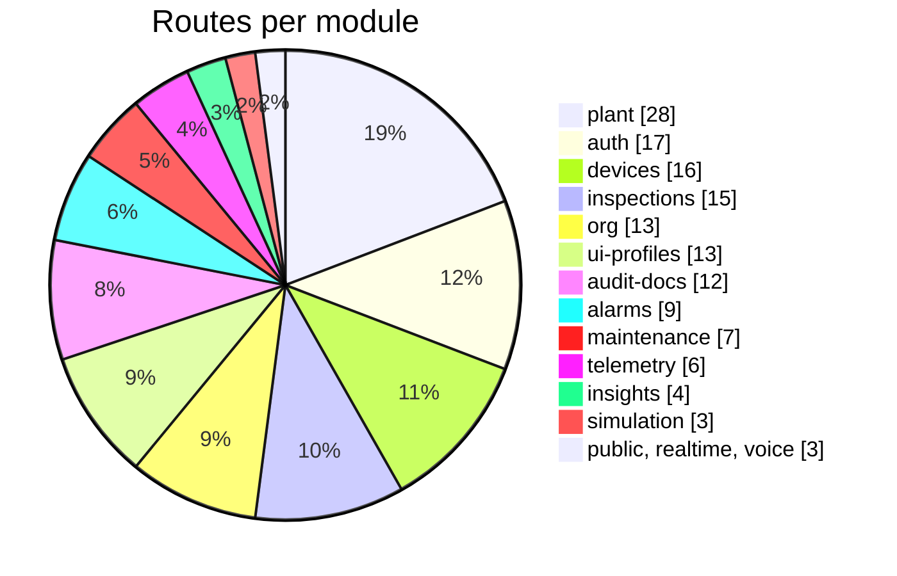

## Overview and conventions

### Base URLs and deployment shapes

The API is served at the same origin as the console. Browsers, the glasses app and the Android app call relative or
absolute `/api/...` paths, never a separate API host.

Table: Base URLs by environment

| Environment | Base URL | How the API runs |
|---|---|---|
| Live demo | `https://hydrisview.vercel.app/api` | Next.js route handler `apps/web/src/app/api/[...path]/route.ts` forwards each request in-process to Fastify with `app.inject` (no network hop). Demo mode: in-memory database per serverless instance |
| Vercel production | `https://<your-deployment>/api` | Same in-process route handler, Postgres via `DATABASE_URL`, `REALTIME_MODE=db`, Vercel Blob for attachments |
| Local development | `http://localhost:3000/api` | Next.js proxies `/api` to the Fastify server on port 4000 (`API_PORT`) |
| Standalone API | `http://<host>:4000/api` | `apps/api/src/server.ts`, long-running process with in-memory event bus and interval jobs |

Two paths are served by dedicated Next.js route handlers rather than by the catch-all forwarder: the SSE stream
(`apps/web/src/app/api/events/stream/route.ts`) and the cron entry (`apps/web/src/app/api/cron/route.ts`). The
Fastify app also registers `GET /api/events/stream` for long-running deployments; both implementations apply the same
authorization function `canReceive` from `apps/api/src/modules/realtime.ts`.

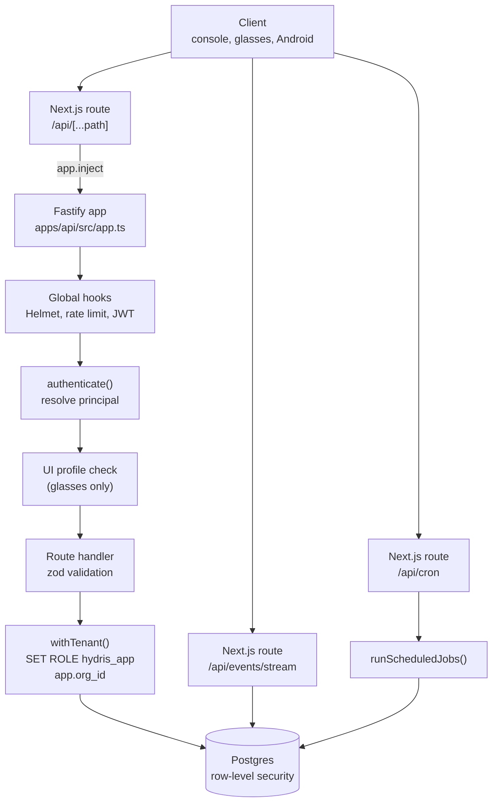

### Versioning

The API is versioned as a whole with the product; there is no version segment in most paths. The one exception is
the edge ingestion endpoint `POST /api/ingest/v1/readings`, which carries `v1` because gateway firmware is deployed
in the field and upgrades slowly. The console, glasses app and Android app ship from the same repository as the API,
so breaking changes to unversioned routes are made in the same commit as the client changes. The deprecation policy
for routes that third parties may depend on is described in the chapter on change history.

### Content types

Table: Content types accepted and produced

| Direction | Content type | Where |
|---|---|---|
| Request | `application/json` | Every JSON route. Global body limit 1 MB (`bodyLimit` in `app.ts`) |
| Request | `application/json` up to 8 MB | `POST /api/audit-docs` (base64 page images) |
| Request | `multipart/form-data` | `POST /api/attachments`: one file, at most 10 MB |
| Response | `application/json` | Default for every route |
| Response | `text/csv; charset=utf-8` | Sensor export, report exports |
| Response | `application/pdf` | Searchable audit document PDF |
| Response | `image/jpeg`, `image/png`, `image/webp`, `text/plain` | Attachment and audit page downloads (stored MIME type) |
| Response | `text/event-stream; charset=utf-8` | `GET /api/events/stream` |

Send `content-type: application/json` with every JSON body. Action endpoints that take an optional body (for example
`POST /api/alarms/:id/acknowledge`) accept an empty object `{}`; the clients always send one.

### Identifiers

Every entity identifier is a UUID (version 4, generated by Postgres `defaultRandom()`), with three exceptions:
telemetry reading ids and realtime event ids are 64-bit integers (`bigint` identity columns), and checklist item ids
inside a maintenance task are 8-character strings. Path parameters named `:id` are validated with `z.uuid()` and a
malformed id returns `400 validation_failed`, not `404`.

Human-facing codes are separate from ids. Site codes, facility codes, process area codes, asset tags and sensor tags
are 1 to 24 characters of letters, digits, dot, dash or underscore, unique within their scope. Pairing codes are eight
characters from the alphabet `23456789ABCDEFGHJKMNPQRSTVWXYZ` and are displayed as `XXXX-XXXX`.

### Timestamps and time zones

Timestamps in responses are ISO 8601 strings in UTC with millisecond precision, for example
`2026-10-22T08:14:03.512Z`. Timestamps in requests are accepted in two forms:

- Fields validated with `z.iso.datetime({ offset: true })` (telemetry `ts`, inspection `recordedAt`) require an ISO
  8601 string and accept an explicit offset such as `+05:30`. Timestamps more than 5 minutes in the future are
  rejected.
- Query parameters and date fields validated with `z.coerce.date()` (`from`, `to`, `dueAt`, `before`) accept anything
  JavaScript's `Date` parses. Send ISO 8601 to avoid ambiguity.

Sites and organizations carry an IANA `timezone` for display; the API never converts timestamps into local time.

### Lists, filtering and pagination

List endpoints return a named array inside an object (`{ "alarms": [...] }`), with one exception:
`GET /api/audit-docs` returns a bare array. Most lists are bounded rather than paginated, because operational lists
are small and are always filtered by site scope.

Table: List bounds and pagination styles

| Style | Endpoints | Parameters |
|---|---|---|
| Fixed cap | Inspections (300), maintenance (300), audit documents (200), notifications (50), device context sections (20) | None |
| Limit | Alarms | `limit` 1 to 500, default 200 |
| Limit and time cursor | Audit log | `limit` 1 to 500, default 100, plus `before` (exclusive timestamp cursor) |
| Limit and offset | Sensor readings | `limit` 1 to 200, default 50, `offset` 0 to 1,000,000, response carries `total` |
| Downsampling | Sensor history | `points` 10 to 2000, default 240: the server buckets readings with `date_bin` |
| Range | Reports, CSV export | `from` and `to`. Reports default to the last 30 days and cap at 5000 rows; sensor CSV export spans at most 93 days |

Boolean query parameters are strings: `"true"` or `"false"`. Enumerated filters reject unknown values with
`400 validation_failed`.

### Tenancy and site scope

Every authenticated request carries exactly one organization: the `org` claim of a user token or the organization of
the paired device. The handler opens a transaction with `withTenant()` (`apps/api/src/db/tenant.ts`), which switches
to the non-privileged `hydris_app` role and sets `app.org_id`, so RLS policies hide every other tenant's rows even if a
query forgets a filter.

Inside a tenant, members are either organization-wide (`allSites: true`) or limited to a list of sites. Site scope is
enforced in the handlers with `siteScope()`, `requireSite()` and `scopedRow()` from `apps/api/src/core/principal.ts`.
A record outside the caller's sites returns **404 not_found**, never 403, so a caller cannot probe which ids exist.

## Authentication and sessions

Hydris has four credential types. Console users hold a short-lived bearer access token plus a rotating refresh cookie.
Paired glasses hold a device access token plus a rotating device refresh token. Edge gateways hold a static API key.
The Vercel cron caller holds a shared secret. All implementations live in `apps/api/src/modules/auth.ts`,
`apps/api/src/modules/devices.ts`, `apps/api/src/context.ts` and `apps/api/src/config.ts`.

Table: Credential types

| Credential | Format | Lifetime | Transport | Issued by |
|---|---|---|---|---|
| User access token | JWT, claims `typ: "user"`, `sub` (user id), `org`, `sid` (session family) | 15 minutes, 12 hours in demo mode | `Authorization: Bearer` | Login, MFA verify, demo login, refresh, switch org, invitation accept, password change |
| User refresh token | 48 random bytes, base64url, stored as SHA-256 hash in `auth_sessions` | 7 days, rotated on every refresh | Cookie `hg_refresh`, httpOnly, SameSite=Strict, `Secure` in production, path `/api/auth` | Same as above |
| Demo session cookie | JWT, `typ: "demo_session"` | 7 days | Cookie `hg_demo`, same attributes | Demo mode only |
| MFA challenge token | JWT, `typ: "mfa"`, `sub` | 5 minutes | JSON body | `POST /api/auth/login` when MFA is enabled |
| Device access token | JWT, claims `typ: "device"`, `sub` (device id), `org`, `sv` (session version); demo mode adds `uid` and `site` | 15 minutes, 12 hours in demo mode | `Authorization: Bearer` | Pairing completion, device refresh |
| Device refresh token | `hgd_` plus 40 random bytes (demo mode: `hgd_z` plus an HMAC-signed body) | 30 days, rotated on every refresh | JSON body of `POST /api/device/refresh` | Same as above |
| Gateway API key | `hgw_` plus 32 random bytes, stored as SHA-256 hash with a 10-character prefix | Until revoked | `Authorization: Bearer hgw_...` | `POST /api/gateways` (shown once) |
| Cron secret | Value of `CRON_SECRET` | Until rotated | `Authorization: Bearer <CRON_SECRET>` | Deployment configuration |

Access tokens are signed with `JWT_SECRET` (at least 32 characters) through `@fastify/jwt`. Every request re-checks
revocation state in the database: for a user token the session family must still have a non-revoked row and the
membership and organization must be active; for a device token the device must be `active`, its `sessionVersion`
must equal the token's `sv` claim, and an operator must still be assigned. Revoking a session family or bumping a
device's session version therefore invalidates outstanding access tokens immediately, not when they expire.

### Password sign-in

`POST /api/auth/login` verifies the password with argon2id (memory 19,456 KiB, 2 iterations). Unknown emails burn the
same verification time against a dummy hash so response timing does not reveal which emails exist. Five consecutive
failures lock the account for 15 minutes (`423 account_locked`). A successful login picks the user's default
organization (or the first active membership), writes an `auth.login` audit event, stores a refresh session and
returns the session view.

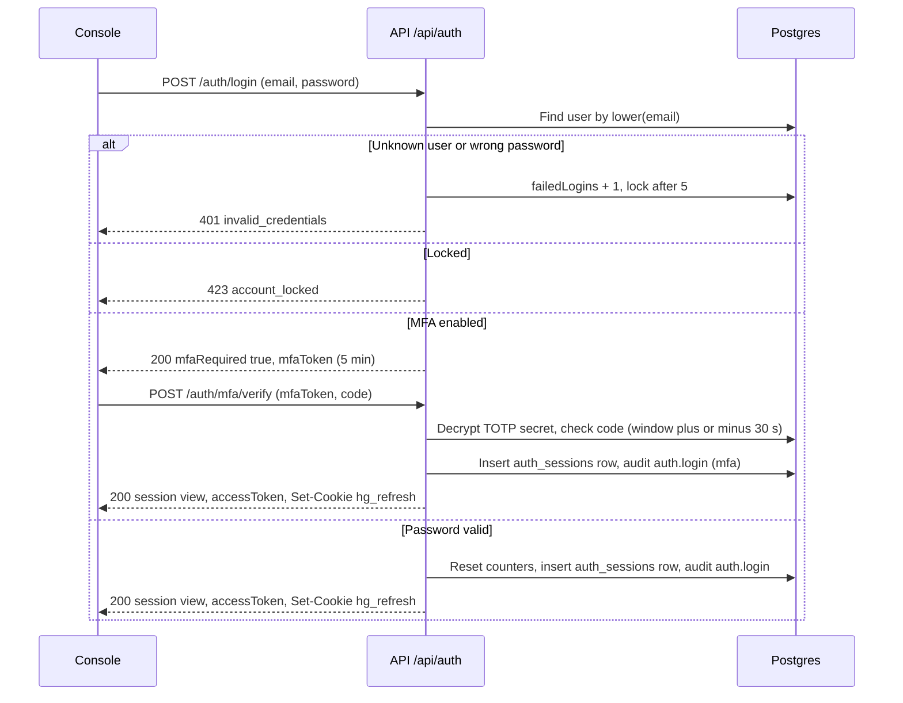

The session view returned by login, MFA verify, demo login, refresh, switch org, password change and invitation
accept has the same shape:

```json
{
  "accessToken": "eyJhbGciOiJIUzI1NiIsInR5cCI6IkpXVCJ9...",
  "user": { "id": "7c1e...", "name": "Tarun KM", "email": "tarun@hydris.ai", "isPlatformAdmin": false, "mfaEnabled": false },
  "memberships": [
    { "orgId": "0b6f...", "orgName": "Hydris Demo Utilities", "role": "org_admin", "isDemo": true, "allSites": true }
  ],
  "org": { "id": "0b6f...", "name": "Hydris Demo Utilities", "isDemo": true },
  "role": "org_admin",
  "permissions": ["org.manage", "site.read", "site.manage", "..."],
  "siteScope": "all"
}
```

`siteScope` is the string `"all"` for organization-wide members and an array of site ids otherwise. `permissions` is
the full list for the active role; clients use it only to decide what to show, the API re-checks on every call.

### Multi-factor authentication

MFA is TOTP (RFC 6238: SHA-1, 30-second step, 6 digits, one step of clock tolerance either side). Enrolment is two
calls: `POST /api/auth/mfa/setup` generates a 20-byte secret, stores it encrypted with AES-256-GCM under `DATA_KEY`
and returns the secret and an `otpauth://` URI for an authenticator app; `POST /api/auth/mfa/enable` turns MFA on once
the user proves a valid code. `POST /api/auth/mfa/disable` needs both the password and a current code. When MFA is on,
`POST /api/auth/login` returns `{ "mfaRequired": true, "mfaToken": "..." }` instead of a session, and the client
completes sign-in with `POST /api/auth/mfa/verify`.

### Demo sign-in

The live demo runs in demo mode (`DEMO_MODE=true`, or automatically on Vercel when `DATABASE_URL` is unset). In demo
mode `POST /api/auth/demo` with a name creates a named guest account in the synthetic demo tenant. The account id is
derived deterministically from the normalized name (`guestUserId()` in `apps/api/src/core/demo-guests.ts`), so the
same name always maps to the same account, and the guest receives a personal copy of the demo owner's open inspections
and maintenance tasks. Guests are organization administrators of the demo tenant with access to all sites.

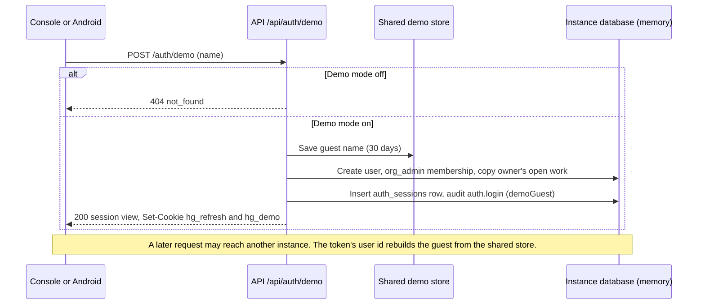

Because each serverless instance in demo mode has its own in-memory database, demo mode relaxes three stateful
checks (documented in `apps/api/src/demo.ts`): a user access token whose session family is unknown on the instance is
accepted (a family that is known and revoked is still rejected); `POST /api/auth/refresh` falls back to the signed
`hg_demo` cookie and re-creates the session family locally; and device tokens carry the operator and site so any
instance can rebuild the device record.

> [!WARNING]
> Demo mode uses fixed public secrets (`DEMO_SECRETS` in `apps/api/src/config.ts`) when `JWT_SECRET` and `DATA_KEY`
> are not configured. It exists for the synthetic demo tenant only and must never serve a real plant.

### Refresh and rotation

`POST /api/auth/refresh` reads the `hg_refresh` cookie, marks the presented session row as rotated, and issues a new
row in the same family with a new cookie and a new access token. Rotation detects theft: if a refresh token that was
already rotated is presented again more than 30 seconds after its rotation, the API revokes the whole family, writes
`auth.refresh_reuse_detected` and returns `401 session_revoked`. Inside the 30-second grace window a replay issues
another successor instead, which keeps several open tabs that refresh at the same moment from logging each other out.

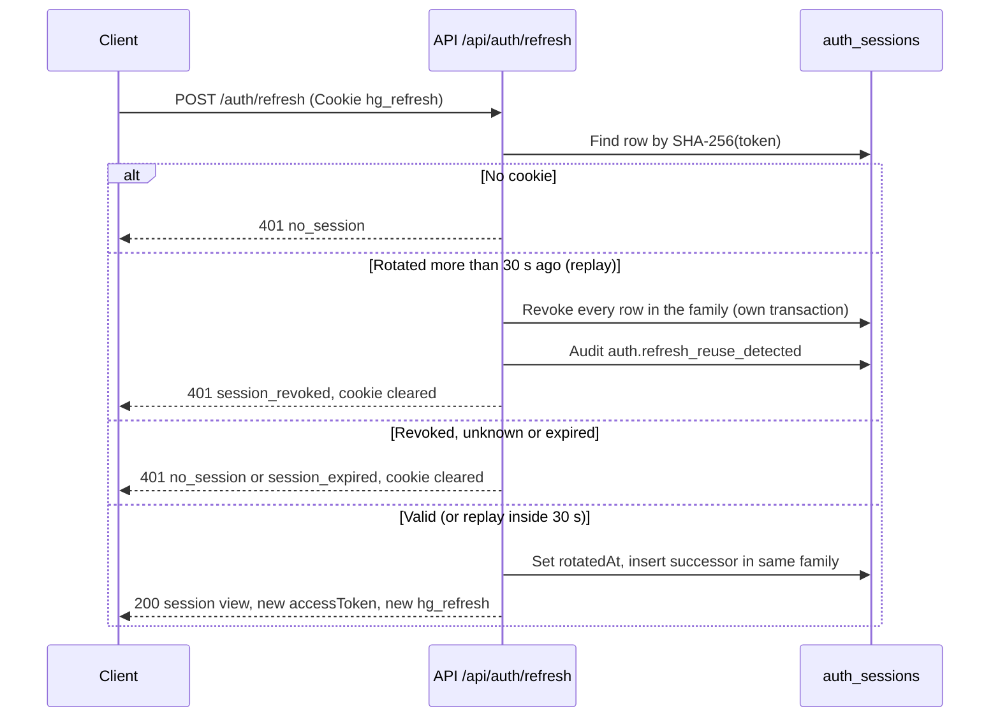

The web client (`apps/web/src/lib/api.ts`) and the Android client (`HydrisApi.kt`) both serialize refreshes so that a
burst of parallel 401 responses triggers one refresh call.

### Glasses pairing

Glasses never see a user password. Pairing follows the shape of the OAuth 2.0 Device Authorization Grant (RFC 8628).
The glasses request a challenge and display a short user code and a QR code that encodes only the verification URL
with that code. A signed-in person approves the code on a phone or console, choosing the site and (with
`device.manage`) the operator. The glasses, which hold a separate poll secret that is never displayed, poll until the
challenge is approved and then receive device credentials exactly once.

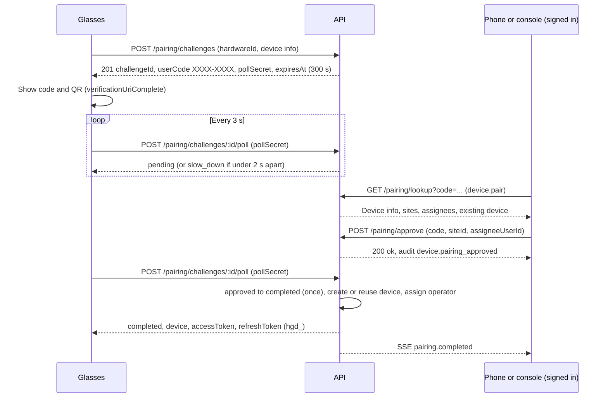

Security properties of the flow, all implemented in `apps/api/src/modules/devices.ts`:

- The code is drawn with a CSPRNG from a 30-character unambiguous alphabet, stored only as a SHA-256 hash, valid for
  300 seconds and usable once. Code lookups and approvals are limited to 10 per minute per IP.
- The poll secret (32 random bytes) is stored as a hash and compared in constant time; a wrong secret returns 404.
- Requesting a new challenge from the same `hardwareId` cancels any open challenge from that install.
- Glasses registered to another organization cannot be approved until revoked there (`409 device_owned_elsewhere`).
- Re-pairing the same install within the same organization reuses the device record, bumps its session version and
  revokes its previous device sessions.
- A background job marks pending and approved challenges past their expiry as `expired`.

### Device token refresh

`POST /api/device/refresh` exchanges a device refresh token for a new access token and a new refresh token. Unlike user
refresh there is no grace window: presenting a device refresh token that was already rotated revokes the entire device
session family, writes `device.refresh_reuse_detected` and returns `401 device_session_invalid`. The glasses then need
to be paired again.

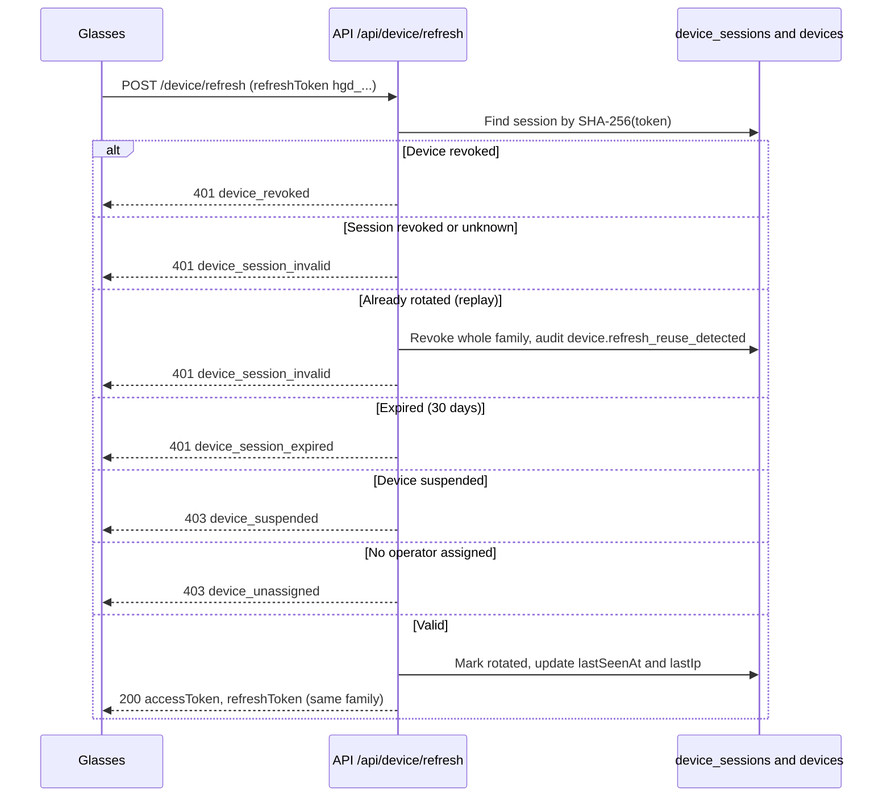

### Ending sessions

Sessions end in several ways, and each one is enforced on the very next request because principals are re-resolved
from the database on every call and every 30 seconds on open SSE streams.

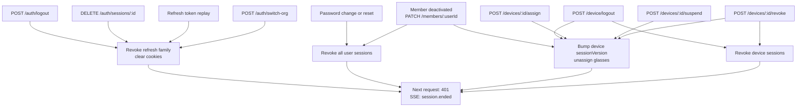

`POST /api/device/logout` is the glasses-initiated unpair: it revokes the device's refresh sessions and bumps its
session version, so the same glasses can be paired again by anyone. Console-initiated revocation
(`POST /api/devices/:id/revoke`) is final for that device record: it also releases the operator assignment, and the
glasses must pair again to obtain a new credential.

## Authorization

Authorization has four layers, applied in this order on every authenticated route:

1. **Authentication.** `authenticate(ctx)` resolves the bearer token into a principal (user or device) or returns
   `401 unauthenticated`.
2. **Role permission.** `requirePerm(p, permission)` checks the role matrix in `packages/domain/src/roles.ts`. For
   device principals the permission must also be in `DEVICE_PERMISSIONS` (`apps/api/src/core/principal.ts`), so a
   paired glasses device can never do more than its operator, and never anything administrative. Failure returns
   `403 forbidden`.
3. **Site scope.** Records on sites outside the principal's scope return `404 not_found`.
4. **Glasses UI profile.** For device principals only, a hook installed by `installProfileEnforcement()`
   (`apps/api/src/modules/ui-profiles.ts`) checks that the device's effective UI profile enables the screen and action
   the route serves. Failure returns `403 profile_forbidden`.

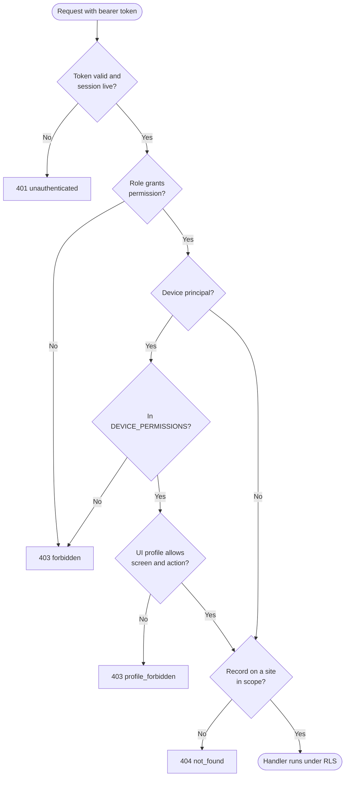

Some rules are expressed in the handler rather than as a single permission. The most important ones: inspections
are recorded only by their assignee and reviewed only by someone else; audit documents are approved by a different
person from the verifier (except in demo tenants, where self-approval is recorded as such); maintenance executors can
start, hold and complete only tasks assigned to them; and members can grant only roles listed by `assignableRoles()`
(organization administrators grant any role, factory managers grant supervisor, field operator, maintenance engineer
and viewer).

### Role and permission matrix

Table: Permissions by role (Y = granted). The last column marks the 13 permissions a paired glasses device may use on behalf of its operator

| Permission | Org admin | Factory manager | Supervisor | Field operator | Maintenance engineer | Viewer | Glasses |
|---|---|---|---|---|---|---|---|
| `org.manage` | Y | | | | | | |
| `site.read` | Y | Y | Y | Y | Y | Y | Y |
| `site.manage` | Y | Y | | | | | |
| `asset.read` | Y | Y | Y | Y | Y | Y | Y |
| `asset.manage` | Y | Y | | | | | |
| `sensor.manage` | Y | Y | | | | | |
| `telemetry.read` | Y | Y | Y | Y | Y | Y | Y |
| `gateway.manage` | Y | Y | | | | | |
| `alarm.read` | Y | Y | Y | Y | Y | Y | Y |
| `alarm.acknowledge` | Y | Y | Y | Y | Y | | Y |
| `alarm.assign` | Y | Y | Y | | | | |
| `alarm.investigate` | Y | Y | Y | | Y | | |
| `alarm.resolve` | Y | Y | Y | | Y | | |
| `alarm.close` | Y | Y | Y | | | | |
| `alarm_rule.manage` | Y | Y | | | | | |
| `inspection.read` | Y | Y | Y | Y | Y | Y | Y |
| `inspection.manage` | Y | Y | Y | | | | |
| `inspection.execute` | Y | | Y | Y | Y | | Y |
| `inspection.review` | Y | Y | Y | | | | |
| `maintenance.read` | Y | Y | Y | Y | Y | Y | Y |
| `maintenance.request` | Y | Y | Y | Y | Y | | Y |
| `maintenance.manage` | Y | Y | Y | | | | |
| `maintenance.execute` | Y | | | | Y | | Y |
| `member.read` | Y | Y | Y | | | | |
| `member.manage` | Y | Y | | | | | |
| `device.read` | Y | Y | Y | | | | |
| `device.pair` | Y | Y | Y | Y | Y | | |
| `device.manage` | Y | Y | | | | | |
| `document.read` | Y | Y | Y | Y | Y | Y | Y |
| `document.manage` | Y | Y | | | | | |
| `report.read` | Y | Y | Y | | | Y | |
| `report.export` | Y | Y | Y | | | | |
| `audit.read` | Y | Y | | | | | |
| `simulation.control` | Y | Y | | | | | |
| `auditdoc.read` | Y | Y | Y | Y | Y | Y | Y |
| `auditdoc.capture` | Y | Y | Y | Y | Y | | Y |
| `auditdoc.verify` | Y | Y | Y | | | | |
| `auditdoc.approve` | Y | Y | | | | | |

The glasses column is an upper bound: a device holds the intersection of this column and its operator's role. Glasses
assigned to a viewer, for example, cannot acknowledge alarms. Factory managers deliberately lack `inspection.execute`
and `maintenance.execute`: they plan and review work rather than record it.

> [!NOTE]
> Platform administration (`/api/platform/*`) is outside the role matrix. It requires `users.isPlatformAdmin`, which
> is resolved from the user token even when the user has no membership in any organization.

## Errors

### Error envelope

Every error produced by the API has the same JSON envelope. The error handler is registered in `apps/api/src/app.ts`;
handlers throw `HttpError` (`apps/api/src/core/errors.ts`) and zod throws `ZodError`.

```json
{
  "error": {
    "code": "validation_failed",
    "message": "Some fields are invalid",
    "details": [
      { "path": "readings.0.ts", "message": "Invalid ISO datetime" }
    ]
  }
}
```

- `code` is stable and machine-readable. Clients branch on `code`, never on `message`.
- `message` is a human-readable sentence suitable for display. It may change between releases.
- `details` is optional. For `validation_failed` it is an array of `{ path, message }` with dotted paths; a few
  handler errors put a structured object here instead (for example the inspection `progress` on `incomplete`, or the
  current `state` on `invalid_transition`).

Errors that do not originate in a handler are mapped as follows: a status of 429 becomes `rate_limited`; any status of
500 or more becomes `internal_error` with the message "Unexpected server error" (the real error is logged, never
returned); other Fastify errors keep their own code (for example `FST_ERR_CTP_BODY_TOO_LARGE` with status 413).

> [!NOTE]
> Requests to a path that matches no route are answered by Fastify's default not-found handler, which does not use
> the Hydris envelope. The Next.js route handlers have their own failure codes: `service_unavailable` (503) when the
> API cannot start, `internal` (500) when forwarding fails, and `unauthorized` (401) on the cron and stream routes.

### HTTP status codes

Table: HTTP status codes used by the API

| Status | Meaning in Hydris |
|---|---|
| 200 | Success with a body |
| 201 | Resource created (invitation, site, asset, sensor, rule, inspection, task, audit document, pairing challenge, assignment) |
| 204 | Success without a body (`POST /api/device/logout`) |
| 400 | Validation failure or a business rule the request breaks (missing note, incomplete checklist, weak password) |
| 401 | Missing, invalid, expired or revoked credential |
| 403 | Authenticated but not permitted (role, device cap, UI profile, four-eyes rule) |
| 404 | Not found, or outside the caller's site scope |
| 409 | Conflict with current state: invalid transition, stale revision, duplicate, already used |
| 413 | Body or file larger than the configured limit |
| 423 | Account locked after repeated failed logins |
| 429 | Rate limit exceeded |
| 500 | Unexpected server error |
| 503 | Pairing code allocation failed, or the serverless API could not start |

### Error code catalogue

The table lists every `error.code` the API emits, collected from the handlers. Codes are grouped by status.

Table: Error codes by HTTP status

| Status | Code | Raised by | Meaning |
|---|---|---|---|
| 400 | `validation_failed` | All routes (zod), plus asset, sensor, rule, document and maintenance edits | Body, query or path parameters are invalid. `details` lists each field |
| 400 | `weak_password` | Change password, reset, invitation accept | Fewer than 12 characters, more than 200, or one repeated character |
| 400 | `wrong_password` | Change password, MFA disable, invitation accept | Current password is incorrect |
| 400 | `invalid_token` | Password reset complete | Reset link invalid, used or expired (30 minutes) |
| 400 | `invalid_invitation` | Invitation preview and accept | Invitation invalid, used, revoked or expired (7 days) |
| 400 | `invalid_mfa_code` | MFA enable and disable | TOTP code is not valid |
| 400 | `mfa_already_enabled` | MFA setup | MFA is already on |
| 400 | `sites_required` | Create invitation | `allSites` is false and no site was chosen |
| 400 | `invalid_sites` | Create invitation | A site id does not exist in the organization |
| 400 | `forbidden_scope` | Create site, document scope | Only organization-wide managers may do this |
| 400 | `invalid_process_area` | Create asset | Process area is not in the asset's facility |
| 400 | `file_required` | Upload attachment | No file part in the multipart body |
| 400 | `unsupported_type` | Upload attachment | MIME type is not JPEG, PNG, WebP, PDF or plain text |
| 400 | `content_mismatch` | Upload attachment | File signature does not match the declared MIME type |
| 400 | `method_mismatch` | Manual reading | Lab entry against an online (continuous) instrument |
| 400 | `reading_rejected` | Manual reading | The ingestion pipeline rejected the value; `details.reason` gives why |
| 400 | `invalid_range` | Sensor history, reports | `from` is not before `to` |
| 400 | `range_too_large` | Sensor CSV export | More than 93 days requested |
| 400 | `note_required` | Alarm resolve, inspection reject, maintenance complete | A note is mandatory for this transition |
| 400 | `invalid_assignee` | Alarms, inspections, maintenance, devices, pairing | Assignee is not an active member, or cannot execute inspections |
| 400 | `assignee_no_site_access` | Pairing approve | The chosen operator has no access to the chosen site |
| 400 | `threshold_required` | Create alarm rule | Non-stale rules need a threshold |
| 400 | `invalid_template` | Create inspection | Template missing or not published |
| 400 | `invalid_asset` | Create inspection | Asset not found |
| 400 | `invalid_assets` | Inspection routes | A route stop is not an asset on the route's site |
| 400 | `site_required` | Create inspection, create maintenance task | Neither an asset nor a site was given |
| 400 | `incomplete` | Inspection submit | Required steps are unanswered; `details` carries the progress object |
| 400 | `invalid_alarm` | Create maintenance task | `sourceAlarmId` does not exist |
| 400 | `checklist_incomplete` | Maintenance complete | Checklist items are still open |
| 400 | `reason_required` | Device revoke, audit document reject | A reason is mandatory |
| 400 | `invalid_code` | Pairing lookup and approve | Code is not 8 valid characters |
| 400 | `page_too_large` | Audit document capture | A page image is over 900 KB |
| 400 | `invalid_image` | Audit document capture | Page bytes are not a JPEG or PNG |
| 400 | `value_required` | Audit item correct | Corrected field value missing |
| 400 | `rows_required` | Audit item correct | Corrected table rows missing |
| 400 | `flagged_items` | Audit document verify | Flagged items must be resolved first |
| 400 | `review_incomplete` | Audit document verify | Items are still pending review |
| 400 | `no_draft` | UI profile publish | There is no draft to publish |
| 400 | `cannot_rollback_to_draft` | UI profile rollback | Target version is the open draft |
| 400 | `invalid_profile`, `invalid_user`, `invalid_device` | UI profile assignment | Target not found in the organization |
| 400 | `subject_required` | Effective UI profile | Neither `deviceId` nor `userId` given |
| 400 | `too_fast` | Public enquiry | Form submitted less than 2.5 s after it was opened |
| 401 | `unauthenticated` | Every authenticated route | No token, invalid token, or session no longer live |
| 401 | `invalid_credentials` | Login | Email or password incorrect (also for inactive accounts) |
| 401 | `mfa_expired` | MFA verify | The 5-minute MFA token expired |
| 401 | `invalid_mfa_code` | MFA verify | TOTP code is not valid |
| 401 | `no_session` | Refresh | No cookie, unknown or revoked session |
| 401 | `session_expired` | Refresh | Refresh session older than 7 days |
| 401 | `session_revoked` | Refresh | Replay of a rotated token; whole family revoked |
| 401 | `device_revoked` | Device refresh | Device revoked by an administrator |
| 401 | `device_session_invalid` | Device refresh | Unknown, revoked or replayed device refresh token |
| 401 | `device_session_expired` | Device refresh | Device refresh session older than 30 days |
| 401 | `invalid_gateway_key` | Edge ingestion | Missing, wrong, revoked key or suspended organization |
| 403 | `forbidden` | Every permission check | Role, device cap or handler rule denies the action |
| 403 | `device_suspended` | Device refresh | Device is suspended |
| 403 | `device_unassigned` | Device refresh | No operator assigned to the device |
| 403 | `profile_forbidden` | Glasses routes | The device's UI profile disables this screen or action |
| 404 | `not_found` | Every lookup | Record missing or outside site scope; `/api/auth/demo` outside demo mode |
| 409 | `slug_taken` | Create organization | Slug already used |
| 409 | `already_member` | Create invitation | Email belongs to an active member |
| 409 | `code_taken` | Sites, facilities, process areas | Code already used in scope |
| 409 | `tag_taken` | Assets, sensors | Tag already used |
| 409 | `source_ref_taken` | Update sensor | Gateway reference already used on the site |
| 409 | `in_use` | Delete asset | Asset has sensors, alarms, inspections or tasks: archive instead |
| 409 | `duplicate_reading` | Manual reading | A reading already exists at that sensor and timestamp |
| 409 | `no_change` | Reading correction, template status | Nothing would change |
| 409 | `already_invalidated` | Reading correction | Reading is already invalidated |
| 409 | `invalid_transition` | Alarms, inspections, maintenance, devices | Action not allowed from the current state |
| 409 | `stale_state` | Alarm transitions, maintenance transitions | State changed between read and write |
| 409 | `revision_conflict` | Inspection transitions | `expectedRevision` does not match, or concurrent write |
| 409 | `not_editable` | Inspection and maintenance edits | Record is closed |
| 409 | `archived` | Template update | Template must be restored before editing |
| 409 | `not_running` | Simulation stop | No simulation is running |
| 409 | `already_used` | Pairing approve | Code was approved concurrently |
| 409 | `device_owned_elsewhere` | Pairing approve | Glasses registered to another organization |
| 409 | `device_not_active` | Device assign | Only active devices can be reassigned |
| 409 | `device_revoked` | Device suspend, reactivate, revoke | Device is already revoked |
| 409 | `review_started` | Audit enhance | Human review has begun |
| 409 | `stale` | Audit document writes | Revision changed underneath the caller |
| 409 | `locked` | Audit document edits | Approved documents are locked |
| 409 | `not_in_review` | Audit confirm-agreed and verify | Document is not in review |
| 409 | `not_verified` | Audit approve | Document must be verified first |
| 409 | `profile_archived` | UI profile draft and publish | Archived profiles cannot change |
| 409 | `profile_assigned` | UI profile archive | Remove assignments first |
| 409 | `already_published` | UI profile rollback | Target version is already live |
| 413 | `FST_ERR_CTP_BODY_TOO_LARGE` | Any JSON route | Body over 1 MB (8 MB for audit capture) |
| 423 | `account_locked` | Login | Five failed attempts; locked 15 minutes |
| 429 | `rate_limited` | Any route | Rate limit exceeded |
| 500 | `internal_error` | Any route | Unexpected error (logged server-side) |
| 503 | `pairing_unavailable` | Pairing challenge | No unique code after five attempts |

## Rate limiting

Rate limits use `@fastify/rate-limit`, keyed by client IP. Fastify runs with `trustProxy: true`, and the Vercel route
handler passes the first `x-forwarded-for` address as the remote address, so the key is the real client IP rather
than the platform's proxy. A global limit of 600 requests per minute applies to every route; the routes below set a
stricter limit of their own.

Table: Route-specific rate limits

| Route | Limit | Window | Reason |
|---|---|---|---|
| `POST /api/auth/login` | 10 | 1 minute | Credential stuffing |
| `POST /api/auth/mfa/verify` | 10 | 1 minute | TOTP guessing |
| `POST /api/auth/demo` | 20 | 1 minute | Guest creation |
| `POST /api/auth/refresh` | 60 | 1 minute | Token churn |
| `POST /api/auth/password-reset/request` | 5 | 1 minute | Mail abuse, enumeration |
| `POST /api/auth/password-reset/complete` | 10 | 1 minute | Token guessing |
| `GET /api/auth/invitations/:token` | 30 | 1 minute | Token probing |
| `POST /api/auth/invitations/accept` | 10 | 1 minute | Token guessing |
| `POST /api/pairing/challenges` | 10 | 1 minute | Code exhaustion |
| `POST /api/pairing/challenges/:id/poll` | 40 | 1 minute | Polling every 3 s with headroom |
| `POST /api/pairing/challenges/:id/cancel` | 20 | 1 minute | |
| `GET /api/pairing/lookup` | 10 | 1 minute | Pairing code guessing |
| `POST /api/pairing/approve`, `POST /api/pairing/deny` | 10 | 1 minute | Pairing code guessing |
| `POST /api/device/refresh` | 30 | 1 minute | Token churn |
| `POST /api/assistant/ask` | 60 | 1 minute | Language model cost |
| `POST /api/ingest/v1/readings` | 1200 | 1 minute | Gateway throughput (each call carries up to 500 readings) |
| `POST /api/public/inquiries` | 5 | 10 minutes | Website form spam |
| All other routes | 600 | 1 minute | Global ceiling |

When a limit is exceeded the API returns `429 rate_limited`. The plugin also sets its standard rate limit headers on
responses (limit, remaining and reset, plus `retry-after` on 429); clients should back off for the indicated time.
Tests build the app with `relaxedLimits`, which raises every limit except the assistant's.

> [!WARNING]
> The rate limit store is the plugin's in-process memory store. On Vercel each serverless instance counts separately,
> so the effective limit across a burst that fans out to several instances is a multiple of the configured value. A
> shared store (Redis or Postgres) is needed before the limits can be treated as hard guarantees.

The pairing poll endpoint has a second, application-level throttle: polling the same challenge again less than
two seconds after the previous poll returns `{ "status": "slow_down", "pollIntervalS": 3 }` without consuming the
approval.

## Idempotency and concurrency

Hydris does not use a generic `Idempotency-Key` header. Instead each write that can be retried by an intermittently
connected client is idempotent by design, and each write that races with other people uses optimistic concurrency.

Table: Idempotency and concurrency mechanisms

| Operation | Mechanism | Replay or race outcome |
|---|---|---|
| Edge ingestion | Unique `(sensor_id, ts)` on `telemetry_readings` | A repeated reading counts in `duplicates`, nothing is stored twice |
| Manual reading | Same unique key | `409 duplicate_reading`: correct the existing reading instead |
| Inspection step responses | Client-generated `opId` (8 to 80 characters), unique per inspection | Replayed ops count in `duplicates` |
| Inspection transitions | `revision` counter, optional `expectedRevision` in the body | `409 revision_conflict` |
| Alarm transitions | `WHERE state = <state read>` on update | `409 stale_state` |
| Maintenance transitions | `WHERE status = <status read>` on update | `409 stale_state` |
| Audit document writes | `revision` counter, optional `expectedRevision` | `409 stale` |
| Pairing claim | `approved` to `completed` update guarded by status | Second claim returns `completed` with `error: "already_claimed"` and no tokens |
| Pairing approve | `pending` to `approved` update guarded by status | `409 already_used` |
| UI profile assignment | One assignment per org, role, user or device | Re-posting replaces the previous assignment (200 instead of 201) |
| Device assign | Same operator already assigned | `200 { "ok": true, "unchanged": true }` |

The glasses app keeps an offline queue of inspection step operations in `apps/web/src/glasses/link.ts` and replays
them grouped by inspection when connectivity returns. Because each operation carries its `opId`, replays are safe.
Operations for an inspection that was closed in the meantime come back in `conflicts` with a reason such as
`inspection_submitted`.

## Realtime events

The API pushes domain events over Server-Sent Events at `GET /api/events/stream`. Events are refetch hints: they tell a
client that something changed and carry enough data to update a list row, but the REST endpoints remain the source of
truth.

### Connecting

Clients connect with `fetch()` rather than `EventSource` so the access token travels in the `Authorization` header and
never in a URL. Resumption uses the standard `Last-Event-ID` request header (a `lastEventId` query parameter is also
accepted). A fresh connection with no last id starts at the current head of the log.

```bash
curl -N https://hydrisview.vercel.app/api/events/stream \
  -H "authorization: Bearer $TOKEN" \
  -H "accept: text/event-stream" \
  -H "last-event-id: 1842"
```

The stream begins with a `ready` event and a `retry` hint, then delivers events as they occur, with a comment line
heartbeat every 15 seconds.

```http
retry: 1000
event: ready
data: {"kind":"user","serverTime":"2026-10-22T08:14:03.512Z"}

id: 1843
event: alarm.created
data: {"id":"5f0c...","severity":"high","state":"active","title":"High Vibration · P-101","_at":"2026-10-22T08:14:05.101Z"}

: hb 1761120860000
```

Each event's `data` is its payload object with an `_at` field (the server time the event was published) added.

### Delivery modes

Table: Realtime delivery modes (REALTIME_MODE)

| Mode | Used by | Mechanism | Replay |
|---|---|---|---|
| `memory` | Long-running API (`server.ts`) | In-process `EventEmitter`, pushed immediately | Ring buffer of the last 1000 events |
| `db` | Vercel and any multi-instance deployment, always in demo mode | Events appended to `realtime_events` after the request finishes (`onSend` hook); streams poll every 1.5 s | Everything still in the table (pruned after 24 hours) |

On Vercel the stream route ends each response after about 50 seconds with a `: reconnect` comment, so every
invocation finishes inside the 60-second function limit. The `retry: 1000` hint makes clients reconnect within a
second, and `Last-Event-ID` resumes without gaps. Both client libraries reconnect automatically with backoff.

```mermaid
%% caption: SSE stream lifecycle in db mode: authorize per event, heartbeat, revalidate, reconnect before the function limit
sequenceDiagram
  participant C as Client
  participant S as /api/events/stream
  participant E as realtime_events
  participant H as Any API request
  C->>S: GET (Authorization, Last-Event-ID)
  S->>S: Verify bearer, resolve principal
  S-->>C: retry 1000, event ready
  H->>E: Insert event after handler commits
  loop Every 1.5 s
    S->>E: Select id greater than cursor for org
    S->>S: canReceive(principal, event)
    S-->>C: id, event type, data
  end
  S-->>C: Heartbeat comment every 15 s
  S->>S: Re-resolve principal every 30 s
  alt Session revoked
    S-->>C: event session.ended
  else About 50 s elapsed
    S-->>C: Comment reconnect, response ends
    C->>S: GET again with Last-Event-ID
  end
```

### Per-connection authorization

Every event names its organization and optionally a site, a permission, a list of user ids or a list of device ids.
`canReceive()` in `apps/api/src/modules/realtime.ts` delivers an event to a connection only when all of these hold:

- the event's organization is the principal's organization;
- if the event names devices, the connection is one of those devices (device-targeted events go to nobody else);
- if the event names users, the principal is one of them;
- if the event names a site, the site is in the principal's scope;
- if the event names a permission, the principal holds it (with the device cap applied for glasses).

The stream re-resolves the principal every 30 seconds and sends `session.ended` when the user or device session is no
longer valid, so a revoked device stops receiving data within half a minute even if its stream stays open.

### Event catalogue

Table: SSE event types, their audience and payload

| Event | Published by | Audience filter | Payload |
|---|---|---|---|
| `ready` | Stream start | The connection | `kind` (`user` or `device`), `serverTime` |
| `session.ended` | Stream revalidation | The connection | `{}` |
| `alarm.created` | Alarm engine on breach or stale data | Site, `alarm.read` | Full alarm event row |
| `alarm.updated` | Transitions, assignment, condition cleared, peak update | Site, `alarm.read` | Full row, or `{ id, clearedAt }` when the condition clears |
| `telemetry.reading` | Ingestion (newest reading only) | Site, `telemetry.read` | `sensorId`, `assetId`, `tag`, `value`, `unit`, `ts`, `quality`, `source`, `synthetic` |
| `telemetry.corrected` | Reading correction | Site, `telemetry.read` | `sensorId`, `readingId`, `action` |
| `sensor.updated` | Sensor edit | Site, `telemetry.read` | `id` |
| `asset.updated` | Asset edit, simulator offline event | Site, `asset.read` | `id`, `status` |
| `inspection.updated` | Create, edit, responses, transitions | Site, `inspection.read` | `id`, `status`, `assignedTo` or `progressChanged` |
| `maintenance.updated` | Create, edit, checklist, transitions, inspection follow-up | Site, `maintenance.read` | `id`, `status` |
| `auditdoc.updated` | Capture, enhance, review, verify, approve, rename | Site, `auditdoc.read` | `id`, `status`, `title` |
| `notification.created` | Any personal notification | That user | Full notification row |
| `device.paired` | Pairing completion | Site, `device.read` | `id`, `name` |
| `device.updated` | Assign, suspend, reactivate, revoke | Site, `device.read` | `id`, optionally `status` |
| `device.context_changed` | Reassign, site change, suspend, reactivate, operator deactivated | That device | `reason` |
| `device.revoked` | Device revoke | That device | `reason: "revoke"` |
| `device.profile_changed` | UI profile publish, rollback, assignment change | Affected devices | `profileId`, `version` or `reason` |
| `ui_profile.updated` | Same as above | `device.read` | `profileId`, `reason`, `affectedDevices` |
| `pairing.completed` | Pairing completion | The approving user | `challengeId`, `deviceId` |
| `simulation.step` | Demo simulator | Site, `telemetry.read` | `runId`, `scenario`, `step`, `events` |

Glasses react to `device.context_changed`, `device.revoked` and `device.profile_changed` by refetching
`GET /api/device/context` or returning to the pairing screen. The console invalidates its query cache by event type.

> [!NOTE]
> A code comment in the Android client names an `alarm.raised` event. The server publishes `alarm.created`; there is
> no `alarm.raised` event.

## Health

`app.ts` registers one route outside the modules.

#### GET /api/health

Liveness probe. Does not touch the database.

- **Auth:** public. **Permission:** none.
- **Response:** `200 { "ok": true, "time": "2026-10-22T08:14:03.512Z" }`.

## Authentication module

File: `apps/api/src/modules/auth.ts`. All routes run in system context (`withSystem`) because they act on users and
sessions, which are not tenant-partitioned. The refresh and demo cookies are scoped to the path `/api/auth`, so they are
sent only to this module.

Table: Authentication endpoints

| Method | Path | Auth | Limit | Purpose |
|---|---|---|---|---|
| POST | `/api/auth/demo` | public (demo mode) | 20/min | One-click sign-in as a named guest |
| POST | `/api/auth/login` | public | 10/min | Email and password sign-in |
| POST | `/api/auth/mfa/verify` | MFA token | 10/min | Complete sign-in with a TOTP code |
| POST | `/api/auth/refresh` | cookie | 60/min | Rotate the refresh cookie, new access token |
| POST | `/api/auth/logout` | cookie | global | End the session family |
| GET | `/api/auth/me` | user or platform admin | global | Current session view |
| POST | `/api/auth/switch-org` | user | global | Start a session in another organization |
| POST | `/api/auth/change-password` | user | global | Change password, end other sessions |
| POST | `/api/auth/password-reset/request` | public | 5/min | Email a reset link |
| POST | `/api/auth/password-reset/complete` | public | 10/min | Set a new password from a reset link |
| GET | `/api/auth/invitations/:token` | public | 30/min | Preview an invitation |
| POST | `/api/auth/invitations/accept` | public | 10/min | Accept an invitation, create or join account |
| POST | `/api/auth/mfa/setup` | user | global | Generate a TOTP secret |
| POST | `/api/auth/mfa/enable` | user | global | Turn MFA on |
| POST | `/api/auth/mfa/disable` | user | global | Turn MFA off |
| GET | `/api/auth/sessions` | user | global | List active sessions |
| DELETE | `/api/auth/sessions/:id` | user | global | Revoke one session |

#### POST /api/auth/demo

Creates (or reuses) a named guest account in the demo tenant and signs it in. Available only when the server runs in
demo mode; otherwise the route answers `404 not_found` as if it did not exist.

- **Auth:** public. **Limit:** 20 per minute.
- **Request:** `name`, 2 to 40 characters after trimming. Whitespace is collapsed and the name is NFKC-normalized.
- **Response:** `200` session view (see the authentication chapter) plus `Set-Cookie: hg_refresh` and `hg_demo`.
- **Errors:** `404 not_found` (demo mode off), `400 validation_failed` ("Enter your name").
- **Side effects:** audit `auth.login` with `metadata.demoGuest: true`; the guest receives copies of the demo owner's
  scheduled inspections and open maintenance tasks.

```bash
curl -s -c cookies.txt -X POST https://hydrisview.vercel.app/api/auth/demo \
  -H "content-type: application/json" \
  -d '{"name":"Priya Raman"}' | jq -r .accessToken
```

#### POST /api/auth/login

Signs in with email and password. Returns either a session or an MFA challenge.

- **Auth:** public. **Limit:** 10 per minute.
- **Request:** `email` (trimmed, lower-cased, valid email), `password` (1 to 200 characters).
- **Response:** `200` session view with `Set-Cookie: hg_refresh`, or `200 { "mfaRequired": true, "mfaToken": "..." }`.
- **Errors:** `401 invalid_credentials` (unknown email, wrong password, inactive account), `423 account_locked`.
- **Side effects:** audit `auth.login` or `auth.login_failed`; failure counter and lockout (5 failures, 15 minutes).

```json
{ "email": "tarun@hydris.ai", "password": "correct horse battery staple" }
```

#### POST /api/auth/mfa/verify

Completes a sign-in that returned `mfaRequired`.

- **Auth:** the `mfaToken` from login, in the body. **Limit:** 10 per minute.
- **Request:** `{ "mfaToken": "...", "code": "123456" }`.
- **Response:** `200` session view with `Set-Cookie: hg_refresh`.
- **Errors:** `401 mfa_expired` (token older than 5 minutes or invalid), `401 unauthenticated` (wrong token type),
  `401 invalid_mfa_code`.
- **Side effects:** audit `auth.login` with `metadata.mfa: true`.

#### POST /api/auth/refresh

Rotates the refresh session and issues a new access token. Send it with credentials (cookies) included and no body.

- **Auth:** `hg_refresh` cookie (demo mode also accepts `hg_demo`). **Limit:** 60 per minute.
- **Response:** `200` session view with a new access token and new cookies.
- **Errors:** `401 no_session`, `401 session_expired`, `401 session_revoked`. Every 401 clears the cookies.
- **Side effects:** on replay outside the 30-second grace window, revokes the family and writes
  `auth.refresh_reuse_detected`.

#### POST /api/auth/logout

Revokes the session family of the presented refresh cookie and clears the cookies. Always succeeds.

- **Auth:** `hg_refresh` cookie (optional). **Response:** `200 { "ok": true }`.
- **Side effects:** audit `auth.logout` when a session was found.

#### GET /api/auth/me

Returns the session view for the bearer token. Unlike other user routes it also answers for platform administrators
who have no organization membership (with `org: null`, `role: null` and empty permissions).

- **Auth:** user access token. **Response:** `200` session view without `accessToken`.
- **Errors:** `401 unauthenticated`.

#### POST /api/auth/switch-org

Moves the caller to another organization they belong to. The current session family is revoked and a new one is
started; the target becomes the user's default organization.

- **Auth:** user. **Request:** `{ "orgId": "<uuid>" }`.
- **Response:** `200` session view for the new organization, new cookie.
- **Errors:** `403 forbidden` ("Not a member of that organization").

#### POST /api/auth/change-password

- **Auth:** user. **Request:** `{ "currentPassword": "...", "newPassword": "..." }`. The new password must be 12 to 200
  characters and not one repeated character.
- **Response:** `200` session view. Every other session of the user is revoked; this call starts a fresh one.
- **Errors:** `400 weak_password`, `400 wrong_password`.
- **Side effects:** audit `auth.password_changed`.

#### POST /api/auth/password-reset/request

Sends a reset link valid for 30 minutes. The response is identical whether or not the account exists.

- **Auth:** public. **Limit:** 5 per minute. **Request:** `{ "email": "..." }`.
- **Response:** `200 { "ok": true }`.
- **Side effects:** a message in `mail_outbox` (the development mail transport), audit `auth.password_reset_requested`
  for existing active accounts.

#### POST /api/auth/password-reset/complete

- **Auth:** public. **Limit:** 10 per minute. **Request:** `{ "token": "...", "password": "..." }` (token at least 10
  characters).
- **Response:** `200 { "ok": true }`. Clears the lockout, marks the email verified and revokes every session.
- **Errors:** `400 weak_password`, `400 invalid_token`.
- **Side effects:** audit `auth.password_reset`.

#### GET /api/auth/invitations/:token

Previews an invitation before the person accepts it.

- **Auth:** public. **Limit:** 30 per minute.
- **Response:** `200 { "email", "name", "role", "orgName", "existingAccount" }`. `existingAccount` tells the page to
  ask for the existing password instead of a new one.
- **Errors:** `400 invalid_invitation`.

#### POST /api/auth/invitations/accept

Accepts an invitation. Accepting doubles as email verification. If an account with the invited email exists, its
password is required; otherwise a new account is created with the given password.

- **Auth:** public. **Limit:** 10 per minute.
- **Request:** `{ "token": "...", "name": "Priya Raman", "password": "..." }` (`name` optional, 2 to 120 characters).
- **Response:** `200` session view in the inviting organization.
- **Errors:** `400 invalid_invitation`, `400 wrong_password`, `400 weak_password`.
- **Side effects:** membership created or reactivated with the invited role and site scope; audit
  `member.invitation_accepted`.

#### POST /api/auth/mfa/setup

- **Auth:** user. **Response:** `200 { "secret": "JBSWY3DPEHPK3PXP...", "otpauthUrl": "otpauth://totp/Hydris:..." }`.
- **Errors:** `400 mfa_already_enabled`.
- **Notes:** the secret is stored encrypted but MFA is not on until `mfa/enable` succeeds.

#### POST /api/auth/mfa/enable

- **Auth:** user. **Request:** `{ "code": "123456" }`. **Response:** `200 { "ok": true }`.
- **Errors:** `400 invalid_mfa_code`. **Side effects:** audit `auth.mfa_enabled`.

#### POST /api/auth/mfa/disable

- **Auth:** user. **Request:** `{ "password": "...", "code": "123456" }`. **Response:** `200 { "ok": true }`.
- **Errors:** `400 wrong_password`, `400 invalid_mfa_code`. **Side effects:** secret deleted, audit
  `auth.mfa_disabled`.

#### GET /api/auth/sessions

Lists the caller's live sessions (not revoked, not rotated, not expired), newest first.

- **Auth:** user.
- **Response:** `200 { "sessions": [{ "id", "userAgent", "ip", "createdAt", "current" }] }`. `id` is the session family
  id; `current` marks the caller's own session.

#### DELETE /api/auth/sessions/:id

Revokes one session family of the caller (for example "sign out my tablet").

- **Auth:** user. **Response:** `200 { "ok": true }`. **Side effects:** audit `auth.session_revoked`.

## Organization module

File: `apps/api/src/modules/org.ts`. Covers platform administration, organization settings, members and invitations,
personal notifications and the audit log.

Table: Organization endpoints

| Method | Path | Auth | Permission | Purpose |
|---|---|---|---|---|
| GET | `/api/platform/organizations` | platform | platform admin | List all tenants |
| POST | `/api/platform/organizations` | platform | platform admin | Create a tenant and invite its first admin |
| POST | `/api/platform/organizations/:id/status` | platform | platform admin | Suspend or reactivate a tenant |
| GET | `/api/org` | any | none | Current organization |
| PATCH | `/api/org` | user | `org.manage` | Rename, region, timezone |
| GET | `/api/members` | user | `member.read` | Members, pending invitations, assignable roles |
| GET | `/api/members/:userId` | user | `member.read` | Member detail with devices and work |
| POST | `/api/invitations` | user | `member.manage` | Invite a person |
| DELETE | `/api/invitations/:id` | user | `member.manage` | Revoke an invitation |
| PATCH | `/api/members/:userId` | user | `member.manage` | Role, title, site scope, status |
| GET | `/api/notifications` | any | none | Own notifications |
| POST | `/api/notifications/read` | any | none | Mark own notifications read |
| GET | `/api/audit` | user | `audit.read` | Organization audit log |

### Platform administration

#### GET /api/platform/organizations

- **Auth:** user token of a platform administrator (membership not required). **Errors:** `401 unauthenticated`.
- **Response:** `200 { "organizations": [{ "id", "name", "slug", "isDemo", "status", "region", "createdAt", "members", "sites" }] }`.

#### POST /api/platform/organizations

Creates an organization and an invitation for its first organization administrator.

- **Auth:** platform administrator.
- **Request:**

```json
{
  "name": "Coimbatore Municipal STP",
  "slug": "cbe-stp",
  "region": "Tamil Nadu",
  "timezone": "Asia/Kolkata",
  "isDemo": false,
  "admin": { "name": "Anand Kumar", "email": "anand@example.org" }
}
```

- **Response:** `201 { "organization": { ... }, "adminInvitationLink": "https://.../invite/<token>" }`.
- **Errors:** `409 slug_taken`, `400 validation_failed` (slug must match `^[a-z0-9-]{2,40}$`).
- **Side effects:** invitation email to `mail_outbox`, audit `organization.created`.

#### POST /api/platform/organizations/:id/status

- **Auth:** platform administrator. **Request:** `{ "status": "active" | "suspended" }`.
- **Response:** `200 { "organization": { ... } }`. **Errors:** `404 not_found`.
- **Notes:** a suspended organization fails principal resolution for every member and device, and its gateway keys stop
  working. Audit `organization.suspended` or `organization.reactivated`.

### Organization settings

#### GET /api/org

- **Auth:** any. **Response:** `200 { "organization": { "id", "name", "slug", "isDemo", "status", "region", "timezone", ... } }`.

#### PATCH /api/org

- **Auth:** user. **Permission:** `org.manage`.
- **Request:** any of `name` (2 to 120), `region` (up to 80, nullable), `timezone` (up to 60).
- **Response:** `200 { "organization": { ... } }`. **Side effects:** audit `organization.updated`.

### Members and invitations

#### GET /api/members

- **Auth:** user. **Permission:** `member.read`.
- **Response:** `200 { "members": [...], "invitations": [...], "assignableRoles": [...] }`. Each member carries
  `membershipId`, `userId`, `name`, `email`, `role`, `status`, `allSites`, `siteIds`, `title`, `lastLoginAt`,
  `mfaEnabled`, `devices` (active assigned glasses), `openInspections` and `openTasks`. Pending invitations are
  included only for organization administrators and factory managers.

#### GET /api/members/:userId

- **Auth:** user. **Permission:** `member.read`.
- **Response:** `200 { "member", "devices", "inspections", "tasks", "sessions" }` with the ten most recent inspections
  and tasks. `sessions` (live session families) is filled only for organization administrators.
- **Errors:** `404 not_found`.

#### POST /api/invitations

Invites a person by email. The link is also returned so administrators can share it when mail delivery is not
configured.

- **Auth:** user. **Permission:** `member.manage`.
- **Request:**

```json
{ "email": "karthik@example.org", "name": "Karthik S", "role": "field_operator", "allSites": false, "siteIds": ["2d4c..."] }
```

- **Response:** `201 { "invitationLink": "https://.../invite/<token>" }`.
- **Errors:** `403 forbidden` (role not assignable by the caller, or sites outside the caller's scope),
  `400 sites_required`, `400 invalid_sites`, `409 already_member`.
- **Notes:** any open invitation for the same email is revoked first. Invitations expire after 7 days. Audit
  `member.invited`.

#### DELETE /api/invitations/:id

- **Auth:** user. **Permission:** `member.manage`. **Response:** `200 { "ok": true }`.
- **Errors:** `404 not_found` (unknown or already accepted). **Side effects:** audit `member.invitation_revoked`.

#### PATCH /api/members/:userId

Changes a member's role, title, site scope or status.

- **Auth:** user. **Permission:** `member.manage`.
- **Request:** any of `role`, `title` (up to 80, nullable), `allSites`, `siteIds` (replaces the list), `status`
  (`active` or `deactivated`).
- **Response:** `200 { "ok": true }`.
- **Errors:** `403 forbidden` (changing your own role or status, managing a role you cannot assign, granting sites
  outside your scope), `404 not_found`.
- **Side effects:** deactivation takes effect at once: the member's sessions in this organization are revoked, their
  glasses are unassigned and each device's session version is bumped, with `device.context_changed` (reason
  `operator_deactivated`) sent to each device. Audit `member.deactivated` or `member.updated`.

### Notifications

#### GET /api/notifications

Returns the caller's 50 most recent notifications and the unread count. Glasses need the `notifications` screen enabled
in their UI profile.

- **Auth:** any. **Response:** `200 { "notifications": [{ "id", "kind", "title", "body", "link", "severity", "entityType", "entityId", "readAt", "createdAt" }], "unread": 3 }`.

#### POST /api/notifications/read

Marks notifications read. Without `ids`, marks all of the caller's unread notifications.

- **Auth:** any. **Request:** `{ "ids": ["<uuid>", ...] }` (optional, up to 200). **Response:** `200 { "ok": true }`.
- **Notes:** glasses need the `notifications` screen and the `mark_notifications_read` action.

### Audit log

#### GET /api/audit

Searches the append-only audit trail of the organization, newest first.

- **Auth:** user. **Permission:** `audit.read`.
- **Query:** `action` (prefix match, for example `alarm.`), `entityType`, `q` (summary or actor name contains),
  `from`, `to`, `limit` (1 to 500, default 100), `before` (exclusive cursor: pass the `at` of the last row).
- **Response:** `200 { "events": [{ "id", "action", "entityType", "entityId", "summary", "metadata", "ip", "at", "actorUserId", "actorDeviceId", "actorName" }] }`.
  `actorName` falls back to the actor label (`alarm engine`, `simulator`, `glasses`) for non-human actors.

## Plant hierarchy and records module

File: `apps/api/src/modules/plant.ts`. The plant is modelled as site, facility, process area, asset and sensor. This
module also owns edge gateway credentials, documents (SOPs, manuals, datasheets), file attachments, per-record change
history and the navigator tree. Codes and tags (site code, facility code, process area code, asset tag, sensor tag)
are 1 to 24 characters from `[A-Za-z0-9._-]`. Delete is offered only for assets without history; everything else is
archived with an `archived` flag so operational history stays intact.

Table: Plant endpoints

| Method | Path | Auth | Permission | Purpose |
|---|---|---|---|---|
| GET | `/api/sites` | any | scope only | Sites with counts |
| POST | `/api/sites` | user | `site.manage` (organization-wide) | Create a site |
| GET | `/api/sites/:id` | any | scope only | Site with facilities, areas, assets, gateways |
| PATCH | `/api/sites/:id` | user | `site.manage` | Edit a site |
| POST | `/api/sites/:id/archive` | user | `site.manage` | Archive or restore |
| POST | `/api/facilities` | user | `site.manage` | Create a facility |
| PATCH | `/api/facilities/:id` | user | `site.manage` | Edit, archive or restore |
| POST | `/api/process-areas` | user | `site.manage` | Create a process area |
| PATCH | `/api/process-areas/:id` | user | `site.manage` | Edit, archive or restore |
| GET | `/api/assets` | any | scope only | Filtered asset list with health |
| POST | `/api/assets` | user | `asset.manage` | Create an asset |
| GET | `/api/assets/:id` | any | scope only | Asset detail with sensors, alarms, work, documents, files |
| PATCH | `/api/assets/:id` | any | `asset.manage`, or `inspection.execute` for status and notes only | Edit, archive or restore |
| DELETE | `/api/assets/:id` | user | `asset.manage` | Delete an asset without history |
| GET | `/api/sensors` | any | scope only | Sensors with freshness |
| POST | `/api/sensors` | user | `sensor.manage` | Create a sensor |
| GET | `/api/sensors/:id` | any | `telemetry.read` | Sensor detail, including archived |
| PATCH | `/api/sensors/:id` | user | `sensor.manage` | Edit, bind gateway, archive or restore |
| POST | `/api/gateways` | user | `gateway.manage` | Create an edge gateway, returns its key once |
| POST | `/api/gateways/:id/revoke` | user | `gateway.manage` | Revoke a gateway key |
| GET | `/api/documents` | any | `document.read` | Search documents |
| GET | `/api/documents/:id` | any | `document.read` | One document |
| POST | `/api/documents` | user | `document.manage` | Create a document |
| PATCH | `/api/documents/:id` | user | `document.manage` | Edit, approve, archive |
| POST | `/api/attachments` | any | depends on owner type | Upload a file |
| GET | `/api/attachments/:id` | any | tenant | Download a file |
| GET | `/api/history/:entityType/:entityId` | any | depends on entity type | Change history of one record |
| GET | `/api/hierarchy` | any | scope only | Site to sensor navigator tree |

### Sites

#### GET /api/sites

- **Auth:** any. **Permission:** site scope only.
- **Query:** `archived` (`"true"` includes archived sites; default `"false"`).
- **Response:** `200 { "sites": [{ ...site, "facilities": 2, "assets": 31, "openAlarms": 4, "criticalAlarms": 1 }] }`.
  Site fields include `id`, `name`, `code`, `address`, `city`, `country`, `lat`, `lng`, `timezone`, `layoutWidthM`,
  `layoutHeightM`, `archivedAt`.

#### POST /api/sites

- **Auth:** user. **Permission:** `site.manage`, and the caller must be organization-wide.
- **Request:**

```json
{ "name": "Ukkadam STP", "code": "UKD", "city": "Coimbatore", "country": "India", "lat": 10.99, "lng": 76.96, "timezone": "Asia/Kolkata", "layoutWidthM": 240, "layoutHeightM": 160 }
```

- **Response:** `201 { "site": { ... } }`.
- **Errors:** `400 forbidden_scope`, `409 code_taken`. **Side effects:** audit `site.created`.
- **Notes:** `layoutWidthM` and `layoutHeightM` (10 to 5000 metres) size the plant map shown on the glasses.

#### GET /api/sites/:id

- **Auth:** any. **Permission:** site scope.
- **Response:** `200 { "site", "facilities", "processAreas", "assets", "gateways" }`. Assets carry the same health
  summary as `GET /api/assets`. Gateways show `keyPrefix` but never the key.
- **Errors:** `404 not_found`.

#### PATCH /api/sites/:id

- **Auth:** user. **Permission:** `site.manage` and site scope. **Request:** any site field.
- **Response:** `200 { "site": { ... } }`. **Side effects:** audit `site.updated`.

#### POST /api/sites/:id/archive

- **Auth:** user. **Permission:** `site.manage`. **Request:** `{ "archived": true }` or `false` to restore.
- **Response:** `200 { "site": { ... } }`. **Side effects:** audit `site.archived` or `site.restored`.

### Facilities and process areas

#### POST /api/facilities

- **Auth:** user. **Permission:** `site.manage` and scope over `siteId`.
- **Request:** `siteId`, `name`, `code`, `kind` (`etp`, `stp`, `wtp`, `cetp`, `other`), optional
  `capacityM3PerDay` and `description`.
- **Response:** `201 { "facility": { ... } }`. **Errors:** `404 not_found` (site), `409 code_taken`.
- **Side effects:** audit `facility.created`.

#### PATCH /api/facilities/:id

- **Auth:** user. **Permission:** `site.manage`. **Request:** any facility field except `siteId`, plus `archived`.
- **Response:** `200 { "facility": { ... } }`. **Side effects:** audit `facility.updated`.

#### POST /api/process-areas

- **Auth:** user. **Permission:** `site.manage`.
- **Request:** `facilityId`, `name`, `code`, `kind` (intake, screening, equalization, primary_treatment, aeration,
  clarification, filtration, disinfection, sludge_handling, chemical_dosing, discharge, utilities, other), optional
  `sortOrder` and `polygon` (3 to 64 `[x, y]` points in metres on the site layout).
- **Response:** `201 { "processArea": { ... } }`. The site is taken from the facility.
- **Errors:** `404 not_found`, `409 code_taken`. **Side effects:** audit `process_area.created`.

#### PATCH /api/process-areas/:id

- **Auth:** user. **Permission:** `site.manage`. **Request:** any field except `facilityId`, plus `archived`.
- **Response:** `200 { "processArea": { ... } }`. **Side effects:** audit `process_area.updated`.

### Assets

#### GET /api/assets

- **Auth:** any. **Permission:** site scope.
- **Query:** `siteId`, `facilityId`, `processAreaId`, `type`, `status`, `q` (tag, name or manufacturer contains),
  `archived`.
- **Response:** `200 { "assets": [...] }`, ordered by tag. Each asset adds `areaName`, `facilityName`, `siteName`,
  `openAlarms`, `worstSeverity`, `sensorCount` and `openTasks` to its row.

```json
{
  "assets": [
    {
      "id": "a91f...", "tag": "P-101", "name": "Raw sewage lift pump 1", "type": "pump", "status": "operational",
      "criticality": "high", "siteName": "Ukkadam STP", "facilityName": "STP 1", "areaName": "Intake",
      "openAlarms": 1, "worstSeverity": "high", "sensorCount": 3, "openTasks": 0
    }
  ]
}
```

#### POST /api/assets

- **Auth:** user. **Permission:** `asset.manage`.
- **Request:** `facilityId`, `tag`, `name`, `type` (pump, blower, tank, valve, mixer, clarifier, filter, dosing_pump,
  analyzer, motor, screen, diffuser, uv_unit, other), optional `processAreaId`, `manufacturer`, `model`,
  `serialNumber`, `installedOn`, `criticality` (`low`, `medium`, `high`), `status`, `specs` (string to string or
  number map), `notes`, `positionX`, `positionY` (metres on the site layout).
- **Response:** `201 { "asset": { ... } }`.
- **Errors:** `404 not_found` (facility), `400 invalid_process_area`, `409 tag_taken`.
- **Side effects:** audit `asset.created`.

#### GET /api/assets/:id

- **Auth:** any. **Permission:** site scope.
- **Response:** `200 { "asset", "sensors", "alarms", "maintenance", "inspections", "documents", "attachments" }`.
  Sensors carry `freshness` (`live`, `delayed`, `stale`, `no_data`). Alarms, tasks and inspections are the 20 most
  recent. Documents are approved ones linked to the asset or to its asset type.
- **Errors:** `404 not_found`.

#### PATCH /api/assets/:id

- **Auth:** any. **Permission:** `asset.manage`; a body containing only `status` and `notes` needs only
  `inspection.execute`, so operators can record an asset as degraded from the field.
- **Request:** any asset field except `facilityId`, plus `archived`.
- **Response:** `200 { "asset": { ... } }`.
- **Errors:** `400 validation_failed` (process area in another facility), `409 tag_taken`.
- **Side effects:** audit `asset.updated`, `asset.archived` or `asset.restored` with field-level `changes`; SSE
  `asset.updated`.

#### DELETE /api/assets/:id

- **Auth:** user. **Permission:** `asset.manage`. **Response:** `200 { "ok": true }`.
- **Errors:** `409 in_use` when sensors, alarms, inspections or maintenance tasks reference the asset.
- **Side effects:** audit `asset.deleted`.

### Sensors

#### GET /api/sensors

- **Auth:** any. **Permission:** site scope. Glasses need the `measurements` or `assets` screen.
- **Query:** `siteId`, `assetId`, `measurand`, `q`, `archived` (`"false"` default, `"true"` all, `"only"` archived).
- **Response:** `200 { "sensors": [...] }`. Each sensor adds `assetTag`, `assetName`, `openAlarms`, `rules` (enabled
  rule count) and `freshness`; the row carries `lastValue`, `lastTs`, `lastQuality`, `lastSource`, `unit`, `method`
  and `expectedIntervalS`.

#### POST /api/sensors

- **Auth:** user. **Permission:** `sensor.manage`.
- **Request:** `assetId`, `tag`, `name`, `measurand` (16 values: ph, temperature, dissolved_oxygen, turbidity,
  conductivity, flow_rate, tank_level, pressure, motor_current, vibration, runtime_hours, tss, cod, bod, ammonia,
  residual_chlorine), optional `method` (`continuous`, `lab`, `manual`), `expectedIntervalS` (1 s to 30 days),
  `gatewayId`, `sourceRef`, `enabled`.
- **Response:** `201 { "sensor": { ... } }`. The unit comes from the measurand definition; method and interval default
  to the measurand's (60 seconds for continuous, one day otherwise).
- **Errors:** `404 not_found` (asset), `409 tag_taken`. **Side effects:** audit `sensor.created`.

#### GET /api/sensors/:id

Returns one sensor, including archived ones, with what the edit form needs.

- **Auth:** any. **Permission:** `telemetry.read` and site scope.
- **Response:** `200 { "sensor", "asset", "gateway", "gateways", "counts" }`. `sensor` adds `freshness`, `label` and
  `decimals`; `gateways` lists the site's active gateways; `counts` gives `rules`, `readings` and `corrections`.

#### PATCH /api/sensors/:id

- **Auth:** user. **Permission:** `sensor.manage`. **Request:** any field except `assetId` and `measurand`, plus
  `archived`.
- **Response:** `200 { "sensor": { ... } }`.
- **Errors:** `400 validation_failed` (gateway on another site or revoked), `409 source_ref_taken`, `409 tag_taken`.
- **Side effects:** audit `sensor.updated`, `sensor.archived` or `sensor.restored`; SSE `sensor.updated`.
- **Notes:** `sourceRef` is the identifier a gateway sends instead of the tag (for example a PLC register name); it
  must be unique on the site against both tags and other source references.

### Gateways

#### POST /api/gateways

Creates an edge gateway credential for one site.

- **Auth:** user. **Permission:** `gateway.manage` and site scope.
- **Request:** `{ "siteId": "<uuid>", "name": "STP-1 edge box", "protocol": "https" }`. `protocol` is `https`
  (default), `mqtt` or `opcua`; only HTTPS ingestion exists today (see the planned API chapter).
- **Response:**

```json
{ "gateway": { "id": "e3b7...", "name": "STP-1 edge box", "keyPrefix": "hgw_Zk3pQ" }, "apiKey": "hgw_Zk3pQ...full key..." }
```

- **Side effects:** audit `gateway.created`.

> [!IMPORTANT]
> `apiKey` is returned exactly once. Only its SHA-256 hash and a 10-character prefix are stored. A lost key cannot be
> recovered: revoke the gateway and create a new one.

#### POST /api/gateways/:id/revoke

- **Auth:** user. **Permission:** `gateway.manage`. **Response:** `200 { "ok": true }`.
- **Side effects:** the key stops working on the next request; audit `gateway.revoked`.

### Documents

Documents are SOPs, manuals, datasheets, safety notes and troubleshooting guides. They are versioned: editing the body
of an approved document increments `version` and returns it to `draft` until approved again. Field operators,
viewers and glasses see approved documents only.

#### GET /api/documents

- **Auth:** any. **Permission:** `document.read`. Glasses need the `sops` screen and `view_sops` action.
- **Query:** `q` (title contains or full-text match on the body), `kind`, `assetId`, `status` (`draft`, `approved`,
  `archived`).
- **Response:** `200 { "documents": [{ "id", "title", "kind", "status", "version", "assetId", "assetType", "siteId", "tags", "updatedAt", "approvedAt" }] }`.
  Organization-wide documents (no site) are visible to every site.

#### GET /api/documents/:id

- **Auth:** any. **Permission:** `document.read`. Glasses need `view_sops`.
- **Response:** `200 { "document": { ..., "body": "markdown" } }`.
- **Errors:** `404 not_found` (missing, out of scope, or not approved for operators, viewers and devices).

#### POST /api/documents

- **Auth:** user. **Permission:** `document.manage`.
- **Request:** `title` (3 to 160), `kind`, `body` (up to 100,000 characters), optional `siteId`, `assetId`,
  `assetType`, `tags` (up to 20).
- **Response:** `201 { "document": { ... } }` in `draft`. **Side effects:** audit `document.created`.

#### PATCH /api/documents/:id

- **Auth:** user. **Permission:** `document.manage`.
- **Request:** any document field plus `status`. Setting `status: "approved"` records the caller as approver.
- **Response:** `200 { "document": { ... } }`.
- **Errors:** `404 not_found`, `400 forbidden_scope` (making a document organization-wide without organization-wide
  scope), `400 validation_failed` (asset on another site).
- **Side effects:** audit `document.approved`, `document.archived`, `document.restored` or `document.updated` with
  field changes, `contentChanged` and the new version.

### Attachments

#### POST /api/attachments

Uploads one evidence file and links it to an inspection, maintenance task, asset or alarm.

- **Auth:** any. **Content type:** `multipart/form-data` with fields `ownerType` (`inspection`, `maintenance`,
  `asset`, `alarm`), `ownerId` and one file (at most 10 MB).
- **Permission:** by owner type: `inspection.execute`, `maintenance.request`, `asset.manage` or
  `alarm.acknowledge`; the owner record must be in scope.
- **Response:** `201 { "attachment": { "id", "ownerType", "ownerId", "filename", "mime", "sizeBytes", "sha256", "uploadedBy", "deviceId", "createdAt" } }`.
- **Errors:** `400 file_required`, `400 unsupported_type`, `400 content_mismatch`, `404 not_found`.
- **Notes:** allowed types are JPEG, PNG, WebP, PDF and plain text, verified against the file's magic bytes. Files are
  stored under a random key on disk or in a private Vercel Blob store and are never exposed as public URLs. Audit
  `attachment.uploaded`.

```bash
curl -X POST https://hydrisview.vercel.app/api/attachments \
  -H "authorization: Bearer $TOKEN" \
  -F ownerType=maintenance -F ownerId=4be1... -F file=@seal-leak.jpg
```

#### GET /api/attachments/:id

Streams a stored file with its MIME type, `content-disposition: inline` and `x-content-type-options: nosniff`.

- **Auth:** any. **Errors:** `404 not_found`.
- **Notes:** the lookup runs under the tenant's RLS. The handler does not re-check the site scope of the owning
  record, so any authenticated member of the organization who knows an attachment id can download it. Clients use the
  authenticated blob helper so the token never appears in a URL.

### History and hierarchy

#### GET /api/history/:entityType/:entityId

Returns the audit events of one record, newest first, for the "History" panels in the console.

- **Auth:** any. **Path:** `entityType` is one of `asset`, `sensor`, `alarm_rule`, `maintenance`, `document`,
  `inspection_template`.
- **Permission:** `asset.read`, `telemetry.read`, `alarm.read`, `maintenance.read`, `document.read` or
  `inspection.read` respectively; the record must be in scope. Non-approved documents need `document.manage`.
- **Query:** `limit` (1 to 500, default 100).
- **Response:** `200 { "events": [{ "id", "action", "summary", "metadata", "at", "actor": { "id", "name" } }] }`. Actors
  are users, devices (named "Device" or their label) or the system.

#### GET /api/hierarchy

Returns the full navigator tree for the caller's active sites in one call: sites, facilities, process areas, assets
(with `openAlarms` and `worstSeverity`), each asset's sensors (with `lastValue`, `lastTs` and `freshness`), and per
facility the `unassignedAssets` that have no process area.

- **Auth:** any. **Permission:** site scope.
- **Response:** `200 { "sites": [{ "id", "name", "code", "facilities": [{ ..., "processAreas": [{ ..., "assets": [...] }], "unassignedAssets": [...] }] }] }`.

## Telemetry module

File: `apps/api/src/modules/telemetry.ts`. Every reading, whatever its source, goes through one function, `ingest()`:
validation, unit normalization, idempotent storage, out-of-order handling, alarm evaluation and realtime fan-out. The
sources are edge gateways (`gateway`), people entering values in the console (`manual` and `lab`) and the demo
simulator (`simulator`). Stored readings are never modified; corrections are appended in a separate table and the
effective value of a reading is its most recent correction.

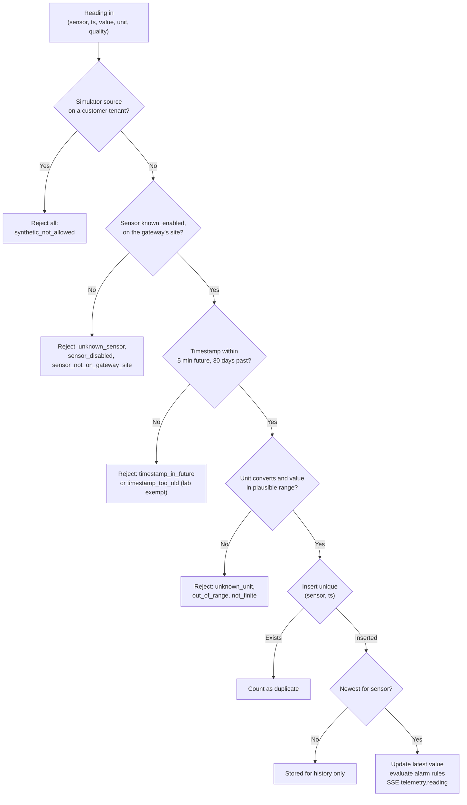

Readings are processed in timestamp order within a batch. A reading older than the sensor's latest is stored for
history and exports but does not overwrite the latest value or re-trigger alarms. Readings with quality `bad` update
the latest value but are not evaluated against alarm rules.

Table: Telemetry endpoints

| Method | Path | Auth | Permission | Purpose |
|---|---|---|---|---|
| POST | `/api/ingest/v1/readings` | gateway | gateway key | Batch ingestion from an edge gateway |
| POST | `/api/telemetry/manual` | user or device | `inspection.execute` (manual) or `sensor.manage` (lab) | Record one reading by hand |
| GET | `/api/telemetry/sensors/:id/history` | any | `telemetry.read` | Downsampled chart series |
| GET | `/api/telemetry/sensors/:id/export.csv` | any | `report.export` | Raw readings as CSV |
| GET | `/api/telemetry/sensors/:id/readings` | any | `telemetry.read` | Paged raw readings with provenance |
| POST | `/api/telemetry/readings/:readingId/corrections` | user | `sensor.manage` | Correct or invalidate a reading |

#### POST /api/ingest/v1/readings

Accepts a batch of up to 500 readings from an edge gateway. The gateway identifies sensors by tag or by `sourceRef`,
and only sensors on the gateway's own site are accepted.

- **Auth:** `Authorization: Bearer hgw_...`. The key must be active and its organization active.
- **Limit:** 1200 requests per minute per IP.
- **Request:**

```json
{
  "readings": [
    { "sensor": "PT-101-VIB", "ts": "2026-10-22T13:44:00+05:30", "value": 7.4, "unit": "mm/s", "quality": "good", "messageId": "plc1-000918" },
    { "sensor": "40001", "ts": "2026-10-22T13:44:00+05:30", "value": 6.92 }
  ]
}
```

- **Response:** `200`. `rejected[].index` refers to the position in the request array.

```json
{ "accepted": 1, "duplicates": 0, "alarmsRaised": 1, "rejected": [{ "index": 1, "reason": "unknown_sensor" }] }
```

- **Errors:** `401 invalid_gateway_key`, `400 validation_failed` (`ts` must be ISO 8601 with offset, 1 to 500
  readings).
- **Side effects:** gateway `lastSeenAt` updated; sensor latest values; alarm events and notifications; SSE
  `telemetry.reading` and `alarm.created`.
- **Notes:** a partially bad batch still returns 200; inspect `rejected`. Rejection reasons are `unknown_sensor`,
  `sensor_disabled`, `sensor_not_on_gateway_site`, `timestamp_in_future`, `timestamp_too_old`, `unknown_unit`,
  `out_of_range` and `not_finite`. `messageId` is stored for traceability; deduplication is by sensor and timestamp.

#### POST /api/telemetry/manual

Records one reading entered by a person, for example a lab COD result or a hand-held pH reading.

- **Auth:** user or device. **Permission:** `inspection.execute` for `source: "manual"`, `sensor.manage` for
  `source: "lab"`; the sensor must be in scope.
- **Request:** `{ "sensorId": "<uuid>", "value": 182, "unit": "mg/L", "ts": "2026-10-22T09:00:00+05:30", "source": "lab" }`
  (`ts` defaults to now, `source` to `manual`).
- **Response:** `201 { "accepted": 1, "duplicates": 0, "alarmsRaised": 0, "rejected": [], "readingId": 99812, "recordedBy": { "id": "..." } }`.
- **Errors:** `400 method_mismatch`, `400 reading_rejected` (with `details.reason`), `409 duplicate_reading`.
- **Side effects:** audit `telemetry.manual_entry` (the provenance record of who entered the value).

#### GET /api/telemetry/sensors/:id/history

Returns a chart-ready series. When the range holds more readings than `points`, the server averages them into equal
time buckets and returns min, max and count per bucket; otherwise it returns the raw readings. Invalidated readings
are excluded and corrected readings use their corrected value.

- **Auth:** any. **Permission:** `telemetry.read`. Glasses need the `measurements` or `assets` screen.
- **Query:** `from` (default `to` minus 24 hours), `to` (default now), `points` (10 to 2000, default 240).
- **Response:**

```json
{
  "sensor": { "id": "c0d1...", "tag": "PT-101-VIB", "unit": "mm/s", "freshness": "live", "label": "Vibration", "decimals": 1, "typicalRange": [0, 4.5] },
  "from": "2026-10-21T08:00:00.000Z", "to": "2026-10-22T08:00:00.000Z",
  "bucketSeconds": 360, "totalReadings": 1440,
  "points": [{ "t": "2026-10-21T08:00:00.000Z", "v": 3.12, "min": 2.9, "max": 3.4, "n": 6 }],
  "corrections": { "corrected": 1, "invalidated": 2 }
}
```

- **Errors:** `400 invalid_range`, `404 not_found`. `bucketSeconds` is `null` when raw readings are returned.

#### GET /api/telemetry/sensors/:id/export.csv

Exports raw readings with original and effective values and the latest correction of each.

- **Auth:** any. **Permission:** `report.export`.
- **Query:** `from` and `to` (both required, at most 93 days apart).
- **Response:** `200 text/csv`, file name `sensor-<id>.csv`, columns `timestamp_utc, sensor_tag, original_value,
  effective_value, unit, quality, source, synthetic, status, correction_reason, corrected_by, corrected_at_utc`.
  Cells that start with `=`, `+`, `-` or `@` and are not numbers are prefixed with a quote to defuse spreadsheet formula
  injection.
- **Errors:** `400 range_too_large`. **Side effects:** audit `report.exported`.

#### GET /api/telemetry/sensors/:id/readings

Pages through raw readings newest first, with who recorded manual values and the full correction trail.

- **Auth:** any. **Permission:** `telemetry.read`.
- **Query:** `limit` (1 to 200, default 50), `offset`, `from`, `to`, `source` (`gateway`, `manual`, `lab`,
  `simulator`), `status` (`all`, `corrected`, `invalidated`).
- **Response:** `200 { "sensor", "total", "limit", "offset", "readings": [...] }`. Each reading has `id` (integer),
  `ts`, `receivedAt`, `quality`, `source`, `synthetic`, `originalValue`, `effectiveValue` (null when invalidated),
  `status` (`original`, `corrected`, `invalidated`), `recordedBy` and `corrections[]`.

#### POST /api/telemetry/readings/:readingId/corrections

Appends a correction or invalidation to one stored reading. The original row is never changed.

- **Auth:** user. **Permission:** `sensor.manage` and scope over the sensor.
- **Request:** `{ "action": "correct", "correctedValue": 7.1, "unit": "pH", "reason": "Probe recalibrated after drift" }`
  or `{ "action": "invalidate", "reason": "Sensor was out of the tank during cleaning" }`. `reason` is 5 to 1000
  characters; `correctedValue` is required for `correct` and forbidden for `invalidate`.
- **Response:** `201 { "correction": { ... }, "effectiveValue": 7.1 }`.
- **Errors:** `404 not_found`, `400 validation_failed` (value implausible for the measurand), `409 no_change`,
  `409 already_invalidated`.
- **Side effects:** audit `telemetry.reading_corrected` or `telemetry.reading_invalidated`; the sensor's latest value
  is recomputed if this reading was the latest; SSE `telemetry.corrected`.

## Alarms module

File: `apps/api/src/modules/alarms.ts`. Alarm rules are thresholds on one sensor: `high_high`, `high`, `low`,
`low_low` with a deadband and an on-delay, or `stale` (no fresh data for five expected intervals). The engine raises
one alarm event per breach and tracks two independent things: the measured condition (`clearedAt` is set when the
value returns to normal) and the human lifecycle below. A cleared alarm stays open until people resolve it.

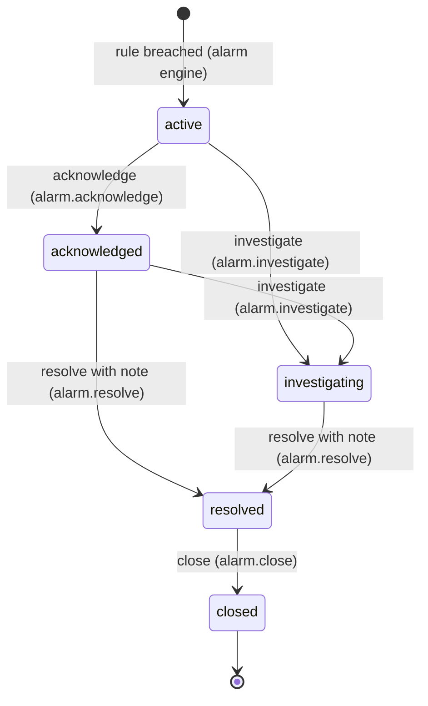

Critical and high alarms notify every active member with an operational role who has access to the site. Assignment
notifies the assignee.

Table: Alarm endpoints

| Method | Path | Auth | Permission | Purpose |
|---|---|---|---|---|
| GET | `/api/alarms` | any | `alarm.read` | Filtered alarm list, most urgent first |
| GET | `/api/alarms/:id` | any | `alarm.read` | Alarm with history, rule, procedure, follow-ups, allowed actions |
| POST | `/api/alarms/:id/:action` | any | per action | acknowledge, investigate, resolve, close |
| POST | `/api/alarms/:id/assign` | user | `alarm.assign` | Assign or unassign |
| POST | `/api/alarms/:id/notes` | any | `alarm.acknowledge` | Add a note to the history |
| GET | `/api/alarm-rules` | any | `alarm.read` | List rules |
| POST | `/api/alarm-rules` | user | `alarm_rule.manage` | Create a rule |
| PATCH | `/api/alarm-rules/:id` | user | `alarm_rule.manage` | Edit, enable or disable a rule |
| DELETE | `/api/alarm-rules/:id` | user | `alarm_rule.manage` | Delete, or disable if it has history |

#### GET /api/alarms

- **Auth:** any. **Permission:** `alarm.read`. Glasses need the `alerts` screen.
- **Query:** `state` (one of the five states, or `open` for active, acknowledged and investigating), `severity`
  (`critical`, `high`, `medium`, `low`), `siteId`, `assetId`, `assignedToMe`, `from`, `to` (on `triggeredAt`),
  `limit` (1 to 500, default 200).
- **Response:** `200 { "alarms": [...] }` ordered by state (active first), then severity, then newest. Each alarm adds
  `assetTag`, `assetName`, `sensorTag` and `assigneeName`.

```bash
curl -s "https://hydrisview.vercel.app/api/alarms?state=open&severity=critical" \
  -H "authorization: Bearer $TOKEN" | jq '.alarms[] | {id, title, state, triggerValue, unit}'
```

```json
{
  "alarms": [
    {
      "id": "5f0c2a7e-...", "siteId": "2d4c...", "assetId": "a91f...", "sensorId": "c0d1...", "ruleId": "77aa...",
      "severity": "critical", "condition": "high_high", "state": "active",
      "title": "High-high Vibration · P-101", "description": "Vibration 9.8 mm/s is above the high-high limit 9 mm/s",
      "recommendedAction": "Stop the pump and check the coupling", "triggerValue": 9.8, "threshold": 9, "unit": "mm/s",
      "peakValue": 10.2, "triggeredAt": "2026-10-22T08:10:00.000Z", "clearedAt": null, "assignedTo": null,
      "synthetic": false, "assetTag": "P-101", "assetName": "Raw sewage lift pump 1", "sensorTag": "PT-101-VIB", "assigneeName": null
    }
  ]
}
```

#### GET /api/alarms/:id

- **Auth:** any. **Permission:** `alarm.read` and site scope. Glasses need the `alerts` screen.
- **Response:** `200 { "alarm", "history", "rule", "procedure", "followUps", "assignee", "allowedActions", "canAssign" }`.
  `history` lists triggered, condition_cleared, transitions, assignments and notes with actor names (`Hydris` for the
  engine). `procedure` is the SOP linked to the rule. `allowedActions` lists the transitions valid from the current
  state that the caller holds the permission for, so clients render exactly the right buttons.
- **Errors:** `404 not_found`.

#### POST /api/alarms/:id/:action

Moves an alarm through its lifecycle. `action` is `acknowledge`, `investigate`, `resolve` or `close`.

- **Auth:** any. **Permission:** `alarm.acknowledge`, `alarm.investigate`, `alarm.resolve` or `alarm.close`. Glasses
  need the `alerts` screen, and for acknowledge also the `acknowledge_alarm` action.
- **Request:** `{ "note": "..." }` (optional, up to 2000; required for `resolve`).
- **Response:** `200 { "alarm": { ...updated row } }`.
- **Errors:** `409 invalid_transition` (with `details.state`), `400 note_required`, `409 stale_state`, `404 not_found`.
- **Side effects:** acknowledge records `acknowledgedBy` and `acknowledgedAt`; investigate self-assigns if
  unassigned; resolve records the resolution note; history row; audit `alarm.<action>` with `via: user | device`;
  SSE `alarm.updated`.

```bash
curl -s -X POST https://hydrisview.vercel.app/api/alarms/5f0c2a7e-.../acknowledge \
  -H "authorization: Bearer $TOKEN" -H "content-type: application/json" -d '{}'
```

#### POST /api/alarms/:id/assign

- **Auth:** user. **Permission:** `alarm.assign`.
- **Request:** `{ "userId": "<uuid>" | null, "note": "..." }`.
- **Response:** `200 { "alarm": { ... } }`.
- **Errors:** `409 invalid_transition` (closed alarms), `400 invalid_assignee`, `404 not_found`.
- **Side effects:** history `assigned`, audit `alarm.assigned`, notification `alarm_assigned`, SSE `alarm.updated`.

#### POST /api/alarms/:id/notes

- **Auth:** any. **Permission:** `alarm.acknowledge`. **Request:** `{ "note": "Coupling guard loose, tightened" }`
  (1 to 2000). **Response:** `200 { "ok": true }`.
- **Notes:** adds a `note` history row attributed to the user and, from glasses, the device. No audit event.

#### GET /api/alarm-rules

- **Auth:** any. **Permission:** `alarm.read`. **Query:** `sensorId`, `siteId`.
- **Response:** `200 { "rules": [{ ...rule, "sensorTag", "sensorName", "unit", "assetTag" }] }`. Rule fields:
  `id`, `sensorId`, `siteId`, `name`, `condition`, `threshold`, `deadband`, `onDelayS`, `severity`, `enabled`,
  `recommendedAction`, `procedureDocumentId`, `breachSince`.

#### POST /api/alarm-rules

- **Auth:** user. **Permission:** `alarm_rule.manage`.
- **Request:**

```json
{ "sensorId": "c0d1...", "name": "Pump vibration high-high", "condition": "high_high", "threshold": 9, "deadband": 0.5, "onDelayS": 30, "severity": "critical", "recommendedAction": "Stop the pump and check the coupling", "procedureDocumentId": "d3e4..." }
```

- **Response:** `201 { "rule": { ... } }`.
- **Errors:** `400 threshold_required`, `404 not_found` (sensor).
- **Side effects:** audit `alarm_rule.created` and `sensor.threshold_added` (so the sensor's own history shows it).
- **Notes:** `onDelayS` (0 to 86,400) is how long a breach must persist before an alarm is raised. `deadband` is the
  hysteresis before a breach counts as cleared.

#### PATCH /api/alarm-rules/:id

- **Auth:** user. **Permission:** `alarm_rule.manage`. **Request:** any rule field except `sensorId`.
- **Response:** `200 { "rule": { ... } }`. Any pending breach timer is reset.
- **Errors:** `400 validation_failed` (missing threshold, unknown procedure document), `404 not_found`.
- **Side effects:** audit `alarm_rule.updated`, `alarm_rule.enabled` or `alarm_rule.disabled` with before and after,
  plus `sensor.threshold_changed`.

#### DELETE /api/alarm-rules/:id

- **Auth:** user. **Permission:** `alarm_rule.manage`.
- **Response:** `200 { "ok": true, "disabled": false }`. A rule that has raised alarms is disabled instead of deleted
  (`"disabled": true`) so past alarm events keep their context.
- **Side effects:** audit `alarm_rule.deleted` or `alarm_rule.disabled`.

## Inspections module

File: `apps/api/src/modules/inspections.ts`. Templates define the steps of an inspection; routes group assets into a
round; inspections are the assigned work items. Each inspection stores a snapshot of its template's steps and safety
notices at creation, so editing a template never changes work in progress. Step kinds are `check`, `reading`,
`choice`, `text` and `photo`; a response is `abnormal` when a check fails or is flagged, a reading falls outside
`expectedMin` to `expectedMax`, or a choice is in `abnormalOptions`.

```mermaid
%% caption: Inspection lifecycle (INSPECTION_TRANSITIONS in packages/domain/src/workflows.ts)
stateDiagram-v2
  [*] --> scheduled: created or dispatched
  scheduled --> in_progress: start, or first response
  paused --> in_progress: start
  rejected --> in_progress: start
  in_progress --> paused: pause
  in_progress --> submitted: submit (all required steps)
  paused --> submitted: submit
  submitted --> approved: approve (reviewer, not assignee)
  submitted --> rejected: reject with note
  scheduled --> cancelled: cancel
  in_progress --> cancelled: cancel
  paused --> cancelled: cancel
  rejected --> cancelled: cancel
  approved --> [*]
  cancelled --> [*]
```

Submitting an inspection with abnormal findings automatically opens an `inspection_followup` maintenance task (priority
`high` for more than one finding, otherwise `medium`) unless the client sends `createFollowUp: false`.

Table: Inspection endpoints

| Method | Path | Auth | Permission | Purpose |
|---|---|---|---|---|
| GET | `/api/inspection-templates` | any | `inspection.read` | List templates |
| POST | `/api/inspection-templates` | user | `inspection.manage` | Create a template |
| PUT | `/api/inspection-templates/:id` | user | `inspection.manage` | Replace a template (versioned) |
| GET | `/api/inspection-templates/:id` | any | `inspection.read` | Template with usage counts |
| POST | `/api/inspection-templates/:id/status` | user | `inspection.manage` | Publish, unpublish, archive, restore |
| GET | `/api/inspection-routes` | any | `inspection.read` | List routes |
| POST | `/api/inspection-routes` | user | `inspection.manage` | Create a route |
| PUT | `/api/inspection-routes/:id` | user | `inspection.manage` | Replace a route |
| POST | `/api/inspection-routes/:id/dispatch` | user | `inspection.manage` | Create one inspection per stop |
| GET | `/api/inspections` | any | `inspection.read` | List inspections |
| POST | `/api/inspections` | user | `inspection.manage` | Create an inspection |
| GET | `/api/inspections/:id` | any | `inspection.read` | Inspection with responses and progress |
| PATCH | `/api/inspections/:id` | user | `inspection.manage` | Reassign, due date, priority |
| POST | `/api/inspections/:id/responses` | any | `inspection.execute` (assignee) | Sync step responses |
| POST | `/api/inspections/:id/:action` | any | per action | start, pause, submit, approve, reject, cancel |

### Templates

#### GET /api/inspection-templates

- **Auth:** any. **Permission:** `inspection.read`. **Response:** `200 { "templates": [...] }` ordered by name.

#### POST /api/inspection-templates

- **Auth:** user. **Permission:** `inspection.manage`.
- **Request:**

```json
{
  "name": "Lift pump daily check",
  "assetType": "pump",
  "estimatedMinutes": 10,
  "safetyNotices": ["Do not open the guard while the pump is running"],
  "status": "draft",
  "steps": [
    { "id": "noise", "kind": "check", "title": "No abnormal noise", "required": true },
    { "id": "vib", "kind": "reading", "title": "Vibration at drive end", "required": true, "measurand": "vibration", "unit": "mm/s", "expectedMin": 0, "expectedMax": 4.5 },
    { "id": "seal", "kind": "choice", "title": "Seal condition", "required": true, "options": ["Dry", "Weeping", "Leaking"], "abnormalOptions": ["Leaking"] },
    { "id": "photo", "kind": "photo", "title": "Photo of the gland", "required": false }
  ]
}
```

- **Response:** `201 { "template": { ... } }` with `version: 1`.
- **Errors:** `400 validation_failed` (1 to 60 steps, step ids unique and up to 40 characters, up to 10 safety notices).
- **Side effects:** audit `inspection_template.created`.

#### PUT /api/inspection-templates/:id

Replaces the template with the same body as create. The content `version` increments only when steps or safety
notices change.

- **Auth:** user. **Permission:** `inspection.manage`. **Response:** `200 { "template": { ... } }`.
- **Errors:** `404 not_found`, `409 archived` (archived templates must be restored first unless the body sets
  `status` to `draft` or `published`).
- **Side effects:** audit `inspection_template.updated` with field changes, `stepsChanged` and step counts.

#### GET /api/inspection-templates/:id

- **Auth:** any. **Permission:** `inspection.read`.
- **Response:** `200 { "template", "usage": { "total": 42, "open": 3 } }`.

#### POST /api/inspection-templates/:id/status

- **Auth:** user. **Permission:** `inspection.manage`. **Request:** `{ "status": "draft" | "published" | "archived" }`.
- **Response:** `200 { "template": { ... } }`. Only published templates can be used for new inspections.
- **Errors:** `409 no_change`, `404 not_found`.
- **Side effects:** audit `inspection_template.published`, `.archived`, `.restored` or `.unpublished`.

### Routes

#### GET /api/inspection-routes

- **Auth:** any. **Permission:** `inspection.read`. **Query:** `siteId`. **Response:** `200 { "routes": [...] }`.

#### POST /api/inspection-routes

- **Auth:** user. **Permission:** `inspection.manage` and site scope.
- **Request:** `{ "siteId": "...", "name": "Morning round STP-1", "description": "...", "assetIds": ["...", "..."] }`
  (1 to 100 stops, in walking order).
- **Response:** `201 { "route": { ... } }`. **Errors:** `400 invalid_assets`. **Side effects:** audit
  `inspection_route.created`.

#### PUT /api/inspection-routes/:id

- **Auth:** user. **Permission:** `inspection.manage`. **Request:** as create without `siteId`.
- **Response:** `200 { "route": { ... } }`. **Side effects:** audit `inspection_route.updated`.

#### POST /api/inspection-routes/:id/dispatch

Creates one inspection per stop for one person. Each stop uses the published template whose `assetType` matches the
asset's type, falling back to `fallbackTemplateId`.

- **Auth:** user. **Permission:** `inspection.manage`.
- **Request:** `{ "assignedTo": "<uuid>", "dueAt": "2026-10-22T11:00:00+05:30", "fallbackTemplateId": "<uuid>" }`.
- **Response:** `201 { "created": 6, "inspectionIds": ["...", "..."] }`.
- **Side effects:** per inspection: audit `inspection.created`, notification `inspection_assigned`, SSE
  `inspection.updated`.

### Inspections

#### GET /api/inspections

- **Auth:** any. **Permission:** `inspection.read`. Glasses need the `inspections` screen.
- **Query:** `status` (a status, `open` for editable ones, or `review` for submitted), `mine`, `siteId`, `assetId`,
  `overdue`.
- **Response:** `200 { "inspections": [{ "id", "title", "status", "priority", "dueAt", "siteId", "assetId", "assignedTo", "startedAt", "submittedAt", "submittedVia", "routeId", "synthetic", "revision", "stepCount", "answered", "assetTag", "assetName", "assigneeName", "siteName" }] }`,
  up to 300, work in progress first.
- **Notes:** callers without `inspection.manage` or `inspection.review` see only inspections assigned to them.

#### POST /api/inspections

- **Auth:** user. **Permission:** `inspection.manage`.
- **Request:** `templateId`, plus `assetId` or `siteId`, optional `assignedTo`, `dueAt`, `priority` (`normal`,
  `high`), `title` (defaults to template name and asset tag).
- **Response:** `201 { "inspection": { ... } }` in `scheduled`.
- **Errors:** `400 invalid_template`, `400 invalid_asset`, `400 site_required`, `400 invalid_assignee`.
- **Side effects:** audit `inspection.created`, notification `inspection_assigned`, SSE `inspection.updated`.

#### GET /api/inspections/:id

- **Auth:** any. **Permission:** `inspection.read`. Glasses need the `inspections` screen.
- **Response:**

```json
{
  "inspection": {
    "id": "91b2...", "title": "Lift pump daily check · P-101", "status": "in_progress", "revision": 4, "priority": "normal",
    "steps": [{ "id": "noise", "kind": "check", "title": "No abnormal noise", "required": true }],
    "safetyNotices": ["Do not open the guard while the pump is running"],
    "asset": { "id": "a91f...", "tag": "P-101", "name": "Raw sewage lift pump 1", "type": "pump", "status": "operational", "positionX": 42, "positionY": 18 },
    "assignee": { "id": "7c1e...", "name": "Karthik S" },
    "progress": { "total": 4, "required": 3, "answered": 2, "requiredAnswered": 2, "abnormal": 0, "complete": false, "percent": 50 },
    "responses": { "noise": { "value": { "kind": "check", "checked": true }, "outcome": "ok", "note": null, "recordedAt": "2026-10-22T08:02:11.000Z", "deviceId": "e0f1..." } },
    "attachments": []
  },
  "followUps": [],
  "permissions": { "execute": true, "manage": false, "review": false }
}
```

- **Errors:** `404 not_found` (also when an executor asks for someone else's inspection).

#### PATCH /api/inspections/:id

- **Auth:** user. **Permission:** `inspection.manage`.
- **Request:** any of `assignedTo` (nullable), `dueAt` (nullable), `priority`.
- **Response:** `200 { "inspection": { ... } }` with `revision` incremented.
- **Errors:** `409 not_editable` (only scheduled, in progress, paused or returned inspections).
- **Side effects:** audit `inspection.updated`, notification to a new assignee, SSE `inspection.updated`.

#### POST /api/inspections/:id/responses

Batch sync of step responses, designed for glasses that work offline. Each operation carries a client-generated id
and the time it was recorded on the device. The latest response per step (by `recordedAt`) wins.

- **Auth:** any. **Permission:** `inspection.execute`, and the caller must be the assignee. Glasses need the
  `inspections` screen and the `record_inspection` action.
- **Request:**

```json
{
  "ops": [
    { "opId": "op-1761120131-01", "stepId": "noise", "value": { "kind": "check", "checked": true }, "recordedAt": "2026-10-22T13:32:11+05:30" },
    { "opId": "op-1761120131-02", "stepId": "vib", "value": { "kind": "reading", "value": 5.2 }, "note": "Rising since last week", "recordedAt": "2026-10-22T13:33:40+05:30" }
  ]
}
```

- **Response:** `200 { "applied": 2, "duplicates": 0, "conflicts": [], "inspection": { ...view } }`. Conflict reasons:
  `unknown_step`, `kind_mismatch`, `timestamp_in_future`, or `inspection_<status>` when the inspection is no longer
  editable (all ops are then returned as conflicts).
- **Errors:** `403 forbidden` (not the assignee).
- **Side effects:** the first applied response moves a scheduled, paused or returned inspection to `in_progress`;
  SSE `inspection.updated` with `progressChanged`.

#### POST /api/inspections/:id/:action

`action` is `start`, `pause`, `submit`, `approve`, `reject` or `cancel`.

- **Auth:** any. **Permission:** `start`, `pause` and `submit` need `inspection.execute` and the assignee; `approve` and
  `reject` need `inspection.review` and someone other than the assignee; `cancel` needs `inspection.manage`. Glasses
  need the `inspections` screen and `submit_inspection` (for submit) or `record_inspection` (other actions).
- **Request:** `{ "note": "...", "expectedRevision": 4, "createFollowUp": true }`, all optional. `note` is required for
  `reject`.
- **Response:** `200 { "inspection": { ...view }, "followUpId": "<uuid>" | null }`.
- **Errors:** `403 forbidden`, `409 revision_conflict`, `409 invalid_transition`, `400 note_required`,
  `400 incomplete` (with the progress object in `details`).
- **Side effects:** audit `inspection.start`, `.pause`, `.submitted`, `.approved`, `.returned` or `.cancel`;
  submit records `submittedVia` (`glasses` or `console`), may create the follow-up task (audit
  `maintenance.created`, SSE `maintenance.updated`) and notifies whoever assigned the work; approve and reject notify
  the assignee; SSE `inspection.updated`.

## Maintenance module

File: `apps/api/src/modules/maintenance.ts`. Maintenance tasks are corrective, preventive, inspection follow-up or alarm
follow-up work with an optional checklist. Anyone with `maintenance.request` can raise a task; planners
(`maintenance.manage`) assign and edit; the assigned engineer (`maintenance.execute`) starts, holds and completes.

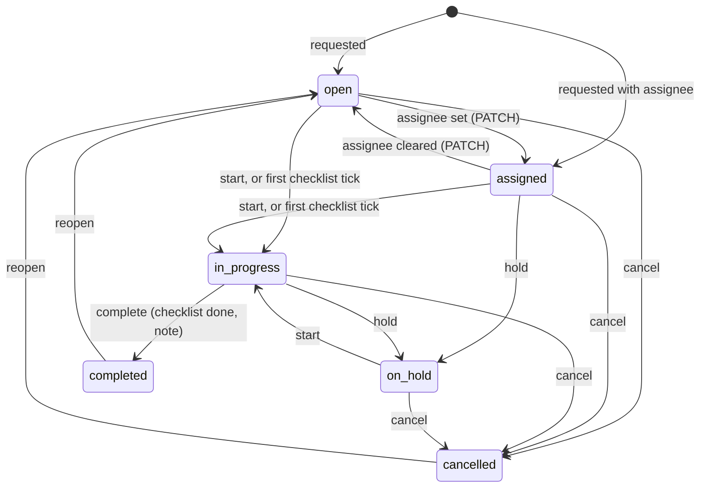

Reopening returns a task to `assigned` instead of `open` when it still has an assignee.

Table: Maintenance endpoints

| Method | Path | Auth | Permission | Purpose |
|---|---|---|---|---|
| GET | `/api/maintenance` | any | `maintenance.read` | List tasks |
| POST | `/api/maintenance` | any | `maintenance.request` | Raise a task |
| GET | `/api/maintenance/:id` | any | `maintenance.read` | Task with activity log |
| PATCH | `/api/maintenance/:id` | user | `maintenance.manage` | Edit, assign, edit checklist |
| POST | `/api/maintenance/:id/checklist/:itemId` | any | manager, or assignee with execute rights | Tick or untick an item |
| POST | `/api/maintenance/:id/notes` | any | `maintenance.read` plus involvement | Add a note |
| POST | `/api/maintenance/:id/:action` | any | `maintenance.manage`, or assignee for start, hold, complete | Transition |

#### GET /api/maintenance

- **Auth:** any. **Permission:** `maintenance.read`. Glasses need the `tasks` screen.
- **Query:** `status` (a status or `open_all`), `priority` (`low`, `medium`, `high`, `urgent`), `siteId`, `assetId`,
  `mine`.
- **Response:** `200 { "tasks": [{ ...task, "assetTag", "assetName", "assigneeName", "siteName" }] }`, up to 300,
  in-progress and urgent first.

#### POST /api/maintenance

- **Auth:** any. **Permission:** `maintenance.request`; setting `assignedTo` needs `maintenance.manage`.
- **Request:**

```json
{
  "title": "Replace gland packing on P-101",
  "description": "Seal leaking during morning round",
  "assetId": "a91f...",
  "kind": "corrective",
  "priority": "high",
  "assignedTo": "b2c3...",
  "dueAt": "2026-10-23T12:00:00+05:30",
  "sourceAlarmId": null,
  "checklist": ["Isolate and lock out", "Replace packing", "Run and check for leaks"]
}
```

- **Response:** `201 { "task": { ... } }`. Status is `assigned` with an assignee, otherwise `open`. A `sourceAlarmId`
  forces `kind: "alarm_followup"`. Checklist items (up to 40) get 8-character ids.
- **Errors:** `400 site_required`, `403 forbidden` ("Only planners can assign maintenance"), `400 invalid_assignee`,
  `400 invalid_alarm`, `404 not_found`.
- **Side effects:** activity `created`, audit `maintenance.created`, notification `maintenance_assigned` (severity
  `critical` for urgent), SSE `maintenance.updated`.

#### GET /api/maintenance/:id

- **Auth:** any. **Permission:** `maintenance.read`. Glasses need the `tasks` screen.
- **Response:** `200 { "task": { ..., "asset", "assignee", "attachments" }, "activity": [{ "action", "note", "actorName", "at" }], "permissions": { "manage", "execute" } }`.

#### PATCH /api/maintenance/:id

- **Auth:** user. **Permission:** `maintenance.manage`.
- **Request:** any of `title`, `description`, `priority`, `assignedTo`, `dueAt`, `kind`, `assetId`, `checklist`.
  `checklist` is the full list: items with an existing `id` keep their completion state, items without an id are
  added, missing ids are removed.
- **Response:** `200 { "task": { ... } }`.
- **Errors:** `409 not_editable` (completed or cancelled), `400 validation_failed` (inactive assignee, asset on
  another site, unknown checklist id).
- **Side effects:** activity `assigned`, `updated` and `checklist_edited`; audit `maintenance.updated` with changes;
  notification to a new assignee; SSE `maintenance.updated`.

#### POST /api/maintenance/:id/checklist/:itemId

- **Auth:** any. **Permission:** `maintenance.manage`, or the assignee holding `maintenance.execute` or
  `inspection.execute`. Glasses need the `tasks` screen and `toggle_checklist` action.
- **Request:** `{ "done": true }`.
- **Response:** `200 { "task": { ... } }`. The first tick moves an open or assigned task to `in_progress`.
- **Errors:** `403 forbidden`, `409 not_editable`, `404 not_found` (item).
- **Side effects:** activity `checklist_done` or `checklist_undone`; SSE `maintenance.updated`.

#### POST /api/maintenance/:id/notes

- **Auth:** any. **Permission:** `maintenance.read`, and the caller must manage maintenance, be the assignee or be
  the requester. **Request:** `{ "note": "Waiting for packing from stores" }`. **Response:** `200 { "ok": true }`.

#### POST /api/maintenance/:id/:action

`action` is `start`, `hold`, `complete`, `cancel` or `reopen`.

- **Auth:** any. **Permission:** `maintenance.manage` for every action; the assignee with `maintenance.execute` may
  also `start`, `hold` and `complete`.
- **Request:** `{ "note": "..." }`; required for `complete`.
- **Response:** `200 { "task": { ... } }`.
- **Errors:** `403 forbidden`, `409 invalid_transition`, `400 checklist_incomplete`, `400 note_required`,
  `409 stale_state`.
- **Side effects:** activity row, audit `maintenance.<action>`, notification `maintenance_completed` to the requester,
  SSE `maintenance.updated`.

## Devices and pairing module

File: `apps/api/src/modules/devices.ts`. The pairing flow and device token rotation are described in the
authentication chapter; this chapter lists the endpoints. Device records have three stored statuses (`active`,
`suspended`, `revoked`); the console shows a derived state (`paired`, `assigned`, `connected`, `disconnected`,
`suspended`, `revoked`) computed from status, assignment, `lastSeenAt` (90-second window) and open SSE streams.

Table: Device and pairing endpoints

| Method | Path | Auth | Permission | Limit | Purpose |
|---|---|---|---|---|---|
| POST | `/api/pairing/challenges` | public | none | 10/min | Glasses request a pairing code |
| POST | `/api/pairing/challenges/:id/poll` | poll secret | none | 40/min | Glasses poll for approval and claim tokens |
| POST | `/api/pairing/challenges/:id/cancel` | poll secret | none | 20/min | Glasses cancel a challenge |
| GET | `/api/pairing/lookup` | user | `device.pair` | 10/min | Look up a code before approving |
| POST | `/api/pairing/approve` | user | `device.pair` (`device.manage` for others) | 10/min | Approve a code |
| POST | `/api/pairing/deny` | user | `device.pair` | 10/min | Deny a code |
| POST | `/api/device/refresh` | device refresh token | none | 30/min | Rotate device tokens |
| POST | `/api/device/logout` | device | none | global | Unpair from the glasses |
| GET | `/api/device/context` | device | none | global | Glasses home screen data |
| GET | `/api/devices` | user | `device.read` | global | Fleet list |
| GET | `/api/devices/:id` | user | `device.read` | global | Device detail and diagnostics |
| PATCH | `/api/devices/:id` | user | `device.manage` | global | Rename or move site |
| POST | `/api/devices/:id/assign` | user | `device.manage` | global | Reassign operator |
| POST | `/api/devices/:id/suspend` | user | `device.manage` | global | Suspend |
| POST | `/api/devices/:id/reactivate` | user | `device.manage` | global | Reactivate a suspended device |
| POST | `/api/devices/:id/revoke` | user | `device.manage` | global | Revoke permanently |

#### POST /api/pairing/challenges

- **Auth:** public. **Request:** `hardwareId` (16 to 80 characters of `[A-Za-z0-9_-]`, stable per install) and
  `device` with `kind` (`hardware` or `simulator`), optional `model`, `name`, `appVersion`, `firmwareVersion`,
  `display` (`width`, `height`).
- **Response:**

```json
{
  "challengeId": "3a9e...", "userCode": "K7RM-4QXT", "pollSecret": "q2Vt...", "expiresAt": "2026-10-22T08:19:03.000Z",
  "pollIntervalS": 3, "verificationUri": "https://hydrisview.vercel.app/pair",
  "verificationUriComplete": "https://hydrisview.vercel.app/pair?code=K7RM-4QXT"
}
```

- **Errors:** `503 pairing_unavailable`. **Notes:** open challenges of the same `hardwareId` are cancelled.

#### POST /api/pairing/challenges/:id/poll

- **Auth:** `{ "pollSecret": "..." }` in the body.
- **Response:** `{ "status": "pending", "expiresAt" }`, `{ "status": "slow_down", "pollIntervalS": 3 }`,
  `{ "status": "expired" | "denied" | "cancelled" }`, or on approval
  `{ "status": "completed", "device": { "id", "name" }, "accessToken", "refreshToken" }`. A second claim returns
  `{ "status": "completed", "error": "already_claimed" }` without tokens.
- **Errors:** `404 not_found` (unknown id or wrong secret).
- **Side effects:** creates or reuses the device, assigns the operator, audit `device.paired`, SSE `device.paired` and
  `pairing.completed`.

#### POST /api/pairing/challenges/:id/cancel

- **Auth:** poll secret. **Response:** `200 { "ok": true }`. **Errors:** `404 not_found`.

#### GET /api/pairing/lookup

- **Auth:** user. **Permission:** `device.pair`. **Query:** `code` (with or without the dash).
- **Response:** `200 { "challenge": { "code", "device", "requestedAt", "expiresAt" }, "organization", "sites", "assignees", "canAssignOthers", "existingDevice" }`.
  Without `device.manage`, `assignees` contains only the caller.
- **Errors:** `400 invalid_code`, `404 not_found` (expired or used).

#### POST /api/pairing/approve

- **Auth:** user. **Permission:** `device.pair`; assigning someone else needs `device.manage`.
- **Request:** `{ "code": "K7RM-4QXT", "siteId": "<uuid>", "assigneeUserId": "<uuid>", "deviceName": "Karthik's glasses" }`.
- **Response:** `200 { "ok": true, "challengeId": "..." }`.
- **Errors:** `403 forbidden`, `400 invalid_assignee`, `400 assignee_no_site_access`, `404 not_found`,
  `409 device_owned_elsewhere`, `409 already_used`. **Side effects:** audit `device.pairing_approved`.

#### POST /api/pairing/deny

- **Auth:** user. **Permission:** `device.pair`. **Request:** `{ "code": "..." }`. **Response:** `200 { "ok": true }`.
- **Side effects:** audit `device.pairing_denied`; the glasses' next poll returns `denied`.

#### POST /api/device/refresh

- **Auth:** `{ "refreshToken": "hgd_..." }` (up to 120 characters).
- **Response:** `200 { "accessToken", "refreshToken" }`.
- **Errors:** `401 device_revoked`, `401 device_session_invalid`, `401 device_session_expired`,
  `403 device_suspended`, `403 device_unassigned`.

#### POST /api/device/logout

- **Auth:** device (a user token returns `403 forbidden`). **Response:** `204`.
- **Side effects:** device sessions revoked and session version bumped.

#### GET /api/device/context

Everything the glasses need for the home screen in one call, filtered by the device's effective UI profile: sections
for disabled screens are omitted on the server, not just hidden.

- **Auth:** device.
- **Response:** `200 { "device", "operator", "organization", "site", "role", "profile", "inspections", "alarms", "tasks", "map", "assets", "measurements", "serverTime" }`.
  `inspections`, `alarms` and `tasks` hold up to 20 open items of the operator and site; `map` gives the site layout in
  metres, process area polygons and asset pins; each measurement carries `freshness` and `threshold` (`alarm`,
  `out_of_range`, `normal`).

#### GET /api/devices

- **Auth:** user. **Permission:** `device.read`.
- **Response:** `200 { "devices": [{ ...device, "siteName", "assignee": { "id", "name", "since" }, "streamOpen", "state" }] }`.
  `hardwareId` is never returned.

#### GET /api/devices/:id

- **Auth:** user. **Permission:** `device.read`.
- **Response:** `200 { "device", "assignments", "activeSessions", "events", "diagnostics", "canManage", "effectiveProfile" }`.
  `diagnostics.battery` is `null`: the current integration does not expose hardware sensors.

#### PATCH /api/devices/:id

- **Auth:** user. **Permission:** `device.manage`. **Request:** `name` (2 to 60), `siteId`.
- **Response:** `200 { "device" }`. **Side effects:** audit `device.updated`; a site change sends
  `device.context_changed` (`site_changed`).

#### POST /api/devices/:id/assign

- **Auth:** user. **Permission:** `device.manage`. **Request:** `{ "userId": "<uuid>", "reason": "Shift handover" }`.
- **Response:** `200 { "ok": true }` or `{ "ok": true, "unchanged": true }`.
- **Errors:** `409 device_not_active`, `400 invalid_assignee`, `404 not_found`.
- **Side effects:** session version bumped (the glasses refresh into the new operator), audit `device.reassigned`,
  SSE `device.context_changed` and `device.updated`.

#### POST /api/devices/:id/suspend, /reactivate, /revoke

- **Auth:** user. **Permission:** `device.manage`. **Request:** `{ "reason": "Lost on site" }`; required for revoke.
- **Response:** `200 { "ok": true, "status": "suspended" | "active" | "revoked" }`.
- **Errors:** `409 device_revoked`, `409 invalid_transition` (reactivate only from suspended), `400 reason_required`.
- **Side effects:** session version bumped; revoke also ends device sessions and the assignment; audit
  `device.suspended`, `device.reactivated` or `device.revoked`; SSE `device.revoked` or `device.context_changed`, and
  `device.updated`.

## Realtime module

File: `apps/api/src/modules/realtime.ts`, with the serverless variant in `apps/web/src/app/api/events/stream/route.ts`.

#### GET /api/events/stream

- **Auth:** any, as `Authorization: Bearer`. **Request:** optional `Last-Event-ID` header or `lastEventId` query.
- **Response:** `200 text/event-stream`, described in the realtime chapter.
- **Errors:** `401 unauthorized`, `503 realtime_misconfigured` (serverless route without `REALTIME_MODE=db`).

## Insights module

File: `apps/api/src/modules/insights.ts`. Dashboards, reports, grounded procedure retrieval and search.

Table: Insights endpoints

| Method | Path | Auth | Permission | Purpose |
|---|---|---|---|---|
| GET | `/api/overview` | any | scope only | Overview dashboard |
| GET | `/api/reports/:kind` | any | `report.read`, `report.export` for CSV | Reports |
| GET | `/api/assist` | any | `document.read` | Approved procedure passages and live asset data |
| GET | `/api/search` | any | scope only | Command palette search |

#### GET /api/overview

- **Query:** `siteId` (optional).
- **Response:** `200 { "generatedAt", "alarms": { "active", "critical", "open", "last24h" }, "inspections": { "due", "overdue", "review", "done7d" }, "maintenance": { "open", "urgent" }, "devices": { "registered", "connected" }, "activeOperators", "sites", "assetHealth", "metrics", "recentAlarms", "activity", "alarmTrend" }`.
  `alarmTrend` covers 14 days; `metrics` are up to 12 continuous pH, DO, turbidity, flow, level and vibration sensors.

#### GET /api/reports/:kind

- **Path:** `kind` is `inspections`, `alarms`, `maintenance`, `devices` or `operators`.
- **Query:** `from`, `to` (default last 30 days), `siteId`, `assetId`, `userId`, `severity`, `format` (`json` or `csv`).
- **Response:** JSON `{ "kind", "from", "to", "rows", "summary" }` (up to 5000 rows) or a CSV attachment. Summaries
  include median minutes to acknowledge (alarms), completion and on-time rates (inspections) and median hours to
  complete (maintenance).
- **Errors:** `400 invalid_range`. **Side effects:** CSV writes audit `report.exported`.

#### GET /api/assist

Grounded retrieval only: it never generates procedures or issues commands. Glasses need `ask_ai` or `view_sops`.

- **Query:** `q` (2 to 200), `assetId` (optional).
- **Response:** `200 { "query", "sources": [{ "id", "title", "kind", "version", "rank", "passage" }], "asset", "telemetry", "glossary", "notice" }`,
  up to five approved documents ranked by Postgres full-text search, with a safety notice.

#### GET /api/search

- **Query:** `q` (1 to 80). **Response:** `200 { "assets", "sensors", "documents", "people" }`, each with `id`,
  `label`, `sub`.

## Voice assistant module

File: `apps/api/src/modules/voice-assistant.ts`. "Hey Hydris" answers spoken questions from the caller's own data.
With an Anthropic credential configured it uses Claude (`claude-opus-5-5`) with five read-only tools (readings, open
alarms, my work, asset status, procedure search), all scoped by RLS and site scope. Otherwise, or if the model call
fails, a deterministic intent engine answers. Neither engine can change data.

#### POST /api/assistant/ask

- **Auth:** any. **Limit:** 60 per minute.
- **Request:** `{ "text": "what is the current pH", "history": [{ "role": "user", "text": "..." }] }` (text 1 to 500,
  up to 8 history turns).
- **Response:**

```json
{
  "answer": "Current pH at Aeration tank 1 is 7.12, measured 40 seconds ago, within the typical range.",
  "facts": [{ "label": "pH · Aeration tank 1", "value": "7.12", "unit": "pH", "at": "2026-10-22T08:13:20.000Z", "source": "sensor", "ref": "AT-101-PH" }],
  "intent": "reading",
  "engine": "hydris-rules"
}
```

- **Notes:** `engine` is `claude-opus-5-5` or `hydris-rules`; `intent` is `llm` for model answers, otherwise
  `alarms`, `my_work`, `reading`, `asset`, `procedure`, `help` or `unknown`.

```bash
curl -s -X POST https://hydrisview.vercel.app/api/assistant/ask \
  -H "authorization: Bearer $TOKEN" -H "content-type: application/json" \
  -d '{"text":"Do I have any critical alarms?"}'
```

## Audit documents module

File: `apps/api/src/modules/audit-docs.ts`. Paper records (lab sheets, logs, permits) are captured as page images with
on-device OCR, optionally refined by a vision model, cross-checked value by value, reviewed by a person, verified and
then approved by a different person, and exported as a searchable PDF.

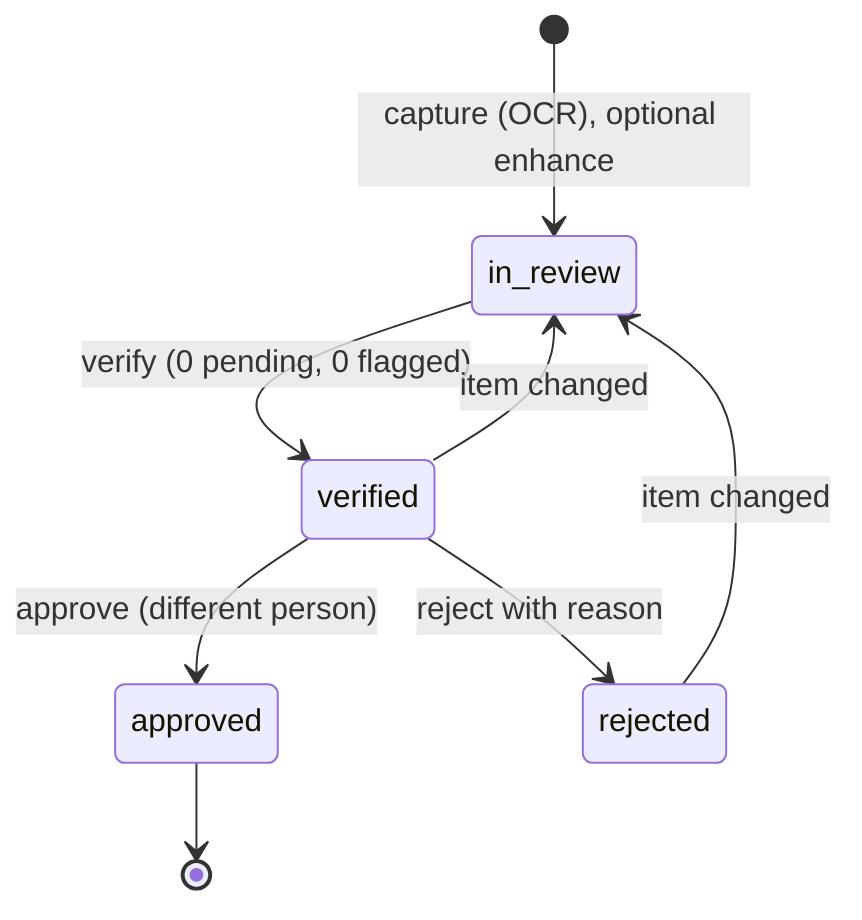

Table: Audit document endpoints

| Method | Path | Auth | Permission | Purpose |
|---|---|---|---|---|
| GET | `/api/audit-docs/capabilities` | any | none | Engine availability and limits |
| GET | `/api/audit-docs` | any | `auditdoc.read` | List (bare array) |
| GET | `/api/audit-docs/:id` | any | `auditdoc.read` | Detail with extraction and events |
| GET | `/api/audit-docs/:id/pages/:pageNo` | any | `auditdoc.read` | Page image |
| GET | `/api/audit-docs/:id/pdf` | any | `auditdoc.read` | Searchable PDF |
| POST | `/api/audit-docs` | any | `auditdoc.capture` | Capture |
| POST | `/api/audit-docs/:id/enhance` | any | `auditdoc.capture` | Run the vision engine |
| PATCH | `/api/audit-docs/:id/items/:itemId` | any | `auditdoc.verify` or `auditdoc.capture` | Review one field or table |
| POST | `/api/audit-docs/:id/confirm-agreed` | any | `auditdoc.verify` or `auditdoc.capture` | Bulk-confirm agreed values |
| POST | `/api/audit-docs/:id/verify` | user | `auditdoc.verify` | Sign off the review |
| POST | `/api/audit-docs/:id/approve` | user | `auditdoc.approve` | Approve or reject |
| PATCH | `/api/audit-docs/:id` | any | `auditdoc.verify` or `auditdoc.capture` | Rename |

#### GET /api/audit-docs/capabilities

- **Response:** `200 { "vision": true, "visionEngine": "vision:claude-opus-5-5", "maxPages": 6, "maxPageBytes": 921600 }`.

#### GET /api/audit-docs

- **Query:** `status` (`processing`, `in_review`, `verified`, `approved`, `rejected`), `mine`.
- **Response:** `200 [{ "id", "title", "docType", "status", "siteName", "pageCount", "capturedVia", "capturedBy", "engines", "aiStatus", "agreement", "fields", "tables", "figures", "review", "attention", ... }]`,
  up to 200.

#### GET /api/audit-docs/:id

- **Response:** the summary plus `extraction`, `revision`, `aiError`, `verifiedBy`, `approvedBy`, `rejectedReason`,
  `pages`, `events` (with `viaGlasses`) and `permissions` (`review`, `verify`, `approve`).

#### GET /api/audit-docs/:id/pages/:pageNo and GET /api/audit-docs/:id/pdf

- **Response:** the page image (`private, max-age=3600`) or `application/pdf` attachment with OCR text, extracted
  values and sign-off record.

#### POST /api/audit-docs

- **Body limit:** 8 MB. **Request:** `title`, `siteId`, `assetId` (optional), `source` (`mobile`, optional) and
  `pages` (1 to 6): each with `mime` (`image/jpeg` or `image/png`), base64 `data` (at most 900 KB decoded), `width`,
  `height`, `readings` (1 to 3 OCR passes with engine, text, confidence and word boxes) and optional `figures`.

```bash
curl -s -X POST https://hydrisview.vercel.app/api/audit-docs \
  -H "authorization: Bearer $TOKEN" -H "content-type: application/json" \
  --data-binary @scan.json
```

- **Response:** `201` summary with `status: "in_review"` and `aiStatus` `pending` or `unavailable`.
- **Errors:** `400 page_too_large`, `400 invalid_image`, `404 not_found` (site).
- **Side effects:** `capturedVia` is `glasses`, `mobile` or `console`; audit `auditdoc.captured`; SSE
  `auditdoc.updated`.

#### POST /api/audit-docs/:id/enhance

- **Response:** `200` summary, or `{ "aiStatus": "unavailable" | "failed", "message" }`.
- **Errors:** `409 review_started`, `409 stale`.

#### PATCH /api/audit-docs/:id/items/:itemId

- **Request:** `action` (`confirm`, `correct`, `flag`, `reset`), `value` and `unit` (fields), `header` and `rows`
  (tables), `note`, `expectedRevision`.
- **Response:** `200 { "revision", "status", "review", "item" }`. The first extracted value is kept in `extracted`.
- **Errors:** `409 locked`, `409 stale`, `400 value_required`, `400 rows_required`, `404 not_found`.
- **Notes:** editing a verified or rejected document reopens the review.

#### POST /api/audit-docs/:id/confirm-agreed

Confirms pending fields read by more than one engine that agree with confidence of at least 0.8.

- **Response:** `200 { "revision", "review" }`. **Errors:** `409 not_in_review`, `409 stale`.

#### POST /api/audit-docs/:id/verify

- **Auth:** user only. **Request:** `{ "note": "..." }` optional. **Response:** `200 { "status": "verified", "revision" }`.
- **Errors:** `409 not_in_review`, `400 flagged_items`, `400 review_incomplete`. **Side effects:** audit
  `auditdoc.verified`.

#### POST /api/audit-docs/:id/approve

- **Auth:** user only. **Request:** `{ "decision": "approve" | "reject", "note": "..." }` (note required to reject).
- **Response:** `200 { "status", "revision" }`.
- **Errors:** `409 not_verified`, `403 forbidden` (same person as verifier, outside demo tenants),
  `400 reason_required`. **Side effects:** audit `auditdoc.approved` or `auditdoc.rejected`.

#### PATCH /api/audit-docs/:id

- **Request:** `{ "title": "..." }` (2 to 160). **Response:** `200 { "title", "revision" }`. **Errors:** `409 locked`.

## Glasses UI profiles module

File: `apps/api/src/modules/ui-profiles.ts`. UI profiles control which screens, widgets, measurements and actions
the glasses show. Profiles are versioned (one draft, one published, superseded history) and assigned by organization,
role, user or device; the most specific assignment wins (device, user, role, organization, built-in default). Reading
requires an organization administrator or factory manager; editing requires an organization administrator.

Table: UI profile endpoints

| Method | Path | Access | Purpose |
|---|---|---|---|
| GET | `/api/ui-profiles` | read | Profiles with published version and draft flag |
| POST | `/api/ui-profiles` | edit | Create (optionally copy another) |
| GET | `/api/ui-profiles/:id` | read | Versions with change lists, assignments |
| PATCH | `/api/ui-profiles/:id` | edit | Rename, describe |
| POST | `/api/ui-profiles/:id/archive` | edit | Archive an unassigned profile |
| PUT | `/api/ui-profiles/:id/draft` | edit | Save the draft config |
| DELETE | `/api/ui-profiles/:id/draft` | edit | Discard the draft |
| POST | `/api/ui-profiles/:id/publish` | edit | Publish the draft |
| POST | `/api/ui-profiles/:id/rollback` | edit | Republish an earlier version as a new version |
| GET | `/api/ui-profile-assignments` | read | List assignments |
| POST | `/api/ui-profile-assignments` | edit | Create or replace an assignment |
| DELETE | `/api/ui-profile-assignments/:id` | edit | Remove an assignment |
| GET | `/api/ui-profiles-effective` | read | Resolve the profile for a device or user |

#### PUT /api/ui-profiles/:id/draft

- **Request:**

```json
{
  "config": {
    "schemaVersion": 1,
    "screens": [{ "id": "map", "enabled": false }],
    "widgets": [{ "id": "alarm_summary", "visible": true }],
    "measurements": { "allow": ["ph", "dissolved_oxygen", "vibration"], "orderByAssetType": { "pump": ["vibration", "motor_current"] } },
    "actions": { "acknowledge_alarm": true, "record_inspection": true, "submit_inspection": true, "toggle_checklist": true, "ask_ai": true, "view_sops": true, "view_map": false, "mark_notifications_read": true },
    "layout": { "density": "compact", "textScale": 1.1, "handedness": "right" }
  },
  "notes": "Hide the map for STP-1 operators"
}
```

- **Response:** `200 { "draft": { ... } }`. **Errors:** `409 profile_archived`.
- **Notes:** screens are `home`, `alerts`, `inspections`, `tasks`, `map`, `measurements`, `assets`, `sops`, `ai`,
  `scan`, `notifications`, `status`.

#### POST /api/ui-profiles/:id/publish and /rollback

- **Request:** publish `{ "notes": "..." }`; rollback `{ "versionId": "<uuid>", "notes": "..." }`.
- **Response:** `200 { "version", "affectedDevices": 4 }`.
- **Errors:** `400 no_draft`, `409 profile_archived`, `400 cannot_rollback_to_draft`, `409 already_published`.
- **Side effects:** audit `ui_profile.published` or `ui_profile.rolled_back`; SSE `device.profile_changed` to affected
  glasses and `ui_profile.updated`.

#### POST /api/ui-profile-assignments

- **Request:** `{ "scope": "org" | "role" | "user" | "device", "profileId", "role" | "userId" | "deviceId" }`.
- **Response:** `201` (new) or `200` (replaced) `{ "assignment", "replaced", "affectedDevices" }`.
- **Errors:** `400 invalid_profile`, `400 invalid_user`, `400 invalid_device`.

#### Other UI profile routes

`POST /api/ui-profiles` takes `{ name, description?, copyFromProfileId? }` and returns `201 { profile }` with a v1
draft. `PATCH` takes `{ name?, description? }`. Archive returns `409 profile_assigned` while assignments exist.
`DELETE .../draft` returns `404 not_found` without a draft. `GET /api/ui-profiles-effective?deviceId=&userId=` returns
`{ subject, effective: { profileId, name, version, source, config } }` or `400 subject_required`. Every write is
audited under `ui_profile.*`.

## Simulation module

File: `apps/api/src/modules/simulation.ts`. Demo tenants only: deterministic scenarios feed synthetic readings through
the normal ingestion pipeline, which refuses `simulator` data for customer tenants.

#### GET /api/simulation

- **Auth:** any. **Response:** `200 { "available", "canControl", "scenarios", "stepSeconds": 5, "running" }`. Scenarios:
  `normal_operations`, `pump_vibration`, `tank_high_level`, `abnormal_ph`, `scheduled_inspection`,
  `equipment_offline`, `glasses_network_loss`, `high_priority_alert`, `maintenance_checklist`, `device_reassignment`.

#### POST /api/simulation/start

- **Permission:** `simulation.control`. **Request:** `{ "scenario": "pump_vibration", "siteId": "<uuid>" }`.
- **Response:** `201 { "run" }`. Runs on the same site are stopped first.
- **Errors:** `403 forbidden` (not a demo organization, simulator disabled), `404 not_found`.

#### POST /api/simulation/stop

- **Permission:** `simulation.control`. **Response:** `200 { "ok": true }`. **Errors:** `409 not_running`.

## Public website module

File: `apps/api/src/modules/public.ts`.

#### POST /api/public/inquiries

- **Auth:** public. **Limit:** 5 per 10 minutes.
- **Request:** `kind` (`contact` or `demo`), `name`, `email`, optional `company`, `jobTitle`, `phone`, `siteCount`
  (`1`, `2-5`, `6-20`, `20+`), `message`, `consent: true` (required), `website` (honeypot, must be empty), `startedAt`
  (epoch milliseconds when the form opened).
- **Response:** `201 { "ok": true }`. **Errors:** `400 too_fast`, `400 validation_failed`.
- **Notes:** the IP is stored only as a salted hash; consent version `2026-10` is recorded.

## Background jobs and cron

File: `apps/api/src/jobs.ts`. Hydris has no outbound webhooks today (see the planned API chapter). Background work
runs inside the API.

Table: Background jobs

| Job | Long-running server | Serverless (Vercel) |
|---|---|---|
| Stale-data alarm rules | Every 30 s | Each cron call |
| Expire pairing challenges | Every 60 s | Each cron call |
| Prune `realtime_events` older than 24 h | Hourly (db mode) | Each cron call |
| Advance running simulations | Timers every 5 s | Each cron call, plus lazily on API activity in demo mode |

#### GET /api/cron

- **Auth:** `Authorization: Bearer <CRON_SECRET>`, compared in constant time. The root `vercel.json` schedules it daily
  at 03:00 UTC (`0 3 * * *`, a Hobby plan constraint; Pro deployments can run it every minute).
- **Response:** `200 { "ok": true, "ms": 412, "report": { "staleRules": "ok", "pairingExpiry": "ok", "realtimePruned": 120, "simulationSteps": 1 } }`.
- **Errors:** `401 unauthorized`.

## Client libraries

### Web console fetch wrapper

`apps/web/src/lib/api.ts`. The access token lives only in memory; the refresh token is the httpOnly cookie, which page
scripts cannot read. `api()` adds the bearer header, and on a 401 performs one single-flight `POST /auth/refresh` and
retries once; if refresh fails it calls the session-lost handler. Errors become `ApiError(status, code, message,
details)` from the envelope. `apiBlob()` and `download()` fetch images, PDFs and CSVs with the header so tokens never
appear in URLs. `apps/web/src/lib/realtime.ts` reads the SSE stream through `fetch`, tracks `Last-Event-ID`, refreshes
on 401 or `session.ended`, and reconnects with backoff capped at 15 seconds.

### Glasses device link

`apps/web/src/glasses/link.ts` and `data.ts`. `DeviceLink` owns the install `hardwareId`, the pairing flow, the device
refresh token (in `localStorage` in the browser runtime; a native runtime should supply a hardware-backed
`SecureStore`), single-flight refresh, one retry on 401, and the offline queue of inspection operations. Responses
for read screens are cached so the glasses keep showing the last known data offline.

### Android OkHttp client

`apps/android/app/src/main/java/ai/hydris/field/data/HydrisApi.kt` and `Repository.kt`. One `OkHttpClient` with a
persistent, encrypted cookie jar for `hg_refresh` and `hg_demo` (15 s connect, 90 s read timeouts for uploads). A
mutex-serialized `refresh()` handles 401s, except on login and demo calls. A second credential channel,
`deviceCall()`, uses stored device tokens and `/device/refresh`, so scans taken with paired Ray-Ban Meta glasses are
attributed to the device. `events()` reads SSE on a separate client without read timeout and resumes with
`Last-Event-ID`.

## Change history and deprecation policy

Table: API change history (from the git log)

| Date | Change |
|---|---|
| 2026-10-15 | Whole stack on Vercel: in-process API route, DB-backed realtime, cron, Blob storage. Demo mode with `POST /api/auth/demo` |
| 2026-10-21 | Named demo guests; pairing shared across instances; `POST /api/device/logout` |
| 2026-10-21 | Audit documents module (12 routes); voice assistant `POST /api/assistant/ask` |
| 2026-10-22 | Android client; audit capture accepts `source: "mobile"` |

Deprecation policy for this API:

- Additive changes (new routes, optional fields, new event types, new error codes) ship without notice. Clients must
  ignore unknown fields and events.
- Removing or renaming a route, field or error code used by a shipped client needs a release in which old and new
  coexist, and a changelog entry here.
- Versioned paths (`/api/ingest/v1`) are kept for at least 12 months after a successor is published, because gateway
  firmware updates slowly.
- The future public integration API will carry a version segment and a published sunset header policy.

## Planned API

> [!NOTE]
> Everything in this chapter is **Planned**. None of it exists in the code today.

- **Public REST API for integrations.** A versioned `/api/v1` surface for CMMS, ERP and historian integrations with
  organization-scoped API clients (client credentials), read access to sites, assets, readings, alarms and work, and
  scoped writes for work orders.
- **OpenAPI generation.** Generate an OpenAPI 3.1 document from the existing zod schemas and publish it with the
  public API, so integrators get typed clients and this reference can be checked against it automatically.
- **MQTT and OPC UA ingestion.** Gateways already record `protocol` (`https`, `mqtt`, `opcua`), but only HTTPS
  ingestion exists. Planned: an MQTT bridge and an OPC UA client that feed the same `ingest()` pipeline.
- **Outbound webhooks.** Signed callbacks for alarm and work events, with retries and a delivery log.
- **Shared rate-limit store.** Redis or Postgres-backed limits so serverless instances enforce one shared budget.
