# Architecture

This document describes the software architecture of Hydris Field Glasses: the operator console, the glasses heads-up app and simulator, the native Android companion app "Hydris Field", the API and the shared domain logic. It is written against the repository at commit `07cca23` on `main`. Every statement about the current system names the file it comes from. Where the code and an older document disagree, the code wins and this document follows the code.

The architecture has one organising idea: **one tenant-isolated API, one shared domain model, many thin clients**. The website, the console, the glasses HUD, the simulator and the Android app all speak the same JSON and Server-Sent Events contract to one Fastify application. That application can run as a long-lived server, as a container, or inside a Next.js route handler on Vercel, without code changes.

> [!STATS]
> - 15 | API modules | Fastify plugins under `apps/api/src/modules`
> - 147 | HTTP routes | Including `/api/health`; counted from the route registrations
> - 42 | Database tables | `apps/api/src/db/schema.ts`, 9 SQL migrations
> - 4 | Deployable units | Web (with built-in API), API container, Android app, WebView bridge

Status labels used throughout:

Table: Status labels

| Label | Meaning |
|---|---|
| **Built** | On `main`, exercised by tests or the live demo at https://hydrisview.vercel.app |
| **Partial** | On `main` but incomplete, unverified on hardware, or limited to one topology |
| **Planned** | Not in the repository. Design intent only |

## Architectural drivers

### Business goals and constraints

The architecture is shaped by a small set of goals that come from the product requirements (`PRD.md`) and from the environment the product runs in: water and wastewater plants (ETPs, STPs, CETPs) where operators wear gloves, stand on ladders and work far from the control room.

Table: Architectural drivers

| Driver | What it demands of the architecture | Where it shows up |
|---|---|---|
| Read-only to the plant | No write path to PLC, SCADA or DCS. Telemetry is pushed in, never pulled out of control networks | `POST /api/ingest/v1/readings` only accepts readings (`modules/telemetry.ts`) |
| Strict tenant isolation | A missing `WHERE` clause must not leak another customer's data | Postgres RLS on every tenant table (`drizzle/0001_rls.sql`, `db/tenant.ts`) |
| Hands-free field use | Short, spoken, glanceable interactions; tolerate flaky Wi-Fi | Glasses HUD (`apps/web/src/glasses`), voice (`modules/voice-assistant.ts`), offline queue (`glasses/link.ts`) |
| Defensible records | Every reading, correction and approval must be attributable and append-only | `audit_events`, `telemetry_corrections`, `audit_document_events` grants |
| Zero-configuration demo | A prospect opens a URL and gets a live, believable plant | Demo mode (`apps/api/src/demo.ts`, `core/demo-shared.ts`) |
| Small team, fast iteration | One language, one repository, one deployable for most customers | TypeScript monorepo, modular monolith |
| Hardware churn | Meta glasses SDKs change quickly; the display glasses are not yet broadly available | Device integration isolated behind `SecureStore`, camera and voice adapters |

### Architecture principles

1. **The API is the product boundary.** Clients hold no business rules that the API does not also enforce. `packages/domain/src/roles.ts` says it plainly: the matrix is the single source of truth, "the API enforces it on every request and clients only use it to decide what to show".
2. **Pure logic lives in `packages/domain`.** State machines, threshold evaluation, unit normalisation, OCR structuring and UI profile resolution have no I/O and are unit-tested in isolation.
3. **Defence in depth for tenancy.** Role checks in handlers, site scoping in queries, and row-level security in the database. Any one layer failing does not expose data.
4. **One ingestion path.** Gateways, manual entry, laboratory entry and the simulator all go through `ingest()` in `modules/telemetry.ts`. Alarms cannot be raised by a side door.
5. **Runtime portability.** The same `buildApp()` (`apps/api/src/app.ts`) runs under `server.ts` (long-lived), `serverless.ts` (Vercel) and the test harness.
6. **Events are hints, the database is truth.** Realtime events tell clients what to refetch. Losing or duplicating one never corrupts state.

## System context

### Context diagram

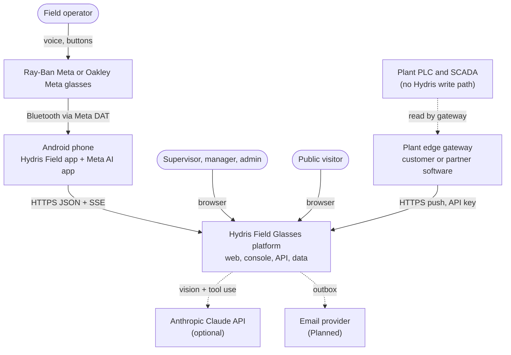

### Actors and external systems

Table: Actors and external systems

| Element | Kind | Interaction | Status |
|---|---|---|---|
| Field operator | Person | Glasses HUD, Android app, voice | Built (web HUD, Android app). Partial on real glasses hardware |
| Supervisor, maintenance engineer, manager, org admin | Person | Operator console (`/console`) | Built |
| Platform admin | Person | `/console/platform`, `/api/platform/organizations` | Built |
| Public visitor | Person | Website, live glasses demo, contact form | Built |
| Meta glasses | Device | Camera, microphone, capture button through the Meta Wearables Device Access Toolkit (DAT) 1.0.1 | Partial (code complete, limited hardware verification) |
| Plant edge gateway | System | Pushes readings with a `hgw_` key | Built (endpoint). Gateway software itself is Planned |
| Anthropic Claude API | System | Document vision extraction and voice assistant tool use | Built, optional (enabled by `ANTHROPIC_API_KEY`) |
| Email provider | System | Invitations and password reset | Planned. Messages are written to `mail_outbox` (`core/services.ts`) |

> [!IMPORTANT]
> Hydris never connects to a PLC, SCADA or DCS and has no endpoint that writes to one. Ingestion is outbound HTTPS from the plant to Hydris. This keeps Hydris outside IEC 62443 control zones and means a compromise of Hydris cannot change the physical process.

## Containers

### Container diagram

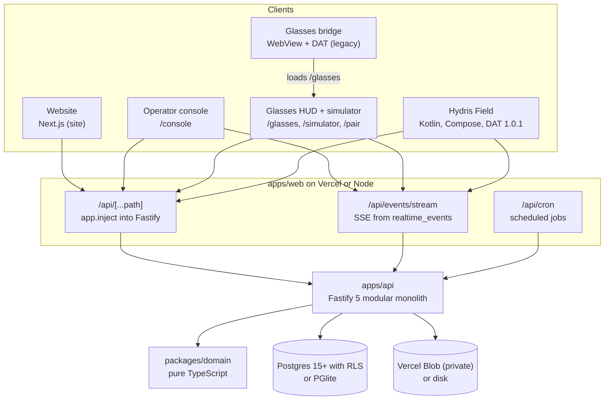

Table: Containers and technology

| Container | Technology (versions from `package.json` and `build.gradle.kts`) | Key files | Status |
|---|---|---|---|
| API | Fastify 5.12.7, zod 4.6.7, Drizzle ORM 0.45.4, `pg` 8.23.1, PGlite 0.5.9, `@fastify/jwt`, `@fastify/rate-limit`, `@node-rs/argon2`, `pdf-lib`, `@anthropic-ai/sdk` 0.137.0 | `apps/api/src/app.ts`, `modules/*`, `core/*` | Built |
| Web | Next.js 16.4, React 19.3, TanStack Query 5, Tailwind 4, Radix UI, Recharts, Tesseract.js 7 | `apps/web/src/**` | Built |
| Domain | TypeScript, no runtime dependencies | `packages/domain/src/*` | Built |
| Contracts | Placeholder package (`export {}`) | `packages/contracts/src/index.ts` | Planned |
| Hydris Field (Android) | Kotlin, Jetpack Compose (BOM 2026.05.01), OkHttp 4.12, CameraX 1.4.2, ML Kit text recognition 16.0.1, DAT 1.0.1 (core, camera, speech, inputs) | `apps/android/app/src/main/java/ai/hydris/field/**` | Built (Partial on hardware) |
| Glasses bridge | Kotlin, Android WebView, DAT 1.0.1 | `apps/glasses-bridge-android/.../MainActivity.kt` | Partial, superseded by Hydris Field |
| Database | Postgres 15+ (Neon, Render, Supabase, self-hosted Postgres 17 in Compose) or PGlite in-process | `apps/api/drizzle/0000` to `0008` | Built |
| File storage | Vercel Blob private store or local disk | `core/services.ts` (`createStorage`) | Built |

### Repository layout

The repository is an npm workspaces monorepo (`package.json`, `"workspaces": ["packages/*", "apps/*"]`, Node 22.x). The web app depends on the API package directly (`"@hydris/api": "0.2.0"`) and imports `@hydris/api/serverless`, which is how the API runs inside Next.js.

Table: Workspaces

| Workspace | Package name | Role |
|---|---|---|
| `packages/domain` | `@hydris/domain` | Roles, permissions, measurands, alarm and workflow state machines, device lifecycle, UI profiles, audit document structuring, voice parsing, simulation scenarios |
| `packages/contracts` | `@hydris/contracts` | Reserved for shared request and response schemas (empty today) |
| `apps/api` | `@hydris/api` | HTTP API, database schema and migrations, seeds, jobs, demo runtime |
| `apps/web` | `@hydris/web` | Website, console, glasses HUD, simulator, pairing page, built-in API route handlers |
| `apps/android` | Gradle project | Native operator app with glasses integration (not an npm workspace member in practice: no `package.json`) |
| `apps/glasses-bridge-android` | Gradle project | WebView companion that bridges DAT into the web HUD |

> [!DECISION]
> **One monorepo, one language on the server and web.** The API, web and domain packages share TypeScript types without a publishing step, and a change to a state machine lands in one commit across server and clients. The Android app is the exception: it mirrors the JSON contract by hand in `Models.kt` until `packages/contracts` produces a schema that Kotlin can consume (see the technical debt register).

## API: a modular monolith

### Component view

`buildApp()` in `apps/api/src/app.ts` creates one Fastify instance, registers shared plugins (helmet, cookie, global rate limit, JWT, multipart), installs the error handler and the glasses UI profile hook, then registers fifteen route modules under the `/api` prefix. Every module receives the same `Ctx` (`apps/api/src/context.ts`): database handle, event bus, configuration, storage adapter and the live-device map.

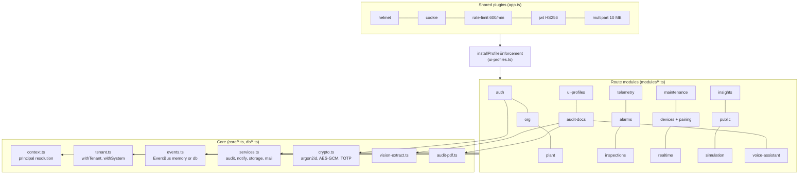

Table: API modules

| Module | Routes | Responsibility | Notable rules |
|---|---|---|---|
| `auth.ts` | 17 | Login, demo guest login, MFA (TOTP), refresh rotation, logout, invitations, password reset, sessions, org switch | Lockout after 5 failures for 15 min, refresh reuse detection with a 30 s grace |
| `org.ts` | 13 | Organization, members, invitations, notifications, audit log, platform organizations | No role escalation (`assignableRoles`) |
| `plant.ts` | 28 | Sites, facilities, process areas, assets, sensors, gateways, documents, attachments, hierarchy, history | Attachments only served through the authorised route |
| `telemetry.ts` | 6 | Gateway ingestion, manual and lab entry, downsampled history, CSV export, corrections | Single `ingest()` path, idempotent on `(sensor_id, ts)` |
| `alarms.ts` | 9 | Alarm rules, alarm list and detail, transitions, stale-data evaluation | Deadband and on-delay, note required to resolve |
| `inspections.ts` | 15 | Templates, routes, inspections, step responses, submit and review | Offline replay by `clientOpId`, `revision` counter |
| `maintenance.ts` | 7 | Work orders, checklists, activity | Transition table in `domain/workflows.ts` |
| `devices.ts` | 16 | Pairing challenges, approval, device refresh, device context, fleet admin | RFC 8628 shape, session version, refresh family revocation |
| `realtime.ts` | 1 | `GET /api/events/stream` (SSE) | Per-connection `canReceive` authorisation |
| `insights.ts` | 4 | Overview KPIs, grounded document assist, search, reports | Read-only |
| `public.ts` | 1 | Website contact and demo requests | 5 requests per 10 min |
| `simulation.ts` | 3 | Start, stop and inspect demo scenarios | Synthetic data rejected for non-demo tenants |
| `ui-profiles.ts` | 13 | Glasses UI profiles, versions, assignments, effective profile | Enforced on device requests by an `onRoute` hook |
| `audit-docs.ts` | 12 | Scanned audit documents: capture, enhance, review, verify, approve, PDF | Four-eyes approval, optimistic concurrency |
| `voice-assistant.ts` | 1 | `POST /api/assistant/ask` | Claude tool use or deterministic rules, 60 per min |

Route counts come from the `app.get/post/put/patch/delete` registrations; `devices.ts` registers `suspend`, `reactivate` and `revoke` in one loop and is counted as three.

### Request lifecycle

Every authenticated request follows the same path. In the built-in API mode on Vercel, the path starts in a Next.js route handler that forwards the request into Fastify with `app.inject` (`apps/web/src/app/api/[...path]/route.ts`), so there is no network hop between the web and the API.

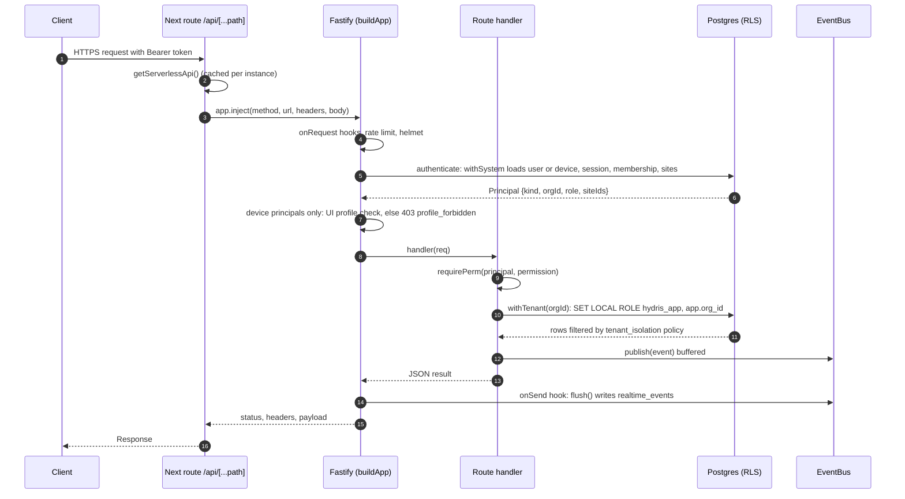

The order matters in three places:

- **Principal resolution re-checks revocation on every request.** `resolveTokenPrincipal()` loads the user status, confirms the session family in `auth_sessions` has not been revoked, and reloads the membership and site list. A device token is rejected if the device is not active, its `session_version` changed, or it has no current assignment. Logout and revocation therefore take effect on the next request, not when the 15 minute access token expires.
- **The UI profile hook runs after authentication.** `installProfileEnforcement()` is registered before the modules so that its `onRoute` hook can append a check to the matching routes. It only applies to device principals: a pair of glasses whose profile hides the alarms screen gets `403 profile_forbidden` from `GET /api/alarms` even if the operator's role allows it.
- **Events are written after the handler returns.** In `db` realtime mode the bus buffers publishes and the `onSend` hook calls `flush()`, so event rows are inserted outside the handler's transaction (`core/events.ts`).

### Error contract

All errors use one shape, produced by the error handler in `app.ts` and the helpers in `core/errors.ts`:

```json
{ "error": { "code": "validation_failed", "message": "Some fields are invalid", "details": [{ "path": "readings.0.ts", "message": "Invalid ISO datetime" }] } }
```

Table: Error mapping

| Source | Status | Code |
|---|---|---|
| `HttpError` thrown by a handler | As thrown (400, 401, 403, 404, 409) | As thrown, for example `note_required`, `invalid_transition`, `stale` |
| `ZodError` from request parsing | 400 | `validation_failed`, with `details[]` per field |
| Rate limiter | 429 | `rate_limited` |
| Anything else | 500 | `internal_error`, message masked as "Unexpected server error", stack logged |
| API failed to start (route handler) | 503 | `service_unavailable` with a short detail |
| SSE route in the wrong realtime mode | 503 | `realtime_misconfigured` |

Records outside the caller's site scope return **404, not 403** (`requireSite()` in `core/principal.ts`), so a user cannot probe for the existence of another site's assets or alarms.

## Domain model

### Key domain types

`packages/domain` is the vocabulary of the system. It has no I/O and is imported by the API, the web app and (by convention, mirrored by hand) the Android app.

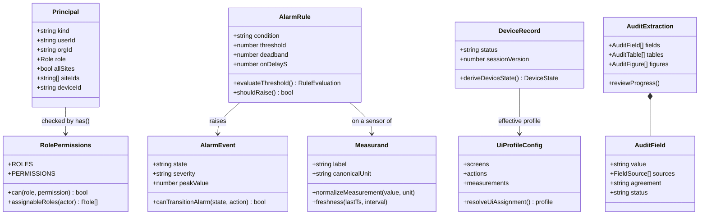

Table: Domain modules

| File | Owns | Used by |
|---|---|---|
| `roles.ts` | 6 roles, the permission list, `ROLE_PERMISSIONS`, `assignableRoles`, `SITE_SCOPED_BY_DEFAULT` | API authorisation, console navigation, Android visibility |
| `measurands.ts` | Measurand definitions (label, units, conversions, typical range, decimals), `normalizeMeasurement` | Ingestion, charts, voice answers |
| `freshness.ts` | `live`, `delayed`, `stale`, `no_data` from last timestamp and expected interval | Console, HUD, stale-data alarms |
| `alarms.ts` | Severities, conditions, states, `ALARM_TRANSITIONS`, `evaluateThreshold` (deadband), `shouldRaise` (on-delay) | Alarm engine, console, HUD |
| `workflows.ts` | Inspection and maintenance state machines, step kinds, progress | Inspections and maintenance modules |
| `devices.ts` | Device states, `deriveDeviceState`, pairing alphabet (30 characters), length 8, TTL 300 s, poll interval 3 s | Pairing, fleet views |
| `uiprofile.ts` | Screens, widgets, actions, text scales, precedence device then user then role then org | Profile enforcement, HUD |
| `auditdoc.ts` | OCR types, key/value and table structuring, cross-check, plausibility, agreement score | Audit scan pipeline on client and server |
| `voice.ts` | Wake phrase regex (`WAKE_RE`), utterance normalisation, measurand detection | Web voice, rules engine |
| `scenarios.ts`, `random.ts`, `catalog.ts` | Simulation scenarios with deterministic noise, enumerations | Simulator, seeds |

### Alarm state machine

Alarm transitions are data, not code paths: `ALARM_TRANSITIONS` in `packages/domain/src/alarms.ts` lists for each action the allowed source states, the target state, the permission and whether a note is required. `transitionAlarm()` in `modules/alarms.ts` applies it, writes `alarm_event_history`, appends an audit event and publishes `alarm.updated`. The transitions are: acknowledge (active to acknowledged), investigate (active or acknowledged to investigating), resolve (acknowledged or investigating to resolved, note required) and close (resolved to closed). The condition clearing (`clearedAt`) is separate from the human workflow: an alarm whose value returned to normal stays open until someone acknowledges and resolves it.

## Data architecture and tenancy

### Schema overview

`apps/api/src/db/schema.ts` defines 42 tables. `DATA_MODEL.md` documents each column; this chapter covers the structural decisions.

Table: Table groups

| Group | Tables | Notes |
|---|---|---|
| Identity and tenancy | `users`, `organizations`, `memberships`, `membership_sites`, `invitations`, `auth_sessions`, `auth_tokens`, `mail_outbox` | `users` is global; membership is per organization |
| Plant model | `sites`, `facilities`, `process_areas`, `assets`, `gateways`, `sensors`, `documents`, `attachments` | Hierarchy site, facility, process area, asset, sensor |
| Telemetry and alarms | `telemetry_readings`, `telemetry_corrections`, `alarm_rules`, `alarm_events`, `alarm_event_history` | Readings are immutable; corrections supersede for display |
| Work | `inspection_templates`, `inspection_routes`, `inspections`, `inspection_responses`, `maintenance_tasks`, `maintenance_activity` | `inspections.revision` for optimistic concurrency |
| Devices | `devices`, `device_assignments`, `pairing_challenges`, `device_sessions` | Assignment history is kept (`unassigned_at`) |
| Glasses UI | `ui_profiles`, `ui_profile_versions`, `ui_profile_assignments` | Versioned configuration |
| Audit documents | `audit_documents`, `audit_document_pages`, `audit_document_events` | Page images stored in the database as base64 text |
| Platform | `notifications`, `audit_events`, `inquiries`, `simulation_runs`, `realtime_events` | `realtime_events` is system-only |

`telemetry_readings` uses a `bigint` identity key, a unique index on `(sensor_id, ts)` that makes ingestion idempotent, a descending `(sensor_id, ts)` index for latest-value and history reads, and an `(org_id, ts)` index. There is no partitioning or retention policy yet.

### Row-level security

Tenant isolation is enforced by Postgres, not only by application code.

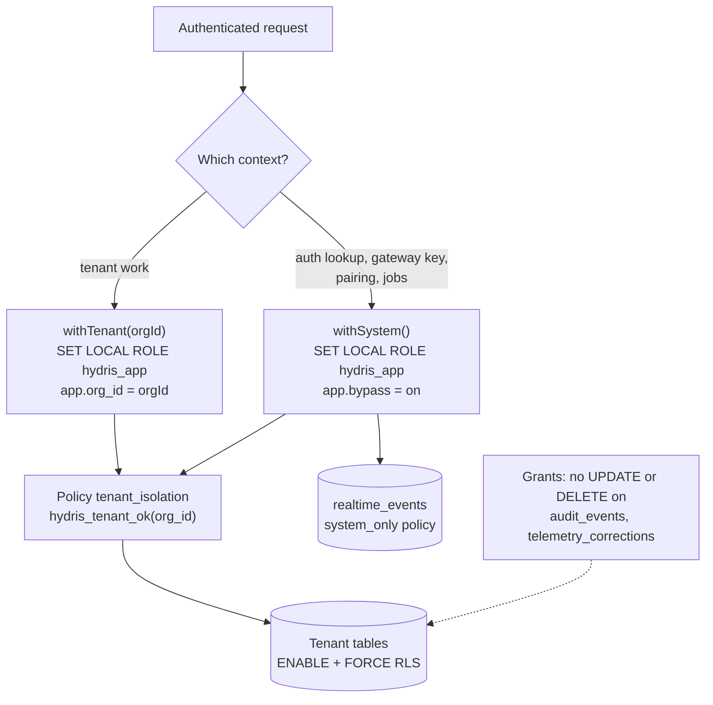

The mechanics, from `drizzle/0001_rls.sql`, `0003`, `0006`, `0008` and `db/tenant.ts`:

- `hydris_app` is created `NOLOGIN` and without `BYPASSRLS`. Migration `0004_app_role_membership.sql` grants the connecting owner role membership `WITH SET TRUE` so that managed Postgres (PG16+) allows `SET ROLE`.
- `hydris_tenant_ok(row_org)` returns true when `app.bypass` is `on` or when `row_org` equals `app.org_id`. Every tenant table has a `tenant_isolation` policy `USING` and `WITH CHECK` that function, so both reads and writes are checked.
- `withTenant()` and `withSystem()` each open a transaction and use `SET LOCAL` and `set_config(..., true)`, so settings cannot leak to the next request on a pooled connection.
- `audit_events` and `telemetry_corrections` have `UPDATE` and `DELETE` revoked from `hydris_app`, and `audit_document_events` has only `SELECT` and `INSERT`. Even system context cannot rewrite history.
- `realtime_events` uses a `system_only` policy: clients never read it directly; the stream reads it in system context and filters per connection.

> [!DECISION]
> **Postgres RLS as the last line of tenant isolation.** The application already filters by organization and site. RLS makes a forgotten `WHERE` clause a non-event instead of a data breach, and it lets a security reviewer verify isolation by reading 46 lines of SQL instead of every query. The cost is that every request runs in a transaction, and system work must be explicit (`withSystem`), which is a useful signal in code review.

### Append-only records and provenance

- A manual or lab reading is stored as an ordinary immutable reading; the audit row (`telemetry.manual_entry`) is the provenance record of who entered it (`modules/telemetry.ts`).
- Corrections never overwrite `telemetry_readings`. A `telemetry_corrections` row supersedes the value for display and aggregation, and history queries compute effective values with a lateral join.
- Audit document reviews keep the first extracted value in `extracted` and write every confirm, correct, flag, verify and approve action to `audit_document_events`.
- Synthetic data is marked (`synthetic = true`) and `ingest()` refuses simulator data for any tenant that is not a demo organization (`synthetic_not_allowed`).

### Migrations

Nine SQL migrations (`apps/api/drizzle/0000_init.sql` to `0008_audit_documents_rls.sql`) are generated by drizzle-kit and applied by the Drizzle migrator. On Postgres, `createDatabase().migrate()` takes a session-level advisory lock (key `4872917633`) on a dedicated connection, so several serverless instances cold-starting at once, or a deploy and an instance, cannot run migrations concurrently (`db/client.ts`). On Vercel the migrations folder is shipped with the functions through `outputFileTracingIncludes` in `apps/web/next.config.ts` and located at runtime by `findMigrationsFolder()`.

## Identity, sessions and tokens

### Token model

Table: Credentials

| Credential | Format and lifetime | Held by | Revocation |
|---|---|---|---|
| User access token | JWT HS256 `{typ: user, sub, org, sid}`, 15 min (12 h in demo mode) | Client memory only | `sid` is the refresh family; revoking the family invalidates access tokens on the next request |
| User refresh token | 48 random bytes, SHA-256 stored in `auth_sessions`, 7 days, cookie `hg_refresh` (httpOnly, SameSite=Strict, path `/api/auth`, Secure in production) | Browser cookie jar; Android encrypted cookie store | Rotation on every use; replay after 30 s revokes the family |
| MFA challenge | JWT `{typ: mfa}`, 5 min | Client | Single step |
| Device access token | JWT `{typ: device, sub, org, sv}`, 15 min | Device memory | `devices.session_version` bump, suspend, revoke, unassign |
| Device refresh token | `hgd_` plus 40 random bytes, `device_sessions`, 30 days, rotating | Android Keystore-encrypted store; web `localStorage` | Reuse revokes the family and is audited (`device.refresh_reuse_detected`) |
| Gateway key | `hgw_` prefix, SHA-256 in `gateways.key_hash` | Gateway | `POST /api/gateways/:id/revoke` |
| Demo session cookie | Signed JWT `hg_demo` | Browser | Demo mode only |
| Demo device refresh | `hgd_z` plus HMAC-signed claims (org, device, user, site, version) | Device | Demo mode only |

Passwords are hashed with argon2id (memory 19456 KiB, time cost 2, parallelism 1) and a dummy verification burns equal time for unknown emails (`core/crypto.ts`). TOTP secrets are encrypted at rest with AES-256-GCM under `DATA_KEY`.

### Refresh rotation and reuse detection

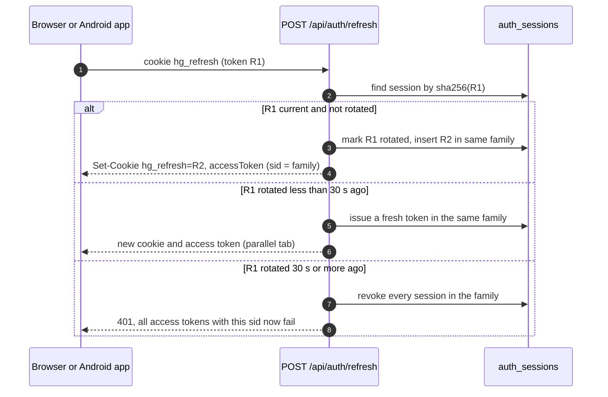

Clients refresh with a **single-flight** guard so parallel 401s trigger one refresh: `refreshSession()` in `apps/web/src/lib/api.ts`, `refresh()` in `apps/web/src/glasses/link.ts`, and a coroutine `Mutex` in `HydrisApi.kt` on Android.

### Session and token states

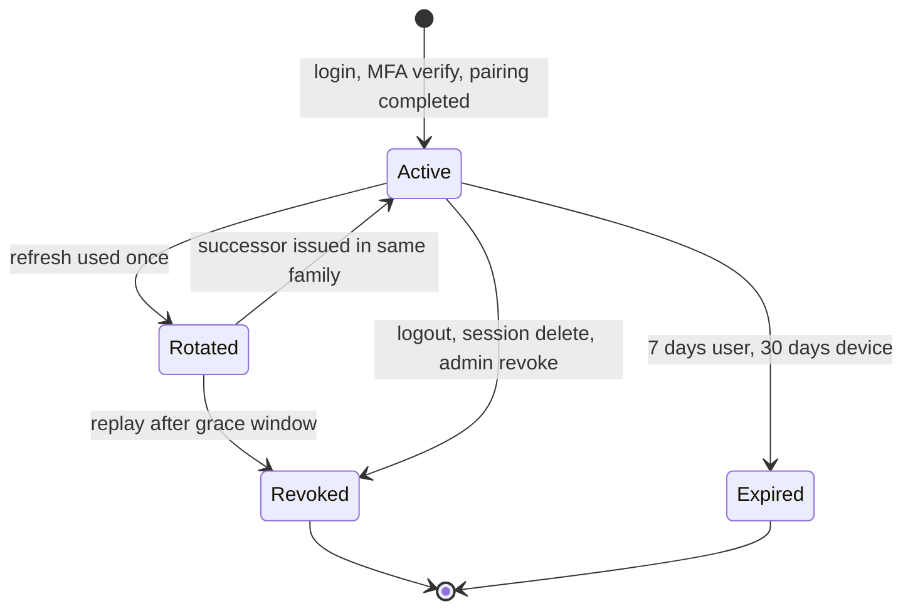

### Principals and permissions

A verified token becomes a `Principal` (`core/principal.ts`). Devices act **on behalf of their assigned operator**: a device principal carries the operator's `userId`, role and sites, and `has()` additionally requires the permission to be in `DEVICE_PERMISSIONS`, a fixed set of 13 permissions (read site, asset, telemetry, alarm, inspection, maintenance, document and audit document data; acknowledge alarms; execute inspections and maintenance; request maintenance; capture audit documents). Glasses therefore can never verify or approve a document, manage members or edit rules, whatever the operator's role. Audit document verification and approval add an explicit `p.kind !== 'user'` check on top.

## Devices and pairing

### Pairing flow

Pairing follows the shape of the OAuth 2.0 Device Authorization Grant (RFC 8628). The glasses or the app requests a challenge, shows a short code and a QR link, and a signed-in person approves it. The QR encodes only the verification URL and the short code, never a credential.

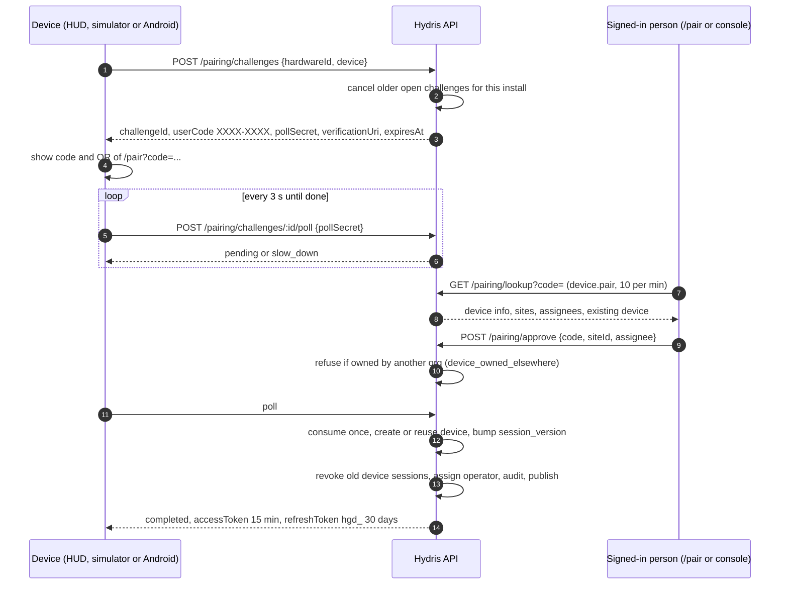

The Android app uses the same endpoints but approves its own challenge with the signed-in user's session: `Repository.registerGlasses()` creates the challenge with the DAT hardware id, looks the code up, approves it for the first site the user can see, and polls for the tokens. The web HUD, the simulator and the companion bridge use the two-device flow shown above.


### Device lifecycle

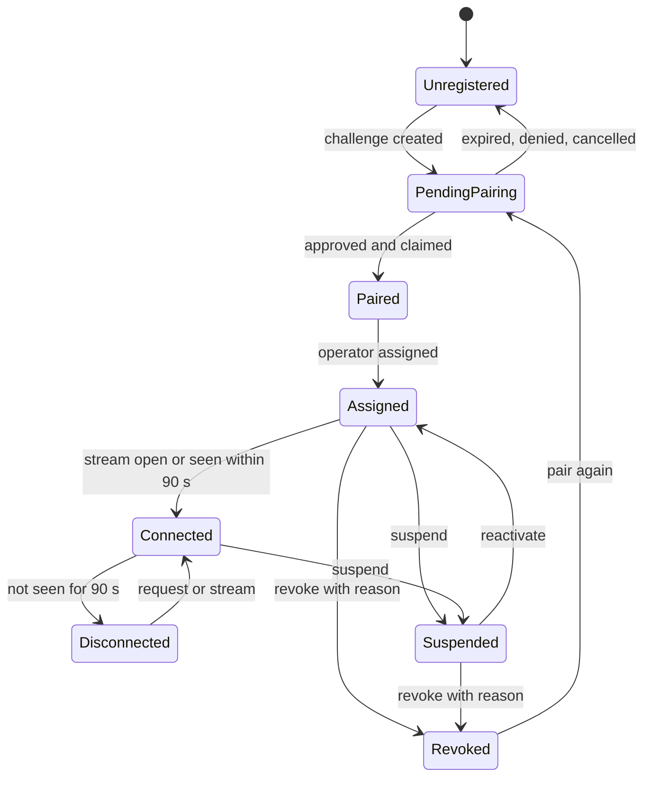

Suspension and revocation bump nothing in the token itself; they change `devices.status`, which `resolveTokenPrincipal()` reads on every request. Revocation also revokes all `device_sessions`, closes the assignment and publishes `device.revoked` to that device only.

### Glasses UI profiles

Administrators decide what each role or device sees on glasses without shipping an app. A profile (`ui_profiles`, versioned in `ui_profile_versions`) lists enabled screens, widgets, allowed actions, measurand filters and text scale. Assignments resolve with the precedence device, then user, then role, then organization (`UI_SCOPE_PRECEDENCE` in `packages/domain/src/uiprofile.ts`). The API enforces the effective profile on device requests through the route rule table in `modules/ui-profiles.ts` and caches each device's effective profile for 5 s. A change invalidates the cache and publishes `device.profile_changed` to the affected devices, which reload their context.

## Telemetry and alarms

### Ingestion and alarm raising

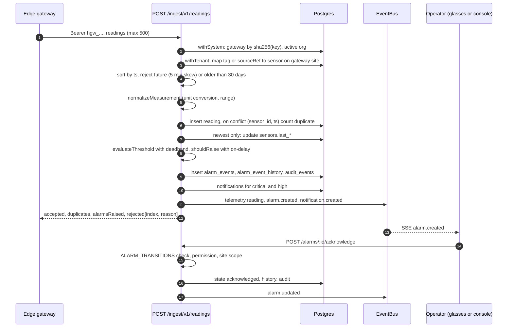

Design points worth knowing:

- **Out-of-order data** is stored for history but does not overwrite a newer latest value or re-trigger alarm evaluation.
- **Hysteresis**: once in alarm, a value inside the deadband reports `holding`, not `normal`, so a noisy signal does not flap. A breach must persist for `onDelayS` (tracked in `alarm_rules.breach_since`) before an alarm is raised.
- **One open event per rule**: a continuing breach only updates `peak_value`. When the value returns to normal the event gets `cleared_at` but stays open for people to acknowledge and resolve.
- **Bad quality readings** update the latest value but skip alarm evaluation.
- **Partial success**: the gateway receives per-reading rejections with the original index, so it can retry or drop individual readings.

### Stale-data alarms and background jobs

"No fresh data" rules cannot be evaluated on ingestion, because the problem is the absence of readings. `evaluateStaleRules()` scans all enabled stale rules across tenants in system context. `jobs.ts` schedules it and three other jobs.

Table: Background jobs

| Job | Long-running server (`startJobs`) | Vercel (`/api/cron` via `runScheduledJobs`) | Demo mode |
|---|---|---|---|
| Stale-data rules | Every 30 s | Once per cron run: `vercel.json` schedules `0 3 * * *` (daily) | Not ticked by `DemoTicker` |
| Pairing expiry | Every 60 s | Once per cron run | Challenges also expire by `expiresAt` checks |
| Realtime event pruning (older than 1 day) | Hourly in `db` mode | Once per cron run | Per instance memory |
| Simulation steps | `setInterval` per run, 5 s | Once per cron run | `DemoTicker.poke()` on API activity, at most every 5 s |

> [!WARNING]
> In the all-Vercel topology the cron runs once a day, so stale-data alarms are raised at most daily. A production plant on Vercel needs a more frequent scheduler (a higher cron tier or an external trigger calling `/api/cron` with `CRON_SECRET`) or the API in a container where `startJobs` runs every 30 s. This is tracked as TD-02.

## Realtime

### Server-Sent Events

Clients receive domain events over Server-Sent Events. The connection is made with `fetch()`, not the browser `EventSource`, so the bearer token travels in the `Authorization` header and never in a URL (`apps/web/src/lib/realtime.ts`). The Android app does the same with OkHttp (`HydrisApi.events()`).

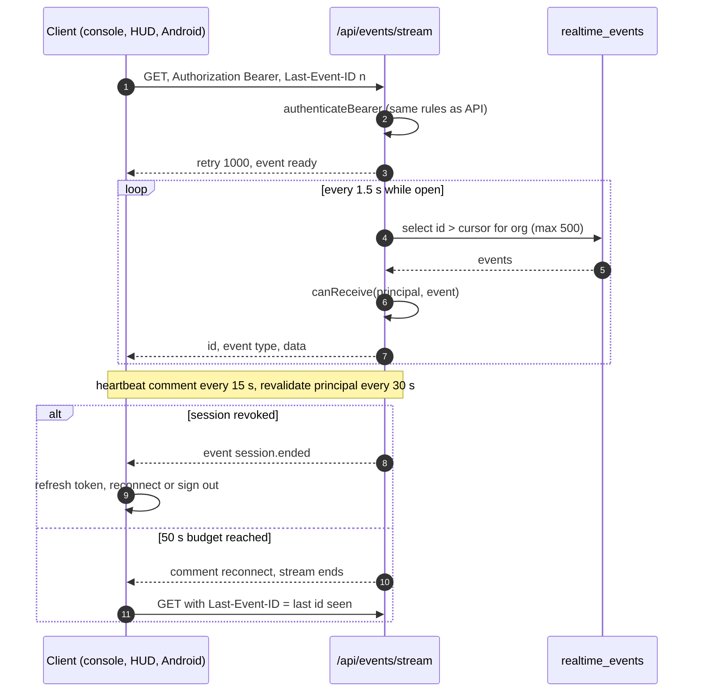

Table: Realtime modes (`REALTIME_MODE`, `core/events.ts`)

| Aspect | `memory` | `db` |
|---|---|---|
| Transport inside the API | In-process `EventEmitter` | Buffered rows in `realtime_events`, flushed in `onSend` |
| Fan-out across instances | No (single instance) | Yes, every instance polls the same table |
| Replay on reconnect | Ring buffer of the last 1,000 events | Any event id still in the table (pruned after 1 day) |
| Latency | Immediate | Up to the 1.5 s poll interval |
| Device presence | `ctx.liveDevices` counts open streams | `devices.last_seen_at` |
| Used by | `server.ts` default, Docker Compose, Render | Vercel, demo mode, any multi-instance deployment |

Authorisation is per connection and per event (`canReceive` in `modules/realtime.ts`): the event's organization must match, device-targeted events go only to those devices, user-targeted events only to those users, and site and permission constraints apply. Events carry identifiers and small payloads; clients refetch through the normal API, which applies RLS again.

The console batches invalidations: `Shell.tsx` maps event types to API path prefixes (`EVENT_PATHS`) and invalidates matching TanStack Query entries every 1.5 s, while critical and high `alarm.created` events raise a toast immediately.

Table: Event types published today

| Area | Events |
|---|---|
| Telemetry and alarms | `telemetry.reading`, `telemetry.corrected`, `sensor.updated`, `alarm.created`, `alarm.updated` |
| Work | `inspection.updated`, `maintenance.updated`, `notification.created` |
| Plant | `asset.updated`, `simulation.step` |
| Devices | `pairing.completed`, `device.paired`, `device.updated`, `device.context_changed`, `device.profile_changed`, `device.revoked` |
| Documents and UI | `auditdoc.updated`, `ui_profile.updated` |

> [!DECISION]
> **SSE instead of WebSockets.** All realtime traffic is server to client; client actions are ordinary authenticated HTTP calls that go through the same validation, RBAC and RLS. SSE works through the Vercel function model (a streamed response with a time budget), through corporate proxies, and with plain `fetch` on every client. WebSockets would need a separate stateful service on Vercel. The price is polling in `db` mode and a reconnect every 50 s, both acceptable at pilot scale.

## Audit document scanning

### Pipeline

Paper logbooks, lab sheets and permits become verified digital records through a pipeline that combines on-device OCR, server structuring, an optional vision model and two human steps.

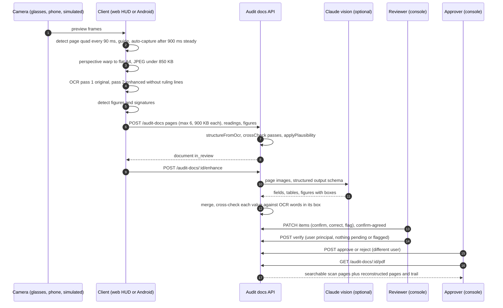

Key properties:

- **Two independent machine readings.** Each page is read twice on the device, once as captured (`ocr:original`) and once contrast-normalised with ruling lines removed (`ocr:enhanced`). The web uses Tesseract.js in WebAssembly (`apps/web/src/lib/ocr.ts`); Android uses ML Kit (`scan/OcrEngine.kt`) and emits exactly the same JSON shape. Disagreement between passes is a signal for the reviewer, which is why the server stores per-field `sources` and an `agreement` value (`match`, `close`, `mismatch`, `single`).
- **No image leaves the device before upload.** Detection, warping and OCR run locally. The web warp produces a 1654 px wide A4 page (`warpToA4` default; the file header comment still says 1240 by 1754).
- **Vision is additive.** If no Anthropic credential is configured, `enhance` returns `aiStatus: unavailable` and the OCR result stands. If the model fails, `aiStatus` becomes `failed` with a short reason and the OCR result stands. Vision cannot replace an extraction once review has started (`409 review_started`).
- **Dual human verification.** Verification and approval require a user principal signed in to the console, and approval must come from a different person than the verifier. Demo tenants may self-approve, and the event records it as such.
- **Optimistic concurrency.** Every write is `UPDATE ... WHERE revision = n`; a lost race returns `409 stale` and the client reloads.

### Document states

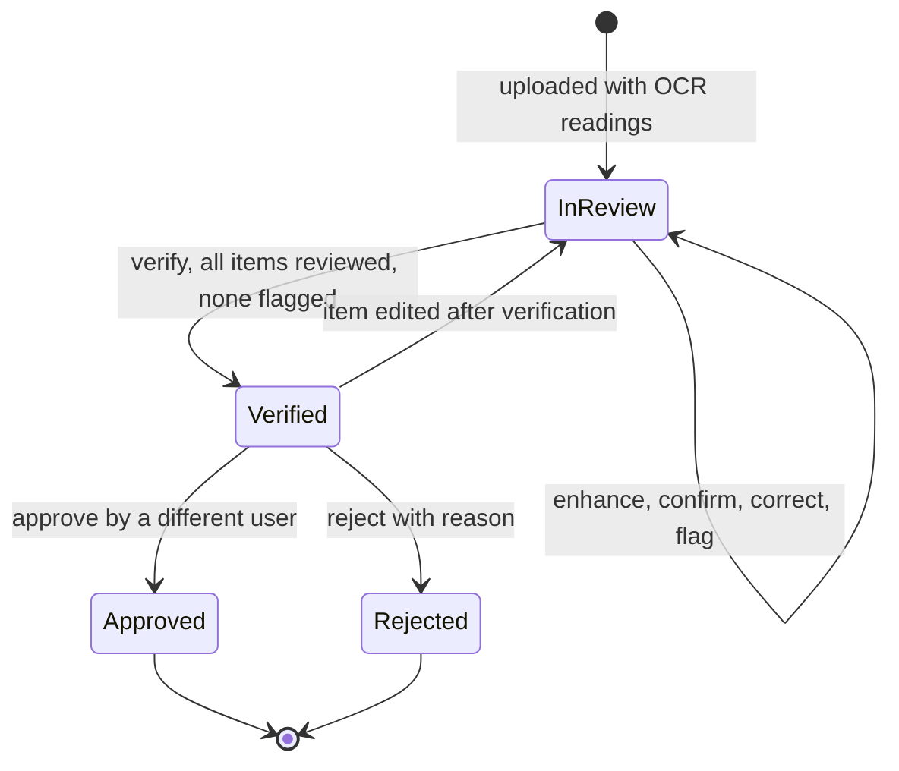

The schema also defines a `processing` status for server-side processing; the current upload path writes `in_review` directly because structuring is synchronous.


## Voice assistant

"Hey Hydris" answers spoken questions with data from the caller's own account. The wake phrase is matched on the client (`WAKE_RE` in `packages/domain/src/voice.ts`, which tolerates common mis-transcriptions such as "hydras" or "idris"), and the question after the wake phrase goes to `POST /api/assistant/ask`.

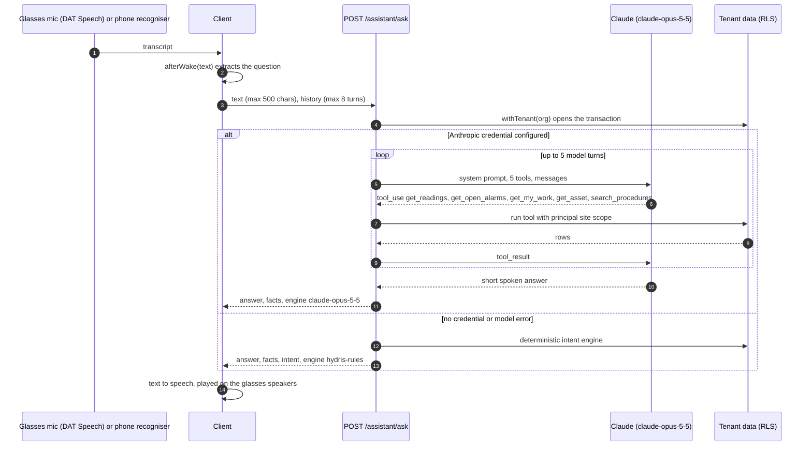

The system prompt forbids estimating or inventing values, asks for the age of each reading, and states that Hydris never operates equipment. The rules engine never guesses: an unrecognised question gets a plain "I can't answer that". The response's `facts[]` list the readings used (label, value, unit, time, and whether they are synthetic), so the client can show what an answer was based on. The endpoint is rate limited to 60 calls per minute.

> [!DECISION]
> **Grounded tool use with a deterministic fallback.** The model never sees the database; it can only call five read-only tools that execute inside the caller's tenant transaction. The deterministic engine keeps the feature working (with narrower coverage) when no credential is configured, the provider is unavailable, or a customer forbids external AI processing.

## Client applications

### Web application

One Next.js application serves four very different experiences from one deployment.

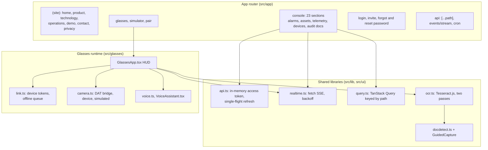

- **Console** sessions keep the access token in memory and the refresh token in the httpOnly cookie. Data is fetched with TanStack Query, where the API path is the cache key so that realtime events can invalidate by prefix (`lib/query.ts`).
- **Glasses HUD** sessions are device sessions. `link.ts` stores the install id and device refresh token behind a `SecureStore` interface (web implementation: `localStorage`), and keeps an **offline queue** of inspection step responses. Each queued operation carries a client id, and the server deduplicates on `(inspection_id, client_op_id)`, so replays after a network drop are safe.
- **Simulator** (`/simulator`) renders the 600 by 600 additive HUD (`GLASSES_DISPLAY` in `packages/domain/src/devices.ts`) in a browser, with a simulated camera that films a sample A4 sheet so the whole scan pipeline can be demonstrated without hardware.
- **Security headers** come from `next.config.ts`: `X-Frame-Options: DENY` everywhere except `/glasses` and `/simulator` (`SAMEORIGIN`, so the website can embed the live demo), `nosniff`, a strict referrer policy and a permissions policy that allows only the camera for the same origin. Helmet runs in the API with its content security policy disabled.


### Android app: Hydris Field

Hydris Field (`apps/android`, package `ai.hydris.field`, minSdk 31 to match DAT, targetSdk 36) is the operator's phone app and the bridge to the glasses.

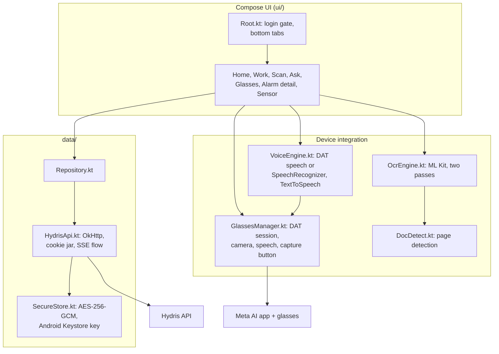

- **Sessions** follow the web contract: an access token in memory and the rotating `hg_refresh` cookie (plus `hg_demo` in demo mode) persisted only as ciphertext in `SecureStore`. 401 responses refresh once under a `Mutex` and retry.
- **Glasses** are reached through the Meta Wearables Device Access Toolkit 1.0.1: `Wearables.initialize`, registration with the Meta AI app, an auto-selected `DeviceSession`, and the camera (preview stream and `capturePhoto`), speech (`addSpeech`) and inputs (capture button) capabilities. A debug-only mock device kit dependency supports development without hardware.
- **Scans taken with the glasses are attributed to the glasses**: `Repository.uploadScan()` uses the device channel (`deviceCall`) when the glasses are registered, so the console shows `capturedVia: glasses` and the device id.
- **Server URL** defaults to `https://hydrisview.vercel.app` and can be overridden in `local.properties` (`hydris_url`), as can the DAT application id and client token for production builds.


> [!DECISION]
> **DAT through a native app, not a WebView bridge.** The first integration (`apps/glasses-bridge-android`) hosted the web HUD in a WebView and exposed DAT through `window.HydrisNative`. It works, but camera frames had to be encoded and passed across the JavaScript bridge, permissions and lifecycle were fragile, and operators need a real phone app anyway. Hydris Field calls DAT directly from Kotlin, runs OCR with ML Kit on the phone, and keeps the web HUD for the simulator, the website demo and future display glasses. The bridge remains in the repository as a fallback.

## Deployment topologies

The same API code runs in four topologies. Configuration is a zod-validated environment (`apps/api/src/config.ts`): `DATABASE_URL` selects Postgres or PGlite, `REALTIME_MODE` selects the event bus, `BLOB_READ_WRITE_TOKEN` selects Vercel Blob over disk, and `API_URL` in the web app selects the external API over the built-in one.

### All on Vercel (serverless)

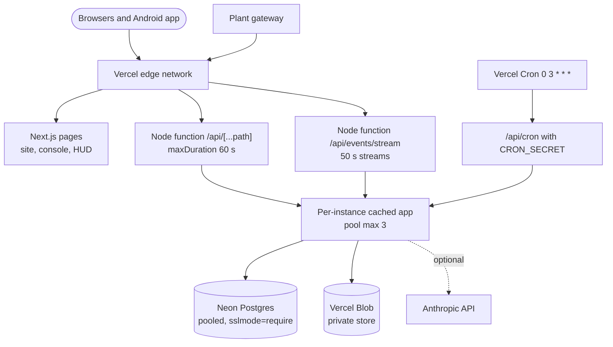

- `getServerlessApi()` (`apps/api/src/serverless.ts`) builds the app on first use, caches the promise for the life of the instance, and clears it on failure so the next request retries.
- Native and WebAssembly packages (`@node-rs/argon2`, `pg`, PGlite, Fastify plugins, `@vercel/blob`) are declared `serverExternalPackages` so they load from `node_modules` instead of being bundled.
- Migrations run on cold start under the advisory lock unless `MIGRATE_ON_START=false`. The root `vercel-build` script would migrate during the build, but `vercel.json` sets `buildCommand` to `npm run build`, so cold-start migration is what runs today.
- `REALTIME_MODE=db` is required; the SSE route refuses to start otherwise.

### Self-hosted and plant edge

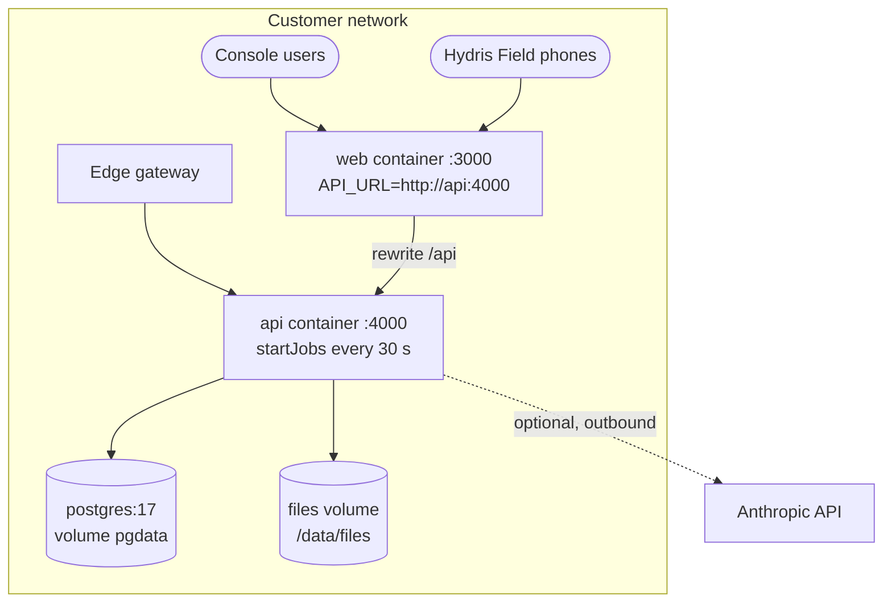

`docker-compose.yml` runs Postgres 17, the API (`apps/api/Dockerfile`) and the web app (`apps/web/Dockerfile`, built with `API_URL=http://api:4000`). The API runs migrations as the owner and then works as `hydris_app` through `SET LOCAL ROLE`, so RLS applies. Memory realtime mode is enough on a single host, and the long-running jobs give 30 s stale-data detection. With no Anthropic key the system is fully functional offline from the internet except for vision enhancement and the language model assistant, which fall back as described.

### Hybrid

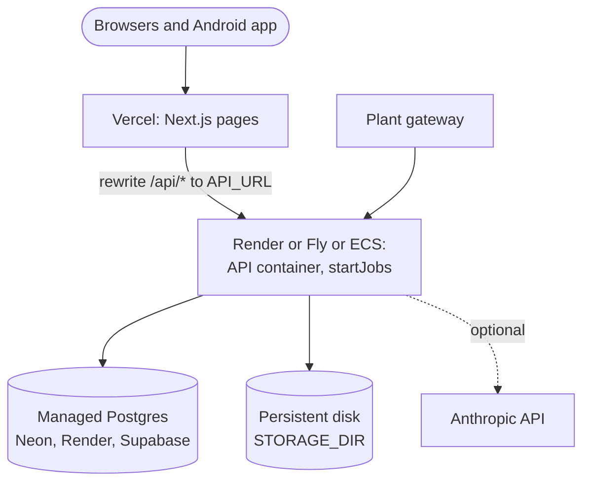

When `API_URL` is set, `next.config.ts` adds a `beforeFiles` rewrite that proxies `/api/*` to the external API, and the in-app route handlers are bypassed. `render.yaml` describes the API service (Docker, health check `/api/health`, 5 GB disk at `/data/files`, generated `JWT_SECRET`, simulator off). This topology removes the serverless limits: memory or db realtime, 30 s jobs, no cold-start migrations, long SSE connections.

Table: Topology comparison

| Concern | All Vercel | Hybrid | Docker Compose | Demo mode |
|---|---|---|---|---|
| Status | Built, live | Partial | Built | Built, live |
| Database | Neon Postgres | Managed Postgres | Postgres 17 container | PGlite in memory per instance |
| Realtime | `db`, 1.5 s poll, 50 s streams | `memory` (one instance) or `db` | `memory` | `db` per instance |
| Jobs | Cron (daily today) | Timers (30 s) | Timers (30 s) | Lazy ticker on activity |
| Files | Vercel Blob private | Disk volume | Disk volume | Disk in function temp |
| Best for | Pilots, demos, low ops | Production cloud | On-premises, air-gapped plants | Sales and evaluation |

### Demo mode and cross-instance state

Demo mode turns on automatically on Vercel when no `DATABASE_URL` is set (`isDemoEnv()` in `config.ts`). Each serverless instance migrates an in-memory PGlite database and seeds the same deterministic tenant (`seed/showcase.ts`). Because instances share nothing, the state that must survive a hop between instances goes through a small shared key/value store (`core/demo-shared.ts`).

```mermaid
%% caption: Demo mode across serverless instances. A guest created on instance A is rebuilt on instance B from the shared store and deterministic ids.
sequenceDiagram
  autonumber
  participant U as Visitor
  participant A as Instance A (PGlite)
  participant K as demoShared (Postgres, Vercel Runtime Cache or memory)
  participant B as Instance B (PGlite)
  U->>A: POST /auth/demo {name: Priya}
  A->>A: guestUserId = demoId(guest, name)
  A->>K: set guest:id {name}, TTL 30 days
  A->>A: create user, membership, copy of owner's open work
  A-->>U: access token (12 h), hg_refresh, hg_demo cookies
  U->>B: GET /api/device/context with token
  B->>B: user unknown locally
  B->>K: get guest:id
  K-->>B: {name: Priya}
  B->>B: materializeGuest (same deterministic ids)
  B->>B: accept token whose session family is unknown here
  B-->>U: same data as instance A
  Note over A,B: pairing challenges and audit documents are shared the same way
```

The shared store prefers Postgres (one table, `hydris_demo_kv`) when a Postgres URL is present, then the Vercel Runtime Cache, then process memory, and a `Resilient` wrapper falls back to memory on any error so the demo never fails because of the store. Device tokens in demo mode carry the operator and site, and demo device refresh tokens are HMAC-signed and self-contained, so any instance can rebuild a paired device. Audit documents are snapshotted into the store after each write and hydrated by revision on read.

> [!CAUTION]
> Demo mode relaxes session checks (it accepts a valid token whose session family this instance has never seen) and uses public, fixed secrets. It is selected only when no database is configured or `DEMO_MODE=true`, logs a warning, and must never hold real plant data.


## Cross-cutting concerns

### Caching and concurrency

Table: Caches

| Cache | Scope and lifetime | Invalidation | File |
|---|---|---|---|
| Serverless API instance | Per function instance, until recycled | Cleared if the build fails | `apps/api/src/serverless.ts` |
| Effective glasses UI profile | Per API instance, 5 s | Cleared on any profile or assignment change on that instance | `modules/ui-profiles.ts` |
| Console query cache | Per browser tab | Realtime events by path prefix, batched every 1.5 s; mutations | `lib/query.ts`, `console/Shell.tsx` |
| OCR engine | Per page, worker created once; language data in browser cache | Never | `lib/ocr.ts` |
| Demo shared store | Postgres table, Vercel Runtime Cache (per region) or memory, with TTLs | TTL | `core/demo-shared.ts` |

Concurrency is handled with database constraints and explicit versions rather than locks held across requests:

- **Idempotent writes**: readings are unique on `(sensor_id, ts)`; inspection responses on `(inspection_id, client_op_id)`; pairing code allocation retries up to five times on a unique violation.
- **Optimistic concurrency**: `inspections.revision` and `audit_documents.revision`. Audit document updates include `WHERE revision = n` and return `409 stale` on a lost race.
- **Single-flight**: token refresh on every client; `DemoTicker` allows one step in flight and at most one step per 5 s; `EventBus.flush()` chains writes so batches are inserted in order.
- **Serialized migrations**: Postgres advisory lock.
- **Connection pools**: 3 connections per serverless instance and 10 for a long-running server (`serverless.ts`, `db/client.ts`).

### Error handling and resilience

Table: Failure modes and responses

| Failure | Behaviour | Where |
|---|---|---|
| API fails to build on a cold start | 503 `service_unavailable` with a short detail; next request retries the build | `app/api/[...path]/route.ts`, `serverless.ts` |
| Network drop on the glasses | Inspection responses queue locally and replay with client ids | `glasses/link.ts` |
| SSE disconnect | Reconnect with backoff 0.5 s doubling to a 15 s cap, resume from `Last-Event-ID` | `lib/realtime.ts` |
| Session revoked during a stream | `session.ended`, client tries one refresh, then signs out | `modules/realtime.ts` |
| Access token expired | One transparent refresh and retry | `lib/api.ts`, `link.ts`, `HydrisApi.kt` |
| Vision engine error or missing key | OCR extraction kept, `aiStatus` failed or unavailable with reason | `modules/audit-docs.ts` |
| Language model error or missing key | Deterministic rules engine answers | `modules/voice-assistant.ts` |
| One background job fails | Others still run; the cron report lists each job's result | `jobs.ts` |
| Demo shared store unreachable | Falls back to instance memory | `core/demo-shared.ts` |
| Event written for a rolled-back request | Harmless refetch hint | `core/events.ts` |
| Gateway sends bad readings | Per-reading rejection with index and reason; the rest are accepted | `modules/telemetry.ts` |

### Observability

Observability is basic today. **Built**: Fastify request logging at `info` level on the long-running server (`server.ts`) and opt-in on serverless (`API_LOG=true`); 5xx errors are logged with the stack; `GET /api/health` for load balancers and Render; the cron endpoint returns a JSON report with per-job status and duration; `audit_events` records security-relevant and business actions (logins, device lifecycle, alarm transitions, exports, verifications) with actor, device and IP; Vercel runtime logs capture `console.error` from route handlers and jobs. **Planned**: OpenTelemetry traces across the route handler and Fastify, metrics for ingestion rate, rejection reasons, alarm latency, SSE connections and OCR agreement, error tracking, and alerting on stale gateways.

### Security architecture summary

Security is covered in depth in `SECURITY_PRIVACY.md`. Architecturally, the controls are layered:

Table: Security layers

| Layer | Control | File |
|---|---|---|
| Transport and headers | HTTPS, helmet, frame and permissions policies | `app.ts`, `next.config.ts` |
| Abuse | Global 600 requests per minute plus stricter per-route limits (login 10, refresh 60, pairing 10, assistant 60, ingestion 1,200, inquiries 5 per 10 min) | `modules/*.ts` |
| Authentication | argon2id, TOTP MFA, lockout, short access tokens, rotating refresh families | `modules/auth.ts`, `core/crypto.ts` |
| Authorisation | Role permissions, device permission cap, site scope with 404, UI profile hook | `core/principal.ts`, `modules/ui-profiles.ts` |
| Data isolation | RLS with `FORCE`, non-privileged role, append-only grants | `drizzle/0001_rls.sql` and later |
| Secrets at rest | MFA secrets AES-256-GCM; token and key hashes only (SHA-256) | `core/crypto.ts` |
| Files | Random keys, private Blob store, served only through `/api/attachments/:id` | `core/services.ts` |
| Mobile | Keystore-backed AES-GCM for cookies and device tokens | `SecureStore.kt` |

## Architecture decision records

The decisions below are recorded here until they move to individual ADR files. Each lists the alternatives that were considered.

Table: Architecture decision records

| ID | Decision | Alternatives considered | Consequences | Status |
|---|---|---|---|---|
| ADR-001 | npm workspaces monorepo for API, web, domain and Android | Separate repositories; Nx or Turborepo | Atomic cross-cutting changes; no build cache yet | Accepted |
| ADR-002 | Fastify modular monolith with one module per bounded area | Microservices; Next.js route handlers only | One deployable, in-process calls between modules; modules must stay disciplined | Accepted |
| ADR-003 | Run Fastify inside a Next.js catch-all route with `app.inject` | Separate API deployment only; rewrite all routes to Next handlers | One Vercel project, no network hop, same code for container mode; cold start includes app build and migration | Accepted |
| ADR-004 | Postgres row-level security plus application RBAC and site scope | Application filtering only; schema or database per tenant | Strong isolation with one schema; every request is a transaction | Accepted |
| ADR-005 | PGlite for development, tests and the demo | SQLite; Docker Postgres for tests | Real Postgres semantics (RLS, enums, `date_bin`) with no external service; per-instance memory in demo | Accepted |
| ADR-006 | Drizzle ORM with generated SQL migrations | Prisma; hand-written SQL only | Typed queries, readable SQL migrations, raw SQL where needed | Accepted |
| ADR-007 | Server-Sent Events over `fetch` for realtime | WebSockets; polling only; managed pub/sub | Works on serverless and through proxies, token stays out of URLs; polling in `db` mode | Accepted |
| ADR-008 | Two event bus modes, `memory` and `db` | Redis pub/sub; Postgres `LISTEN/NOTIFY` | No extra infrastructure; 1.5 s latency in `db` mode | Accepted, revisit at scale |
| ADR-009 | On-device OCR with two passes, vision model optional | Server-side OCR; vision model only | Works offline and without AI processing; vision improves layout when allowed | Accepted |
| ADR-010 | Meta DAT through the native Hydris Field app | WebView bridge (built first); waiting for display glasses SDK | Reliable camera, speech and button access; Android first, iOS later | Accepted |
| ADR-011 | RFC 8628-style pairing with short codes and poll secrets | QR containing a token; manual device enrolment by admins | No credential on screen or in a QR; works on devices without keyboards | Accepted |
| ADR-012 | Push-only HTTPS ingestion from an edge gateway | Hydris polling OPC UA or Modbus directly | Hydris stays outside control networks; customers or partners run the gateway | Accepted |
| ADR-013 | Short JWT access tokens plus rotating opaque refresh tokens checked on every request | Long-lived JWTs; server sessions only | Revocation is immediate; one database lookup per request | Accepted |
| ADR-014 | Demo mode as in-memory tenants with a small shared store | One shared demo database | Zero configuration, no cleanup; cross-instance logic confined to demo code paths | Accepted |
| ADR-015 | LLM features grounded through tenant-scoped tools, with deterministic fallbacks | Retrieval over exported data; no AI | Answers cite real readings; feature degrades gracefully | Accepted |
| ADR-016 | Pure domain package shared by server and web | Logic duplicated per client | One definition of state machines and rules; Android mirrors by hand for now | Accepted |

> [!DECISION]
> **Fastify inside a Next.js route (ADR-003).** The built-in API mode lets a pilot run as one Vercel project with one set of environment variables, and the same Fastify application runs unchanged as a container when a customer needs long-lived connections, frequent jobs or on-premises hosting. The trade-offs are explicit: a cold start builds the app and may run migrations, streams must end within the function budget, and in-memory state (rate limits, profile cache) is per instance.

> [!DECISION]
> **PGlite for development, tests and demo (ADR-005).** Tests run against real Postgres semantics, including RLS policies and the `hydris_app` role, without Docker. The same property makes the public demo free to operate: each instance seeds its own database in memory. The cost is the cross-instance code in demo mode, which is deliberately isolated in `demo.ts`, `core/demo-auth.ts`, `core/demo-guests.ts` and `core/demo-shared.ts`.

> [!DECISION]
> **On-device OCR first (ADR-009).** Paper records often contain personal names and signatures. Reading them on the device means the platform works without sending images to any AI provider, and the two independent passes give the reviewer a machine cross-check for free. A vision model is an opt-in enhancement, and its values are cross-checked against the OCR words inside each returned box rather than trusted on their own.

## Quality attributes

Table: Quality attributes, tactics and evidence

| Attribute | Scenario | Tactics | Evidence or target |
|---|---|---|---|
| Tenant isolation | A query in a handler forgets the organization filter | RLS `FORCE`, non-privileged role, `SET LOCAL` per transaction | `drizzle/0001_rls.sql`; covered by `apps/api/test/platform.test.ts` |
| Security | A refresh token is stolen and replayed | Rotation, family revocation, per-request family check | `modules/auth.ts` |
| Availability | One serverless instance fails to start | Lazy build with retry; 503 with detail; stateless instances | `serverless.ts` |
| Reliability of records | Network drops during an inspection | Offline queue, client operation ids, unique constraints | `glasses/link.ts`, `modules/inspections.ts` |
| Data integrity | Two reviewers edit one audit document | Revision check, `409 stale` | `modules/audit-docs.ts` |
| Performance | An operator opens a 24 h chart | Server-side downsampling with `date_bin` to at most 2,000 points (default 240) | `modules/telemetry.ts` |
| Responsiveness | A critical alarm is raised | Event published in the same request; console toast on receipt | Target: under 3 s end to end in `db` mode (not yet measured) |
| Modifiability | A new screen is hidden for a role | Data-driven UI profiles, no app release | `modules/ui-profiles.ts` |
| Auditability | A regulator asks who changed a value | Append-only audit and corrections, actor and device recorded | `audit_events`, `telemetry_corrections` |
| Usability hands-free | Operator wearing gloves needs a value | Wake phrase, spoken short answers, capture button | `voice.ts`, `GlassesManager.kt` |
| Portability | Customer requires on-premises hosting | Same code in Compose; no cloud-only dependency on the critical path | `docker-compose.yml` |
| Testability | Change to alarm hysteresis | Pure functions in `packages/domain` with unit tests | `packages/domain/test/domain.test.ts` |

Automated tests today: four domain test files and six API test files (about 69 test cases by count of `test(` calls), run against PGlite with `npm test`, plus a Playwright journey suite in `tests/e2e/journeys.spec.ts`. There is no CI pipeline yet.

## Scalability path

### Capacity model

The numbers below are **planning estimates, not measurements**. They assume one sensor reports every 60 s, a site has about 200 sensors and 10 concurrent console or glasses users, and the gateway batches up to 500 readings per request.

```mermaid
%% caption: Estimated telemetry load and open SSE connections by deployment stage (planning estimates, not measured).
xychart-beta
  title "Estimated load by stage (estimates)"
  x-axis ["Pilot 1 site", "Early 10 sites", "Regional 50 sites", "Enterprise 200 sites"]
  y-axis "Readings per minute (thousands)" 0 --> 45
  bar [0.2, 2, 10, 40]
  line [0.01, 0.1, 0.5, 2]
```

The bars are readings per minute in thousands (200, 2,000, 10,000 and 40,000). The line is open realtime connections in thousands (10, 100, 500 and 2,000). At 200 sensors per site, one site produces about 288,000 readings per day and about 105 million per year.

Table: Scaling stages

| Stage | Load (estimate) | What holds | What must change |
|---|---|---|---|
| Pilot, 1 to 3 sites | Under 1,000 readings per minute, tens of users | Any topology. All-Vercel is fine if stale-data checks run more often than daily | Fix TD-02 (job frequency) and TD-01 (Android source in git) |
| Early fleet, about 10 sites | About 2,000 readings per minute, about 100 streams | Hybrid or Compose; Postgres with the current indexes | Shared rate-limit store (TD-03); move audit page images to object storage (TD-04); CI (TD-06) |
| Regional, about 50 sites | About 10,000 readings per minute, about 500 streams | Hybrid with 2 to 4 API instances in `db` realtime mode | Batch inserts and rule evaluation in `ingest()` (TD-11); time-partitioned telemetry and retention (TD-10); replace polling with `LISTEN/NOTIFY` or a broker (TD-07) |
| Enterprise, 200 sites and more | About 40,000 readings per minute, about 2,000 streams | Separate ingestion workers from the interactive API | Edge gateway with store and forward, MQTT ingestion, read replicas, regional deployments |

The main bottlenecks, in the order they will be hit:

1. **Ingestion is row by row.** `ingest()` inserts each reading and, for the newest reading per sensor, loads the sensor's rules and the open alarm for each rule. This is correct and simple but costs several queries per reading.
2. **`db` realtime polls per connection.** Each open stream runs one query every 1.5 s. 500 streams are about 330 queries per second of polling on top of real work.
3. **Telemetry table growth.** One table with three indexes and no partitioning will need time partitioning and retention well before a billion rows.
4. **Audit page images in Postgres.** Up to 6 pages of up to 900 KB each per document, stored as base64 text, inflate the database and its backups.

## Technical debt register

Table: Technical debt register

| ID | Item | Impact | Severity | Proposed fix |
|---|---|---|---|---|
| TD-01 | The root `.gitignore` rule `data` also ignores `apps/android/app/src/main/java/ai/hydris/field/data/` (`HydrisApi.kt`, `Models.kt`, `Repository.kt`, `SecureStore.kt`) | A fresh clone of the Android app does not compile | High | Anchor the rule (`/data`, `apps/api/data`) and commit the package |
| TD-02 | Vercel Cron runs `/api/cron` daily (`0 3 * * *`) | Stale-data alarms and pairing expiry run once a day on the all-Vercel topology | High | More frequent schedule or external trigger; or hybrid topology |
| TD-03 | Rate limits use the plugin's in-memory store | Limits are per instance on serverless and multi-instance deployments | Medium | Shared store (Redis or Postgres) or edge firewall rules |
| TD-04 | Audit page images stored as base64 `text` in `audit_document_pages` | Database and backup growth; large rows in API responses | Medium | Store in the existing `Storage` adapter, keep keys in the table |
| TD-05 | `packages/contracts` is empty; Android `Models.kt` mirrors JSON by hand | Contract drift between web, API and Android | Medium | Generate JSON Schema or OpenAPI from zod schemas; generate Kotlin models |
| TD-06 | No CI pipeline | Regressions found late; no automatic migration check | Medium | GitHub Actions: typecheck, unit tests on PGlite, build, e2e on preview |
| TD-07 | `db` realtime mode polls every 1.5 s per stream | Database load grows with connections | Medium at scale | `LISTEN/NOTIFY` fan-out per instance or a managed pub/sub |
| TD-08 | Email transport not wired (`mail_outbox` only) | Invitations and password resets need manual delivery | Medium | Provider adapter with outbox worker and retries |
| TD-09 | Events from rolled-back requests may be written in `db` mode | Spurious refetches | Low | Accepted by design; revisit with transactional outbox |
| TD-10 | `telemetry_readings` has no partitioning or retention | Index and vacuum cost at large volumes | Low now, High later | Monthly partitions or TimescaleDB, retention per tenant contract |
| TD-11 | Ingestion evaluates readings one by one with per-rule queries | Throughput ceiling per instance | Low now, High later | Batch insert, load rules and open alarms once per batch |
| TD-12 | Helmet content security policy disabled in the API; no CSP set by Next.js | Weaker defence against injected scripts | Medium | Nonce-based CSP for pages; strict CSP for API responses |
| TD-13 | Web HUD keeps the device refresh token in `localStorage` | Token exposed to any script on the origin | Medium | Native runtimes implement `SecureStore`; shorten web device sessions |
| TD-14 | UI profile cache invalidation is local to one instance | Other instances may apply an old profile for up to 5 s | Low | Accepted; or invalidate through realtime events |
| TD-15 | Android release build is signed with the debug keystore | Not distributable through managed app stores | Medium before rollout | Release keystore and Play App Signing |
| TD-16 | Comment in `lib/docdetect.ts` says the warp is 1240 by 1754; the default is 1654 px wide | Misleading documentation | Low | Align comment or default |
| TD-17 | `vercel-build` script is unused because `vercel.json` sets `buildCommand` | Migrations happen on cold start instead of at deploy | Low | Choose one: build-time migration with `MIGRATE_ON_START=false`, or remove the script |
| TD-18 | Observability limited to logs and the audit table | Slow diagnosis in production | Medium | OpenTelemetry, metrics, error tracking |

> [!RISK]
> TD-01 and TD-02 should be fixed before any pilot plant goes live: the first blocks anyone else from building the Android app, and the second means a silent gateway would go unnoticed for up to a day on the all-Vercel deployment.

## Future architecture

### Target picture

```mermaid
%% caption: Target architecture (Planned). Edge collection with store and forward, a broker for high-volume ingestion, and regional deployments for data residency.
flowchart TB
  subgraph PlantSide["Plant (customer OT network)"]
    PLC["PLC, SCADA, analysers"] -- "OPC UA, Modbus TCP" --> EG["Hydris edge gateway<br/>(Planned)"]
    EG --> Buf[("Local buffer<br/>store and forward")]
  end
  subgraph Region["Hydris region (for example India)"]
    Br["MQTT broker<br/>(Planned)"] --> IW["Ingestion workers<br/>batch ingest()"]
    HTTPS["HTTPS ingest endpoint<br/>(Built)"] --> IW
    IW --> TS[("Postgres with<br/>time-partitioned telemetry")]
    API2["Interactive API<br/>containers"] --> TS
    API2 --> Obj[("Object storage<br/>audit pages, files")]
    API2 --> PS["Pub/sub for realtime"]
  end
  Buf -- "MQTT over TLS" --> Br
  Buf -- "HTTPS fallback" --> HTTPS
  Clients(["Console, HUD,<br/>Hydris Field"]) --> API2
  PS --> Clients
  Region -. "tenant pinned to region" .- Other["Second region<br/>(Planned)"]
```

### Planned building blocks

Table: Future architecture items

| Item | Purpose | Builds on | Status |
|---|---|---|---|
| Hydris edge gateway | Read OPC UA and Modbus from the plant side, map tags to `sourceRef`, buffer during outages, push outbound only | `POST /api/ingest/v1/readings`, `gateways.key_hash`, `sensors.source_ref` | Planned |
| MQTT ingestion | Efficient high-frequency transport from many gateways | Same `ingest()` path behind workers | Planned |
| Batch ingestion workers | Separate write-heavy ingestion from the interactive API | TD-11 | Planned |
| Telemetry partitioning and retention | Keep queries fast and storage bounded | TD-10 | Planned |
| Realtime pub/sub | Remove polling, sub-second delivery across instances | `EventBus` interface already isolates the transport | Planned |
| Object storage for audit pages | Smaller database, cheaper backups | `Storage` adapter | Planned |
| Contracts package | One schema for API, web and Android | `packages/contracts` | Planned |
| Multi-region | Data residency (for example India for CPCB-regulated plants), lower latency | Stateless API, tenant pinned to one region's database | Planned |
| iOS app | Operators on iPhone | DAT iOS SDK, same API | Planned |
| Display glasses rendering | Native HUD on Meta Ray-Ban Display | Web HUD layouts, `GLASSES_DISPLAY`, UI profiles | Planned |
| Observability stack | Traces, metrics and alerts | TD-18 | Planned |

The current design keeps these doors open on purpose. Ingestion has one entry point and an idempotency key, so a broker and workers can be added behind it. The event bus is an interface with two implementations, so a third (pub/sub) is a contained change. Storage is an adapter. Tenancy is enforced in the database, so splitting tenants across regions does not change application code. The API is stateless apart from caches that are already safe to lose.
