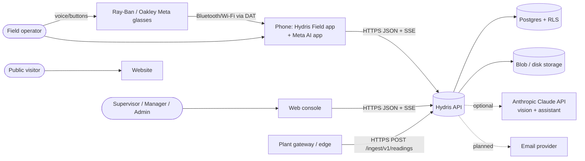
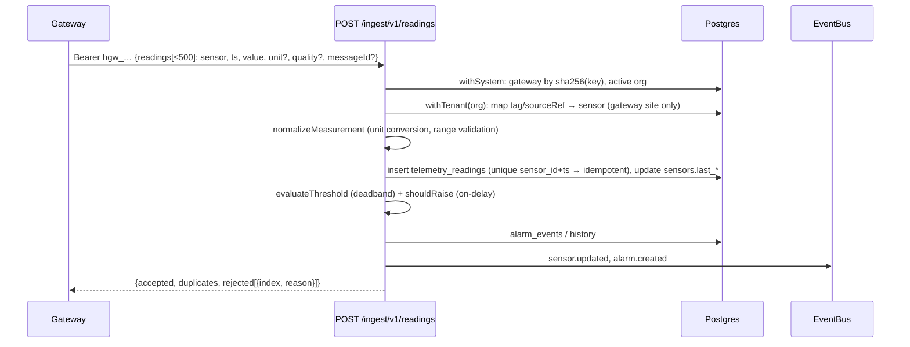
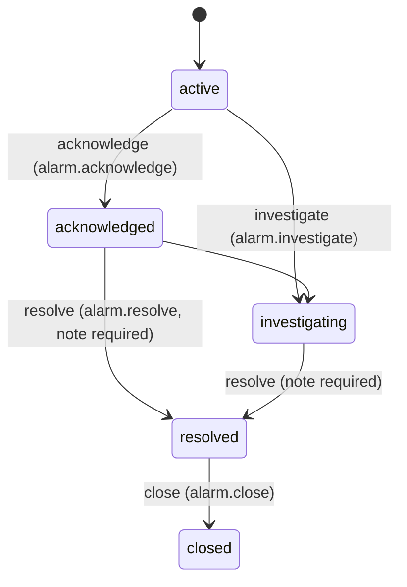
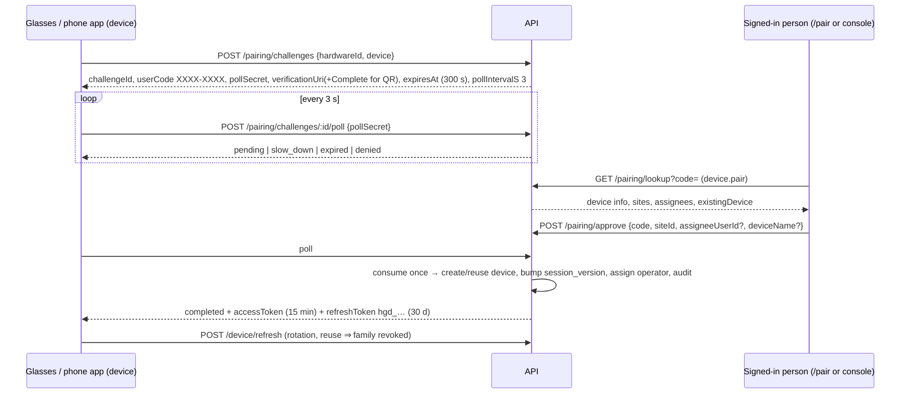
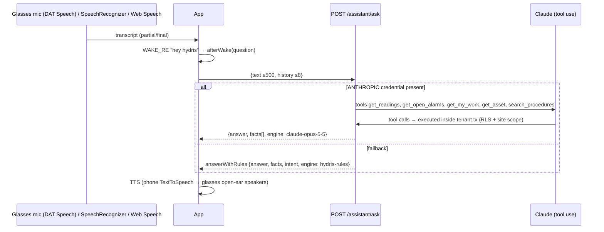

# Architecture

## 1. System context



Hydris never connects back to PLC or SCADA write paths. Ingestion is push-only from the gateway.

## 2. Containers

```mermaid
flowchart TB
  subgraph Web["apps/web (Next.js 16)"]
    S["(site) website"]
    C["/console"]
    G["/glasses + /simulator + /pair"]
    R["/api/[...path] route → Fastify in-process (serverless.ts)"]
    E["/api/events/stream (SSE, DB polling)"]
    CR["/api/cron"]
  end
  subgraph Api["apps/api (Fastify modular monolith)"]
    M1[auth] --- M2[org] --- M3[plant] --- M4[telemetry] --- M5[alarms]
    M6[inspections] --- M7[maintenance] --- M8[devices/pairing] --- M9[realtime]
    M10[insights/assist] --- M11[ui-profiles] --- M12[audit-docs] --- M13[voice-assistant] --- M14[simulation] --- M15[public]
    Bus[EventBus memory|db]
    Jobs[jobs.ts: stale rules, pairing expiry, realtime prune, sim]
  end
  Dom["packages/domain (roles, measurands, alarms, workflows, devices, uiprofile, auditdoc, voice)"]
  Bridge["apps/glasses-bridge-android (WebView + DAT 1.0.1)"]
  Native["apps/android Hydris Field (Planned)"]
  Web --> Api
  Api --> Dom
  Web --> Dom
  Bridge -->|loads /glasses| Web
  Native -->|REST/SSE| Api
```

| Container | Tech | Key files |
|---|---|---|
| API | Fastify, zod, Drizzle ORM, `pg` / PGlite, `@fastify/jwt`, rate-limit | `apps/api/src/app.ts`, `modules/*` |
| Web | Next.js 16, React, Tesseract.js (WASM) | `apps/web/src/**` |
| Domain | Pure TypeScript shared by API and web | `packages/domain/src/*` |
| Bridge | Kotlin, WebView, `com.meta.wearable:mwdat-*:1.0.1` | `apps/glasses-bridge-android/.../MainActivity.kt` |
| Native app | Kotlin, Compose (Planned) | `apps/android` (not on `main`) |

## 3. Data flows

### 3.1 Telemetry ingestion

Stale-data alarms come from `jobs.ts → evaluateStaleRules` (every 30 s on a long-running server, or per cron run on Vercel).

### 3.2 Alarm lifecycle

Transitions come from `ALARM_TRANSITIONS` in `packages/domain/src/alarms.ts`. Every transition writes `alarm_event_history` and publishes `alarm.updated`.

### 3.3 Glasses pairing (RFC 8628-style device authorization)

The QR encodes only the verification URL and the short code, never a credential. Codes use a 30-character alphabet without ambiguous characters and are rate limited at 10 lookups per minute. Glasses already owned by another organization are refused (`device_owned_elsewhere`).

### 3.4 Audit scan
```mermaid
sequenceDiagram
  participant Cam as Camera (DAT glasses | phone | simulated)
  participant App as Web/Native client
  participant API
  participant V as Claude vision (optional)
  Cam->>App: preview frames (~8 fps) → docdetect quad, auto-capture when stable
  App->>App: perspective warp to 1240×1754 (A4@150 dpi)
  App->>App: OCR pass 1 (original) + pass 2 (enhanced, ruling lines removed); figure detection
  App->>API: POST /audit-docs {pages[≤6]: jpeg ≤900 KB, readings, figures}
  API->>API: structureFromOcr, crossCheck, applyPlausibility → status in_review
  App->>API: POST /audit-docs/:id/enhance
  API->>V: page images
  V-->>API: fields/tables/figures with boxes → cross-checked vs OCR words in box
  Note over API: Reviewer: PATCH items, confirm-agreed, then POST verify (auditdoc.verify)
  Note over API: Different user: POST approve {approve|reject} (auditdoc.approve)
  App->>API: GET /audit-docs/:id/pdf
```
Verification and approval require a **user** principal ("signed in the console"). Glasses devices can only capture.

### 3.5 Voice assistant


### 3.6 Realtime SSE
- `GET /api/events/stream` with `Authorization: Bearer` (fetch-based EventSource, so the token never goes in the URL). Supports `Last-Event-ID`.
- **memory mode**: in-process bus, 15 s heartbeats, principal revalidated every 30 s (`session.ended` on revocation). Single instance only.
- **db mode**: events persisted to `realtime_events` (system-only RLS) after the request commits. The stream polls every 1.5 s. On Vercel each stream lasts ~50 s and the client reconnects. Rows are pruned after 1 day.
- Filtering (`canReceive`): org, site scope, permission, `userIds`, `deviceIds`.
- Event types: `alarm.created`, `alarm.updated`, `asset.updated`, `auditdoc.updated`, `device.context_changed`, `device.paired`, `device.profile_changed`, `device.updated`, `inspection.updated`, `maintenance.updated`, `notification.created`, `pairing.completed`, `sensor.updated`, `simulation.step`, `telemetry.corrected`, `ui_profile.updated`.

## 4. Tenancy and RLS
- Every tenant table has `org_id` and a `tenant_isolation` policy `USING/WITH CHECK hydris_tenant_ok(org_id)`. The tables are ENABLE and FORCE RLS.
- `withTenant`: `SET LOCAL ROLE hydris_app` and `app.org_id`. `withSystem`: `hydris_app` and `app.bypass=on` (auth lookups, gateway key, pairing, jobs).
- `hydris_app` is NOLOGIN without BYPASSRLS. `audit_events` and `telemetry_corrections` have UPDATE and DELETE revoked (append-only). `audit_document_events` gets SELECT and INSERT only.
- `realtime_events` uses the `system_only` policy.
- Application layer adds RBAC (`requirePerm`) and site scoping (`siteScope`, out-of-scope → 404).

## 5. Token model

| Token | Format and lifetime | Storage | Revocation |
|---|---|---|---|
| User access JWT `{typ:'user', sub, org, sid}` | HS256, 15 min (12 h in demo) | Client memory | `sid` = refresh family. Checked live on every request |
| User refresh | 48-byte random, sha256 in `auth_sessions`, 7 d, cookie `hg_refresh` (httpOnly, SameSite=Strict, path `/api/auth`) | Cookie | Rotation. Replay after 30 s revokes the family |
| MFA challenge JWT `{typ:'mfa'}` | 5 min | Client | n/a |
| Device access JWT `{typ:'device', sub, org, sv}` | 15 min | Device | `devices.session_version` bump, status suspended/revoked, assignment removed |
| Device refresh `hgd_…` | 40-byte random, `device_sessions`, 30 d, rotating | Device secure store (web: localStorage) | Reuse ⇒ family revoked |
| Gateway key `hgw_…` | sha256 in `gateways.key_hash` | Gateway | `/gateways/:id/revoke` |
| Demo session `hg_demo` | Signed JWT cookie, demo only | Cookie | Rebuilds the session on any instance |
| Demo device refresh | Self-contained signed claims (org, device, user, site, sv) | Device | `session_version`, status |

Devices act **on behalf of their assigned operator**, limited to `DEVICE_PERMISSIONS ∩ role permissions` (`core/principal.ts`).

## 6. Deployment topologies
1. **All-in Vercel**: Next.js serves the pages and runs the API in-process (`apps/api/src/serverless.ts`). Neon Postgres, private Vercel Blob, `REALTIME_MODE=db`, Vercel Cron → `/api/cron`.
2. **Vercel web + container API**: `API_URL` rewrite. API on Render (`render.yaml`), Fly or ECS with managed Postgres and a persistent `STORAGE_DIR`.
3. **Docker Compose single host**: `docker-compose.yml` (on-prem or edge in the plant).
4. **Demo mode**: no environment variables, in-memory PGlite per instance, cross-instance state through `demo-shared.ts` (Postgres → Vercel Runtime Cache → memory).

Details: [DEPLOYMENT.md](DEPLOYMENT.md).
