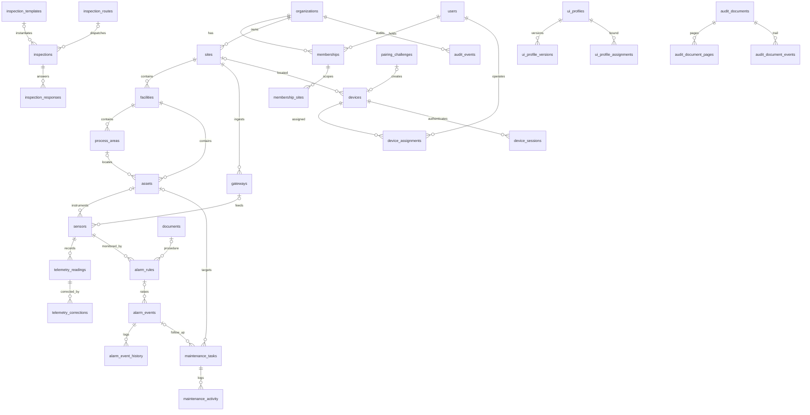

# Data Model

Source: `apps/api/src/db/schema.ts`, migrations `apps/api/drizzle/0000`–`0008`. Postgres 15+ (PGlite in dev, test and demo). All ids are UUID v4 unless noted. `created_at` and `updated_at` are timestamptz.

## 1. Enums

| Enum | Values (source) |
|---|---|
| `role` | org_admin, factory_manager, supervisor, field_operator, maintenance_engineer, viewer |
| `membership_status` | invited, active, deactivated |
| `facility_kind` | etp, stp, wtp, cetp, other |
| `process_area_kind`, `asset_type`, `asset_status` (operational, degraded, down, maintenance, standby, decommissioned), `criticality` (low, medium, high) | `packages/domain/src/catalog.ts` |
| `measurand` | ph, temperature, dissolved_oxygen, turbidity, conductivity, flow_rate, tank_level, pressure, motor_current, vibration, runtime_hours, tss, cod, bod, ammonia, residual_chlorine |
| `measurement_method` | continuous, lab, manual |
| `sensor_quality` | good, uncertain, bad |
| `telemetry_source` | gateway, manual, lab, simulator |
| `alarm_severity` | critical, high, medium, low |
| `alarm_condition` | high_high, high, low, low_low, stale |
| `alarm_state` | active, acknowledged, investigating, resolved, closed |
| `inspection_status` | scheduled, in_progress, paused, submitted, approved, rejected, cancelled |
| `maintenance_status` | open, assigned, in_progress, on_hold, completed, cancelled |
| `maintenance_priority` | low, medium, high, urgent |
| `maintenance_kind` | corrective, preventive, inspection_followup, alarm_followup |
| `device_status` | active, suspended, revoked |
| `pairing_status` | pending, approved, completed, denied, expired, cancelled |
| `document_kind` | sop, manual, datasheet, safety, troubleshooting, other |
| `document_status` | draft, approved, archived |
| `audit_doc_status` | processing, in_review, verified, approved, rejected |

## 2. Tables

### Identity and tenancy
| Table | Purpose | Key columns |
|---|---|---|
| `users` | Global identities (not tenant-scoped) | `email` (unique lower), `password_hash`, `is_platform_admin`, `status`, `mfa_secret_enc` (AES with `DATA_KEY`), `mfa_enabled`, `failed_logins`, `locked_until`, `default_org_id` |
| `organizations` | Tenants | `slug` unique, `is_demo`, `region`, `timezone`, `status` active/suspended |
| `memberships` | User ↔ org with role | unique (org,user), `role`, `status`, `all_sites`, `title` |
| `membership_sites` | Site scope when `all_sites=false` | PK (membership_id, site_id) |
| `invitations` | Invite tokens | `token_hash` unique, `role`, `site_ids`, `expires_at`, `accepted_at`, `revoked_at` |
| `auth_sessions` | Refresh-token rows | `family_id`, `token_hash`, `expires_at`, `rotated_at`, `revoked_at`, `user_agent`, `ip` |
| `auth_tokens` | Password reset / email verify | `purpose`, `token_hash`, `expires_at`, `used_at` |
| `mail_outbox` | Outgoing mail (no transport yet) | `to`, `subject`, `body_text`, `sent_at` |

### Plant
| Table | Purpose | Key columns |
|---|---|---|
| `sites` | Physical site | unique (org, code), lat/lng, `layout_width_m`/`height_m`, `archived_at` |
| `facilities` | ETP/STP/... within a site | `kind`, `capacity_m3_per_day` |
| `process_areas` | Area within a facility | `kind`, `sort_order`, `polygon` (map) |
| `assets` | Equipment | unique (org, tag), `type`, `criticality`, `status`, `specs` jsonb, `position_x/y` |
| `gateways` | Ingestion credentials per site | `protocol` https/mqtt/opcua, `key_prefix`, `key_hash` unique, `status`, `last_seen_at` |
| `sensors` | Measurement points | unique (org, tag), `measurand`, `unit`, `method`, `expected_interval_s`, `source_ref`, `last_value/ts/quality/source` |
| `telemetry_readings` | Time series (bigint identity) | unique (sensor_id, ts), `value`, `quality`, `source`, `synthetic` (CHECK synthetic ⇔ source='simulator'), `message_id` |
| `telemetry_corrections` | Append-only corrections | `reading_id`, `original_value`, `corrected_value`, `action` correct/invalidate, `reason`, `corrected_by` |
| `documents` | SOPs and manuals (full-text searchable) | `kind`, `body`, `version`, `status`, `asset_id`/`asset_type`, `tags` |

### Alarms
| Table | Purpose | Key columns |
|---|---|---|
| `alarm_rules` | Threshold rules | `condition`, `threshold` (CHECK: required unless stale), `deadband`, `on_delay_s`, `severity`, `recommended_action`, `procedure_document_id`, `breach_since` |
| `alarm_events` | Alarm instances | `state`, `severity`, `trigger_value`, `peak_value`, `triggered_at`, `cleared_at`, `assigned_to`, ack/resolve/close by+at, `resolution_note`, `synthetic` |
| `alarm_event_history` | Transition log | `action`, `from_state`, `to_state`, `actor_user_id`/`actor_device_id`, `note`, `at` |

### Work
| Table | Purpose | Key columns |
|---|---|---|
| `inspection_templates` | Versioned checklists | `key`, `version`, `steps` jsonb (`InspectionStep[]`), `safety_notices`, `status` draft/published/archived |
| `inspection_routes` | Ordered asset lists per site | `asset_ids` |
| `inspections` | Instances (steps snapshotted) | `status`, `assigned_to`, `due_at`, `submitted_via` console/glasses, `submitted_device_id`, `reviewed_by`, `revision` |
| `inspection_responses` | Step values | unique (inspection_id, client_op_id) → idempotent offline replay, `outcome` ok/abnormal/na, `recorded_at`, `device_id` |
| `attachments` | Files | `owner_type`/`owner_id`, `sha256`, `storage_key` (disk or private Blob) |
| `maintenance_tasks` | Work orders | `kind`, `priority`, `status`, `checklist` jsonb, `source_inspection_id`, `source_alarm_id` |
| `maintenance_activity` | Task log | `action`, `note`, `actor_user_id` |

### Devices and UI
| Table | Purpose | Key columns |
|---|---|---|
| `devices` | Glasses / simulators / phones | `kind` hardware/simulator, `model`, `hardware_id`, `firmware_version`, `app_version`, `display_info`, `status`, `session_version`, `last_seen_at`, revoke fields |
| `device_assignments` | Operator per device | partial unique: one active (`unassigned_at IS NULL`) per device |
| `pairing_challenges` | Device flow state | `code_hash` (partial unique while pending/approved), `poll_secret_hash`, `hardware_id`, `device_info`, `status`, `expires_at`, approval fields, `device_id` |
| `device_sessions` | Device refresh tokens | `family_id`, `token_hash`, `session_version`, `expires_at`, `rotated_at`, `revoked_at` |
| `ui_profiles` | Glasses UI profile container | `name`, `archived_at` |
| `ui_profile_versions` | Versioned config | unique (profile, version), `config` jsonb (`UiProfileConfig`), `status` draft/published/superseded |
| `ui_profile_assignments` | Scope binding | `scope` org/role/user/device, partial uniques per scope |

### Audit documents
| Table | Purpose | Key columns |
|---|---|---|
| `audit_documents` | Scanned record | `status`, `page_count`, `extraction` jsonb (`AuditExtraction`: fields, tables, figures, text), `engines`, `ai_status`, `captured_by`/`captured_via`/`device_id`, `verified_by/at`, `approved_by/at`, `rejected_reason`, `revision` (optimistic lock) |
| `audit_document_pages` | Page images and OCR | unique (document, page_no), `data` (base64 JPEG/PNG **stored in DB**), `width`, `height`, `ocr` jsonb |
| `audit_document_events` | Review trail (insert-only grant) | `action`, `target`, `before`, `after`, `note`, `user_id`/`device_id` |

### Platform
| Table | Purpose |
|---|---|
| `notifications` | Per-user in-app notifications (`severity`, `link`, `read_at`) |
| `audit_events` | Append-only audit trail (`actor_*`, `action`, `entity_*`, `metadata`, `ip`) |
| `inquiries` | Website contact/demo leads (`consent`, `consent_version`, `ip_hash`), **not tenant-scoped** |
| `simulation_runs` | Demo scenarios |
| `realtime_events` | SSE log for db mode (bigint id, `permission`, `user_ids`, `device_ids`, `payload`) |

## 3. ER diagram (core)

## 4. RLS policy summary
| Policy | Tables |
|---|---|
| `tenant_isolation` = `hydris_tenant_ok(org_id)` | memberships, membership_sites, invitations, sites, facilities, process_areas, assets, gateways, sensors, telemetry_readings, alarm_rules, alarm_events, alarm_event_history, documents, inspection_templates, inspection_routes, inspections, inspection_responses, attachments, maintenance_tasks, maintenance_activity, devices, device_assignments, device_sessions, notifications, audit_events, simulation_runs (0001), telemetry_corrections, ui_profiles, ui_profile_versions, ui_profile_assignments (0003), audit_documents, audit_document_pages, audit_document_events (0008) |
| `tenant_isolation` on `id` | organizations |
| `system_only` (`app.bypass='on'`) | realtime_events (0006) |
| No RLS (system context only) | users, auth_sessions, auth_tokens, mail_outbox, pairing_challenges, inquiries |
| Append-only grants | audit_events, telemetry_corrections (UPDATE/DELETE revoked), audit_document_events (SELECT/INSERT only) |

## 5. Retention (current vs recommended)
| Data | Current behaviour | Recommended policy (**Planned**, configurable per org) |
|---|---|---|
| `realtime_events` | Pruned after 1 day (`pruneRealtimeEvents`) | Keep |
| `telemetry_readings` | Kept indefinitely | Raw 2 years online, then archive. Discharge-monitoring data ≥ 5 years (align with consent/permit conditions) |
| `audit_events`, `audit_document_events`, `alarm_event_history` | Indefinite, append-only | ≥ 7 years, then export to WORM storage |
| `audit_document_pages.data` | Indefinite in Postgres | Move to object storage (Blob/S3) with lifecycle rules. Keep for the record retention period |
| `auth_sessions`, `device_sessions`, `pairing_challenges` | Not purged (expired rows remain) | Purge 30 days after expiry |
| `inquiries` | Indefinite | 24 months or consent withdrawal (DPDP/GDPR) |
| `mail_outbox` | Indefinite (contains reset links) | Purge after send or 7 days |
