# Data Model

This document describes the persistent data of Hydris Field Glasses: what is stored, where, in which shape, who may
read it, how long it lives and how it is expected to grow. It is written for engineers who change the schema, for
data and analytics people who query it, and for security reviewers who need to know which tables hold personal or
sensitive data.

Everything about the current product is taken from the code on `main`:

- Schema: `apps/api/src/db/schema.ts` (Drizzle ORM, one file, 42 tables).
- Migrations: `apps/api/drizzle/0000_init.sql` to `0008_audit_documents_rls.sql`, with snapshots in `apps/api/drizzle/meta/`.
- Tenancy helpers: `apps/api/src/db/tenant.ts` and `apps/api/src/context.ts`.
- Shared types and enumerations: `packages/domain/src/*` (`catalog.ts`, `alarms.ts`, `workflows.ts`, `devices.ts`, `measurands.ts`, `uiprofile.ts`, `auditdoc.ts`, `roles.ts`).
- Seed and demo data: `apps/api/src/seed/demo.ts`, `apps/api/src/seed/showcase.ts`, `apps/api/src/core/demo-shared.ts`.
- Client-side storage: `apps/android/app/src/main/java/ai/hydris/field/data/SecureStore.kt` and `apps/web/src/glasses/link.ts`.

Statements are marked **Built** (on `main`), **Partial** or **Planned**. Volume and storage figures are estimates and
are labelled as such.

> [!STATS]
> - 42 | Tables in the Drizzle schema | plus 1 runtime table in demo mode
> - 548 | Columns | from the 0008 snapshot
> - 23 | Postgres enum types | 22 in 0000, 1 in 0007
> - 9 | SQL migrations | 0000 to 0008

> [!STATS]
> - 71 | Indexes | 23 unique, 4 of them partial
> - 130 | Foreign keys | cascade from organizations
> - 36 | Tables with row-level security | 6 system-only tables without
> - 23 | JSONB columns | typed in TypeScript, not in SQL

## Data principles

The schema follows a small set of rules. New tables and columns are expected to follow them too; a review that
breaks one should say why.

Table: Data principles and where the code enforces them

| # | Principle | How it shows up in the code |
|---|---|---|
| P1 | **Every tenant row carries `org_id`.** Tenancy is a column, not a database or schema per customer. | `orgRef()` helper in `schema.ts` adds `org_id uuid not null references organizations(id) on delete cascade` to every tenant table. |
| P2 | **Isolation is enforced by the database, not only by queries.** A missing `WHERE org_id = ...` must not leak data. | Row-level security policy `tenant_isolation` on 35 tables; requests run as the non-privileged role `hydris_app` (`0001_rls.sql`, `tenant.ts`). |
| P3 | **Provenance is explicit.** Every measurement says where it came from and whether it is synthetic. | `telemetry_readings.source`, `quality`, `synthetic` plus CHECK `telemetry_synthetic_source_ck`; `synthetic` flags on alarms, inspections and maintenance tasks. |
| P4 | **History is appended, never overwritten.** Corrections, reviews and decisions add rows. | `telemetry_corrections`, `alarm_event_history`, `maintenance_activity`, `audit_document_events`, `audit_events` (UPDATE and DELETE revoked on three of them). |
| P5 | **Missing data is not zero.** A value without a timestamp is meaningless. | `sensors.last_value` and `last_ts` are nullable; `freshness()` in `packages/domain/src/freshness.ts` returns `no_data` instead of 0. |
| P6 | **One canonical unit per measurand.** Conversion happens at ingestion. | `normalizeMeasurement()` in `measurands.ts`; `sensors.unit` stores the canonical unit. |
| P7 | **Snapshots protect history from later edits.** | `inspections.steps` copies the template steps at assignment time; `AuditField.extracted` keeps the first extracted value. |
| P8 | **Offline clients replay safely.** | Unique `(inspection_id, client_op_id)` on `inspection_responses`; unique `(sensor_id, ts)` on `telemetry_readings`; `revision` counters for optimistic locking. |
| P9 | **Secrets are stored as hashes or ciphertext.** | `password_hash` (argon2id), `token_hash`, `key_hash`, `code_hash`, `poll_secret_hash` (SHA-256), `mfa_secret_enc` (AES-256-GCM with `DATA_KEY`). |
| P10 | **Times are UTC `timestamptz`.** Site and organization time zones are display settings. | `ts()` helper uses `timestamp with time zone`; `sites.timezone` and `organizations.timezone` default to `UTC`. |

> [!DECISION]
> Shared-schema multi-tenancy with RLS was chosen over a database per tenant. It keeps one migration path, one
> connection pool and cheap tenant creation, and moves the isolation guarantee into Postgres. The cost is that every
> new tenant table must be added to an RLS migration; section "Tenancy and row-level security" lists the checklist.

## Domain overview

The 42 tables fall into ten domains. Each domain is owned by one API module in `apps/api/src/modules/`.

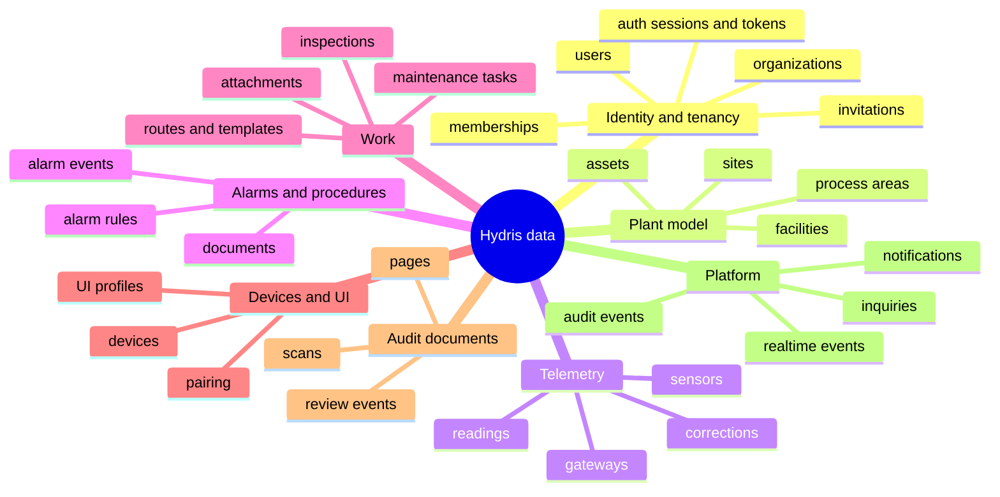

Table: Domains, tables and owning modules

| Domain | Tables | Owning module(s) | Status |
|---|---|---|---|
| Identity and tenancy | `users`, `organizations`, `memberships`, `membership_sites`, `invitations`, `auth_sessions`, `auth_tokens`, `mail_outbox` | `auth.ts`, `org.ts` | **Built** |
| Plant model | `sites`, `facilities`, `process_areas`, `assets` | `plant.ts` | **Built** |
| Telemetry | `gateways`, `sensors`, `telemetry_readings`, `telemetry_corrections` | `telemetry.ts`, `plant.ts` | **Built** |
| Alarms and procedures | `alarm_rules`, `alarm_events`, `alarm_event_history`, `documents` | `alarms.ts`, `plant.ts`, `insights.ts` | **Built** |
| Work | `inspection_templates`, `inspection_routes`, `inspections`, `inspection_responses`, `maintenance_tasks`, `maintenance_activity`, `attachments` | `inspections.ts`, `maintenance.ts`, `plant.ts` | **Built** |
| Devices and UI profiles | `devices`, `device_assignments`, `pairing_challenges`, `device_sessions`, `ui_profiles`, `ui_profile_versions`, `ui_profile_assignments` | `devices.ts`, `ui-profiles.ts` | **Built** |
| Audit documents | `audit_documents`, `audit_document_pages`, `audit_document_events` | `audit-docs.ts` | **Built** |
| Platform | `audit_events`, `notifications`, `realtime_events`, `inquiries`, `simulation_runs` | `core/services.ts`, `core/events.ts`, `public.ts`, `simulation.ts` | **Built** |
| Demo key/value | `hydris_demo_kv` (created at runtime, not in migrations) | `core/demo-shared.ts` | **Built** (demo mode only) |

### Conventions

- **Primary keys** are `uuid` with `DEFAULT gen_random_uuid()` (helper `pk()`), except the two high-volume append logs `telemetry_readings` and `realtime_events`, which use `bigint GENERATED ALWAYS AS IDENTITY`, and `membership_sites`, which has a composite key.
- **Timestamps**: `created_at` and `updated_at` are `timestamptz not null default now()`. `updated_at` is set by the application on every update (there are no triggers).
- **Soft delete**: plant objects and UI profiles use `archived_at`. Hard deletes are rare and guarded (an asset with sensors, alarms, inspections or tasks returns `in_use`; an alarm rule with events is disabled instead of deleted).
- **Text-typed states**: some small state sets are `text` columns typed with `$type<...>()` in TypeScript rather than Postgres enums (for example `users.status`, `devices.kind`, `audit_documents.ai_status`). Section "Enumerations" lists both kinds.
- **Naming**: tables are plural snake case; foreign keys are `<entity>_id`; actor columns are `<verb>_by` (user) and `<verb>_at` (time).

## Entity relationship model

The full model is too large for one readable diagram, so it is split by domain. Shared entities (`organizations`,
`users`, `sites`, `assets`, `devices`) appear as stubs with only their key where they are referenced from another
domain. Every tenant table also has `org_id` referencing `organizations.id` with `ON DELETE CASCADE`; that edge is
drawn only in the identity diagram to keep the others legible. Column types use Postgres names (`timestamptz`,
`float8` for `double precision`).

### Identity and tenancy

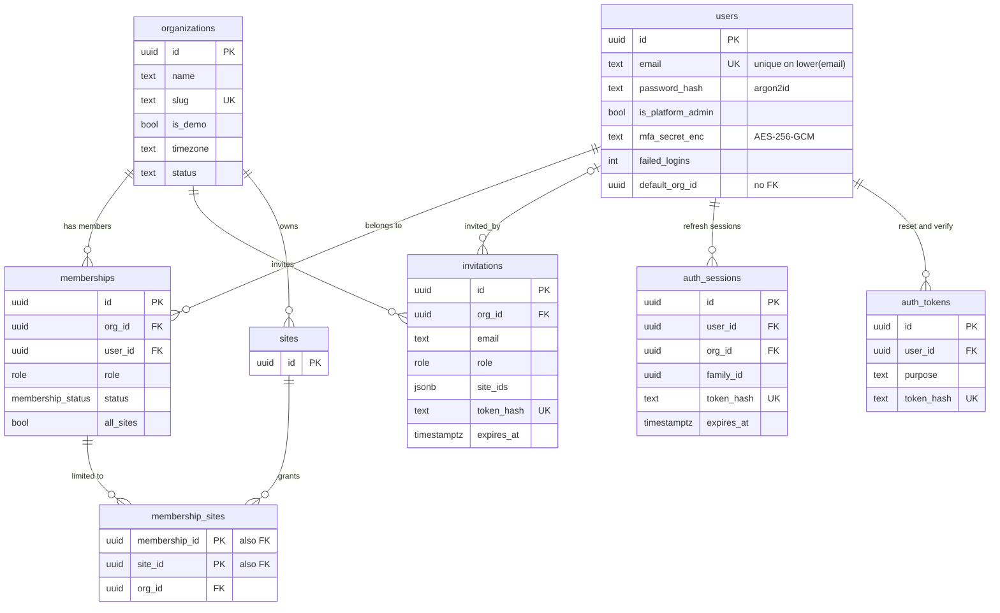

`users` is global: one person can belong to several organizations with a different role in each. The active
organization is carried in the access token (`org` claim) and resolved to a membership on every request.
`mail_outbox` stands alone (no foreign keys) and is not drawn.

### Plant model

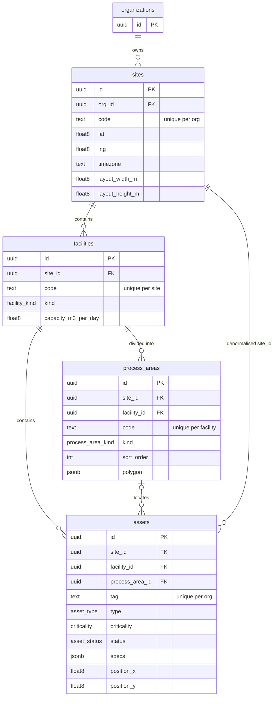

`assets.site_id` duplicates what can be derived through `facility_id`; it is kept so that site-scoped queries and
site permission checks need no join.

### Telemetry

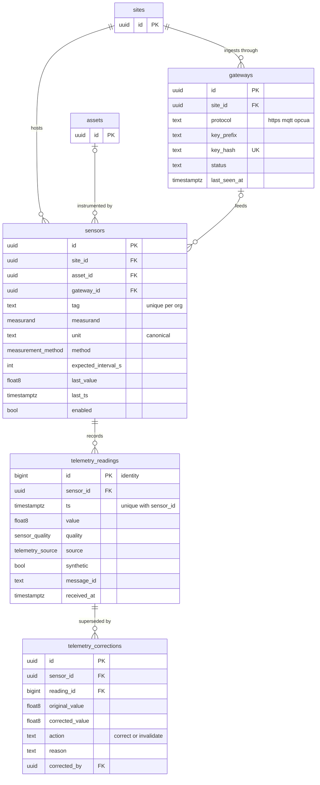

### Alarms and procedures

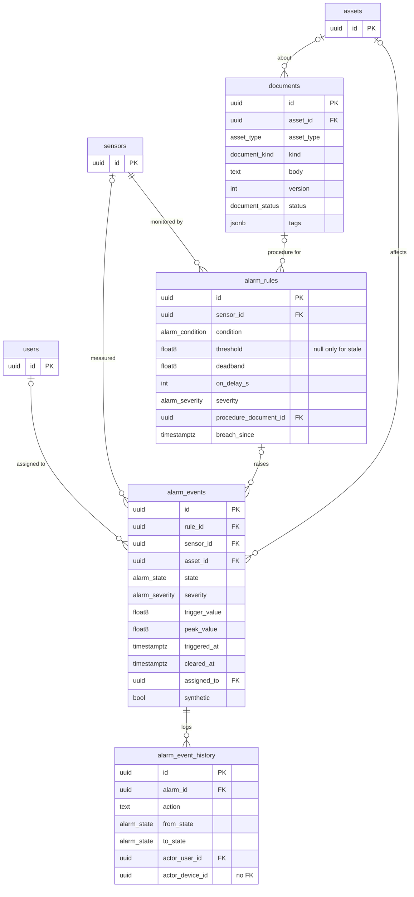

### Inspections and maintenance

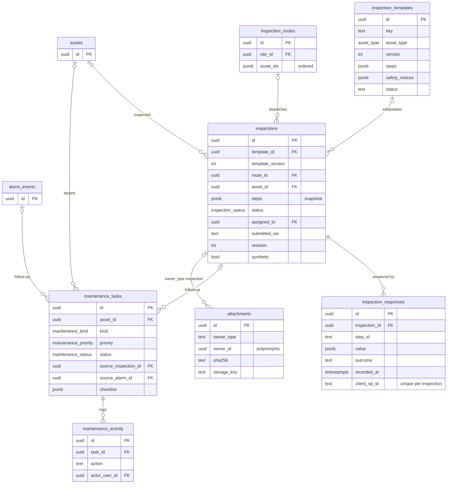

`attachments.owner_id` is polymorphic: it points at an inspection, maintenance task, asset or alarm depending on
`owner_type`, and therefore has no foreign key. The upload route validates the owner inside the tenant transaction
before inserting (`apps/api/src/modules/plant.ts`).

### Devices and UI profiles

```mermaid
%% caption: Devices and UI profiles: pairing creates devices, assignments bind operators, profiles shape the glasses UI
erDiagram
  pairing_challenges {
    uuid id PK
    text code_hash "unique while pending or approved"
    text poll_secret_hash
    text hardware_id
    jsonb device_info
    pairing_status status
    timestamptz expires_at
    uuid org_id FK
    uuid device_id FK
  }
  devices {
    uuid id PK
    uuid site_id FK
    text kind "hardware or simulator"
    text hardware_id
    jsonb display_info
    device_status status
    int session_version
    timestamptz last_seen_at
  }
  device_assignments {
    uuid id PK
    uuid device_id FK
    uuid user_id FK
    timestamptz assigned_at
    timestamptz unassigned_at "one open per device"
  }
  device_sessions {
    uuid id PK
    uuid device_id FK
    uuid family_id
    text token_hash UK
    int session_version
  }
  ui_profiles {
    uuid id PK
    text name
    timestamptz archived_at
  }
  ui_profile_versions {
    uuid id PK
    uuid profile_id FK
    int version "unique per profile"
    jsonb config
    text status
  }
  ui_profile_assignments {
    uuid id PK
    uuid profile_id FK
    text scope "org role user device"
    role role
    uuid user_id FK
    uuid device_id FK
  }
  pairing_challenges |o--o| devices : "creates or re-pairs"
  devices ||--o{ device_assignments : "assigned"
  devices ||--o{ device_sessions : "authenticates"
  ui_profiles ||--o{ ui_profile_versions : "versions"
  ui_profiles ||--o{ ui_profile_assignments : "bound by"
  devices |o--o{ ui_profile_assignments : "device scope"
```

### Audit documents

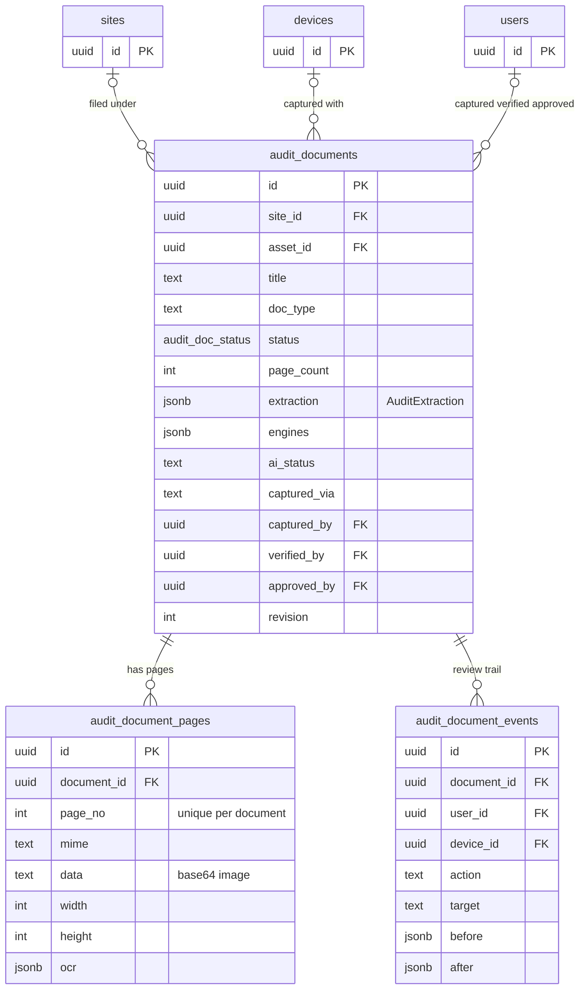

### Platform and demo storage

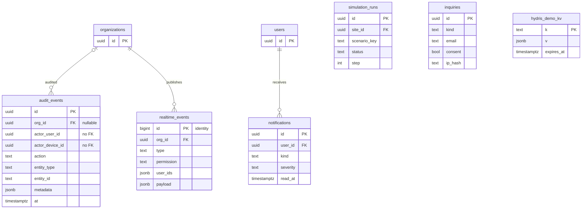

`inquiries` and `hydris_demo_kv` have no relationships: inquiries are platform-owned leads from the public website,
and the demo key/value store is infrastructure for demo mode only.

## Data dictionary

One table per database table, listing every column. "Null" is **No** for `NOT NULL` columns. Defaults are the SQL
defaults from the migrations; application-level defaults are noted in the description. Foreign keys give the target
and the `ON DELETE` action (`cascade`, `set null`, or `no action` when omitted). Every `id` without a note is
`uuid` with default `gen_random_uuid()`, and every `org_id` is `uuid not null`, FK `organizations.id`, cascade.

### Identity and tenancy tables

#### users

Table: users (global identities, not tenant-scoped, no RLS)

| Column | Type | Null | Default | Description |
|---|---|---|---|---|
| `id` | uuid | No | gen_random_uuid() | Primary key. |
| `email` | text | No | | Sign-in email. Unique case-insensitively. |
| `name` | text | No | | Display name. |
| `password_hash` | text | Yes | | argon2id hash (`core/crypto.ts`). Null for accounts without a password. |
| `is_platform_admin` | boolean | No | false | Hydris staff flag; enables platform administration routes. |
| `status` | text | No | 'active' | `active` or `disabled`. Disabled users cannot authenticate. |
| `email_verified_at` | timestamptz | Yes | | Set on verification or first password reset. |
| `mfa_secret_enc` | text | Yes | | TOTP secret, AES-256-GCM encrypted with `DATA_KEY`. |
| `mfa_enabled` | boolean | No | false | TOTP required at sign-in when true. |
| `failed_logins` | integer | No | 0 | Consecutive failed sign-ins; reset on success. |
| `locked_until` | timestamptz | Yes | | Set for 15 minutes after 5 failures (`TTL` in `config.ts`). |
| `last_login_at` | timestamptz | Yes | | Last successful sign-in. |
| `default_org_id` | uuid | Yes | | Preferred organization at sign-in. No FK. |
| `created_at` | timestamptz | No | now() | |
| `updated_at` | timestamptz | No | now() | |

Indexes and constraints: `users_email_lower_uq` unique on `lower(email)`.

#### organizations

Table: organizations (tenants)

| Column | Type | Null | Default | Description |
|---|---|---|---|---|
| `id` | uuid | No | gen_random_uuid() | Primary key; the tenant id used in `app.org_id`. |
| `name` | text | No | | Display name. |
| `slug` | text | No | | URL-safe unique key (demo: `riverbend-demo`). |
| `is_demo` | boolean | No | false | Demo tenants may receive simulator telemetry; customer tenants never do. |
| `region` | text | Yes | | Free-text region label. |
| `timezone` | text | No | 'UTC' | IANA zone for display and reports. |
| `status` | text | No | 'active' | `active` or `suspended`. |
| `created_at` | timestamptz | No | now() | |
| `updated_at` | timestamptz | No | now() | |

Indexes and constraints: `organizations_slug_uq` unique on `slug`. RLS policy uses `id` instead of `org_id`.

#### memberships

Table: memberships (user role in an organization)

| Column | Type | Null | Default | Description |
|---|---|---|---|---|
| `id` | uuid | No | gen_random_uuid() | Primary key. |
| `org_id` | uuid | No | | Tenant. |
| `user_id` | uuid | No | | FK `users.id`, cascade. |
| `role` | role | No | | One of the six roles in `roles.ts`. |
| `status` | membership_status | No | 'active' | `invited`, `active`, `deactivated`. |
| `all_sites` | boolean | No | true | When false, access is limited to `membership_sites`. |
| `title` | text | Yes | | Job title shown in the UI. |
| `created_at` | timestamptz | No | now() | |
| `updated_at` | timestamptz | No | now() | |
| `deactivated_at` | timestamptz | Yes | | When access was removed. |

Indexes and constraints: `memberships_org_user_uq` unique `(org_id, user_id)`; `memberships_user_idx` on `user_id`.

#### membership_sites

Table: membership_sites (site scope for restricted memberships)

| Column | Type | Null | Default | Description |
|---|---|---|---|---|
| `membership_id` | uuid | No | | FK `memberships.id`, cascade. Part of the primary key. |
| `site_id` | uuid | No | | FK `sites.id`, cascade. Part of the primary key. |
| `org_id` | uuid | No | | Tenant. |

Indexes and constraints: primary key `(membership_id, site_id)`.

#### invitations

Table: invitations (pending invites to an organization)

| Column | Type | Null | Default | Description |
|---|---|---|---|---|
| `id` | uuid | No | gen_random_uuid() | Primary key. |
| `org_id` | uuid | No | | Tenant. |
| `email` | text | No | | Invitee address. |
| `name` | text | Yes | | Invitee name if known. |
| `role` | role | No | | Role granted on acceptance. |
| `site_ids` | jsonb | No | '[]' | Array of site uuids when `all_sites` is false. |
| `all_sites` | boolean | No | true | Site scope on acceptance. |
| `token_hash` | text | No | | SHA-256 of the invitation token. |
| `expires_at` | timestamptz | No | | Seven days after creation (`TTL.inviteMs`). |
| `accepted_at` | timestamptz | Yes | | Set on acceptance. |
| `revoked_at` | timestamptz | Yes | | Set when an admin revokes. |
| `invited_by` | uuid | Yes | | FK `users.id`. |
| `created_at` | timestamptz | No | now() | |

Indexes and constraints: `invitations_token_uq` unique on `token_hash`; `invitations_org_idx` on `org_id`.

#### auth_sessions

Table: auth_sessions (rotating refresh-token sessions for people; no RLS)

| Column | Type | Null | Default | Description |
|---|---|---|---|---|
| `id` | uuid | No | gen_random_uuid() | Primary key. |
| `user_id` | uuid | No | | FK `users.id`, cascade. |
| `org_id` | uuid | Yes | | FK `organizations.id`, cascade. Organization of the session. |
| `family_id` | uuid | No | | Rotation family; the access token `sid` claim. Revoking a family ends all its tokens. |
| `token_hash` | text | No | | SHA-256 of the refresh token. |
| `expires_at` | timestamptz | No | | Seven days after issue (`TTL.refreshMs`). |
| `revoked_at` | timestamptz | Yes | | Logout or reuse detection. |
| `rotated_at` | timestamptz | Yes | | Set when the token was exchanged for a new one. |
| `user_agent` | text | Yes | | Client user agent. |
| `ip` | text | Yes | | Client IP at issue. |
| `created_at` | timestamptz | No | now() | |
| `last_used_at` | timestamptz | Yes | | Last refresh. |

Indexes and constraints: `auth_sessions_token_uq` unique on `token_hash`; `auth_sessions_user_idx`; `auth_sessions_family_idx`.

#### auth_tokens

Table: auth_tokens (single-use password reset and email verification tokens; no RLS)

| Column | Type | Null | Default | Description |
|---|---|---|---|---|
| `id` | uuid | No | gen_random_uuid() | Primary key. |
| `purpose` | text | No | | `password_reset` or `email_verify`. |
| `user_id` | uuid | No | | FK `users.id`, cascade. |
| `token_hash` | text | No | | SHA-256 of the emailed token. |
| `expires_at` | timestamptz | No | | 30 minutes for resets (`TTL.resetMs`). |
| `used_at` | timestamptz | Yes | | Set when consumed. |
| `created_at` | timestamptz | No | now() | |

Indexes and constraints: `auth_tokens_token_uq` unique on `token_hash`.

#### mail_outbox

Table: mail_outbox (recorded outgoing mail; no transport yet; no RLS)

| Column | Type | Null | Default | Description |
|---|---|---|---|---|
| `id` | uuid | No | gen_random_uuid() | Primary key. |
| `to` | text | No | | Recipient address. |
| `subject` | text | No | | Subject line. |
| `body_text` | text | No | | Plain-text body. Can contain reset and invitation links. |
| `created_at` | timestamptz | No | now() | |
| `sent_at` | timestamptz | Yes | | Reserved for a mail transport; never set today. |

Indexes and constraints: none.

> [!RISK]
> `mail_outbox.body_text` holds live password-reset and invitation links in clear text and is never purged. Until a
> mail transport exists, restrict database access to this table and add the purge job proposed in "Data lifecycle
> and retention".

### Plant model tables

#### sites

Table: sites (physical plant locations)

| Column | Type | Null | Default | Description |
|---|---|---|---|---|
| `id` | uuid | No | gen_random_uuid() | Primary key. |
| `org_id` | uuid | No | | Tenant. |
| `name` | text | No | | Display name. |
| `code` | text | No | | Short code, unique per organization (demo: `RIP`, `RTS`). |
| `address` | text | Yes | | Street address. |
| `city` | text | Yes | | City. |
| `country` | text | Yes | | Country. |
| `lat` | double precision | Yes | | Latitude, WGS84. |
| `lng` | double precision | Yes | | Longitude, WGS84. |
| `timezone` | text | No | 'UTC' | IANA zone. |
| `layout_width_m` | double precision | No | 100 | Plant layout canvas width in metres (map and route planner). |
| `layout_height_m` | double precision | No | 80 | Canvas height in metres. |
| `archived_at` | timestamptz | Yes | | Soft delete. |
| `created_at` | timestamptz | No | now() | |
| `updated_at` | timestamptz | No | now() | |

Indexes and constraints: `sites_org_code_uq` unique `(org_id, code)`; `sites_org_idx` on `org_id`.

#### facilities

Table: facilities (treatment plants within a site)

| Column | Type | Null | Default | Description |
|---|---|---|---|---|
| `id` | uuid | No | gen_random_uuid() | Primary key. |
| `org_id` | uuid | No | | Tenant. |
| `site_id` | uuid | No | | FK `sites.id`, cascade. |
| `name` | text | No | | Display name. |
| `code` | text | No | | Unique per site (demo: `ETP-01`). |
| `kind` | facility_kind | No | | ETP, STP, WTP, CETP or other. |
| `capacity_m3_per_day` | double precision | Yes | | Design capacity. |
| `description` | text | Yes | | Free text. |
| `archived_at` | timestamptz | Yes | | Soft delete. |
| `created_at` | timestamptz | No | now() | |
| `updated_at` | timestamptz | No | now() | |

Indexes and constraints: `facilities_site_code_uq` unique `(site_id, code)`; `facilities_org_idx`.

#### process_areas

Table: process_areas (treatment stages inside a facility)

| Column | Type | Null | Default | Description |
|---|---|---|---|---|
| `id` | uuid | No | gen_random_uuid() | Primary key. |
| `org_id` | uuid | No | | Tenant. |
| `site_id` | uuid | No | | FK `sites.id`, cascade. |
| `facility_id` | uuid | No | | FK `facilities.id`, cascade. |
| `name` | text | No | | Display name. |
| `code` | text | No | | Unique per facility. |
| `kind` | process_area_kind | No | | Treatment stage (13 values). |
| `sort_order` | integer | No | 0 | Display order along the treatment train. |
| `polygon` | jsonb | Yes | | Outline on the site layout, metres: `[[x, y], ...]`. |
| `archived_at` | timestamptz | Yes | | Soft delete. |
| `created_at` | timestamptz | No | now() | |
| `updated_at` | timestamptz | No | now() | |

Indexes and constraints: `process_areas_facility_code_uq` unique `(facility_id, code)`; `process_areas_org_idx`.

#### assets

Table: assets (equipment)

| Column | Type | Null | Default | Description |
|---|---|---|---|---|
| `id` | uuid | No | gen_random_uuid() | Primary key. |
| `org_id` | uuid | No | | Tenant. |
| `site_id` | uuid | No | | FK `sites.id`, cascade. |
| `facility_id` | uuid | No | | FK `facilities.id`, cascade. |
| `process_area_id` | uuid | Yes | | FK `process_areas.id`, set null. |
| `tag` | text | No | | Plant tag (P-101), unique per organization. |
| `name` | text | No | | Display name. |
| `type` | asset_type | No | | Equipment class (14 values). |
| `manufacturer` | text | Yes | | |
| `model` | text | Yes | | |
| `serial_number` | text | Yes | | |
| `installed_on` | text | Yes | | Installation date as entered (ISO date string by convention). |
| `criticality` | criticality | No | 'medium' | low, medium, high. |
| `status` | asset_status | No | 'operational' | Operational state (6 values). |
| `specs` | jsonb | No | '{}' | Name to value map of nameplate data. |
| `notes` | text | Yes | | Free text. |
| `position_x` | double precision | Yes | | Map position in metres from the layout origin. |
| `position_y` | double precision | Yes | | Map position in metres. |
| `archived_at` | timestamptz | Yes | | Soft delete. |
| `created_at` | timestamptz | No | now() | |
| `updated_at` | timestamptz | No | now() | |

Indexes and constraints: `assets_org_tag_uq` unique `(org_id, tag)`; `assets_site_idx` `(org_id, site_id)`; `assets_area_idx` on `process_area_id`.

### Telemetry tables

#### gateways

Table: gateways (ingestion credentials per site)

| Column | Type | Null | Default | Description |
|---|---|---|---|---|
| `id` | uuid | No | gen_random_uuid() | Primary key. |
| `org_id` | uuid | No | | Tenant. |
| `site_id` | uuid | No | | FK `sites.id`, cascade. A gateway may only write sensors on its own site. |
| `name` | text | No | | Display name. |
| `protocol` | text | No | 'https' | `https`, `mqtt` or `opcua` (only HTTPS ingestion is implemented). |
| `key_prefix` | text | No | | Visible prefix of the API key for identification. |
| `key_hash` | text | No | | SHA-256 of the full key. |
| `status` | text | No | 'active' | `active` or `revoked`. |
| `last_seen_at` | timestamptz | Yes | | Updated on each authenticated ingest call. |
| `created_by` | uuid | Yes | | FK `users.id`. |
| `created_at` | timestamptz | No | now() | |
| `revoked_at` | timestamptz | Yes | | |

Indexes and constraints: `gateways_key_uq` unique on `key_hash`; `gateways_org_idx`.

#### sensors

Table: sensors (measurement points, with the latest value cached)

| Column | Type | Null | Default | Description |
|---|---|---|---|---|
| `id` | uuid | No | gen_random_uuid() | Primary key. |
| `org_id` | uuid | No | | Tenant. |
| `site_id` | uuid | No | | FK `sites.id`, cascade. |
| `asset_id` | uuid | Yes | | FK `assets.id`, cascade. |
| `process_area_id` | uuid | Yes | | FK `process_areas.id`, set null. |
| `gateway_id` | uuid | Yes | | FK `gateways.id`, set null. |
| `tag` | text | No | | Instrument tag (VT-101), unique per organization. |
| `name` | text | No | | Display name. |
| `measurand` | measurand | No | | What is measured (16 values). |
| `unit` | text | No | | Canonical unit from `MEASURAND_DEFS`. |
| `method` | measurement_method | No | 'continuous' | continuous, lab or manual. |
| `expected_interval_s` | integer | No | 60 | Expected reporting interval; drives freshness and stale alarms. |
| `source_ref` | text | Yes | | Gateway-side address (demo: `ETP01.VT-101`). |
| `last_value` | double precision | Yes | | Cached effective latest value. |
| `last_ts` | timestamptz | Yes | | Observation time of `last_value`. |
| `last_quality` | sensor_quality | Yes | | Quality of the latest reading. |
| `last_source` | telemetry_source | Yes | | Source of the latest reading. |
| `last_received_at` | timestamptz | Yes | | Server receive time of the latest reading. |
| `enabled` | boolean | No | true | Disabled sensors reject ingestion. |
| `archived_at` | timestamptz | Yes | | Soft delete; archived sensors reject ingestion. |
| `created_at` | timestamptz | No | now() | |
| `updated_at` | timestamptz | No | now() | |

Indexes and constraints: `sensors_org_tag_uq` unique `(org_id, tag)`; `sensors_asset_idx`; `sensors_site_idx` `(org_id, site_id)`.

#### telemetry_readings

Table: telemetry_readings (time series of measured values)

| Column | Type | Null | Default | Description |
|---|---|---|---|---|
| `id` | bigint | No | identity | Primary key, `GENERATED ALWAYS AS IDENTITY`. |
| `org_id` | uuid | No | | Tenant. |
| `sensor_id` | uuid | No | | FK `sensors.id`, cascade. |
| `ts` | timestamptz | No | | Observation time from the source. |
| `value` | double precision | No | | Value in the canonical unit. |
| `quality` | sensor_quality | No | 'good' | good, uncertain, bad. Bad readings never raise alarms. |
| `source` | telemetry_source | No | | gateway, manual, lab or simulator. |
| `synthetic` | boolean | No | false | True if and only if `source = 'simulator'`. |
| `message_id` | text | Yes | | Source message id for tracing (demo: `demo:VT-101:<ms>`). |
| `received_at` | timestamptz | No | now() | Server receive time. |

Indexes and constraints: `telemetry_sensor_ts_uq` unique `(sensor_id, ts)` (idempotent ingestion);
`telemetry_sensor_ts_idx` `(sensor_id, ts DESC)`; `telemetry_org_ts_idx` `(org_id, ts)`;
CHECK `telemetry_synthetic_source_ck`: `synthetic = (source = 'simulator')`.

#### telemetry_corrections

Table: telemetry_corrections (append-only corrections; UPDATE and DELETE revoked)

| Column | Type | Null | Default | Description |
|---|---|---|---|---|
| `id` | uuid | No | gen_random_uuid() | Primary key. |
| `org_id` | uuid | No | | Tenant. |
| `sensor_id` | uuid | No | | FK `sensors.id`, cascade. |
| `reading_id` | bigint | No | | FK `telemetry_readings.id`, cascade. |
| `original_value` | double precision | No | | Value of the reading at correction time. |
| `corrected_value` | double precision | Yes | | New value (canonical unit) for `correct`; null for `invalidate`. |
| `action` | text | No | | `correct` replaces the value; `invalidate` excludes the reading. |
| `reason` | text | No | | Required explanation, 5 to 1,000 characters. |
| `corrected_by` | uuid | Yes | | FK `users.id`. |
| `created_at` | timestamptz | No | now() | The newest correction per reading wins. |

Indexes and constraints: `telemetry_corrections_reading_idx` `(reading_id, created_at)`; `telemetry_corrections_sensor_idx`.

### Alarm and procedure tables

#### alarm_rules

Table: alarm_rules (threshold and data-freshness rules)

| Column | Type | Null | Default | Description |
|---|---|---|---|---|
| `id` | uuid | No | gen_random_uuid() | Primary key. |
| `org_id` | uuid | No | | Tenant. |
| `site_id` | uuid | No | | FK `sites.id`, cascade. Copied from the sensor. |
| `sensor_id` | uuid | No | | FK `sensors.id`, cascade. |
| `name` | text | No | | Display name (demo: `VT-101 high-high`). |
| `condition` | alarm_condition | No | | high_high, high, low, low_low or stale. |
| `threshold` | double precision | Yes | | Limit in the canonical unit; required unless `stale`. |
| `deadband` | double precision | No | 0 | Hysteresis band before an alarm counts as cleared. |
| `on_delay_s` | integer | No | 0 | Seconds a breach must persist before raising. |
| `severity` | alarm_severity | No | | critical, high, medium, low. |
| `enabled` | boolean | No | true | Rules with history are disabled instead of deleted. |
| `recommended_action` | text | Yes | | First action shown to the operator. |
| `procedure_document_id` | uuid | Yes | | FK `documents.id`, set null. Linked SOP. |
| `breach_since` | timestamptz | Yes | | Evaluation state: start of the current breach (on-delay). |
| `created_by` | uuid | Yes | | FK `users.id`. |
| `created_at` | timestamptz | No | now() | |
| `updated_at` | timestamptz | No | now() | |

Indexes and constraints: `alarm_rules_sensor_idx`; CHECK `alarm_rules_threshold_ck`: `condition = 'stale' OR threshold IS NOT NULL`.

#### alarm_events

Table: alarm_events (alarm instances and their human lifecycle)

| Column | Type | Null | Default | Description |
|---|---|---|---|---|
| `id` | uuid | No | gen_random_uuid() | Primary key. |
| `org_id` | uuid | No | | Tenant. |
| `site_id` | uuid | No | | FK `sites.id`, cascade. |
| `asset_id` | uuid | Yes | | FK `assets.id`, set null. |
| `sensor_id` | uuid | Yes | | FK `sensors.id`, set null. |
| `rule_id` | uuid | Yes | | FK `alarm_rules.id`, set null. |
| `severity` | alarm_severity | No | | Copied from the rule at trigger time. |
| `condition` | alarm_condition | No | | Copied from the rule. |
| `state` | alarm_state | No | 'active' | Human lifecycle state. |
| `title` | text | No | | Headline. |
| `description` | text | Yes | | Breach description (`describeBreach()`). |
| `recommended_action` | text | Yes | | Copied from the rule. |
| `trigger_value` | double precision | Yes | | Value that raised the alarm. |
| `threshold` | double precision | Yes | | Limit at trigger time. |
| `unit` | text | Yes | | Unit of the values. |
| `peak_value` | double precision | Yes | | Worst value seen while the condition persisted. |
| `triggered_at` | timestamptz | No | | Observation time of the triggering reading. |
| `cleared_at` | timestamptz | Yes | | When the measured condition returned to normal; independent of `state`. |
| `assigned_to` | uuid | Yes | | FK `users.id`. |
| `acknowledged_by` | uuid | Yes | | FK `users.id`. |
| `acknowledged_at` | timestamptz | Yes | | |
| `resolved_by` | uuid | Yes | | FK `users.id`. |
| `resolved_at` | timestamptz | Yes | | |
| `resolution_note` | text | Yes | | Required by the `resolve` transition. |
| `closed_by` | uuid | Yes | | FK `users.id`. |
| `closed_at` | timestamptz | Yes | | |
| `synthetic` | boolean | No | false | Raised from simulator data. |
| `updated_at` | timestamptz | No | now() | There is no `created_at`; `triggered_at` serves. |

Indexes and constraints: `alarm_events_org_state_idx` `(org_id, state, triggered_at)`; `alarm_events_rule_idx` `(rule_id, state)`; `alarm_events_asset_idx`.

#### alarm_event_history

Table: alarm_event_history (transition and note log per alarm)

| Column | Type | Null | Default | Description |
|---|---|---|---|---|
| `id` | uuid | No | gen_random_uuid() | Primary key. |
| `org_id` | uuid | No | | Tenant. |
| `alarm_id` | uuid | No | | FK `alarm_events.id`, cascade. |
| `action` | text | No | | `triggered`, `condition_cleared`, `acknowledge`, `investigate`, `resolve`, `close`, `assigned`, `note`. |
| `from_state` | alarm_state | Yes | | State before a transition. |
| `to_state` | alarm_state | Yes | | State after a transition. |
| `actor_user_id` | uuid | Yes | | FK `users.id`; null for the alarm engine. |
| `actor_device_id` | uuid | Yes | | Glasses that performed the action. No FK. |
| `note` | text | Yes | | Operator note or engine message. |
| `at` | timestamptz | No | now() | |

Indexes and constraints: `alarm_history_alarm_idx` `(alarm_id, at)`.

#### documents

Table: documents (SOPs, manuals and safety notices; full-text searchable)

| Column | Type | Null | Default | Description |
|---|---|---|---|---|
| `id` | uuid | No | gen_random_uuid() | Primary key. |
| `org_id` | uuid | No | | Tenant. |
| `site_id` | uuid | Yes | | FK `sites.id`, cascade. Null means organization-wide. |
| `asset_id` | uuid | Yes | | FK `assets.id`, set null. Specific asset. |
| `asset_type` | asset_type | Yes | | Applies to every asset of this type. |
| `title` | text | No | | Title (demo: `SOP-PMP-07 Pump vibration response`). |
| `kind` | document_kind | No | | sop, manual, datasheet, safety, troubleshooting, other. |
| `body` | text | No | | Plain text body; searched with `to_tsvector('english', ...)`. |
| `version` | integer | No | 1 | Document revision number. |
| `status` | document_status | No | 'draft' | Only `approved` documents reach the glasses and the assistant. |
| `tags` | jsonb | No | '[]' | Array of strings. |
| `approved_by` | uuid | Yes | | FK `users.id`. |
| `approved_at` | timestamptz | Yes | | |
| `created_by` | uuid | Yes | | FK `users.id`. |
| `created_at` | timestamptz | No | now() | |
| `updated_at` | timestamptz | No | now() | |

Indexes and constraints: `documents_org_idx` `(org_id, status)`; `documents_asset_idx`. No full-text index (see "Indexing and query patterns").

### Work tables

#### inspection_templates

Table: inspection_templates (versioned checklists)

| Column | Type | Null | Default | Description |
|---|---|---|---|---|
| `id` | uuid | No | gen_random_uuid() | Primary key. |
| `org_id` | uuid | No | | Tenant. |
| `key` | text | Yes | | Stable key across versions (demo: `pump_routine`). Not unique. |
| `name` | text | No | | Display name. |
| `description` | text | Yes | | |
| `asset_type` | asset_type | Yes | | Asset class the template is for. |
| `version` | integer | No | 1 | Template revision. |
| `steps` | jsonb | No | | `InspectionStep[]` (see "JSON column schemas"). |
| `safety_notices` | jsonb | No | '[]' | Array of strings shown before the first step. |
| `estimated_minutes` | integer | Yes | | Planning estimate. |
| `status` | text | No | 'published' | `draft`, `published` or `archived`. |
| `created_by` | uuid | Yes | | FK `users.id`. |
| `created_at` | timestamptz | No | now() | |
| `updated_at` | timestamptz | No | now() | |

Indexes and constraints: `inspection_templates_org_idx`.

#### inspection_routes

Table: inspection_routes (ordered rounds through assets on a site)

| Column | Type | Null | Default | Description |
|---|---|---|---|---|
| `id` | uuid | No | gen_random_uuid() | Primary key. |
| `org_id` | uuid | No | | Tenant. |
| `site_id` | uuid | No | | FK `sites.id`, cascade. |
| `name` | text | No | | Display name (demo: `Morning round · ETP-01`). |
| `description` | text | Yes | | |
| `asset_ids` | jsonb | No | '[]' | Ordered array of asset uuids. Not foreign keys. |
| `created_by` | uuid | Yes | | FK `users.id`. |
| `created_at` | timestamptz | No | now() | |
| `updated_at` | timestamptz | No | now() | |

Indexes and constraints: `inspection_routes_site_idx` `(org_id, site_id)`.

#### inspections

Table: inspections (assigned inspection instances)

| Column | Type | Null | Default | Description |
|---|---|---|---|---|
| `id` | uuid | No | gen_random_uuid() | Primary key. |
| `org_id` | uuid | No | | Tenant. |
| `site_id` | uuid | No | | FK `sites.id`, cascade. |
| `asset_id` | uuid | Yes | | FK `assets.id`, set null. |
| `template_id` | uuid | Yes | | FK `inspection_templates.id`, set null. |
| `template_version` | integer | Yes | | Template version at assignment. |
| `route_id` | uuid | Yes | | FK `inspection_routes.id`, set null. |
| `title` | text | No | | Display title. |
| `steps` | jsonb | No | | Snapshot of the template steps at assignment time. |
| `safety_notices` | jsonb | No | '[]' | Snapshot of the safety notices. |
| `status` | inspection_status | No | 'scheduled' | Lifecycle state. |
| `priority` | text | No | 'normal' | `normal` or `high`. |
| `assigned_to` | uuid | Yes | | FK `users.id`. Only this person may record responses. |
| `assigned_by` | uuid | Yes | | FK `users.id`. Notified on submit. |
| `due_at` | timestamptz | Yes | | |
| `started_at` | timestamptz | Yes | | First response or explicit start. |
| `paused_at` | timestamptz | Yes | | |
| `submitted_at` | timestamptz | Yes | | |
| `submitted_via` | text | Yes | | `console` or `glasses`. |
| `submitted_device_id` | uuid | Yes | | Glasses that submitted. No FK. |
| `reviewed_by` | uuid | Yes | | FK `users.id`. |
| `reviewed_at` | timestamptz | Yes | | |
| `review_note` | text | Yes | | Reason when returned. |
| `revision` | integer | No | 1 | Incremented on every change; optimistic lock for offline clients. |
| `synthetic` | boolean | No | false | Created by a simulation. |
| `created_at` | timestamptz | No | now() | |
| `updated_at` | timestamptz | No | now() | |

Indexes and constraints: `inspections_org_status_idx` `(org_id, status)`; `inspections_assignee_idx` `(assigned_to, status)`; `inspections_asset_idx`.

#### inspection_responses

Table: inspection_responses (step answers; idempotent for offline replay)

| Column | Type | Null | Default | Description |
|---|---|---|---|---|
| `id` | uuid | No | gen_random_uuid() | Primary key. |
| `org_id` | uuid | No | | Tenant. |
| `inspection_id` | uuid | No | | FK `inspections.id`, cascade. |
| `step_id` | text | No | | `InspectionStep.id` within the snapshot. |
| `value` | jsonb | No | | `StepValue` (see "JSON column schemas"). |
| `outcome` | text | No | | `ok`, `abnormal` or `na`, derived by `stepOutcome()`. |
| `note` | text | Yes | | Operator note. |
| `recorded_at` | timestamptz | No | | Client time of the answer; at most 5 minutes in the future. |
| `received_at` | timestamptz | No | now() | Server receive time. |
| `recorded_by` | uuid | Yes | | FK `users.id`. |
| `device_id` | uuid | Yes | | Glasses that recorded the answer. No FK. |
| `client_op_id` | text | No | | Client-generated idempotency key. |

Indexes and constraints: `inspection_responses_op_uq` unique `(inspection_id, client_op_id)`; `inspection_responses_step_idx` `(inspection_id, step_id, recorded_at)`. A step may have several responses; the latest `recorded_at` is current.

#### attachments

Table: attachments (file metadata; bytes live in object storage)

| Column | Type | Null | Default | Description |
|---|---|---|---|---|
| `id` | uuid | No | gen_random_uuid() | Primary key. |
| `org_id` | uuid | No | | Tenant. |
| `owner_type` | text | No | | `inspection`, `maintenance`, `asset`, `document`, `alarm` (upload route accepts all but `document`). |
| `owner_id` | uuid | No | | Owner row id. Polymorphic, no FK. |
| `filename` | text | No | | Sanitised original name, at most 120 characters. |
| `mime` | text | No | | JPEG, PNG, WebP, PDF or plain text; magic bytes checked. |
| `size_bytes` | integer | No | | Size in bytes. |
| `sha256` | text | No | | Content hash. |
| `storage_key` | text | No | | Disk path `<org>/<uuid>` or private Vercel Blob key `attachments/<org>/<uuid>`. |
| `uploaded_by` | uuid | Yes | | FK `users.id`. |
| `device_id` | uuid | Yes | | Glasses that uploaded. No FK. |
| `created_at` | timestamptz | No | now() | |

Indexes and constraints: `attachments_owner_idx` `(owner_type, owner_id)`.

#### maintenance_tasks

Table: maintenance_tasks (work orders)

| Column | Type | Null | Default | Description |
|---|---|---|---|---|
| `id` | uuid | No | gen_random_uuid() | Primary key. |
| `org_id` | uuid | No | | Tenant. |
| `site_id` | uuid | No | | FK `sites.id`, cascade. |
| `asset_id` | uuid | Yes | | FK `assets.id`, set null. |
| `title` | text | No | | |
| `description` | text | Yes | | |
| `kind` | maintenance_kind | No | 'corrective' | corrective, preventive, inspection_followup, alarm_followup. |
| `priority` | maintenance_priority | No | 'medium' | low, medium, high, urgent. |
| `status` | maintenance_status | No | 'open' | Lifecycle state. |
| `assigned_to` | uuid | Yes | | FK `users.id`. |
| `requested_by` | uuid | Yes | | FK `users.id`. |
| `source_inspection_id` | uuid | Yes | | FK `inspections.id`, set null. Set for automatic follow-ups. |
| `source_alarm_id` | uuid | Yes | | FK `alarm_events.id`, set null. |
| `checklist` | jsonb | No | '[]' | Checklist items (see "JSON column schemas"). |
| `due_at` | timestamptz | Yes | | |
| `started_at` | timestamptz | Yes | | |
| `completed_at` | timestamptz | Yes | | |
| `completion_note` | text | Yes | | |
| `synthetic` | boolean | No | false | Created by a simulation. |
| `created_at` | timestamptz | No | now() | |
| `updated_at` | timestamptz | No | now() | |

Indexes and constraints: `maintenance_org_status_idx` `(org_id, status)`; `maintenance_assignee_idx` `(assigned_to, status)`; `maintenance_asset_idx`.

#### maintenance_activity

Table: maintenance_activity (task log)

| Column | Type | Null | Default | Description |
|---|---|---|---|---|
| `id` | uuid | No | gen_random_uuid() | Primary key. |
| `org_id` | uuid | No | | Tenant. |
| `task_id` | uuid | No | | FK `maintenance_tasks.id`, cascade. |
| `action` | text | No | | Transition or event name (`start`, `hold`, `complete`, `note`, `assigned`, ...). |
| `note` | text | Yes | | |
| `actor_user_id` | uuid | Yes | | FK `users.id`. |
| `at` | timestamptz | No | now() | |

Indexes and constraints: `maintenance_activity_task_idx` `(task_id, at)`.

### Device and UI profile tables

#### devices

Table: devices (paired glasses and simulators)

| Column | Type | Null | Default | Description |
|---|---|---|---|---|
| `id` | uuid | No | gen_random_uuid() | Primary key. |
| `org_id` | uuid | No | | Tenant. |
| `site_id` | uuid | Yes | | FK `sites.id`, set null. Home site. |
| `name` | text | No | | Display name. |
| `kind` | text | No | | `hardware` or `simulator`. |
| `model` | text | Yes | | Model string (demo: `Vuzix M400`). |
| `hardware_id` | text | No | | Install identifier generated on the device; stable across re-pairing. |
| `firmware_version` | text | Yes | | |
| `app_version` | text | Yes | | |
| `display_info` | jsonb | Yes | | `{ "width": n, "height": n }`. |
| `status` | device_status | No | 'active' | active, suspended, revoked. |
| `session_version` | integer | No | 1 | Bumped on revoke, suspension or reassignment to invalidate tokens. |
| `paired_at` | timestamptz | No | now() | |
| `paired_by` | uuid | Yes | | FK `users.id`. |
| `last_seen_at` | timestamptz | Yes | | Updated on every authenticated device request. |
| `last_ip` | text | Yes | | IP of the last device request. |
| `suspended_at` | timestamptz | Yes | | |
| `revoked_at` | timestamptz | Yes | | |
| `revoked_by` | uuid | Yes | | FK `users.id`. |
| `revoke_reason` | text | Yes | | |
| `created_at` | timestamptz | No | now() | |
| `updated_at` | timestamptz | No | now() | |

Indexes and constraints: `devices_org_idx` `(org_id, status)`; `devices_hw_idx` on `hardware_id`.

#### device_assignments

Table: device_assignments (which operator wears which device)

| Column | Type | Null | Default | Description |
|---|---|---|---|---|
| `id` | uuid | No | gen_random_uuid() | Primary key. |
| `org_id` | uuid | No | | Tenant. |
| `device_id` | uuid | No | | FK `devices.id`, cascade. |
| `user_id` | uuid | No | | FK `users.id`, cascade. |
| `assigned_by` | uuid | Yes | | FK `users.id`. |
| `assigned_at` | timestamptz | No | now() | |
| `unassigned_at` | timestamptz | Yes | | Null while the assignment is current. |
| `reason` | text | Yes | | |

Indexes and constraints: `device_assignments_device_idx` `(device_id, assigned_at)`; `device_assignments_active_uq` unique `(device_id) WHERE unassigned_at IS NULL`.

#### pairing_challenges

Table: pairing_challenges (device authorization flow state; pre-tenant, no RLS)

| Column | Type | Null | Default | Description |
|---|---|---|---|---|
| `id` | uuid | No | gen_random_uuid() | Primary key; the `challengeId`. |
| `code_hash` | text | No | | SHA-256 of the 8-character user code. |
| `poll_secret_hash` | text | No | | SHA-256 of the secret only the device holds. |
| `hardware_id` | text | No | | Requesting install. |
| `device_info` | jsonb | No | | Self-description sent by the device. |
| `status` | pairing_status | No | 'pending' | Flow state. |
| `expires_at` | timestamptz | No | | 300 seconds after creation (`PAIRING_TTL_S`). |
| `last_polled_at` | timestamptz | Yes | | Enforces the 3 second poll interval. |
| `approved_by` | uuid | Yes | | FK `users.id`. |
| `approved_at` | timestamptz | Yes | | |
| `org_id` | uuid | Yes | | FK `organizations.id`, cascade. Set on approval. |
| `site_id` | uuid | Yes | | FK `sites.id`, set null. |
| `assignee_user_id` | uuid | Yes | | FK `users.id`. Operator to assign. |
| `device_id` | uuid | Yes | | FK `devices.id`, set null. Device created or re-paired. |
| `completed_at` | timestamptz | Yes | | |
| `requester_ip` | text | Yes | | |
| `created_at` | timestamptz | No | now() | |

Indexes and constraints: `pairing_code_active_uq` unique `(code_hash) WHERE status IN ('pending','approved')`; `pairing_expires_idx` on `expires_at`.

#### device_sessions

Table: device_sessions (rotating device refresh tokens)

| Column | Type | Null | Default | Description |
|---|---|---|---|---|
| `id` | uuid | No | gen_random_uuid() | Primary key. |
| `org_id` | uuid | No | | Tenant. |
| `device_id` | uuid | No | | FK `devices.id`, cascade. |
| `family_id` | uuid | No | | Rotation family. |
| `token_hash` | text | No | | SHA-256 of the refresh token. |
| `session_version` | integer | No | | Device `session_version` at issue; older versions are rejected. |
| `expires_at` | timestamptz | No | | 30 days after issue (`TTL.deviceRefreshMs`). |
| `revoked_at` | timestamptz | Yes | | |
| `rotated_at` | timestamptz | Yes | | |
| `created_at` | timestamptz | No | now() | |
| `last_used_at` | timestamptz | Yes | | |

Indexes and constraints: `device_sessions_token_uq` unique on `token_hash`; `device_sessions_device_idx`.

#### ui_profiles

Table: ui_profiles (containers for versioned glasses UI configuration)

| Column | Type | Null | Default | Description |
|---|---|---|---|---|
| `id` | uuid | No | gen_random_uuid() | Primary key. |
| `org_id` | uuid | No | | Tenant. |
| `name` | text | No | | Display name. |
| `description` | text | Yes | | |
| `created_by` | uuid | Yes | | FK `users.id`. |
| `archived_at` | timestamptz | Yes | | Archived profiles are skipped during resolution. |
| `created_at` | timestamptz | No | now() | |
| `updated_at` | timestamptz | No | now() | |

Indexes and constraints: `ui_profiles_org_idx`.

#### ui_profile_versions

Table: ui_profile_versions (immutable published configurations)

| Column | Type | Null | Default | Description |
|---|---|---|---|---|
| `id` | uuid | No | gen_random_uuid() | Primary key. |
| `org_id` | uuid | No | | Tenant. |
| `profile_id` | uuid | No | | FK `ui_profiles.id`, cascade. |
| `version` | integer | No | | Monotonic per profile. Rollback creates a new draft from an old version. |
| `config` | jsonb | No | | `UiProfileConfig`, normalised by `normalizeUiProfileConfig()`. |
| `status` | text | No | 'draft' | `draft`, `published` or `superseded`; one published version per profile. |
| `notes` | text | Yes | | Change note. |
| `created_by` | uuid | Yes | | FK `users.id`. |
| `created_at` | timestamptz | No | now() | |
| `published_by` | uuid | Yes | | FK `users.id`. |
| `published_at` | timestamptz | Yes | | |

Indexes and constraints: `ui_profile_versions_uq` unique `(profile_id, version)`; `ui_profile_versions_status_idx` `(profile_id, status)`.

#### ui_profile_assignments

Table: ui_profile_assignments (scope bindings; device beats user beats role beats org)

| Column | Type | Null | Default | Description |
|---|---|---|---|---|
| `id` | uuid | No | gen_random_uuid() | Primary key. |
| `org_id` | uuid | No | | Tenant. |
| `profile_id` | uuid | No | | FK `ui_profiles.id`, cascade. |
| `scope` | text | No | | `org`, `role`, `user` or `device`. |
| `role` | role | Yes | | Set when `scope = 'role'`. |
| `user_id` | uuid | Yes | | FK `users.id`, cascade. Set when `scope = 'user'`. |
| `device_id` | uuid | Yes | | FK `devices.id`, cascade. Set when `scope = 'device'`. |
| `created_by` | uuid | Yes | | FK `users.id`. |
| `created_at` | timestamptz | No | now() | |

Indexes and constraints: four partial unique indexes, one binding per subject: `ui_assign_org_uq` `(org_id) WHERE scope='org'`, `ui_assign_role_uq` `(org_id, role) WHERE scope='role'`, `ui_assign_user_uq` `(org_id, user_id) WHERE scope='user'`, `ui_assign_device_uq` `(org_id, device_id) WHERE scope='device'`.

### Audit document tables

#### audit_documents

Table: audit_documents (scanned paper records and their extraction)

| Column | Type | Null | Default | Description |
|---|---|---|---|---|
| `id` | uuid | No | gen_random_uuid() | Primary key. |
| `org_id` | uuid | No | | Tenant. |
| `site_id` | uuid | Yes | | FK `sites.id`, set null. Defaults to the first permitted site. |
| `asset_id` | uuid | Yes | | FK `assets.id`, set null. |
| `title` | text | No | | Given, guessed from page 1 (`guessTitle()`), or `Audit scan <date>`. |
| `doc_type` | text | No | 'general' | Document class; may be refined by the vision engine. |
| `status` | audit_doc_status | No | 'in_review' | Review workflow state. |
| `page_count` | integer | No | 0 | Number of pages (1 to 6). |
| `extraction` | jsonb | No | | `AuditExtraction`: fields, tables, figures, page text, warnings. |
| `engines` | jsonb | No | '[]' | Engines that contributed, for example `["mlkit", "vision:<model>"]`. |
| `ai_status` | text | No | 'none' | `none`, `pending`, `done`, `failed`, `unavailable`. |
| `ai_error` | text | Yes | | Last vision-engine error. |
| `captured_by` | uuid | Yes | | FK `users.id`. |
| `captured_via` | text | No | | `glasses`, `console` or `mobile`. |
| `device_id` | uuid | Yes | | FK `devices.id`, set null. |
| `verified_by` | uuid | Yes | | FK `users.id`. Field reviewer. |
| `verified_at` | timestamptz | Yes | | |
| `approved_by` | uuid | Yes | | FK `users.id`. Must differ from `verified_by` outside demo tenants. |
| `approved_at` | timestamptz | Yes | | Also set on rejection. |
| `rejected_reason` | text | Yes | | Required on rejection. |
| `revision` | integer | No | 1 | Optimistic lock; every write checks and increments it. |
| `created_at` | timestamptz | No | now() | |
| `updated_at` | timestamptz | No | now() | |

Indexes and constraints: `audit_documents_org_idx` `(org_id, created_at)`.

#### audit_document_pages

Table: audit_document_pages (page images and raw OCR)

| Column | Type | Null | Default | Description |
|---|---|---|---|---|
| `id` | uuid | No | gen_random_uuid() | Primary key. |
| `org_id` | uuid | No | | Tenant. |
| `document_id` | uuid | No | | FK `audit_documents.id`, cascade. |
| `page_no` | integer | No | | 1-based page number. |
| `mime` | text | No | | `image/jpeg` or `image/png`; magic bytes checked. |
| `data` | text | No | | Base64 image, under 900 KB decoded per page. |
| `width` | integer | No | | Pixels, 50 to 6,000. |
| `height` | integer | No | | Pixels, 50 to 6,000. |
| `ocr` | jsonb | Yes | | `{ "readings": OcrReading[] }`, one to three device OCR passes. |
| `created_at` | timestamptz | No | now() | |

Indexes and constraints: `audit_document_pages_uq` unique `(document_id, page_no)`.

#### audit_document_events

Table: audit_document_events (append-only review trail; SELECT and INSERT only)

| Column | Type | Null | Default | Description |
|---|---|---|---|---|
| `id` | uuid | No | gen_random_uuid() | Primary key. |
| `org_id` | uuid | No | | Tenant. |
| `document_id` | uuid | No | | FK `audit_documents.id`, cascade. |
| `user_id` | uuid | Yes | | FK `users.id`. |
| `device_id` | uuid | Yes | | FK `devices.id`, set null. |
| `action` | text | No | | `captured`, `enhanced`, `item.confirm`, `item.correct`, `item.flag`, `item.reset`, `items.confirm_agreed`, `review.reopened`, `verified`, `approved`, `rejected`, `renamed`. |
| `target` | text | Yes | | Field or table id for item actions. |
| `before` | jsonb | Yes | | Item or title before the change. |
| `after` | jsonb | Yes | | Item, title or summary after the change. |
| `note` | text | Yes | | Reviewer note. |
| `created_at` | timestamptz | No | now() | |

Indexes and constraints: `audit_document_events_doc_idx` `(document_id, created_at)`.

### Platform tables

#### audit_events

Table: audit_events (append-only audit trail; UPDATE and DELETE revoked)

| Column | Type | Null | Default | Description |
|---|---|---|---|---|
| `id` | uuid | No | gen_random_uuid() | Primary key. |
| `org_id` | uuid | Yes | | FK `organizations.id`, cascade. Null for platform-level events. |
| `actor_user_id` | uuid | Yes | | Acting person. No FK, so the trail survives user deletion. |
| `actor_device_id` | uuid | Yes | | Acting glasses. No FK. |
| `actor_label` | text | Yes | | Non-person actor (`alarm engine`, `glasses`). |
| `action` | text | No | | Dotted verb, for example `alarm.triggered`, `auditdoc.verified`, `device.revoke`. |
| `entity_type` | text | Yes | | Affected entity class. |
| `entity_id` | text | Yes | | Affected id (text, so non-uuid ids fit). |
| `summary` | text | Yes | | Human-readable one-liner. |
| `metadata` | jsonb | Yes | | Structured detail, for example field-level changes. |
| `ip` | text | Yes | | Request IP. |
| `at` | timestamptz | No | now() | |

Indexes and constraints: `audit_org_at_idx` `(org_id, at)`; `audit_entity_idx` `(entity_type, entity_id)`.

#### notifications

Table: notifications (per-user in-app notifications)

| Column | Type | Null | Default | Description |
|---|---|---|---|---|
| `id` | uuid | No | gen_random_uuid() | Primary key. |
| `org_id` | uuid | No | | Tenant. |
| `user_id` | uuid | No | | FK `users.id`, cascade. Recipient. |
| `kind` | text | No | | `inspection_assigned`, `inspection_submitted`, and similar. |
| `severity` | text | No | 'info' | `info`, `success`, `warning`, `critical`. |
| `title` | text | No | | |
| `body` | text | Yes | | |
| `link` | text | Yes | | Console path. |
| `entity_type` | text | Yes | | |
| `entity_id` | uuid | Yes | | No FK. |
| `read_at` | timestamptz | Yes | | Null while unread. |
| `created_at` | timestamptz | No | now() | |

Indexes and constraints: `notifications_user_idx` `(user_id, read_at, created_at)`.

#### realtime_events

Table: realtime_events (durable SSE event log for serverless mode; system context only)

| Column | Type | Null | Default | Description |
|---|---|---|---|---|
| `id` | bigint | No | identity | Primary key and SSE cursor (`Last-Event-ID`). |
| `org_id` | uuid | No | | FK `organizations.id`, cascade. |
| `type` | text | No | | Event type, for example `telemetry.reading`, `alarm.updated`, `auditdoc.updated`. |
| `site_id` | uuid | Yes | | Site filter. No FK. |
| `permission` | text | Yes | | Permission a subscriber needs to receive the event. |
| `user_ids` | jsonb | Yes | | Array of recipient user ids, or null for everyone permitted. |
| `device_ids` | jsonb | Yes | | Array of recipient device ids. |
| `payload` | jsonb | Yes | | Event body. |
| `created_at` | timestamptz | No | now() | Pruned after one day. |

Indexes and constraints: `realtime_events_created_idx` on `created_at`. Written only when `REALTIME_MODE=db` (always in demo mode on serverless).

#### simulation_runs

Table: simulation_runs (demo scenario runs)

| Column | Type | Null | Default | Description |
|---|---|---|---|---|
| `id` | uuid | No | gen_random_uuid() | Primary key. |
| `org_id` | uuid | No | | Tenant (demo organizations only). |
| `site_id` | uuid | No | | FK `sites.id`, cascade. |
| `scenario_key` | text | No | | Scenario from `packages/domain/src/scenarios.ts` (for example `normal_operations`). |
| `status` | text | No | 'running' | `running`, `stopped`, `completed`. |
| `step` | integer | No | 0 | Last executed step; runs resume from `step + 1` after a restart. |
| `started_by` | uuid | Yes | | FK `users.id`. |
| `started_at` | timestamptz | No | now() | |
| `stopped_at` | timestamptz | Yes | | |

Indexes and constraints: `simulation_runs_org_idx` `(org_id, status)`.

#### inquiries

Table: inquiries (public website contact and demo requests; platform-owned, no RLS)

| Column | Type | Null | Default | Description |
|---|---|---|---|---|
| `id` | uuid | No | gen_random_uuid() | Primary key. |
| `kind` | text | No | | `contact` or `demo`. |
| `name` | text | No | | |
| `email` | text | No | | |
| `company` | text | Yes | | |
| `job_title` | text | Yes | | |
| `phone` | text | Yes | | |
| `site_count` | text | Yes | | Self-reported range. |
| `message` | text | Yes | | |
| `consent` | boolean | No | | Must be true to submit. |
| `consent_version` | text | No | | Version of the consent text shown. |
| `ip_hash` | text | Yes | | SHA-256 of a secret prefix and the IP; the raw IP is not stored. |
| `user_agent` | text | Yes | | Truncated to 200 characters. |
| `status` | text | No | 'new' | `new`, `contacted`, `closed`, `spam`. |
| `created_at` | timestamptz | No | now() | |

Indexes and constraints: none.

#### hydris_demo_kv

Table: hydris_demo_kv (demo-mode shared key/value store; created at runtime)

| Column | Type | Null | Default | Description |
|---|---|---|---|---|
| `k` | text | No | | Primary key. Keys: `auditdoc:index:<org>`, `auditdoc:doc:<id>`, `pair:id:<id>`, `pair:code:<hash>`, `guest:<userId>`. |
| `v` | jsonb | No | | Value, for example a full audit document snapshot with pages and events. |
| `expires_at` | timestamptz | No | | Rows past this time are ignored on read; never deleted. |

This table is created with `create table if not exists` by `PgShared` in `apps/api/src/core/demo-shared.ts` only
when demo mode runs against a Postgres `DATABASE_URL`. It is not part of the Drizzle schema or the migrations and
has no RLS. On Vercel without Postgres the same interface uses the Vercel Runtime Cache, and locally it uses process
memory.

> [!NOTE]
> In demo mode every serverless instance runs its own in-memory PGlite database seeded with identical deterministic
> ids. `hydris_demo_kv` (or the runtime cache) is how a pairing approved on one instance, a guest account, or a
> scanned audit document becomes visible on another. It is a demo convenience, not a production pattern.

## Enumerations

### Postgres enum types

All 23 enum types are generated from the arrays in `packages/domain/src`, so TypeScript and SQL share one list.
Adding a value needs a migration (`ALTER TYPE ... ADD VALUE`); removing one needs a type rebuild.

Table: Postgres enum types, values and source

| Enum type | Values | Used by | Source |
|---|---|---|---|
| `role` | org_admin, factory_manager, supervisor, field_operator, maintenance_engineer, viewer | memberships, invitations, ui_profile_assignments | `roles.ts` |
| `membership_status` | invited, active, deactivated | memberships | `catalog.ts` |
| `facility_kind` | etp, stp, wtp, cetp, other | facilities | `catalog.ts` |
| `process_area_kind` | intake, screening, equalization, primary_treatment, aeration, clarification, filtration, disinfection, sludge_handling, chemical_dosing, discharge, utilities, other | process_areas | `catalog.ts` |
| `asset_type` | pump, blower, tank, valve, mixer, clarifier, filter, dosing_pump, analyzer, motor, screen, diffuser, uv_unit, other | assets, documents, inspection_templates | `catalog.ts` |
| `asset_status` | operational, degraded, down, maintenance, standby, decommissioned | assets | `catalog.ts` |
| `criticality` | low, medium, high | assets | `catalog.ts` |
| `measurand` | ph, temperature, dissolved_oxygen, turbidity, conductivity, flow_rate, tank_level, pressure, motor_current, vibration, runtime_hours, tss, cod, bod, ammonia, residual_chlorine | sensors | `measurands.ts` |
| `measurement_method` | continuous, lab, manual | sensors | `schema.ts` |
| `sensor_quality` | good, uncertain, bad | telemetry_readings, sensors | `catalog.ts` |
| `telemetry_source` | gateway, manual, lab, simulator | telemetry_readings, sensors | `catalog.ts` |
| `alarm_severity` | critical, high, medium, low | alarm_rules, alarm_events | `alarms.ts` |
| `alarm_condition` | high_high, high, low, low_low, stale | alarm_rules, alarm_events | `alarms.ts` |
| `alarm_state` | active, acknowledged, investigating, resolved, closed | alarm_events, alarm_event_history | `alarms.ts` |
| `inspection_status` | scheduled, in_progress, paused, submitted, approved, rejected, cancelled | inspections | `workflows.ts` |
| `maintenance_status` | open, assigned, in_progress, on_hold, completed, cancelled | maintenance_tasks | `workflows.ts` |
| `maintenance_priority` | low, medium, high, urgent | maintenance_tasks | `workflows.ts` |
| `maintenance_kind` | corrective, preventive, inspection_followup, alarm_followup | maintenance_tasks | `workflows.ts` |
| `device_status` | active, suspended, revoked | devices | `devices.ts` |
| `pairing_status` | pending, approved, completed, denied, expired, cancelled | pairing_challenges | `devices.ts` |
| `document_kind` | sop, manual, datasheet, safety, troubleshooting, other | documents | `catalog.ts` |
| `document_status` | draft, approved, archived | documents | `catalog.ts` |
| `audit_doc_status` | processing, in_review, verified, approved, rejected | audit_documents | `schema.ts` (mirrors `AuditDocStatus` in `auditdoc.ts`) |

### Text-typed value sets

These columns are `text` in SQL and constrained only by the TypeScript type and request validation (Zod). A direct
SQL write can store any string.

Table: Text columns with a closed value set

| Column | Allowed values |
|---|---|
| `users.status` | active, disabled |
| `organizations.status` | active, suspended |
| `auth_tokens.purpose` | password_reset, email_verify |
| `gateways.protocol` | https, mqtt, opcua |
| `gateways.status` | active, revoked |
| `telemetry_corrections.action` | correct, invalidate |
| `inspection_templates.status` | draft, published, archived |
| `inspections.priority` | normal, high |
| `inspections.submitted_via` | console, glasses |
| `inspection_responses.outcome` | ok, abnormal, na |
| `attachments.owner_type` | inspection, maintenance, asset, document, alarm |
| `devices.kind` | hardware, simulator |
| `notifications.severity` | info, success, warning, critical |
| `inquiries.kind` / `inquiries.status` | contact, demo / new, contacted, closed, spam |
| `simulation_runs.status` | running, stopped, completed |
| `ui_profile_versions.status` | draft, published, superseded |
| `ui_profile_assignments.scope` | org, role, user, device |
| `audit_documents.ai_status` | none, pending, done, failed, unavailable |
| `audit_documents.captured_via` | glasses, console, mobile |

> [!RISK]
> Text-typed sets drift silently: a typo in a script or a manual fix is accepted by Postgres. Planned change: add
> CHECK constraints for each set above in one migration (cheap, non-blocking with `NOT VALID` then `VALIDATE`).

## JSON column schemas

The 23 JSONB columns are typed in TypeScript (`$type<...>()`) and validated with Zod at the API boundary, but not
in SQL. This section documents their shapes with realistic examples taken from the seed data and the domain code.

### Inspection steps and step values

`inspection_templates.steps` and the snapshot in `inspections.steps` hold `InspectionStep[]`
(`packages/domain/src/workflows.ts`). Step kinds are `check`, `reading`, `choice`, `text` and `photo`.

```json
[
  { "id": "guard", "kind": "check", "title": "Coupling guard fitted and secure", "required": true,
    "caution": "Never remove guards from running equipment." },
  { "id": "leak", "kind": "choice", "title": "Mechanical seal condition", "required": true,
    "options": ["No leakage", "Weeping", "Active leak"], "abnormalOptions": ["Active leak"] },
  { "id": "vib", "kind": "reading", "title": "Bearing vibration (handheld)", "measurand": "vibration",
    "unit": "mm/s", "required": true, "expectedMax": 4.5,
    "instruction": "Measure at the drive-end bearing, horizontal direction." }
]
```

`inspection_responses.value` holds one `StepValue`, discriminated by `kind`, which must match the step kind:

```json
{ "kind": "check", "checked": true }
{ "kind": "reading", "value": 5.2 }
{ "kind": "choice", "option": "Weeping" }
{ "kind": "text", "text": "Slight odour near the seal" }
{ "kind": "photo", "attachmentId": "7f3c1b2e-5d4a-4c61-9a0e-2b8f6d1c9e44" }
```

`stepOutcome()` derives `outcome`: a reading outside `expectedMin`/`expectedMax`, an option in `abnormalOptions`,
or an unchecked (or explicitly abnormal) check is `abnormal`. The reading above (5.2 against `expectedMax` 4.5) is
abnormal, and submitting an inspection with abnormal outcomes creates an `inspection_followup` maintenance task.

### Maintenance checklist

```json
[
  { "id": "a", "label": "Isolate blower (SAFE-01)", "done": true, "doneAt": "2026-10-21T06:12:00Z", "doneBy": "<user uuid>" },
  { "id": "b", "label": "Replace filter element", "done": false },
  { "id": "c", "label": "Record differential after restart", "done": false }
]
```

### Audit extraction

`audit_documents.extraction` holds an `AuditExtraction` (`packages/domain/src/auditdoc.ts`). Bounding boxes are
normalised `[x, y, width, height]` in 0..1 with the origin at the top left. Each field keeps every engine reading in
`sources`, the computed `agreement`, the review `status`, and the first extracted value in `extracted`, so a
correction never overwrites history.

```json
{
  "title": "ETP daily log sheet",
  "docType": "general",
  "summary": "",
  "pages": [{ "page": 1, "text": "ETP DAILY LOG\nOutlet pH: 7.4\n...", "engine": "mlkit" }],
  "fields": [{
    "id": "p1-outlet-ph", "label": "Outlet pH", "value": "7.4", "unit": null, "type": "number",
    "page": 1, "bbox": [0.05, 0.13, 0.31, 0.03], "conf": 0.93,
    "sources": [
      { "engine": "mlkit", "value": "7.4", "conf": 0.93 },
      { "engine": "mlkit-contrast", "value": "7.4", "conf": 0.9 }
    ],
    "agreement": "match", "status": "confirmed", "extracted": "7.4",
    "reviewedBy": "<user uuid>", "reviewedAt": "2026-10-21T09:40:00Z", "note": null
  }],
  "tables": [{
    "id": "p1-t1", "title": null, "page": 1, "bbox": [0.05, 0.4, 0.9, 0.3],
    "header": ["Parameter", "Inlet", "Outlet"],
    "rows": [["pH", "7.9", "7.4"], ["COD mg/L", "412", "180"], ["Temperature", "31", "71"]],
    "conf": 0.88, "engine": "mlkit", "status": "pending",
    "issues": [{ "row": 2, "col": 2, "message": "Temperature: \"71\" - temperature outside -20..120", "suggestion": null }]
  }],
  "figures": [{ "id": "p1-g1", "page": 1, "bbox": [0.7, 0.85, 0.2, 0.08], "kind": "signature", "caption": "Operator signature" }],
  "warnings": []
}
```

Table: Value sets inside AuditExtraction

| Property | Values | Meaning |
|---|---|---|
| `fields[].type` | text, number, date, id, checkbox, signature | Inferred by `inferType()`. |
| `fields[].agreement` | match, close, mismatch, single | Cross-engine comparison; numbers must match exactly after look-alike folding. |
| `fields[].status`, `tables[].status` | pending, confirmed, corrected, flagged | Human review state per item. |
| `figures[].kind` | photo, diagram, chart, signature, stamp, logo, other | Detected regions. |

The engine names shown (`mlkit`, `mlkit-contrast`) are illustrative; the stored value is whatever the capturing
client sends in `readings[].engine` (at most 40 characters). The vision engine is stored as `vision:<model>`
(`VISION_ENGINE` in `apps/api/src/core/vision-extract.ts`).

### OCR readings per page

`audit_document_pages.ocr` stores the raw device readings so the server can re-structure or merge them later (the
vision merge reads them back). Request validation caps each page at 3 readings, 600 lines per reading and 400 words
per line.

```json
{
  "readings": [{
    "engine": "mlkit",
    "text": "ETP DAILY LOG\nOutlet pH: 7.4",
    "conf": 91.5,
    "lines": [{
      "text": "Outlet pH: 7.4", "conf": 93, "bbox": [0.05, 0.13, 0.31, 0.03],
      "words": [
        { "text": "Outlet", "conf": 95, "bbox": [0.05, 0.13, 0.1, 0.03] },
        { "text": "pH:", "conf": 92, "bbox": [0.16, 0.13, 0.05, 0.03] },
        { "text": "7.4", "conf": 93, "bbox": [0.22, 0.13, 0.04, 0.03] }
      ]
    }]
  }]
}
```

> [!NOTE]
> OCR confidences in `ocr` are on a 0 to 100 scale (as engines report them); the structuring code divides by 100,
> so `conf` inside `extraction` is 0 to 1.

### UI profile configuration

`ui_profile_versions.config` holds a `UiProfileConfig` (`packages/domain/src/uiprofile.ts`, schema version 1). Any
input is normalised before storage: unknown ids are dropped, missing ids are appended in default order, `home` and
`status` screens are always enabled, and `textScale` is clamped to 0.85 to 1.4.

```json
{
  "schemaVersion": 1,
  "screens": [
    { "id": "home", "enabled": true }, { "id": "alerts", "enabled": true },
    { "id": "inspections", "enabled": true }, { "id": "map", "enabled": false },
    { "id": "ai", "enabled": true }, { "id": "status", "enabled": true }
  ],
  "widgets": [
    { "id": "alarm_summary", "visible": true }, { "id": "next_inspection", "visible": true },
    { "id": "measurements_glance", "visible": true }, { "id": "task_progress", "visible": false }
  ],
  "measurements": {
    "allow": ["ph", "dissolved_oxygen", "vibration", "tank_level"],
    "orderByAssetType": { "pump": ["vibration", "pressure", "motor_current"] }
  },
  "actions": {
    "acknowledge_alarm": true, "record_inspection": true, "submit_inspection": true,
    "toggle_checklist": true, "ask_ai": true, "view_sops": true, "view_map": false,
    "mark_notifications_read": true
  },
  "layout": { "density": "compact", "textScale": 1.15, "handedness": "right" }
}
```

The example lists only some screens for brevity; normalisation always stores all twelve (`home`, `alerts`,
`inspections`, `tasks`, `map`, `measurements`, `assets`, `sops`, `ai`, `scan`, `notifications`, `status`).

### Smaller JSON columns

Table: Smaller JSONB columns and their shapes

| Column | Shape | Example |
|---|---|---|
| `invitations.site_ids` | `string[]` of site uuids | `["2b1c...", "9e4f..."]` |
| `process_areas.polygon` | `[number, number][]`, metres on the site layout | `[[6,10],[44,10],[44,40],[6,40]]` |
| `assets.specs` | `Record<string, string or number>` | `{"Rated flow": "140 m³/h", "Motor": "15 kW / 28 A"}` |
| `documents.tags` | `string[]` | `["vib"]` |
| `inspection_templates.safety_notices`, `inspections.safety_notices` | `string[]` | `["Hearing protection required in the pump house."]` |
| `inspection_routes.asset_ids` | ordered `string[]` of asset uuids | |
| `devices.display_info` | `{ width, height }` or null | `{"width": 640, "height": 360}` |
| `pairing_challenges.device_info` | `{ kind, model?, appVersion?, firmwareVersion?, display?, name? }` | `{"kind": "hardware", "model": "Ray-Ban Meta", "appVersion": "1.4.0"}` |
| `audit_documents.engines` | `string[]` | `["mlkit", "vision:<model>"]` |
| `audit_document_events.before` / `after` | the item, title or summary before and after | `{"pages": 2, "fields": 14, "tables": 1}` |
| `audit_events.metadata` | free-form object | `{"changes": {"status": {"from": "operational", "to": "degraded"}}}` |
| `realtime_events.user_ids`, `device_ids` | `string[]` or null | |
| `realtime_events.payload` | event body | `{"sensorId": "...", "value": 2.61, "unit": "mm/s", "ts": "...", "quality": "good", "source": "simulator", "synthetic": true}` |

## State models

Status columns are guarded by transition tables in `packages/domain/src` and checked inside the same transaction
that writes the new state. Every transition writes a history row.

### Alarm events

`alarm_events.state` is the human lifecycle. The measured condition is tracked separately in `cleared_at`, so an
alarm whose value has returned to normal stays open until people resolve it (`ALARM_TRANSITIONS` in `alarms.ts`).

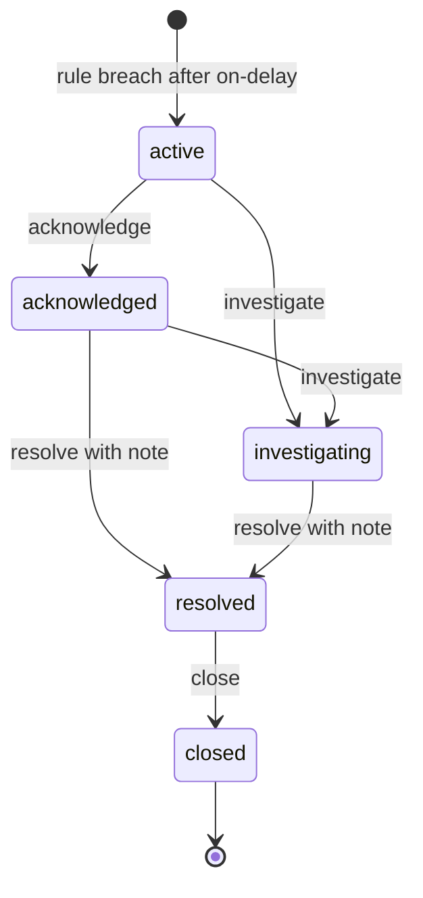

Table: Alarm transitions, permissions and side effects

| Action | From | To | Permission | Side effects |
|---|---|---|---|---|
| (engine) trigger | none | active | alarm engine | Insert `alarm_events`, history `triggered`, `audit_events` `alarm.triggered`. |
| (engine) clear | open states | unchanged | alarm engine | Set `cleared_at`; history `condition_cleared`. |
| acknowledge | active | acknowledged | `alarm.acknowledge` | Set `acknowledged_by/at`. |
| investigate | active, acknowledged | investigating | `alarm.investigate` | |
| resolve | acknowledged, investigating | resolved | `alarm.resolve` | Note required, stored in `resolution_note`. |
| close | resolved | closed | `alarm.close` | Set `closed_by/at`. |

While an alarm is open and not cleared, a worse value updates `peak_value`. A new alarm for the same rule is only
raised after the previous one has cleared.

### Inspections

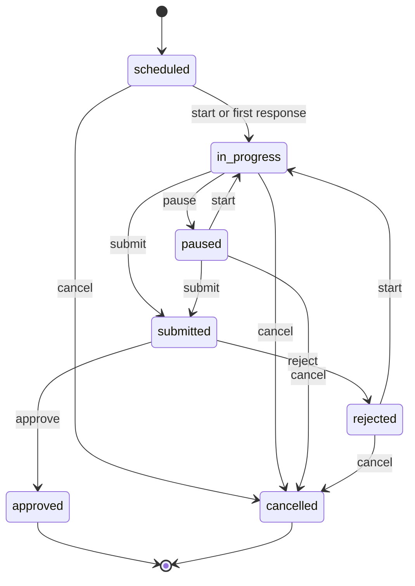

Responses are accepted in `scheduled`, `in_progress`, `paused` and `rejected` (`INSPECTION_EDITABLE`). Every state
change increments `revision`; a client that sends a stale `expectedRevision` receives `revision_conflict`. The UI
labels `rejected` as "Returned".

### Maintenance tasks

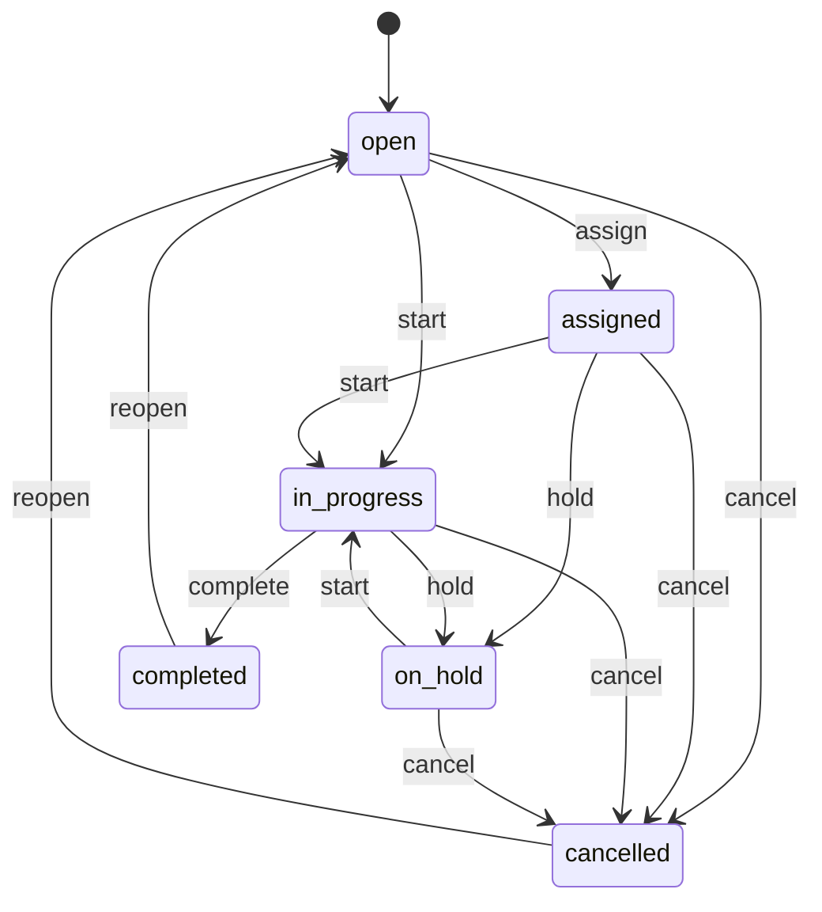

### Audit documents

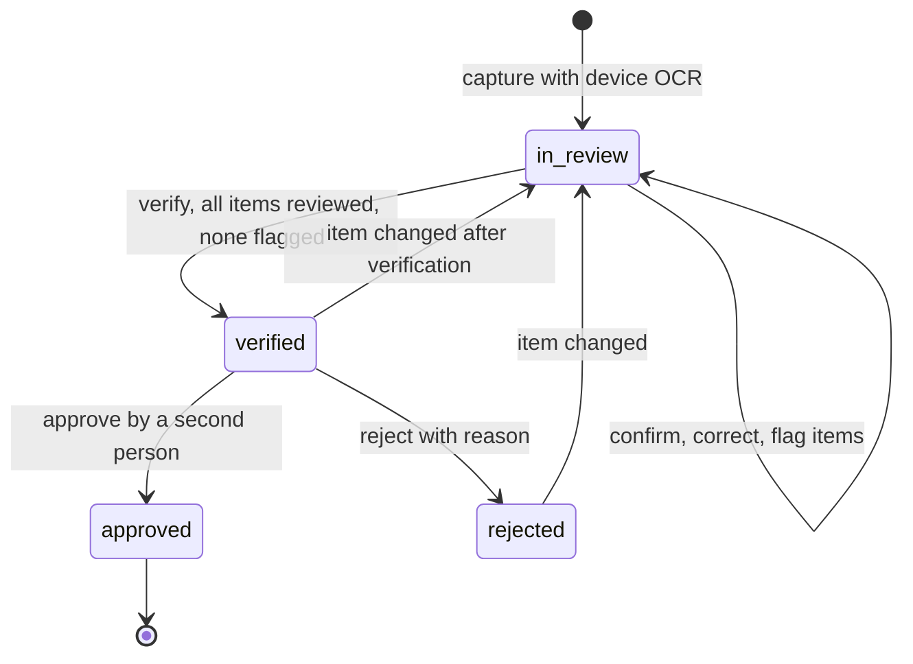

Table: Audit document rules enforced in apps/api/src/modules/audit-docs.ts

| Rule | Enforcement |
|---|---|
| Capture starts in `in_review` | Insert sets `status = 'in_review'`. `processing` exists in the enum and the list filter but is never written. |
| Vision refinement only before review starts | `enhance` returns `review_started` once any item is confirmed or corrected. |
| Verification needs a complete review | `reviewProgress()` must report no pending and no flagged items. |
| Verification and approval are console actions | Device principals receive `forbidden`. |
| Four-eyes approval | `approved_by` must differ from `verified_by`, except in demo tenants (recorded as self-approved in the event note). |
| Approved documents are locked | Item edits and renames return `locked`. |
| Editing after verification reopens the review | Status returns to `in_review`; verifier and approver fields are cleared; event `review.reopened`. |
| Concurrent edits | Every update matches on `revision` and increments it; a mismatch returns `stale`. |

### Pairing challenges and devices

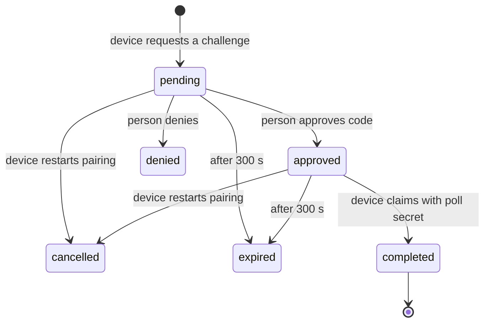

`devices.status` has only three stored values (active, suspended, revoked). The console shows a richer composite
state computed by `deriveDeviceState()` in `packages/domain/src/devices.ts`:

Table: Composite device state derived from stored columns

| Displayed state | Derived from |
|---|---|
| revoked | `status = 'revoked'` |
| suspended | `status = 'suspended'` |
| connected | active, current assignment, and an open stream or `last_seen_at` within 90 s |
| paired | active, no current assignment |
| assigned | active, assigned, never seen |
| disconnected | active, assigned, last seen more than 90 s ago |
| unregistered, pending_pairing | client-side states before a `devices` row exists |

## Tenancy and row-level security

### How organization context is set

Every request runs in a database transaction that first drops to the role `hydris_app` and then sets a
transaction-local setting. `withTenant()` sets `app.org_id`; `withSystem()` sets `app.bypass = 'on'` for the few
operations that legitimately span tenants. Both use `set_config(..., true)` and `SET LOCAL`, so the context ends
with the transaction and cannot leak to the next request on a pooled connection.

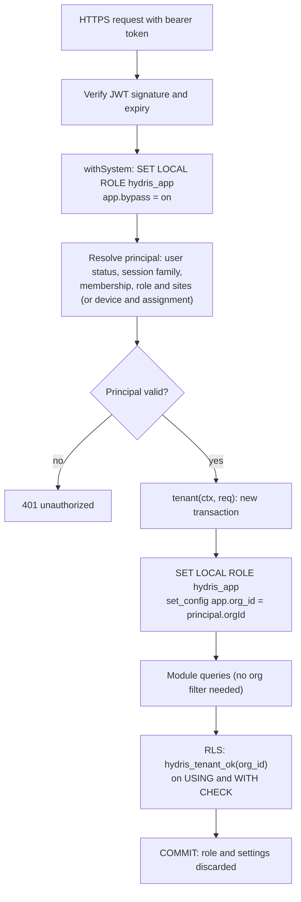

The policy function from `0001_rls.sql`:

```sql
CREATE OR REPLACE FUNCTION hydris_tenant_ok(row_org uuid) RETURNS boolean
LANGUAGE sql STABLE AS $$
  SELECT current_setting('app.bypass', true) = 'on'
      OR row_org = nullif(current_setting('app.org_id', true), '')::uuid
$$;
```

If neither setting is present, `current_setting(..., true)` returns null, the comparison is null, and the row is
invisible. A request that forgets to set context therefore sees nothing rather than everything. `FORCE ROW LEVEL
SECURITY` makes the policy apply to the table owner as well.

### Policy inventory

Table: Row-level security and grants per table

| Policy or grant | Tables | Migration |
|---|---|---|
| `tenant_isolation` on `org_id` | memberships, membership_sites, invitations, sites, facilities, process_areas, assets, gateways, sensors, telemetry_readings, alarm_rules, alarm_events, alarm_event_history, documents, inspection_templates, inspection_routes, inspections, inspection_responses, attachments, maintenance_tasks, maintenance_activity, devices, device_assignments, device_sessions, notifications, audit_events, simulation_runs | 0001 |
| `tenant_isolation` on `id` | organizations | 0001 |
| `tenant_isolation` on `org_id` | telemetry_corrections, ui_profiles, ui_profile_versions, ui_profile_assignments | 0003 |
| `system_only` (`app.bypass = 'on'`) | realtime_events | 0006 |
| `tenant_isolation` on `org_id` | audit_documents, audit_document_pages, audit_document_events | 0008 |
| No RLS, system context only | users, auth_sessions, auth_tokens, mail_outbox, pairing_challenges, inquiries | n/a |
| UPDATE and DELETE revoked from `hydris_app` | audit_events (0001), telemetry_corrections (0003) | 0001, 0003 |
| SELECT and INSERT only for `hydris_app` | audit_document_events | 0008 |
| SELECT, INSERT, DELETE only | realtime_events | 0006 |

Because `withSystem()` also runs as `hydris_app`, the append-only grants hold even for background jobs: no code
path in the application can rewrite the audit trail.

> [!WARNING]
> Superuser and owner connections bypass RLS. Production must connect as a role that is a member of `hydris_app`
> with `SET` rights (`0004_app_role_membership.sql` and `0006_realtime_events_rls.sql` grant this on PG16+ managed
> Postgres). Ad hoc SQL consoles connected as the owner see every tenant.

### Checklist for a new tenant table

1. Add `orgId: orgRef()` as a column in `schema.ts`.
2. Generate the table migration with `drizzle-kit generate`.
3. Write a second, hand-written migration that grants `hydris_app` the needed privileges, enables and forces RLS,
   and creates `tenant_isolation` with `hydris_tenant_ok(org_id)` (copy `0008_audit_documents_rls.sql`).
4. Revoke UPDATE and DELETE if the table is a log.
5. Add a test that reads the table from a second organization and expects zero rows.

### Site scoping

RLS isolates organizations, not sites. Site restrictions (`memberships.all_sites = false` plus `membership_sites`)
are enforced in application code by `requireSite()`, `siteScope()` and `scopedRow()` in `apps/api/src/core` and the
modules. This is **Built** but not defended in depth by the database.

> [!DECISION]
> Site scoping stays in the application for now: it changes per request and per role, and expressing it in policies
> would need a per-request site list in a setting. A **Planned** option is an `app.site_ids` setting and a second
> policy on site-bearing tables for the most sensitive data (telemetry, audit documents).

## Module access patterns

Table: Which modules read and write which tables

| Module | Writes | Reads | Context |
|---|---|---|---|
| `auth.ts` | users, auth_sessions, auth_tokens, memberships, membership_sites, mail_outbox (via `sendMail`) | users, memberships, organizations | system for sign-in, tenant for org switching |
| `org.ts` | memberships, membership_sites, invitations, organizations | audit_events, users | tenant |
| `plant.ts` | sites, facilities, process_areas, assets, gateways, sensors, documents, attachments | all plant tables | tenant |
| `telemetry.ts` | telemetry_readings, sensors (latest value), telemetry_corrections, gateways (`last_seen_at`) | sensors, readings, corrections | system to resolve gateway keys, then tenant |
| `alarms.ts` | alarm_rules, alarm_events, alarm_event_history | rules, events, sensors | tenant; system for stale-rule jobs |
| `inspections.ts` | inspections, inspection_responses, maintenance_tasks (follow-ups), notifications | templates, routes, assets | tenant |
| `maintenance.ts` | maintenance_tasks, maintenance_activity | tasks, assets | tenant |
| `devices.ts` | pairing_challenges, devices, device_assignments, device_sessions | memberships, sites | system for pairing, tenant for management |
| `ui-profiles.ts` | ui_profiles, ui_profile_versions, ui_profile_assignments | same | tenant |
| `audit-docs.ts` | audit_documents, audit_document_pages, audit_document_events | same, sites, users | tenant; system for demo hydration |
| `insights.ts` | none | documents (full text), assets, sensors, users, alarms, inspections | tenant |
| `voice-assistant.ts` | none | sensors, alarms, inspections, tasks, documents | tenant |
| `simulation.ts` | simulation_runs, telemetry (through ingest), maintenance_tasks, assets | scenarios | tenant |
| `public.ts` | inquiries | none | system |
| `core/services.ts` | audit_events, notifications, mail_outbox | none | caller's transaction |
| `core/events.ts`, `realtime.ts` | realtime_events | realtime_events | system |
| `jobs.ts` | pairing_challenges (expire), alarm tables (stale), realtime_events (prune) | simulation_runs | system |

## Indexing and query patterns

The 71 indexes are all B-tree. They follow the main read paths of the console and glasses:

Table: Main query patterns and the indexes that serve them

| Query pattern | Example route or code | Index |
|---|---|---|
| Latest values per site | overview, glasses measurements | `sensors_site_idx` plus cached `sensors.last_*` (no time-series scan) |
| Sensor history for a range | `GET /sensors/:id/history` with `date_bin` buckets | `telemetry_sensor_ts_uq` and `telemetry_sensor_ts_idx` |
| Idempotent ingest | `INSERT ... ON CONFLICT (sensor_id, ts) DO NOTHING` | `telemetry_sensor_ts_uq` |
| Effective value with corrections | `effectiveReadings()` lateral join, newest correction first | `telemetry_corrections_reading_idx` |
| Open alarms for an org | alarm list, overview counters | `alarm_events_org_state_idx` |
| Open alarm for a rule during evaluation | `evaluateSensor()` | `alarm_events_rule_idx` |
| My inspections and tasks | glasses home, mobile work tab | `inspections_assignee_idx`, `maintenance_assignee_idx` |
| Latest response per step | inspection view | `inspection_responses_step_idx` |
| Unread notifications | bell counter | `notifications_user_idx` |
| Audit log by time or by entity | console audit view, entity history | `audit_org_at_idx`, `audit_entity_idx` |
| Realtime replay since cursor | SSE `id > lastEventId` | primary key on `realtime_events.id` |
| Token lookups | refresh, invite, reset, device refresh, gateway key | unique `token_hash`, `key_hash`, `code_hash` indexes |

Known gaps, all **Planned**:

- **Full-text search** on `documents` computes `to_tsvector('english', title || ' ' || body)` on every query
  (`insights.ts`). Add a generated `tsvector` column with a GIN index once a tenant holds more than a few hundred
  documents.
- **`audit_document_pages`** has no `org_id` index; reads go through `document_id`, which is covered by the unique
  index, so this is acceptable.
- **Telemetry at scale** needs time partitioning (monthly) or TimescaleDB hypertables, plus BRIN on `ts` for archive
  partitions. See "Volumes and growth".
- **`telemetry_org_ts_idx`** serves organization-wide time scans (exports, reports). It costs one index entry per
  reading; review it once reports move to rollup tables.

> [!TIP]
> RLS adds `hydris_tenant_ok(org_id)` to every scan. Indexes that lead with `org_id` (sites, assets, sensors,
> alarm events, inspections, maintenance, audit) let the planner combine the policy and the filter in one index
> range. Lead with `org_id` for new tenant indexes unless the first column is already tenant-unique.

## Data quality rules

Data quality is enforced at three points: ingestion, the review workflows, and display. All rules below are
**Built** unless marked otherwise.

### Telemetry ingestion

`ingest()` in `apps/api/src/modules/telemetry.ts` validates every reading before storage and returns a per-item
rejection reason. Accepted gateway batches hold up to 500 readings.

Table: Telemetry ingestion checks and rejection reasons

| Check | Rule | Rejection reason |
|---|---|---|
| Synthetic isolation | `source = 'simulator'` only for `is_demo` organizations; also enforced by CHECK on `synthetic` | `synthetic_not_allowed` |
| Sensor exists in the organization, not archived | lookup by id within the tenant | `unknown_sensor` |
| Sensor enabled | `sensors.enabled` | `sensor_disabled` |
| Gateway site | a gateway may only write sensors on its own site | `sensor_not_on_gateway_site` |
| Clock skew | `ts` at most 5 minutes in the future | `timestamp_in_future` |
| Late data | `ts` at most 30 days old, except `lab` | `timestamp_too_old` |
| Finite value | not NaN or infinite | `not_finite` |
| Known unit | canonical or a listed alternative unit | `unknown_unit` |
| Physical plausibility | value within `validRange` after conversion | `out_of_range` |
| Duplicate | same `(sensor_id, ts)` | counted as duplicate, not an error |

Table: Physical plausibility ranges in canonical units (MEASURAND_DEFS)

| Measurand | Unit | Valid range | Typical band |
|---|---|---|---|
| ph | pH | 0 to 14 | 6.5 to 8.5 |
| temperature | °C | -20 to 120 | 10 to 35 |
| dissolved_oxygen | mg/L | 0 to 25 | 1.5 to 3 |
| turbidity | NTU | 0 to 4,000 | 0 to 10 |
| conductivity | µS/cm | 0 to 200,000 | 200 to 3,000 |
| flow_rate | m³/h | 0 to 100,000 | none |
| tank_level | % | 0 to 100 | 20 to 80 |
| pressure | bar | -1 to 100 | none |
| motor_current | A | 0 to 2,000 | none |
| vibration | mm/s | 0 to 100 | 0 to 4.5 |
| runtime_hours | h | 0 to 1,000,000 | none |
| tss | mg/L | 0 to 50,000 | none |
| cod | mg/L | 0 to 100,000 | none |
| bod | mg/L | 0 to 50,000 | none |
| ammonia | mg/L | 0 to 2,000 | 0 to 5 |
| residual_chlorine | mg/L | 0 to 20 | 0.2 to 1 |

Out-of-order readings are stored for history but do not overwrite a newer cached latest value or re-trigger alarms.
Readings with quality `bad` are stored but never evaluated against alarm rules.

### Freshness

`freshness()` classifies the age of `sensors.last_ts` relative to `expected_interval_s`: **live** up to 2 times the
interval, **delayed** up to 5 times, **stale** beyond, and **no_data** without a timestamp. Stale values must be
visibly marked and are excluded from health roll-ups. Stale alarm rules (`condition = 'stale'`) are evaluated by a
background job every 30 seconds on the long-running server, or per cron pass on serverless.

### Corrections

A correction needs a reason of at least 5 characters, the corrected value is normalised and range-checked like an
ingested reading, and the original reading row is never modified. The newest correction per reading defines the
effective value; `invalidate` excludes the reading from charts, aggregates and the cached latest value
(`recomputeLatest()`). CSV exports show original value, effective value, status, reason, author and time.

### Inspections

Readings outside `expectedMin`/`expectedMax` and abnormal options set `outcome = 'abnormal'`. Response timestamps
more than 5 minutes in the future and values whose kind does not match the step are rejected as conflicts.

### Audit documents

Table: Audit document quality rules (packages/domain/src/auditdoc.ts)

| Rule | Behaviour |
|---|---|
| Plausibility ranges | pH 0 to 14; dissolved oxygen 0 to 25 mg/L; temperature -20 to 120; percentages 0 to 100; turbidity 0 to 4,000 NTU. Out-of-range fields get confidence capped at 0.4 and a note. |
| Table cell checks | Numeric cells are range-checked against the row label; when a labelled field with the same digits passes, it is offered as a suggestion (catches a dropped decimal point). |
| Engine agreement | Numbers must match exactly after folding look-alike characters (O to 0, l to 1, S to 5); text may differ slightly (`close` at similarity 0.85 or more). |
| Needs attention | `mismatch` or confidence below 0.75 is shown to the reviewer first. |
| Bulk confirm | Only pending fields with more than one source, `match` agreement and confidence of at least 0.8. |
| Low-quality capture | A page with OCR confidence below 60 adds a warning to rescan. |

> [!RISK]
> Two engines can agree on a wrong value. Plausibility checks cover the common water-quality parameters only; COD,
> BOD and flow values in scanned sheets are not range-checked. **Planned**: reuse `MEASURAND_DEFS.validRange` for
> field labels that map to a measurand.

## Data lifecycle and retention

### Current behaviour

Only one table is pruned today: `realtime_events`, older than one day, by `pruneRealtimeEvents()` (hourly on the
long-running server in db mode, each cron pass on serverless). Pairing challenges are marked `expired` every minute
but not deleted. Everything else is kept indefinitely. Deleting an organization cascades to every tenant row.

### Recommended policy

Retention should be configurable per organization, with defaults that meet typical record-keeping obligations for
effluent and sewage treatment. The periods below are proposals, not legal advice; confirm each against the
customer's consent-to-operate conditions and applicable law before enforcement.

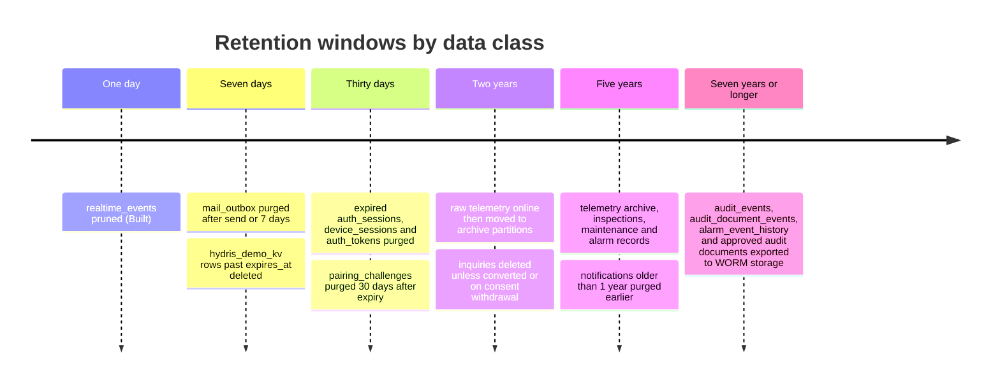

Table: Retention by table, current and recommended

| Data | Current | Recommended (**Planned**) |
|---|---|---|
| `realtime_events` | Pruned after 1 day (**Built**) | Keep. |
| `telemetry_readings` | Indefinite | 2 years online in monthly partitions, then archive (cold storage or compressed partitions) for at least 5 years; keep hourly rollups online. |
| `telemetry_corrections` | Indefinite | Same as the readings they correct. |
| `alarm_events`, `alarm_event_history` | Indefinite | At least 5 years; history follows its event. |
| `inspections`, `inspection_responses`, `maintenance_*` | Indefinite | At least 5 years, configurable. |
| `audit_documents`, `audit_document_pages` | Indefinite, images in Postgres | Approved records for the customer's record period (at least 5 years); page images in object storage with lifecycle rules; rejected scans 1 year. |
| `audit_events`, `audit_document_events` | Indefinite, append-only | At least 7 years, then export to WORM storage before deletion. |
| `notifications` | Indefinite | Read notifications 1 year. |
| `auth_sessions`, `device_sessions`, `auth_tokens` | Expired rows remain | Purge 30 days after expiry or revocation. |
| `pairing_challenges` | Expired rows remain | Purge 30 days after expiry. |
| `invitations` | Indefinite | Purge 90 days after expiry, acceptance or revocation. |
| `mail_outbox` | Indefinite, contains live links | Purge after send or 7 days. |
| `inquiries` | Indefinite | 24 months, or on consent withdrawal (DPDP Act 2023, GDPR). |
| `simulation_runs` | Indefinite | 90 days after stop. |
| `hydris_demo_kv` | Expired rows ignored, never deleted | Delete rows past `expires_at` daily. |

> [!IMPORTANT]
> Retention jobs must run in system context as `hydris_app`. Because UPDATE and DELETE are revoked on the audit
> logs, purging them needs a dedicated maintenance role and a documented, audited procedure. That is intentional.

## Volumes and growth

### Telemetry

Telemetry dominates storage. Rows per day per sensor follow directly from the reporting interval:

Table: Telemetry rows per sensor by reporting interval

| Interval | Rows per sensor per day | Rows per sensor per year | Typical use |
|---|---|---|---|
| 5 s | 17,280 | 6.3 million | Demo simulator (`SIM_STEP_SECONDS = 5`) |
| 10 s | 8,640 | 3.2 million | Fast online analysers |
| 60 s | 1,440 | 525,600 | Default `expected_interval_s` |
| 300 s | 288 | 105,120 | Slow process values |
| 1 day | 1 | 365 | Lab parameters (COD, BOD, TSS) |

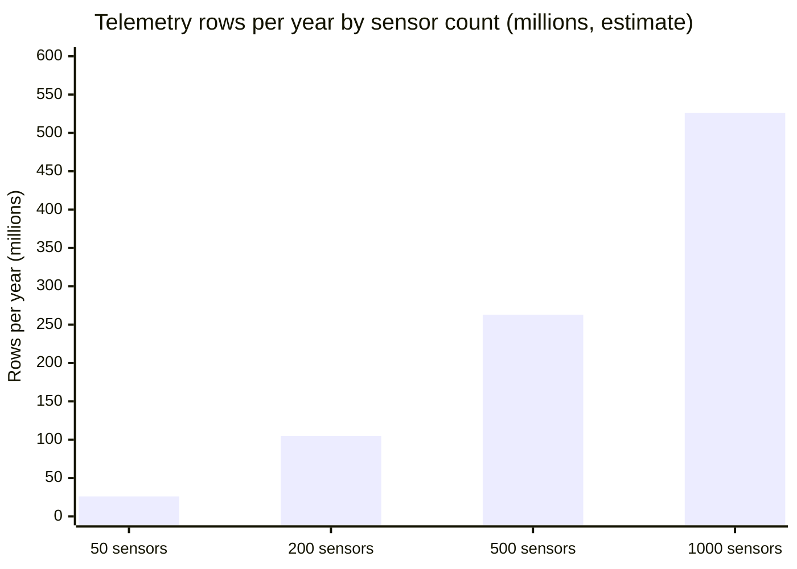

Storage estimate: a reading row is about 100 to 130 bytes of heap (tuple header, `bigint`, two `uuid`, two
`timestamptz`, `double`, two enums, `boolean` and a short `message_id`), plus about 40 to 50 bytes in each of the
three indexes. Roughly **250 bytes per reading** in total is a reasonable planning figure (estimate). At 60 s that
is about 130 MB per sensor-year, so a 200-sensor plant adds about 26 GB per year and 1,000 sensors about 130 GB per
year. Dropping `message_id` for gateways that do not need it and moving cold months to compressed partitions are the
main levers.

> [!RISK]
> A single unpartitioned `telemetry_readings` table will slow down vacuum, index maintenance and range scans beyond
> a few hundred million rows. Partition by month before the first customer passes about 200 sensors at 60 s.

### Other tables

Table: Growth estimates for one mid-size site (estimate, not measured)

| Table | Driver | Estimate per site per year |
|---|---|---|
| `alarm_events` and history | 5 to 20 alarms a day, 3 to 5 history rows each | 2,000 to 7,000 events; 10,000 to 35,000 history rows |
| `inspections`, `inspection_responses` | 10 to 30 inspections a day, 5 to 10 steps | 4,000 to 11,000 inspections; 20,000 to 110,000 responses |
| `maintenance_tasks` | 2 to 10 a day | 700 to 3,700 |
| `audit_events` | every write action | 50,000 to 200,000 |
| `realtime_events` | every published event, pruned daily | bounded at about one day of events |
| `audit_documents` and pages | 5 to 20 scans a day, 1 to 3 pages | 2,000 to 7,000 documents; 0.6 to 4 GB of base64 page data in Postgres |

### Demo tenant

The showcase seed produces a known volume, useful for performance tests: 27 simulated signals at 10-minute
resolution over 7 days (27 × 1,008 = 27,216 readings), 30 lab readings, 2 sites, 15 assets and 30 sensors.

## Binary and image storage

Two storage paths exist today:

- **Attachments** (`attachments`) store only metadata in Postgres. Bytes go to local disk (`STORAGE_DIR`) or a private
  Vercel Blob store (`attachments/<org>/<uuid>`) through `createStorage()` in `apps/api/src/core/services.ts`. Files
  are only served through the authorised `/api/attachments/:id` route. **Built**.
- **Audit page images** (`audit_document_pages.data`) are stored as base64 text inside Postgres, together with the
  OCR JSON. The device downscales scans (the schema comment targets about 600 KB) and the API rejects pages over
  900 KB decoded and documents over 6 pages. **Built**.

> [!RISK]
> Base64 in Postgres costs about 37 % more space than the binary, is mostly incompressible (JPEG), inflates backups
> and logical replication, and every `SELECT *` on pages drags megabytes through the pool. A six-page document can
> approach 7 MB of row data. In demo mode, the same snapshot is also copied into `hydris_demo_kv`.

### Proposed migration to object storage

**Planned.** Move page images to the same storage adapter as attachments and keep only a reference in Postgres.

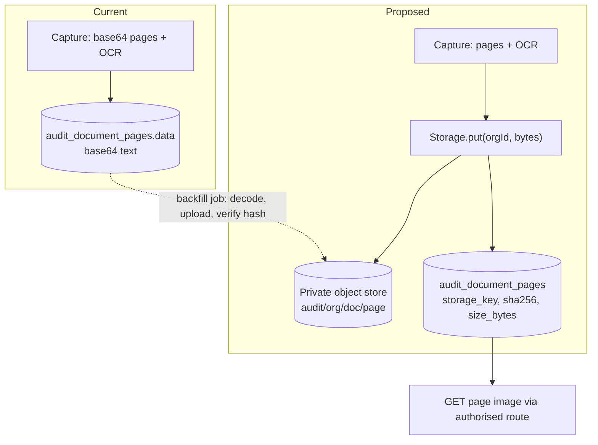

Migration steps:

1. Add nullable columns `storage_key text`, `sha256 text` and `size_bytes integer` to `audit_document_pages`; make
   `data` nullable.
2. Write new captures to object storage; keep `ocr` in Postgres (it is queried during review and vision merge).
3. Backfill existing rows in batches in system context: decode, upload, record hash and key, verify by re-reading,
   then set `data` to null.
4. Serve images through an authorised route that checks tenancy and site scope, like attachments.
5. After a full release cycle with no reads of `data`, drop the column and `VACUUM FULL` (or repack) the table.
6. Apply bucket lifecycle rules that mirror the record retention policy, with object lock for approved records.

## Migrations

### Process

Schema changes start in `apps/api/src/db/schema.ts`. `npm run db:generate` (Drizzle Kit, config in
`apps/api/drizzle.config.ts`) writes a numbered SQL file and a snapshot into `apps/api/drizzle/`. Policy, grant and
role changes are hand-written migrations in the same folder, registered in `meta/_journal.json`. `npm run
db:migrate` applies pending migrations; the API also migrates on start-up.

On Postgres, `createDatabase().migrate()` in `apps/api/src/db/client.ts` takes a session-level advisory lock
(`pg_advisory_lock(4872917633)`) on one dedicated connection, so several cold-starting serverless instances never
migrate concurrently. PGlite (tests, demo) migrates in process.

Table: Migration history

| Migration | Kind | Content |
|---|---|---|
| `0000_init` | generated | 22 enums, 34 tables, foreign keys, indexes, 2 CHECK constraints |
| `0001_rls` | hand-written | `hydris_app` role, grants, `hydris_tenant_ok()`, RLS on 27 tenant tables and organizations, audit_events append-only |
| `0002_corrections_ui_profiles` | generated | telemetry_corrections, ui_profiles, ui_profile_versions, ui_profile_assignments |
| `0003_rls_new_tables` | hand-written | Grants and RLS for the four new tables; corrections append-only |
| `0004_app_role_membership` | hand-written | Grant `hydris_app` to the migrating user (`WITH SET TRUE` on PG16+) |
| `0005_realtime_events` | generated | realtime_events |
| `0006_realtime_events_rls` | hand-written | `system_only` policy; re-check SET capability on PG16+ |
| `0007_audit_documents` | generated | audit_doc_status enum, audit_documents, pages, events |
| `0008_audit_documents_rls` | hand-written | Grants (events insert-only) and RLS for audit tables |

### Rules for schema changes

- **Expand, then contract.** Add nullable columns or new tables first, deploy code that writes both shapes,
  backfill, then remove the old shape in a later release. Serverless instances of two versions run side by side
  during a deploy.
- **No destructive change in a generated migration without review.** Drizzle Kit can emit `DROP COLUMN`; a reviewer
  must confirm a backfill exists.
- **Every new tenant table gets an RLS migration** (see the checklist above). Tests run on PGlite with the same
  migrations, so a missing policy fails the cross-tenant test.
- **Enum values are append-only.** Renaming or removing a value needs a new type and a data migration.
- **Large tables** (`telemetry_readings`, `audit_events`) need `CREATE INDEX CONCURRENTLY` in a hand-written
  migration outside a transaction once they are big.

## Seed and demo data

Table: Seed entry points

| Entry point | What it creates | Used by |
|---|---|---|
| `npm run seed` (`apps/api/src/seed/cli.ts`) | Platform admin from `SEED_ADMIN_EMAIL` and `SEED_ADMIN_PASSWORD` (12+ characters) | New environments |
| `npm run seed -- --demo` | Plus the Riverbend demo tenant with 7 role accounts at `@demo.hydris.local` (password `SEED_DEMO_PASSWORD`) | Staging, sales environments |
| `seedDemoShowcase()` (`seed/showcase.ts`) via `bootDemo()` | Full showcase tenant on every instance in demo mode | Public demo, tests |

The demo tenant is the organization `Riverbend Process Industries (Demo)` (slug `riverbend-demo`, `is_demo = true`,
time zone `Asia/Kolkata`). Every row has a deterministic UUID v5 from `demoId()` in `seed/ids.ts`, so separate
in-memory databases on separate serverless instances agree on every identifier.

Table: Demo showcase content

| Area | Content |
|---|---|
| Sites | Riverbend Industrial Park (`RIP`, ETP-01, 3,000 m³/day, 5 process areas) and Riverbend Township STP (`RTS`, STP-02, 5,000 m³/day, 4 process areas) |
| Assets and sensors | 7 + 8 assets; 15 + 12 continuous sensors and 3 lab sensors (COD, BOD, TSS) |
| Telemetry | 7 days at 10-minute resolution for 27 signals, `source = 'simulator'`, `synthetic = true`; 10 lab samples per lab parameter over 14 days, `source = 'lab'`, including one COD exceedance (262 mg/L) |
| Rules and alarms | Threshold rules from `SIM_PLANT.thresholds`, two stale rules, alarm events across all states with history |
| Documents | Approved SOPs and a lockout/tagout safety notice, linked to rules as procedures |
| Work | 5 inspection templates, routes, inspections in several states with responses, maintenance tasks with activity |
| Devices | 5 devices: two active hardware glasses, a browser simulator, one suspended and one revoked unit |
| UI profiles | Profiles with published, superseded and draft versions and assignments at several scopes |
| People and trail | Owner account, role accounts, notifications and audit events |

Live data in demo mode comes from `DemoTicker` (`apps/api/src/demo.ts`): at most every 5 seconds a request advances
running simulations and feeds the second site's instruments through the normal `ingest()` path, so alarms and
realtime events behave exactly as with a gateway.

> [!IMPORTANT]
> Synthetic data is labelled at every level: `organizations.is_demo`, `telemetry_readings.synthetic` (tied to
> `source` by a CHECK constraint), and `synthetic` flags on alarms, inspections and maintenance tasks. Ingestion
> rejects simulator data for customer tenants. Analytics must filter on these flags.

## Privacy classification

Each table is classified by the most sensitive data it holds. **PII** means personal data about an identifiable
person; **Secret** means credentials or material that grants access; **Sensitive** means business or compliance data
a customer would treat as confidential; **Operational** means plant data without personal content.

Table: Privacy classification per table

| Table | Class | Personal or sensitive fields | Notes |
|---|---|---|---|
| `users` | PII, Secret | email, name, password_hash, mfa_secret_enc, last_login_at | Global; erasure must keep audit references (actor ids have no FK). |
| `memberships`, `membership_sites` | PII | role, title | |
| `invitations` | PII, Secret | email, name, token_hash | |
| `auth_sessions` | PII, Secret | ip, user_agent, token_hash | |
| `auth_tokens` | Secret | token_hash | |
| `mail_outbox` | PII, Secret | recipient, body with live links | Purge (Planned). |
| `inquiries` | PII | name, email, phone, company, job_title, message | Consent recorded; IP hashed. |
| `devices` | PII (indirect) | last_ip, hardware_id, link to wearer | |
| `device_assignments` | PII | who wore which device when | Workforce monitoring sensitivity. |
| `device_sessions`, `pairing_challenges` | Secret | token, code and poll-secret hashes, requester_ip | |
| `notifications` | PII | per-person content | |
| `audit_events` | PII, Sensitive | actor ids, ip, metadata | Legal record. |
| `alarm_event_history`, `maintenance_activity` | PII | actor ids, notes | |
| `inspections`, `inspection_responses` | PII, Sensitive | assignee, recorded_by, notes, photos via attachments | |
| `attachments` | PII possible | photos may show people | Bytes in object storage. |
| `audit_documents`, `audit_document_pages`, `audit_document_events` | Sensitive, PII possible | scanned names and signatures, compliance values | Page images may contain handwriting and signatures. |
| `telemetry_readings`, `telemetry_corrections` | Sensitive | discharge quality values | Compliance evidence; `corrected_by` is PII. |
| `alarm_rules`, `alarm_events` | Sensitive | limits and exceedances | `assigned_to` and actor columns are PII. |
| `documents` | Sensitive | procedures | |
| `organizations`, `sites`, `facilities`, `process_areas`, `assets`, `gateways`, `sensors` | Operational | site coordinates, gateway key hashes | `gateways.key_hash` is Secret. |
| `ui_profiles`, `ui_profile_versions`, `ui_profile_assignments` | Operational | | User and device scope rows are PII by link. |
| `realtime_events` | Sensitive, transient | payloads | Pruned after 1 day. |
| `simulation_runs`, `hydris_demo_kv` | Operational | demo only | |

> [!NOTE]
> Hydris processes field workers' personal data as a processor for its customers. Data subject requests (access,
> correction, erasure) are handled per organization; a user erasure should anonymise `users` and keep the trail rows
> whose actor ids no longer resolve to a name. The full control mapping is in the Security and Privacy document
> (HFG-SEC).

## Mobile and client-side data

### Android app

The native Android app (`apps/android`) keeps **no local database**. Screens load from the API on demand. The only
persisted data is credentials in `SecureStore` (`data/SecureStore.kt`): an encrypted key/value store on top of
SharedPreferences file `hydris.secure`.

Table: Android SecureStore entries

| Key | Content | Written by |
|---|---|---|
| `cookies` | Session cookies for the API (refresh cookie), one per line | `HydrisApi` cookie jar |
| `device.access` | Glasses device access token | Pairing, device refresh |
| `device.refresh` | Glasses device refresh token (30 days) | Pairing, device refresh |
| `device.id`, `device.name` | Paired device identity | Pairing |

Each value is encrypted with AES-256-GCM using a non-exportable Android Keystore key (alias `hydris.secure.v1`); the
stored string is Base64 of a 12-byte IV followed by ciphertext and a 128-bit tag. Nothing secret reaches
SharedPreferences in plain text. Scanned pages are held in memory until upload, then sent as base64 with their OCR
readings (`ScanUpload` in `data/Models.kt`, `source = "mobile"`). The Kotlin models mirror the API responses and
ignore unknown keys, so the server can add fields without breaking the app.

### Web glasses app

The browser-based glasses app (`apps/web/src/glasses`) is offline-first for inspections and stores in
`localStorage`:

Table: Web glasses app local storage

| Key | Content |
|---|---|
| `hydris.glasses.hw` | Install identifier used as `hardware_id` at pairing |
| `hydris.glasses.refresh` | Device refresh token |
| `hydris.glasses.queue` | Offline queue of inspection responses `{ inspectionId, op: { opId, stepId, value, note, recordedAt } }` |
| `hydris.glasses.cache.ctx`, `hydris.glasses.cache.docs`, `hydris.glasses.cache.doc.<id>` | Last good context and SOPs with a timestamp, shown as stale when offline |

Queued operations replay idempotently because `opId` becomes `client_op_id` and the server ignores duplicates.

> [!RISK]
> `localStorage` is readable by any script on the origin. A device refresh token there is acceptable for the browser
> simulator but not for production hardware; `link.ts` defines a `SecureStore` interface so a native runtime can
> supply hardware-backed storage. **Planned** for production glasses runtimes.

## Analytics and event model

**Planned.** There is no analytics pipeline today. Product and operational analytics are currently answered from
the transactional tables and `audit_events`. The proposal below keeps analytics out of the request path and reuses
events the API already produces.

### Principles

- Analytics read from a replica or an export, never from the primary during business hours.
- Every analytic row carries `org_id`, `site_id` where relevant, and the synthetic flag; demo and synthetic data are
  excluded by default.
- No free text and no names leave the tenant boundary; people are referenced by pseudonymous ids.

### Proposed event schema

Table: Proposed analytics event envelope

| Field | Type | Description |
|---|---|---|
| `event_id` | uuid | Unique id for deduplication. |
| `event_type` | text | `alarm.acknowledged`, `inspection.submitted`, `auditdoc.verified`, `assistant.answered`, `glasses.session_started`, ... |
| `occurred_at` | timestamptz | When it happened. |
| `org_id` | uuid | Tenant. |
| `site_id` | uuid | Optional. |
| `actor_ref` | text | Pseudonymous actor id (keyed hash of user id per org). |
| `surface` | text | console, glasses, mobile, gateway, engine. |
| `entity_type`, `entity_id` | text | Subject of the event. |
| `properties` | jsonb | Typed per event type, no free text. |
| `synthetic` | boolean | From the source row. |

Sources: `audit_events` already captures most state changes with actor and entity; `realtime_events` captures
telemetry and alarm updates. A nightly job (or logical replication) copies them into an analytics store, and rollup
tables answer the product questions.

Table: Proposed rollups and the questions they answer

| Rollup | Grain | Answers |
|---|---|---|
| `telemetry_hourly` | sensor, hour: min, max, avg, count, invalidated count | Long-range charts and compliance summaries without scanning raw readings. |
| `alarm_daily` | site, severity, day: raised, acknowledged, time to acknowledge, time to resolve | Alarm burden and response performance. |
| `inspection_daily` | site, template, day: due, done on time, abnormal steps | Round completion and findings. |
| `auditdoc_daily` | site, day: scanned, verified, approved, items corrected, engine agreement | Scanning adoption and OCR quality. |
| `surface_usage_daily` | org, surface, day: active users and devices | Adoption of glasses vs console vs mobile. |

## Future schema changes

All items in this section are **Planned** and listed in priority order. Each one should follow the expand and
contract rules in "Migrations".

Table: Planned schema changes

| # | Change | Why | Size |
|---|---|---|---|
| 1 | Move `audit_document_pages.data` to object storage (`storage_key`, `sha256`, `size_bytes`) | Database size, backup time, pool pressure | M |
| 2 | Partition `telemetry_readings` by month; add `telemetry_hourly` rollup | Scale beyond about 100 million rows | L |
| 3 | Retention jobs (sessions, tokens, pairing, mail_outbox, demo kv) and per-org retention settings | Privacy, table hygiene | M |
| 4 | CHECK constraints for every text-typed value set | Integrity under manual fixes | S |
| 5 | Generated `tsvector` column and GIN index on `documents` | Search latency | S |
| 6 | Foreign keys or validation for `actor_device_id`, `submitted_device_id`, `inspection_responses.device_id`, `attachments.device_id` (set null) | Referential integrity | S |
| 7 | Document versions table (`document_versions`) so approved SOP text is immutable and inspections can cite the version used | Compliance traceability | M |
| 8 | Sample and laboratory model (`samples`, `lab_results` with chain of custody) instead of lab readings in telemetry | Lab provenance, OCEMS reporting | L |
| 9 | Compliance limits per discharge point (`consent_limits`) separate from alarm rules | Exceedance reporting | M |
| 10 | Voice assistant conversation log (opt-in, `assistant_turns` with grounding references, short retention) | Quality review of answers | M |
| 11 | Optional site-level RLS (`app.site_ids`) for telemetry and audit documents | Defence in depth for restricted memberships | M |
| 12 | Push notification tokens per device and user (`push_tokens`) | Mobile alerts | S |
| 13 | Use `processing` status for asynchronous OCR or vision on the server | Large documents, retries | S |
| 14 | Mail transport sets `mail_outbox.sent_at`, then purges | Operational correctness | S |

> [!DECISION]
> TimescaleDB is attractive for item 2, but managed Postgres offerings used for Hydris deployments may not support
> the extension. Native declarative partitioning is the default plan; TimescaleDB stays an option per deployment.

## Open questions and unverified facts

Table: Items to verify before this document leaves draft

| # | Item | Status |
|---|---|---|
| 1 | Retention periods for discharge-monitoring and audit records under each customer's consent to operate (India CPCB and state boards) | Needs legal confirmation |
| 2 | Per-row storage figure (about 250 bytes per reading) and per-site growth figures | Estimates; measure on a staging dataset |
| 3 | Engine names written by the Android and web OCR clients (`mlkit` and similar in examples) | Illustrative; confirm against `apps/android/.../scan/OcrEngine.kt` and the web scan code |
| 4 | Whether production deployments run `REALTIME_MODE=db` (and therefore write `realtime_events`) outside demo mode | Depends on deployment configuration |
| 5 | Exact list of `maintenance_activity.action` values written by `maintenance.ts` beyond transitions and notes | Verify in code |
