# Deployment and Infrastructure

This document describes how Hydris Field Glasses is deployed today and how it will be deployed for paying
customers. It covers the hosted platform on Vercel, the managed Postgres database, the two Android apps, the
release pipeline that ships them, and the operational practices (observability, backup, disaster recovery,
capacity, cost and data residency) that turn a working demo into a dependable service for wastewater and
effluent treatment plants.

Every statement about the current system is grounded in the repository and names the file it comes from. Status
labels follow the house rule: **Built** means it is in the code and exercised, **Partial** means it exists but
has a known gap, and **Planned** means it is a design that is not yet implemented. Targets are labelled as
targets. Costs and capacity numbers are indicative estimates, not measurements or quotes.

> [!STATS]
> - 1 | Vercel project | website, console, glasses app and API in one deployment
> - 9 | SQL migrations | `apps/api/drizzle/0000` to `0008`, applied under an advisory lock
> - 0 | CI workflows | no `.github/` directory yet; the pipeline in this document is proposed
> - 1 | daily cron | `/api/cron` at `0 3 * * *` (root `vercel.json`)

> [!IMPORTANT]
> The live deployment at `https://hydrisview.vercel.app` is a demonstration environment. It runs in demo mode
> with synthetic data and public demo secrets. It must never receive real plant data. The production
> topologies in this document are what a customer pilot runs on.

## Deployment at a glance

Hydris is a TypeScript monorepo (`package.json` workspaces `packages/*` and `apps/*`, Node `22.x` in `engines`).
Three deployable units come out of it:

| Unit | Source | Runtime | Status |
|---|---|---|---|
| Web and API | `apps/web` (Next.js 16) with `apps/api` (Fastify) compiled in | Vercel serverless functions, Node.js runtime | **Built** |
| Hydris Field (native Android) | `apps/android` (Kotlin, Jetpack Compose) | Android 12+ phones, package `ai.hydris.field` | **Partial** (release signing not configured) |
| Hydris Glasses bridge (Android) | `apps/glasses-bridge-android` (WebView plus Meta Wearables DAT 1.0.1) | Android 12+ phones paired to Ray-Ban Meta glasses, package `ai.hydris.glassesbridge` | **Partial** (not yet run on physical glasses, per its README) |

Two further artefacts exist for non-Vercel hosting and are used by the target topologies:

| Artefact | File | Purpose | Status |
|---|---|---|---|
| API container image | `apps/api/Dockerfile` | Long-running Fastify server (`src/server.ts`) with timers, SSE and local disk storage | **Built**, not used in production |
| Web container image | `apps/web/Dockerfile` | Next.js server that proxies `/api` to `API_URL` | **Built**, not used in production |
| Compose stack | `docker-compose.yml` | Postgres 17, API and web on one host | **Built**, used for local production-like tests |
| Render blueprint | `render.yaml` | API as a Render web service with a 5 GB disk | **Built**, not deployed |

> [!NOTE]
> Both Dockerfiles use `node:24-slim`, while the root `package.json` pins `engines.node` to `22.x` and
> `docs/operations/vercel.md` asks for Node 24 in the Vercel project settings. Pick one major version for all
> runtimes before the pilot. This document assumes Node 22 because that is what `engines` enforces.

## Where Hydris runs today

### The current production topology

The whole product is one Vercel project connected to the GitHub repository `tarun-km/hydrisview`. Every push to
`main` triggers a production build and deployment to `https://hydrisview.vercel.app`. The root `vercel.json` sets
the framework (`nextjs`), the install command (`npm ci --include=dev`), the build command (`npm run build`, which
builds only `@hydris/web`), the output directory (`apps/web/.next`) and a single cron job.

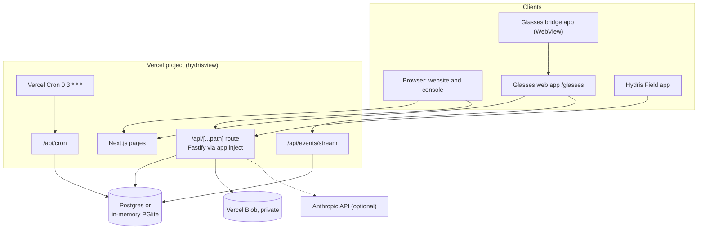

The API is not a separate service. `apps/web/src/app/api/[...path]/route.ts` lazily imports
`@hydris/api/serverless`, builds the Fastify application once per function instance and forwards each request
with `app.inject` (no network hop). Next.js treats it as an ordinary route handler with `runtime = 'nodejs'`,
`dynamic = 'force-dynamic'` and `maxDuration = 60`. The `next.config.ts` file keeps native and runtime-plugin
packages (`@node-rs/argon2`, `pg`, `@electric-sql/pglite`, `fastify` and its plugins, `@vercel/blob`) out of the
bundle via `serverExternalPackages`, and ships the SQL migrations with the functions via
`outputFileTracingIncludes`.

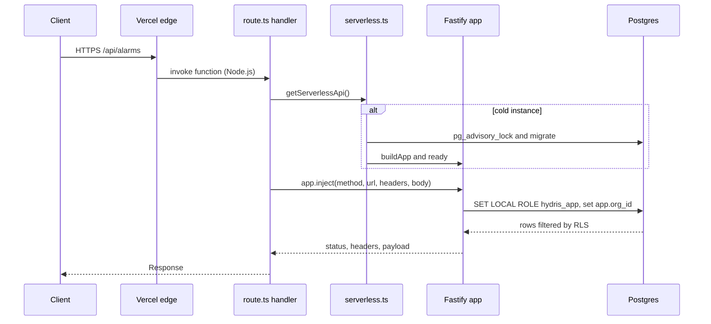

Two route handlers bypass `app.inject` because they need host-level behaviour:

- `apps/web/src/app/api/events/stream/route.ts` streams Server-Sent Events from the `realtime_events` table for
  up to 50 seconds, then ends with a `retry:` hint so the client reconnects with `Last-Event-ID`. It refuses to
  run unless `REALTIME_MODE=db`, because an in-memory event bus cannot span serverless instances. **Built.**
- `apps/web/src/app/api/cron/route.ts` runs one pass of the background jobs when called with
  `Authorization: Bearer $CRON_SECRET`, compared in constant time. **Built.**

When `API_URL` is set (or in `next dev`), `next.config.ts` adds a `beforeFiles` rewrite that proxies `/api/*` to
that URL instead, so the same web build can front an external API container. This switch is the hinge between
the serverless topology and the container topologies below.

### Demo mode and how it is selected

`apps/api/src/config.ts` decides at start-up whether the instance is a demo. `isDemoEnv` returns true when
`DEMO_MODE=true`, false when `DEMO_MODE=false`, and otherwise true when running on Vercel (`VERCEL` set) without a
`DATABASE_URL`. In demo mode `demoDefaults` forces `DATABASE_URL=memory://` (an in-memory PGlite database per
instance) unless `DEMO_PERSIST=true` and a Postgres URL are both present, fills in the public `DEMO_SECRETS` for
any missing or invalid `JWT_SECRET` and `DATA_KEY` (and logs a warning), derives `PUBLIC_APP_URL` from
`VERCEL_PROJECT_PRODUCTION_URL` or `VERCEL_URL`, and forces `SIMULATOR_ENABLED=true` and `REALTIME_MODE=db`.

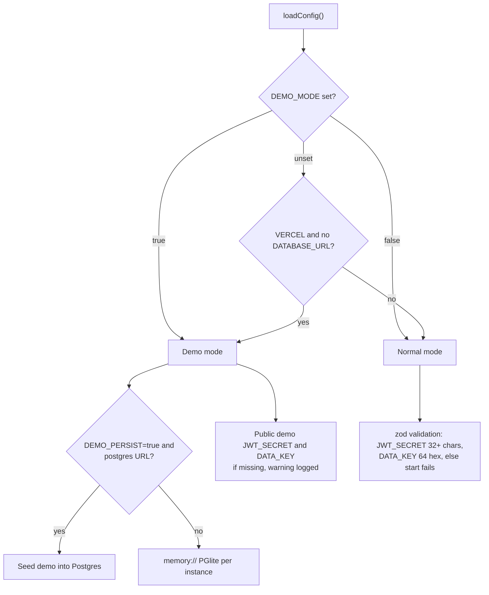

Demo mode always behaves as serverless (no interval timers). Its access tokens live 12 hours instead of 15
minutes (`accessTokenTtl`) because sessions live per instance. Each instance seeds the same deterministic
synthetic tenant on cold start (`bootDemo` in `apps/api/src/demo.ts`).

### Cross-instance demo state

Because every demo instance has its own database, short-lived state that must be seen by more than one instance
(a pairing challenge and its approval, a named guest account) goes through a tiny key/value store,
`apps/api/src/core/demo-shared.ts`. It selects a backend in order of preference and wraps it so that a failure
never breaks the demo.

| Backend | When | Scope | Persistence | Status |
|---|---|---|---|---|
| Postgres `hydris_demo_kv` | A Postgres `DATABASE_URL` is present | All instances using that database | Until `expires_at` | **Built** |
| Vercel Runtime Cache | On Vercel without Postgres | All instances in one region | Best effort, TTL based | **Built** |
| Process memory | Local development and tests | One process | Until restart | **Built** |

Table: Demo shared-state backends in `apps/api/src/core/demo-shared.ts`

> [!WARNING]
> Demo mode relaxes several security properties on purpose (public signing secrets, 12-hour access tokens,
> self-contained device refresh tokens, self-approval in demo tenants). That is acceptable only because demo
> data is synthetic and flagged `is_demo`. The Security and Privacy document (HFG-SEC) lists these relaxations.

### What exists and what does not

| Capability | Status | Evidence |
|---|---|---|
| Git-driven deploys to Vercel (preview per branch, production on `main`) | **Built** | Vercel Git integration, root `vercel.json` |
| In-process API on serverless functions | **Built** | `apps/web/src/app/api/[...path]/route.ts`, `apps/api/src/serverless.ts` |
| Migrations on cold start under an advisory lock | **Built** | `createDatabase().migrate` in `apps/api/src/db/client.ts` |
| Migrations in the build step | **Built**, optional | `npm run vercel-build` with `MIGRATE_ON_START=false` |
| Private attachment storage on Vercel Blob | **Built** | `createStorage` in `apps/api/src/core/services.ts` |
| Realtime over SSE with database polling | **Built** | `apps/web/src/app/api/events/stream/route.ts` |
| Scheduled jobs via Vercel Cron | **Partial** | runs daily only (`0 3 * * *`) |
| CI pipeline (tests, type checks, Android builds) | **Planned** | no `.github/` directory |
| Production Postgres for a customer | **Planned** | demo uses in-memory PGlite |
| Error tracking, metrics, tracing, uptime checks | **Planned** | only function logs and `/api/health` |
| Email delivery | **Planned** | `sendMail` writes to `mail_outbox` only |
| Retention and purge jobs | **Planned** | `runScheduledJobs` prunes only `realtime_events` |
| Android release signing | **Planned** | `apps/android/app/build.gradle.kts` signs release with the debug key |

Table: Current infrastructure capability status

## Target topologies

Hydris will be offered in four topologies. They share one codebase and one database schema; they differ in where
the API process runs, where data lives and how the plant connects. Choosing a topology is a commercial and
regulatory decision as much as a technical one, so it is fixed in the customer's order form.

### Topology A: managed SaaS on Vercel and Neon

This is the default for pilots and for most commercial customers. It is the current architecture with a real
database and production secrets.

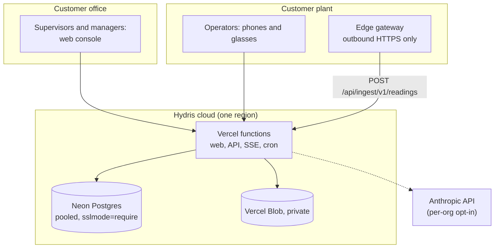

| Setting | Value |
|---|---|
| Vercel plan | Pro (Hobby is limited to non-commercial use and daily crons) |
| Function region | Same region as the database (one region per deployment) |
| Database | Neon Postgres, pooled connection string, `sslmode=require` |
| Connections | 3 per function instance (`poolMax: config.serverless ? 3 : 10` in `serverless.ts`) |
| Realtime | `REALTIME_MODE=db` |
| Attachments | Private Blob store (`BLOB_READ_WRITE_TOKEN`) |
| Cron | `/api/cron` every minute (requires Vercel Pro) |
| Tenancy | Many organizations per database, isolated by RLS |

Table: Topology A configuration

Topology A suits customers without strict residency requirements, and customers whose residency needs are met by
an India region (see below). Its main limits are function duration (60 seconds), per-instance rate limiting and
polling-based realtime with up to about 1.5 seconds of latency (`docs/operations/vercel.md`).

### Topology A-IN: India region

Topology A deployed with every data-bearing component in India. The application code is identical; the
differences are region choices and subprocessor configuration.

| Component | India option | Notes |
|---|---|---|
| Functions | Vercel region `bom1` (Mumbai) | Set in Project, Settings, Functions. Static assets are still served from the global edge network |
| Database | Neon in an India region if offered, otherwise AWS RDS or Aurora Postgres in `ap-south-1` (Mumbai) or `ap-south-2` (Hyderabad) | Confirm Neon region availability at contract time |
| Object storage | AWS S3 in `ap-south-1` behind the `Storage` interface | Vercel Blob region control must be confirmed; S3 is the safe default |
| Logs | Log drain to a store in India | Needed for CERT-In 180-day log retention in Indian jurisdiction |
| AI processing | Off by default for strict-residency tenants | Anthropic processing location is outside India; see HFG-SEC |
| Backups | Same region plus a second Indian region | Mumbai primary, Hyderabad secondary |

Table: India region component choices

> [!DECISION]
> For Indian public-sector and municipal customers the default is Topology A-IN with AI features switched off
> until the customer signs an explicit addendum covering processing outside India. This keeps the default
> deployment inside India without forking the product.

### Topology B: Vercel web with a container API

For larger tenants, long-lived SSE connections, or where background jobs must run every few seconds, the API runs
as a long-lived container and the web build proxies `/api` to it by setting `API_URL`. The container entry point
is `apps/api/src/server.ts`, which starts the timer-driven jobs in `startJobs` (stale rules every 30 seconds,
pairing expiry every 60 seconds, realtime pruning every hour in `db` mode).

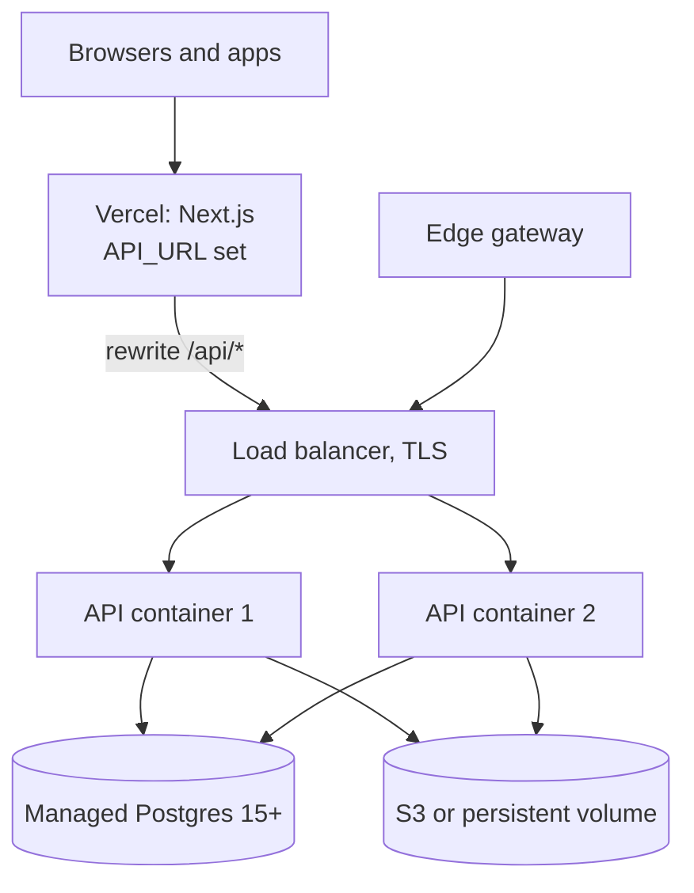

The `render.yaml` blueprint is a ready starting point: a Docker web service with `healthCheckPath: /api/health`,
a 5 GB disk mounted at `/data/files`, `SIMULATOR_ENABLED=false` and a generated `JWT_SECRET`. Two changes are
required before running more than one container: set `REALTIME_MODE=db` (the in-memory bus is per process) and
replace disk storage with S3-compatible object storage, because a disk volume cannot be shared between replicas.

### Topology C: on-premises or plant-edge install

Some plants, especially those under strict OT security policies, cannot send data to a public cloud at all. For
them Hydris runs on a server inside the plant network using `docker-compose.yml` (Postgres 17, API, web). The
phones and the glasses bridge connect over the plant Wi-Fi to a local hostname. Nothing leaves the site.

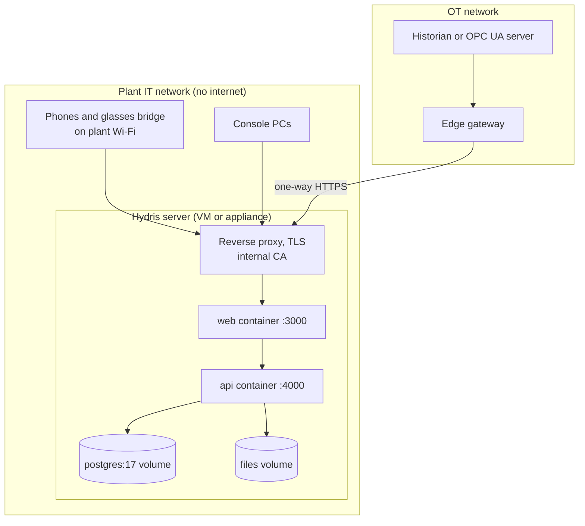

| Concern | Air-gapped approach | Status |
|---|---|---|
| Install | Versioned container images delivered as a signed archive, loaded with `docker load` | **Planned** |
| TLS | Reverse proxy (Caddy or nginx) with a certificate from the plant's internal CA | **Planned** |
| Updates | Quarterly offline bundles with migration notes; migrations run on API start (`server.ts`) | **Partial** |
| AI features | Disabled (no `ANTHROPIC_API_KEY`); rules-based assistant and on-device OCR remain | **Built** (automatic fallback) |
| Android apps | Installed from the customer MDM with `hydris_url` pointing at the local hostname | **Partial** (`hydris_url` is a build-time property today) |
| Meta glasses | DAT needs the Meta AI app, which needs internet at registration time | Constraint: confirm with Meta before quoting air-gapped glasses |
| Backups | Nightly `pg_dump` to a plant NAS plus a weekly offline copy | **Planned** |
| Support access | Escorted remote session on request; no standing vendor access | Policy |

Table: Plant-edge install considerations

> [!RISK]
> The Ray-Ban Meta glasses depend on the Meta AI companion app and Meta's Wearables Device Access Toolkit. A fully
> air-gapped plant may therefore support the phone apps and console but not the glasses. This must be stated in
> the proposal, not discovered at commissioning.

### Topology D: hybrid with an edge gateway

The common case for industrial customers: the application runs in the cloud (A or A-IN) and a small gateway in
the plant pushes telemetry outward. The gateway reads from the historian, PLC data server or OPC UA endpoint on
the OT side and posts batches of up to 500 readings to `POST /api/ingest/v1/readings` with a gateway key
(`hgw_` prefix, stored only as a SHA-256 hash in `gateways.key_hash`; `apps/api/src/modules/telemetry.ts`).
Hydris never connects into the plant.

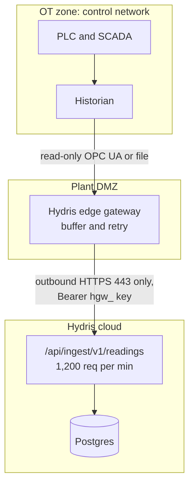

The ingest endpoint is idempotent per sensor and timestamp (unique `(sensor, ts)` index) and accepts an optional
`messageId`, so the gateway can retry safely after a network outage. The gateway itself (store-and-forward
software, hardware choice, OPC UA client) is **Planned**; the API contract it targets is **Built**.

### Choosing a topology

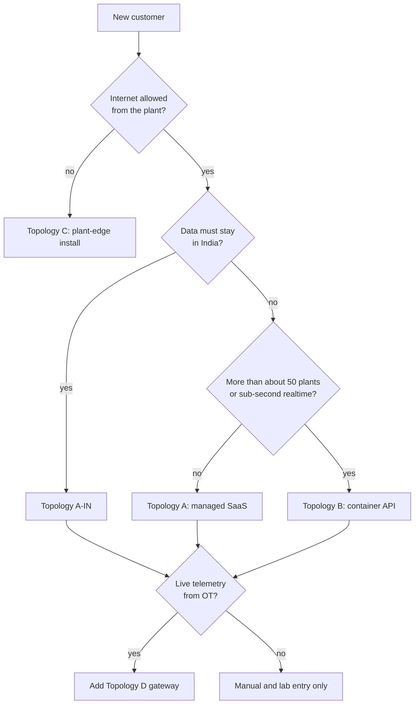

| Topology | Best for | Data location | Ops burden | AI features | Glasses | Status |
|---|---|---|---|---|---|---|
| A | Pilots, private industry | Chosen cloud region | Low (Hydris) | Opt-in | Yes | **Partial** (needs prod DB and cron fix) |
| A-IN | Indian PSUs, municipal STPs | India | Low (Hydris) | Off by default | Yes | **Planned** |
| B | Large multi-plant groups | Chosen region | Medium (Hydris) | Opt-in | Yes | **Planned** (artefacts built) |
| C | Air-gapped plants | Customer premises | High (shared) | Off | Phone yes, glasses to confirm | **Planned** (compose built) |
| D | Any customer with online instruments | Gateway in plant, data in A, A-IN or B | Medium (shared) | n/a | n/a | **Planned** (API built) |

Table: Topology comparison

## Environment matrix

Hydris uses five environments. They differ in data, secrets, who can reach them and which mobile builds point at
them. Demo is deliberately separate from staging: a demo is a sales tool and resets itself, staging is a release
gate.

| Environment | Purpose | URL | Database | Secrets | Simulator | Mobile builds | Status |
|---|---|---|---|---|---|---|---|
| dev | Local development (`npm run dev`) | `localhost:3000`, API on `:4000` | PGlite at `./data/pglite` | Local `.env` | On | Debug APKs with `hydris_url` set locally | **Built** |
| preview | One per pull request | Vercel preview URL | Neon branch per preview (target) or demo mode | Preview scope in Vercel | On | None | **Partial** (demo mode today) |
| staging | Release candidate, hardware tests, pilot rehearsal | `staging.` subdomain (target) | Neon staging branch, seeded demo tenant | Staging scope | On for demo tenant only | Play internal track, DAT test channel | **Planned** |
| prod | Customer tenants | Customer-facing domain | Neon production, region pinned, PITR on | Production scope, managed secrets | Off (`false`) | Play closed track or MDM | **Planned** |
| demo | Public sales demo | `hydrisview.vercel.app` | In-memory PGlite per instance | Public demo secrets | On | Debug builds for demos | **Built** |

Table: Environment matrix

Today `main` deploys straight to the demo URL. The target separates them into two Vercel projects pointing at the
same repository: a demo project that tracks `main` with no `DATABASE_URL`, and a production project that deploys
only on release tags after the staging gate. This keeps sales demos current without coupling them to customer
releases.

> [!TIP]
> Neon branches make per-preview databases cheap: each preview deployment gets a copy-on-write branch of the
> staging database, migrations run against it on the first request, and the branch is deleted when the pull
> request closes. This is the single biggest improvement to review quality we can make cheaply.

## Configuration reference

All server configuration is read from environment variables. `apps/api/src/config.ts` validates the core set with
zod and refuses to start on invalid values; a handful of operational variables are read directly with
`process.env` elsewhere. In development the API also loads `.env` from the repository root or the working
directory with `process.loadEnvFile`.

### Variables validated by config.ts

| Variable | Required | Default | Validation | Purpose |
|---|---|---|---|---|
| `NODE_ENV` | No | `development` | `development`, `test` or `production` | `production` sets `isProd`, which marks refresh cookies `Secure` |
| `API_PORT` | No | `4000` | integer | Listen port for the container server |
| `HOST` | No | `127.0.0.1` | string | Listen address; set `0.0.0.0` in containers |
| `DATABASE_URL` | Yes in prod | `./data/pglite` | string | `postgres://...` for Postgres, a directory path for PGlite, or `memory://` |
| `JWT_SECRET` | Yes | demo value in demo mode | at least 32 characters | Signs every JWT (user, device, MFA challenge, demo session) |
| `DATA_KEY` | Yes | demo value in demo mode | exactly 64 hex characters | AES-256-GCM key for MFA secrets at rest |
| `PUBLIC_APP_URL` | Yes in prod | `http://localhost:3000` | URL | Base of pairing, invitation and reset links |
| `STORAGE_DIR` | Containers | `./data/files` | string | Disk storage for attachments when Blob is not configured |
| `SEED_ADMIN_EMAIL` | Seed only | none | optional | First platform admin for `apps/api/src/seed/cli.ts` |
| `SEED_ADMIN_PASSWORD` | Seed only | none | optional | Its password (12+ characters) |
| `SEED_DEMO_PASSWORD` | Seed only | none | optional | Password for seeded demo role accounts |
| `SIMULATOR_ENABLED` | No | `true` | `true` or `false` | Enables the demo-tenant simulator; `false` in production |
| `REALTIME_MODE` | No | `memory` | `memory` or `db` | `db` is required on serverless or with more than one instance |
| `BLOB_READ_WRITE_TOKEN` | On Vercel | none | optional | Switches attachments to a private Vercel Blob store |
| `CRON_SECRET` | On Vercel | none | optional | Bearer secret required by `/api/cron` |
| `SERVERLESS` | No | none | `1` or `true` | Forces serverless behaviour (no interval timers) |
| `VERCEL` | Auto | set by Vercel | optional | Detects Vercel: serverless behaviour and demo auto-detection |
| `DEMO_MODE` | No | auto | `true` or `false` | Forces demo mode on or off |

Table: Configuration validated by apps/api/src/config.ts

### Variables read directly from the environment

| Variable | Read in | Purpose |
|---|---|---|
| `DEMO_PERSIST` | `config.ts` (`demoDefaults`) | With `DEMO_MODE` and a Postgres URL, seeds the demo into that database instead of memory |
| `ANTHROPIC_API_KEY` | `core/vision-extract.ts` (`visionAvailable`) | Enables Claude vision extraction for audit scans and the Claude engine of the voice assistant |
| `ANTHROPIC_AUTH_TOKEN` | `core/vision-extract.ts` | Alternative Anthropic credential; either one enables the AI features |
| `MIGRATE_ON_START` | `serverless.ts` | `false` skips cold-start migrations (when `npm run vercel-build` runs them) |
| `HYDRIS_MIGRATIONS_DIR` | `serverless.ts` (`findMigrationsFolder`) | Overrides where the bundle looks for `drizzle/meta/_journal.json` |
| `API_LOG` | `serverless.ts` | `true` enables Fastify request logging at `info` level |
| `API_URL` | `apps/web/next.config.ts` | Switches the web build to proxy `/api` to an external API |
| `VERCEL_PROJECT_PRODUCTION_URL`, `VERCEL_URL` | `config.ts` | Demo mode only: derives `PUBLIC_APP_URL` |
| `POSTGRES_PASSWORD` | `docker-compose.yml` | Password for the compose database owner |

Table: Operational variables outside the zod schema

### Android build properties

The Android apps are configured at build time through `local.properties` (not committed), read in each
`app/build.gradle.kts`:

| Property | App | Default | Purpose |
|---|---|---|---|
| `hydris_url` | both | `https://hydrisview.vercel.app` | Server the app talks to (`BuildConfig.HYDRIS_URL`) |
| `mwdat_application_id` | both | `0` | Meta Wearables application ID (`0` in DAT Developer Mode) |
| `mwdat_client_token` | both | `0` | Meta Wearables client token |
| `sdk.dir` | both | none | Android SDK path |

Table: Android build-time properties

> [!WARNING]
> Because `hydris_url` is compiled in, a customer on Topology A-IN, B or C needs a separate build today. The
> target is an MDM managed-configuration key (`hydris_url`) read at run time, with the build value as fallback,
> so one signed APK serves every customer.

### Secrets handling rules

1. Generate `JWT_SECRET`, `DATA_KEY` and `CRON_SECRET` with 32 random bytes each
   (`node -e "console.log(require('crypto').randomBytes(32).toString('hex'))"`).
2. Store them only in the Vercel project's environment variables (production scope separate from preview), or in
   the cloud provider's secrets manager for containers. Never in the repository, never in `NEXT_PUBLIC_*`.
3. `DATA_KEY` is not rotatable without re-encrypting every `users.mfa_secret_enc` value. Losing it disables MFA
   for every user. Keep an offline escrow copy under two-person control.
4. Rotating `JWT_SECRET` signs everyone out (all access tokens and the MFA step become invalid; refresh cookies
   remain valid because they are random tokens checked against hashes). It also changes the salt used for the
   hashed IP on website inquiries (`modules/public.ts`).
5. Preview deployments must not share production secrets or the production database.

## Build and release pipeline

### How a release happens today

There is no CI. A merge or push to `main` triggers Vercel's Git integration, which installs, builds and deploys.
Tests and type checks are run by developers locally (`npm test`, `npm run typecheck`, `npm run test:e2e`). The
Android apps are built from Android Studio or Gradle on a developer machine and installed with `adb`.

| Step | Command | Where defined | Notes |
|---|---|---|---|
| Install | `npm ci --include=dev` | root `vercel.json` | Dev dependencies are needed for the TypeScript build |
| Build | `npm run build` (runs `npm run build -w @hydris/web`) | root `package.json` | API is compiled into the web build via `transpilePackages` |
| Migrate | On first request per instance, or `npm run vercel-build` | `serverless.ts`, root `package.json` | Advisory lock key `4872917633` |
| Seed | `npx tsx apps/api/src/seed/cli.ts [--demo]` from an operator machine | `docs/operations/vercel.md` | Creates the platform admin; safe to rerun |

Table: Current build and release steps

The weaknesses are clear: a type error or failing test can reach production, and a migration can run in
production before anyone has run it against realistic data. Vercel's instant rollback protects the web tier but
not the database.

### Release versioning

| Artefact | Version source | Target scheme |
|---|---|---|
| Web and API | root `package.json` `version` (`0.2.0`) | Semantic version tag `vX.Y.Z` on `main`; tag triggers production |
| Database schema | Drizzle journal `apps/api/drizzle/meta/_journal.json` | Monotonic migration index, never edited after release |
| Hydris Field app | `versionCode = 1`, `versionName = "1.0.0"` | `versionCode` from the CI run number, `versionName` from the tag |
| Glasses bridge | `versionCode = 1` | Same as above |

Table: Versioning of release artefacts

### Release train

| Cadence | What ships | Gate |
|---|---|---|
| Continuous | Web and API fixes behind no flag | CI green, one reviewer |
| Fortnightly | Features, migrations | CI green, staging soak 48 hours, release notes |
| Monthly | Android apps to the pilot track | Staging hardware test on real glasses |
| Quarterly | Offline bundle for Topology C | Signed archive, upgrade rehearsal |

Table: Target release cadence

## Proposed CI/CD with GitHub Actions

The pipeline below is **Planned**. It uses only commands that already exist in the repository's `package.json`
scripts and Gradle wrappers, so it can be added without code changes.

### Pipeline design

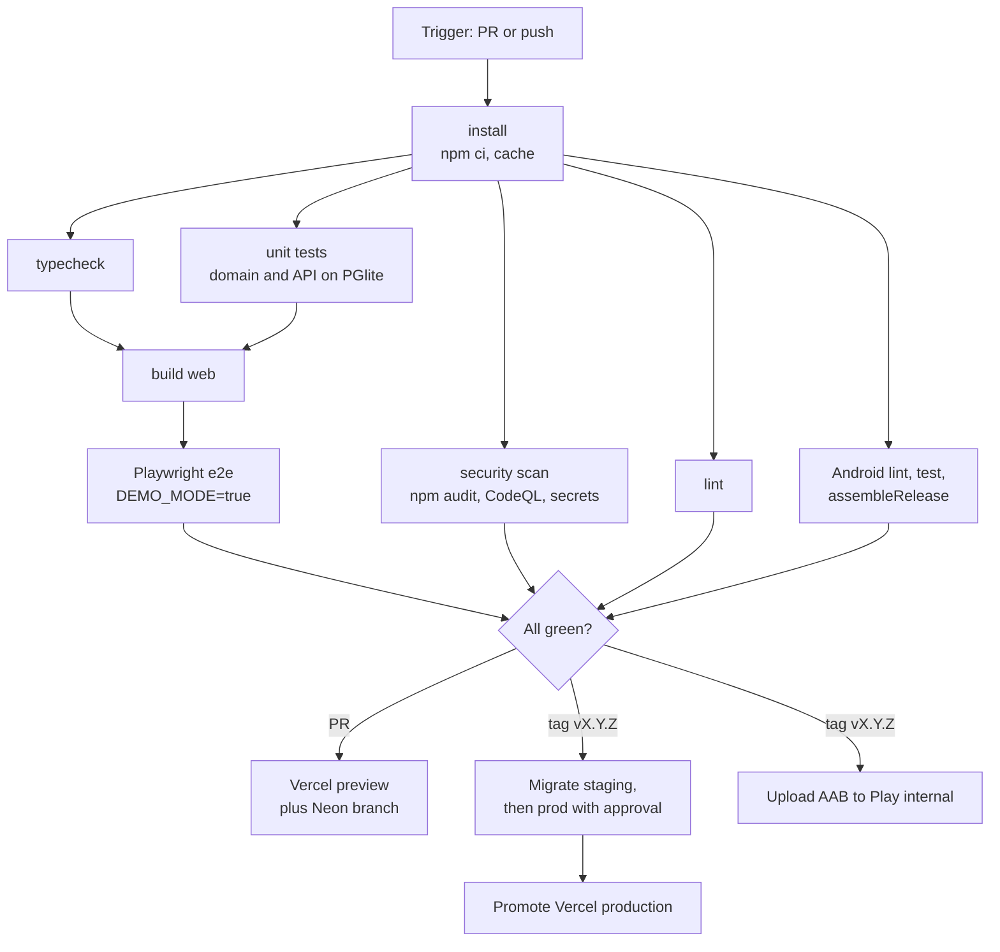

| Job | Runs | Commands | Blocks merge | Target time |
|---|---|---|---|---|
| install | Every PR and push | `npm ci` with npm cache keyed on `package-lock.json` | Yes | 1 min |
| typecheck | Every PR | `npm run typecheck` | Yes | 2 min |
| lint | Every PR | `npm run lint` | Yes | 1 min |
| unit | Every PR | `npm test` (domain, then API against PGlite) | Yes | 3 min |
| build | Every PR | `npm run build` | Yes | 4 min |
| e2e | Every PR | `npx playwright install chromium`, `npm run test:e2e` against a demo-mode server | Yes | 6 min |
| security | Every PR, nightly | `npm audit --omit=dev --audit-level=high`, CodeQL, secret scanning | High and critical only | 5 min |
| android | PRs touching `apps/android*`, tags | `./gradlew lint testDebugUnitTest assembleRelease` in both apps | Yes | 8 min |
| migrate | Tags | `npm run db:migrate` against staging, then production after approval | n/a | 1 min |
| deploy | Tags | `vercel deploy --prebuilt --prod` or promote the staging deployment | n/a | 3 min |
| publish-android | Tags | Sign with upload key, upload AAB to Play internal track | n/a | 4 min |

Table: Proposed CI jobs

```mermaid
%% caption: Target duration of the pipeline stages for a release tag (minutes from start)
gantt
  title Release pipeline, target timings
  dateFormat mm
  axisFormat %M
  section Verify
  install          :i, 00, 1m
  typecheck        :tc, after i, 2m
  lint             :l, after i, 1m
  unit tests       :u, after i, 3m
  security scan    :s, after i, 5m
  section Build
  web build        :b, after u, 4m
  e2e              :e, after b, 6m
  android builds   :a, after i, 8m
  section Release
  approval         :ap, after e, 2m
  migrate          :m, after ap, 1m
  deploy and smoke :d, after m, 3m
  publish android  :p, after ap, 4m
```

### Example workflow

```yaml
# .github/workflows/ci.yml (proposed)
name: ci
on:
  pull_request:
  push:
    branches: [main]
    tags: ['v*']
jobs:
  verify:
    runs-on: ubuntu-latest
    steps:
      - uses: actions/checkout@v4
      - uses: actions/setup-node@v4
        with: { node-version: 22, cache: npm }
      - run: npm ci
      - run: npm run typecheck
      - run: npm test
      - run: npm run build
  e2e:
    needs: verify
    runs-on: ubuntu-latest
    env: { DEMO_MODE: 'true' }
    steps:
      - uses: actions/checkout@v4
      - uses: actions/setup-node@v4
        with: { node-version: 22, cache: npm }
      - run: npm ci
      - run: npx playwright install --with-deps chromium
      - run: npm run test:e2e
  android:
    runs-on: ubuntu-latest
    strategy:
      matrix: { app: [apps/android, apps/glasses-bridge-android] }
    steps:
      - uses: actions/checkout@v4
      - uses: actions/setup-java@v4
        with: { distribution: temurin, java-version: 21 }
      - run: ./gradlew lint testDebugUnitTest assembleRelease
        working-directory: ${{ matrix.app }}
```

### Gates and policies

| Gate | Rule |
|---|---|
| Branch protection | `main` requires a pull request, one approving review and all required checks |
| Migrations | Any change under `apps/api/drizzle/` needs a second reviewer from platform engineering |
| Secrets | Production secrets live in a GitHub environment `production` with required reviewers |
| Dependencies | Renovate or Dependabot weekly; lockfile changes go through CI like code |
| Provenance | Release tags signed; build logs retained 90 days |
| Smoke test | After deploy, `/api/health` returns `ok` and a scripted login and alarm list succeed |
| Automatic rollback | If the smoke test fails, promote the previous Vercel deployment (schema permitting, see below) |

Table: Release gates

> [!NOTE]
> `playwright.config.ts` starts `npm run dev` as its web server. In CI the e2e job should start a production
> build in demo mode instead (`next start` with `DEMO_MODE=true`) so the tests exercise the same code path as
> Vercel. The comment in the config already anticipates CI use.

## Database migrations and rollback

### How migrations run

Migrations are plain SQL files generated by Drizzle Kit (`npm run db:generate`) and stored in
`apps/api/drizzle/` with a journal in `meta/_journal.json`. There are nine today: the base schema (`0000_init`),
row-level security (`0001_rls`), corrections and UI profiles (`0002`), RLS for those tables (`0003`), role
membership for managed Postgres (`0004`), the realtime event log (`0005`, `0006`) and audit documents (`0007`,
`0008`).

On Postgres, `createDatabase().migrate` in `apps/api/src/db/client.ts` takes a dedicated connection, acquires a
session-level advisory lock (`pg_advisory_lock(4872917633)`), runs Drizzle's migrator and releases the lock. This
serializes concurrent migrators: several serverless instances cold-starting together, or a deploy step racing a
running instance.

| Mode | How | When to use |
|---|---|---|
| Cold start (default) | `migrate()` in `serverless.ts` unless `MIGRATE_ON_START=false` | Demo, small pilots |
| Build step | `npm run vercel-build` runs `db:migrate` then build; set `MIGRATE_ON_START=false` | Topology A production |
| Pipeline step | CI `migrate` job before promotion | Target for all production deploys |
| Container start | `server.ts` migrates on boot (Dockerfile comment) | Topologies B and C |

Table: Migration execution modes

> [!WARNING]
> Running migrations in the Vercel build step means a migration is applied before the new deployment is
> promoted, and is not undone if the build later fails. That is safe only if every migration is backward
> compatible with the code currently in production. The expand and contract rule below makes that true.

### Managed Postgres prerequisites

Migration `0001_rls.sql` creates the `NOLOGIN` role `hydris_app`, grants it table privileges, revokes `UPDATE`
and `DELETE` on `audit_events`, and enables and forces RLS on every tenant table. Migration `0004` grants
`hydris_app` to the connecting user `WITH SET TRUE` so the application can `SET LOCAL ROLE hydris_app` (needed on
Postgres 16 and later). If the provider forbids it, an administrator runs once:
`GRANT hydris_app TO <app_user> WITH SET TRUE;` (`docs/operations/vercel.md`).

The comment in `0001_rls.sql` is important for production: owner and superuser connections bypass RLS, so the
application must always switch to `hydris_app`, which `withTenant` and `withSystem` in `apps/api/src/db/tenant.ts`
do for every transaction. The target is a separate migration user (owner) and runtime user (member of
`hydris_app`, no ownership), so a code path that forgets to switch role still cannot bypass RLS.

### Expand and contract

Every schema change ships in two releases so that the old and new application versions both work against the
schema in between.

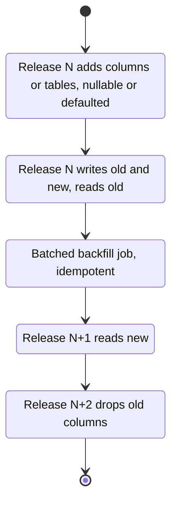

| Change | Allowed in one release | Needs expand and contract |
|---|---|---|
| Add table, add nullable column, add index concurrently | Yes | No |
| Add `NOT NULL` column with default | Yes on Postgres 11+ | No |
| Rename column or table | No | Yes (add, dual write, switch, drop) |
| Change column type | No | Yes |
| Drop column or table | No | Yes, only after no deployed code reads it |
| New RLS policy on a new table | Yes, in the same migration as the table | No |
| Tighten an existing RLS policy | Review required | Test against staging data first |

Table: Migration safety rules

### Rollback

| Situation | Action | Data impact |
|---|---|---|
| Bad web or API code, schema unchanged | Vercel instant rollback to the previous deployment | None |
| Bad code after an expand migration | Roll back code; leave the additive schema in place | None |
| Bad migration caught on staging | Fix forward with a new migration; never edit a released migration file | None |
| Bad migration in production, data intact | Write a forward migration that reverses it; deploy through the normal pipeline | None |
| Migration corrupted or deleted data | Neon point-in-time restore to a branch just before the migration, verify, then switch `DATABASE_URL` or copy rows back | Writes after the restore point must be replayed or accepted as lost |

Table: Rollback playbook

Drizzle migrations are forward-only. We do not write down migrations; the fix for a bad migration is another
migration. Point-in-time restore is the last resort and is rehearsed quarterly (see backup and disaster
recovery).

## Background jobs and scheduling

### Jobs that exist

`apps/api/src/jobs.ts` defines one pass of every background job in `runScheduledJobs`, and a timer-driven
version for long-running servers in `startJobs`.

| Job | Function | Container interval (`startJobs`) | Serverless trigger | Status |
|---|---|---|---|---|
| Stale-data alarms | `evaluateStaleRules` (`modules/alarms.ts`) | 30 s | `/api/cron` | **Built** |
| Pairing expiry | `expirePairings` | 60 s | `/api/cron` | **Built** |
| Realtime log pruning (1 day) | `pruneRealtimeEvents` (`core/events.ts`) | 1 h in `db` mode | `/api/cron` | **Built** |
| Demo simulation steps | `SimulationEngine.advanceAll` | continuous | `/api/cron`, and lazily on requests in demo mode (`DemoTicker`) | **Built** |
| Resume running simulations after restart | in `startJobs` | on boot | n/a | **Built** |
| Expired session and pairing purge | none | none | none | **Planned** |
| Mail delivery from `mail_outbox` | none | none | none | **Planned** |
| Retention and archival | none | none | none | **Planned** |
| Audit page image migration to object storage | none | none | none | **Planned** |

Table: Background jobs

Each job is wrapped in its own `catch`, so one failure is reported in the JSON (`staleRules: "error: ..."`) and
does not stop the others. That JSON report is the only job telemetry today.

### The daily cron problem

The root `vercel.json` schedules `/api/cron` once a day at 03:00 UTC. On Vercel, stale-data alarms ("no reading
for 15 minutes") therefore fire up to 24 hours late, and expired pairing challenges are only marked expired once
a day (pairing codes are still rejected when used after their 300-second TTL, because the poll and approve paths
check `expiresAt`).

> [!CAUTION]
> Stale-data alarms are a safety-relevant feature for operators: a silent instrument looks like a healthy one.
> Before any customer pilot on Topology A, change the schedule to `* * * * *` on Vercel Pro, or run the jobs
> from an external scheduler, or use Topology B. This is the first item on the go-live checklist.

| Option | Frequency | Cost | Trade-off |
|---|---|---|---|
| Vercel Pro cron `* * * * *` | 1 min | Included in Pro | Simplest; one invocation per minute |
| External scheduler (GitHub Actions schedule, cron-job.org, cloud scheduler) calling `/api/cron` | 1 to 5 min | Low | Another moving part; GitHub schedules can drift by minutes |
| Topology B container | 30 to 60 s | Container cost | Best freshness; more operations |

Table: Options for job frequency on Vercel

### Job design rules for new jobs

1. Every job is idempotent and safe to run concurrently on two instances (use `UPDATE ... WHERE` predicates or
   advisory locks, as the migration code does).
2. Every job runs through `withSystem` so RLS and append-only grants still apply.
3. Batch large work (purges, backfills) into chunks under 10 seconds so a 60-second function limit is never hit.
4. Report counts in the cron JSON and emit a metric per job (see observability).

## Android app distribution

Hydris ships two Android apps. Hydris Field (`apps/android`, `ai.hydris.field`) is the native operator app with
camera capture, on-device ML Kit OCR and the Meta DAT integration. The Glasses bridge
(`apps/glasses-bridge-android`, `ai.hydris.glassesbridge`) hosts the `/glasses` web app in a WebView and connects
the Ray-Ban Meta camera, capture button and microphone through DAT 1.0.1. Both target SDK 36 with a minimum of
SDK 31 (Android 12), matching Meta's DAT requirement.

### Distribution channels

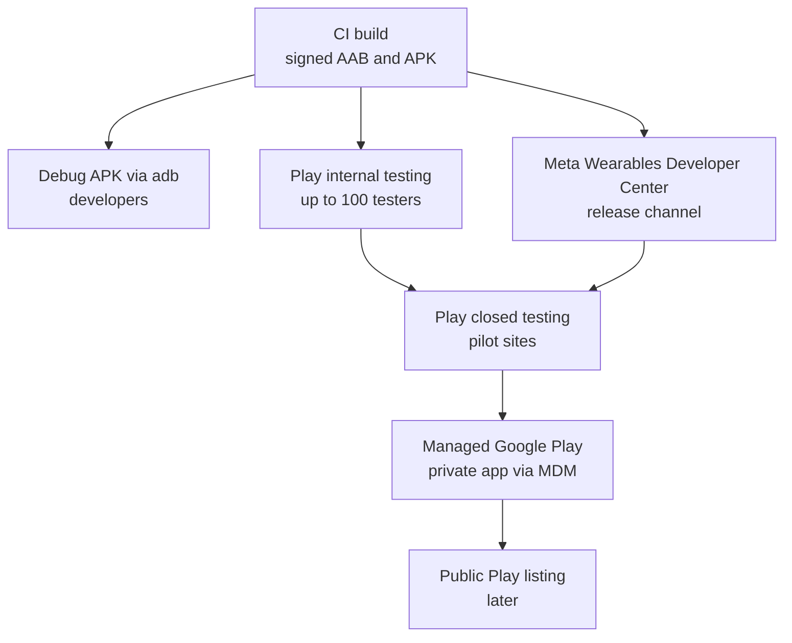

| Channel | Audience | DAT requirement | Use | Status |
|---|---|---|---|---|
| Debug APK with `adb` | Hydris developers | Developer Mode in the Meta AI app (IDs `0`/`0`) | Daily development | **Built** (a debug APK is checked in at `apps/glasses-bridge-android/hydris-glasses-debug.apk`) |
| Play internal testing | Up to 100 named testers | Developer Mode until the app is registered | Pilot rehearsals, staging | **Planned** |
| Meta Wearables Developer Center release channel | Named DAT testers who are not developers | Registered app ID and client token | Glasses features for pilot users | **Planned** |
| Play closed testing | Pilot plant staff | Registered app | Pilot | **Planned** |
| Managed Google Play private app | Enterprise fleets via MDM (Intune, Workspace ONE, Knox) | Registered app | Commercial rollout | **Planned** |
| Public Play listing | General availability | Meta publishing approval | Later | **Planned** |

Table: Android distribution channels

> [!NOTE]
> A debug APK is committed to the repository. Remove it from version control and attach builds to CI artefacts
> or releases instead; binaries in Git bloat the repository and cannot be traced to a commit reliably.

### Signing keys

| Key | Purpose | Holder | Storage | Status |
|---|---|---|---|---|
| Debug key | Local builds | Each developer | Android SDK default | **Built** |
| Upload key | Signs AABs uploaded to Play | CI | GitHub environment secret (base64 keystore plus passwords), offline backup under two-person control | **Planned** |
| App signing key | Signs APKs delivered to devices | Google (Play App Signing) | Google-managed | **Planned** |
| Enterprise sideload key | Signs APKs for air-gapped MDM without Play | Hydris release manager | HSM or offline vault | **Planned** (Topology C only) |
| Meta DAT credentials | `mwdat_application_id`, `mwdat_client_token` | CI | GitHub environment secret, injected into `local.properties` at build | **Planned** |

Table: Android signing and credential inventory

> [!CAUTION]
> `apps/android/app/build.gradle.kts` currently signs the release build type with the debug key
> (`signingConfig = signingConfigs.getByName("debug")`, with a comment to replace it). A release signed with a
> debug key cannot be uploaded to Play and must never be distributed to customers. Configure the upload key
> from CI secrets before the first pilot build.

### Enterprise MDM configuration

| Managed configuration key | Type | Purpose | Status |
|---|---|---|---|
| `hydris_url` | string | Server URL for this customer (A, A-IN, B or C) | **Planned** |
| `org_hint` | string | Pre-selects the organization on the sign-in screen | **Planned** |
| `allow_ai_features` | boolean | Hides AI-assisted extraction where the org has opted out | **Planned** |
| `kiosk_mode` | boolean | Device-owner mode for shared phones at a plant | **Planned** |

Table: Proposed MDM managed configuration

Shared phones (one phone per shift, not per person) are common in plants. The app already encrypts credentials
with an Android Keystore key and disables backup (`android:allowBackup="false"` in both manifests), so a shared
device does not leak the previous user's session to a backup. Sign-out on shift change is a process requirement
documented in the Operations Runbook.

## Observability

### Current state

| Signal | Today | Where |
|---|---|---|
| Logs | Vercel function logs; Fastify logs only when `API_LOG=true`; 5xx errors logged by the error handler; route handlers log start failures | `serverless.ts`, `app.ts`, `route.ts` |
| Health | `GET /api/health` returns `ok` and server time | `apps/api/src/app.ts` |
| Job results | JSON report from `/api/cron` | `apps/web/src/app/api/cron/route.ts` |
| Business signals | Audit events and alarm history in the database | `audit_events`, `alarm_event_history` |
| Metrics, traces, error tracking, uptime | None | **Planned** |

Table: Observability today

`/api/health` does not touch the database, so it reports the function as up even when Postgres is unreachable.
A deep health check (`/api/health?deep=1` running `select 1` and checking the migration journal) is **Planned**.

### Target architecture

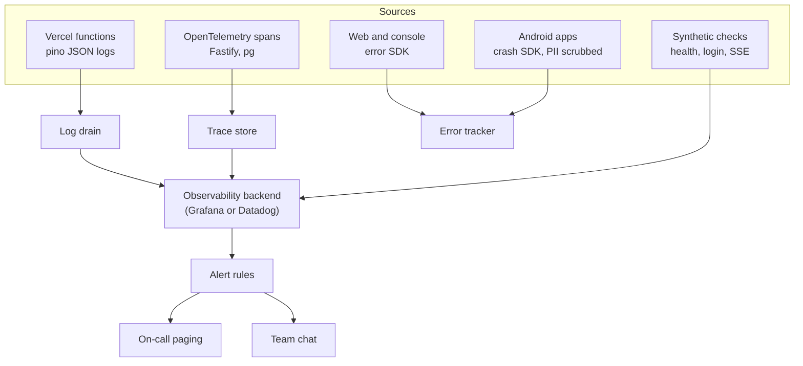

| Signal | Tooling (proposed) | Content | Residency note |
|---|---|---|---|
| Logs | Vercel log drain to Grafana Loki, Datadog or an India-hosted store | Structured JSON with request id, org id, route, status, duration; no tokens, no bodies | CERT-In requires 180 days of logs in India for Indian service providers |
| Metrics | OpenTelemetry metrics or log-derived metrics | Request rate, error rate, latency, cold starts, DB pool waits, job counts | |
| Traces | OpenTelemetry for Fastify and `pg` | Span per request and per query | Sample 10% in production |
| Errors | Sentry (or equivalent) for web, console and Android | Stack traces with PII scrubbing and IP anonymisation | Choose EU or self-hosted for strict tenants |
| Uptime | External synthetic checks every minute | `/api/health`, login, SSE connect, cron freshness | |

Table: Target observability stack

### Key metrics

| Metric | Why it matters | Alert threshold (target) |
|---|---|---|
| API 5xx rate | Overall health | Over 1% for 5 min |
| p95 API latency | Console and glasses responsiveness | Over 800 ms for 10 min |
| Ingest lag (now minus newest reading per gateway) | Live telemetry is the core promise | Over 5 min for any active gateway |
| Cron last success age | Stale alarms depend on it | Over 3 min (after the per-minute fix) |
| SSE reconnect rate | Realtime health | Over 3 per client per 5 min |
| `auth.login_failed` rate | Credential stuffing | 10x baseline |
| `auth.refresh_reuse_detected`, `device.refresh_reuse_detected` | Token theft | Any occurrence |
| Postgres connections in use | Pool exhaustion with many instances | Over 80% of the pooler limit |
| Anthropic error rate | AI features degrade to rules engine | Over 20% for 15 min |

Table: Key metrics and alert thresholds

### Service level objectives

SLOs are targets for the pilot and the first commercial year. They are not measured results.

| SLI | SLO target | Window | Error budget |
|---|---|---|---|
| Availability of `/api/*` (non-5xx, excluding 429) | 99.5% | 30 days | 3.6 hours |
| Latency: p95 of read API calls | Under 500 ms | 30 days | 5% of requests may exceed |
| Telemetry freshness: readings visible within 60 s of ingest | 99% | 30 days | 1% of readings |
| Stale-data alarm raised within 2 min of the configured threshold | 99% | 30 days | 1% of evaluations |
| Realtime delivery: event visible on an open console within 5 s | 99% | 30 days | 1% of events |
| Audit scan upload success | 99% | 30 days | 1% of uploads |
| Cron success | 99.9% of runs | 30 days | about 43 failed runs at 1 per min |

Table: Service level objectives (targets)

Error budget policy: while less than half of the monthly budget is consumed, releases proceed normally. Between half and all of it, risky changes need approval from the platform lead. Once the budget is exhausted, feature releases freeze and only reliability work ships until the 30-day window recovers, and every budget-exhausting incident gets a post-incident review.

> [!NOTE]
> The SLOs exclude scheduled maintenance announced 72 hours ahead, customer-side network outages and the
> Anthropic API (AI features degrade to the rules engine by design, see `answerWithRules` in
> `apps/api/src/modules/voice-assistant.ts`).

## Backup and disaster recovery

### Objectives

| Tier | Data | RPO target | RTO target | Mechanism |
|---|---|---|---|---|
| 1 | Postgres (all tenant records, audit trail, telemetry) | 15 min | 4 h | Neon point-in-time restore plus daily logical dump |
| 1 | Audit page images (today inside Postgres) | 15 min | 4 h | Same as Postgres |
| 2 | Attachments in Blob or S3 | 24 h | 8 h | Object versioning and daily copy to a second region |
| 2 | Secrets (`JWT_SECRET`, `DATA_KEY`, `CRON_SECRET`, gateway keys are hashed in DB) | n/a | 1 h | Secrets manager plus offline escrow of `DATA_KEY` |
| 3 | Application code and build | 0 | 1 h | Git, Vercel deployment history |
| 3 | Logs | 24 h | best effort | Log drain retention |

Table: Recovery objectives (pilot targets)

The pilot targets are RPO 15 minutes and RTO 4 hours. The commercial target after the first year is RPO 5
minutes and RTO 1 hour for Topology A.

### Backup schedule

| Backup | Frequency | Retention | Location | Status |
|---|---|---|---|---|
| Neon point-in-time history | Continuous | 7 days (Launch) to 30 days (Scale), by plan | Same region | **Planned** (no production DB yet) |
| Logical dump (`pg_dump -Fc`) | Daily | 35 daily, 12 monthly | Object storage, same jurisdiction, different account | **Planned** |
| Object storage versioning | Continuous | 30 days of non-current versions | Same bucket | **Planned** |
| Cross-region copy | Daily | 35 days | Second region in the same country | **Planned** |
| Topology C local dump | Nightly | 14 nightly, 8 weekly | Plant NAS, weekly offline copy | **Planned** |

Table: Backup schedule

### Disaster scenarios

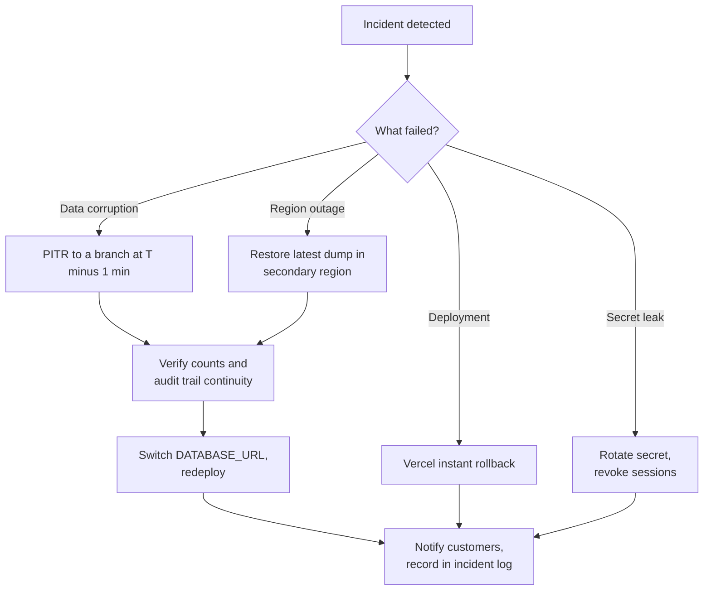

### Restore runbook

1. Declare the incident and assign an incident lead (see HFG-SEC incident response).
2. Freeze writes if corruption is spreading: suspend affected organizations with
   `POST /api/platform/organizations/:id/status` (`modules/org.ts`), or put the project behind Vercel's
   maintenance page.
3. Identify the restore point from the audit trail (`audit_events.created_at` of the first bad action) or the
   migration time in the deployment log.
4. Create a Neon branch at that point. Never restore over the live branch.
5. Run verification queries on the branch: row counts per organization, newest telemetry timestamp per site,
   latest `audit_events` id, and a login with a test account.
6. Decide: switch the production `DATABASE_URL` to the restored branch, or copy specific rows back.
7. Redeploy so every function instance reconnects. Run the smoke test.
8. Reconcile: gateways replay buffered readings (ingest is idempotent per sensor and timestamp); users are told
   which window of manual entries must be re-entered.
9. Record timings against RPO and RTO; file the post-incident review within five business days.

> [!IMPORTANT]
> A restore drill runs every quarter on staging, timed end to end, with results recorded. A backup that has never
> been restored is not a backup.

## Scaling and capacity

### What limits scale today

| Component | Limit | Mitigation | Status |
|---|---|---|---|
| Serverless function duration | 60 s (`maxDuration`) | SSE streams end at 50 s and resume; batch jobs | **Built** |
| Postgres connections | 3 per instance; many instances can exhaust the pooler | Neon pooled endpoint; alert at 80% | **Built** (pool), **Planned** (alert) |
| Realtime | DB polling every 1.5 s per open stream | Topology B with in-memory or Redis bus for large tenants | **Partial** |
| Rate limiting | `@fastify/rate-limit` is in memory per instance | Shared store (Redis or Vercel Firewall rules) | **Partial** |
| Telemetry table growth | Unbounded; unique `(sensor, ts)` index | Monthly partitions or TimescaleDB beyond about 50 M rows | **Planned** |
| Audit page images | Base64 in `audit_document_pages.data` (up to 6 pages of 900 KB each per document) | Move to object storage, keep a key in Postgres | **Planned** |
| Request body | 1 MB global, 8 MB for audit uploads | Direct-to-storage uploads for large media | **Built** limits |

Table: Scaling constraints

### Capacity model

The model assumes a typical plant with 40 online instruments reporting every 60 seconds, 15 active users, 2 pairs
of glasses and 20 audit scans a day. These are planning estimates, not measurements.

| Scale | Plants | Readings per day | Telemetry rows per year | Audit scan storage per year | Peak API req/s |
|---|---|---|---|---|---|
| Pilot | 2 | 115 k | 42 M | 30 GB | 5 |
| Early commercial | 10 | 576 k | 210 M | 150 GB | 20 |
| Growth | 50 | 2.9 M | 1.05 B | 750 GB | 90 |
| Scale | 200 | 11.5 M | 4.2 B | 3 TB | 350 |

Table: Capacity estimates by scale (planning assumptions)

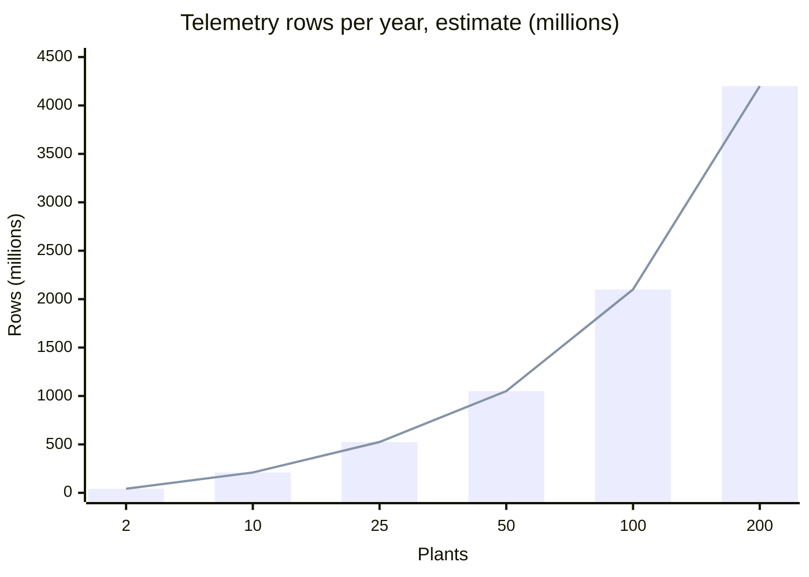

Practical thresholds from the model:

- Up to about 10 plants, Topology A with a single Neon database and no partitioning is comfortable.
- Between 10 and 50 plants, partition `telemetry_readings` by month, move audit images to object storage, add
  downsampled rollups for charts (the history endpoint already aggregates by bucket in
  `modules/telemetry.ts`), and move realtime for the largest tenants to Topology B.
- Beyond 50 plants, consider a time-series extension (TimescaleDB) or a dedicated telemetry store, and shard
  large tenants into their own database.

## Cost model

All figures are indicative monthly costs in US dollars at 2026 list prices, before tax, for planning only. They
must be checked against current vendor pricing and are not quotes.

| Line item | Demo | Pilot (2 plants, 20 users) | Early commercial (10 plants, 150 users) | Growth (50 plants, 750 users) |
|---|---|---|---|---|
| Vercel | 0 (Hobby, non-commercial) | 40 (Pro, 2 seats) | 150 (Pro, usage) | 800 (Pro or Enterprise) |
| Postgres (Neon) | 0 | 70 | 300 | 1,200 |
| Object storage and egress | 0 | 5 | 30 | 150 |
| Anthropic (vision and assistant) | 0 to 20 | 150 | 600 | 2,500 |
| Observability (logs, errors, uptime) | 0 | 50 | 200 | 700 |
| Email delivery | 0 | 0 to 20 | 20 | 50 |
| CI minutes and artefacts | 0 | 0 to 20 | 50 | 100 |
| Total (approximate) | under 20 | about 350 | about 1,350 | about 5,500 |

Table: Indicative monthly infrastructure cost (USD, estimates)

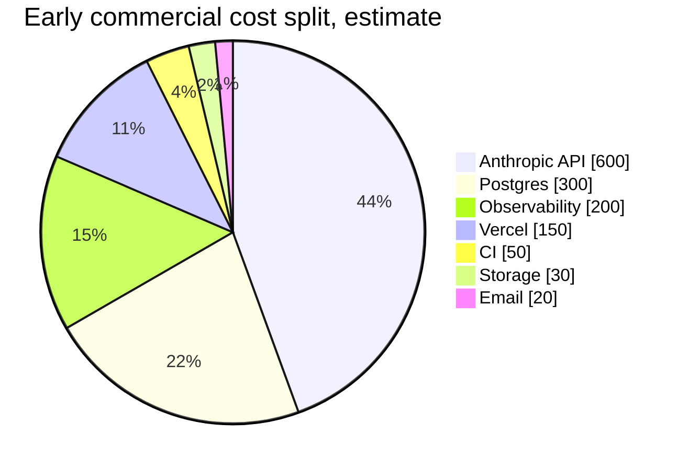

Observations:

- AI usage is the largest variable cost. It scales with audit scans and voice questions, not with users. Each
  organization needs a monthly AI budget with alerts, and the rules engine remains the free fallback.
- Database cost grows with telemetry retention. Downsampling raw data after 2 years (see HFG-SEC retention) is
  the main cost lever.
- Topology C shifts infrastructure cost to the customer but adds support cost on our side (offline upgrades,
  on-site visits). Price it as an annual licence plus a support fee.
- Topology A-IN may cost 10 to 30% more than the same footprint in a larger region because of regional pricing
  and the switch from Vercel Blob to S3.

## India data residency and regulatory hosting

Hydris is an Indian company whose first customers are Indian plants. Residency is a selling point and in some
cases a hard requirement.

| Source | What it says (summary) | Effect on hosting |
|---|---|---|
| Digital Personal Data Protection Act 2023 | No blanket localisation; the government may restrict transfer of personal data to notified countries | Personal data (user names, emails, IPs) may leave India unless a restriction applies; keep it in India by default for public-sector buyers |
| DPDP Rules 2025 | Operational rules on notice, consent, security safeguards, breach reporting and retention, with phased commencement | Breach-reporting and log retention processes must be in place before the obligations apply |
| CERT-In Directions (April 2022) | Report specified incidents within 6 hours; keep ICT system logs for a rolling 180 days within Indian jurisdiction | Log drain to an India-hosted store; incident process with a 6-hour clock |
| CPCB and State Pollution Control Board consent conditions | Continuous monitoring data must be retrievable and unaltered; some boards require OCEMS feeds to their servers | Hydris is not the regulatory OCEMS feed; it must preserve records, provenance and audit trails |
| Customer contracts (PSUs, municipal corporations, smart city SPVs) | Frequently require data in India and named subprocessors | Topology A-IN or C; subprocessor list in the DPA |
| MeitY cloud empanelment | Government departments may require empanelled cloud service providers | Use an empanelled provider (AWS, Azure, Google Cloud India regions) for government tenders; Vercel and Neon empanelment must be checked |

Table: Indian regulatory considerations for hosting (summary, not legal advice)

> [!WARNING]
> This table is an engineering summary to guide design, not legal advice. Residency commitments in contracts must
> be reviewed by counsel, and dates in the DPDP Rules phase-in must be confirmed against the official gazette.

### Residency design

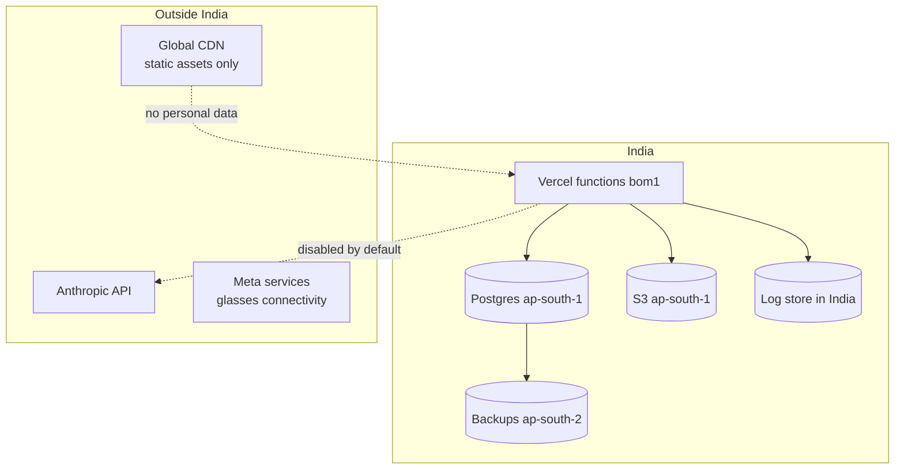

Rules for a strict-residency tenant:

1. All stores (database, objects, logs, backups) are in India.
2. AI features are off unless the customer accepts processing outside India in writing. The organization record
   already has a `region` field (`modules/org.ts`); a per-organization AI switch keyed on it is **Planned**.
3. On-device OCR (ML Kit on the phone) keeps working without any cloud AI.
4. Meta glasses connectivity uses Meta services; disclose it as a subprocessor for glasses features.
5. Support staff access production data only from India or under a documented exception.

## Customer onboarding and provisioning

### Provisioning flow

A new customer organization is created by a Hydris platform administrator through
`POST /api/platform/organizations` (`apps/api/src/modules/org.ts`). The call creates the organization with its
name, slug, region and timezone, creates an `org_admin` invitation for the customer's first administrator, writes
an `organization.created` audit event, and returns the invitation link. Because email is not wired yet, the
platform admin currently sends that link to the customer by a separate secure channel.

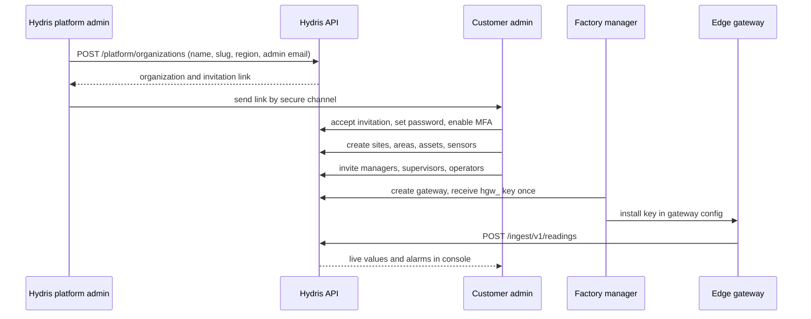

### Onboarding steps and owners

| Step | Owner | Done when |
|---|---|---|
| Contract, DPA, topology and region chosen | Hydris sales and customer | Signed order form names topology and AI setting |
| Environment ready | Hydris platform engineering | Production project, database, secrets and cron verified |
| Organization created | Hydris platform admin | `organization.created` audit event |
| First admin activated with MFA | Customer admin | `member.invitation_accepted`, `auth.mfa_enabled` events |
| Plant model built (sites, areas, assets, sensors, alarm rules) | Customer with Hydris solutions engineer | Plant map and sensor list complete |
| Users invited with site scopes | Customer admin or factory manager | All pilot users active |
| Gateway installed and keyed | Customer OT team with Hydris | First readings within freshness window |
| Phones enrolled in MDM, apps installed | Customer IT | Apps open and sign in |
| Glasses paired and assigned | Customer supervisor | Devices show as active in the console |
| Procedures and inspection templates loaded | Customer | First guided inspection completed |
| Training and go-live sign-off | Customer and Hydris | Signed acceptance |

Table: Onboarding steps

## Go-live checklist

The checklist below gates the first customer pilot on Topology A. Items already true in the code are ticked.

### Platform

- [x] API runs in-process on Vercel with migrations under an advisory lock
- [x] Refresh cookies are `HttpOnly`, `SameSite=Strict`, `Secure` in production
- [x] Attachments use a private store served only through authorized routes
- [ ] Separate production Vercel project; demo project keeps `hydrisview.vercel.app`
- [ ] Production Neon database in the agreed region, PITR enabled, pooled URL
- [ ] Runtime database user is not the owner; RLS verified with a cross-tenant test
- [ ] `JWT_SECRET`, `DATA_KEY`, `CRON_SECRET` generated, stored, `DATA_KEY` escrowed offline
- [ ] `DEMO_MODE=false` set explicitly in production; `SIMULATOR_ENABLED=false`
- [ ] `REALTIME_MODE=db`, `PUBLIC_APP_URL` set to the customer-facing domain
- [ ] Cron schedule changed to every minute (Vercel Pro) or external scheduler in place
- [ ] Vercel function region matches the database region
- [ ] Custom domain with TLS; HSTS confirmed

### Pipeline

- [ ] GitHub Actions CI with required checks on `main`
- [ ] Migrations run as a pipeline step with approval
- [ ] Release tags and changelog
- [ ] Android upload key in CI; release builds no longer signed with the debug key
- [ ] Meta DAT application ID and client token injected in CI

### Operations

- [ ] Log drain, error tracking and uptime checks live
- [ ] Alerts for 5xx, ingest lag, cron age and token reuse routed to on-call
- [ ] Deep health check covering the database
- [ ] Backup dump job and first restore drill completed and timed
- [ ] Incident response contacts and CERT-In reporting path documented
- [ ] Email provider wired for invitations and password reset

### Customer

- [ ] DPA signed with subprocessor list (Vercel, Neon, Anthropic if enabled, Meta for glasses)
- [ ] AI processing choice recorded per organization
- [ ] Gateway tested end to end with buffered replay
- [ ] Training delivered; site privacy signage for glasses in place

## Known gaps and decisions

| ID | Gap | Impact | Plan | Priority |
|---|---|---|---|---|
| DEP-01 | No CI pipeline | Regressions and unsafe migrations can reach production | Add the proposed workflow | High |
| DEP-02 | Cron runs daily on Vercel | Stale-data alarms up to 24 h late | Per-minute cron on Pro or external scheduler | High |
| DEP-03 | Release APK signed with debug key | Cannot distribute through Play | Upload key in CI | High |
| DEP-04 | Email not wired | Invitations and resets need manual link delivery | Transactional email provider, purge `mail_outbox` after send | High |
| DEP-05 | No metrics, tracing or alerting | Incidents found by users | Observability stack | High |
| DEP-06 | Audit page images in Postgres as base64 | Database bloat, backup size, cost | Move to object storage | Medium |
| DEP-07 | No retention or purge jobs | Unbounded growth of sessions, mail and telemetry | Retention jobs per HFG-SEC schedule | Medium |
| DEP-08 | `hydris_url` compiled into Android builds | One build per customer | MDM managed configuration | Medium |
| DEP-09 | Node version mismatch (22 in `engines`, 24 in Dockerfiles and Vercel guide) | Inconsistent runtime behaviour | Standardize | Low |
| DEP-10 | Per-instance rate limiting | Limits weaker under many instances | Shared limiter or edge firewall rules | Medium |
| DEP-11 | Demo and production share one project today | Customer data could be added to a demo by mistake | Split projects | High |
| DEP-12 | Debug APK committed to the repository | Untraceable binaries | Move to CI artefacts | Low |

Table: Deployment gaps register

> [!DECISION]
> Topology A on Vercel and Neon remains the default for pilots. Topology B is adopted per customer only when the
> capacity model or a realtime requirement demands it. Topology C is offered to air-gapped plants with the glasses
> constraint stated up front. All production deployments wait for DEP-01, DEP-02, DEP-03 and DEP-11.
