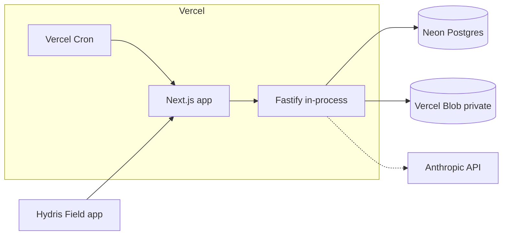

# Deployment

This document summarizes and extends [docs/operations/vercel.md](../operations/vercel.md) and [docs/operations/deployment.md](../operations/deployment.md).

## 1. Topologies
| Topology | When | Components |
|---|---|---|
| **A. All-in Vercel** | Hosted demo, pilot, SaaS GA | Next.js (site, console, glasses, API in-process via `apps/api/src/serverless.ts`), Neon Postgres (pooled `DATABASE_URL`), private Vercel Blob, `REALTIME_MODE=db`, Vercel Cron → `/api/cron` |
| **B. Vercel web + container API** | Larger tenants, long-lived SSE, background jobs | `API_URL` rewrite. API container from `apps/api/Dockerfile` on Render (`render.yaml`), Fly.io or AWS ECS. Managed Postgres 15+. Persistent `STORAGE_DIR` volume (or swap `Storage` for S3/R2 in `core/services.ts`) |
| **C. Docker Compose single host** | On-prem / in-plant edge, air-gapped | `docker-compose.yml` (Postgres + API + web). Migrations on API start |
| **D. Demo mode** | Sales demos | No environment variables. In-memory PGlite per instance. Public demo secrets. Resets on cold start |

## 2. Environments
| Env | Purpose | Data | Notes |
|---|---|---|---|
| dev | Local `npm run dev` | PGlite `./data/pglite` | API :4000, web :3000 |
| preview | Per-PR Vercel previews | Neon branch per preview (recommended) | `SIMULATOR_ENABLED=true` |
| staging | Pre-release, hardware tests | Neon staging + demo tenant | DAT pilot builds point here |
| prod | Customers | Neon prod (region-pinned) | `SIMULATOR_ENABLED=false` unless demo tenants are hosted |

## 3. Environment variables (`apps/api/src/config.ts`)
| Variable | Required | Default | Purpose |
|---|---|---|---|
| `NODE_ENV` | | development | production enables Secure cookies |
| `API_PORT`, `HOST` | | 4000, 127.0.0.1 | Container listen address |
| `DATABASE_URL` | prod | `./data/pglite` | `postgres://…?sslmode=require` or a PGlite path / `memory://` |
| `JWT_SECRET` | yes (≥32 chars) | demo value in demo mode | Signs all JWTs |
| `DATA_KEY` | yes (64 hex) | demo value in demo mode | Encrypts MFA secrets. **Never rotate without re-encryption** |
| `PUBLIC_APP_URL` | yes | `http://localhost:3000` | Pairing URIs, mail links |
| `STORAGE_DIR` | container | `./data/files` | Attachment storage when Blob is absent |
| `BLOB_READ_WRITE_TOKEN` | Vercel | | Private Blob store |
| `REALTIME_MODE` | | memory | `db` for serverless / multiple instances |
| `CRON_SECRET` | Vercel | | Bearer for `/api/cron` |
| `SIMULATOR_ENABLED` | | true | Demo simulator |
| `SERVERLESS`, `VERCEL` | auto | | Disables interval timers |
| `DEMO_MODE` | | auto (Vercel without DB) | Force demo on or off |
| `DEMO_PERSIST` | | | Seed the demo into Postgres instead of memory |
| `SEED_ADMIN_EMAIL`, `SEED_ADMIN_PASSWORD`, `SEED_DEMO_PASSWORD` | seed only | | `apps/api/src/seed/cli.ts` |
| `ANTHROPIC_API_KEY` | optional | | Enables the Claude vision engine and LLM voice answers |
| `MIGRATE_ON_START` | optional | | `false` when using `npm run vercel-build` |
| `API_URL` (web) | topology B | | Proxies `/api` to the container |
| `POSTGRES_PASSWORD` | compose | | Docker Compose DB |

## 4. Background jobs
`runScheduledJobs` (`apps/api/src/jobs.ts`): stale-data rules, pairing expiry, realtime pruning, simulation steps. On a container they run on timers (30 s / 60 s / 1 h). On Vercel they run when `/api/cron` is called.
> **Note:** root `vercel.json` currently schedules the cron **daily** (`0 3 * * *`), while `vercel.md` describes a per-minute schedule. Stale-data alarms on Vercel are therefore evaluated once a day unless the schedule is changed to `* * * * *` (needs the Pro plan) or an external scheduler is used. Fix before the pilot.

## 5. Android distribution
| Channel | Use | Notes |
|---|---|---|
| Debug APK / `adb` | Developers | DAT Developer Mode |
| Google Play internal testing (≤100 testers) | Pilot | Fast. Glasses features still need DAT Developer Mode until Meta approval |
| Meta Wearables Developer Center release channel | DAT testers | Required for DAT features with non-developers before publishing |
| Managed Google Play (private app) / MDM (Intune, Workspace ONE, Knox) | Enterprise GA | Managed config for server URL. Device-owner mode on shared phones |
| Public Play listing | Later | After Meta DAT submissions open and the app is approved |

Signing: Play App Signing. The upload key goes in CI secrets. `versionCode` comes from the CI build number.

## 6. CI/CD
There is **no CI configuration in the repo yet** (no `.github/`). Proposed GitHub Actions:
1. `npm ci` → `npm run typecheck` → `npm test` (domain + API with PGlite) → `npm run build`.
2. Playwright e2e against `DEMO_MODE=true next start`.
3. Android: `./gradlew lint test assembleRelease` for `apps/android` and `apps/glasses-bridge-android`. Upload to Play internal on tag.
4. Vercel Git integration deploys previews per PR and production on `main`. Migrations run on the first request under an advisory lock, or via `npm run vercel-build`.

## 7. Observability
- Today: Fastify/pino logs (Vercel Function logs), `/api/health`, and the cron JSON report.
- Planned: OpenTelemetry traces → Grafana/Datadog. Sentry for web and Android (with PII scrubbing). Uptime checks on `/api/health` and the SSE stream. Business metrics (ingest lag, open alarms, sync queue depth) on `/overview`.

## 8. Backups and DR
- Neon: point-in-time restore (retention by plan) plus a weekly logical dump to object storage in the same jurisdiction.
- Blob/S3: versioning and lifecycle rules.
- RPO ≤ 15 min, RTO ≤ 4 h (pilot). Restore drill every quarter.
- Keep `DATA_KEY` and `JWT_SECRET` in a secrets manager. Losing `DATA_KEY` disables MFA for every user.

## 9. Scaling
- API is stateless apart from the in-memory realtime bus, so use `REALTIME_MODE=db` for more than one instance.
- Telemetry: the unique (sensor, ts) index and the `telemetry_org_ts_idx` index. Beyond ~50 M rows, partition by month or adopt TimescaleDB.
- Audit page images are stored as base64 in `audit_document_pages.data`. Move them to object storage before scale.
- Connection pooling: the Neon pooler, max 3 connections per serverless instance.

## 10. Cost estimate (indicative, USD/month, 2026 list prices; verify)
| Scale | Vercel | Postgres | Storage | Claude (vision + voice) | Total |
|---|---|---|---|---|---|
| Demo | Hobby $0 | none | none | $0 | ~$0 |
| Pilot (1–2 plants, 20 users) | Pro $20/seat | Neon Launch ~$20–70 | <$5 | $50–300 | ~$150–450 |
| GA (20 plants, 300 users) | Pro/Enterprise $200–1,500 | Neon Scale $70–700 | $20–100 | $500–3,000 | ~$1k–5k |
| Container option | Render/Fly $25–250 per API instance | RDS $50–500 | S3 $5–50 | same | |

## 11. India data residency
- India's DPDP Act 2023 does not impose blanket localization, but it allows the government to restrict transfers to notified countries ([MeitY DPDP Act](https://www.meity.gov.in/data-protection-framework)). Sector regulators and customer contracts (PSUs, municipal STPs) often require data to stay in India.
- Options: Neon or AWS RDS in **ap-south-1 (Mumbai)**, Vercel functions pinned to `bom1` (Mumbai), Blob or S3 in ap-south-1, or topology B/C on AWS Mumbai / Azure Central India / an on-prem plant server.
- LLM calls: send no data to Anthropic for strict-residency tenants (rules engine plus on-device OCR only), or use Claude through a provider with an India region where available. Make this a per-org setting (**Planned**).
