# Design System and UX Guidelines

Hydris Field Glasses is used by people standing next to running pumps, aeration basins and chemical dosing skids,
often wearing gloves, ear defenders and safety glasses, sometimes in bright sun and sometimes in a dark pump room.
The design system exists so that every surface (the marketing website, the operator console, the glasses heads-up
app, the browser simulator and the native Android app) shows plant state the same way, uses colour for the same
meaning, and never asks an operator to read more than they can take in at a glance.

This document describes the system **as it is built today**, with every token and component traced to the file
that defines it, and it marks the gaps honestly. Where the code and the intended design differ, the difference is
called out as a finding with a recommended fix. Status labels follow the house convention: **Built** (in the code
and working), **Partial** (in the code with known gaps), **Planned** (designed or intended, not yet in the code).

> [!STATS]
> - 5 | surfaces | website, console, glasses HUD, simulator, Android app
> - 3 | token sources | globals.css, site.css brand layer, Android Theme.kt
> - 4 | severity levels | critical, high, medium, low, one colour each
> - 19.05:1 | primary text contrast | white on Deep Midnight (WCAG AAA)

## Design principles

The principles below are ranked. When two of them conflict, the one higher in the list wins. Every design review
and every QA pass (see the design QA checklist chapter) checks a screen against them in this order.

### Safety first

Hydris is an information and records tool. It does not operate equipment, and the interface must never suggest
that it does. That rule is visible in the product today:

- The glasses task screen states "Records only" and that Hydris does not operate equipment
  (`apps/web/src/glasses/GlassesApp.tsx`, `TaskDetail`). **Built.**
- The glasses Acknowledge action carries the inline hint "does not change equipment" (`AlertDetail`). **Built.**
- Recommended actions on alarms are labelled "Next step (approved procedure)" so the operator knows the text comes
  from an approved SOP, not from a model (`AlertDetail`). **Built.**
- Inspection runs show safety notices **before** the first step and render step cautions in the medium (amber)
  tone with a shield icon (`InspectionRunner`). **Built.**

> [!IMPORTANT]
> No Hydris screen may present a control that looks like it starts, stops, opens, closes or sets plant equipment.
> Buttons are verbs about records: Acknowledge, Record, Submit, Resolve, Send for verification.

### The one-glance rule

An operator should get the answer to "is anything wrong, and what do I do next?" from a single glance of under
two seconds. In practice that means:

- One primary action per HUD screen and one focus indicator (`apps/web/src/glasses/hud.tsx` header comment). **Built.**
- Numbers are shown large, with their unit and their freshness, never as a bare value.
- Severity is carried by colour **and** by a word (Critical, High) and, on the HUD, by a border. Colour alone is
  never the only signal.
- Lists on the HUD are one column, short labels, with secondary meta in a smaller, dimmer line.

### Advisory only

The voice assistant and the audit-scan OCR are advisory. Answers from "Hey Hydris" are grounded in the account's
live data and shown with the facts (value, unit, label) they used (`apps/android/.../ui/screens/AskScreen.kt`
shows up to four facts per answer). Scanned audit values always go to a human reviewer and then to a second
approver in the console; the Android scan flow says so on its confirmation screen (`ScanScreen.kt`). The design
must keep that distinction: model output is shown in Insight Purple contexts or with explicit "verify" copy, and is
never styled as a confirmed record.

### Never hide state

Every value has a state, and the state is always visible:

- **Freshness.** A reading is only meaningful together with when it was observed. The domain defines `live`,
  `delayed`, `stale` and `no_data` (`packages/domain/src/freshness.ts`), and missing data is reported as
  `no_data`, never as zero. The console renders this with `FreshnessBadge` (`apps/web/src/ui/index.tsx`). **Built.**
- **Connectivity.** The glasses app shows an offline strip ("Offline · showing data cached ...") and a queued-steps
  counter in the status bar (`GlassesApp.tsx`, `StatusBar`). **Built.**
- **Synthetic data.** Simulator-generated values carry a dashed purple "Synthetic" chip on every surface
  (`SyntheticBadge` in `ui/index.tsx`, the `synthetic` chip on Android alarm detail, "· synthetic" on the HUD), and
  the console shows a demo banner for demo tenants (`console/Shell.tsx`). **Built.**
- **Permissions.** When a UI profile blocks an action, the glasses app shows a dashed "not permitted by your
  profile" note instead of silently removing the control (`Blocked` in `GlassesApp.tsx`). **Built.**

### Dark first for the glasses

Display glasses use an additive display: pure black renders as transparent. The HUD therefore uses a black canvas,
light strokes, large type (at least 20 px for body content) and no large filled areas (`hud.tsx`). The glasses
route is forced dark regardless of the user's theme (`FORCED_DARK_RE` in `apps/web/src/ui/theme-script.ts`). The
console and website default to dark (`THEME_DEFAULT_MODE = 'dark'`) and offer a full light theme; the Android app
is dark only today.

### Consistency across surfaces

The same alarm should look like the same alarm on the console, the phone and the glasses: same severity colour
family, same state words, same order of information (title, value and unit, asset, time, recommended action). The
token chapter below shows where the surfaces currently drift and how to close the gaps.

## Design system architecture

The system has four layers. Brand decisions flow down into tokens; tokens are implemented per platform; components
consume only tokens; screens compose components.

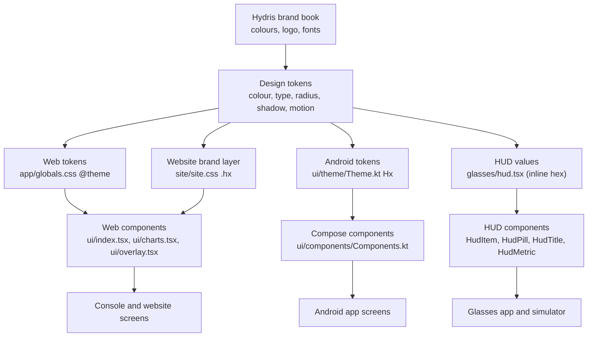

Table: Where the design system lives in the code

| Layer | Web console and website | Glasses HUD and phone mode | Android app | Status |
|---|---|---|---|---|
| Colour, radius, shadow, motion tokens | `apps/web/src/app/globals.css` (`@theme`, `:root`, `:root[data-theme='light']`) | Inherits globals.css; severity tints hard-coded in `apps/web/src/glasses/hud.tsx` and `GlassesApp.tsx` | `apps/android/app/src/main/java/ai/hydris/field/ui/theme/Theme.kt` (`object Hx`) | **Partial** (three sources, some drift) |
| Website brand overrides | `apps/web/src/site/site.css` (`.hx` scope) | Not used | Not used | **Built** |
| Typography roles | `.t-display` to `.t-kpi-sm` in globals.css; Outfit via `next/font` in `app/layout.tsx` | Tailwind pixel sizes in `hud.tsx` | Material 3 `Typography` in Theme.kt | **Built** |
| Components | `apps/web/src/ui/index.tsx`, `ui/charts.tsx`, `ui/overlay.tsx`, `ui/theme.tsx` | `hud.tsx` primitives plus screens in `GlassesApp.tsx` | `ui/components/Components.kt` | **Built** |
| Icons | `lucide-react` 1.57.0 | `lucide-react` | `material-icons-extended` (Outlined set) | **Built** |
| Theme switching | `ui/theme.tsx`, `ui/theme-script.ts` | Forced dark | Dark only | **Partial** |
| Shared token package | None | None | None | **Planned** |

> [!RISK]
> Tokens are defined three times and the HUD uses inline hex values. The values were aligned by hand, and several
> have drifted (see the severity mapping table). Until a single token source generates all three platforms
> (Planned, see the future chapter), every colour change must be made in all three files in the same pull request.

## Brand and colour system

### Brand palette

The brand palette comes from the Hydris AI brand book and is quoted in the header comments of `globals.css` and
`site.css`. Core Blue is the dominant brand colour on the website; Signal Blue is the action colour in product
surfaces. Deep Intelligence Blue (navy) is used for pressed states and deep brand panels.

Table: Brand palette

| Name | Hex | Role | Where defined |
|---|---|---|---|
| Hydris Core Blue | `#1746E4` | Brand fills, hover on primary, chart series 1, website accent | `--color-brand` (globals.css), `--hx-blue` (site.css), `Hx.Core` |
| Deep Intelligence Blue | `#0C1E85` | Pressed primary, deep brand panels, logo navy | `--color-brand-deep`, `--hx-deep` |
| Signal Blue | `#1954F1` | Primary buttons, focus fills, selected state, links on paper | `--color-signal`, `--color-lime`, `Hx.Signal` |
| Signal tint (accent text) | `#6F93FF` | Accent **text** and focus ring on dark backgrounds | `--color-accent`, `Hx.SignalText` |
| Deep Midnight | `#081116` | App background (dark) | `--color-bg`, `Hx.Midnight` |
| Graphite Black | `#222222` | Print and brand graphite | `--color-graphite` |
| Pure White | `#FFFFFF` | Primary text on dark, ink on blue | `--color-text` |
| Alert Orange | `#FF2800` | Critical severity only | `--color-critical`, `--color-orange`, `Hx.Alert` |
| Active Green | `#00FE21` | OK and live: dots and text only, never large fills | `--color-ok`, `Hx.Ok` |
| Hydris Insight Purple | `#8A60F0` | AI, information, secondary data series, synthetic data | `--color-purple`, `--color-cobalt`, `Hx.Insight` |

> [!NOTE]
> The token names `lime`, `lime-2`, `lime-3` and `cobalt` are historical. In the code today `lime` means the brand
> blue role with white ink, and `cobalt` means Insight Purple (globals.css header comment). New code should use
> `signal`, `brand`, `brand-deep` and `purple`. Renaming the legacy roles is part of the token pipeline work.

### Web neutral and surface tokens (dark and light)

The console defines every semantic token for both themes. The dark values live in `@theme`; the light values in
`:root[data-theme='light']`. Components refer only to the semantic names, so a theme switch needs no JavaScript.

Table: Web surface and text tokens (apps/web/src/app/globals.css)

| Token | Dark | Light | Semantic role |
|---|---|---|---|
| `--color-bg` | `#081116` | `#F6F8FC` | Page background |
| `--color-bg-2` | `#0C161C` | `#EEF2F8` | Inset areas, input wells |
| `--color-surface` | `#121A20` | `#FFFFFF` | Cards, menus, dialogs |
| `--color-surface-2` | `#1A2229` | `#F2F5FA` | Secondary buttons, chips, hover |
| `--color-surface-3` | `#252E35` | `#E5EAF2` | Pressed, disabled primary, progress track |
| `--color-line` | white 7.5 % | slate 8.5 % | Hairline borders |
| `--color-line-2` | white 14 % | slate 15 % | Strong borders, inputs |
| `--color-text` | `#FFFFFF` | `#1B2129` | Primary text |
| `--color-text-2` | `#C5CCD2` | `#46505B` | Secondary text |
| `--color-muted` | `#8D979F` | `#66717D` | Labels, meta, captions |
| `--color-paper` | `#EEF1F4` | `#FFFFFF` | KPI paper cards (light island on dark page) |
| `--color-ink` / `--color-ink-2` | `#081116` / `#4C5862` | `#1B2129` / `#545F6B` | Text on paper |
| `--color-accent` | `#6F93FF` | `#1746E4` | Accent text, focus ring |
| `--color-scrim` | midnight 72 % | slate 38 % | Modal backdrop |
| `--color-field` | `#0C161C` | `#FFFFFF` | Input background |
| `--color-placeholder` | `#67727B` | `#8A949F` | Input placeholder |
| `--color-chart-grid` | white 7 % | slate 7 % | Chart gridlines |

### Android tokens

The Android app maps the same palette into a Material 3 dark colour scheme (`Theme.kt`). `primary` is Signal Blue,
`secondary` is Insight Purple, `tertiary` is a softer green (`OkSoft`), `error` is Alert Orange.

Table: Android Hx tokens (apps/android/.../ui/theme/Theme.kt)

| Token | Hex | Material role | Use |
|---|---|---|---|
| `Hx.Midnight` | `#081116` | `background`, `surfaceContainerLow` | Screen background |
| `Hx.Surface` | `#0E1A21` | `surface`, `surfaceContainer` | Cards, navigation bar |
| `Hx.Surface2` | `#13222B` | `surfaceVariant`, `surfaceContainerHigh` | Raised containers |
| `Hx.Line` | white 12 % | `outline` | Card borders, progress track |
| `Hx.Signal` | `#1954F1` | `primary` | Primary buttons, progress, spinner |
| `Hx.Core` | `#1746E4` | `primaryContainer` | Pressed and selected |
| `Hx.SignalText` | `#6F93FF` | (direct) | Accent text, selected tab |
| `Hx.Alert` | `#FF2800` | `error` | Critical severity |
| `Hx.High` | `#F26414` | (direct) | High severity, stale data, error notes |
| `Hx.Medium` | `#F5B83D` | (direct) | Medium severity, delayed data |
| `Hx.Ok` | `#00FE21` | (direct) | Active Green (reserved) |
| `Hx.OkSoft` | `#34D27A` | `tertiary` | Live data, typical-range band |
| `Hx.Insight` | `#8A60F0` | `secondary` | AI, synthetic chip |
| `Hx.Text` / `Hx.Text2` / `Hx.Muted` | `#F2F5F7` / `#B7C2CA` / `#7D8B95` | `onBackground`, `onSurfaceVariant` | Text hierarchy |

### HUD colour values

The HUD inherits `globals.css`, so `lime` (focus border, selected pill) is Signal Blue `#1954F1`. Severity tints on
the HUD are lighter than the console's, because they must read as thin strokes and text on an additive display.
They are currently inline hex values in `hud.tsx` and `GlassesApp.tsx`.

Table: HUD colour values (apps/web/src/glasses/hud.tsx, GlassesApp.tsx)

| Use | Border | Text | Notes |
|---|---|---|---|
| Critical | `#FF5A4E` | `#FF8A80` | `HudPill tone="critical"`, `AlertInterrupt` border |
| High | `#F26414` | `#FF9A5C` | Matches Android `Hx.High` border |
| Medium | `#F5B83D` | `#F7C96A` | Step cautions, safety notices icon |
| OK | `#4ED98E` | `#7FE6AE` | Softer than Active Green to avoid glare |
| Neutral line | white 25 % | white 80 % | Default pill |
| Focus / selected | `lime` (`#1954F1`) | `#141714` on fill | See the contrast findings below |
| Critical banner background | n/a | n/a | `#2A0D0B` (critical), `#2A1608` (high and offline strip) |

### Severity and status colour mapping

Severity colours are semantic and are **never** reused as decoration (globals.css header). The table shows how each
surface renders each severity today, which is where the drift is easiest to see.

Table: Severity colour mapping by surface

| Severity | Web console fill / text (dark) | Web light text | Website `.hx` | Android `Hx.severity()` | HUD border / text |
|---|---|---|---|---|---|
| Critical | `#FF2800` / `#FF7A5C` | `#C41F00` | `#FF2800` | `#FF2800` | `#FF5A4E` / `#FF8A80` |
| High | `#FF9F1C` / `#FFB547` | `#A35200` | `#FF5A1F` | `#F26414` | `#F26414` / `#FF9A5C` |
| Medium | `#F5C542` / `#F7D36E` | `#7F6000` | (inherits) | `#F5B83D` | `#F5B83D` / `#F7C96A` |
| Low | `#8FB0FF` / `#B3C9FF` | `#1746E4` | (inherits) | `#6F93FF` | neutral line |
| OK / live | `#00FE21` / `#00FE21` | `#0B7A1F` | `#00FE21` | `#34D27A` (live), `#00FE21` | `#4ED98E` / `#7FE6AE` |

> [!DECISION]
> The canonical High colour is **`#F26414`** (the brand-adjacent orange already used on Android and the HUD). The
> console's amber `#FF9F1C` and the website's `#FF5A1F` will move to it, with a lighter text tint for small text on
> dark. Critical stays Alert Orange `#FF2800` everywhere, with surface-specific text tints for legibility.
> Status: **Planned** (token alignment).

The same colours drive object states through `StateChip` (`ui/index.tsx`). The mapping rule: red family for
"needs attention now", amber for "seen, not finished", purple for "someone is working on it", green for "done or
healthy", outline for "neutral or historical".

Table: State to tone mapping used by StateChip (apps/web/src/ui/index.tsx)

| Tone | States |
|---|---|
| Critical | `active` (alarm), `down`, `revoked`, `urgent` |
| Medium | `acknowledged`, `paused`, `on_hold`, `degraded`, `disconnected` |
| Cobalt (Insight Purple) | `investigating`, `in_progress`, `assigned`, `maintenance` |
| OK | `resolved`, `approved`, `completed`, `operational`, `connected` |
| High | `rejected`, `suspended` |
| Brand blue (lime) | `submitted` |
| Outline | `closed`, `scheduled`, `cancelled`, `open`, `standby`, `draft`, `archived` and other neutral states |

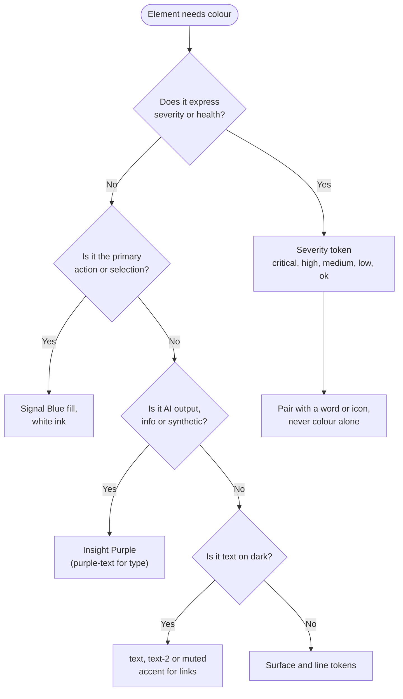

### Contrast audit

Contrast ratios below were computed with the WCAG 2.x relative luminance formula from the hex values in the code
(script run during authoring; alpha tints were not composited and are excluded). The target for all product text
is WCAG 2.2 **AA**: 4.5:1 for normal text and 3:1 for large text (24 px regular or 18.66 px bold and above) and for
non-text UI components.

Table: Contrast ratios for key colour pairs (computed from code values)

| Foreground | Background | Ratio | Result | Where used |
|---|---|---|---|---|
| White `#FFFFFF` | Midnight `#081116` | 19.05:1 | AAA | Primary text, console and HUD |
| text-2 `#C5CCD2` | surface `#121A20` | 10.84:1 | AAA | Secondary text in cards |
| muted `#8D979F` | surface `#121A20` | 5.91:1 | AA | Labels, meta |
| muted `#8D979F` | bg `#081116` | 6.41:1 | AA | Captions on page |
| Signal `#1954F1` | Midnight `#081116` | 3.25:1 | Large text only | Why accent text uses `#6F93FF` |
| Accent `#6F93FF` | Midnight `#081116` | 6.62:1 | AA | Links, selected tab, focus ring |
| White | Signal `#1954F1` | 5.87:1 | AA | Primary button label |
| White | Core Blue `#1746E4` | 6.92:1 | AA | Hover primary, brand panel |
| White | Deep Blue `#0C1E85` | 13.64:1 | AAA | Pressed primary |
| White | Danger solid `#E02400` | 4.75:1 | AA | `btn-danger-solid` |
| critical-text `#FF7A5C` | surface `#121A20` | 6.86:1 | AA | Critical chip text |
| high-text `#FFB547` | surface | 10.01:1 | AAA | High chip text |
| ok-text `#00FE21` | surface | 12.73:1 | AAA | OK chip text |
| purple-text `#B69CFF` | surface | 7.69:1 | AAA | Insight and synthetic chips |
| Ink `#081116` | paper `#EEF1F4` | 16.81:1 | AAA | KPI paper cards |
| Light text `#1B2129` | White | 16.20:1 | AAA | Light theme body |
| Light muted `#66717D` | bg `#F6F8FC` | 4.68:1 | AA | Light theme labels |
| Light critical `#C41F00` | White | 5.93:1 | AA | Light theme critical text |
| Light high `#A35200` | White | 5.58:1 | AA | Light theme high text |
| Light ok `#0B7A1F` | White | 5.50:1 | AA | Light theme OK text |
| Android Text2 `#B7C2CA` | Surface `#0E1A21` | 9.75:1 | AAA | Secondary text |
| Android Muted `#7D8B95` | Surface `#0E1A21` | 5.05:1 | AA | Meta lines |
| Android Insight `#8A60F0` | Surface `#0E1A21` | 4.22:1 | Fails AA (normal) | Synthetic chip text |
| White | Android Alert `#FF2800` | 3.78:1 | Fails AA (normal) | Filled critical chip, 12 sp |
| White | Android High `#F26414` | 3.18:1 | Fails AA (normal) | Filled high chip, 12 sp |
| HUD critical `#FF8A80` | Black | 9.20:1 | AAA | HUD critical text |
| HUD white 55 % (about `#8C8C8C`) | Black | 6.25:1 | AA | HUD meta lines |
| HUD ink `#141714` | Signal `#1954F1` | 3.08:1 | Large text only | Selected pill, View button, digit entry |

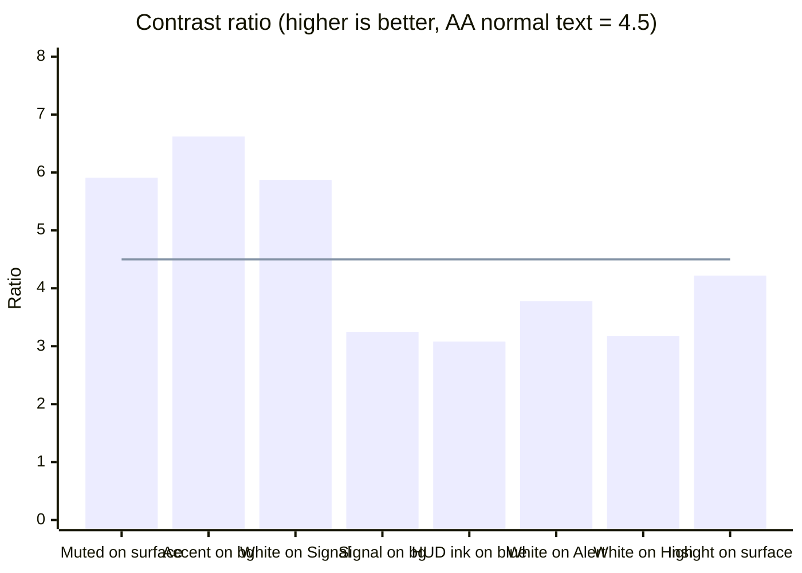

> [!WARNING]
> Three contrast failures exist in shipped code. (1) **HUD selected pill and View button**: `#141714` ink on Signal
> Blue is 3.08:1. The ink colour is a leftover from when the `lime` role was a light lime green. Fix: white ink on
> the blue fill (5.87:1) in `HudPill tone="lime"`, `AlertInterrupt` and the digit-entry cell in `GlassesApp.tsx`.
> (2) **Android filled severity chips**: white on `#FF2800` (3.78:1) and on `#F26414` (3.18:1) at 12 sp. Fix: use
> the tinted chip style (coloured text on a 14 % fill) or dark ink on the fill. (3) **Android synthetic chip**:
> Insight `#8A60F0` text on Surface is 4.22:1. Fix: add an `Hx.InsightText` tint equivalent to the web
> `#B69CFF`. Status: **Planned** fixes, tracked in the QA checklist.

## Typography

### Typefaces

Table: Typefaces by surface

| Surface | Typeface in code | Source | Status |
|---|---|---|---|
| Console, website, glasses web app, simulator | Outfit (300, 400, 500, 600) | `next/font/google` in `apps/web/src/app/layout.tsx`, exposed as `--font-outfit` | **Built** |
| Monospace (IDs, codes) | System UI monospace stack | `--font-mono` in globals.css | **Built** |
| Android app | Platform default (Roboto on most devices) | Material 3 `Typography` without a custom `FontFamily` | **Built** |
| Word and PDF product documents | Arial and Calibri | `docs/product/tools/build.js` theme | **Built** |
| Brand typefaces Unison Pro (display) and Eloquia Text (body) | Not in any product surface | Brand book | **Planned** (licensing for web and app embedding) |

> [!DECISION]
> Product UI keeps Outfit and the platform font until web and app embedding licences for Unison Pro and Eloquia Text
> are confirmed. When they are, Unison Pro is limited to display roles (`t-display`, `t-hero`, website headings) and
> Eloquia Text replaces Outfit for body roles. Numerals in KPIs keep tabular figures (`.num`), whichever face is used.

All numeric values use tabular, lining figures (`.num` in globals.css: `font-variant-numeric: tabular-nums
lining-nums`) so live values do not jitter as digits change. HUD metrics and digit-entry cells apply `.num` too.

### Web type scale

Table: Web typography roles (apps/web/src/app/globals.css)

| Role class | Size | Line height | Tracking | Weight | Use |
|---|---|---|---|---|---|
| `t-display` | clamp 44 to 92 px | 1.02 | -0.04 em | 600 | Website hero |
| `t-hero` | clamp 36 to 64 px | 1.04 | -0.035 em | 600 | Website section heroes |
| `t-page` | clamp 30 to 44 px | 1.06 | -0.03 em | 600 | Console page titles |
| `t-section` | 21 px | 1.25 | -0.02 em | 600 | Card groups, dialog titles |
| `t-card` | 16.5 px | 1.3 | -0.012 em | 600 | Card titles |
| body (`.input`, table) | 14 to 14.5 px | 1.5 | normal | 400 | Body text, tables, inputs |
| `t-label` | 13 px | 1.35 | 0.005 em | 400 | Field labels, KPI labels |
| `t-eyebrow` | 11.5 px | 1.4 | 0.16 em, uppercase | 500 | Section eyebrows |
| `t-kpi` | clamp 38 to 54 px | 0.95 | -0.045 em | 300 | KPI numerals |
| `t-kpi-sm` | 28 px | 1.05 | -0.035 em | 300 | Secondary KPI numerals |
| Table header | 11.5 px | n/a | 0.08 em, uppercase | 500 | `.table th` |

### Android type scale

Table: Android typography (apps/android/.../ui/theme/Theme.kt)

| Material role | Size | Weight | Tracking | Use |
|---|---|---|---|---|
| `displaySmall` | 34 sp / 38 sp | SemiBold | -0.8 sp | Large greetings |
| `headlineSmall` | 24 sp | SemiBold | -0.4 sp | Screen titles ("Audit scan", "Glasses") |
| `titleLarge` | 20 sp | SemiBold | -0.2 sp | Section titles |
| `titleMedium` | 16 sp | Medium | 0 | List item titles, option rows |
| `bodyLarge` | 16 sp / 22 sp | Regular | 0 | Primary body |
| `bodyMedium` | 14 sp / 20 sp | Regular | 0 | Secondary body, KPI labels |
| `bodySmall` | 12.5 sp / 17 sp | Regular | 0 | Meta lines |
| `labelSmall` | 11 sp | Medium | 1.4 sp | Eyebrows (uppercase) |
| KPI value (inline) | 34 sp | SemiBold | -1 sp | `KpiTile` value |
| Alarm reading (inline) | 36 sp | SemiBold | 0 | Alarm detail reading |

Sizes are in `sp`, so the app follows the operator's system font-size setting. **Built.**

### HUD type scale

The HUD is designed on a 600 by 600 canvas. All sizes below are canvas units, scaled to the display.

Table: HUD typography (apps/web/src/glasses/hud.tsx, GlassesApp.tsx)

| Role | Size | Weight | Use |
|---|---|---|---|
| `HudTitle` | 38 | Regular, -0.03 em | Screen title |
| `HudMetric` value | 52 | Light, tabular | Key reading |
| Digit entry cell | 56 | Light, tabular | Inspection numeric input |
| Alert interrupt title | 34 | Regular | Full-screen alarm |
| `HudItem` row | 23 | Regular | List rows, actions |
| Body and instructions | 19 to 22 | Regular | Step instructions, SOP text |
| Status bar | 18 | Regular | Connection, queue, operator |
| `HudPill` | 18 | Medium | Status pills |
| Eyebrow | 17 | Uppercase, 0.14 em | Section and step labels |
| Meta line | 17 | Regular, white 55 % | Secondary row text |
| Hint bar | 16 | Regular, white 45 % | Control hints |

> [!TIP]
> The HUD comment sets the floor at 20 px for content. Meta lines, eyebrows and hints at 16 to 18 are allowed
> because they are secondary and never carry the only copy of a safety-relevant value. A UI profile can raise
> everything with `layout.textScale` (0.9, 1, 1.15, 1.3; clamped to 0.85 to 1.4) in `packages/domain/src/uiprofile.ts`;
> the glasses app applies it with CSS `zoom` in `GlassesApp.tsx`. **Built.**

## Spacing, radius and elevation

### Spacing

Web layouts use the Tailwind 4 spacing scale (4 px base) without custom spacing tokens. The recurring values are
documented here so new screens stay on the rhythm.

Table: Spacing rhythm in use

| Context | Web console | Android | HUD |
|---|---|---|---|
| Page gutter | 16 px mobile, 32 px from `md` (`px-4 md:px-8`) | 16 dp (`padding(horizontal = 16.dp)`) | 32 units HUD, 24 units phone mode (`px-8` / `px-6`) |
| Card padding | 24 px (`.card`), 18 px tight, 20 to 24 px KPI | 16 dp default, 14 dp list cards | 16 to 24 units |
| Gap between cards | 12 to 16 px | 12 dp (`Row2`, `spacedBy(12.dp)`) | 12 units |
| Section top spacing | 32 px (`pt-8`) | 20 dp (`SectionTitle`) | 20 units (`HudTitle` margin) |
| Max content width | 1440 px (`max-w-[1440px]`) | Full width | 600 units (HUD) / 540 units (phone) |

### Radius

Table: Radius tokens

| Token | Value | Use |
|---|---|---|
| `--radius-xs` | 6 px | Small tags, kbd |
| `--radius-sm` | 10 px | Skeletons |
| `--radius-md` | 14 px | Inputs, selects |
| `--radius-lg` | 18 px | Inset cards, menus |
| `--radius-xl` | 24 px | Cards, panels, empty states |
| `--radius-2xl` | 32 px | Centered dialogs |
| Pill | 9999 px | Buttons, chips, capsules, icon buttons |
| Android `CardShape` | 22 dp | `HCard` |
| Android chip / progress | 50 % | `Chip`, `ProgressBar` |
| HUD row | 26 units | `HudItem` |
| HUD alert | 34 units | `AlertInterrupt` |

### Elevation

Elevation on dark surfaces comes from a top-edge sheen and graded surface colours more than from shadows.

Table: Elevation tokens (globals.css)

| Token | Dark | Light | Use |
|---|---|---|---|
| `--sheen` | inset 1 px white 4.5 % | soft 1 to 2 px shadow | Every card and capsule |
| `--shadow-1` | 1 px plus 8 px blur, black 20 to 30 % | slate 5 % | Resting raised elements |
| `--shadow-2` | 6 px plus 28 px, black 30 to 35 % | slate 6 to 9 % | Hover lift, glass panels |
| `--shadow-3` | 12 px plus 72 px, black 35 to 55 % | slate 8 to 16 % | Menus, dialogs, mobile tab bar |
| Brand panel glow | 18 px 48 px Core Blue 22 % | 18 % | `.card-lime` focal panel |

Android cards are flat (`tonalElevation = 0` on the navigation bar, no shadow on `HCard`), separated by a 1 dp
`Hx.Line` border. The HUD uses no shadows at all, since shadows are invisible on an additive display.

## Iconography

Table: Icon systems

| Surface | Library | Style | Default sizes | Status |
|---|---|---|---|---|
| Console and website | `lucide-react` 1.57.0 | 1.5 to 2 px stroke, rounded | 19 px navigation, 16 to 18 px buttons, 14 px inline | **Built** |
| Glasses HUD and phone mode | `lucide-react` | Same | 22 to 28 units | **Built** |
| Android | `androidx.compose.material:material-icons-extended` | Outlined set (`Icons.Outlined.*`, `Icons.AutoMirrored.Outlined.*`) | 18 to 24 dp | **Built** |

The two libraries are visually close (outlined, geometric), which keeps the surfaces consistent without sharing
assets. Use the same concept for the same meaning:

Table: Icon concept mapping across surfaces

| Concept | Lucide (web, HUD) | Material Outlined (Android) |
|---|---|---|
| Home / overview | `LayoutGrid`, `Glasses` (HUD home tab) | `Dashboard` |
| Alarms | `Siren` (console nav), `AlertTriangle` (HUD) | `Warning` |
| Inspections | `ClipboardCheck` | `FactCheck` |
| Maintenance | `Wrench` | `Build` |
| Audit scan | `ScanLine` | `DocumentScanner` |
| Voice / Hydris AI | `Mic`, `Sparkles` | `AutoAwesome`, `Mic`, `MicOff` |
| Glasses / devices | `Glasses` | `Visibility` |
| Back | `ChevronLeft` | `AutoMirrored.Outlined.ArrowBack` |
| Camera | n/a | `PhotoCamera` |
| Safety notice | `ShieldAlert` | n/a |
| Not permitted | `Ban` | n/a |

Rules: icons never stand alone for an action on the HUD or phone (always with a label); icon-only buttons on the
web carry an `aria-label` and a `Tooltip` (`IconButton` in `ui/index.tsx`); decorative icons are `aria-hidden`.

## Component library

### Component inventory

Table: Component inventory

| Component | Purpose | Surfaces | States | Status |
|---|---|---|---|---|
| `Button`, `ButtonLink` | Actions: primary, secondary, ghost, light, cobalt, danger, danger-solid | Web | default, hover, active, focus, disabled, busy (`aria-busy`) | **Built** |
| `IconButton` | Circular icon actions with label and badge | Web | default, light, lime, ghost, outline, on-paper, danger; sm, md, lg | **Built** |
| Material `Button`, `OutlinedButton` | Primary and secondary actions, 52 to 54 dp tall | Android | enabled, disabled (busy) | **Built** |
| `Card` | Section container (dark, paper, lime focal) | Web | default, tight, hover lift | **Built** |
| `HCard` | Card with optional click and accent border | Android | default, clickable, accent | **Built** |
| `KpiCard` | KPI island: label, value plus unit, sub line, open link | Web | paper, dark, lime; critical, high, ok accent | **Built** |
| `KpiTile` | KPI tile: label, 34 sp value, sub line, icon | Android | accent colour, clickable | **Built** |
| `HudMetric` | Large reading with unit and label | HUD | tone colour | **Built** |
| `Chip`, `SeverityChip`, `StateChip` | Status and category labels | Web | 10 tones including synthetic | **Built** |
| `Chip` (Compose) | Status label | Android | tinted, filled | **Partial** (filled contrast) |
| `HudPill` | Status pill on HUD | HUD | line, lime, critical, high, ok, medium | **Partial** (lime contrast) |
| `FreshnessBadge` | Live, delayed, stale, no data with time | Web | 4 freshness states, pulsing live dot | **Built** |
| `SyntheticBadge` | Marks simulator data | Web, HUD text, Android chip | n/a | **Built** |
| `Capsule` | Segmented control and filters | Web | selected, hover, counts, lime variant | **Built** |
| `Input`, `PasswordInput`, `Select`, `Textarea`, `Field` | Forms with label, hint, error | Web | hover, focus, invalid, disabled | **Built** |
| `Switch` | Boolean settings | Web | on, off, disabled | **Built** |
| `DataTable` | Sortable, clickable tables | Web | hover, focus, selected, dense, empty | **Built** |
| `Timeline` | Event history | Web | lime, critical, ok, muted, cobalt | **Built** |
| `KeyValues` | Definition grid | Web | 1 to 3 columns | **Built** |
| `Progress` | Progress bar with ARIA | Web | lime, ok, critical | **Built** |
| `ProgressBar` | 6 dp progress bar | Android | colour | **Built** |
| `Dialog`, `ConfirmDialog` | Modal, side panel, bottom sheet; confirmation with optional required note | Web | open, destructive, note required | **Built** |
| Toasts (`ToastProvider`, `useToast`) | Transient confirmations with timer | Web | info, error | **Built** |
| `EmptyState`, `ErrorState`, `LoadingBlock`, `Skeleton`, `QueryView` | Data states | Web | empty, not found, forbidden, error with retry, loading | **Built** |
| `Loading`, `ErrorNote` | Data states | Android | spinner, error note | **Built** |
| `HudItem` | Focusable HUD row | HUD | active (focus), disabled, tone | **Built** |
| `HudTitle` | Screen title with eyebrow | HUD | n/a | **Built** |
| `PhoneTabBar` | Bottom tab bar in phone mode | Glasses phone mode | active, back, badge | **Built** |
| `HintBar` | Control hints aligned to handedness | HUD | left, right | **Built** |
| `AlertInterrupt` | Full-screen critical or high alarm | HUD | critical, high, synthetic | **Partial** (button contrast) |
| `GuidedCapture` | Live A4 framing with guidance and auto-capture | Glasses, web | 8 guidance codes, ready progress | **Built** |
| Web charts (`ui/charts.tsx`) | Sparkline, Sparkbars, BarStrip, Gauge, RadialGauge, Donut, StackedBar, BarList, Heatmap, BulletBar, RangeBar, Delta, MiniTrend, Funnel, StatusStrip, TrendChart | Web | empty state, screen-reader table | **Built** |
| Android charts | `Sparkline`, `LineChart`, `Bars`, `Donut` (Canvas) | Android | fewer than 2 points draws nothing | **Partial** (no accessible description) |
| `ThemeToggle` | System, light, dark | Web | checked, compact | **Built** |
| Haptic feedback | Confirm critical actions by vibration | Android, glasses | n/a | **Planned** |

### Cards

**Web `Card`** (`ui/index.tsx`, `.card` in globals.css): surface background, 1 px line border, 24 px radius, 24 px
padding, sheen. Three tones: default dark; `paper` (light island on a dark page, used for KPIs so numbers pop);
`lime`, the focal brand panel, a radial gradient of Core Blue with white type. Use at most **one** focal panel per
view. Interactive cards opt into `.lift` (2 px rise on hover, settle on press).

**Android `HCard`** (`Components.kt`): `Hx.Surface`, 22 dp radius, 1 dp `Hx.Line` border, 16 dp padding. Passing
`accent` tints the border at 55 % alpha; the home screen uses this for critical alarm cards and the alarm detail uses
a Signal accent for the recommended action card.

### KPI tiles

Table: KPI tile specification

| Property | Web `KpiCard` | Android `KpiTile` | HUD `HudMetric` |
|---|---|---|---|
| Minimum height | 124 px, 148 px from `sm` | Content height | Content height |
| Label | 13.5 px, 75 % opacity, top left | `bodyMedium`, Text2, single line | 17, white 60 %, below value |
| Value | `t-kpi` (38 to 54 px, light 300) | 34 sp SemiBold | 52 light |
| Unit | 15 px, 60 % opacity, baseline aligned | Inline in value or sub | 20, white 60 % |
| Accent | `kpi-accent-critical`, `-high`, `-ok`; deepened on paper for AA | `accent` colours the value | `tone` colours the value |
| Link | `OpenLink` arrow, top right | Whole tile clickable | Not interactive |
| Sub line | 13 px, 70 % opacity | `bodySmall`, Muted | n/a |

Rules: a KPI value is a fact with a unit and a time context ("in the last 24 h"); never show a KPI computed from
stale data without saying so; never use the accent colour unless the number itself is the alert.

### Chips and badges

Web chips are 28 px tall pills, 12.5 px medium text, with a 1 px tinted border and a 12 to 15 % tinted fill per
tone. Clickable chips get a 44 px hit area through an `::after` pseudo-element. `SeverityChip` adds a dot in the
severity colour plus the word. `chip-synthetic` is a dashed purple outline so simulated data is recognisable even
in greyscale.

Android `Chip` is 12 sp medium text with 10 by 4 dp padding on a 14 % tint, or a solid fill when `filled = true`
(alarm severity on the alarm detail screen). The HUD `HudPill` is 34 units tall with a 2 unit border and 18 unit
text; on the HUD, outlines are preferred to fills.

### Buttons

Table: Button specification (globals.css)

| Variant | Fill | Text | Hover | Use |
|---|---|---|---|---|
| `btn-primary` | Signal `#1954F1` | White | Core Blue plus blue glow; pressed Deep Blue | One per view: the main record action |
| `btn-secondary` | surface-2 | text | surface-3 | Secondary actions |
| `btn-ghost` | transparent | text-2 | surface-2 | Tertiary, toolbars |
| `btn-light` | White | ink | paper | On the blue focal panel |
| `btn-cobalt` | Core Blue | White | Deep Blue | Brand emphasis on the website |
| `btn-danger` | transparent, orange border | critical-text | 12 % orange fill | Reversible destructive actions |
| `btn-danger-solid` | `#E02400` | White | `#C41F00` | Irreversible destructive confirmation |

Sizes: `btn-sm` 36 px (with an invisible 44 px hit area), default 44 px, `btn-lg` 52 px. All buttons scale to 0.97
on press, show 50 % opacity when disabled (the disabled primary turns into a neutral surface so it reads as "not
yet" rather than a faded blue), and set `aria-busy` while an action is in flight. Android primary actions are
Material `Button` at 52 to 54 dp height and full width in task flows (alarm detail, scan review), with
`OutlinedButton` for secondary actions.

### Inputs and forms

Inputs are at least 46 px tall, 14 px radius, 14.5 px text, on `--color-field` with a `line-2` border. Focus shows a
Signal Blue border plus a 4 px Signal glow at 22 %; invalid inputs show a critical border and a `field-error` line
prefixed by a small critical dot (so the error is not colour-only). `Field` always renders a visible label, an
optional hint and an error, linked by `id`. Glove-friendly rules: never rely on small inline controls in the field
apps; on Android use full-width text fields (the Ask screen uses a 26 dp radius pill field) and full-width buttons.

### Tables

`.table` (globals.css) and `DataTable` (`ui/index.tsx`): sticky uppercase 11.5 px headers, 13 px row padding
(10 px dense), hover wash, a 2 px Signal inset on the first cell of clickable rows, keyboard focus outline, and a
14 % Signal fill for the selected row. Sorting uses `aria-sort` on the header. Tables belong to the console only;
phones and the HUD use lists.

### Alarm rows

An alarm row shows, in this order: severity (chip or coloured border plus word), title, value with unit, asset tag,
state, and time since it was raised. Synthetic alarms add the synthetic marker.

Table: Alarm row anatomy by surface

| Element | Console table row | Android list card | HUD `HudItem` |
|---|---|---|---|
| Severity | `SeverityChip` (dot plus word) | Accent border (critical) plus severity colour | `tone` colours the text, pill on detail |
| Title | Primary text | `titleMedium` | 23 unit row text |
| Value and unit | Column | Meta line | Detail screen, 24 unit |
| State | `StateChip` | Chip on detail | Meta line ("active · 3m ago") |
| Time | Relative | `ago()` (just now, 5m ago) | `timeAgo` |
| Synthetic | `SyntheticBadge` | Purple chip | "· synthetic" |
| Open | Row click | Card click to `alarm/{id}` | Select to `alert` screen |

### Charts

Web charts (`apps/web/src/ui/charts.tsx`) are hand-built SVG microcharts, plus `TrendChart` built on Recharts
`AreaChart`. Every chart reads colours from CSS variables, is an accessible image (`role="img"` with
`aria-label`), can render a screen-reader data table (`SrTable`), and shows an explicit empty state instead of
inventing numbers. Android charts are drawn on Compose `Canvas` without a chart library (`Components.kt`; the
mobile spec's Vico choice was not adopted).

Table: Chart specifications

| Chart | Web | Android | Specification |
|---|---|---|---|
| Sparkline | `Sparkline`: default 40 px tall, stroke `--color-lime` | `Sparkline`: 2 dp round stroke, range padded 7.5 % top and bottom | No axes; trend only; always next to the current value |
| Line / trend | `TrendChart` (Recharts area, 260 px, thresholds as reference lines, typical band); `MiniTrend` with band and limits | `LineChart`: typical range shaded in `OkSoft` 8 %, 3 gridlines, 28 % gradient fill, end-point dot | Thresholds and typical range always drawn when known |
| Bars | `Sparkbars` (peak emphasis), `BarStrip`, `BarList`, `StackedBar` | `Bars`: 4 dp gaps, 4 dp radius, last bar full colour, others 45 % | Highlight only the bar that matters (latest or peak) |
| Donut | `Donut`: 156 px, 14 px ring, centre value, legend with percentages | `Donut`: 14 dp stroke, 2 degree gaps, starts at 12 o'clock, centre slot | Compositions only; at most 5 segments |
| Gauges | `Gauge`, `RadialGauge` with marks and band | n/a | Single value against a range |
| Heatmap | `Heatmap` (week by hour) | n/a | Event density |
| Progress | `Progress`, `BulletBar` (target) | `ProgressBar` | Fraction of a known total |

### Empty, loading and error states

Table: Data state patterns

| State | Web | Android | HUD |
|---|---|---|---|
| Loading | `LoadingBlock` skeleton rows with shimmer, `role="status"`; `QueryView` keeps last good data while refetching | `Loading`: Signal Blue spinner | "Generating…", "Context will load when the connection returns" |
| Empty | `EmptyState`: dashed border, concentric art, title, body, action | Inline text ("No ..."), per screen | Plain 22 unit sentence ("This alert is no longer open.") |
| Not found | `ErrorState` turns 404 and invalid ids into "We couldn't find that record" with a back link | n/a | n/a |
| Forbidden | "You do not have access to this" with admin guidance | Server error text | `NotPermitted` screen and `Blocked` notes |
| Error | Red-tinted `role="alert"` panel with message and Retry | `ErrorNote`: High tint panel with message | Banner (`role="status"`) in critical or high tone |
| Offline | Realtime status in shell | Error notes | Offline strip plus queued counter |

## Data visualisation guidelines

1. **Show the value, its unit and its time together.** A number without freshness is not shown. Use `FreshnessBadge`
   (web) or `Hx.freshness()` (Android: live `OkSoft`, delayed `Medium`, stale `High`, no data `Muted`).
2. **Never plot invented data.** Missing readings are gaps, not zeros (`freshness.ts`); charts render their empty
   state ("No data", "No records").
3. **Limits and typical ranges are context, not decoration.** Draw thresholds as reference lines and typical ranges
   as a faint band (Android `LineChart`, web `MiniTrend` and `TrendChart`).
4. **One highlight per chart.** Emphasise the latest or peak bar; mute the rest (`Sparkbars` `emphasise`, Android
   `Bars` 45 % alpha).
5. **Severity colours only for severity.** Series colours come from the brand set (Signal, Core Blue, Insight
   Purple, text-2) in that order; Alert Orange is reserved for critical.
6. **Every chart has a text equivalent.** Web: `aria-label` plus optional `SrTable`. Android: **Planned**
   (`Modifier.semantics { contentDescription }` on chart canvases).
7. **Tabular figures** for every numeric axis, legend and value.
8. **HUD: no charts beyond a single sparkline.** On the glasses, a reading and its state word beat any chart.

## Layout grids

### Console desktop

The console shell (`apps/web/src/console/Shell.tsx`) has a fixed 84 px icon rail on the left from the `md`
breakpoint, a sticky blurred header with the search trigger (Ctrl or Cmd K command palette), theme toggle and
account menu, an optional demo banner, and a main column capped at 1440 px with 32 px gutters. Below `md` the rail
becomes a floating bottom capsule bar with four primary items (Overview, Alarms, Sensors, Inspections) and More,
which opens an "All modules" bottom sheet.

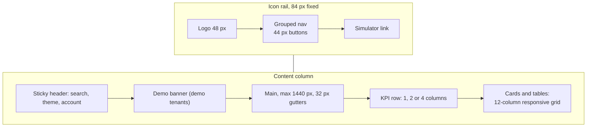

Table: Console breakpoints and grid behaviour

| Breakpoint (Tailwind) | Navigation | KPI row | Content grid |
|---|---|---|---|
| Below `sm` (640 px) | Bottom capsule bar plus More sheet | 1 to 2 columns | Single column; dialogs become bottom sheets |
| `sm` to `md` | Bottom capsule bar | 2 columns | Single column; centred dialogs |
| `md` (768 px) and up | 84 px rail | 2 columns | Two-column card layouts begin |
| `lg` (1024 px) | Rail | 2 to 3 columns | Main plus side column |
| `xl` (1280 px) and up | Rail | 4 columns (`xl:grid-cols-4`) | Full dashboard grid, max 1440 px |

### Phone (glasses phone mode and Android)

The glasses web app switches to **phone mode** for portrait phones, the Ray-Ban Meta companion app and any page with
`?mode=phone` (`useViewportLayout` in `hud.tsx`). Phone mode keeps a 540-unit design width
(`PHONE_DESIGN_WIDTH`), scales by `window width / 540`, and grows to the full device height so screens fill the
phone instead of sitting in a letterboxed square. Safe areas are respected with `env(safe-area-inset-top)` on the
status bar and `env(safe-area-inset-bottom)` on the tab bar.

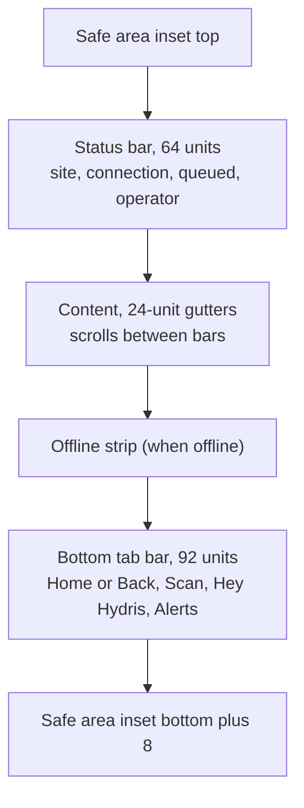

The Android app follows the same structure natively: `statusBarsPadding()`, 16 dp horizontal padding, a `LazyColumn`
of cards with 12 dp spacing, and a Material `NavigationBar` with five tabs (Home, Work, Scan, Hydris, Glasses) on
`Hx.Surface`, selected items in `SignalText` with an 18 % Signal indicator (`ui/Root.kt`).

### HUD 600 by 600

The HUD canvas is 600 by 600 units scaled to fit (`useFitScale`, `useViewportLayout`). The simulator also offers
640 by 480 and 480 by 480 viewports (`apps/web/src/app/simulator/page.tsx`) to test other display shapes.

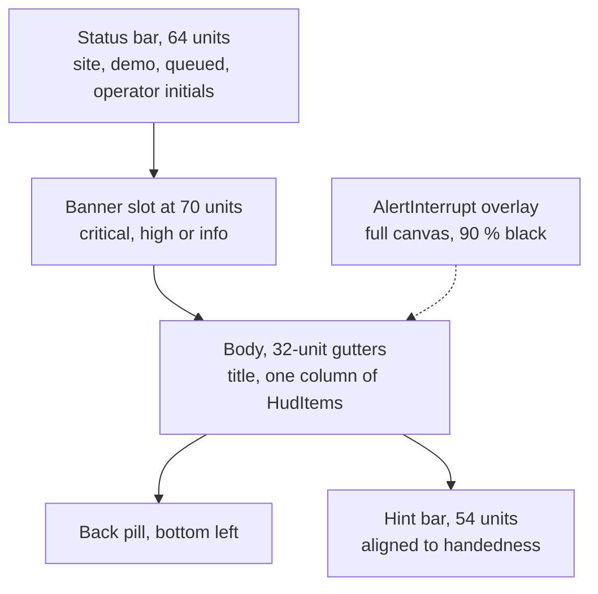

Table: HUD layout rules

| Rule | Value | Source |
|---|---|---|
| Canvas | 600 by 600 units, black (renders transparent) | `hud.tsx` |
| Gutters | 32 units (HUD), 24 units (phone) | `GlassesApp.tsx` |
| Columns | One | `hud.tsx` header comment |
| Focus | One focused `HudItem` with Signal border and 10 % Signal fill | `HudItem` |
| Row height | 14 units vertical padding (comfortable), 9 units (compact) | `HudItem`, `layout.density` |
| Primary actions | One per screen | `hud.tsx` header comment |
| Hint bar | Right or left aligned per `layout.handedness` | `HintBar` |
| Text scale | `layout.textScale` 0.85 to 1.4 | `uiprofile.ts` |

### UI profiles shape the layout

Administrators control what the glasses show through versioned UI profiles (`packages/domain/src/uiprofile.ts`):
12 screens (Home and Device and session can never be disabled), 4 home widgets, 8 actions, a measurement allow-list
and per-asset-type order, plus layout density, text scale and handedness. The most specific published assignment
wins entirely: device, then user, then role, then organisation, then the built-in default. Designers must design
every glasses screen for both densities, all four text scales and both hands.

## Navigation patterns

### Console information architecture

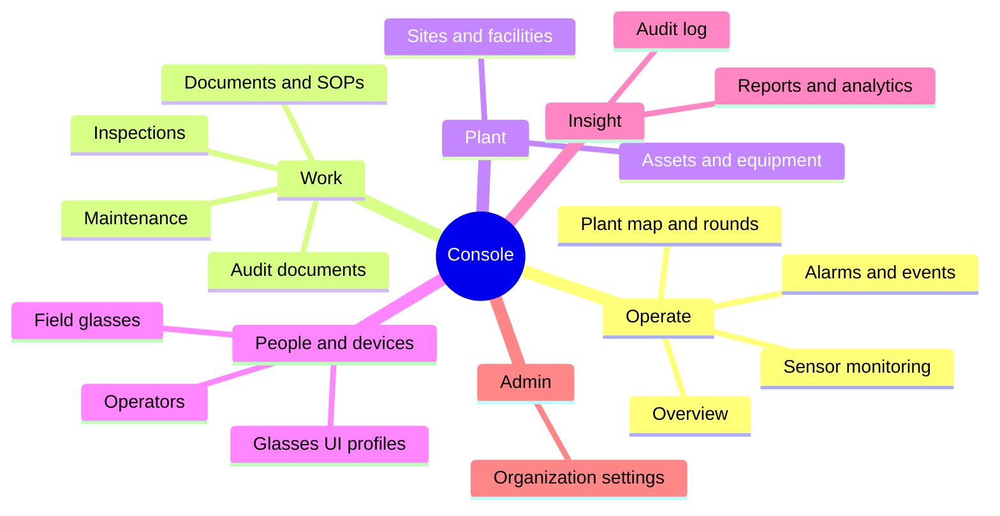

Navigation items are filtered by permission (`perm` on each `NavItem`), so an operator never sees a module they
cannot open. The command palette searches assets, sensors, documents and people from every page.

### Glasses app information architecture

The glasses app is a stack: Home is the root, every selection pushes a screen, and Back pops. Screens are gated by
the UI profile (`screenAllowed` logic at the top of `GlassesApp.tsx`).

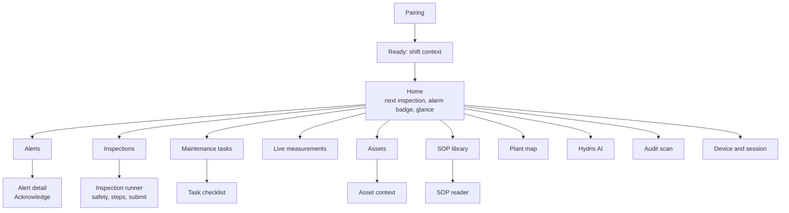

### Android app navigation

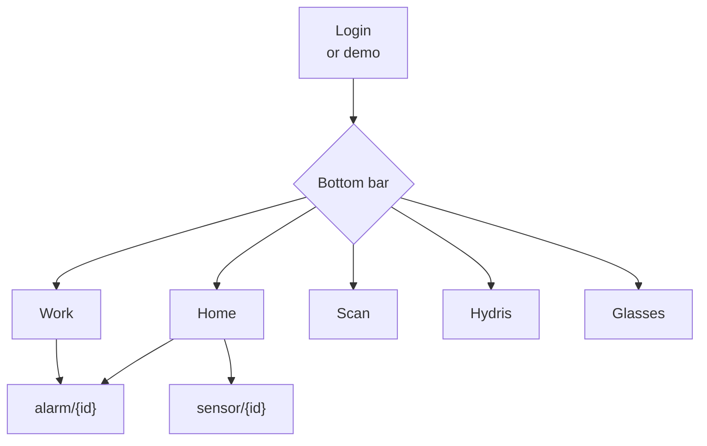

Tab switches pop to Home with saved state and `launchSingleTop`, so returning to a tab restores its scroll position.
Detail screens show a back arrow at top left (`Icons.AutoMirrored.Outlined.ArrowBack`), and the system back gesture
works everywhere.

## Interaction patterns

### Input model

The glasses app reduces every input to six keys: up, down, left, right, select, back (`apps/web/src/glasses/input.ts`).
Keyboard arrows, Enter or Space, Escape or Backspace, touch swipes of at least 40 px, and simulator `postMessage`
controls all map onto that vocabulary. Hardware gestures (neural band pinch and swipe, frame touchpad) plug in once
their delivery to the web runtime is verified on a device (**Planned**). Phone mode adds direct touch on rows and the
bottom tab bar.

Table: Input vocabulary and its meaning

| Key | HUD meaning | Phone mode | Android |
|---|---|---|---|
| Up / Down | Move focus between `HudItem`s; change a digit in numeric entry | Swipe up or down | Scroll |
| Left / Right | Move between digits; right also opens | Swipe right to open, left for back | n/a |
| Select | Activate focused item | Tap | Tap |
| Back | Pop the stack; dismiss interrupt | Back tab or swipe left | Back arrow or system back |
| Voice | "Hey Hydris" | Hey Hydris tab | Mic toggle on Hydris tab |
| Capture button | n/a on display glasses | n/a | Ray-Ban Meta short press triggers a scan capture |

### Voice first: "Hey Hydris"

The wake phrase is matched by `WAKE_RE` in `packages/domain/src/voice.ts`, which tolerates common mishearings
("hey hydras", "ok hydrus", "hi dris"). A question can follow in the same breath ("Hey Hydris, what's the pH?").
Answers come from the account's live data through `POST /assistant/ask`, are shown as a card and spoken through the
glasses speakers or the device's speech synthesis (`VoiceAssistant.tsx`).

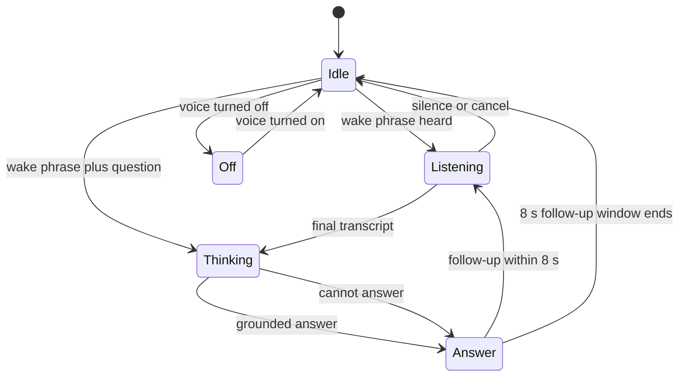

Design rules for voice:

- Always show what was heard (Android renders the transcript in `SignalText` quotes) before the answer arrives.
- The thinking state has copy ("Checking your plant data…") so silence is never ambiguous.
- Answers list their facts with value, unit and label, so the operator can check the source.
- The mic state is always visible: "Hey Hydris" (listening for wake), "Voice off", "No mic" (`VoiceAssistant.tsx`).
- Voice never performs a state change on its own. Acknowledging or submitting stays an explicit select or tap.

### Capture button and audit scan

On Ray-Ban Meta glasses the physical capture button is surfaced through the Meta Wearables Device Access Toolkit:
a `SHORT_PRESS` capture event is emitted on `GlassesManager.captureButton` and the scan screen uses it to capture a
page (`apps/android/.../glasses/GlassesManager.kt`). The scan menu offers three sources: glasses camera, phone
camera with guided A4 framing, and photo import (`ScanScreen.kt`).

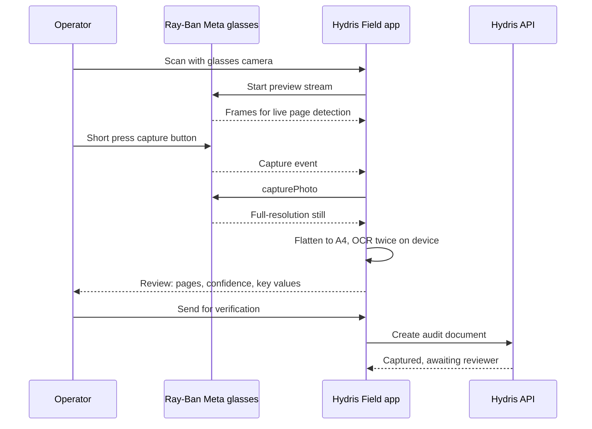

### Guided capture feedback

`GuidedCapture` (`apps/web/src/lib/GuidedCapture.tsx`, with logic in `lib/docdetect.ts`; ported to Kotlin in
`apps/android/.../scan/DocDetect.kt`) shows one instruction at a time. Detection runs every 90 ms; the detected
sheet is outlined in Signal Blue while guidance is pending, in orange `#FF6A3D` when it touches the edge or is
skewed, and in Active Green once ready. After 900 ms of continuous readiness it captures automatically.

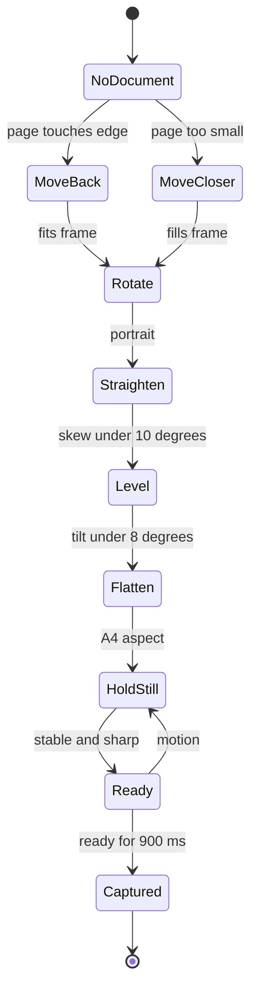

Table: Guidance messages (lib/docdetect.ts)

| Code | Message shown | Outline colour |
|---|---|---|
| `no_document` | Place the A4 sheet in view, on a dark surface | None |
| `move_back` | Move back - show all four corners of the page | Orange |
| `move_closer` | Move closer - fill the frame with the page | Signal Blue |
| `rotate` | Turn the sheet to portrait (long side vertical) | Signal Blue |
| `straighten` | Look straight down at the page - reduce the tilt | Orange |
| `level` | Level the page - rotate it left or right until upright | Orange |
| `flatten` | Hold the sheet flat and square to your view | Signal Blue |
| `hold_still` | Hold still… | Signal Blue |
| `ready` | Perfect - capturing | Active Green, with fill progress |

### Back navigation

- HUD: Back key or swipe left pops one screen; a Back pill sits bottom left when the stack is deeper than Home.
- Phone mode: the first tab becomes **Back** whenever the stack is deeper than Home, otherwise **Home**
  (`PhoneTabBar`). This keeps back reachable with a thumb at the bottom of the screen.
- Android: top-left back arrow on detail screens and the system back gesture.
- Console: breadcrumbs and `BackLink`; `ErrorState` defaults back to the parent list.
- Back never discards recorded work: inspection steps are saved as they are recorded and queued offline.

### Alarm acknowledgement and lifecycle

The alarm lifecycle is defined once in `packages/domain/src/alarms.ts` and enforced by the API. Each surface shows
only the next valid actions.

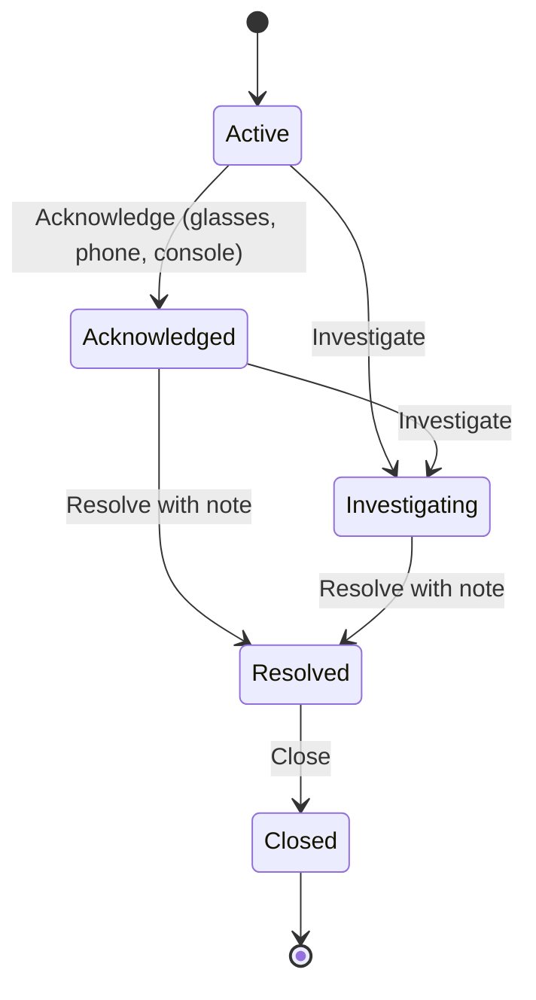

Table: Acknowledgement and lifecycle patterns by surface

| Surface | Interrupt | Acknowledge | Resolve | Status |
|---|---|---|---|---|
| Glasses HUD | `AlertInterrupt` full-screen overlay for critical and high, View or Dismiss | Single focused `HudItem`, disabled offline with "(needs connection)" | Not offered (console or phone) | **Built** |
| Android | None (push notifications **Planned**) | Full-width primary button | Button shown, but no note is collected | **Partial** |
| Console | Realtime toast for critical alarms | Button on detail | `ConfirmDialog` with required note "What was done to resolve the condition" | **Built** |

> [!WARNING]
> On Android the Resolve button posts the action without a note (`WorkScreen.kt` calls `alarmAction(id, "resolve")`),
> but the API rejects resolve without one (`note_required` in `apps/api/src/modules/alarms.ts`). The operator sees an
> error note. Fix: a bottom sheet that collects the note, matching the console's `ConfirmDialog`. Status: **Planned**.

### Operator experience journey

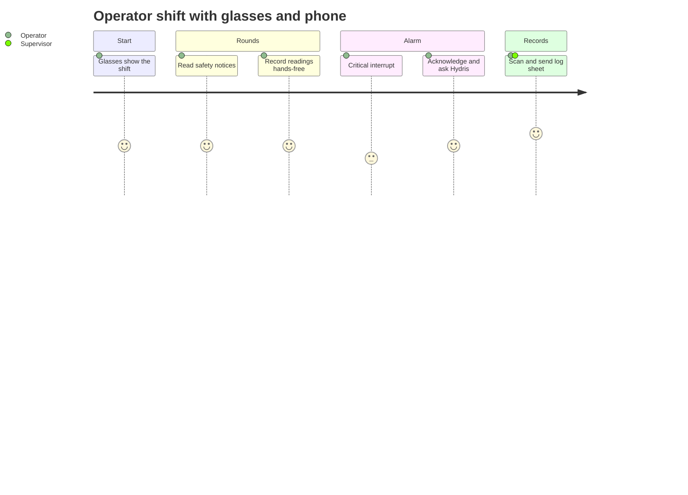

## Motion

Motion explains change; it never decorates. All motion tokens are in globals.css.

Table: Motion tokens and patterns

| Token or class | Value | Use |
|---|---|---|
| `--speed-fast` | 150 ms | Colour and border changes, press feedback |
| `--speed` | 240 ms | Lifts, fades |
| `--ease-out` | cubic-bezier(0.22, 1, 0.36, 1) | Default easing |
| `--ease-spring` | cubic-bezier(0.34, 1.4, 0.64, 1) | Theme toggle icon only |
| `.page-enter` | 360 ms fade and 8 px rise | Route change in console |
| `.pop-in` | 220 ms | Popovers, centred dialogs |
| `.sheet-up` | 320 ms | Bottom sheets |
| `.slide-in-right` | 320 ms | Side panels |
| `.stagger` | 40 ms steps up to 200 ms | Card grids on load |
| `.pulse-dot` | 1.8 s | Live freshness dot only |
| `.skeleton` | 1.6 s shimmer | Loading |
| Chart transitions | 600 to 700 ms | Bars and arcs growing to value |
| Theme switch | 300 ms colour cross-fade | `html.theme-switching` |

Rules:

- `prefers-reduced-motion: reduce` disables animations and transitions globally, stops the pulse dot and hides the
  toast timer (globals.css). **Built** on web.
- The HUD uses colour transitions only; no movement on an additive display, where motion pulls the eye from the
  task. **Built.**
- Android uses Material defaults; honouring the system "remove animations" setting is inherent to Compose
  animation APIs. Custom motion is not used. **Built.**
- Alarms never animate in a way that could be mistaken for normal motion; the interrupt simply appears.

## Accessibility

### Targets

Table: Accessibility targets

| Area | Target | Status |
|---|---|---|
| Text contrast | WCAG 2.2 AA (4.5:1, 3:1 large) on every surface and theme | **Partial** (3 failures listed in the contrast audit) |
| Non-text contrast | 3:1 for borders of inputs, focus rings, chart marks | **Built** (focus ring `#6F93FF` 6.62:1 on bg) |
| Target size | WCAG 2.5.8: at least 24 by 24 px; Hydris standard 44 by 44 px | **Built** on web (`::after` hit areas on `btn-sm`, `icon-btn-sm`, chips, links) and Android (48 dp Material, 52 dp buttons) |
| Focus visible | 2 px outline, 2 px offset, colour follows surface | **Built** (`:focus-visible` in globals.css) |
| Keyboard | Every console action reachable by keyboard; HUD fully key-driven | **Built** |
| Screen readers | Labels on icon buttons; charts as images with text tables; live region for route changes | **Built** on web, **Partial** on Android charts |
| Forced colours | Selected capsule outlined in `CanvasText` | **Built** |
| Text resize | Web reflow to 320 px; Android `sp`; HUD `textScale` | **Built** |
| Reduced motion | Respect user preference | **Built** (web) |
| Haptics | Vibration for critical alarms and confirmed actions | **Planned** |

### Gloves, noise and outdoor light

- **Gloves.** Field targets are 52 dp or larger on Android task flows and the full width of the screen where
  possible; the phone-mode tab bar is 92 units tall with 28-unit icons. Avoid swipe-only actions in phone flows:
  every swipe has a tap equivalent.
- **Noise.** Voice is a convenience, never the only path. Every voice capability has a button or tap equivalent, and
  answers are shown as text as well as spoken. On Ray-Ban Meta glasses the microphone is the glasses microphone over
  Bluetooth, which sits closer to the mouth than the phone.
- **Outdoor light.** Dark themes with near-white text (19:1) survive glare better than mid-grey palettes. Minimum
  sizes outdoors: 16 sp body on Android, 20 units body on the HUD, KPI values at 34 sp or larger. Operators can
  raise text size through the system setting (Android) or the UI profile (glasses).
- **Safety glasses and polarised lenses.** Do not rely on subtle tints; severity is always paired with a word and,
  on the HUD, a 2 to 3 unit border.

### Haptics (Planned)

No haptic feedback exists in the code today (no vibration calls on web or Android). The planned pattern: one short
pulse when a step is recorded, a double pulse when an action is rejected, and a long pulse for a critical alarm
interrupt on Android. Haptics complement, never replace, visible state.

## Content and voice guidelines

Hydris copy is short, specific and calm. It names the equipment, the value and the next step. It never overstates
what the system does.

Table: UX writing do and don't

| Do | Don't | Why |
|---|---|---|
| "Acknowledge" with hint "does not change equipment" | "Fix", "Clear alarm" | Hydris records; it does not operate equipment |
| "VT-101 vibration high-high · 7.4 mm/s" | "Problem detected on pump" | Name the tag, measurand and value |
| "Offline · showing data cached 4m ago" | "Error" | Say what still works and how old the data is |
| "Next step (approved procedure): ..." | "AI recommends ..." | Attribute guidance to the approved SOP |
| "Send for verification" | "Submit final" | A reviewer and approver still confirm the record |
| "We couldn't find that record" plus a way back | "404 Not Found" | Plain language with a recovery path |
| "Ticking checklist items · not permitted by your profile" | Hiding the control silently | Never hide state |
| "Checking your plant data…" | Silent spinner | Explain waits longer than a moment |
| "Synthetic" | "Test", "Fake" | Consistent term for simulator data |
| "Step 3 of 8 · optional" | "Question 3" | Orientation and obligation in one line |

Rules:

- Sentence case for every label and title. Uppercase only through the eyebrow style.
- Units follow numbers with a space ("7.4 mm/s"); pH is the exception and leads the value ("pH 6.8").
- Relative times for recent events ("5m ago"), absolute times in tooltips and audit records.
- No em dashes in product copy or documents; use a colon, a comma, a middle dot or two sentences. The guided
  capture messages currently use a spaced hyphen, which is acceptable on screen.
- Button labels are verbs; one to three words on the HUD.

## Localisation

The product ships in English only today: the web root sets `lang="en"` (`apps/web/src/app/layout.tsx`) and no
string catalogue or i18n library exists on web or Android.

Table: Localisation plan

| Item | Detail | Status |
|---|---|---|
| String extraction | Web: message catalogues per route; Android: `strings.xml` resources | **Planned** |
| Hindi (hi-IN) | First additional language; Devanagari font fallback for Outfit (Noto Sans Devanagari) | **Planned** |
| Tamil (ta-IN), Marathi, Gujarati, Telugu, Kannada | Pilot regions in India | **Planned** |
| Voice | Wake phrase stays "Hey Hydris"; recognition and TTS locale follow the operator | **Planned** |
| OCR | ML Kit Devanagari model for Hindi labels on audit sheets (per mobile spec) | **Planned** |
| Numbers and units | Locale digit grouping in tables; SI units unchanged; decimal separator follows locale | **Planned** |
| Layout tolerance | Labels must survive 40 % expansion; HUD rows truncate with an ellipsis, never wrap into two actions | Rule (applies now) |

> [!NOTE]
> Indic scripts need taller line heights than Latin. When Hindi or Tamil is added, HUD row padding and the 0.95
> line height of `t-kpi` must be rechecked; numerals stay Latin (tabular) in every locale.

## Dark and light themes

Table: Theme support by surface

| Surface | Default | Light theme | Mechanism | Status |
|---|---|---|---|---|
| Console | Dark | Full token set | `data-theme` on `<html>` set by a blocking script before paint; `ThemeToggle` (system, light, dark); stored in `localStorage` key `hydris.theme` | **Built** |
| Website | Dark | Shared tokens plus `.hx` brand layer | Same | **Built** |
| Glasses app and simulator viewport | Dark, forced | None (by design) | `FORCED_DARK_RE` | **Built** |
| Android | Dark | None | `darkColorScheme` only | **Planned** (light scheme for office use) |
| Word and PDF documents | Light | n/a | Build theme | **Built** |

Rules: the blue focal panel, brand blue fills and Alert Orange are identical in both themes; semantic **text** tints
are redefined for light so they stay AA (for example critical text `#C41F00` on white, 5.93:1); KPI accent numerals
deepen on paper and light surfaces (`kpi-accent-*` overrides).

## Design QA checklist

Use this list on every pull request that changes UI. Items checked here are true of the current code base; open items
are known gaps to close.

- [x] Uses semantic tokens only; no new hex values in components (web)
- [x] Every value shows unit and freshness, and missing data shows "No data"
- [x] Severity is shown with a word or icon as well as colour
- [x] Synthetic data carries the Synthetic marker on every surface
- [x] Interactive targets are at least 44 by 44 px (web) or 48 dp (Android)
- [x] Focus is visible and follows the surface colour
- [x] Charts have an accessible name and an empty state (web)
- [x] `prefers-reduced-motion` respected (web)
- [x] HUD screen has one column and one primary action
- [x] Blocked actions are explained, not hidden (glasses)
- [ ] HUD selected pill, View button and digit cell use white ink on Signal Blue (contrast 5.87:1)
- [ ] Android filled severity chips meet 4.5:1 or use the tinted style
- [ ] Android synthetic chip uses a lighter Insight text tint
- [ ] Android Resolve collects a note before posting
- [ ] High severity colour aligned to `#F26414` across console, website, Android and HUD
- [ ] HUD severity colours moved from inline hex to tokens
- [ ] Android chart canvases have content descriptions
- [ ] Haptic patterns implemented for record, reject and critical alarm
- [ ] Strings extracted for localisation
- [ ] Tested at UI profile text scale 1.3 in both densities and both hands

## Governance and contribution

The design system is owned by Design, Hydris, with one engineering maintainer per platform (web, Android). Changes
follow the same review discipline as code: the Markdown in this folder and the token files are the source of truth.

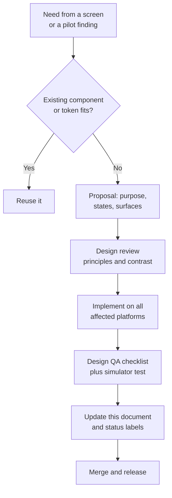

Table: Contribution rules

| Rule | Detail |
|---|---|
| Tokens before components | A new colour, size or radius is added as a token in `globals.css` and `Theme.kt` (and the HUD) in the same pull request |
| No one-off severity colours | Severity and status colours come only from the severity tokens |
| All surfaces or a ticket | A change to a shared pattern ships on every surface, or opens a tracked gap with a **Partial** label here |
| Contrast proof | New colour pairs include their computed ratio in the pull request description |
| Simulator check | Glasses changes are checked in the simulator at 600 by 600, 640 by 480 and 480 by 480, in phone mode, and at text scale 1.3 |
| Screenshots | Updated screenshots go into `docs/product/images/` (web shots refresh with `node screenshots.js`) |
| Versioning | This document versions with minor bumps for additions and major bumps for breaking token renames |

## Future work

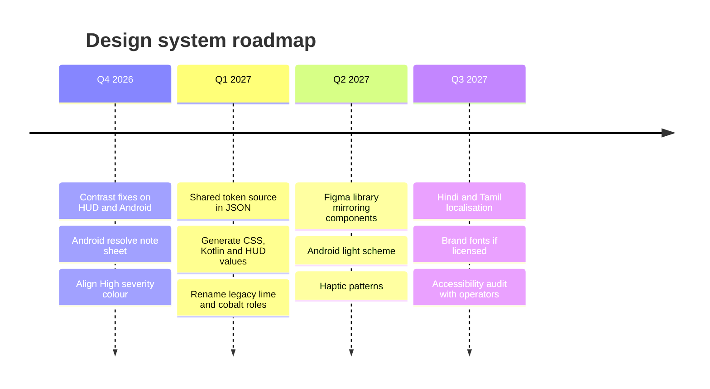

Table: Future work items

| Item | Description | Status |
|---|---|---|
| Token pipeline | One JSON token source (for example in `packages/domain` or a new `packages/tokens`) that generates `globals.css` variables, `Theme.kt` `Hx` and a HUD palette module | **Planned** |
| Figma library | Components, tokens as Figma variables, HUD frame templates at 600 by 600 and phone 540-unit width, linked to code | **Planned** |
| Legacy role renames | `lime` to `signal`, `cobalt` to `purple` across classes and utilities | **Planned** |
| Android component parity | `StateChip`, `FreshnessBadge`, empty states and a severity chip that matches the web | **Planned** |
| Push notification design | Critical alarm notification layout and channels on Android | **Planned** |
| Hardware gesture mapping | Neural band and frame touchpad onto the six-key vocabulary | **Planned** |
| Field usability study | Glove, glare and noise trials with pilot operators; results to update this document | **Planned** |

> [!EXAMPLE]
> A token entry in the planned pipeline: `color.severity.high = { value: "#F26414", text.dark: "#FF9A5C",
> text.light: "#A35200" }` generates `--color-high` and `--color-high-text` for web, `Hx.High` and `Hx.HighText` for
> Android, and the HUD pill and border values, so one change updates every surface.
