# Glasses Integration

Hydris puts live plant data, guided paper capture and a voice assistant in front of field operators who need their hands free. This document explains how Hydris talks to smart glasses: which glasses, which capabilities, which software stack, and what is built, partial or planned. It covers three runtimes that share one backend and one account model:

- **Hydris Field** (`apps/android`), the native Android app, which uses Meta's Wearables Device Access Toolkit (DAT) directly.
- **Hydris Glasses bridge** (`apps/glasses-bridge-android`), a WebView host that loads the glasses web app and exposes DAT to it through a JavaScript bridge.
- **The glasses web viewport** (`apps/web/src/glasses/*`, served at `/glasses`), which runs as a heads-up display (HUD) in the browser simulator and as a full-screen phone layout inside the bridge.

> [!STATS]
> - 4 | DAT modules used | core, camera, speech, inputs (1.0.1)
> - 0 | Displays on Ray-Ban Meta | the phone is the screen
> - 3 | Camera bridge shapes | JS interface, injected API, postMessage
> - 300 s | Pairing code lifetime | `PAIRING_TTL_S`

> [!IMPORTANT]
> No Hydris build has yet been run against physical Meta glasses. All DAT calls compile and are type-checked against DAT 1.0.1, and the page side of the bridge was tested end to end with a stand-in bridge (`apps/glasses-bridge-android/README.md`). Every hardware behaviour in this document is therefore **Built, not hardware-verified** unless stated otherwise. The first hardware run is the top item on the roadmap.

## Scope and status

Table: Integration status at a glance

| Capability | Native app | Bridge app | Web viewport alone |
|---|---|---|---|
| Register with the Meta AI app | Built | Built | Not possible |
| Glasses camera preview for guided A4 capture | Built | Built | Not possible |
| Full-resolution glasses photo | Built | Built | Not possible |
| Capture button | Built | Built | Keyboard and simulator only |
| Glasses microphone ("Hey Hydris") | Built | Built | Browser microphone |
| Spoken answers on the glasses speakers | Built (phone TTS over Bluetooth) | Built | Browser speech synthesis |
| Voice Invocations ("Hey Meta, start Hydris") | Planned | Built | Not possible |
| Register glasses as a Hydris device | Built (self-approved) | Built (code and QR via the viewport) | Built (code and QR) |
| HUD on glasses with a display | Not applicable | Not applicable | Built in the simulator; on-glasses Planned |

### Terminology

Table: Terms used in this document

| Term | Meaning |
|---|---|
| DAT | Meta Wearables Device Access Toolkit: the Android and iOS SDK that lets phone apps use supported Meta glasses |
| Meta AI app | Meta's phone app (Android package `com.facebook.stella`) that pairs the glasses, updates firmware and approves third-party apps |
| Registration | DAT's approval that Hydris may connect to the glasses, confirmed in the Meta AI app |
| Session | A DAT `DeviceSession` with one device; camera, speech and inputs are capabilities added to it |
| Pairing | Hydris's own device authorization flow that turns the glasses into a Hydris device record |
| HUD | The 600 x 600 display layout of the web viewport |
| Phone mode | The full-screen phone layout of the web viewport used inside the bridge |

## Hardware and capabilities

### Supported glasses

Meta's DAT FAQ lists Ray-Ban Meta (Gen 1 and Gen 2), Meta Ray-Ban Display, Oakley Meta HSTN and Oakley Meta Vanguard as supported, and says capability availability varies by device. Meta's setup guide additionally lists Ray-Ban Meta Optics and "Meta glasses". Hydris's primary target is Ray-Ban Meta Gen 2.

Table: Capability matrix by glasses family

| Capability | Ray-Ban Meta (Gen 1, Gen 2) | Oakley Meta (HSTN, Vanguard) | Meta Ray-Ban Display | Browser simulator |
|---|---|---|---|---|
| Supported by DAT | Yes (Meta FAQ) | Yes (Meta FAQ) | Yes (Meta FAQ) | Not applicable |
| Camera stream and photo to the phone app | Yes via DAT | Yes via DAT, unverified by Hydris | Yes via DAT, unverified by Hydris | Simulated camera |
| Microphone and speech | Yes via DAT Speech | Unverified by Hydris | Unverified by Hydris | Web Speech API |
| Open-ear speakers | Phone TTS over Bluetooth | Phone TTS over Bluetooth | Phone TTS over Bluetooth | `speechSynthesis` |
| Capture button input | DAT Inputs | Unverified by Hydris | Unverified by Hydris | Keyboard, `hydris:input` |
| Display | **None** | **None** | Yes | 600 x 600 HUD |
| Hydris UI | On the phone | On the phone | On the phone today; on-glasses Planned | HUD |
| Hydris status | Primary target, not yet run on hardware | Expected to work, untested | Phone path expected to work; display Planned | Built |

> [!NOTE]
> Vendor hardware figures (camera megapixels, battery life, microphone count) are deliberately not quoted here. Take them from Meta's current specification sheets when talking to customers.

### Display glasses from other vendors

The console's demo data (`apps/api/src/seed/showcase.ts`) contains device records for **Vuzix M400** and **RealWear Navigator 520** units, plus a browser simulator. These records show how a fleet of display glasses appears in the console (status, firmware, app version, assignment). Hydris has no native app for Vuzix or RealWear yet. The web viewport is designed for such devices: a 600 x 600 additive display, large type and directional input. The simulator offers 600 x 600, 640 x 480 and 480 x 480 viewports (`apps/web/src/app/simulator/page.tsx`).

Table: Other display glasses

| Device | Where it appears | Status |
|---|---|---|
| Vuzix M400 | Demo device records | Planned: run `/glasses` in the device browser or a thin Android host; not tested |
| RealWear Navigator 520 | Demo device records | Planned: as above, with voice-first navigation; not tested |
| Browser simulator | `/simulator`, device kind `simulator` | Built |

## Runtimes and architecture

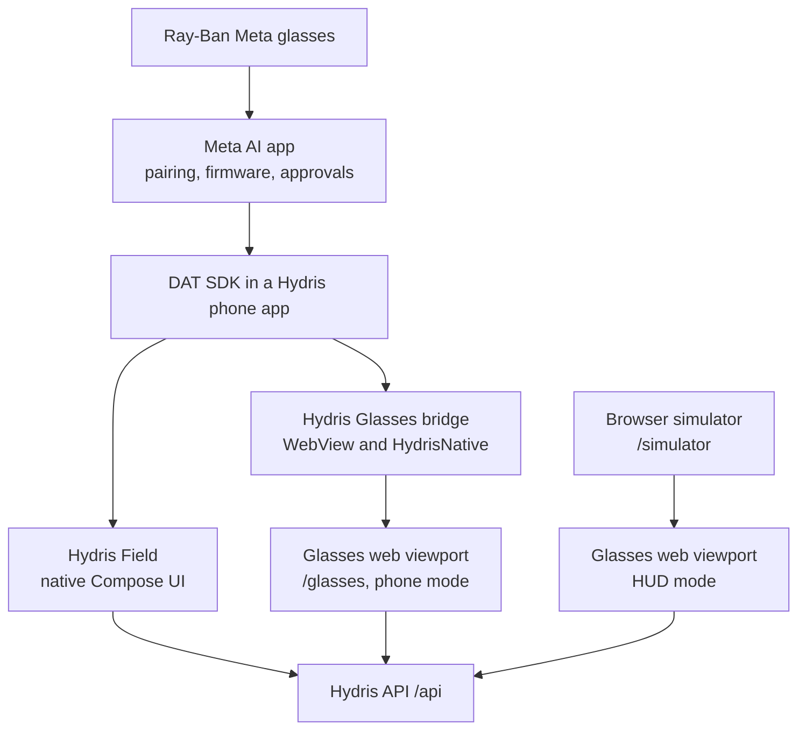

### Meta's stack

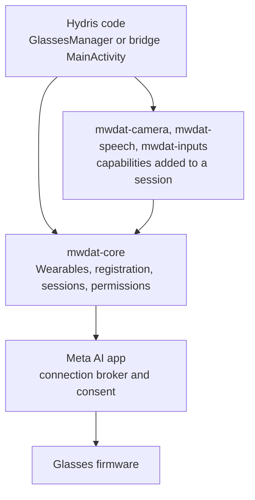

Table: DAT artifacts used (`com.meta.wearable`, version 1.0.1)

| Artifact | What Hydris uses |
|---|---|
| `mwdat-core` | `Wearables.initialize`, `registrationState`, `registrationErrorStream`, `startRegistration`, `startUnregistration`, `devices`, `devicesMetadata`, `checkPermissionStatus`, `RequestPermissionContract`, `createSession(AutoDeviceSelector())`, `isVoiceInvocationsIntent` |
| `mwdat-camera` | `session.addCamera(StreamConfiguration(VideoQuality.MEDIUM, 24))`, `stream.videoStream`, `stream.start`, `stream.state`, `stream.capturePhoto`, `PhotoData.Bitmap` and `PhotoData.HEIC` |
| `mwdat-speech` | `session.addSpeech()`, `transcriptions`, `state`, `errors`, `start`, `stop` |
| `mwdat-inputs` | `session.addInputs(InputsConfiguration(CAPTURE_BUTTON))`, `InputEvent.Capture` with `CapturePressType.SHORT_PRESS` |
| `mwdat-mockdevice` | Debug dependency only; not yet used by tests |

The bridge README notes that Speech, Inputs and Voice Invocations are experimental in DAT and must be enabled for the app in the Wearables Developer Center. Hydris treats them as optional at runtime: failures are logged and the phone fallbacks remain.

## The Meta AI app dependency

Meta's documentation is explicit: "the Meta AI app must be used to pair your glasses". Developer Mode, which lets an unpublished app connect, is enabled in the Meta AI app (Settings, App Info, tap the app version five times, then turn on Developer Mode); connected apps then appear under Meta AI settings, App connections, Developer mode apps. Firmware versions must meet DAT's version dependency table, and firmware is updated through the Meta AI app.

> [!DECISION]
> Hydris does not attempt to replace the Meta AI app. It must stay installed and signed in. Hydris checks for it (`GlassesManager.metaAiInstalled()` looks up `com.facebook.stella`, declared in the manifest `<queries>`) and tells the user to install it and pair the glasses there first.

Developer Mode builds use the manifest placeholders `mwdat_application_id = "0"` and `mwdat_client_token = "0"` (both apps' `build.gradle.kts`). DAT logs that it read no credentials, which is expected. Production builds put the values issued by the Wearables Developer Center in `local.properties`.

## DAT lifecycle

The native `GlassesManager` and the bridge's `MainActivity` implement the same lifecycle. Differences are noted where they matter.

### Initialization

DAT is initialized only after Android grants the Bluetooth permissions. The native app requests `BLUETOOTH`, `BLUETOOTH_CONNECT` and `POST_NOTIFICATIONS` on every `onStart` and initializes when `BLUETOOTH_CONNECT` is not denied. The bridge requests `BLUETOOTH`, `BLUETOOTH_CONNECT` and `INTERNET` and initializes only if all are granted.

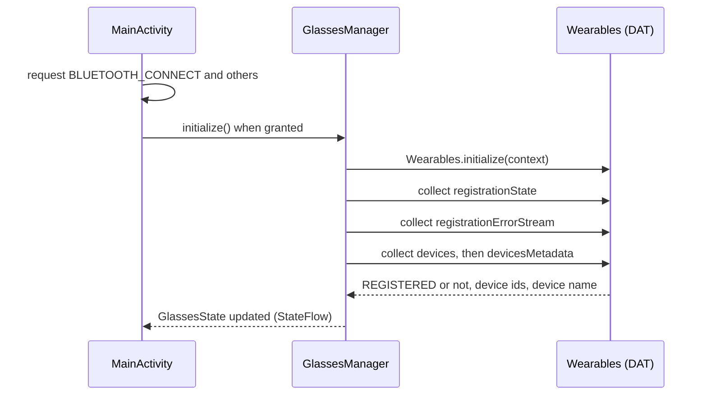

The device name comes from `devicesMetadata` and falls back to "Ray-Ban Meta" when empty. The state holds the registration state, the device list, the session state, camera streaming, speech state, the last error and a log of the latest 30 messages.

### Registration through the Meta AI app

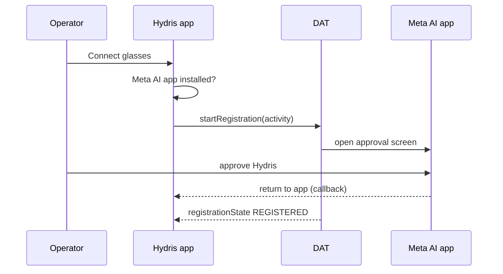

Each app declares a callback URL scheme in its manifest for the return from the Meta AI app: `hydrisfield` for the native app and `hydrisglasses` for the bridge. The native app starts registration only from the Glasses screen. The bridge also starts it automatically when the page needs a session and the app is not registered, and exposes `HydrisNative.connectGlasses()`. Unregistration uses `startUnregistration` (native "Disconnect").

### Permissions

Camera and microphone access on the glasses are DAT permissions, separate from Android permissions, and are approved in the Meta AI app.

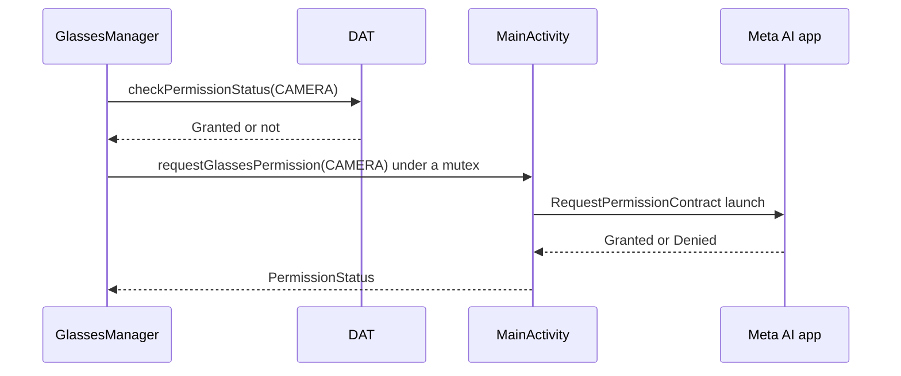

The mutex ensures only one prompt is open at a time. A cancelled or failed result is treated as `Denied`.

### Session

One `DeviceSession` is shared by camera, speech and inputs. It is created lazily with `createSession(AutoDeviceSelector())` the first time a capability is needed, started, and reused while its state is `STARTED`. A `CompletableDeferred` lets concurrent callers wait for the same session.

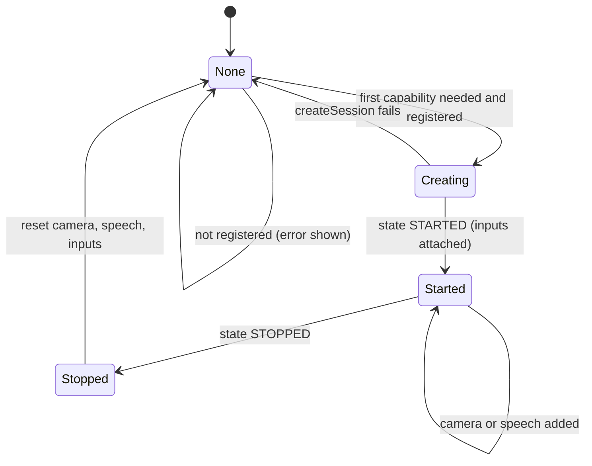

On `STOPPED` both apps drop the camera, speech and inputs objects so the next request creates a fresh session. Session errors are logged ("Session: ...").

### Camera stream for guided capture

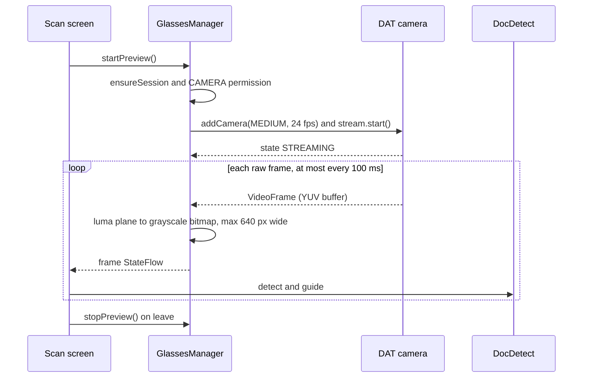

DAT documents raw frames as YUV pixel data without fixing the chroma layout. Every planar or semi-planar 4:2:0 layout starts with the full-resolution luma plane, so Hydris reads luma only. The row stride is inferred from the buffer size (total bytes over height times 1.5), and frames are subsampled to at most 640 px wide. Compressed frames are skipped. The native app forwards at most one frame per 100 ms; the bridge encodes one JPEG (quality 70) per 120 ms and calls `window.__hydrisCameraFrame`.

> [!RISK]
> Two parts of this path are unverified on hardware: stride inference, and the battery cost of the stream. `stopPreview()` stops forwarding frames but does not stop the DAT stream, which ends only with the session. Stopping the stream explicitly is Planned and must be checked against the capture LED behaviour.

### Photo capture

`capturePhoto()` works only on an active stream, so both apps wait until the stream reports `STREAMING` (or stops) before capturing.

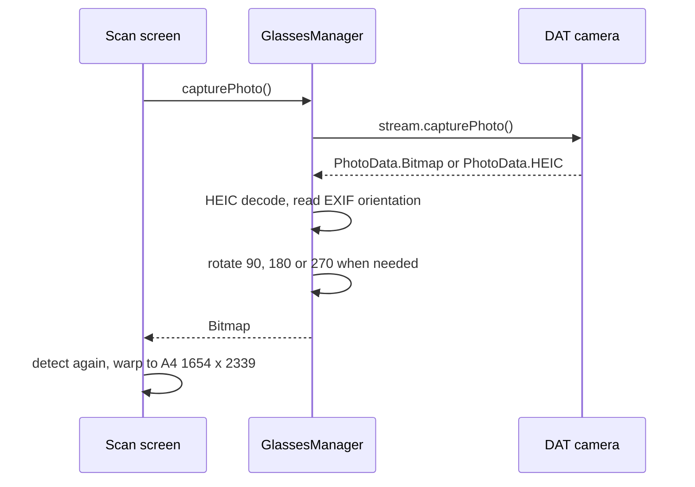

The bridge also handles EXIF flips and transposes, then encodes the photo as JPEG at quality 92 and calls `window.__hydrisCameraPhoto(requestId, base64)`. The native app handles rotations only; adding flips is Planned.

### Capture button

When a session starts, both apps add the Inputs capability with `sources = {CAPTURE_BUTTON}` and `consumeBack = false`. Only `InputEvent.Capture` with `SHORT_PRESS` is used.

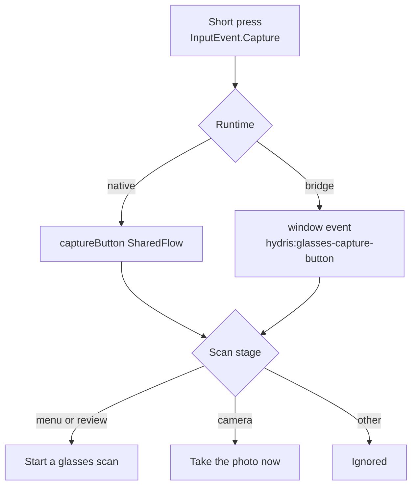

The capture press decomposition (which presses DAT reports as short) is unverified on hardware.

### Speech

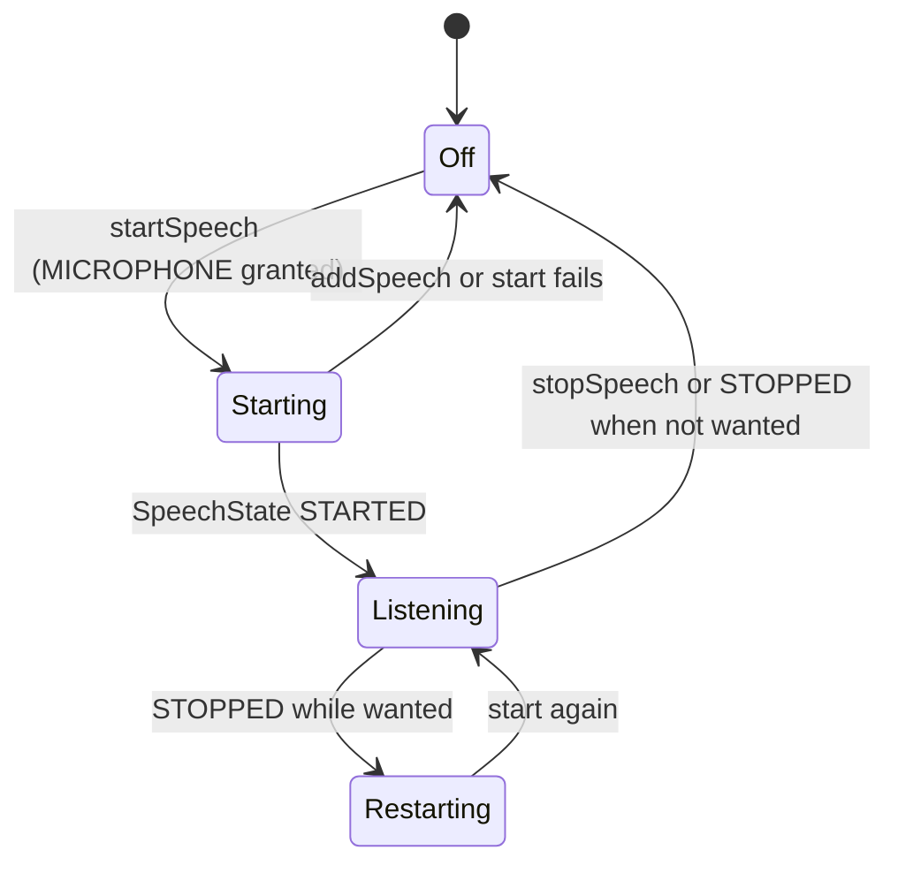

Transcriptions arrive as text with an `isFinal` flag. The native `VoiceEngine` drops them while text-to-speech is playing. The bridge forwards them with `window.__hydrisSpeech(text, isFinal)` and reports states with `window.__hydrisSpeechState(state, detail)`. Answers are spoken by the phone's `TextToSpeech`; Android plays them on the glasses when they are the Bluetooth audio output.

### Voice Invocations

The bridge checks every launch and new intent with `isVoiceInvocationsIntent(intent)` and, when it matches, dispatches `hydris:voice-activate` to the page, which opens the assistant. The native app does not handle Voice Invocations yet (Planned).

### Errors

Table: Error sources and handling

| Source | Example message | Handling |
|---|---|---|
| Registration | "Meta AI: ..." | Shown on the Glasses screen |
| Missing Meta AI app | "Install the Meta AI app and pair your glasses in it first" | Registration not started |
| Not registered | "Connect Hydris in the Meta AI app first" | No session created |
| Session | "No glasses session: ..." | Deferred fails, next call retries |
| Camera permission | "Camera permission denied in Meta AI" | Preview and capture fail; phone camera still available |
| Camera stream | "Stream failed: ..." | Logged; scan shows the error |
| Microphone permission | "Microphone permission denied in Meta AI" | Phone microphone used instead |
| Inputs | "Capture button unavailable: ..." | Logged only |

## Web bridge contract

The bridge app (`ai.hydris.glassesbridge`, version 0.2.0, minSdk 31) loads `${HYDRIS_URL}/glasses` in a WebView with JavaScript and DOM storage enabled and adds a `HydrisNative` JavaScript interface. The page detects the bridge and switches to phone mode.

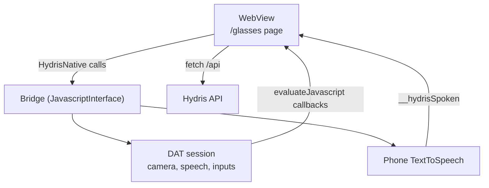

### Page to host

Table: `window.HydrisNative` methods

| Method | Effect |
|---|---|
| `startPreview()` | Turn preview forwarding on and ensure the camera stream |
| `stopPreview()` | Stop forwarding preview frames |
| `capturePhoto(requestId)` | Take a full-resolution photo and answer with the same ID |
| `deviceName()` | Returns "Ray-Ban Meta" (constant today) |
| `startSpeech()` | Start always-on glasses speech |
| `stopSpeech()` | Stop speech |
| `speak(text)` | Speak with phone TTS |
| `connectGlasses()` | Start DAT registration |
| `status()` | DAT registration state as text |

### Host to page

Table: Callbacks and events the host calls

| Callback or event | Arguments | Meaning |
|---|---|---|
| `window.__hydrisCameraFrame` | JPEG base64, width, height | Preview frame (about 8 fps) |
| `window.__hydrisCameraPhoto` | request ID, JPEG base64 | Photo result |
| `window.__hydrisCameraError` | request ID, message | Photo failed |
| `window.__hydrisSpeech` | text, isFinal | Transcript |
| `window.__hydrisSpeechState` | state, detail | `listening`, `idle` or `error` |
| `window.__hydrisSpoken` | none | TTS finished |
| `hydris:glasses-capture-button` | CustomEvent | Capture button short press |
| `hydris:voice-activate` | CustomEvent, optional `question` | Open the assistant |

The page rejects a photo request after 20 s ("The glasses did not return a photo"). For speech output it resolves after `__hydrisSpoken` or a timeout of 1.5 s plus 70 ms per character (at most 20 s).

### Other host shapes

`apps/web/src/glasses/camera.ts` also supports an injected promise API for iOS WKWebView hosts, `window.HydrisWearables` (`capturePhoto(): Promise<{dataUrl}>`, optional `startPreview(onFrame)`, `stopPreview()`, `deviceName`), and a postMessage protocol for any embedding host (React Native WebView or a parent frame).

Table: postMessage protocol

| Direction | Message | Fields |
|---|---|---|
| Host to page | `hydris:camera-ready` | `deviceName` (announces a bridged camera) |
| Page to host | `hydris:camera-start` | none |
| Host to page | `hydris:camera-frame` | `dataUrl` |
| Page to host | `hydris:camera-capture` | `requestId` |
| Host to page | `hydris:camera-photo` | `requestId`, `dataUrl` |
| Host to page | `hydris:camera-error` | `requestId`, `message` |
| Page to host | `hydris:camera-stop` | none |
| Simulator to page | `hydris:input` | `key`: up, down, left, right, select, back (same origin only) |
| Simulator to page | `hydris:network` | `online` (simulated loss) |
| Console to page | `hydris:profile` | `config` (demo preview only) |
| Page to console | `hydris:preview-ready` | none |
| Page to simulator | `hydris:event` | `event`, `detail`, `at` (event log) |

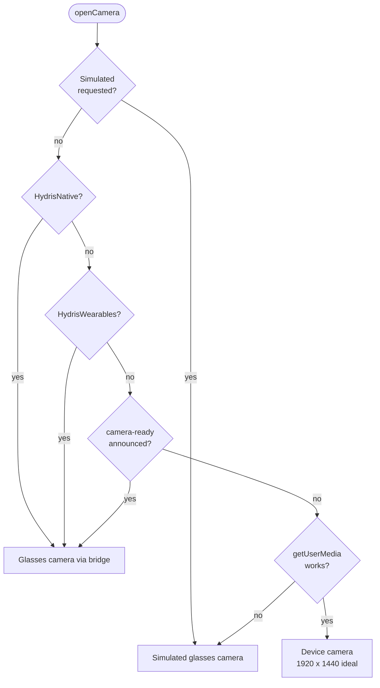

The simulated camera draws the sample A4 audit sheet moving through too close, too far, tilted and finally square, so every guidance state is exercised without hardware. Its stills are 2016 x 1512.

> [!WARNING]
> Bridge hardening is Planned: the WebView grants every page permission request (`onPermissionRequest` grants all resources) and does not restrict navigation away from `HYDRIS_URL`. The JavaScript interface would be exposed to any page loaded. Restrict navigation to the Hydris origin before distributing the bridge outside the team.

## Glasses web viewport

### HUD and phone modes

`useViewportLayout` in `apps/web/src/glasses/hud.tsx` picks the layout.

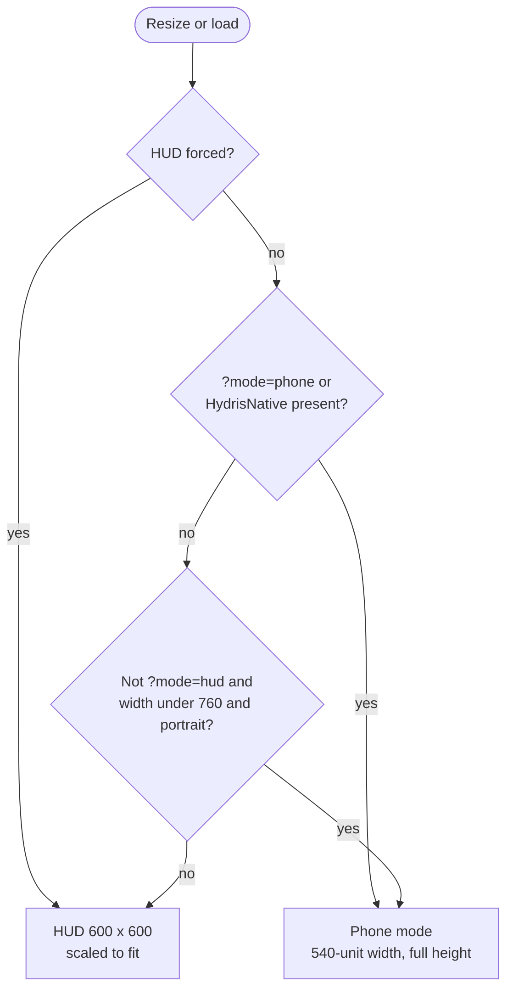

Table: HUD versus phone mode

| Aspect | HUD mode | Phone mode |
|---|---|---|
| Canvas | 600 x 600, scaled to the window | 540 design units wide, full device height |
| Target | Display glasses, simulator | Bridge app, portrait phones |
| Navigation | Directional keys, swipes, `hydris:input`; hint bar for the configured hand | Bottom tab bar: Home or Back, Scan, Hey Hydris, Alerts |
| Design rules | Additive display: black is transparent, light strokes, type at 20 px or more, a lime focus ring, one primary action per screen | Same components, safe-area insets |

### Phases and screens

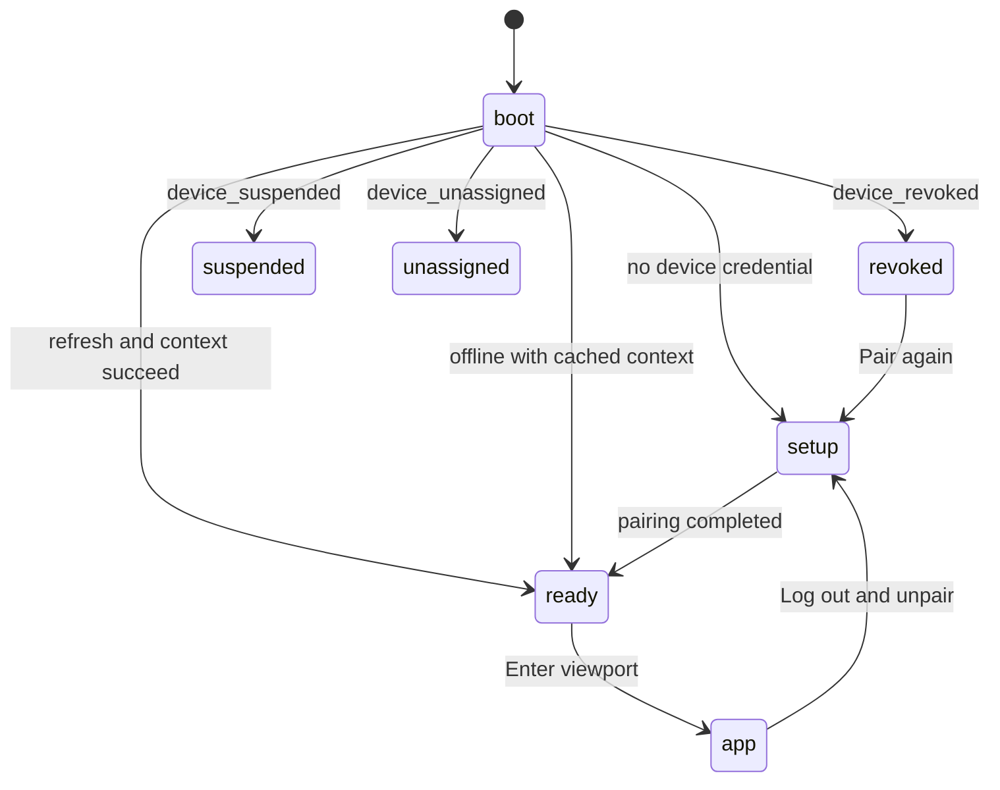

Screens: home, alerts and alert detail, inspections and the inspection runner, tasks and task detail, asset context, assist, status, notifications, Hydris AI, plant map, audit scan, measurements, assets, SOP library and reader. Each screen is gated by the organization's UI profile (`screenPermitted`), so administrators decide in the console what each role sees on the glasses.

### Voice assistant on the viewport

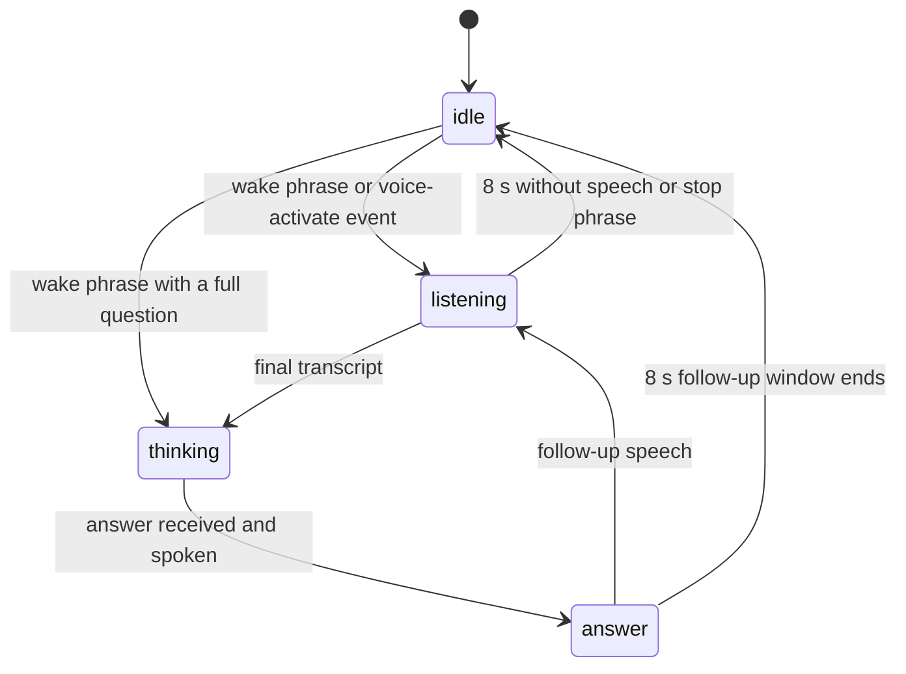

The engine order is the bridge (`meta-glasses`), then the browser Web Speech API, then none (typed questions). Offline, demo and cached answers come from `answerFromContext` using the same rules as the API.

### Audit scan on the viewport

`AuditScan.tsx` follows the same steps as the native app: guided capture (`apps/web/src/lib/GuidedCapture.tsx`, 900 ms ready time, stability threshold 0.012), A4 warp to 1654 px wide, two OCR passes in the browser, review of up to six pages and upload. The capture button shoots while framing and starts a scan from the menu or review.

## Pairing with the Hydris account

Glasses become Hydris devices through an RFC 8628-style device authorization flow (`apps/api/src/modules/devices.ts`). Two variants exist.

### Code and QR (viewport and bridge)

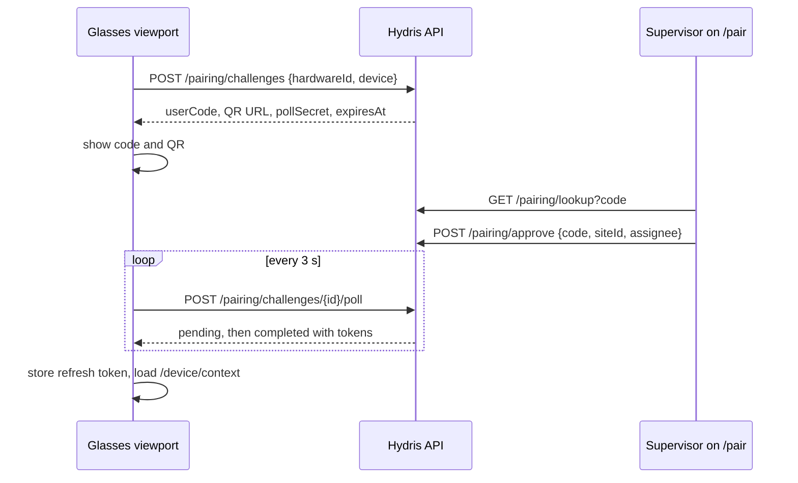

The viewport's hardware ID is `hg-` plus a random UUID kept in local storage; the refresh token is stored in local storage too (`link.ts`), which the code marks as the integration boundary for a hardware-backed store.

### Self-approval (native app)

The native app creates the challenge and approves it as the signed-in user in one step, assigning the glasses to that user and the first site the user can see. Its hardware ID is `rbm-` plus a SHA-256 digest of the DAT device identifier. Details are in the Mobile App Specification (HFG-MOB).

Table: Pairing rules and constants

| Rule | Value |
|---|---|
| Code length and alphabet | 8 characters from `23456789ABCDEFGHJKMNPQRSTVWXYZ` |
| Challenge lifetime | 300 s |
| Poll interval | 3 s; faster polls return `slow_down` |
| Statuses | pending, approved, completed, denied, expired, cancelled |
| Approver permission | `device.pair`; pairing to another person needs `device.manage` |
| Cross-organization | `device_owned_elsewhere` until revoked in the other organization |
| A new challenge for the same hardware | Cancels older pending or approved ones |
| Device states seen by the viewport | active, suspended, revoked, unassigned |

## Setup guide

### Developer setup

1. Create an organization and app in the Wearables Developer Center (confirm country eligibility).
2. Install the Meta AI app on an Android 12 or later phone, sign in, pair the glasses and update the firmware.
3. In the Meta AI app, open Settings, App Info, tap the version five times and turn on Developer Mode.
4. Configure the GitHub Packages Maven repository for `com.meta.wearable` with a token that has `read:packages`.
5. Set `sdk.dir` and `hydris_url` in `local.properties`; leave the DAT placeholders at `0` for Developer Mode.
6. Build and install: `./gradlew assembleDebug`, then `adb install`.
7. Enable the experimental Speech, Inputs and Voice Invocations capabilities for the app in the Developer Center.

### Operator setup (native app)

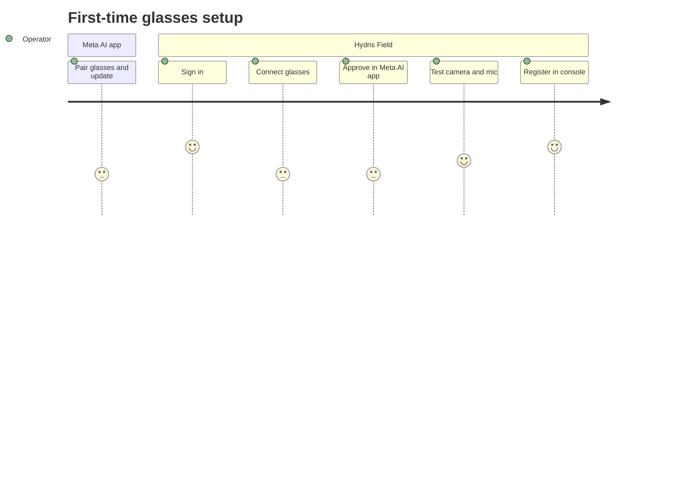

1. Open Hydris Field, sign in and allow Bluetooth and notifications.
2. Glasses tab, step 1: Connect glasses, approve Hydris in the Meta AI app, return.
3. Step 2: Test camera and Test microphone, approving each in the Meta AI app the first time.
4. Step 3: Register glasses. The glasses now appear in the console under Field glasses.
5. Scan tab: Scan with glasses camera, or press the capture button.

## Troubleshooting

Table: Troubleshooting

| Symptom | Likely cause | Fix |
|---|---|---|
| "Install the Meta AI app and pair your glasses in it first" | Meta AI app missing | Install it, sign in, pair the glasses |
| Meta link stays "unavailable" | DAT not initialized (Bluetooth permission denied) | Allow Nearby devices for Hydris in Android settings, reopen the app |
| Connect does nothing or returns unregistered | Developer Mode off, or firmware below DAT requirements | Enable Developer Mode, update firmware in the Meta AI app |
| "Camera permission denied in Meta AI" | Prompt declined | Run Test camera again and approve, or change it in Meta AI app connections |
| "No glasses session" | Glasses off, out of range or connected elsewhere | Wake the glasses, keep them near the phone, retry |
| Preview is black or garbled | Stride inference wrong on this firmware | Report the device and firmware; use the phone camera meanwhile |
| Capture button ignored | Inputs not enabled for the app, or not on the scan screen | Enable Inputs in the Developer Center; open Scan |
| Hey Hydris uses the phone microphone | Glasses not registered or speech failed | Check step 1 and the microphone permission |
| Answers play on the phone speaker | Glasses not the Bluetooth audio output | Reconnect audio in Android Bluetooth settings |
| "Your account has no site to assign the glasses to" | User has no site access | Ask an admin for site access |
| `device_owned_elsewhere` | Glasses registered in another organization | Revoke them there first |
| Viewport shows "Device revoked" | Admin revoked the device | Pair again |

## Limitations and known gaps

- Not yet run on physical glasses; preview stride, capture press decomposition and speech restart are unverified.
- The DAT camera stream is not stopped when the preview ends (battery and capture LED impact).
- Preview frames reach the phone over the wireless link, so preview resolution and frame rate are far below on-glasses recording; detection runs on about 200 px frames and the photo is full resolution.
- The native app assigns registered glasses to the first available site.
- Voice Invocations are handled only by the bridge.
- `deviceName()` in the bridge is a constant.
- The bridge WebView needs navigation and permission hardening.
- Hardware gestures (Neural Band, temple touchpad) are not delivered to the web runtime; `input.ts` keeps a placeholder.
- The Mock Device Kit does not support display glasses (Meta FAQ), and Hydris has no automated DAT tests yet.
- Public publishing of DAT apps is not open yet (Meta FAQ); pilots rely on Developer Mode and release channels.
- Full Developer Center access is limited to countries where Meta AI glasses are supported.

## Glasses state model and console view

### GlassesState fields

`GlassesManager.state` is the single source of truth the native UI reads. Every field is written by DAT callbacks or by Hydris's own calls, never by the screens.

Table: GlassesState fields (`glasses/GlassesManager.kt`)

| Field | Type | Written by | Shown as |
|---|---|---|---|
| `initialized` | Boolean | `initialize()` | Gates the Connect button (initializes on demand) |
| `registration` | Text | `registrationState` collector | "Meta link: ..." on the status card |
| `registered` | Boolean | `registrationState` is `REGISTERED` | Step 1 done, Home tile text, Scan menu subtitle |
| `devices` | List of IDs | `Wearables.devices` | Status dot colour; input to the hardware ID |
| `deviceName` | Text | `devicesMetadata` (fallback "Ray-Ban Meta") | Card title, scan chip, registration name |
| `session` | Text | Session state collector | "session: ..." on the status card |
| `cameraStreaming` | Boolean | Camera stream state after start | "camera live" chip, step 2 done |
| `speech` | Text | Speech state collector | "mic listening" chip, step 2 done |
| `lastError` | Text | `fail()` | Error note on the Glasses screen |
| `log` | List, latest 30 | `log()` and `fail()` | Connection log card (latest 8) |

Separate flows carry the data path: `frame` (latest preview bitmap), `captureButton` (short presses) and `speech` (transcripts with the final flag). The shared flows have small extra buffers (4 presses, 16 transcripts) so a slow collector drops nothing in normal use.

### What the console sees

Once registered, the glasses are an ordinary Hydris device record. The console's Field glasses page lists them with status, assignment, site, last seen time and app version; supervisors can assign, suspend or revoke them. Scans uploaded with the device token are attributed to the device. Domain events `device.paired` and `device.updated` are published on the realtime bus with the `device.read` permission, so open consoles update live.

Table: Device records created by each runtime

| Runtime | Kind | Model | Hardware ID | App version reported |
|---|---|---|---|---|
| Native app | hardware | "Ray-Ban Meta" | `rbm-` plus SHA-256 prefix | `android-1.0.0` |
| Bridge viewport | hardware | "Web viewport" | `hg-` plus random UUID | `0.2.0` |
| Simulator viewport | simulator | "Hydris browser simulator" | `hg-` plus random UUID | `0.2.0` |

> [!NOTE]
> The same physical glasses paired once through the native app and once through the bridge produce two device records, because the hardware IDs are derived differently. Pilots should use one runtime per pair of glasses. Unifying the ID is Planned.

## Data flows and network use

Table: What crosses which link

| Data | Glasses to phone | Phone to Hydris | Notes |
|---|---|---|---|
| Preview frames | Raw YUV over the Meta link | Never | Luma only, processed in memory |
| Page photo | Bitmap or HEIC | JPEG under 850 KB per page, only on "Send" | Two OCR readings attached |
| Speech | Transcripts from DAT | Question text only | Audio is not sent to Hydris |
| Spoken answers | Phone TTS over Bluetooth audio | Answer text received from `/assistant/ask` | |
| Capture button | Input events | Never | |
| Device identifier | DAT device ID | SHA-256 derived hardware ID | Native app only |

Table: Timing targets for the first hardware run (targets, not measured)

| Path | Target |
|---|---|
| First preview frame after opening the glasses scan | Under 3 s with an existing session |
| Preview rate reaching detection | 8 to 10 frames per second |
| Photo returned after capture | Under 4 s |
| Wake phrase to listening card | Under 1 s after the transcript arrives |
| Speech restart gap after silence | Under 1 s |

Results will be recorded in the QA test plan (HFG-QA).

## Hardware acceptance tests

The first hardware run must answer the open questions in this document. Failures become issues against `GlassesManager.kt` or the bridge.

Table: Hardware test checklist

| ID | Test | Expected result |
|---|---|---|
| GLS-T01 | Connect glasses with the Meta AI app installed and Developer Mode on | Meta AI app opens, approval returns to Hydris, Meta link "registered" |
| GLS-T02 | Connect with Developer Mode off | Clear error from DAT shown, no crash |
| GLS-T03 | Test camera, first time | Meta AI permission prompt, then "Glasses camera is streaming" |
| GLS-T04 | Guided scan of an A4 sheet on a dark desk | Preview correct (not sheared), guidance changes, auto-capture within 10 s of a steady pose |
| GLS-T05 | Leave the scan screen | Preview stops; record whether the capture LED and stream stay on |
| GLS-T06 | Capture photo in different head poses | Bitmap upright after EXIF rotation |
| GLS-T07 | Short press of the capture button on the Scan menu | Glasses scan starts |
| GLS-T08 | Long press of the capture button | Ignored by Hydris; record what DAT reports |
| GLS-T09 | Hey Hydris through the glasses microphone for 10 minutes | Listening resumes after each silence; no transcripts of Hydris's own answers |
| GLS-T10 | Answer playback | Speech heard on the open-ear speakers |
| GLS-T11 | Register glasses | Device appears in the console with the right name and site |
| GLS-T12 | Revoke the device in the console, then upload a glasses scan | Upload fails with a clear message; Unregister clears local tokens |
| GLS-T13 | Turn the glasses off mid-session | Session stops, state resets, next scan recreates the session |
| GLS-T14 | Bridge: tests T03 to T10 inside the WebView | Same results through the JavaScript bridge |
| GLS-T15 | Battery over a simulated four-hour shift with periodic scans and Hey Hydris on | Recorded for phone and glasses |

## Frequently asked questions

**Can an operator use Hydris without the Meta AI app?** Yes, without glasses. Every glasses feature has a phone fallback: the phone camera, microphone and speaker. With Ray-Ban Meta or Oakley Meta glasses, the Meta AI app is mandatory.

**Why does Hydris need its own pairing when the glasses are already paired in the Meta AI app?** The Meta AI app pairs the glasses to the phone. Hydris pairing makes the glasses a managed device in the customer's organization: assigned to a person and a site, visible to supervisors, revocable, and credited for the scans it captures.

**Why not run Hydris as a Web App on Meta Ray-Ban Display?** Meta's Web Apps cannot use the camera or capture microphone audio, so audit scans and Hey Hydris on the glasses microphone need a phone app with DAT. A Web App could still show the HUD, which is a Planned option.

**Does Hydris record video?** No. It uses preview frames in memory for framing and takes single photos of documents.

**Which runtime should a pilot use?** The native Hydris Field app. The bridge exists for the web viewport and for development comparison; it is not planned for general distribution.

**Can one phone serve several pairs of glasses?** DAT selects a device with `AutoDeviceSelector`. Hydris assumes one pair per phone and uses the first device it sees.

## Privacy

> [!IMPORTANT]
> Glasses cameras raise bystander concerns in plants. Hydris keeps capture deliberate, local and visible.

- **Deliberate capture.** The glasses camera runs only on the Scan screen or the camera test. Photos are taken by auto-capture after the page is aligned, by "Capture now" or by the capture button. There is no background recording and no video upload.
- **Capture LED.** Meta glasses show a capture LED when the camera is in use; Hydris cannot and does not try to control it. Whether the LED is lit during DAT preview streaming is to be confirmed on hardware.
- **On-device processing.** Page detection and both OCR passes run on the phone. Images leave the phone only when the operator taps "Send for verification".
- **Minimal identifiers.** The raw DAT device identifier is hashed before it reaches Hydris.
- **Audio.** Glasses speech is recognized through DAT; Hydris receives transcripts, not audio, and sends only the question text to `/assistant/ask`.
- **Bystanders.** Pilot sites should brief staff, mark scan points, and avoid scanning near people; scans target A4 documents and the warp crops to the page.
- **Retention and access.** Scans follow the audit document retention and permissions described in the Security and Privacy document (HFG-SEC).

## Roadmap

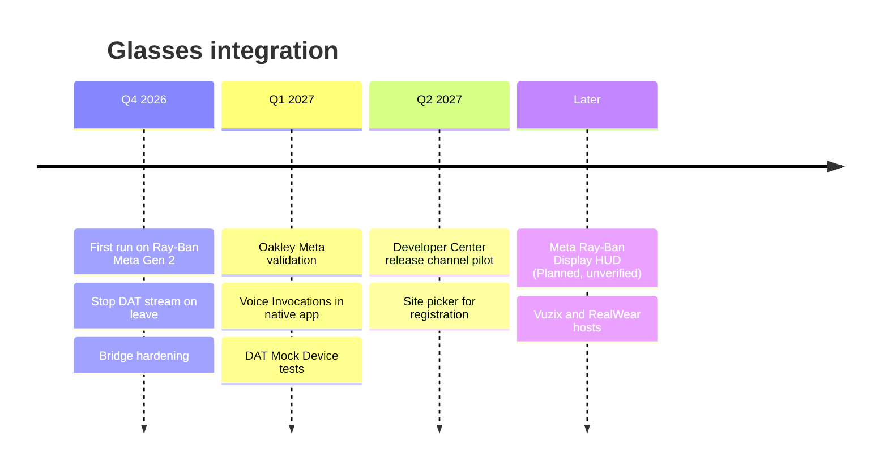

Table: Planned display work

| Item | Status | Basis |
|---|---|---|
| Use the display of Meta Ray-Ban Display through DAT | Planned, unverified | Meta's documentation index says DAT apps can use "the display on Meta Ray-Ban Display glasses"; the API details are not yet reviewed |
| Run the viewport as a Web App on Meta Ray-Ban Display | Planned, unverified | Meta Web Apps run in a Chromium-based browser on the glasses over HTTPS; they cannot use the camera or capture microphone audio, and receive speech only as dictated text or WebMCP tool calls |
| Native device adapter for display glasses with neural band input | Planned | Listed on the Hydris website roadmap (`apps/web/src/site/content.ts`) |
| Vuzix M400 and RealWear Navigator 520 | Planned | Device records in demo data only |

Audit scans from glasses will always need a phone app with DAT, because Web Apps cannot use the camera.
