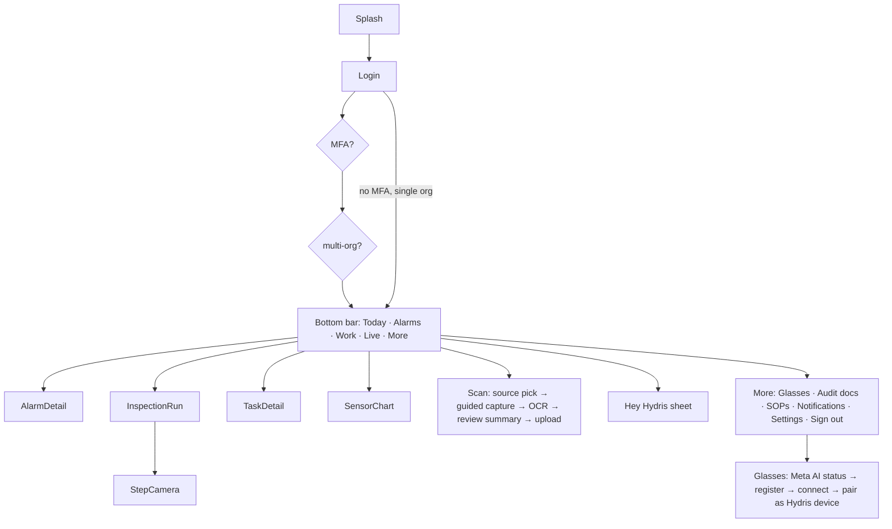

# Mobile App Spec: "Hydris Field" (native Android)

> **Status: In progress / Planned.** The target location is `apps/android`. That directory is **not on `main`** as of `3ac2d1d`. This spec defines the target. Everything server-side that it depends on already exists (see [API_REFERENCE.md](API_REFERENCE.md)). The app replaces the WebView companion `apps/glasses-bridge-android` as the single phone app operators use.

## 1. Goals
- One app for operators: sign in with the same Hydris account, then work the dashboard, alarms, inspections, maintenance, live charts, audit scan and voice.
- Glasses are optional. Every glasses feature has a phone fallback: CameraX for the camera, Android `SpeechRecognizer` and `TextToSpeech` for voice.
- Register the connected glasses as a Hydris **device** using the existing pairing endpoints, so admins see, assign and revoke them in the console.

### Relationship to the Meta AI app (must be read)
The Hydris app **cannot fully replace the Meta AI app**. Under Meta's Wearables Device Access Toolkit (DAT), the glasses are paired to the phone in the Meta AI app ("the Meta AI app must be used to pair your glasses", [Meta FAQ](https://developers.meta.com/wearables/faq)). Developer Mode is enabled in the Meta AI app, and the app and glasses firmware must meet DAT's version dependencies ([DAT setup](https://wearables.developer.meta.com/docs/develop/)). App registration (`Wearables.startRegistration`) and capability permission grants (e.g. Camera) are confirmed in the Meta AI app, which then returns to the calling app. Our bridge already relies on this (`hydrisglasses://` callback in `apps/glasses-bridge-android/app/src/main/AndroidManifest.xml`; README "First run"). The microphone uses Bluetooth HFP and normal Android permissions.
**Product position:** operators only open **Hydris Field** day to day. The Meta AI app stays installed and signed in, running in the background as the connection broker and firmware updater. It is needed again only for first-time setup, permission changes and firmware updates.

## 2. Architecture
| Layer | Choice |
|---|---|
| UI | Jetpack Compose, Material 3, single-activity, Navigation-Compose |
| Pattern | MVVM + unidirectional data flow: `Screen` ← `UiState` (StateFlow) ← `ViewModel` ← `Repository` ← `DataSource`s |
| DI | Hilt |
| Network | OkHttp 4 + Retrofit (or a thin OkHttp client) + **kotlinx.serialization**. SSE with `okhttp-sse` (`Authorization: Bearer`, `Last-Event-ID`) |
| Auth | Access token in memory. Refresh: the web flow uses an httpOnly cookie on path `/api/auth`, so the app keeps an OkHttp `CookieJar` persisted encrypted. **Planned API addition:** an optional body-based refresh for native clients |
| Persistence | **DataStore** (preferences: server URL, org, UI settings). **Room** for the offline cache and outbox. Secrets in **EncryptedSharedPreferences / Android Keystore** (AES-GCM key in Keystore, StrongBox when available) |
| Camera | **CameraX** (Preview + ImageAnalysis for detection + ImageCapture) |
| OCR | **ML Kit Text Recognition v2** (on-device, Latin; Devanagari model for Hindi labels), with two passes (original + enhanced) mapped to `OcrReading{engine:'mlkit:original'|'mlkit:enhanced'}` |
| Doc detection | Port of `apps/web/src/lib/docdetect.ts` (Otsu → largest bright region → quad scoring → homography warp to 1240×1754) to Kotlin, on ImageAnalysis frames (~200 px) |
| Glasses | DAT `com.meta.wearable:mwdat-core/camera/speech/inputs` (1.0.x), `mwdat-mockdevice` in debug |
| Voice | DAT Speech when glasses are connected, otherwise `SpeechRecognizer`. Wake-phrase regex ported from `packages/domain/src/voice.ts` (`WAKE_RE`). `TextToSpeech` output (routes to the glasses speakers over BT) |
| Charts | Vico (Compose charts) |
| Push | FCM (**Planned**, needs a server-side push sender) |
| Min SDK | 29 (Android 10, DAT minimum per Meta docs). Target 36 |

Modules: `:app`, `:core:network`, `:core:data` (Room), `:core:designsystem`, `:feature:auth`, `:feature:dashboard`, `:feature:alarms`, `:feature:inspections`, `:feature:maintenance`, `:feature:telemetry`, `:feature:scan`, `:feature:voice`, `:feature:glasses`, `:feature:settings`.

## 3. Navigation map

## 4. Screens
| Screen | Components | States | APIs |
|---|---|---|---|
| Login | Email, password, server URL (advanced), "Try demo" (demo deployments) | idle, loading, error (invalid / locked), MFA required | `/auth/login`, `/auth/mfa/verify`, `/auth/demo` |
| Org switcher | List of memberships | | `/auth/switch-org` |
| Today (dashboard) | Next inspection card, open alarms by severity, measurement glance tiles with freshness chip, task progress | loading skeleton, empty, offline banner (cached at …), demo badge | `/overview`, `/inspections?assignee=me`, `/maintenance`, `/alarms` |
| Alarms list | Severity chips, state filter, site filter | live-updating via SSE | `/alarms`, SSE `alarm.*` |
| Alarm detail | Values, threshold, recommended action, SOP link, history timeline, actions (Ack, Investigate, Resolve with note, Close) gated by permissions | conflict (already acknowledged) | `/alarms/:id`, `/alarms/:id/:action`, `/alarms/:id/notes` |
| Work (inspections + maintenance) | Segmented tabs, due/overdue | | `/inspections`, `/maintenance` |
| Inspection run | Step pager (check / reading with unit + typical range / choice / text / photo), safety notices first, abnormal indicator, submit | queued-offline counter, synced | `/inspections/:id`, `/:id/start`, `/:id/responses` (clientOpId), `/:id/submit`, `/attachments` |
| Task detail | Checklist toggles, notes, start/hold/complete | | `/maintenance/:id/*` |
| Live | Sensor list by area, sparkline, freshness | | `/sensors`, SSE `sensor.updated` |
| Sensor chart | 1 h / 24 h / 7 d line chart, thresholds overlay, CSV share (if `report.export`) | no_data, stale | `/telemetry/sensors/:id/history` |
| Scan flow | Source picker (Glasses camera / Phone camera / Sample sheet), guided overlay quad (green when stable), auto-capture, page strip (≤6), OCR progress, upload | permission denied, glasses disconnected, OCR failed, too large | `/audit-docs/capabilities`, `POST /audit-docs`, `/enhance` |
| Audit docs | List with status, open PDF | | `/audit-docs`, `/:id/pdf` (review and approval stay in the console: they need a user principal, which the app has, so in-app review is **Planned v2**) |
| Voice sheet | Waveform, transcript, answer card with `facts` and their timestamps, "speak again" | listening, thinking, answered, can't-answer, error | `/assistant/ask` |
| Glasses | Checklist: Meta AI app installed → glasses paired in Meta AI → DAT registration → permissions (Camera; Microphone) → connected device name/battery → "Register as Hydris device" (pairing) → assigned operator, site | each step: ok / action needed / error | DAT APIs + pairing endpoints |
| Settings | Text size, haptics, wake word on/off, language (Planned), diagnostics, sign out (revokes the refresh family) | | `/auth/logout`, `/auth/sessions` |

### Registering glasses as a Hydris device (FR-057)
Two options. Option A is the default:
- **A. Self-approve:** the app (device role) calls `POST /pairing/challenges` with `hardwareId` = a stable per-install ID derived from the DAT device identifier and the app install ID, and `device.kind='hardware'`, `model` = DAT device name. The same signed-in user then immediately calls `POST /pairing/approve {code, siteId}` with their user token, assigning the glasses to themselves (allowed with `device.pair`). The app polls `/pairing/challenges/:id/poll`, then stores the `hgd_` refresh token in Keystore.
- **B. Supervisor approval:** show the code and QR (`verificationUriComplete`) for someone else to approve on `/pair`.
Device tokens then drive the glasses-scoped endpoints (`/device/context`, inspection responses with `deviceId`, audit capture `capturedVia:'glasses'`). User tokens drive everything else.

## 5. Design system tokens
| Token | Hex | Use |
|---|---|---|
| `color.bg` Deep Midnight | `#081116` | App background (dark default; glare-friendly) |
| `color.primary` Signal Blue | `#1954F1` | Primary actions, focus, links |
| `color.primaryPressed` Core Blue | `#1746E4` | Pressed/selected states, charts series 1 |
| `color.critical` Alert Orange | `#FF2800` | Critical/high alarms, destructive actions |
| `color.ok` Active Green | `#00FE21` | Live/healthy/synced, "ok" outcomes (use on dark only; contrast on light fails) |
| `color.ai` Insight Purple | `#8A60F0` | Voice/AI surfaces, vision-engine badges |
| `color.surface` | `#0F1B22` (derived) | Cards |
| `color.onBg` | `#E8EEF2` | Body text (≥ 12:1 on Deep Midnight) |
| Type | Outfit (matches web `--font-outfit`), scale 12/14/16/20/24/32, `UI_TEXT_SCALES` 0.9–1.3 honoured |
| Spacing | 4-pt grid. Touch targets ≥ 56 dp (gloves) |
| Shape | 12 dp cards, 24 dp sheets |
| Motion | ≤ 200 ms, reduced-motion respected |
Severity mapping: critical/high → Alert Orange, medium → amber `#FFB020`, low → Signal Blue. Light theme provided for office use.

## 6. Glasses integration (DAT flows)
1. `Wearables.initialize(context)` at app start. Observe `registrationState`.
2. If not REGISTERED: `Wearables.startRegistration(activity)`, which hands off to the **Meta AI app**. The callback deep link returns (`hydrisfield://` scheme).
3. Permissions: `Wearables.checkPermissionStatus(Permission.CAMERA)`, then `RequestPermissionContract` (confirmed in the Meta AI app). Microphone uses Android `RECORD_AUDIO` + `BLUETOOTH_CONNECT`.
4. Session: `Wearables.createSession(AutoDeviceSelector())`, one session reused for camera + speech + inputs (same as the bridge's `ensureSession`).
5. Camera: `session.addCamera(StreamConfiguration(VideoQuality.MEDIUM, 24))`. Frames feed the detector at ~8 fps. `camera.stream.capturePhoto()` (only on an active stream), EXIF-rotate, then warp.
6. Capture button: `session.addInputs(InputsConfiguration(CAPTURE_BUTTON))`. A short press starts the scan screen or takes the page.
7. Speech: `session.addSpeech()`, then the `transcriptions` flow, then `WAKE_RE`. Restart after silence. Stop when the user disables the wake word or the app is backgrounded beyond 5 min.
8. Voice Invocations: handle `isVoiceInvocationsIntent(intent)` ("Hey Meta, start Hydris") → open the Voice sheet.
9. Speech, Inputs and Voice Invocations must be **enabled for the app in the Wearables Developer Center** (`apps/glasses-bridge-android/README.md`). Treat their availability as runtime-optional.

## 7. Offline and sync
- Room cache: device context, assigned inspections (with step snapshots), tasks, sensors' last values, SOPs read. "Last updated" is shown on every cached screen.
- Outbox table: inspection responses (`clientOpId` UUID), checklist toggles, alarm acknowledgements, notes, and audit uploads (pages kept in app-private storage until accepted). WorkManager replays with exponential backoff when the network returns. The server's `inspection_responses_op_uq` makes replays idempotent.
- Conflicts: a server `409 stale` / invalid transition is surfaced as "updated by someone else". Local edits are never silently dropped.
- Alarms acknowledged offline are shown as "pending ack" and are not counted as acknowledged until the server confirms.

## 8. Security
- Refresh tokens (user cookie and device `hgd_`) are encrypted with a Keystore AES-256-GCM key (EncryptedSharedPreferences / Tink). Access tokens stay in memory only.
- `FLAG_SECURE` on scan review and on screens showing document images. Biometric unlock (optional) before resuming a session older than 12 h.
- TLS only, plus certificate pinning for production hosts (with a backup pin). `android:allowBackup="false"`, `usesCleartextTraffic=false`.
- Captured images are stored in app-private storage and deleted after a successful upload. Never written to the gallery.
- Root/emulator detection is informational, logged to device diagnostics (no hard block for pilots).
- MDM: supports managed configuration (server URL, org hint) via `app_restrictions.xml`.

## 9. Performance budgets
| Metric | Budget |
|---|---|
| Cold start → Today (cached) | < 1.5 s on a mid-range device (Snapdragon 6-class) |
| SSE alarm → visible | < 2 s after server publish |
| Detector frame | < 25 ms per 200 px frame |
| OCR (2 passes, A4) | < 6 s per page with ML Kit |
| Upload of one page | ≤ 900 KB JPEG |
| Memory | < 250 MB peak during a scan |
| Battery | Glasses camera stream only on the scan screen. Speech session ≤ 10 % phone battery per 4-h shift |
| APK size | < 40 MB (ML Kit bundled Latin model) |

## 10. Testing
- Unit tests: ViewModels (Turbine), repositories with MockWebServer, the wake regex, and docdetect parity tests against the web fixtures.
- **MockDeviceKit** (`com.meta.wearable:mwdat-mockdevice`, debug): simulated glasses with camera stream, photo capture, permissions, and an injected capture-button press. Note: the Mock Device Kit "currently doesn't support display glasses" ([FAQ](https://developers.meta.com/wearables/faq)).
- Compose UI tests and screenshot tests (Paparazzi/Roborazzi) in dark and light themes at text scale 1.3.
- End-to-end tests against a demo-mode deployment (`DEMO_MODE=true`).
- The hardware matrix is in [QA_TEST_PLAN.md](QA_TEST_PLAN.md).

## 11. Distribution notes (Play)
- **Phone-only features** (CameraX scan, phone voice, alarms, work) can ship through Google Play internal / closed testing and managed Google Play (private app for enterprise MDM) today.
- **DAT glasses features:** during the developer preview, only select partners could publish DAT integrations to public app stores. Others distributed through Developer Center release channels. DAT 1.0 began rolling out on 30 Sep 2026 and Meta says submissions will open "soon" ([Connect recap](https://developers.meta.com/blog/meta-connect-recap-ai-glasses/), [FAQ](https://developers.meta.com/wearables/faq)). Until our app is approved in the Wearables Developer Center, glasses features work only with **Developer Mode** enabled in the Meta AI app (`APPLICATION_ID=0`/`CLIENT_TOKEN=0`). Production builds need the issued `mwdat_application_id` / `mwdat_client_token`.
- Build flavors: `demo`, `pilot` (DAT dev mode), `prod` (DAT credentials). Glasses features are behind a remote flag.
- The data-safety form declares camera images, audio (processed on device; transcripts sent), and account info.
