# Mobile App Specification

Hydris Field is the native Android app that field operators carry on shift. It signs in with the same Hydris account as the web console, shows the plant dashboard, alarms, work and live sensor charts, scans paper audit records into verified digital documents, answers spoken questions ("Hey Hydris") from live plant data, and connects Ray-Ban Meta glasses through Meta's Wearables Device Access Toolkit (DAT). This specification describes the app as it exists in `apps/android` on `main`, and marks every capability **Built**, **Partial** or **Planned**.

The previous edition of this document (version 1) described a target architecture before any code existed. Version 2 replaces it: the app is now written, and where the code differs from the earlier plan (no Hilt, no Room, no ViewModels yet, a single Gradle module), this document follows the code and records the earlier plan as Planned work.

> [!STATS]
> - 5 | Bottom tabs | Home, Work, Scan, Hydris, Glasses
> - 7 | Navigation routes | `Root.kt` NavHost
> - 2 | OCR passes per page | original and enhanced, on device
> - 31 | Minimum SDK | Android 12

> [!NOTE]
> Source of truth for this document: `apps/android/app/build.gradle.kts`, `AndroidManifest.xml` and the Kotlin sources under `apps/android/app/src/main/java/ai/hydris/field/`. File names are given relative to that package unless stated otherwise. Screenshots in this document were taken from a debug build on an Android emulator against the demo deployment, so the Glasses screen shows the "Meta AI app not installed" state.

## Product summary and goals

### Who the app is for

The primary user is the **field operator** (role `field_operator`): the person walking rounds in an effluent or sewage treatment plant, reading gauges, acknowledging alarms and filling paper logs. Secondary users are **maintenance engineers** (work orders, checklists) and **supervisors** who want the plant status in their pocket. All of them already have a Hydris console account; the app adds no new identity.

### Goals

| ID | Goal | Status | Evidence |
|---|---|---|---|
| MOB-G01 | One account everywhere: sign in with the console credentials and see the same organization, sites and data | Built | `HydrisApi.login`, `Repository` calls the shared `/api` |
| MOB-G02 | Plant status at a glance: open alarms, inspections due, maintenance, live measurements, alarm trend, asset health | Built | `HomeScreen.kt` over `GET /overview` |
| MOB-G03 | Act on alarms from the field: acknowledge, investigate, resolve, close | Built | `AlarmDetailScreen` in `WorkScreen.kt` |
| MOB-G04 | Turn a paper record into a verified digital document in under a minute | Built | `ScanScreen.kt`, `scan/DocDetect.kt`, `scan/OcrEngine.kt` |
| MOB-G05 | Hands-free questions answered from live data, spoken back | Built | `AskScreen.kt`, `voice/VoiceEngine.kt` |
| MOB-G06 | Glasses are optional: every glasses feature has a phone fallback | Built | Phone camera, phone microphone and phone speaker paths in `ScanScreen.kt` and `VoiceEngine.kt` |
| MOB-G07 | Connect Ray-Ban Meta glasses and register them as a Hydris device so scans are attributed | Built (not verified on hardware) | `glasses/GlassesManager.kt`, `Repository.registerGlasses` |
| MOB-G08 | Critical and high alarms reach the operator's phone in real time | Partial (foreground process only) | SSE in `Root.kt`, channel in `HydrisApp.kt` |
| MOB-G09 | Work offline on a round and sync later | Planned | No local cache or outbox yet |

### Non-goals

- **Replacing the Meta AI app.** It is impossible under DAT and is not attempted (see the next chapter).
- **Equipment control.** The app never writes set points or commands to plant equipment. It reads telemetry and records human actions.
- **Administration.** Members, roles, sites, alarm rules, UI profiles and device revocation stay in the web console.
- **Audit document review and approval.** Reviewers confirm each value against the paper in the console. The app captures and sends; it does not approve.
- **iOS in this release.** The web glasses viewport already supports an iOS host through `window.HydrisWearables`, but there is no native iOS app.
- **Rendering a HUD on the glasses.** Ray-Ban Meta and Oakley Meta glasses have no display. On them the phone is the screen and the glasses are a camera, microphone, speaker and button.

### Success measures (targets, not measured results)

| Measure | Target | How it will be measured |
|---|---|---|
| Time from opening Scan to "Sent" for a one-page A4 record | Under 60 s on a mid-range phone | Pilot telemetry (Planned event logging) and stopwatch tests in QA |
| Share of scans that auto-capture without "Capture now" | Above 70 % | Planned client event `scan.autocapture` |
| Critical alarm to phone notification | Under 5 s while the app process is alive | QA with the alarm simulator |
| Spoken answer latency after the question ends | Under 3 s on 4G | QA script with fixed questions |
| Crash-free sessions in pilot | Above 99.5 % | Play Console vitals (Planned) |

## Relationship to the Meta AI app

### What Meta requires

Ray-Ban Meta glasses are paired to a phone in Meta's **Meta AI** app (Android package `com.facebook.stella`). Meta's DAT FAQ states that "the Meta AI app must be used to pair your glasses", including for apps that process data elsewhere. Developer Mode, which lets an unpublished app connect to the glasses, is also switched on inside the Meta AI app. Meta's setup guide describes the toggle as hidden: Settings, App Info, then tap the app version number five times. Glasses firmware is updated through the Meta AI app, and DAT publishes a version dependency table that the Meta AI app and firmware must satisfy.

When Hydris Field calls `Wearables.startRegistration(activity)`, the Meta AI app opens so the wearer can approve Hydris, then returns to Hydris Field. The same happens when Hydris asks for a glasses capability permission (camera or microphone) through `Wearables.RequestPermissionContract()`.

### Product position

> [!DECISION]
> Hydris Field does not replace the Meta AI app. The Meta AI app stays installed and signed in on every operator phone that uses glasses. It pairs the glasses, approves Hydris as a connected app, grants camera and microphone access and updates firmware. After that one-time setup, operators open only Hydris Field; the Meta AI app works in the background as the connection broker.

The app makes this dependency visible instead of hiding it:

- `GlassesManager.metaAiInstalled()` checks for `com.facebook.stella` through the package manager. The manifest declares a `<queries>` entry for that package so the check works on Android 11 and later.
- If the Meta AI app is missing, "Connect glasses" does not call DAT. It shows: "Install the Meta AI app and pair your glasses in it first - Hydris connects through it." (see the Glasses screen chapter).
- Step 1 on the Glasses screen is titled "Link with the Meta AI app" and tells the user to keep it installed.

Table: Which app owns which responsibility

| Responsibility | Meta AI app | Hydris Field |
|---|---|---|
| Bluetooth pairing of the glasses to the phone | Owns | Never touches |
| Glasses firmware updates | Owns | Shows errors reported by DAT |
| Developer Mode toggle | Owns | Documents the step |
| Approving Hydris as a connected app (registration) | Shows the prompt | Starts it with `startRegistration` |
| Camera and microphone permission for Hydris | Shows the prompt | Requests it with `RequestPermissionContract` |
| Camera stream, photo capture, capture button, speech | Brokers the link | Consumes through DAT sessions |
| Hydris account, plant data, scans, alarms, voice answers | Not involved | Owns |
| Registering the glasses as a Hydris device | Not involved | Owns (pairing endpoints) |

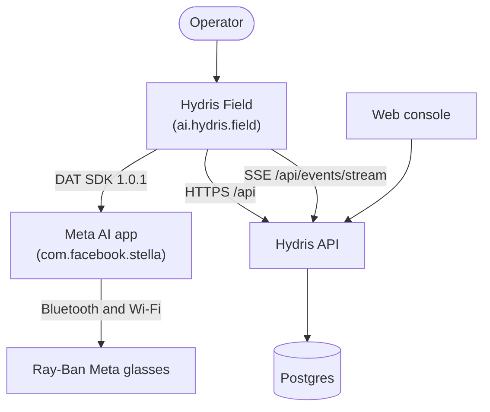

## Architecture

### Technology stack

Table: Technology choices as built (`apps/android/app/build.gradle.kts`, `settings.gradle.kts`)

| Concern | Choice | Version | Status |
|---|---|---|---|
| Language | Kotlin, JVM target 17 | 2.2.21 | Built |
| Build | Android Gradle Plugin, Gradle wrapper | AGP 8.11.1, Gradle 8.14.3 | Built |
| SDK levels | `minSdk` 31 (Android 12), `compileSdk` and `targetSdk` 36 | | Built |
| UI | Jetpack Compose, Material 3, Material icons extended | Compose BOM 2026.05.01 | Built |
| Navigation | `navigation-compose`, single activity | 2.9.5 | Built |
| Concurrency | Kotlin coroutines and Flow | 1.10.2 | Built |
| Serialization | `kotlinx-serialization-json` | 1.9.0 | Built |
| HTTP and SSE | OkHttp (one client, one SSE client without read timeout) | 4.12.0 | Built |
| Secrets | Android Keystore AES-256-GCM over SharedPreferences (`data/SecureStore.kt`) | Platform | Built |
| Preferences | `datastore-preferences` | 1.1.7 | Partial: declared, not used yet |
| Camera | CameraX `camera2`, `lifecycle`, `view` | 1.4.2 | Built |
| OCR | ML Kit Text Recognition (Latin) | 16.0.1 | Built |
| Image metadata | `androidx.exifinterface` | 1.4.2 | Built |
| Glasses | Meta DAT `mwdat-core`, `mwdat-camera`, `mwdat-speech`, `mwdat-inputs`; `mwdat-mockdevice` in debug | 1.0.1 | Built (not hardware-verified) |
| Charts | Hand-drawn Compose `Canvas` (`Sparkline`, `LineChart`, `Bars`, `Donut`) | | Built |
| Dependency injection | None: app-wide singletons on `HydrisApp` | | Built (Hilt is Planned) |
| Local database | None | | Planned (Room) |
| Push | None (SSE only) | | Planned (FCM) |

> [!NOTE]
> Meta's setup guide lists Android 10 as the DAT minimum. Hydris Field sets `minSdk = 31` (Android 12) on purpose: it matches the DAT sample apps and the existing bridge app, and Android 12 introduced the `BLUETOOTH_CONNECT` runtime permission the app is designed around.

### Layers

The app is one Gradle module (`:app`) organized in packages. Screens are composable functions that hold their own UI state and call the `Repository` through a small `rememberLoad` helper. There is no ViewModel layer yet; long-lived state (session, glasses link, voice) lives in singletons created once in `HydrisApp.onCreate`.

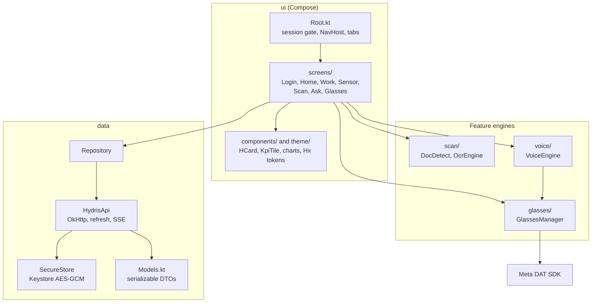

### Package and file inventory

Table: Kotlin sources and their responsibilities

| File | Lines (approx.) | Responsibility |
|---|---|---|
| `MainActivity.kt` | 64 | Single activity. Edge-to-edge dark system bars. Launches Bluetooth and notification permissions on every `onStart`. Bridges DAT permission requests (Meta AI app round trip) and phone camera or microphone permissions into suspend functions |
| `HydrisApp.kt` | 31 | `Application`. Creates `HydrisApi`, `Repository`, `GlassesManager`, `VoiceEngine`; registers the `alarms` notification channel |
| `data/HydrisApi.kt` | 179 | HTTP client, session refresh, encrypted cookie jar, device token channel, SSE event stream |
| `data/Repository.kt` | 71 | Every API call the screens use; scan upload; glasses registration flow |
| `data/Models.kt` | 119 | `@Serializable` DTOs mirroring `apps/api/src/modules` |
| `data/SecureStore.kt` | 53 | Encrypted key/value store |
| `scan/DocDetect.kt` | 226 | A4 page detection, guidance, motion, homography warp (port of `apps/web/src/lib/docdetect.ts`) |
| `scan/OcrEngine.kt` | 115 | Upload sizing, two ML Kit passes, image enhancement |
| `glasses/GlassesManager.kt` | 305 | DAT initialization, registration, session, camera, photo, capture button, speech |
| `voice/VoiceEngine.kt` | 132 | Speech input (glasses or phone) and TextToSpeech output |
| `ui/Root.kt` | 142 | Session restore, login gate, bottom navigation, realtime alarm notifications |
| `ui/theme/Theme.kt` | 58 | `Hx` colour tokens, Material colour scheme, typography |
| `ui/components/Components.kt` | 208 | Cards, chips, KPI tiles, progress bar, charts, time formatting |
| `ui/screens/*.kt` | 1,300 | Seven screens plus `Common.kt` (`rememberLoad`) |

### Core classes

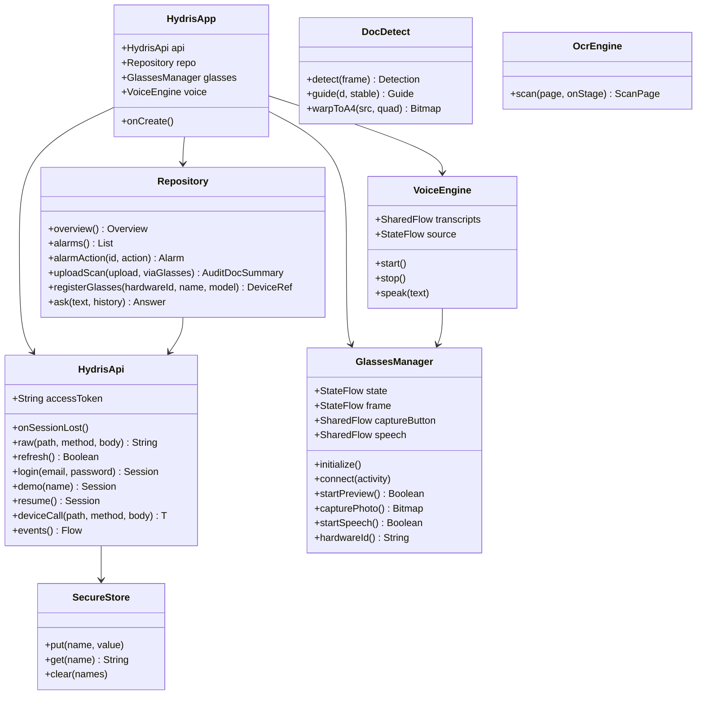

### State management pattern

Screens load data through `rememberLoad` in `ui/screens/Common.kt`. It returns a `Loadable` with three Compose states (`data`, `error`, `nonce`) and runs the loader in a `LaunchedEffect` keyed on the caller's keys and the nonce. When `refreshMs` is set, it loops with `delay(refreshMs)` for as long as the screen is composed, which is how live screens poll. `reload()` increments the nonce to force a reload, for example after an alarm action or a checklist toggle.

Table: Polling intervals per screen (from the `refreshMs` arguments)

| Screen or tab | Loader | Refresh |
|---|---|---|
| Home | `overview()` | 15 s |
| Work, Alarms tab | `alarms()` without closed alarms | 15 s |
| Work, Inspections tab | `inspections()` | On open only |
| Work, Maintenance tab | `tasks()` without completed and cancelled | On open and after each toggle |
| Work, Sensors tab | `sensors()` | 10 s |
| Work, Audit docs tab | `auditDocs()` | 20 s |
| Sensor detail | `history(id, hours)` | 15 s |
| Alarm detail | `alarm(id)` | On open and after each action |
| Scan menu, recent scans | `auditDocs().take(4)` | On open only |

> [!DECISION]
> Polling plus SSE is deliberate for the pilot. It keeps every screen correct after network drops without a local database, at the cost of extra requests while a screen is visible. The Planned offline work (Room cache and outbox) will move these loaders behind ViewModels and repositories that serve cached data first.

## Navigation

### Navigation map

`Root.kt` decides between three top-level states: restoring a session, signed out (Login) and signed in (`Main`). `Main` hosts a `Scaffold` with a Material 3 `NavigationBar` and a `NavHost` whose start destination is `home`. Tab navigation pops back to `home` with saved and restored state, so each tab keeps its scroll position.

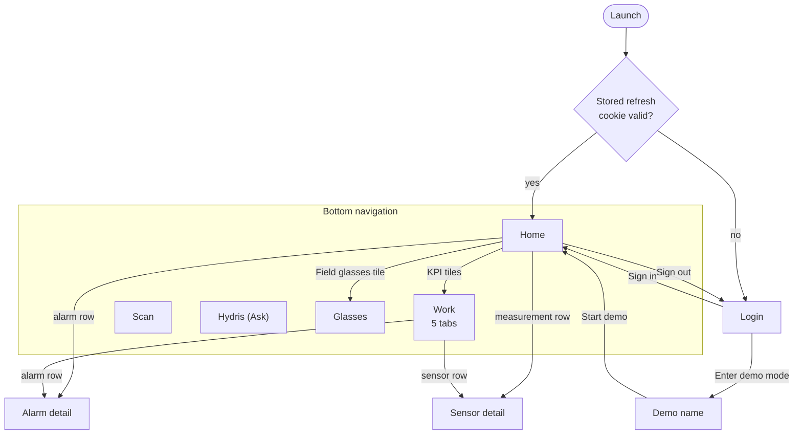

Table: Routes registered in the NavHost

| Route | Screen | Arguments | Entry points |
|---|---|---|---|
| `home` | `HomeScreen` | none | Start destination, Home tab |
| `work` | `WorkScreen` | none | Work tab, Home KPI tiles, Home "All sensors" link |
| `scan` | `ScanScreen` | none | Scan tab |
| `ask` | `AskScreen` | none | Hydris tab |
| `glasses` | `GlassesScreen` | none | Glasses tab, Home "Field glasses" tile |
| `alarm/{id}` | `AlarmDetailScreen` | alarm UUID | Home recent alarms, Work alarms tab |
| `sensor/{id}` | `SensorScreen` | sensor UUID | Home live measurements, Work sensors tab |

> [!WARNING]
> Known gap: the Home "All sensors" link navigates to `work`, which opens on the Alarms tab, not the Sensors tab. The fix is to pass the tab index as a route argument (`work?tab=3`). Planned for the next build.

### Session gate

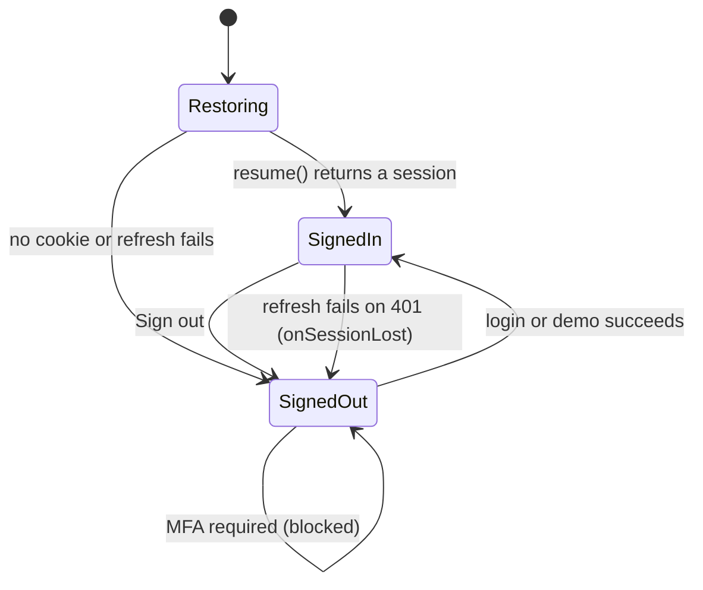

While `Restoring`, the app shows a centred progress indicator on the Deep Midnight background. `HydrisApi.resume()` calls `refresh()` (which sends the stored `hg_refresh` cookie) and then `GET /auth/me`. If either fails, the user lands on Login. `onSessionLost` is installed after restore, so any later 401 that cannot be refreshed returns the user to Login.

## Screen specifications

Each screen below lists its purpose, layout, data, state model, actions and status. Screenshots are from the demo deployment (`hydrisview.vercel.app`).

### Login

**Purpose.** Sign in with the console account, or start a personal demo account.


**Layout.** Hydris mark and "Hydris Field" title, eyebrow "Field glasses · console · one account", "Sign in" headline and a one-line explanation. Email field (email keyboard), password field (masked), primary button "Sign in" (54 dp high, Signal Blue), outlined button "Enter demo mode". The configured server URL (`BuildConfig.HYDRIS_URL`) is printed at the bottom so pilots can see which deployment the build points at.

**Demo mode.** Tapping "Enter demo mode" swaps the form for a single "Your name" field with the explanation "Demo mode creates a personal account with synthetic plant data, your own inspections and tasks." "Start demo" is enabled when the trimmed name has at least two characters and calls `POST /auth/demo {name}`.


Table: Login states

| State | Trigger | UI |
|---|---|---|
| Idle | Screen opens | Buttons enabled when email is not blank and password is not empty |
| Busy | Sign in or Start demo tapped | Button text "Signing in…" or "Starting…", buttons disabled |
| Error | API error | `ErrorNote` with the server message (for example invalid credentials or lockout) |
| MFA required | `Session.mfaRequired = true` | Error text: sign in on the web console first |
| Signed in | Session returned | `Root` switches to `Main` |

> [!IMPORTANT]
> In-app MFA is **Planned**. The API supports `POST /auth/mfa/verify`, and `Session` already carries `mfaRequired` and `mfaToken`, but the app does not yet show a code entry step. Accounts with TOTP enabled cannot sign in on the phone today. This blocks pilots where MFA is mandatory and is the first item in the release checklist.

Also Planned on this screen: organization switching for users with several memberships (`POST /auth/switch-org`), a server URL picker for multi-deployment pilots (today the URL is fixed at build time), and password reset links.

### Home

**Purpose.** The operator's dashboard: what needs attention now on the sites they can see.


**Data.** `GET /overview`, refreshed every 15 s, plus the glasses link state from `GlassesManager.state`.

**Layout, top to bottom.**

1. Header: organization name eyebrow, time-of-day greeting with the first name ("Good morning, Meera."), a "Demo" chip for demo organizations and a sign-out icon.
2. Status line: "N critical alarms need attention." in Alert Orange, or "N open alarms, none critical.", or "All quiet on your sites."
3. Four KPI tiles in two rows: Open alarms (critical and unacknowledged counts, orange when any are critical), Inspections (due, overdue, in review; amber when overdue), Maintenance (open, high or urgent), Field glasses (connected over registered across the organization, with "Ray-Ban Meta linked" when this phone's glasses are registered with DAT).
4. Alarm trend: total for the last 14 days, count in the last 24 h, and a bar chart where the latest day is full Signal Blue.
5. Asset health: donut of asset statuses (operational, degraded, down, maintenance, standby) with a legend.
6. Live measurements: one card per metric with label, asset tag, freshness dot and age, "synthetic" when the source is the simulator, and the value with unit.
7. Recent alarms: severity dot, title, state and age, severity chip; critical alarms get an orange card border.
8. Activity: the last eight audit events with actor and age.

Table: Home interactions

| Element | Action |
|---|---|
| Open alarms, Inspections, Maintenance tiles | Navigate to Work |
| Field glasses tile | Navigate to Glasses |
| Live measurement card | Open Sensor detail |
| Recent alarm card | Open Alarm detail |
| Sign-out icon | Stop voice, `POST /auth/logout`, clear cookies, return to Login |

**States.** Loading (spinner) until the first overview arrives; error note if it fails with no cached value; content otherwise. A failed refresh keeps the last overview on screen and only shows an error when nothing has loaded yet.

### Hydris assistant

**Purpose.** Ask questions about readings, alarms, work or an asset, by typing or by voice, and get answers grounded in live plant data.


**Layout.** Eyebrow "Answers from your live plant data" in Insight Purple, a "Hey Hydris" switch with a status line ("Hey Hydris off", "listening · glasses mic", "listening · phone mic" or "starting…"), the conversation list, a row of suggestion chips ("What is the current pH?", "Any open alarms?", "What are my tasks?", "Dissolved oxygen", "Status of P-101"), a text field with a Send button and a Talk button.

**Answers.** `POST /assistant/ask {text, history}` with the last six turns. The answer bubble shows the text, up to four facts ("7.3 · Outlet pH"), and the engine label ("from live data" for the rules engine `hydris-rules`, otherwise the engine name). If the call fails, the bubble says "Sorry, I couldn't get that answer" with the error message.

**Voice behaviour.** The wake phrase regex is the same as `WAKE_RE` in `packages/domain/src/voice.ts`: "hey", "hi", "hay", "ok", "okay" or "a", followed by one of the common recognitions of "Hydris" ("hydris", "hydras", "hydrus", "hydrous", "high dris", "hi dris", "hydra", "idris"). A stop phrase ("stop", "cancel", "thanks", "thank you", "never mind", "that's all", "bye") ends the follow-up window. Answers are spoken only when Hey Hydris is on.

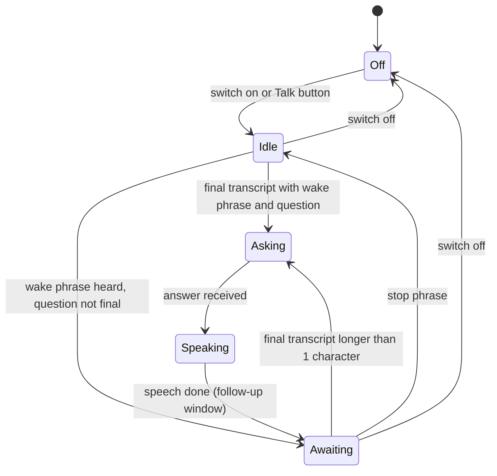

> [!NOTE]
> The native app keeps the follow-up window open until a stop phrase or the switch is turned off. The glasses web viewport (`apps/web/src/glasses/VoiceAssistant.tsx`) closes it after 8 s of silence. Aligning the two (an 8 s timeout on the phone) is Planned.

### Work

**Purpose.** Everything assigned or open, in five tabs: Alarms, Inspections, Maintenance, Sensors and Audit docs (`PrimaryScrollableTabRow`).


Table: Work tabs

| Tab | Data | Row content | Actions | Status |
|---|---|---|---|---|
| Alarms | `GET /alarms`, closed alarms hidden, 15 s refresh | Severity dot, title, state, age, assignee, severity chip; orange border when critical and active | Open Alarm detail | Built |
| Inspections | `GET /inspections` | Title, status chip, assignee, site, overdue marker, progress bar of answered over total steps | None (read-only) | Partial: running an inspection on the phone is Planned |
| Maintenance | `GET /maintenance`, completed and cancelled hidden | Title, priority chip, status, assignee, checks done; expands to description and checklist | Toggle checklist items (`POST /maintenance/{id}/checklist/{itemId}`) | Built; start, hold and complete are Planned |
| Sensors | `GET /sensors`, 10 s refresh | Name, freshness dot, tag, age, open alarm count, value in orange when alarmed | Open Sensor detail | Built |
| Audit docs | `GET /audit-docs`, 20 s refresh | Title, status chip, values, tables, capture route, author, age, review progress and engine agreement | None (review stays in the console) | Built |

Empty states are explicit: "No open alarms.", "No inspections.", "No open maintenance tasks.", "No sensors.", and "No audit documents yet - scan one from the Scan tab."

### Alarm detail

**Purpose.** Understand one alarm and move it through its lifecycle.


**Layout.** Back button; severity chip (filled), state chip and "synthetic" chip for simulator alarms; title and description; a Reading card with the trigger value in the severity colour, unit, limit and peak, asset, sensor tag and age; a Recommended action card; then action buttons for the current state. The first action is a filled button, the second an outlined button.

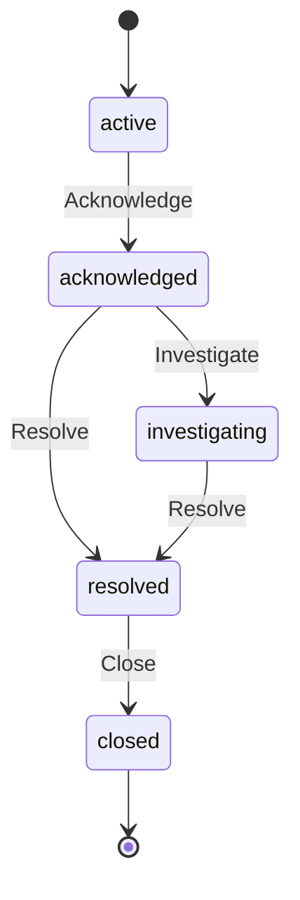

Each button calls `POST /alarms/{id}/{action}` and reloads the alarm. Server rules still apply: if the user lacks the permission for an action, or another user already moved the alarm, the API error message is shown in an `ErrorNote` and the reloaded alarm shows the real state.

Planned on this screen: resolution notes (the repository already accepts a `note`), the alarm history timeline, the SOP link, assignment, and a "pending" marker for actions taken offline.

### Sensor detail

**Purpose.** Trend of one sensor with its typical range.

**Data.** `GET /telemetry/sensors/{id}/history?from=…&points=144` with `from` set to 6, 24 or 168 hours ago (filter chips "6 h", "24 h", "7 d"), refreshed every 15 s.

**Layout.** Tag and measurand label, sensor name, the last value in 44 sp, freshness and the number of readings, the range chips, a 220 dp line chart with a gradient fill, the typical range shaded in green when the API provides `typicalRange`, min, typical and max labels, and a "What this measures" card when the API returns an explanation.

**Status.** Built. Thresholds overlay, CSV export and pinch zoom are Planned.

### Scan

The Scan tab is the app's most complex screen. Its pipeline is described in detail in the "Audit scan pipeline" chapter; this section covers the UI.


**Menu.** Eyebrow "Paper record → verified digital audit", title "Audit scan", explanation, and three source cards:

- **Scan with glasses camera** (Signal Blue border). Subtitle shows the glasses name and "or press the capture button" when DAT registration is complete, otherwise "Connect your glasses first (Glasses tab)".
- **Scan with phone camera**: guided A4 framing with CameraX. Asks for the camera permission in context.
- **Import a photo**: Android photo picker (`PickVisualMedia`, images only). Also the path on devices without a usable camera.

Below the cards, up to four recent scans with their status.

**Guided capture.** A status bar shows the guidance message with a coloured dot (green when ready, grey with no document, orange otherwise) and a source chip ("phone" or "Ray-Ban Meta"). The preview fills the remaining height with an A4 guide rectangle (86 % of the frame height), the detected page outline, corner dots and a green progress bar while the auto-capture timer runs. "Capture now" forces a capture; "Cancel" returns to the menu or to the review.


**Review.** "N page(s) read on this phone", thumbnails of every page with the first pass's mean confidence, and a "Lines read (pass 1)" card with up to eight label and value pairs from the latest page. Buttons: "Send for verification", "Add page" (disabled at six pages) and "Discard".


**Sent.** Eyebrow "Sent · awaiting dual verification", the document title detected by the server, chips for values, tables, engine agreement and items to check, the capture route, and "Scan another document".


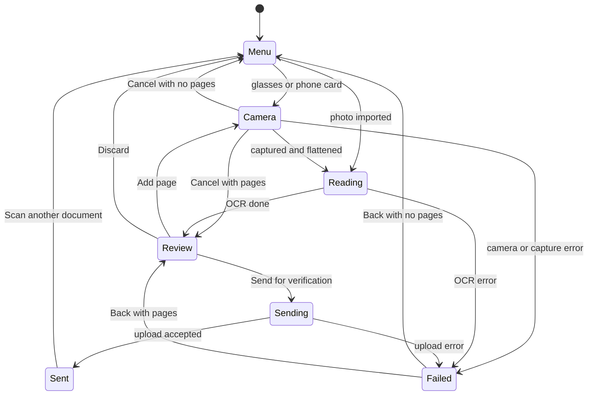

**Capture button.** While the menu or review is showing, a short press of the glasses capture button starts a glasses scan. During guided capture with the glasses source, it takes the photo.

### Glasses

**Purpose.** One place to connect Ray-Ban Meta glasses, test them and register them with Hydris.


**Status card.** Glasses name (or "Waiting for glasses" or "Not connected"), status dot (green when registered and a device is visible, amber when registered with no device, grey otherwise), "Meta link" registration state and "session" state, and three chips: camera live or idle, mic state, and "in Hydris console" or "not registered".

Table: Glasses setup steps

| Step | Done when | Action | Notes |
|---|---|---|---|
| 1 Link with the Meta AI app | DAT `registrationState` is `REGISTERED` | "Connect glasses" initializes DAT if needed and calls `startRegistration`; "Disconnect" calls `startUnregistration` | Fails early with a clear message if the Meta AI app is missing |
| 2 Allow camera and microphone | Camera streaming or speech listening | "Test camera" starts and stops a preview; "Test microphone" starts and stops speech | Each test triggers the Meta AI permission prompt the first time |
| 3 Register in the Hydris console | A device refresh token is stored | "Register glasses" runs the pairing flow; "Unregister" logs the device out and forgets its tokens | Requires the `device.pair` permission on the server |

Below the steps, a card lists what the glasses do in Hydris (audit scan, capture button, Hey Hydris, alarm notifications) and a "Connection log" card shows the latest eight of up to 30 DAT log lines kept in memory.

The DAT flows behind this screen are specified in the Glasses Integration document (HFG-GLS). The registration with Hydris is described under "Data layer and networking" below.

## Data layer and networking

### API client

`HydrisApi` talks to `${BuildConfig.HYDRIS_URL}/api`. `HYDRIS_URL` comes from `hydris_url` in `local.properties` and defaults to `https://hydrisview.vercel.app`. Every request sends `accept: application/json`; JSON bodies use `application/json`; non-GET requests without a body send `{}`.

Table: HTTP client configuration

| Setting | Value | Why |
|---|---|---|
| Connect timeout | 15 s | Fail fast on dead networks |
| Read timeout | 90 s | OCR uploads with server-side vision extraction can take a while |
| SSE read timeout | 0 (none) | The event stream is long-lived; the server sends heartbeats |
| JSON | `ignoreUnknownKeys`, `explicitNulls = false`, `encodeDefaults` | The API can add fields without breaking older app builds |
| Errors | `ApiException(status, code, message)` parsed from `{error:{code,message}}` | Screens show the server's message |

### Session model

The app follows the web session contract exactly, so the server needed no mobile-specific auth:

- A short-lived **access token** returned by `/auth/login`, `/auth/demo` and `/auth/refresh` is kept in memory only (`@Volatile accessToken`).
- A rotating **refresh cookie** (`hg_refresh`, path `/api/auth`) and, for demo accounts, the demo session cookie are stored by an OkHttp `CookieJar` whose backing store is the encrypted `SecureStore` entry `cookies`.
- The cookie jar only sends cookies to the configured host and drops expired cookies on load and on save.

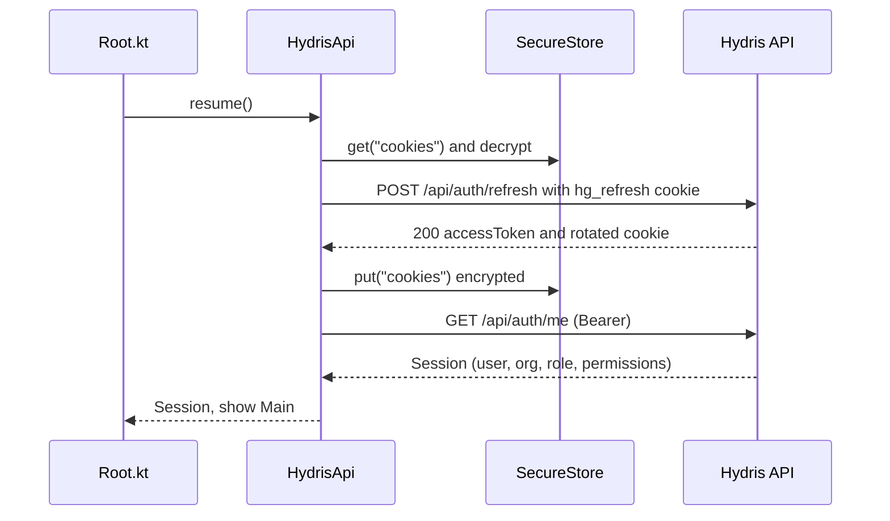

### Refresh on 401 with a mutex

`raw()` retries a 401 once after a successful refresh, except for `/auth/login` and `/auth/demo`. `refresh()` is wrapped in a coroutine `Mutex`, so when several screens hit a 401 at the same moment the refresh calls run one after another and the server sees each rotated cookie in order. This matters because the API revokes the whole refresh family when a cookie is reused outside its grace window.

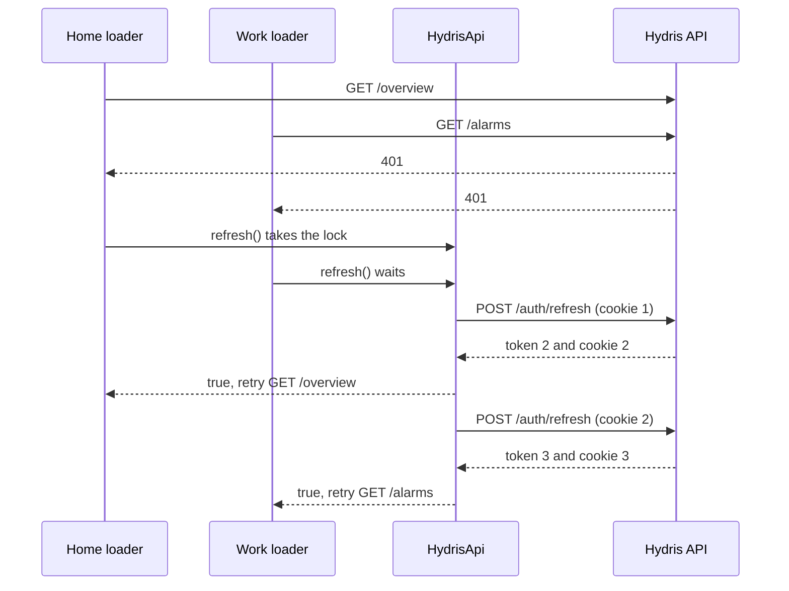

> [!NOTE]
> The second waiter performs its own refresh rather than reusing the first result. That is correct but costs one extra rotation. A Planned improvement is to skip the refresh when the access token changed while waiting for the lock.

If the retry still returns 401, or the refresh fails, `onSessionLost` fires and the user returns to Login with "Session ended. Please sign in again."

### Device credential channel

When the glasses are registered, a second credential set is stored in `SecureStore`: `device.access`, `device.refresh`, `device.name`. `deviceCall()` sends a request with the device access token and, on 401, exchanges the device refresh token at `POST /device/refresh` for a new pair and retries once. Scans captured with the glasses are uploaded through this channel so the console attributes them to the device (`capturedVia` set by the server from the principal), while every other call uses the user's token.

> [!RISK]
> The device refresh in `deviceCall()` is not serialized by a mutex. Two concurrent glasses uploads could both rotate the device token and trigger reuse detection. Today only one upload runs at a time (the Scan screen is modal), so the risk is low; adding a lock is Planned.

### Repository

Table: Repository functions and endpoints

| Function | Method and path | Used by |
|---|---|---|
| `overview()` | `GET /overview` | Home |
| `alarms()` | `GET /alarms` | Work alarms tab |
| `alarm(id)` | `GET /alarms/{id}` | Alarm detail |
| `alarmAction(id, action, note)` | `POST /alarms/{id}/{action}` | Alarm detail |
| `inspections()` | `GET /inspections` | Work inspections tab |
| `tasks()` | `GET /maintenance` | Work maintenance tab |
| `toggleChecklist(task, item, done)` | `POST /maintenance/{id}/checklist/{itemId}` | Work maintenance tab |
| `sensors()` | `GET /sensors` | Work sensors tab |
| `history(id, hours)` | `GET /telemetry/sensors/{id}/history` | Sensor detail |
| `notifications()` | `GET /notifications` | Not used by a screen yet |
| `ask(text, history)` | `POST /assistant/ask` | Hydris assistant |
| `auditDocs()` | `GET /audit-docs` | Work audit docs tab, Scan menu |
| `uploadScan(upload, viaGlasses)` | `POST /audit-docs`, then `POST /audit-docs/{id}/enhance` when `aiStatus` is `pending` | Scan |
| `registerGlasses(hw, name, model)` | `POST /pairing/challenges`, `GET /pairing/lookup`, `POST /pairing/approve`, `POST /pairing/challenges/{id}/poll` | Glasses |
| `unregisterGlasses()` | `POST /device/logout` (device token) | Glasses |

### Registering glasses as a Hydris device

The console already pairs display glasses with an RFC 8628-style device authorization flow: the device asks for a challenge and shows a code, a signed-in user approves the code on `/pair`, and the device polls until it receives tokens. The phone plays both roles in one go: it creates the challenge for the glasses and immediately approves it as the signed-in user.

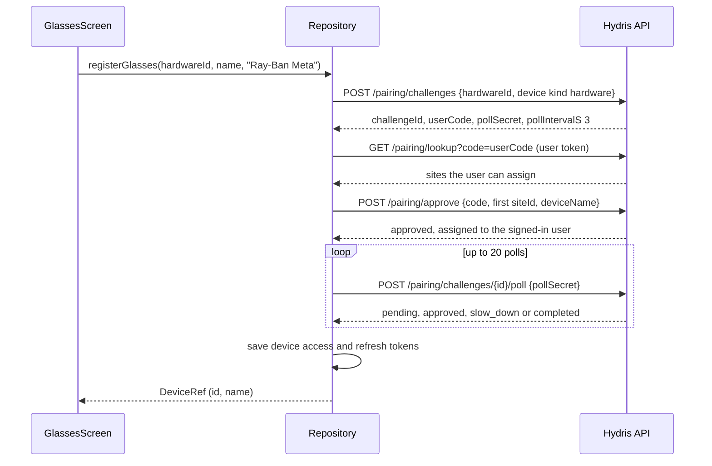

Rules enforced by the server (`apps/api/src/modules/devices.ts`): the approver needs `device.pair`; pairing to another user needs `device.manage`; glasses registered to another organization must be revoked there first (`device_owned_elsewhere`); challenges expire after 300 s; polling faster than every 3 s returns `slow_down`. The hardware ID is `rbm-` followed by the first 16 bytes (hex) of SHA-256 over `hydris-glasses:` plus the DAT device identifier, so the raw Meta identifier never leaves the phone and re-registering the same glasses reuses the console's device record.

> [!WARNING]
> The app assigns the glasses to the **first** site returned by `/pairing/lookup`. Users with access to several sites cannot choose. A site picker is Planned before multi-site pilots.

### Realtime events (SSE)

`HydrisApi.events()` returns a cold `Flow<Pair<event, data>>` backed by a daemon thread. It connects to `GET /api/events/stream` with the bearer token and `accept: text/event-stream`, and sends `last-event-id` after the first event so the server can replay missed events. The parser handles `event:`, `data:` and `id:` lines and emits on each blank line.

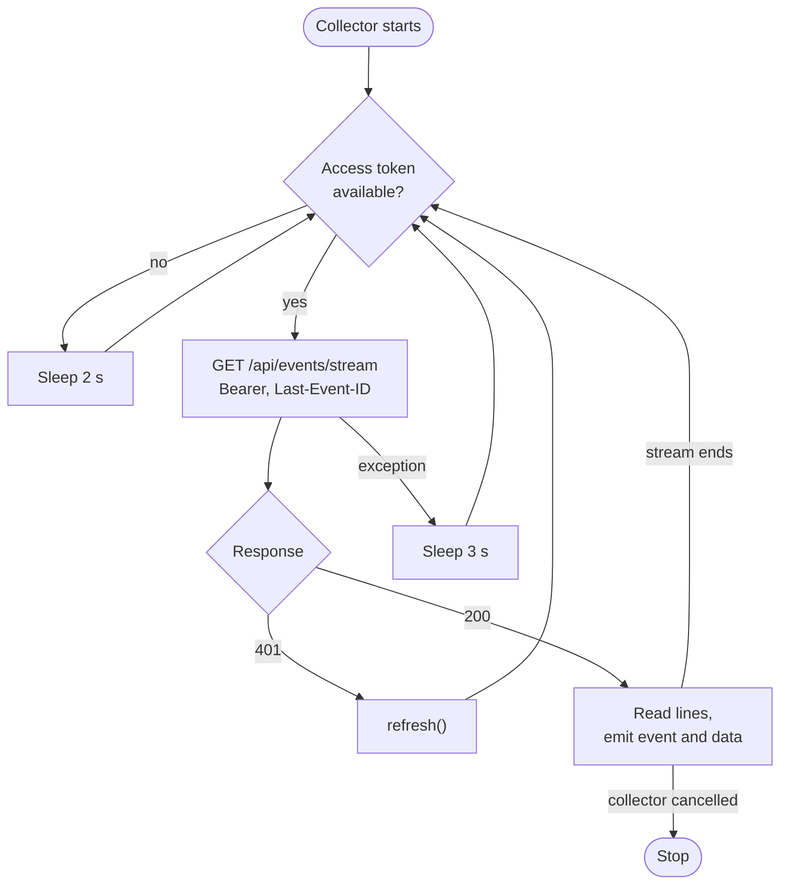

The server (`apps/api/src/modules/realtime.ts`) sends a `ready` event with `retry: 3000`, comment heartbeats every 15 s, and ends long-lived streams cleanly so clients reconnect with `Last-Event-ID`.

## Audit scan pipeline

### End-to-end flow

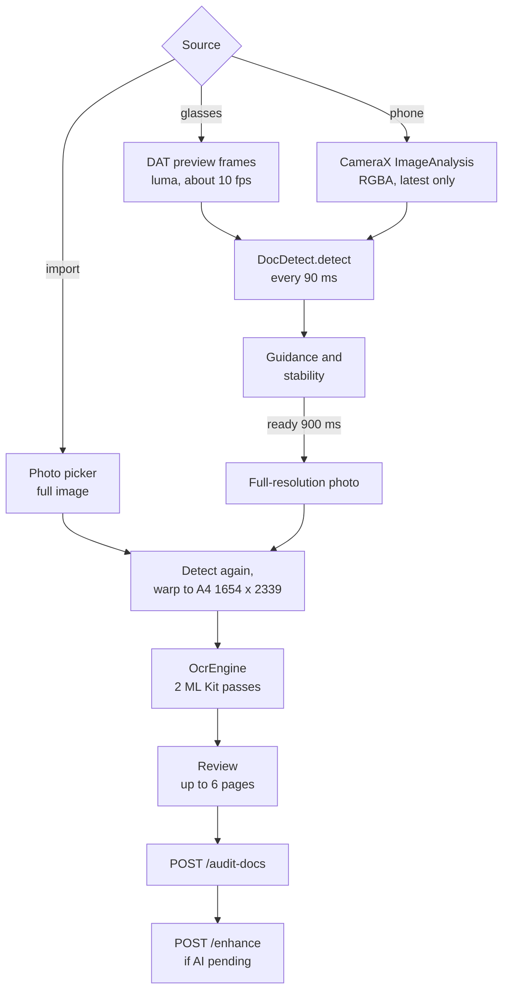

### Page detection (DocDetect)

`scan/DocDetect.kt` is a line-by-line Kotlin port of `apps/web/src/lib/docdetect.ts` with the same thresholds, so the phone, the glasses web viewport and the console guide the wearer identically.

Table: Detection algorithm

| Step | What it does | Constant |
|---|---|---|
| Downscale | Scale the frame to 200 px wide, keep aspect | `DW = 200` |
| Grayscale | Luma with integer weights 299, 587, 114 per 1000 | |
| Threshold | Otsu's threshold on the histogram, floored | at least 90 |
| Region | 4-connected flood fill of bright pixels; keep the largest region | Region must cover at least 6 % of pixels |
| Corners | Extremes of x+y (top-left, bottom-right) and x−y (top-right, bottom-left) | |
| Coverage | Quad area over frame area | |
| Aspect | Longer over shorter mean side | A4 is √2 (1.414) |
| Skew | Largest deviation of a corner angle from 90° | |
| Tilt | Angle of the top edge | |
| Edge contact | Region pixels on the frame border over the perimeter | More than 8 % means cut off |
| Sharpness | Variance of the Laplacian inside the quad's bounding box | |

### Guidance

`DocDetect.guide()` checks conditions in a fixed order and returns the first message that applies. The order matters: there is no point asking the wearer to straighten a page that is half out of frame.

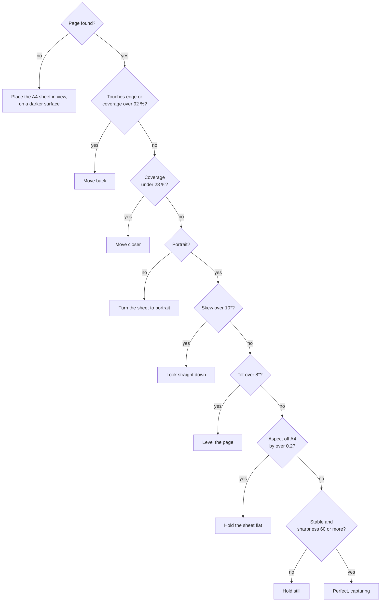

### Stability and auto-capture

`GuidedCapture` runs detection at most every 90 ms. A frame is "still" when every corner moved less than 0.012 of the frame size since the previous detection (`DocDetect.motion`). Four still detections in a row make the page stable. When the guidance is "Ready", a timer starts; after **900 ms** of continuous readiness the app captures automatically. Any non-ready frame resets the timer. The green progress bar shows the timer.

### Capture and flattening

On capture the app takes a full-resolution photo: CameraX `ImageCapture` in `CAPTURE_MODE_MAXIMIZE_QUALITY` (rotated by the reported rotation degrees), or `GlassesManager.capturePhoto()` for the glasses (EXIF orientation applied). Detection runs again on the full photo. If it finds a page with coverage over 20 % that does not touch the edges, that quad is used; otherwise the last quad from the preview is used; if there is none, the photo is kept as is.

`warpToA4` maps the unit square onto the quad with a projective homography (`squareToQuad`), insets the quad by 0.4 % to drop the page border, and samples the source bilinearly into a **1654 x 2339** bitmap: A4 at 200 dpi. Pixels outside the source are white.

> [!NOTE]
> A comment in `apps/web/src/lib/docdetect.ts` still mentions 1240 x 1754 at 150 dpi, but the code in both the web and Android versions defaults to `outW = 1654`. The comment is stale.

### On-device OCR (OcrEngine)

`scan/OcrEngine.kt` reads each page twice with ML Kit Text Recognition on the device. No image leaves the phone until the user taps "Send for verification".

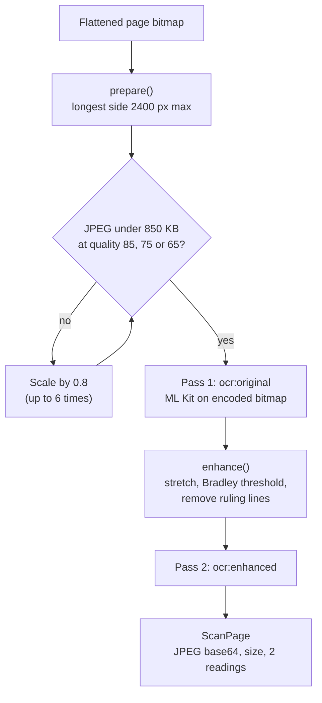

Table: OCR details

| Item | Behaviour |
|---|---|
| Size budget | Longest side at most 2400 px; JPEG at quality 85, then 75, then 65; if still over 850 KB, scale by 0.8 and retry, up to six times, else fail with "This image is too large to upload" |
| Pass 1 | `ocr:original`: the encoded bitmap as captured |
| Pass 2 | `ocr:enhanced`: grayscale, 1 % contrast stretch at both ends, Bradley adaptive threshold (window radius `max(8, min(W,H)/32)`, factor 0.85), then removal of horizontal black runs of at least 20 % of the width and vertical runs of at least 2.8 % of the height, so table borders and underlines do not merge cells |
| Output format | `OcrReading{engine, text, conf, lines[]}` with words; boxes normalized to `[x, y, w, h]` in 0..1; confidences scaled to 0..100 to match the Tesseract-compatible web format in `apps/web/src/lib/ocr.ts` |
| Line order | Sorted by top edge, then left edge |
| Progress | "Preparing image" 5 %, "Reading text (pass 1 of 2)" 15 %, "Reading text (pass 2 of 2)" 55 %, "Done" 100 % |

The two readings are the machine half of Hydris's dual verification: the server compares them field by field (`agreement`) and flags disagreements for the reviewer.

### Label and value pairing on the review card

ML Kit often returns a form's label column and value column as separate lines. `labelValues()` takes every line that contains a colon. If text follows the colon, that is the value. Otherwise it looks for the nearest line to the right (starting beyond 90 % of the label's width) whose vertical centre is within 60 % of the label's height, and uses it as the value. The card shows the first eight pairs. This is display only; the server does its own structuring.

### Upload limits

Table: Upload limits (`apps/api/src/modules/audit-docs.ts` and `OcrEngine.kt`)

| Limit | Server | App |
|---|---|---|
| Pages per document | 6 (`MAX_PAGES`) | "Add page" disabled at 6 |
| Bytes per page image | 900 KB (`MAX_PAGE_BYTES`) | Encodes under 850 KB to leave headroom |
| Request body | 8 MB | 6 pages of up to 850 KB in base64 fit |
| Image types | JPEG or PNG, checked by magic bytes | Always JPEG |
| Source tag | `source` field | `"mobile"` |

After a successful upload, if the server reports `aiStatus = "pending"`, the app calls `POST /audit-docs/{id}/enhance` to start the optional vision extraction. Failures of that call are ignored; the document is already saved.

## Voice

### Speech sources

`voice/VoiceEngine.kt` provides one transcript stream to the assistant regardless of where the audio comes from.

Table: Speech engines

| Source | Recognition | Restart behaviour | Self-hearing protection |
|---|---|---|---|
| Glasses | DAT Speech capability on the glasses microphone; partial and final transcripts | `GlassesManager` restarts the speech capability when it reports `STOPPED` after having started, while listening is wanted | Transcripts are dropped while TTS is speaking |
| Phone | Android `SpeechRecognizer`, free-form model, partial results on, device locale | Restarts 150 ms after results, no match or speech timeout; 1200 ms after other errors | Recognizer is cancelled during TTS and restarted after |
| None | Not available | Not applicable | Not applicable |

### Speech output

Answers are spoken with Android `TextToSpeech` in the device locale, `QUEUE_FLUSH`, with a 30 s safety timeout. When the glasses are the active Bluetooth audio output, Android routes the speech to their open-ear speakers; the app does not route audio itself. `speak()` waits up to 1.5 s for the TTS engine to initialize the first time.

> [!NOTE]
> The phone microphone needs `RECORD_AUDIO`, which the assistant requests when Hey Hydris is turned on. The glasses microphone needs the DAT `MICROPHONE` permission, approved in the Meta AI app.

### Language

Recognition and speech use `Locale.getDefault()`. The assistant's answers come from the server in English. Hindi and other Indian languages for questions and answers are Planned and depend on server-side support in `voice-assistant.ts`.

## Notifications

**Built.** `HydrisApp` creates a notification channel `alarms` ("Plant alarms", importance high, description "Critical and high alarms on your sites"). While the signed-in UI is composed, `Root.kt` collects the SSE stream and, for every `alarm.created` event whose `state` is `active` and whose severity is `critical` or `high`, posts a notification titled "Critical alarm" or "High alarm" with the alarm title, using the Hydris mark as the small icon and auto-cancel on tap.

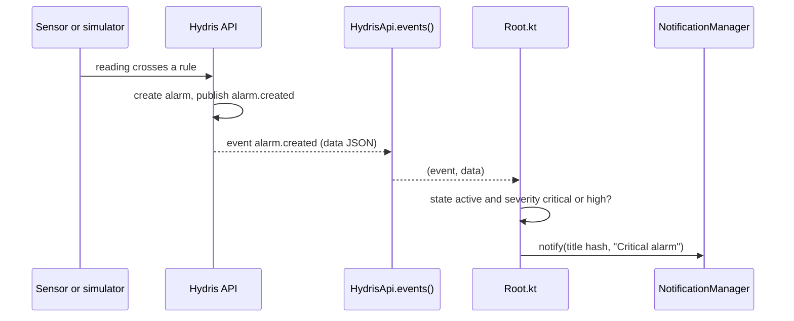

Table: Notification gaps

| Gap | Effect | Plan |
|---|---|---|
| No push service | Notifications arrive only while the app process and signed-in UI are alive | FCM with a server-side sender (Planned) |
| Notification ID is the title's hash | Two alarms with the same title replace each other | Use the alarm ID (Planned) |
| Tap opens the app, not the alarm | Operator must find the alarm | Deep link `alarm/{id}` in the pending intent (Planned) |
| Permission asked on every start | Users who deny it are asked again on each `onStart` | Ask once, explain in Settings (Planned) |
| `GET /notifications` not shown | The in-app inbox is console only | Notifications screen (Planned) |

## Permissions

### Permission matrix

Table: Android and DAT permissions

| Permission | Kind | Declared in | Requested when | Used for | If denied |
|---|---|---|---|---|---|
| `BLUETOOTH` | Normal (install time) | Manifest | Always granted | DAT link | Not applicable |
| `BLUETOOTH_CONNECT` | Runtime (Android 12+) | Manifest | Every `MainActivity.onStart`, with the other two | DAT reaches the glasses through the Meta AI app | DAT is not initialized; glasses features unavailable, phone features work |
| `POST_NOTIFICATIONS` | Runtime (Android 13+) | Manifest | Every `onStart` | Alarm notifications | No notifications |
| `INTERNET` | Normal | Manifest | Always granted | API and SSE | Not applicable |
| `CAMERA` | Runtime | Manifest | Tapping "Scan with phone camera" | CameraX scan | "Camera permission is needed to scan with the phone"; import still works |
| `RECORD_AUDIO` | Runtime | Manifest | Turning Hey Hydris on | Phone microphone | Switch turns back off; typing still works |
| DAT `CAMERA` | Glasses capability | DAT | First glasses preview or photo | Glasses camera | "Camera permission denied in Meta AI" |
| DAT `MICROPHONE` | Glasses capability | DAT | First glasses speech start | Glasses microphone | "Microphone permission denied in Meta AI"; falls back to phone microphone |

The manifest marks `android.hardware.camera` as not required, so the app installs on devices without a camera.

### Glasses permission round trip

`MainActivity` registers `Wearables.RequestPermissionContract()` and exposes `requestGlassesPermission(permission)` as a suspend function guarded by a `Mutex`, so only one Meta AI prompt is open at a time. `GlassesManager.ensurePermission()` first calls `Wearables.checkPermissionStatus()` and only launches the prompt when the permission is not granted. The full sequence is in the Glasses Integration document.

## Design system

### Colour tokens

The `Hx` object in `ui/theme/Theme.kt` holds the brand palette shared with the website, console and glasses HUD. The app is dark only.

Table: Hx colour tokens

| Token | Hex | Use |
|---|---|---|
| `Hx.Midnight` (Deep Midnight) | `#081116` | App and window background, status bar |
| `Hx.Surface` | `#0E1A21` | Cards, navigation bar, text fields |
| `Hx.Surface2` | `#13222B` | Raised surfaces, step numbers, Talk button |
| `Hx.Line` | white at 12 % alpha | Card borders, dividers, chart grid |
| `Hx.Signal` (Signal Blue) | `#1954F1` | Primary buttons, chart lines, progress |
| `Hx.Core` (Core Blue) | `#1746E4` | Primary container |
| `Hx.SignalText` | `#6F93FF` | Blue text and icons on dark, selected tab |
| `Hx.Alert` (Alert Orange) | `#FF2800` | Critical severity, errors |
| `Hx.High` | `#F26414` | High severity, stale data, warnings |
| `Hx.Medium` | `#F5B83D` | Medium severity, delayed data |
| `Hx.Ok` (Active Green) | `#00FE21` | Ready states, done steps (on dark only) |
| `Hx.OkSoft` | `#34D27A` | Live data, success chips, checklist done |
| `Hx.Insight` (Insight Purple) | `#8A60F0` | AI surfaces, synthetic markers, maintenance health |
| `Hx.Text` | `#F2F5F7` | Primary text |
| `Hx.Text2` | `#B7C2CA` | Secondary text |
| `Hx.Muted` | `#7D8B95` | Captions, inactive icons |

Table: Semantic colour mappings

| Mapping | Values |
|---|---|
| `Hx.severity()` | critical: Alert, high: High, medium: Medium, anything else: SignalText |
| `Hx.freshness()` | live: OkSoft, delayed: Medium, stale: High, anything else: Muted |
| Asset health (Home) | operational: OkSoft, degraded: High, down: Alert, maintenance: Insight, standby: Muted |
| Audit doc status | approved: OkSoft, rejected: Alert, verified: SignalText, others: Medium |

### Typography, shape and spacing

Table: Type scale (Material 3 `Typography` overrides)

| Style | Size | Weight | Use |
|---|---|---|---|
| `displaySmall` | 34 sp | SemiBold | "Sign in" |
| `headlineSmall` | 24 sp | SemiBold | Screen titles |
| `titleLarge` | 20 sp | SemiBold | Section titles |
| `titleMedium` | 16 sp | Medium | Card titles |
| `bodyLarge` | 16 sp | Regular | Long text |
| `bodyMedium` | 14 sp | Regular | Body |
| `bodySmall` | 12.5 sp | Regular | Captions |
| `labelSmall` | 11 sp | Medium, 1.4 sp tracking | Uppercase eyebrows |

Cards use a 22 dp corner radius and a 1 dp border; chips are fully rounded; text fields use 16 dp corners; primary buttons are 52 to 54 dp tall. KPI numbers are 34 sp. The app uses the system font; bundling Outfit to match the web is Planned.

### Components

Table: Shared components (`ui/components/Components.kt`)

| Component | Purpose |
|---|---|
| `HCard` | Rounded card with optional accent border and click |
| `Eyebrow` | Uppercase small label |
| `SectionTitle` | Section heading with optional action link |
| `Chip` | Rounded label, tinted or filled |
| `Dot` | Status dot |
| `KpiTile` | Label, large value, sub line, optional icon |
| `ProgressBar` | 6 dp rounded bar |
| `Loading`, `ErrorNote` | Standard loading and error states |
| `Sparkline`, `LineChart`, `Bars`, `Donut` | Canvas charts with no chart library |
| `ago()`, `fmt()`, `label()` | Relative time, number and label formatting |

## Accessibility

Field use means gloves, glare, noise and one free hand. The requirements below are written against that context.

Table: Accessibility requirements

| Requirement | Status | Notes |
|---|---|---|
| Text scales with the system font size | Built | All text uses `sp` |
| Primary actions at least 48 dp tall | Built | Buttons are 52 to 54 dp; tabs use Material defaults |
| Touch targets of 56 dp for gloved use on primary flows | Partial | Main buttons meet it; chips, checklist rows and the sign-out icon do not |
| Content descriptions on actionable icons | Partial | Back, Sign out, Send and Talk have labels; source cards rely on their text |
| Colour is never the only signal | Partial | Severity has text chips; freshness also has text; scan guidance has text; the alarm card border is colour only |
| Contrast on Deep Midnight | Built for text | `Hx.Text` and `Hx.Text2` are high contrast; `Hx.Muted` captions should be checked at 4.5:1 |
| Voice alternative for the main question flow | Built | Hey Hydris and Talk button |
| Screen reader pass (TalkBack) | Planned | Not yet audited |
| Reduced motion | Not applicable | The app uses no decorative animation |
| Light theme for office use | Planned | Dark only today |

## Performance budgets

> [!IMPORTANT]
> The numbers below are **targets** for pilot acceptance. None has been measured yet on reference hardware. QA will record results in the QA test plan (HFG-QA) on a mid-range reference phone.

Table: Performance targets

| Metric | Target | Notes |
|---|---|---|
| Cold start to Home with a valid session | Under 2.0 s | Includes refresh and `/auth/me` |
| Home overview refresh | Under 800 ms on 4G | One request every 15 s |
| SSE alarm to notification | Under 2 s after the server publishes | Foreground process |
| Detection per preview frame | Under 25 ms | 200 px frame on the main thread; moving it off the main thread is Planned |
| Warp to A4 | Under 1.5 s | 3.9 MP output with bilinear sampling in Kotlin |
| OCR, two passes, one A4 page | Under 6 s | ML Kit on device |
| Upload, one page | Under 900 KB | Enforced by `OcrEngine` |
| Peak memory during a six-page scan | Under 300 MB | Pages are kept as full bitmaps for thumbnails; downsampling thumbnails is Planned |
| Glasses camera on | Only while the scan camera is open | See the battery gap below |
| APK size (release, minified) | Under 45 MB | ML Kit bundled model and DAT included |

> [!RISK]
> Battery: `GlassesManager.stopPreview()` stops forwarding frames but does not stop the DAT camera stream; the stream ends only when the session stops. On hardware this may keep the glasses camera and LED on after leaving the scan screen. Stopping the stream on `stopPreview` is a Planned fix that must be verified on real glasses.

## Offline behaviour and sync

### Today

Table: Offline behaviour as built

| Situation | Behaviour |
|---|---|
| Network lost on a loaded screen | The last loaded data stays on screen; the next refresh fails silently because `error` is only shown when nothing has loaded |
| Network lost on a new screen | Loading spinner, then the error message |
| App restarted offline | Session restore fails and the user sees Login (the cookie is kept, so sign-in works once online again after restart) |
| Alarm action offline | Fails with the network error; nothing is queued |
| Checklist toggle offline | Fails silently (`runCatching`), the list reloads and shows the real state |
| Scan offline | Capture and OCR work fully offline; upload fails and the pages stay in the review until the user retries or discards, but are lost if the app process ends |
| Voice offline | Phone recognition may still work (device dependent); the answer fails with an error bubble |

### Planned

- **Room cache** of assigned inspections with step snapshots, tasks, sensor last values and the device context, with "last updated" shown on every cached screen.
- **Outbox** for inspection responses (with `clientOpId`, made idempotent by the server's unique index), checklist toggles, alarm acknowledgements, notes and scans (pages written to app-private storage until accepted).
- **WorkManager** replay with exponential backoff when connectivity returns. Conflicts (`409`, invalid transition) shown as "updated by someone else"; local edits never silently dropped. Offline alarm acknowledgements shown as "pending" until confirmed.
- The glasses web viewport already implements the inspection response queue (`apps/web/src/glasses/link.ts`, `flush()`), which is the reference behaviour for the native outbox.

## Security

Table: Security controls

| Control | Status | Detail |
|---|---|---|
| Access tokens in memory only | Built | `HydrisApi.accessToken`, never persisted |
| Refresh cookies and device tokens encrypted at rest | Built | `SecureStore`: AES-256-GCM, non-exportable Android Keystore key alias `hydris.secure.v1`, random 12-byte IV stored before the ciphertext, 128-bit tag; only ciphertext in SharedPreferences `hydris.secure` |
| Undecryptable values treated as absent | Built | `get()` returns null if decryption fails (for example after a key reset), which forces a new sign-in |
| Backups disabled | Built | `android:allowBackup="false"` |
| HTTPS only | Built by default | No `usesCleartextTraffic`; the default for target SDK 28 and later blocks cleartext |
| Cookies scoped to the Hydris host | Built | Cookie jar ignores other hosts |
| Raw glasses identifier not sent | Built | SHA-256 derived `rbm-` hardware ID |
| Images kept in memory, never written to the gallery | Built | Pages are bitmaps in the Scan screen state |
| Sign out revokes the server session | Built | `POST /auth/logout`, then local cookies cleared |
| `FLAG_SECURE` on scan review | Planned | Prevents screenshots and recents thumbnails of documents |
| Certificate pinning with a backup pin | Planned | For production hosts |
| Release signing key | Planned | Release builds are currently signed with the debug key |
| Biometric re-entry after long inactivity | Planned | |
| Managed configuration (MDM) for server URL | Planned | `app_restrictions.xml` |
| Device integrity signals | Planned | Informational only for pilots |

> [!CAUTION]
> Until the release signing configuration is replaced, any build produced with `assembleRelease` is signed with a debug key and must not be distributed outside the team.

The Hydris-wide threat model, data classification and retention are in the Security and Privacy document (HFG-SEC).

## Build and release

### Project setup

Table: Gradle setup

| Item | Value |
|---|---|
| Root project | `hydris-field`, one module `:app` |
| Namespace and application ID | `ai.hydris.field` |
| Version | `versionName 1.0.0`, `versionCode 1` |
| Repositories | Google (Android and Google groups only), Maven Central, Gradle Plugin Portal; `FAIL_ON_PROJECT_REPOS` |
| Gradle JVM | `-Xmx4g` |
| Java and Kotlin target | 17 |
| Build features | Compose, BuildConfig |
| Packaging | Excludes `META-INF/AL2.0` and `LGPL2.1` |
| Release build | R8 minify on, `proguard-android-optimize.txt` plus `proguard-rules.pro` (kotlinx.serialization keep rules; DAT and ML Kit ship consumer rules) |

Table: Build-time configuration in `local.properties` (not committed)

| Key | Default | Purpose |
|---|---|---|
| `sdk.dir` | none | Android SDK path |
| `hydris_url` | `https://hydrisview.vercel.app` | API base URL compiled into `BuildConfig.HYDRIS_URL` |
| `mwdat_application_id` | `0` | DAT application ID manifest placeholder |
| `mwdat_client_token` | `0` | DAT client token manifest placeholder |

```bash
cd apps/android
./gradlew assembleDebug
adb install app/build/outputs/apk/debug/app-debug.apk
```

> [!NOTE]
> DAT artifacts (`com.meta.wearable:mwdat-*`) are not on Maven Central or Google Maven. The bridge README and Meta's distribution use a GitHub Packages Maven repository that needs a token with `read:packages`. The `settings.gradle.kts` in `apps/android` lists only Google and Maven Central, so the build relies on that repository being configured in the developer's Gradle user settings or on a local Maven cache. Adding the repository declaration explicitly is Planned.

### DAT credentials and Developer Mode

With the placeholders set to `0`, the app runs against glasses only when **Developer Mode** is enabled in the Meta AI app. DAT logs that it read no credentials; that is expected in Developer Mode. For production, the Wearables Developer Center issues an application ID and client token, which go into `local.properties` and the manifest placeholders.

### Release channels

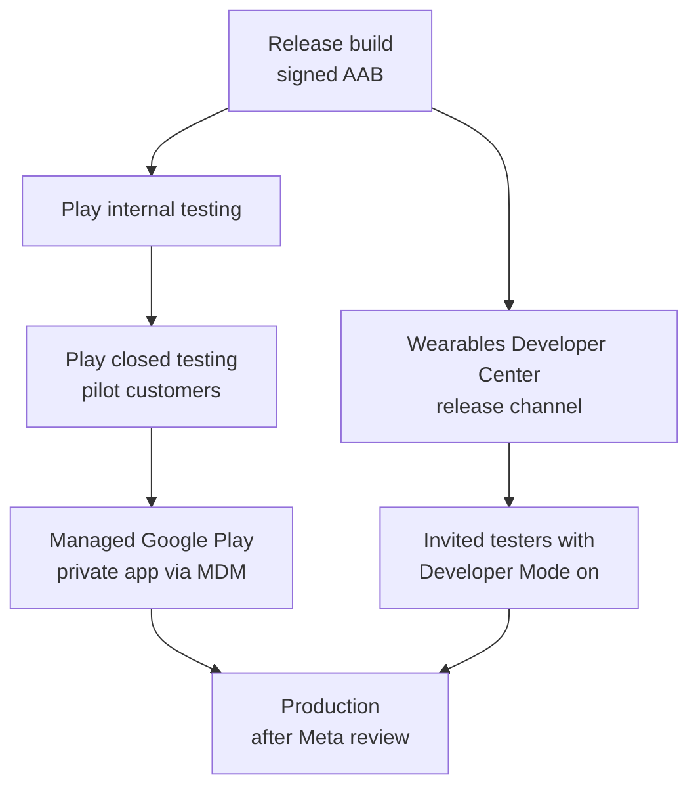

Table: Distribution status

| Channel | What it covers | Status |
|---|---|---|
| Direct APK (sideload) | Team devices and demos | In use |
| Google Play internal and closed testing | Phone features for pilot users | Planned (needs release signing and the Play data safety form) |
| Managed Google Play (private app) | Enterprise rollout through the customer's MDM | Planned |
| Wearables Developer Center release channels | Invite-only testing of the glasses features without publishing review | Planned (needs a Developer Center organization and app) |
| Public listing with DAT features | General availability | Blocked: Meta's FAQ says submissions are not open yet and will open "soon" |

> [!RISK]
> Full Wearables Developer Center access is limited to countries where Meta AI glasses are supported. Eligibility for Hydris's Indian pilots must be confirmed with Meta before planning a production glasses rollout. Phone features are not affected.

The Play data safety declaration must cover: camera images (processed on device, uploaded when the user sends a scan), audio (recognized on device or by the system recognizer; transcripts sent to Hydris), account information, and crash diagnostics once added.

## Testing

### Current state

There are no automated tests in `apps/android` yet (no `src/test` or `src/androidTest`). The scanning algorithm is shared with the web, where the same thresholds are exercised by the web test suite and the simulated glasses camera in `apps/web/src/glasses/camera.ts`. The bridge app README states that the page side was tested end to end with a stand-in bridge, and that DAT calls are type-checked but not yet run on physical glasses.

### Test plan

Table: Planned test layers

| Layer | Scope | Tooling |
|---|---|---|
| Unit | `DocDetect` (guidance, warp corners, parity with web fixtures), `OcrEngine.prepare` sizing, `labelValues`, wake and stop regexes, cookie jar expiry | JUnit, Robolectric for `Bitmap` |
| Networking | Refresh on 401, mutex ordering, session lost, device token refresh, SSE parsing and Last-Event-ID | OkHttp MockWebServer, Turbine |
| UI | Login states, alarm actions per state, scan stages, glasses steps | Compose UI tests |
| Screenshots | Every screen at font scale 1.0 and 1.3 | Roborazzi or Paparazzi |
| Glasses without hardware | Registration, permissions, camera stream, photo, capture button | DAT Mock Device Kit (`mwdat-mockdevice`, already a debug dependency) |
| Hardware | Ray-Ban Meta Gen 2 and Oakley Meta, phone matrix | Manual, per the QA test plan (HFG-QA) |
| End to end | Demo deployment, scripted round | Manual for pilot, automated later |

> [!NOTE]
> Meta's FAQ states that the Mock Device Kit does not support display glasses. That does not affect Hydris Field, which targets camera glasses.

## Feature status and roadmap

### Status summary

Table: Feature status

| Feature | Status |
|---|---|
| Sign in, demo mode, session restore, sign out | Built |
| MFA, org switch, server picker | Planned |
| Home dashboard | Built |
| Alarms list, detail and lifecycle actions | Built |
| Alarm notes, history, SOP links | Planned |
| Inspections list | Built (read-only) |
| Running inspections on the phone | Planned |
| Maintenance list and checklist toggles | Built |
| Maintenance start, hold, complete | Planned |
| Sensors list and history chart | Built |
| Audit scan: phone camera, glasses camera, import, guided capture, two-pass OCR, upload | Built |
| Audit document list | Built |
| Audit review and approval in the app | Planned (console only) |
| Hydris assistant: text, Hey Hydris on phone and glasses, spoken answers | Built |
| Voice Invocations ("Hey Meta, start Hydris") in the native app | Planned (implemented in the bridge app only) |
| Glasses connect, test, register, unregister | Built, not verified on hardware |
| Realtime alarm notifications while open | Built |
| Push notifications when closed | Planned |
| Offline cache and outbox | Planned |
| Automated tests | Planned |
| Release signing and Play distribution | Planned |

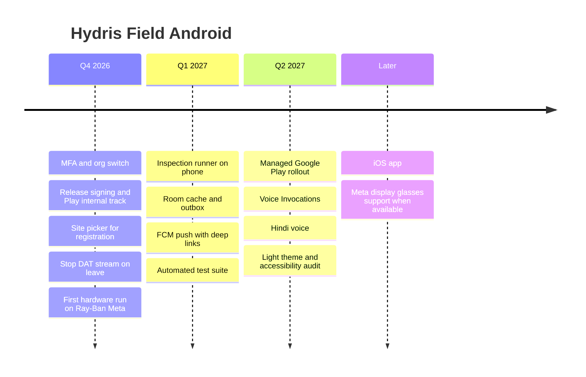

### Open questions

- Should the phone app become the only companion for display glasses as well, replacing `apps/glasses-bridge-android`, or should the WebView bridge remain for Meta Ray-Ban Display web apps? (See the Glasses Integration document.)
- Which customer MDMs must be supported at pilot (Intune, Workspace ONE, Google endpoint management)?
- Is MFA mandatory for field operators at the first pilot site? If so, in-app MFA moves to the top of the plan.
