# Operations and Support Runbook

This runbook is the working manual for everyone who keeps Hydris Field Glasses running for a customer: the Hydris support tiers, customer success, the engineer on call, and the customer's own administrators and plant supervisors. It covers onboarding a new plant, the routine checks that keep data and devices healthy, the procedures for glasses, audit documents and alarms, troubleshooting decision trees for the problems we see most, incident handling, releases, training and the operational KPIs.

Every procedure is grounded in the current code. Where a step depends on behaviour in the API, the console, the glasses web app or the Android app, the file is named so that support staff can confirm it and engineers can keep this document honest. Each capability carries a status:

- **Built**: present in the code on `main` and usable today.
- **Partial**: works, with a known gap that the procedure works around.
- **Planned**: not in the code yet. The procedure describes the intended practice or a manual stopgap.

All targets in this document (response times, SLAs, KPIs) are **targets**, not measured results. No production KPI data exists yet; the numbers are proposals for the first pilot and will be revised from pilot data.

> [!IMPORTANT]
> Hydris is read-only to the plant. No endpoint writes to a PLC, SCADA or DCS. Acknowledging an alarm in Hydris records that a person has seen it; it never changes the physical process (`packages/domain/src/alarms.ts`). Every support conversation about an alarm must keep this distinction clear: the plant's own control system and procedures remain the authority.

## Operating model

### Platform surfaces

Support staff should be able to name which surface a user is on before troubleshooting, because the failure modes differ.

Table: Platform surfaces and where they live in the code

| Surface | Users | Code | Notes |
|---|---|---|---|
| Operator console | Admins, managers, supervisors, viewers | `apps/web/src/app/console` | Overview, sites, assets, telemetry, map, alarms, inspections, maintenance, documents, audit documents, devices, glasses profiles, operators, reports, audit, settings, platform |
| Glasses web app | Operators on display glasses or the phone layout | `apps/web/src/glasses`, routes `/glasses`, `/simulator`, `/pair` | Device refresh token in `localStorage` (`glasses/link.ts`) |
| Hydris Field Android app | Operators with Ray-Ban Meta glasses | `apps/android` (`ai.hydris.field`, minSdk 31, DAT `mwdat-core` 1.0.1) | Connects to the glasses through the Meta AI app |
| API | All of the above, gateways | `apps/api` (Fastify, Postgres with RLS), served in-process on Vercel at `/api` | `/api/health`, daily cron `/api/cron` |
| Telemetry gateways | Plant edge | `POST /api/ingest/v1/readings` with an `hgw_` key | Created in the console (`POST /gateways`) |

The hosted deployment is `https://hydrisview.vercel.app` (`vercel.json`, framework Next.js). The Android app points there by default through `hydris_url` in `apps/android/local.properties` (`apps/android/app/build.gradle.kts`).

### Roles

Hydris operations uses five human roles. Two sit with the customer and map to roles in the product (`packages/domain/src/roles.ts`); three sit with Hydris.

Table: Operating roles and what each one owns

| Role | Organisation | Product role | Owns |
|---|---|---|---|
| Hydris support L1 | Hydris customer success | None in the tenant | First response, triage, known-issue fixes, guided procedures, ticket hygiene |
| Hydris support L2 | Hydris operations | Platform admin when needed (`req.platformUserId`, `apps/api/src/modules/org.ts`) | Tenant configuration, device and account recovery, data exports, cron and health checks, Vercel logs |
| Hydris support L3 | Hydris engineering on call | Platform admin, database access | Code defects, database operations, secret rotation, restores, releases and rollbacks |
| Customer admin | Customer | `org_admin` (all permissions) or `factory_manager` | Users and roles, sites, assets, sensors, gateways, UI profiles, SOPs, device fleet |
| Plant supervisor | Customer | `supervisor` | Daily alarm handling, inspection review, audit document verification, pairing approvals |

Product roles and their permissions are fixed in code. Field operators (`field_operator`) and maintenance engineers (`maintenance_engineer`) are the glasses wearers; viewers (`viewer`) read only. A factory manager can assign only `supervisor`, `field_operator`, `maintenance_engineer` and `viewer`; only an org admin can create another org admin (`assignableRoles`). Everyone except the org admin is limited to the sites on their membership by default (`SITE_SCOPED_BY_DEFAULT`).

### Support tiers and routing

L1 handles anything that a documented procedure in this runbook resolves. L2 handles anything that needs configuration access, logs or a platform-admin action. L3 handles code, data and infrastructure. The customer admin is always the first line inside the plant: operators go to their supervisor, the supervisor to the customer admin, the customer admin to Hydris.

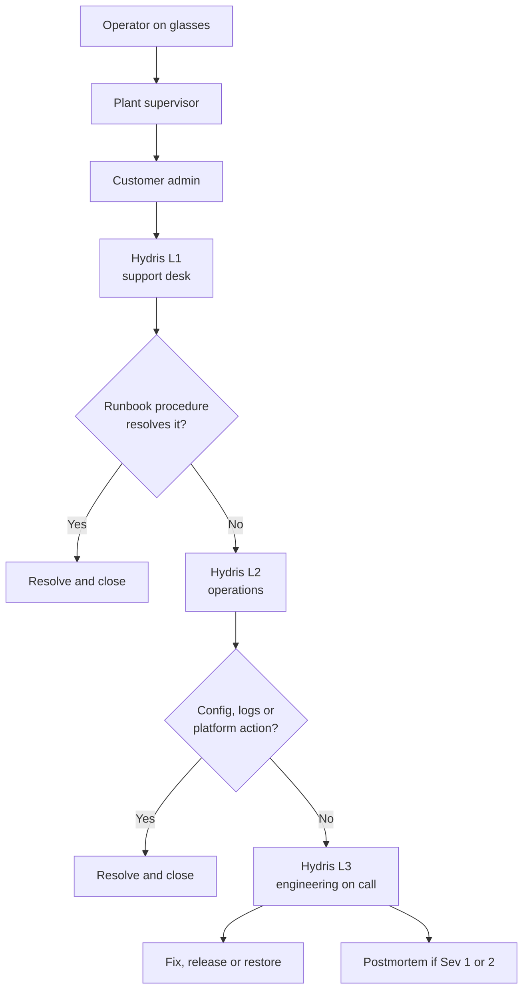

### RACI

R is responsible (does the work), A is accountable (one per row), C is consulted, I is informed.

Table: RACI for recurring operational activities

| Activity | L1 | L2 | L3 | Customer admin | Plant supervisor |
|---|---|---|---|---|---|
| Create organisation and first admin | I | A, R | C | I | |
| Sites, assets, sensors, gateways | C | C | | A, R | C |
| Users, roles and site scope | C | | | A, R | C |
| UI profiles for glasses | C | C | | A, R | C |
| SOP and document upload | | | | A | R |
| Glasses procurement and setup | C | R | | A | C |
| Pairing approval | C | | | A | R |
| Lost or stolen device revocation | C | R | | A | R |
| Alarm acknowledgement and resolution | | | | A | R |
| Audit document verification and approval | | | | A | R |
| Telemetry ingestion health | I | R | C | A | I |
| Daily health check and cron report | | A, R | C | | |
| Sev 1 and Sev 2 incidents | R | R | A | C | I |
| Release and rollback | I | C | A, R | I | |
| Data export, deletion and DPDP requests | R | R | C | A | |
| Training delivery | C | R | | A | R |

## Customer onboarding

Onboarding takes a customer from a signed pilot to operators using glasses on shift. The order matters: devices cannot be paired to a site that does not exist, and pairing approval needs a member with `device.pair` on that site.

### End-to-end flow

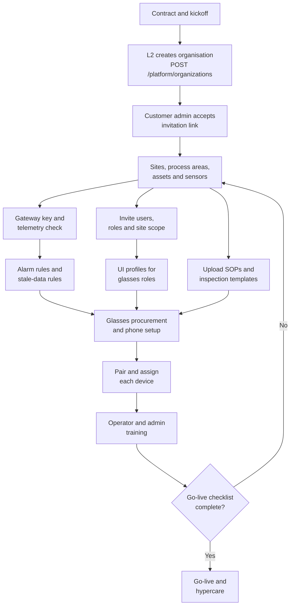

### Organisation creation

**Built.** A platform admin creates the tenant with `POST /api/platform/organizations` (`apps/api/src/modules/org.ts`). The response carries `adminInvitationLink`, an invitation for the first `org_admin` with access to all sites. The same action is available in the console under **Platform** (`apps/web/src/app/console/platform`).

1. L2 confirms the legal entity name, the plant list and the first admin's name and email.
2. L2 signs in to the console as a platform admin and creates the organisation.
3. L2 sends the invitation link to the customer admin over the agreed channel. The link is valid for 7 days (`TTL.inviteMs` in `apps/api/src/config.ts`).
4. The customer admin opens the link (`/invite/<token>`), sets a password and signs in.

> [!WARNING]
> Email delivery is **Partial**. `sendMail` in `apps/api/src/core/services.ts` writes to the `mail_outbox` table; there is no outbound mail transport yet. Invitation links are returned to the inviter in the API response so they can be shared by hand. Password-reset links are written only to `mail_outbox`, so a user who forgets a password needs L2 help (see the sign-in troubleshooting tree). Treat `mail_outbox` rows as sensitive.

The first platform admin for a new environment is created with the seed script, which also applies migrations:

```bash
SEED_ADMIN_EMAIL=ops@hydris.ai SEED_ADMIN_PASSWORD='<12+ characters>' npm run seed
```

### Sites, assets and sensors

**Built.** The customer admin (or a factory manager) builds the plant hierarchy in the console under **Sites** and **Assets**: site, facility, process area, asset, sensor (`apps/api/src/modules/plant.ts`). Points to check with the customer:

- Each sensor's **expected interval** is realistic. Freshness is derived from it: live within 2 times the interval, delayed within 5 times, stale beyond that (`packages/domain/src/freshness.ts`). An interval that is too short makes healthy sensors show as stale.
- Lab and manual parameters get long intervals (hours or days) and are entered with **manual telemetry** (`POST /api/telemetry/manual`).
- Asset tags match the tags on the plant floor and on the SOPs, because operators ask the voice assistant by tag.
- Process area polygons are drawn on the **Map** so the glasses map and console map agree.


### Gateways and telemetry

**Built.** For live data, the customer admin creates a gateway in the console (`POST /api/gateways`, protocol `https`, `mqtt` or `opcua`). The key starts with `hgw_` and is shown once; only its hash is stored. The gateway posts batches of up to 500 readings to `POST /api/ingest/v1/readings` with `Authorization: Bearer hgw_...`. The route is rate limited to 1,200 requests a minute per client (`apps/api/src/modules/telemetry.ts`).

Before go-live, L2 confirms on the **Telemetry** page that every sensor shows **Live**, and that a deliberately paused sensor turns **Delayed** then **Stale** at the expected times.


For a pilot without a live gateway, the simulator (`/simulator`, `apps/api/src/modules/simulation.ts`) drives synthetic scenarios such as `pump_vibration`, `tank_high_level`, `abnormal_ph` and `equipment_offline` (`packages/domain/src/scenarios.ts`). Simulated readings are flagged as synthetic in the database and must never be mixed into a customer's compliance reporting.

### Alarm rules

**Built.** Threshold rules (`high_high`, `high`, `low`, `low_low`) with a deadband, and `stale` rules that raise **No fresh data** when a sensor stops reporting (`apps/api/src/modules/alarms.ts`). The customer's process engineer owns the thresholds; Hydris only helps enter them. Every critical sensor should have a stale rule, because a silent sensor is more dangerous than a noisy one.

### Users, roles and site scope

**Built.** Under **Operators**, the customer admin invites each person with a role, a title and the sites they cover (`POST /api/invitations`). Members can later be deactivated (`PATCH /api/members/:userId` with `status: deactivated`), and nobody can change their own role or status.

Table: Recommended role mapping for a typical effluent treatment plant

| Plant job | Product role | Typical surface |
|---|---|---|
| Plant head, EHS head | `factory_manager` | Console |
| Shift in-charge | `supervisor` | Console and phone |
| ETP operator | `field_operator` | Glasses |
| Maintenance fitter or electrician | `maintenance_engineer` | Glasses |
| Auditor, corporate EHS, consultant | `viewer` | Console |
| Customer IT or digital lead | `org_admin` | Console |

Encourage admins and managers to enable two-step verification (TOTP, `POST /api/auth/mfa/setup`). Note the Android limitation in the sign-in troubleshooting tree.

### UI profiles for glasses

**Built.** A UI profile controls which screens and actions the glasses show (`apps/api/src/modules/ui-profiles.ts`, `packages/domain/src/uiprofile.ts`). Profiles are edited as drafts, published as numbered versions and can be rolled back. Assignment precedence is most specific first: device, then user, then role, then org, then the built-in default. Configure them under **Glasses profiles** in the console.

Recommended starting set: one profile per glasses role (`field_operator`, `maintenance_engineer`), assigned by role. Use device-level assignments only for exceptions, because they are easy to forget when a device changes hands.

### SOPs and inspection templates

**Built.** SOPs, method statements and other references are uploaded under **Documents** (`POST /api/documents`, permission `document.manage`) and linked to a site or asset. Only approved documents appear in search results on the glasses (`apps/api/src/modules/insights.ts`). Inspection templates and routes are built under **Inspections** and dispatched to operators (`POST /api/inspection-routes/:id/dispatch`). Attachments are limited to 10 MB per file (`apps/api/src/app.ts`).

### Glasses procurement and phone setup

Two glasses paths are supported:

Table: Glasses paths and what each needs

| Path | Hardware | Software | Status |
|---|---|---|---|
| Ray-Ban Meta | Ray-Ban Meta glasses plus an Android 12 or later phone per operator | Meta AI app (pairs glasses, grants permissions, updates firmware) and Hydris Field (`apps/android`) | **Built** for camera, capture button and voice through DAT. Distribution needs Developer Mode until Meta approves the app |
| Display glasses or phone | Android display glasses with a browser, or a phone | Browser at `/glasses` | **Built** |

Per operator for the Ray-Ban Meta path, L2 prepares a kit: glasses, charging case, a dedicated Android phone, a protective case and a lanyard. The setup procedure is in the fleet chapter.

### Pairing and training

Each device is paired to a site and assigned to an operator (see the fleet chapter). Training follows the curriculum in the training chapter. Go-live happens when every item below is ticked.

- [ ] Every sensor shows **Live** or has a documented reason
- [ ] Stale rules exist on every critical sensor
- [ ] Every operator has an account, the right role and the right sites
- [ ] UI profiles published and assigned by role
- [ ] SOPs for the pilot assets uploaded and approved
- [ ] Every device paired, named after its holder or station, and assigned
- [ ] A test audit document scanned, verified and approved by two different people
- [ ] A test alarm raised, acknowledged, resolved with a note and closed
- [ ] Supervisors and the customer admin trained and signed off
- [ ] Escalation contacts exchanged and the support channel tested

### Typical pilot rollout

The plan below is a **plan**, not a commitment: a six-week pilot for one plant with up to ten operators.

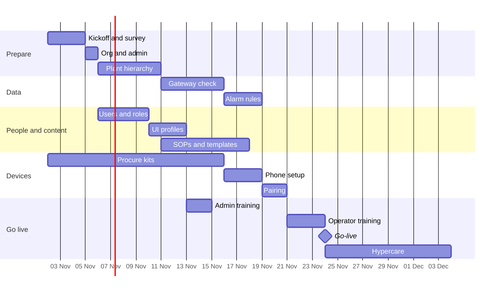

## Routine operations

### Daily checklist

Owner shown in brackets. Hydris tasks assume one hosted deployment; repeat per deployment.

- [ ] (L2) `GET /api/health` returns `{"ok":true,...}` from the production domain
- [ ] (L2) Vercel **Cron Jobs** shows the last `/api/cron` run with `ok: true`, and every field in `report` is `ok` or a number (`staleRules`, `pairingExpiry`, `realtimePruned`, `simulationSteps`)
- [ ] (L2) Vercel function logs: no new spike of 5xx responses, `503 API is starting or misconfigured`, or `realtime_misconfigured`
- [ ] (L2) No unexpected `auth.refresh_reuse_detected` or `device.refresh_reuse_detected` events in the audit log
- [ ] (Supervisor) Console **Overview**: no open critical or high alarm older than its target, no sensor stale without a known reason
- [ ] (Supervisor) **Audit documents**: review queue within the verification SLA
- [ ] (Supervisor) **Devices**: every glasses device on shift is **Connected**; anything **Disconnected** is explained
- [ ] (Operator) Glasses charged, phone charged, Hydris Field signed in, wake phrase tested once at shift start


### Weekly checklist

- [ ] (Customer admin) Review **Operators**: leavers deactivated, role changes applied, site scope correct
- [ ] (Customer admin) Review **Devices**: suspended devices either reactivated or revoked, assignments match the shift roster
- [ ] (Supervisor) Export the alarm report (`GET /api/reports/alarms?format=csv`) and review repeat offenders and long acknowledgement times
- [ ] (Supervisor) Rejected audit documents rescanned or closed out
- [ ] (L2) Review open tickets older than 5 business days and escalate
- [ ] (L2) Check Meta AI app and DAT release notes for changes that affect pairing or permissions
- [ ] (L2) Confirm the cron schedule still matches the plan (see monitoring chapter)

### Monthly checklist

- [ ] (Customer admin) Access review: every `org_admin` and `factory_manager` still needs that role; MFA enabled for them
- [ ] (Customer admin) UI profile review: drafts published or discarded, no stale device-level overrides
- [ ] (Customer admin) SOP review: superseded documents archived, new revisions approved
- [ ] (L2) Device report (`GET /api/reports/devices?format=csv`): devices not seen for 30 days investigated
- [ ] (L2) KPI pack for the customer (operations KPIs chapter)
- [ ] (L3) Dependency and security advisories reviewed; release planned if needed
- [ ] (L3) Restore drill on staging once a quarter (DEPLOYMENT.md backup targets: RPO 15 minutes, RTO 4 hours, both targets)

## Glasses fleet management

### Device lifecycle

A device record is `active`, `suspended` or `revoked`. The console shows a derived state (`deriveDeviceState` in `packages/domain/src/devices.ts`): a device counts as **Connected** if it has an open realtime stream or was seen in the last 90 seconds.

Table: Device states shown in the console and what support should do

| State | Meaning | Support action |
|---|---|---|
| Pending pairing | Challenge created, not yet approved | Approve within 5 minutes or generate a new code |
| Paired | Paired, no operator assigned | Assign an operator; the glasses cannot refresh tokens without one |
| Assigned | Assigned, never seen | Ask the operator to open the app and sign in on the glasses |
| Connected | Seen in the last 90 s | None |
| Disconnected | Assigned, seen before, not in the last 90 s | Check battery, phone, network |
| Suspended | Temporarily blocked | Reactivate when the reason is cleared |
| Revoked | Permanently blocked; sessions ended | Pair again as a new device if the hardware is recovered |


### Pairing

**Built.** Pairing follows the shape of the OAuth 2.0 device authorization grant (`apps/api/src/modules/devices.ts`, `packages/domain/src/devices.ts`):

- The glasses request a challenge and show an 8-character code as `XXXX-XXXX` plus a QR code. The alphabet excludes easily confused characters (no 0, O, 1, I, L, U).
- The code lives for **300 seconds** (`PAIRING_TTL_S`). The glasses poll every 3 seconds; faster polling receives `slow_down`.
- The QR encodes only `PUBLIC_APP_URL/pair?code=XXXX-XXXX`, never a credential.
- An authenticated person with `device.pair` approves the code, picks the site and optionally the operator and a device name.
- Code lookups are rate limited (`PAIRING_MAX_LOOKUPS_PER_MINUTE` is 10).
- The glasses then receive a device access token (15 minutes, 12 hours in demo mode) and a device refresh token (30 days, `TTL.deviceRefreshMs`).

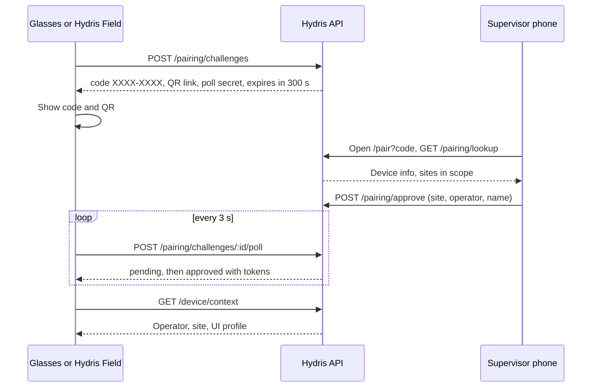

On the Ray-Ban Meta path, pairing happens from the **Glasses** tab in Hydris Field ("Register as Hydris device"). On display glasses, the `/glasses` route shows the code; `/simulator` does the same in a desktop browser for demos.


### Reassigning a device

**Built.** Under **Devices**, open the device and choose a new operator (`POST /api/devices/:id/assign`). Only active devices can be reassigned. Reassignment closes the previous assignment, records the reason, invalidates outstanding device tokens and pushes a `device.context_changed` event so the glasses reload the new operator's work. The operator does not need to re-pair.

Use reassignment for shift handovers of shared glasses. Use revocation only when the hardware is lost or leaves the organisation.

### Suspending, revoking and logging out

**Built.**

- **Suspend** (`POST /api/devices/:id/suspend`): blocks the device immediately. Use when a device is temporarily missing or an operator is on leave. Reactivate with `POST /api/devices/:id/reactivate`.
- **Revoke** (`POST /api/devices/:id/revoke`, reason required): final. Ends every device session, releases the assignment and invalidates tokens. A revoked device must be paired again as a new device. Glasses owned by another organisation cannot be paired until revoked there.
- **Logout or unpair from the glasses** (`POST /api/device/logout`): the wearer ends the device's own sessions so it can be paired again by anyone. Use when moving a device between people without console access.

Lost or stolen device procedure:

1. The operator tells the supervisor immediately.
2. The supervisor or customer admin **suspends** the device in the console within 15 minutes (target).
3. If it is not found by the end of the shift, the customer admin **revokes** it with the reason "lost" or "stolen".
4. If the device was a Ray-Ban Meta pair, the customer also removes the glasses from the Meta AI app account and, for a stolen phone, uses their mobile device management to wipe it.
5. L1 records the ticket; L2 confirms in the device detail that **active sessions** is empty.

### Battery, charging and diagnostics

**Partial.** The device detail page shows last seen time, last IP, app version, firmware version and display info. Battery level is **not** available: the API returns `battery: null` with the note that battery and hardware sensors are not exposed by the current device integration (`GET /api/devices/:id`). Operational rules until it is:

- Glasses go back in the charging case at every break. The phone charges on a shift-start dock.
- Supervisors check the case LED at handover.
- Continuous voice listening and camera streaming drain both glasses and phone; operators turn listening off when not needed.

### Firmware and the Meta AI app

Glasses firmware and DAT permissions are owned by Meta's tooling, not by Hydris. The Meta AI app must stay installed and signed in on every operator phone: it pairs the glasses, registers Hydris as a permitted integration, grants camera access and delivers firmware updates (GLASSES_INTEGRATION.md). The Meta AI app and glasses firmware must meet the DAT version dependencies.

Firmware procedure (L2, monthly or when Meta releases):

1. Test the new firmware on one spare kit with the current Hydris Field build: connect, capture, voice.
2. If it passes, ask the customer admin to update the fleet in the Meta AI app between shifts.
3. Record the firmware version from the device detail page after the update.

### Developer Mode

**Partial.** Until Hydris Field is approved in the Meta Wearables Developer Center, DAT features work only with **Developer Mode** enabled in the Meta AI app, using the development identifiers (`mwdat_application_id` and `mwdat_client_token` both `0` in `apps/android/local.properties`). Production builds need the identifiers issued by Meta. Enable Developer Mode on each phone in the Meta AI app settings during phone setup, and re-check it after any Meta AI app update.

> [!RISK]
> Developer Mode is a per-phone setting outside Hydris control. A Meta AI app update or a phone reset can turn it off, and the glasses then stop connecting with no change on the Hydris side. Put "Developer Mode on" at the top of every glasses troubleshooting call.

### Phone setup procedure

Per operator phone (L2 or customer admin):

1. Android 12 or later (minSdk 31). Update the OS.
2. Install the Meta AI app, sign in with the customer's Meta account, pair the glasses, update firmware, enable Developer Mode.
3. Install Hydris Field (see distribution below).
4. Open Hydris Field and sign in with the operator's Hydris account.
5. **Glasses** tab: connect Hydris in the Meta AI app, approve camera and microphone, then "Register as Hydris device" and have a supervisor approve the code.
6. Test: guided capture of one page, "Hey Hydris, what alarms are open?".


## Android app distribution and updates

**Partial.** The app is `ai.hydris.field`, `versionName 1.0.0`, `versionCode 1` (`apps/android/app/build.gradle.kts`). There is no CI pipeline in the repository yet, so builds are produced by hand.

Table: Android distribution channels

| Channel | When | Status |
|---|---|---|
| Debug or release APK installed with `adb` | Internal testing, first pilot | **Built** (manual) |
| Google Play internal testing (up to 100 testers) | Pilots | **Planned** |
| Meta Wearables Developer Center release channel | DAT features for non-developers | **Planned** |
| Managed Google Play through the customer's MDM | Enterprise rollout | **Planned** |

Update procedure for the pilot (L3 builds, L2 distributes):

1. L3 bumps `versionCode` and `versionName`, builds the release APK and records the commit.
2. L2 installs it on the spare kit and runs the smoke test: sign in, connect glasses, capture, voice, pairing.
3. L2 installs it on the fleet between shifts. The device detail page shows the new app version once the phone checks in.
4. Keep the previous APK so a phone can be downgraded if the new build fails (uninstall, then install the old APK; the operator signs in and the device is reassigned if needed).

```bash
cd apps/android
./gradlew assembleDebug
adb install -r app/build/outputs/apk/debug/app-debug.apk
```

## Audit document operations

### Pipeline and states

**Built.** Operators capture paper records (log sheets, lab reports, calibration certificates) with guided capture on the glasses or phone. Two independent OCR readings are taken on the device (the original image and a contrast-normalised copy, `apps/android/app/src/main/java/ai/hydris/field/scan/OcrEngine.kt`). The server structures key and value fields, tables and figures, optionally refined by a vision model when `ANTHROPIC_API_KEY` is set (`GET /api/audit-docs/capabilities` reports whether vision is on). Each value is cross-checked between engines, then reviewed by a person, verified, and independently approved (`apps/api/src/modules/audit-docs.ts`).

Limits: up to 6 pages per document, each page under 900 KB, request body 8 MB.

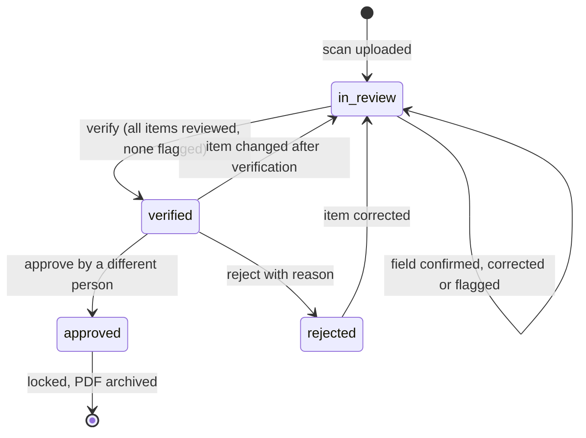

Rules enforced in code:

- **Verify** needs `auditdoc.verify` and a signed-in user (not a device). Every item must be reviewed and no item may be flagged.
- **Approve or reject** needs `auditdoc.approve`. The approver must be a different person from the verifier, except in demo tenants where self-approval is allowed and recorded as such.
- **Reject** needs a reason.
- Any change after verification re-opens the review and clears the verifier and approver.
- Approved documents are locked: no edits, no renames.
- Corrections keep the extracted value (`extracted`); history is never overwritten.

Only `org_admin` and `factory_manager` hold `auditdoc.approve`. Supervisors can verify but not approve. Plan the approver roster accordingly: every site needs at least two people who can complete the chain.

### Review queue

The console **Audit documents** page lists documents by status (`GET /api/audit-docs?status=in_review`). Items flagged as needing attention are those where the engines disagree (`mismatch`) or confidence is below 0.75 (`needsAttention`). Reviewers can bulk-confirm items where both engines agree and confidence is at least 0.8 (`POST /api/audit-docs/:id/confirm-agreed`), then work through the rest by hand.


### Verification SLAs

Table: Audit document turnaround targets (targets, not measured)

| Step | Owner | Target |
|---|---|---|
| Scan to first review action | Supervisor | Same shift |
| Scan to verified | Supervisor | 1 business day |
| Verified to approved or rejected | Factory manager or org admin | 2 business days |
| Rejected to rescanned or closed | Supervisor and operator | 3 business days |
| Compliance-critical record (discharge, consent condition) scan to approved | Customer admin | 1 business day |

### Rejected scans

When a document is rejected, the reason is stored in `rejectedReason`. The supervisor decides between:

1. **Correct in place**: if the problem is a misread value, correct the item; the document returns to review and goes through verify and approve again.
2. **Rescan**: if the image is unusable (cut off, blurred, glare), the operator scans the paper again. The rejected record stays as evidence; reference it in the new document title.

### PDF archive

**Built.** `GET /api/audit-docs/:id/pdf` produces a PDF with the page images, the extracted values and the verification trail (who captured, verified, approved, when, and the engines used; `apps/api/src/core/audit-pdf.ts`). Archive procedure (customer admin, weekly): download PDFs for approved documents and store them in the customer's document management system per their retention policy. A retention configuration inside Hydris is **Planned**.

## Alarm operations and escalation

### Alarm lifecycle

**Built.** Alarms have severity `critical`, `high`, `medium` or `low` and condition `high_high`, `high`, `low`, `low_low` or `stale` (`packages/domain/src/alarms.ts`). Transitions are permission-checked in the API, and resolution requires a note.

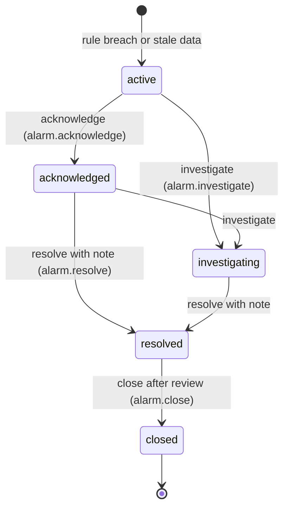

Field operators can only acknowledge. Maintenance engineers can acknowledge, investigate and resolve. Supervisors and above can do everything including assignment (`POST /api/alarms/:id/assign`) and closing. Notes are added with `POST /api/alarms/:id/notes`. If two people act at once, the second gets `stale_state` and must refresh.


### Escalation matrix

Hydris does not page anyone outside the product yet: escalation beyond the console and glasses notifications is a customer procedure (**Planned**: SMS or call escalation). The matrix below is the recommended plant procedure; all times are targets.

Table: Alarm escalation matrix (targets)

| Severity | Acknowledge within | First escalation | Second escalation | Resolve or hand to plant procedure within |
|---|---|---|---|---|
| Critical | 5 minutes | Supervisor at 5 minutes, by phone | Plant head at 15 minutes | 1 hour |
| High | 15 minutes | Supervisor at 15 minutes | Plant head at 1 hour | 4 hours |
| Medium | 1 hour | Supervisor at end of shift | None | 1 business day |
| Low | End of shift | None | None | 1 week |
| Stale (no fresh data) | 30 minutes | Customer admin (data path) | Hydris L1 if gateway or platform suspected | 4 hours |

A stale alarm is a data problem first: follow the "data not updating" tree before assuming a plant fault, but never assume the plant is fine because the data stopped.

### Alarm hygiene

Weekly, the supervisor reviews the alarm report for: alarms resolved without a meaningful note, repeat alarms on the same sensor (threshold or deadband needs tuning), and alarms closed by the same person who resolved them without review. Rule changes go through the customer's management of change; `alarm_rule.manage` is held only by `org_admin` and `factory_manager`.

## Support procedures and troubleshooting

### Ticket intake

L1 records for every ticket: customer, site, user email, role, surface (console, glasses web app, Hydris Field), device name, app version, time of the problem with time zone, and what the user saw (exact message or screenshot). Never ask for or record passwords, MFA codes, refresh tokens, gateway keys or `CRON_SECRET`.

Table: Support response targets by priority (targets)

| Priority | Example | First response | Update cadence | Target resolution |
|---|---|---|---|---|
| P1 | Nobody can sign in; all telemetry stale | 30 minutes | Hourly | 4 hours |
| P2 | One site cannot pair glasses; audit approval blocked | 2 hours | Every 4 hours | 1 business day |
| P3 | One operator's voice not working | 1 business day | Daily | 3 business days |
| P4 | Question, how-to, feature request | 2 business days | Weekly | Best effort |

### Cannot sign in

Facts from the code (`apps/api/src/modules/auth.ts`, `apps/api/src/config.ts`): wrong email or password returns `invalid_credentials`. Five failures lock the account for 15 minutes (`account_locked`). Access tokens last 15 minutes and refresh tokens 7 days; reuse of a rotated refresh token revokes the family. On the Android app, an account with two-step verification sees "This account uses two-step verification - sign in on the web console first." **Partial**: MFA is not completed inside the Android app.

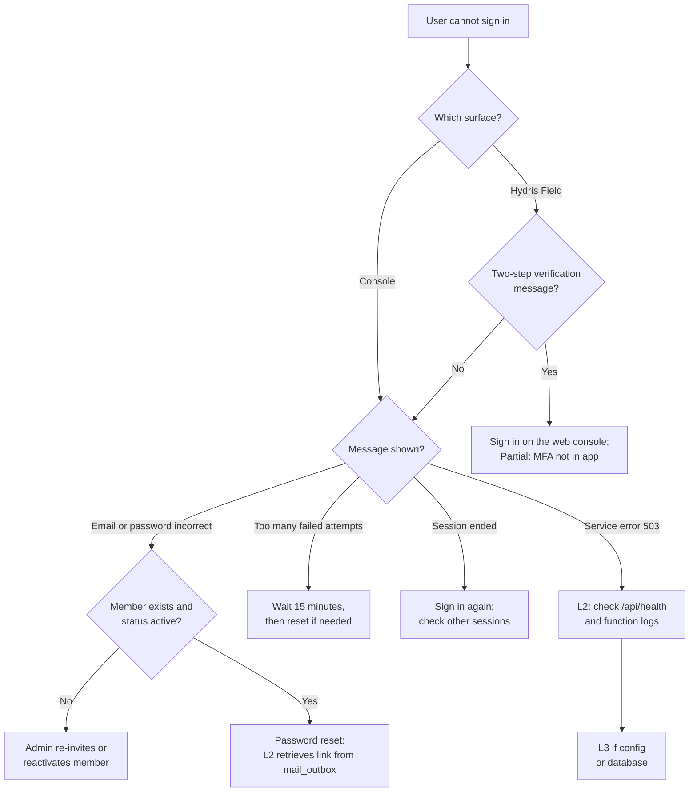

Password reset links expire after 30 minutes (`TTL.resetMs`). Because email is not wired, L2 confirms the request with the customer admin, reads the latest reset link for that address from `mail_outbox`, and gives it to the user over a verified channel. Delete the row afterwards.

### Pairing fails or code expired

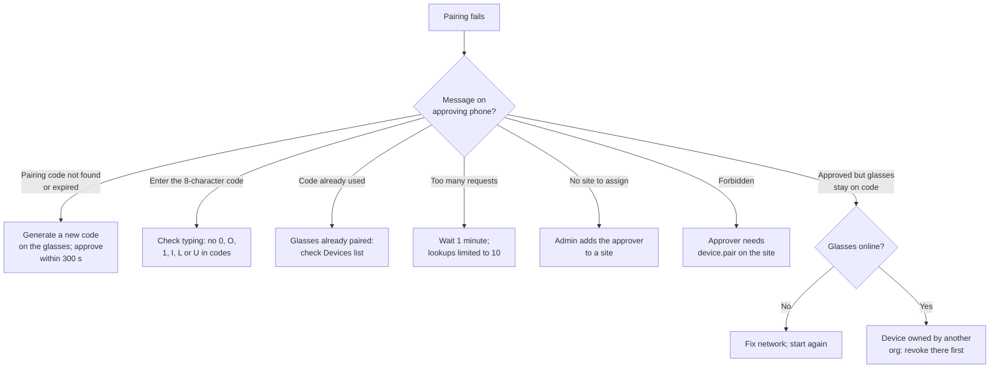

Common causes in pilots: the approver walked to a desk and took longer than five minutes; the approver has no site in scope; the glasses lost Wi-Fi while polling. After approval, if the glasses show "No operator is assigned to this device" (`device_unassigned`), assign an operator in the console.

### Glasses not connecting (Ray-Ban Meta)

Messages in Hydris Field (`apps/android/app/src/main/java/ai/hydris/field`) point to the step that failed: "Install the Meta AI app and pair your glasses in it first", "Connect Hydris in the Meta AI app first (Glasses, Connect)", "Camera permission denied in Meta AI", "The glasses are not registered".

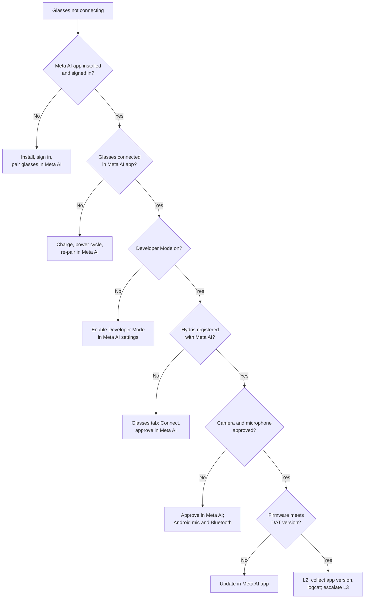

### Camera not available

The camera can come from the glasses (DAT stream) or, as a fallback, the phone. Messages: "Glasses camera not available", "Camera unavailable: ...", "Camera permission is needed to scan with the phone", "No usable camera on this phone". On display glasses and the web app, the browser camera permission applies (`apps/web/src/glasses/camera.ts`).

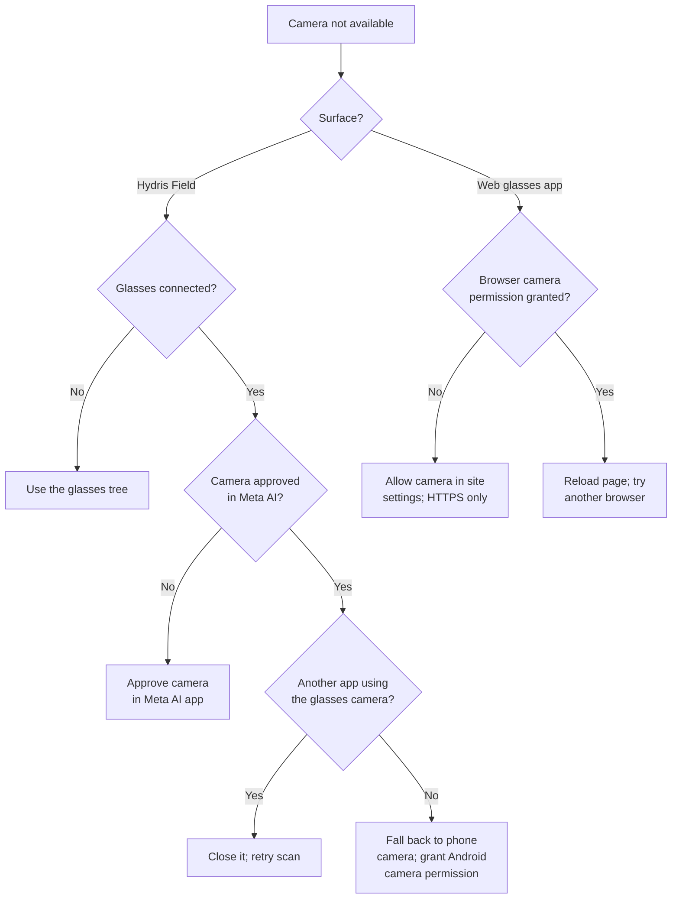

### OCR results are poor

Guided capture checks the page before it auto-captures (`DocDetect.kt`): it asks the wearer to move closer if the page covers less than 28 percent of the frame, to move back if it touches the edge or covers more than 92 percent, to rotate to portrait, to straighten if a corner is skewed more than 10 degrees, to level if tilted more than 8 degrees, to flatten if the shape is far from A4, and to hold still if the image is not sharp. It then warps the page to a flat A4 image at about 200 dpi.

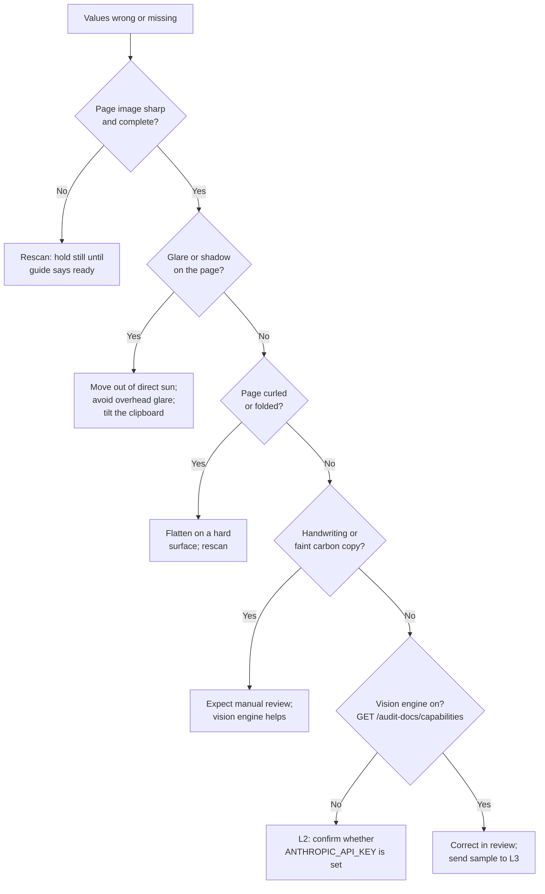

Correcting values in review is normal and expected; the two-person rule exists because OCR is never perfect. Tell operators that a poor scan costs the reviewer time, so a ten-second rescan is cheaper than a ten-minute correction.


### Voice assistant not hearing

"Hey Hydris" uses the glasses microphone (DAT speech) when the glasses are connected and the phone microphone through Android `SpeechRecognizer` otherwise. Answers play through text to speech on the glasses speakers when they are the Bluetooth audio device (`apps/android/app/src/main/java/ai/hydris/field/voice/VoiceEngine.kt`). The wake phrase is matched on the transcript on the device; only the question after it is sent to `POST /api/assistant/ask`. Without an Anthropic key, a deterministic intent engine answers measurements, alarms, my work, asset status and procedures, and says it cannot answer anything else.

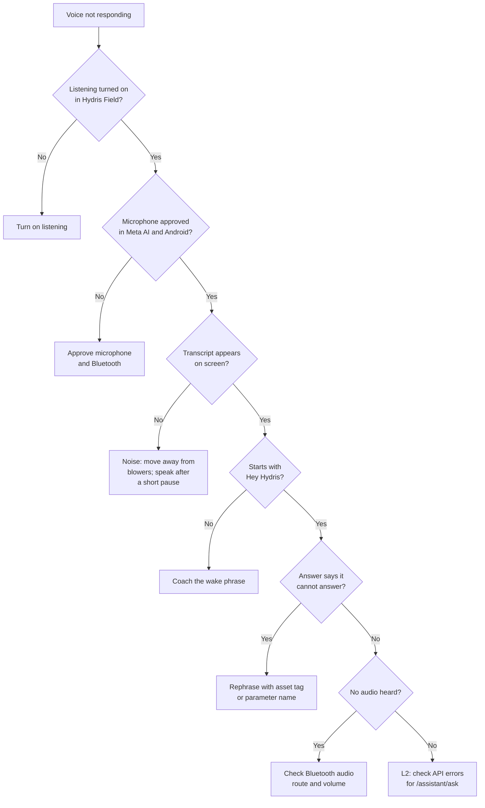


### Data not updating (telemetry stale)

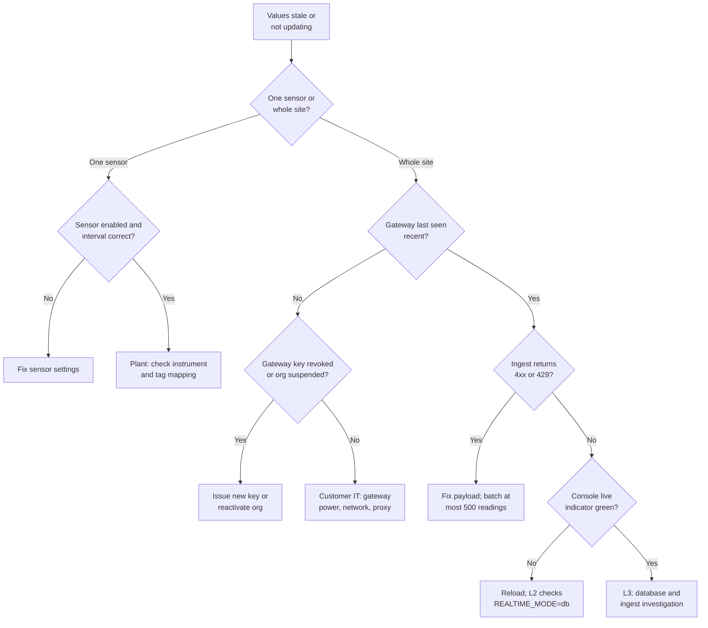

Two behaviours to remember:

- On Vercel, stale-data rules are evaluated only when `/api/cron` runs. `vercel.json` schedules it **daily at 03:00 UTC** (`0 3 * * *`), so a stale alarm can take up to a day to appear on the hosted deployment. The console's freshness badges are computed on read and are always current. On a long-running container the job runs every 30 seconds (`apps/api/src/jobs.ts`).
- In `REALTIME_MODE=db`, the console polls the `realtime_events` table, so updates can lag by about 1.5 seconds. That is normal.

### Console slow

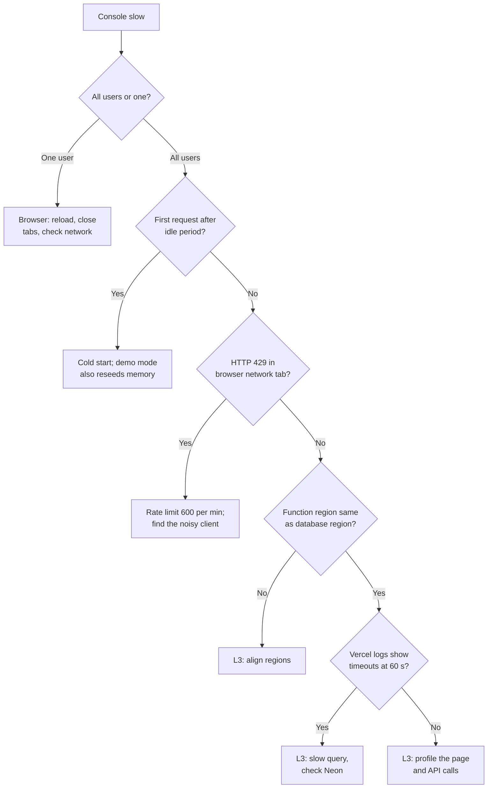

## Incident management

### Severity levels

Table: Incident severity levels (targets)

| Severity | Definition | Examples | Response | Customer update |
|---|---|---|---|---|
| Sev 1 | Platform down or data at risk for one or more customers | `/api/health` failing; cross-tenant data exposure; data loss | L3 engaged within 15 minutes, all hands | Within 1 hour, then hourly |
| Sev 2 | Major function down for a customer, no workaround | No telemetry ingest; nobody can pair; audit approval broken | L3 engaged within 1 hour | Within 2 hours, then every 4 hours |
| Sev 3 | Function degraded, workaround exists | Voice down but console works; one site's gateway down | Next business day | Daily |
| Sev 4 | Minor or cosmetic | Label wrong, slow export | Planned release | On release |

A suspected security or personal data breach is always Sev 1 until ruled out and follows SECURITY_PRIVACY.md: customers within 24 hours, CERT-In within 6 hours for reportable incidents, the Data Protection Board and affected data principals per the DPDP Rules, and GDPR authorities within 72 hours where applicable.

### Incident lifecycle

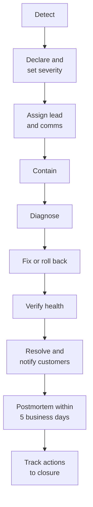

Containment levers available today (all **Built**): revoke a user session (`DELETE /api/auth/sessions/:id`), suspend or revoke a device, revoke a gateway (`POST /api/gateways/:id/revoke`), suspend an organisation (`POST /api/platform/organizations/:id/status`), roll back the Vercel deployment, and as a last resort rotate `JWT_SECRET`, which signs everyone out. Never rotate `DATA_KEY` without re-encrypting MFA secrets: losing it disables MFA for every user.

### Communication templates

Initial notice (within the update target for the severity):

```text
Subject: [Hydris] Sev <n> incident: <short description>

We are investigating an issue affecting <surface> for <customer or "some customers">
since <time, time zone>. Impact: <what users see>. Plant equipment and control
systems are not affected; Hydris is read-only to the plant.

Workaround: <if any, otherwise "none yet">.
Next update: <time>.
Incident lead: <name>, Hydris.
```

Update:

```text
Subject: [Hydris] Update <n>: <short description>

Status: <investigating | identified | fix in progress | monitoring>.
What we know: <one or two sentences>.
What we are doing: <one or two sentences>.
Next update: <time>.
```

Resolution:

```text
Subject: [Hydris] Resolved: <short description>

The issue affecting <surface> was resolved at <time>. Duration: <duration>.
Cause: <one sentence>. Data: <"no data was lost" or what was affected and how
it was recovered>. A postmortem will follow by <date>.
```

### Postmortem template

```text
Title, date, severity, incident lead, authors

Summary: two or three sentences a plant manager can understand.
Impact: customers, sites, users, duration, data affected.
Timeline: detection, declaration, key actions, resolution (with time zone).
Root cause: technical cause and contributing factors.
Detection: how we found out; how we should have found out sooner.
What went well / what went badly.
Action items: owner, due date, ticket link. Blameless language throughout.
```

## Monitoring and health checks

### Health endpoint

**Built.** `GET /api/health` returns `{"ok": true, "time": "<ISO timestamp>"}` (`apps/api/src/app.ts`). It confirms that the function starts and the API is registered. It does not prove that the database is reachable; for that, check that the console overview loads, or call an authenticated endpoint such as `GET /api/overview`. An external uptime check on `/api/health` is **Planned**; until then L2 runs it in the daily check.

### Scheduled jobs

**Built.** `runScheduledJobs` (`apps/api/src/jobs.ts`) performs one pass of: stale-data rule evaluation, pairing challenge expiry, pruning `realtime_events` older than 24 hours (`apps/api/src/core/events.ts`), and one simulation step for each running scenario when `SIMULATOR_ENABLED=true`.

Table: Background jobs by deployment type

| Job | Long-running container | Vercel |
|---|---|---|
| Stale-data rules | Every 30 s | On each `/api/cron` run |
| Pairing expiry | Every 60 s | On each cron run (challenges also expire on poll and lookup) |
| Realtime pruning | Hourly when `REALTIME_MODE=db` | On each cron run |
| Simulation | Continuous, resumes running scenarios at start | One step per cron run, or lazily per request in demo mode |

The cron route (`apps/web/src/app/api/cron/route.ts`) accepts only `Authorization: Bearer $CRON_SECRET` and returns `{"ok": true, "ms": <duration>, "report": {...}}`. A `401` means `CRON_SECRET` is missing or changed. A report field that starts with `error:` names the failing job.

> [!DECISION]
> The schedule in `vercel.json` is daily (`0 3 * * *`). For a production pilot with live telemetry, stale alarms evaluated once a day are not acceptable. Before a production pilot, either move to a plan that allows a per-minute cron (`* * * * *`) or call `/api/cron` every minute from an external scheduler with the secret. Owner: L3. Status: **open**.

### Signals to watch

Table: Monitoring signals and where to find them today

| Signal | Source today | Threshold to act (target) | Status |
|---|---|---|---|
| API up | `/api/health` | Any failure | **Built** (manual check) |
| Cron success | Vercel cron log JSON | Any `error:` field | **Built** (manual check) |
| 5xx rate | Vercel function logs | More than 1 percent over 15 minutes | **Partial** (no alerting) |
| Refresh token reuse | `audit_events` actions `auth.refresh_reuse_detected`, `device.refresh_reuse_detected` | Any | **Built** (query) |
| Login failures | `audit_events` action `auth.login_failed` | Spike against baseline | **Built** (query) |
| Ingest lag | Sensor freshness on Telemetry | Any critical sensor stale | **Built** |
| Tracing, error tracking, uptime alerts | OpenTelemetry, Sentry, uptime monitor | | **Planned** |

## Data requests

### Exports

**Built.** All exports are scoped to the caller's organisation and sites, and CSV exports are audited (`report.exported`).

Table: Data export paths

| Data | Path | Permission |
|---|---|---|
| Alarms, inspections, maintenance, devices, operators | `GET /api/reports/:kind?format=csv` | `report.export` |
| Sensor readings | `GET /api/telemetry/sensors/:id/export.csv` | `telemetry.read` |
| Approved audit document with trail | `GET /api/audit-docs/:id/pdf` | `auditdoc.read` |
| Audit log | `GET /api/audit` (console **Audit**) | `audit.read` |
| Change history of an entity | `GET /api/history/:entityType/:entityId` | Read permission on the entity |

A full tenant export (all tables, all files) is **Planned**; until then L3 produces it from the database on a signed request from the customer admin.

### Deletion and DPDP requests

India's DPDP Act 2023 and the DPDP Rules 2025 give data principals rights to access, correction and erasure, and to grievance redressal. For a plant, most personal data is the names and emails of members, IP addresses in sessions and audit events, and names attached to records.

Table: Handling data principal requests

| Request | Procedure | Status |
|---|---|---|
| Access | Customer admin exports member record and their activity (`/api/audit` filtered by user); L2 assists | **Partial** (manual) |
| Correction | Member updates their name in **Account**; admin updates title and role | **Built** |
| Stop access | Admin deactivates the member (`PATCH /api/members/:userId`) and revokes their devices | **Built** |
| Erasure | No self-service deletion. L3 pseudonymises the user record on written request after legal review. Records that form part of a regulated record (alarm notes, inspection sign-offs, audit document approvals) are kept with the customer's retention period and the name pseudonymised where the law allows | **Planned** (manual today) |
| Grievance | Logged as a P2 ticket; answered within the statutory period | **Built** (process) |

> [!CAUTION]
> Hydris is usually the processor; the customer is the data fiduciary. Act on a data principal's request only through the customer admin, unless the request concerns Hydris's own website inquiries (`/public/inquiries`, where Hydris is the fiduciary). Never hard-delete audit trails: `audit_events`, `telemetry_corrections` and `audit_document_events` are append-only by design.

## Demo environment management

**Built.** Demo mode turns on when `DEMO_MODE=true`, or automatically on Vercel when no `DATABASE_URL` is set (`isDemoEnv` in `apps/api/src/config.ts`). In demo mode:

- Each serverless instance runs its own in-memory database seeded with the same deterministic synthetic tenant. A cold start resets it. `DEMO_PERSIST=true` with a Postgres URL seeds into Postgres instead.
- Built-in public demo secrets are used if none are configured, and a warning is logged. Demo mode must never hold real plant data.
- "Enter demo mode" asks for a name and creates a personal guest account (`POST /api/auth/demo`, `apps/api/src/core/demo-guests.ts`): an org admin on all sites with its own copy of open inspections and maintenance tasks. The same name always maps to the same account. Guest names are kept for 30 days.
- State that must survive across instances (pairing challenges and approvals, guest names) goes into a shared store (`apps/api/src/core/demo-shared.ts`): Postgres when available, otherwise Vercel Runtime Cache, otherwise process memory.
- Access tokens last 12 hours, the simulator is on and the realtime mode is `db`.
- Self-approval of audit documents is allowed and recorded as such.

Before a sales demo (L1 or sales engineer):

- [ ] Open the demo URL 10 minutes early to warm an instance
- [ ] Enter demo mode with the presenter's name; check the overview loads
- [ ] Start a scenario on `/simulator` (for example `pump_vibration`) and confirm an alarm appears
- [ ] Pair the simulator or phone glasses view and confirm the operator's name shows
- [ ] Run one audit scan end to end


If the demo misbehaves mid-session, reload: a new instance reseeds. Do not try to repair demo data. For a customer who wants a longer evaluation, set up a separate Postgres-backed tenant with `npm run seed:demo` rather than relying on the in-memory demo.

## Release and change management

### Environments and the path to production

DEPLOYMENT.md defines dev (local, PGlite), preview (per pull request), staging and production. Vercel deploys previews per pull request and production from `main`. There is no CI configuration in the repository yet, so the checks below are run by the releasing engineer (**Partial**).

Pre-release checklist (L3):

- [ ] `npm run typecheck`, `npm test` and `npm run build` pass locally
- [ ] `npm run test:e2e` (Playwright) passes against the preview
- [ ] Migrations reviewed: additive only, or a written plan for destructive steps
- [ ] Preview deployment smoke test: sign in, overview, pairing via `/simulator`, alarm transition, audit scan
- [ ] Release note written for customers if behaviour changes
- [ ] Android: new APK tested on the spare kit if the API contract changed

Migrations run on the first request of each new function instance under a Postgres advisory lock, or during the build with `npm run vercel-build` and `MIGRATE_ON_START=false` (docs/operations/vercel.md).

### Maintenance windows

Table: Change classes and windows (targets)

| Change | Window | Notice to customers |
|---|---|---|
| Web and API release, no migration | Any time outside shift changes | Release note after |
| Release with additive migration | Weekdays 14:00 to 16:00 IST | 2 business days |
| Release with destructive migration or data backfill | Sunday 06:00 to 08:00 IST | 5 business days |
| Android APK rollout | Between shifts, per site | 2 business days |
| Glasses firmware | Between shifts, after spare-kit test | 2 business days |
| Secret rotation (`JWT_SECRET`, `CRON_SECRET`) | Planned window or incident | Users will need to sign in again for `JWT_SECRET` |

### Rollback

1. **Web and API:** promote the previous production deployment in Vercel (instant rollback). Because migrations are additive, the previous code runs against the newer schema.
2. **Destructive migration:** do not roll back code alone. Restore from Neon point-in-time recovery to a branch, verify, then switch; this is an L3 decision and a Sev 2 incident at least.
3. **Android:** reinstall the previous APK (kept with every release).
4. **UI profile:** use **Rollback** on the profile (`POST /api/ui-profiles/:id/rollback`); glasses reload the earlier version.
5. **Alarm rule change:** edit the rule back; the audit log shows the previous values.

## Training curriculum

### Curriculum

Table: Training modules by audience

| Module | Audience | Duration | Format | Covers |
|---|---|---|---|---|
| Platform overview | All | 30 min | Classroom | What Hydris does and does not do; read-only to the plant |
| Glasses basics | Operators, maintenance | 45 min | Hands-on | Wearing, charging, Hydris Field home, work list, alarms on glasses |
| Guided capture | Operators | 45 min | Hands-on on real log sheets | Lighting, flattening, holding still, multi-page scans |
| Hey Hydris | Operators, maintenance | 30 min | Hands-on on the floor | Wake phrase, asking by tag, limits of the assistant |
| Alarm handling | Operators, supervisors | 45 min | Scenario on simulator | Acknowledge vs resolve, notes, escalation matrix |
| Inspections and maintenance | Operators, supervisors | 45 min | Hands-on | Executing routes, checklists, requesting maintenance |
| Review and verification | Supervisors, managers | 60 min | Hands-on in console | Review queue, bulk confirm, verify, approve, reject, PDF |
| Fleet administration | Customer admin, supervisors | 45 min | Hands-on | Pairing approval, assign, suspend, revoke, UI profiles |
| Tenant administration | Customer admin | 90 min | Workshop | Sites, assets, sensors, gateways, users, roles, SOPs, reports |
| Support and escalation | Customer admin, supervisors | 30 min | Classroom | When and how to contact Hydris, what to include |

### Operator journey

The journey below shows the target experience for an operator in their first week, with scores from 1 (poor) to 5 (good) as the **expected** experience, to be validated in the pilot.

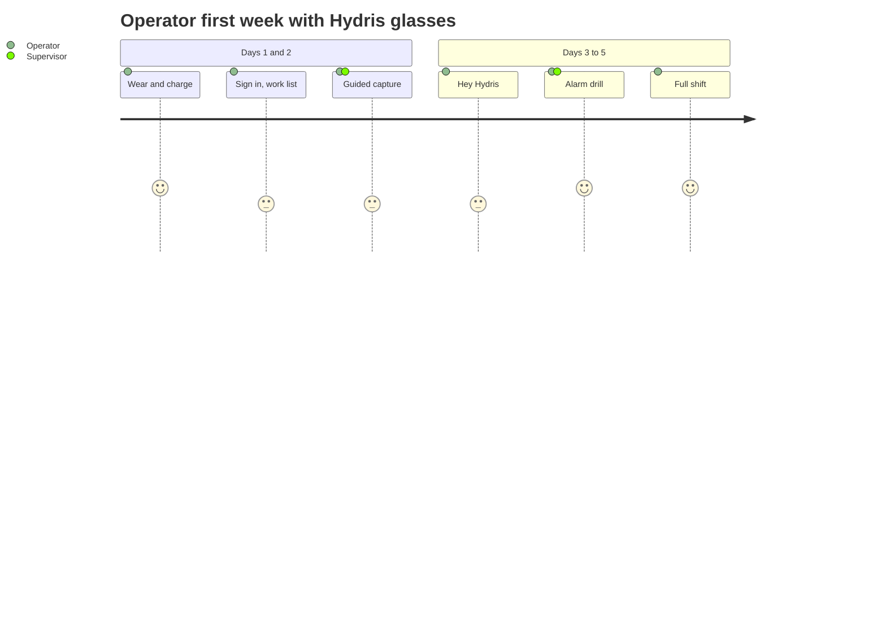

Sign-off: an operator is signed off after one full shift in which they completed an inspection route, scanned at least one document that was verified without a rescan, and acknowledged a drill alarm. Supervisors are signed off after verifying five documents and completing a pairing approval and a device reassignment.

## Operations KPIs

All values are **targets** for the first pilot. Measurement sources are named so the numbers can be produced from the product rather than estimated.

> [!STATS]
> - 5 min | Time to pair | Target from code shown to Connected
> - 1 day | Scan to verified | Target for routine records
> - 5 min | Critical alarm acknowledge | Target, median
> - 99.5% | Monthly availability | Target for /api/health

Table: Operations KPIs, targets and measurement sources

| KPI | Target | Measured from |
|---|---|---|
| Time to pair (challenge created to device connected) | Median under 5 minutes | `pairing_challenges.created_at` to `completed_at`; device `last_seen_at` |
| Pairing success on first code | Over 90 percent | Completed vs expired challenges |
| Scan to verified | Median 1 business day | `audit_documents.created_at` to `verified_at` |
| Verified to approved | Median 2 business days | `verified_at` to `approved_at` |
| Rescan rate | Under 10 percent of documents | Rejected documents over total |
| Critical alarm acknowledge time | Median under 5 minutes | Alarm events (raised to acknowledged) |
| High alarm acknowledge time | Median under 15 minutes | Alarm events |
| Alarms resolved with a note | 100 percent (enforced in code) | `requiresNote` on resolve |
| Sensors live | Over 98 percent of sensor-hours | Freshness on telemetry history |
| Devices connected on shift | Over 95 percent | Device report |
| Support first response | Per priority table | Ticket system |
| Platform availability | 99.5 percent monthly | External uptime check (**Planned**) |

## Support contact and escalation templates

Support contacts are confirmed per customer at kickoff and recorded in the customer's account plan.

Table: Support contact details (to be completed per customer)

| Channel | Use | Hours |
|---|---|---|
| Support email (to be confirmed) | P3 and P4 tickets | Business hours IST |
| Support phone (to be confirmed) | P1 and P2 | 24 by 7 for P1 during pilots (target) |
| Shared chat channel | Day-to-day coordination | Business hours IST |
| Customer success manager | Account, training, KPIs | Business hours IST |

Customer admin to Hydris (ticket template):

```text
Subject: [<Customer> / <Site>] <P1-P4>: <short description>

Who is affected: <user emails or "all users at site X">
Surface: <console | glasses web app | Hydris Field app> <app version if known>
Device: <device name from the Devices page, if relevant>
Since: <date and time, time zone>
What happened: <steps and the exact message shown>
What we tried: <steps from the runbook>
Screenshots: attached (no passwords, codes or keys)
```

L1 to L2 or L3 escalation:

```text
Ticket: <id>   Priority: <P1-P4>   Customer: <name>   Site: <name>
Summary: <one sentence>
Evidence: <health result, cron report, log lines with timestamps, request ids>
Runbook trees followed: <names and where they ended>
Suspected area: <auth | pairing | devices | telemetry | audit docs | voice | infra>
Customer impact and workaround: <text>
Ask: <what you need from the next tier>
```

## Appendices

### Glossary

Table: Glossary

| Term | Meaning |
|---|---|
| DAT | Meta Wearables Device Access Toolkit; the SDK Hydris Field uses to reach Ray-Ban Meta glasses |
| Developer Mode | Meta AI app setting that lets an unpublished app such as Hydris Field register with the glasses |
| Device token | Access and refresh tokens issued to a paired glasses device, separate from user sessions |
| Freshness | Live, delayed, stale or no data, derived from a sensor's expected interval |
| Gateway | Plant-side system that posts readings with an `hgw_` key |
| Pairing challenge | Short-lived (300 s), single-use code that links glasses to a site |
| RLS | Postgres row-level security; isolates tenants at the database |
| Stale rule | Alarm rule that raises "No fresh data" when a sensor stops reporting |
| Two-person verification | Verify by one person, approve by a different person (audit documents) |
| UI profile | Versioned configuration of the glasses screens and actions, assigned by device, user, role or org |
| Demo mode | Self-contained deployment with synthetic data, guest accounts and in-memory database |
| DPDP | India's Digital Personal Data Protection Act 2023 and Rules 2025 |

### Command cheat sheet

Health and cron (replace the domain for other environments):

```bash
curl -s https://hydrisview.vercel.app/api/health
curl -s -H "Authorization: Bearer $CRON_SECRET" https://hydrisview.vercel.app/api/cron
```

Local development, database and seed (repository root):

```bash
npm install
npm run dev                  # API on :4000, web on :3000
npm run db:migrate
npm run seed                 # needs SEED_ADMIN_EMAIL and SEED_ADMIN_PASSWORD (12+ chars)
npm run seed:demo            # also needs SEED_DEMO_PASSWORD (12+ chars)
npm run typecheck && npm test && npm run build
npm run test:e2e
```

Demo mode locally:

```bash
DEMO_MODE=true npm run dev
```

Reports and exports with a console access token:

```bash
curl -s -H "Authorization: Bearer $TOKEN" "https://hydrisview.vercel.app/api/reports/alarms?format=csv" -o alarms.csv
curl -s -H "Authorization: Bearer $TOKEN" "https://hydrisview.vercel.app/api/reports/devices?format=csv" -o devices.csv
curl -s -H "Authorization: Bearer $TOKEN" "https://hydrisview.vercel.app/api/audit-docs/$DOC_ID/pdf" -o audit-doc.pdf
```

Device actions:

```bash
curl -s -X POST -H "Authorization: Bearer $TOKEN" -H "Content-Type: application/json" \
  -d '{"reason":"lost on site"}' "https://hydrisview.vercel.app/api/devices/$DEVICE_ID/suspend"
curl -s -X POST -H "Authorization: Bearer $TOKEN" -H "Content-Type: application/json" \
  -d '{"reason":"stolen"}' "https://hydrisview.vercel.app/api/devices/$DEVICE_ID/revoke"
```

Android build, install and logs:

```bash
cd apps/android
./gradlew assembleDebug
adb install -r app/build/outputs/apk/debug/app-debug.apk
adb logcat | grep -i hydris
```

Database checks (L3, read-only role, production only with approval):

```sql
select action, at, ip from audit_events
 where action in ('auth.refresh_reuse_detected', 'device.refresh_reuse_detected')
 order by at desc limit 50;
select status, count(*) from pairing_challenges
 where created_at > now() - interval '7 days' group by status;
```
