# Product Requirements Document

This document is the single statement of what Hydris Field Glasses is for and what it must do. It is written for the people who build the product, the people who sell and deploy it, and the plant teams who will use it. Every statement about the current product was checked against the repository on `main` at commit `07cca23` (22 October 2026). Where the code and an earlier document disagree, the code wins and this document says so.

Each requirement carries a stable ID, a MoSCoW priority, a status and an acceptance criterion. Status labels mean exactly this:

- **Built**: implemented on `main` and exercised by the product today (in the live demo or in automated tests).
- **Partial**: implemented in part, or implemented in code but not yet validated where it matters (for example on physical Ray-Ban Meta glasses).
- **Planned**: not in the repository. It is a commitment to build, with a target phase in the release plan.

Targets (latency, accuracy, adoption) are labelled as targets. None of them is a measured result unless the text names the measurement.

## Executive summary

Wastewater plant operators spend their shift walking the plant: reading instruments, checking pumps and blowers, sampling effluent, writing values on paper logs, and responding to alarms that usually reach a control room before they reach the person standing next to the equipment. The records they produce are the evidence a plant shows to its regulator, and much of that evidence still lives on paper.

Hydris Field Glasses puts the live state of the plant, the next task and the approved procedure in the operator's line of sight, hands free, and turns every reading, check and paper record they touch into a trustworthy digital record. It does this through five connected surfaces that share one API, one tenant model and one permission matrix:

1. A **public website** with a live, synthetic glasses demo.
2. An **operator console** for supervisors, managers and administrators.
3. A **glasses heads-up app** (web) that runs on smart-glasses runtimes, in a phone layout, and inside a browser simulator.
4. A **native Android app**, Hydris Field, which connects Ray-Ban Meta glasses through Meta's Wearables Device Access Toolkit (DAT 1.0.1).
5. A **multi-tenant API** with row-level security, realtime events and an append-only audit trail.

> [!STATS]
> - 67 | automated tests passing | 26 domain + 41 API, run locally on 22 Oct 2026
> - 5 | product surfaces | website, console, glasses app, Android app, API
> - 143 | API routes | across 15 modules in apps/api/src/modules
> - 12 | glasses screens | UI_SCREENS in packages/domain/src/uiprofile.ts

> [!STATS]
> - 6 | roles | 38 permissions in packages/domain/src/roles.ts
> - 16 | measurands | pH to residual chlorine, with unit normalization
> - 42 | database tables | 23 enums, RLS on every tenant table
> - 10 | demo scenarios | deterministic, demo tenants only

The platform core is built and running at `https://hydrisview.vercel.app` in demo mode (named guest accounts on synthetic plant data). The main gaps before a customer pilot are: validation of the glasses paths on physical Ray-Ban Meta hardware, email delivery for invitations and password resets, continuous integration, a scheduled-job cadence that suits real data on serverless hosting, and an offline outbox in the Android app. The release plan (chapter "Release plan and milestones") sequences these into a hardening phase, a pilot at one or two Indian plants in Q1 2027, and general availability in Q2 2027.

> [!DECISION]
> Hydris is read-only towards the plant. It never writes to PLCs, SCADA or equipment. The grounded assistance endpoint says so in every response ("Hydris does not control equipment", `apps/api/src/modules/insights.ts`), and the voice assistant's tools are all read-only (`apps/api/src/modules/voice-assistant.ts`). This keeps Hydris outside the plant's control-system safety case and is a precondition for every requirement in this document.

> [!IMPORTANT]
> Ray-Ban Meta glasses reach third-party apps only through Meta's DAT, and the glasses are paired, registered and permissioned through the Meta AI app. Hydris cannot replace the Meta AI app; it must stay installed on every operator phone. The Android app checks for it (`GlassesManager.metaAiInstalled()`, package `com.facebook.stella`) and sends the user there to connect.

## Vision and product principles

### Vision

Every operator in a water or wastewater plant sees what matters, does the next right thing, and leaves behind a record that stands up to an audit, without putting down their tools.

In three years we want Hydris to be the default way an Indian ETP, STP or CETP runs its rounds, responds to alarms and keeps its compliance records, and a credible choice for plants in other markets with similar discharge-monitoring obligations.

### Product principles

These principles settle design arguments. When two requirements conflict, the principle higher in this list wins.

Table: Product principles and how the code already applies them

| # | Principle | What it means in practice | Where the code applies it |
|---|---|---|---|
| P1 | Safety first, read-only towards the plant | Never issue a control command. Point to the approved procedure and the supervisor for safety-critical actions | `/assist` safety notice; assistant system prompt in `voice-assistant.ts` |
| P2 | Never show a guess as a value | Missing data is "no data", never zero. Stale values are marked and excluded from health roll-ups | `freshness()` in `packages/domain/src/freshness.ts` |
| P3 | Every number has provenance | A reading says where it came from (instrument, manual, lab, simulator) and when | `TELEMETRY_SOURCES`, DB check `telemetry_synthetic_source_ck` |
| P4 | History is never overwritten | Corrections append; the original stays visible | Telemetry corrections, audit document `extracted` values, `audit_events` |
| P5 | Humans verify, machines assist | AI and OCR propose; a person confirms; a different person approves | Audit document four-eyes rule in `audit-docs.ts` |
| P6 | Glance, then act | A screen on the glasses answers one question. Voice answers are one or two sentences | HUD screens; assistant `SYSTEM` prompt |
| P7 | Hands busy, still in control | Every operator action works with directional input or voice; the camera only runs on explicit intent | `useHudInput` in `apps/web/src/glasses/input.ts`; scan screens |
| P8 | Tenant isolation is enforced by the database, not by convention | RLS on every tenant table; every request runs as `hydris_app` with `app.org_id` | `drizzle/0001_rls.sql`, `db/tenant.ts` |
| P9 | Synthetic data can never reach a customer tenant | Simulator readings are refused for non-demo organizations | `ingest()` in `modules/telemetry.ts` |
| P10 | One account everywhere | The same user, permissions and data on console, glasses and phone | Shared API; Android `HydrisApi.kt` uses the web session contract |

### What Hydris is not

- Not a SCADA, DCS or historian. It reads from them (Planned connectors) and never replaces them.
- Not a general-purpose chatbot. The assistant answers only from the tenant's own data and approved documents.
- Not a laboratory information management system. It records lab results as telemetry with `source = lab` and will integrate with a LIMS later (Planned).
- Not a consumer glasses app. It is an enterprise tool distributed to managed devices.

## Problem and market context

### The operator's day today

Effluent treatment plants (ETPs), sewage treatment plants (STPs), water treatment plants (WTPs) and common effluent treatment plants (CETPs) run continuously, with shift operators walking fixed rounds. The facility kinds Hydris models are exactly these (`FACILITY_KINDS` in `packages/domain/src/catalog.ts`). A typical round covers intake and screening, equalization, aeration, clarification, filtration, disinfection, sludge handling and the discharge point, which are the process areas Hydris models (`PROCESS_AREA_KINDS`).

Four problems recur:

1. **Paper rounds drift from reality.** Readings are written on clipboards, transcribed later, and diverge from instrument values. Nobody can tell which value was observed and which was copied.
2. **Alarms reach the wrong person.** Alarms land in a control room or on a panel. The operator nearest the pump finds out last. Acknowledging an alarm and actually fixing the condition get conflated, so the record shows alarms "cleared" that were never resolved.
3. **Compliance evidence is unsearchable.** Logbooks, lab sheets, calibration certificates and inspection checklists are paper. Producing evidence for an inspection means digging through files.
4. **Phones are the wrong tool at the asset.** Gloves, ladders, wet hands and sampling bottles make phones awkward. Smart glasses free the hands, but there is no industrial software for them.

### Regulatory context

Hydris is designed around discharge-monitoring regimes, and it states only what is well established about them:

- **India.** Discharges are regulated under the Water (Prevention and Control of Pollution) Act, 1974, through consents to establish and operate issued by State Pollution Control Boards (SPCBs) and Pollution Control Committees. General discharge standards are set under the Environment (Protection) Rules, 1986, with plant-specific limits in each consent. In 2014 the Central Pollution Control Board (CPCB) directed the 17 categories of highly polluting industries, and CETPs, to install online continuous effluent and emission monitoring systems (OCEMS) connected to the CPCB and SPCB servers ([CPCB online monitoring](https://cpcb.nic.in/online-monitoring/)).
- **United States.** Point-source discharges need National Pollutant Discharge Elimination System (NPDES) permits, with monitoring results reported through Discharge Monitoring Reports.
- **European Union.** The Urban Waste Water Treatment Directive (originally 91/271/EEC, recast in 2024) sets treatment and monitoring requirements for urban wastewater.

The common thread is that plants must monitor continuously, keep records that can be retrieved and trusted, and show who did what and when. Hydris does not certify compliance. It produces records (telemetry with provenance, inspection results, verified audit documents and an append-only audit trail) that make compliance easier to demonstrate.

> [!NOTE]
> Hydris does not replace OCEMS reporting to CPCB or SPCB servers, and it is not a certified OCEMS. A plant's OCEMS analyzers can feed Hydris through the gateway ingestion API (FR-022) so operators see the same values the regulator sees.

### Why glasses, why now

Three things changed. Consumer-grade camera glasses (Ray-Ban Meta) are light, affordable and socially acceptable on a plant floor. Meta opened a device access toolkit (DAT) that lets third-party Android and iOS apps use the glasses' camera, microphone, capture button and speakers. And large language models can now answer spoken questions from structured plant data reliably enough to be useful, provided they are grounded and constrained (chapter "Data and AI requirements").

### Competitive landscape (qualitative)

Table: Alternatives a plant uses today and where Hydris differs

| Alternative | Strength | Gap Hydris fills |
|---|---|---|
| Paper logbooks and clipboards | Familiar, no devices needed | No provenance, no search, no realtime alarms, transcription errors |
| SCADA/HMI in the control room | Authoritative live data and control | Not at the asset; no rounds, no paper-record digitization |
| Generic mobile forms apps | Cheap digital checklists | Not hands-free, no live telemetry context, no alarm lifecycle, no verified OCR |
| Remote-assist video apps for glasses | Expert sees what the operator sees | No plant data model, no rounds, no records |
| CMMS / EAM suites | Strong maintenance planning | Heavy, desktop-first, weak in the field, no glasses |

## Personas

Hydris has seven personas. Six map one to one onto the roles in `packages/domain/src/roles.ts`; the platform administrator is a flag on the user (`users.is_platform_admin`).

Table: Personas, roles and primary surfaces

| Persona | Role in code | Primary surface | Top needs |
|---|---|---|---|
| Field operator (Ravi) | `field_operator` | Glasses, Android app | Next task, live values at the asset, acknowledge alarms, record readings, scan paper logs, ask by voice |
| Shift supervisor (Meena) | `supervisor` | Console, Android app | Dispatch rounds, triage and assign alarms, review inspections, verify scanned documents |
| Maintenance engineer (Arjun) | `maintenance_engineer` | Android app, glasses | Work orders, checklists, investigate and resolve alarms, SOPs at the asset |
| Plant manager (Priya) | `factory_manager` | Console | KPIs and reports, alarm rules, approve audit documents, devices and people |
| Compliance auditor (Mr Rao) | `viewer` (read plus `report.read`) | Console, PDF exports | Tamper-evident trail, approved documents, exports for the regulator |
| Organization admin (IT lead) | `org_admin` | Console | Members and invitations, sites, glasses UI profiles, all permissions |
| Hydris platform admin | `users.is_platform_admin` | Console `/console/platform` | Create and suspend customer organizations |

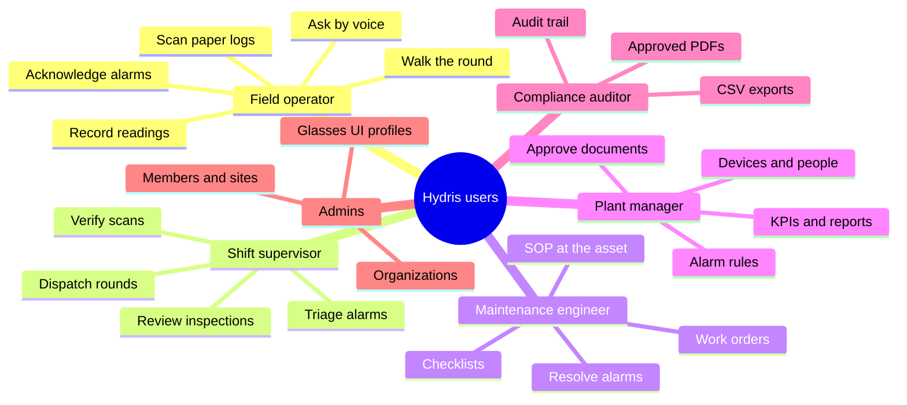

### Persona detail

#### Field operator

Ravi is 28, a diploma holder with six years on ETP shifts. He works 8-hour rotating shifts, often alone at night. He wears gloves and safety glasses, carries a sampling bottle and a radio, and has an Android phone in his pocket. His English reading is good; he speaks Hindi and Tamil at home. He wants fewer forms, clear instructions, and to be told quickly when something near him is wrong. He fears being blamed for a reading he copied from someone else.

What success looks like for Ravi: his round is on the glasses in order, each asset shows its live values with how fresh they are, he records a reading with two taps or a sentence, and his paper log becomes a verified PDF without retyping.

#### Shift supervisor

Meena runs a shift of four operators across two plants. She lives in the console during the day and on her phone at night. She needs to see open alarms by severity, who has them, and which rounds are late. She verifies scanned audit documents against the paper before her manager approves them.

#### Maintenance engineer

Arjun moves between pumps, blowers and dosing systems. He needs the work order, the checklist and the equipment manual at the asset, and he needs to close the loop on alarms: investigate, fix, resolve with a note.

#### Plant manager

Priya is accountable to the SPCB for discharge compliance and to her management for uptime and cost. She configures alarm rules, approves audit documents, decides which glasses features each role sees, and reads the reports.

#### Compliance auditor

Mr Rao is an internal or third-party auditor. He needs read-only access to approved records, the verification trail of every scanned document, and exports. He must never be able to change anything.

#### Administrators

The organization admin manages members, invitations, sites and glasses UI profiles. The Hydris platform admin creates and suspends customer organizations and has no access to tenant data by default.

## Jobs to be done and user journeys

### Jobs to be done

Table: Jobs to be done, with the requirements that serve them

| # | Job statement | Served by |
|---|---|---|
| J1 | When I start my round, I want my assigned inspections in order, so I do not miss an asset | FR-040, FR-041, FR-059 |
| J2 | When I stand at an asset, I want its live readings and how fresh they are, so I can trust what I record | FR-021, FR-026, FR-095 |
| J3 | When an alarm fires near me, I want to acknowledge it and see the recommended action and SOP, so the right person is accountable | FR-031, FR-032, FR-033, FR-112 |
| J4 | When I fill a paper log or receive a lab sheet, I want to capture it once and have it verified, so the record is searchable and defensible | FR-060 to FR-069 |
| J5 | When my hands are busy, I want to ask by voice and hear a short answer grounded in our data | FR-071, FR-072, FR-074 |
| J6 | As a manager, I want to control what each role sees on the glasses without shipping an app update | FR-054 |
| J7 | As an admin, I want to pair, reassign, suspend or revoke a pair of glasses in seconds | FR-050 to FR-053, FR-057 |
| J8 | As an auditor, I want every approved document and every change traceable to a person and a time | FR-065, FR-066, FR-082 |
| J9 | As a prospect, I want to try the product in minutes without talking to sales | FR-083, FR-091, FR-102 |

### Journey: an operator's shift

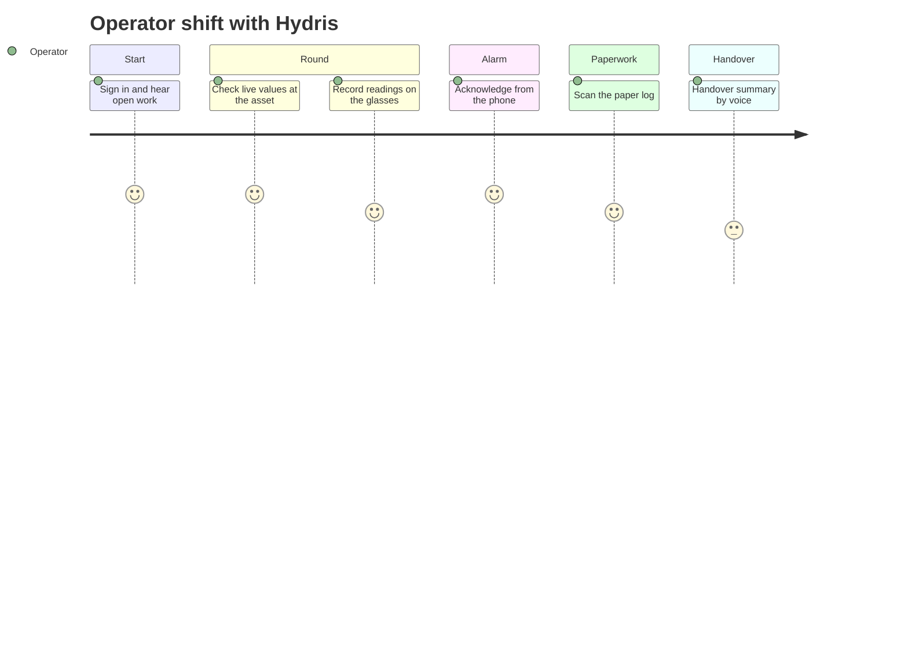

The shift journey shows where the product is strong today (alarm acknowledgement, scanning, voice lookups) and where it is weakest: the handover summary is a Planned capability, and inspection execution on the Android app is Planned (FR-044). Inspections are executed on the glasses heads-up app today.

### Journey: from paper record to approved evidence

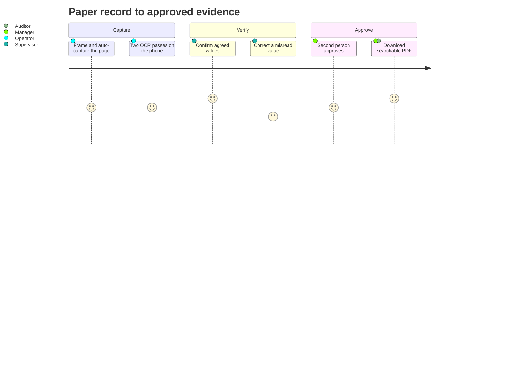

### Journey: evaluating Hydris

A prospect lands on the website, opens the live glasses demo (`/glasses?demo=1`, fully client-side synthetic data), and then signs in to the console or the Android app in demo mode with just their name (`POST /auth/demo`). Each guest gets an `org_admin` account in the demo tenant with personal copies of the demo owner's scheduled inspections and open maintenance tasks (`apps/api/src/core/demo-guests.ts`). Nothing they do affects other guests' work, and all data is clearly labelled synthetic.

## Product surfaces and scope

### System context

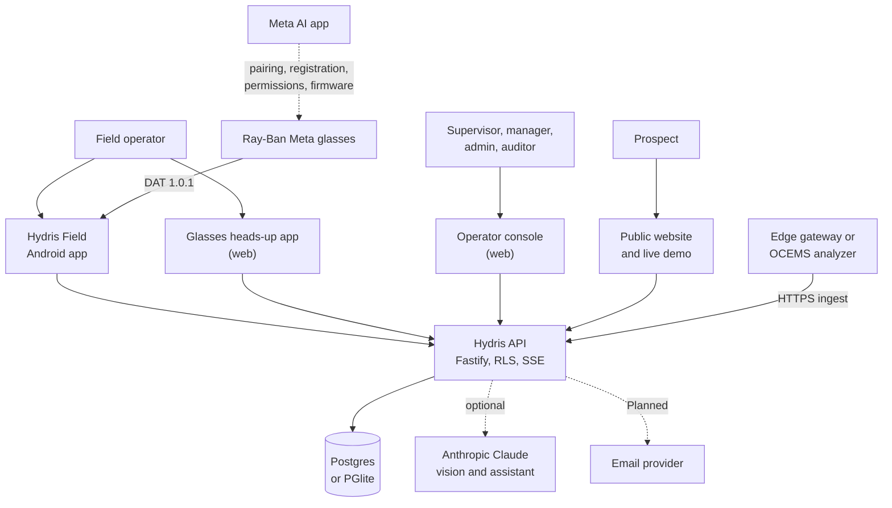

### Surfaces

Table: Product surfaces, where they live and their status

| Surface | Code | What it does | Status |
|---|---|---|---|
| Public website | `apps/web/src/app/(site)` | Seven pages (`/`, `/product`, `/technology`, `/operations`, `/demo`, `/contact`, `/privacy`), live glasses demo, contact and demo-request form | Built |
| Operator console | `apps/web/src/app/console/**` | Sixteen navigation sections in five groups (Operate, Work, Plant, People and devices, Insight) plus Admin, account and platform pages | Built |
| Glasses heads-up app | `apps/web/src/app/glasses`, `apps/web/src/glasses/*` | Twelve screens, directional input, offline inspection queue, audit scan, voice assistant, phone layout | Built (web). Native glasses display rendering Planned |
| Simulator and pairing | `/simulator`, `/pair` | Browser glasses simulator; approve a pairing code by QR or typed code | Built |
| Android app "Hydris Field" | `apps/android` | Sign-in, home, work, alarms, sensors, audit scan with ML Kit OCR, "Hey Hydris", glasses connection and registration through DAT | Partial: built in code, glasses paths not validated on hardware |
| Android WebView bridge | `apps/glasses-bridge-android` | Hosts the glasses web app and bridges DAT camera, speech, capture button and voice invocation | Partial: superseded by the native app for pilot |
| API | `apps/api` | 143 routes in 15 modules, RLS tenancy, SSE realtime, jobs, demo mode | Built |

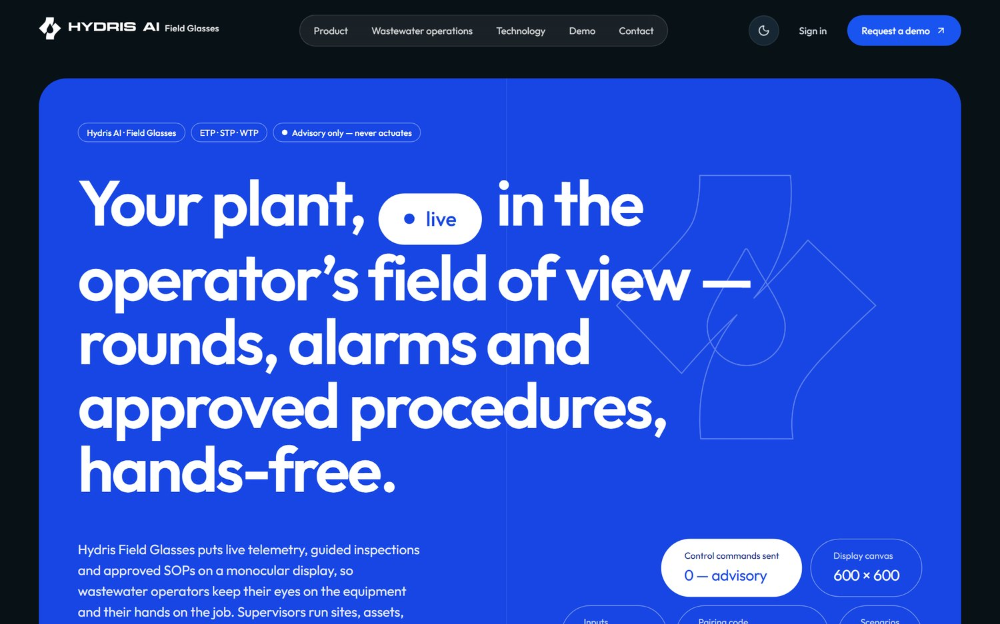


### Feature map

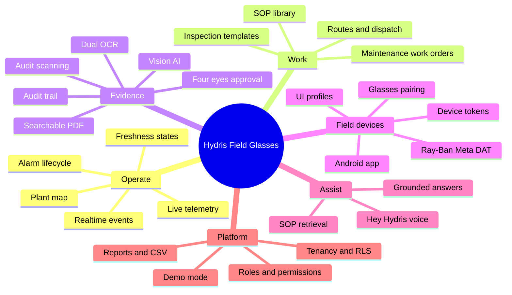

### In scope and out of scope

Table: Scope boundaries for the pilot and GA releases

| Area | In scope | Out of scope |
|---|---|---|
| Plant control | Read-only display of values, alarms and procedures | Any write to PLC, SCADA or equipment; setpoint changes |
| Data ingestion | HTTPS gateway push, manual and lab entry; MQTT and OPC UA adapters (Planned) | Direct fieldbus integration (Modbus, Profibus) inside Hydris |
| Devices | Ray-Ban Meta through DAT on Android; glasses web app on other runtimes and in a phone layout | Building custom glasses hardware; iOS before GA |
| Compliance | Records with provenance, verification and audit trail; exports | Certified OCEMS reporting to CPCB or SPCB servers; legal e-signature certification before FR-068 |
| AI | Grounded answers from tenant data; vision extraction with human verification | Autonomous decisions; free-form generation of procedures; answers from the open internet |
| Accounts | Invitations, MFA, sessions, SSO (Planned) | Self-serve signup for customer tenants (demo mode only) |
| Languages | English UI and voice | Hindi, Tamil, Marathi and Gujarati voice (Planned, Advanced phase) |

## Functional requirements

### How to read the requirement tables

Each table lists ID, requirement, MoSCoW priority (**M**ust, **S**hould, **C**ould, **W**on't this release), status, acceptance criterion and the surfaces involved (W website, C console, G glasses app, A Android app, P API). IDs from version 1.0 are unchanged. New IDs take the next free number inside the area's block of ten; new areas start a new block (FR-090 Android app, FR-100 website and demo, FR-110 documents and SOPs, FR-120 insights and compliance).

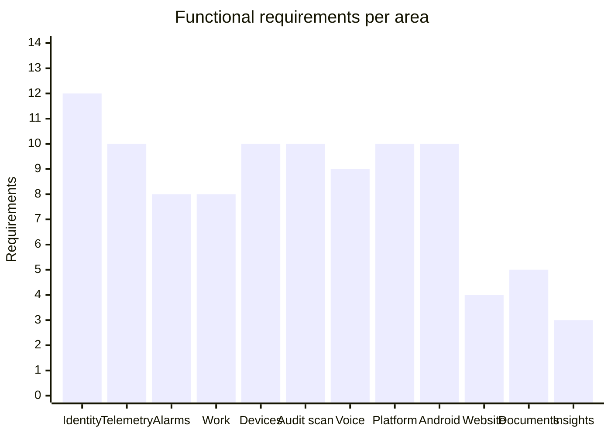

### Identity, tenancy and access

Hydris is multi-tenant from the first line of code. Every tenant table has row-level security; every request runs `SET LOCAL ROLE hydris_app` with the organization in `app.org_id`, so the database enforces isolation even if application code has a bug. Roles are a fixed matrix of six roles and 38 permissions; the API enforces it on every request and clients use it only to decide what to show.

Table: Identity, tenancy and access requirements

| ID | Requirement | Pri | Status | Acceptance criteria | Surface |
|---|---|---|---|---|---|
| FR-001 | Email and password sign-in with lockout after 5 failed attempts for 15 minutes | M | Built | Sixth attempt within the window returns `423 account_locked`; lockout clears after 15 min (`TTL.lockoutMs`) | C, A, P |
| FR-002 | TOTP MFA (setup, enable, disable, verify step) with the secret encrypted by `DATA_KEY` | S | Built | MFA user cannot obtain a session without a valid code; secret is never stored in clear | C, P |
| FR-003 | Refresh-token rotation with family revocation on reuse (30 s multi-tab grace) | M | Built | Reusing a rotated refresh token outside the grace window revokes the whole family | C, G, A, P |
| FR-004 | Invitations with a 7-day token and role assignment that cannot escalate above the inviter (`assignableRoles`) | M | Built (delivery depends on FR-086) | A factory manager cannot invite an org admin; expired tokens are refused | C, P |
| FR-005 | Password reset with a 30-minute single-use token | M | Partial | Token works once and expires in 30 min. Gap: the email is written to `mail_outbox` and not sent | C, P |
| FR-006 | Multi-organization membership and organization switch | S | Built | A user in two orgs switches with `/auth/switch-org` and sees only the new org's data | C, P |
| FR-007 | Site-scoped permissions for every role except `org_admin` | M | Built | A site-scoped supervisor cannot read alarms of another site (403/404) | All |
| FR-008 | Database-enforced tenant isolation (RLS) | M | Built | Cross-tenant reads return no rows even with a crafted ID (API test suite) | P |
| FR-009 | Session listing and revocation | S | Built | Revoking a session ends it on the next refresh | C, P |
| FR-010 | Platform organization management (create, suspend) | M | Built | Suspended org members cannot sign in to that org | C, P |
| FR-011 | Single sign-on with SAML 2.0 and OIDC per organization | S | Planned (GA) | An org admin configures an IdP; users sign in with it; local passwords can be disabled | C, A, P |
| FR-012 | Fixed role matrix: six roles, 38 permissions, no escalation path | M | Built | `can(role, permission)` is the only check; unit tests cover the matrix | All |

> [!NOTE]
> The Android app does not yet complete an MFA challenge. If an account has MFA enabled, the app tells the user to sign in on the web console first (`LoginScreen.kt`). That gap is tracked as FR-099.

### Plant model and telemetry

The plant model is a hierarchy: site, facility (ETP, STP, WTP, CETP, other), process area (13 kinds), asset (14 types), and sensors on assets. Sensors measure one of 16 measurands with defined units and decimals (`MEASURAND_DEFS`). Readings carry a source (`gateway`, `manual`, `lab`, `simulator`) and a quality. Freshness is derived from the sensor's expected interval: live within 2 times the interval, delayed within 5 times, stale beyond, and `no_data` when nothing was ever received.

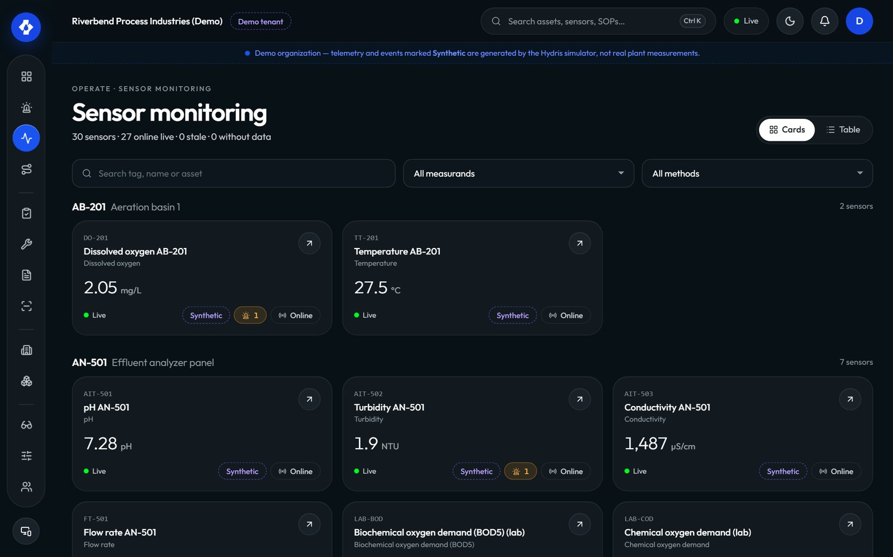

Table: Plant model and telemetry requirements

| ID | Requirement | Pri | Status | Acceptance criteria | Surface |
|---|---|---|---|---|---|
| FR-020 | Site, facility, process area and asset hierarchy with map positions, archive and restore | M | Built | Archived assets disappear from glasses and assistant answers and can be restored | C, G, P |
| FR-021 | Sensors for 16 measurands with unit normalization | M | Built | A reading in a compatible unit is stored in the canonical unit | C, P |
| FR-022 | HTTPS gateway ingestion `POST /ingest/v1/readings` with an `hgw_` API key, up to 500 readings per call, idempotent on sensor and timestamp | M | Built | Replaying the same batch creates no duplicates; a revoked key gets 401 | P |
| FR-023 | Manual and lab entry with provenance | M | Built | Entries show source "Manual" or "Lab" everywhere they appear | C, P |
| FR-024 | Append-only telemetry corrections (correct or invalidate) | M | Built | The original reading stays visible with its correction and author | C, P |
| FR-025 | History, raw readings and CSV export per sensor | S | Built | CSV export opens in a spreadsheet without formula injection (leading `=+-@` escaped) | C, A, P |
| FR-026 | Freshness states live, delayed, stale, no data; missing data never shown as a value | M | Built | A sensor with no readings shows "No data", never 0 | All |
| FR-027 | MQTT and OPC UA ingestion adapters | S | Planned (Advanced) | A gateway publishing over MQTT or OPC UA lands readings with the same guarantees as FR-022 | P |
| FR-028 | Read-only SCADA and historian connectors | C | Planned (Advanced) | Values from a historian appear with source and timestamp; no write path exists | P |
| FR-029 | Synthetic data is labelled everywhere and refused for non-demo tenants | M | Built | Simulator readings into a customer org are rejected with `synthetic_not_allowed`; DB check ties `synthetic` to `source = simulator` | All |

### Alarms

Alarms come from threshold rules (high-high, high, low, low-low) with a deadband (hysteresis) and an on-delay, or from a stale-data rule. An alarm has a severity (critical, high, medium, low) and moves through a five-state lifecycle. Acknowledging records that a person has seen it; it does not change the process. Resolving records that the condition was dealt with and requires a note. Closing archives the event after review.

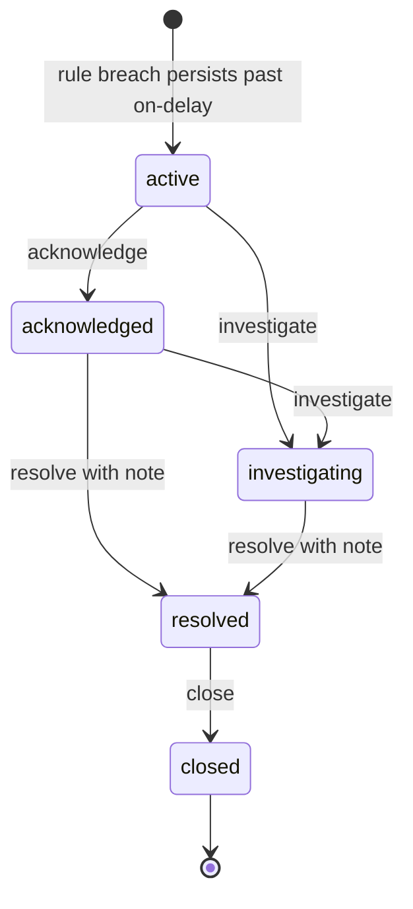

Table: Alarm transitions, permissions and who holds them

| Action | From | To | Permission | Note required | Held by |
|---|---|---|---|---|---|
| Acknowledge | active | acknowledged | `alarm.acknowledge` | No | All roles except viewer |
| Investigate | active, acknowledged | investigating | `alarm.investigate` | No | Admin, manager, supervisor, maintenance engineer |
| Resolve | acknowledged, investigating | resolved | `alarm.resolve` | Yes | Admin, manager, supervisor, maintenance engineer |
| Close | resolved | closed | `alarm.close` | No | Admin, manager, supervisor |

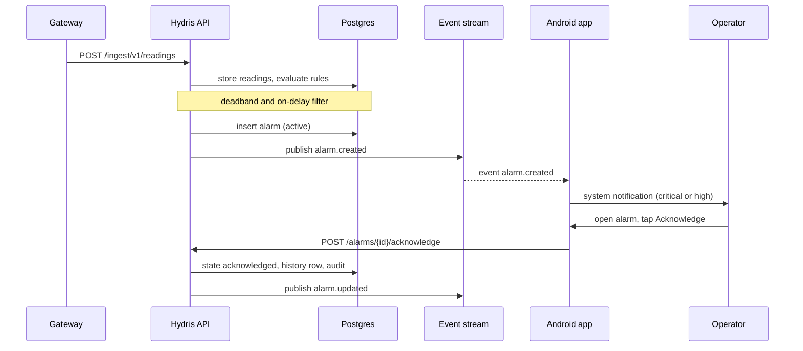


Table: Alarm requirements

| ID | Requirement | Pri | Status | Acceptance criteria | Surface |
|---|---|---|---|---|---|
| FR-030 | Threshold rules (high-high, high, low, low-low, stale) with deadband and on-delay | M | Built | A value oscillating inside the deadband does not raise or clear repeatedly; a breach shorter than the on-delay raises nothing | C, P |
| FR-031 | Lifecycle active, acknowledged, investigating, resolved, closed; no resolve from active; resolution note required | M | Built | `POST /alarms/{id}/resolve` without a note returns `400 note_required` | C, G, A, P |
| FR-032 | Assignment, notes, history, recommended action and linked SOP | M | Built | Alarm detail shows history with actors, the rule's procedure and follow-up tasks | C, A, P |
| FR-033 | Realtime push of alarm events to console, glasses and Android | M | Built | A new alarm appears without reload within the NFR-002 target | C, G, A, P |
| FR-034 | Push notifications through Firebase Cloud Messaging when the app is not running | S | Planned (GA) | A critical alarm reaches a phone whose app process is stopped | A, P |
| FR-035 | Stale-data alarms evaluated on a schedule | M | Partial | Long-running server evaluates every 30 s (`startJobs`). Gap: on Vercel the cron runs once a day (`vercel.json`, `0 3 * * *`) | P |
| FR-037 | Escalation when an alarm stays unacknowledged (notify supervisor after a configurable time) | S | Planned (Pilot) | An unacknowledged critical alarm notifies the site supervisor after N minutes; the escalation is in the alarm history | C, A, P |
| FR-038 | Alarm shelving with reason and expiry | C | Planned (GA) | A shelved alarm is hidden from the operator's active list until expiry; shelving is audited | C, P |

> [!NOTE]
> FR-036 from the draft of this edition (Android alarm notifications) was folded into FR-097 to keep Android requirements in one block. The ID is retired and will not be reused.

### Inspections and maintenance

Inspection templates are versioned and made of steps of five kinds: check, reading (with expected range), choice (with abnormal options), text and photo. Routes group templates in order and are dispatched to operators. An inspection moves through scheduled, in progress, paused, submitted, then approved or returned (rejected), or cancelled. A reading outside its expected range, a failed check or an abnormal choice marks the step abnormal automatically (`stepOutcome`).

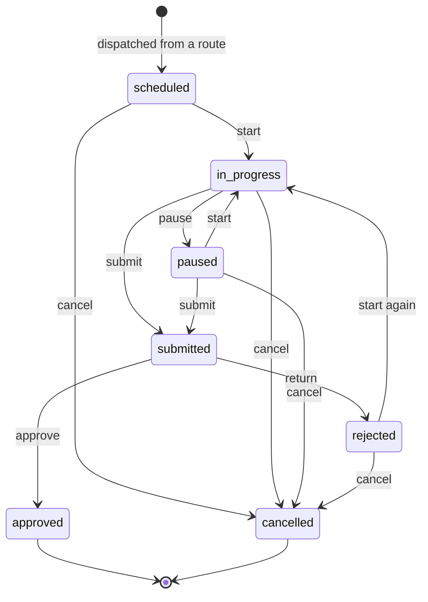

On the glasses, every step response is queued locally first and then flushed; replays are idempotent because each response carries a client operation ID (`apps/web/src/glasses/data.ts`). An operator who loses connectivity mid-round keeps working and the record syncs when the network returns. The "Glasses lose connectivity" demo scenario (`glasses_network_loss`) exercises exactly this.

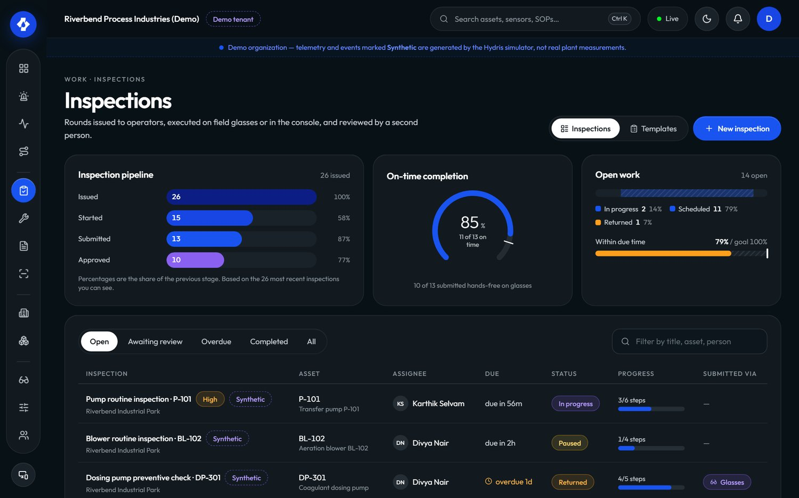

Maintenance tasks are corrective, preventive, inspection follow-ups or alarm follow-ups, with a priority (low to urgent), a checklist and an activity log. Their lifecycle is open, assigned, in progress, on hold, completed or cancelled, with reopen from completed or cancelled.

Table: Inspection and maintenance requirements

| ID | Requirement | Pri | Status | Acceptance criteria | Surface |
|---|---|---|---|---|---|
| FR-040 | Versioned inspection templates (check, reading, choice, text, photo) and routes with dispatch | M | Built | Editing a template creates a new version; dispatched inspections keep the version they were created with | C, P |
| FR-041 | Execution on the glasses with an offline queue and idempotent replay | M | Built | Responses recorded offline appear once after reconnect (Playwright journey) | G, P |
| FR-042 | Submit, review, approve or return | M | Built | A returned inspection can be restarted and resubmitted; history shows both submissions | C, G, P |
| FR-043 | Maintenance tasks with checklist, activity and follow-ups from alarms and inspections | M | Built | A follow-up created from an alarm links back to it and shows on the alarm detail | C, A, P |
| FR-044 | Inspection execution in the Android app (step entry, submit) | S | Planned (Pilot) | An operator completes a round on the phone with the same validation and offline guarantees as FR-041 | A, P |
| FR-045 | Photo steps captured with the glasses or phone camera | S | Partial | Photo steps and attachments exist (`/attachments`); the glasses app shows "attach from console" because camera capture is not wired to photo steps | G, A, P |
| FR-046 | Tick maintenance checklist items from the Android app | M | Built | Ticking an item on the phone updates the console task in realtime | A, P |
| FR-047 | Recurring preventive maintenance and inspection schedules (calendar or runtime based) | S | Planned (GA) | A weekly route generates inspections automatically; a runtime-hours rule creates a task when crossed | C, P |

### Devices and glasses

A pair of glasses becomes a Hydris device through a pairing flow shaped like the OAuth 2.0 Device Authorization Grant (RFC 8628). The glasses ask for a challenge and display a short code and a QR link; a signed-in person approves it on another device and chooses the site and operator; the glasses, holding a separate poll secret that is never displayed, then claim a device credential. The QR code never contains a credential.

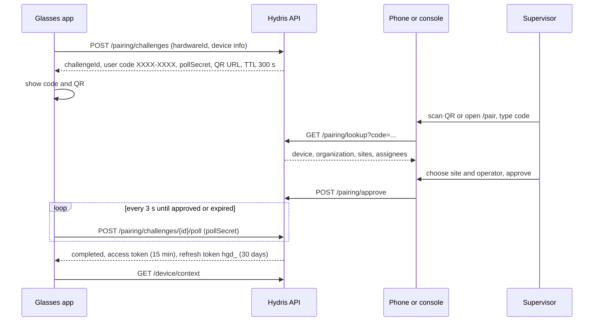

Device credentials are short-lived access tokens (15 minutes) plus a rotating 30-day refresh token with reuse detection. A session version on the device record lets an administrator invalidate every outstanding token at once. Suspending, revoking or unassigning a device takes effect on its next request and on the realtime stream's 30-second revalidation.

Device permissions are capped: whatever the assigned operator's role, a device can only do what `DEVICE_PERMISSIONS` allows. Managers further shape the glasses experience with **UI profiles**: versioned configurations of which screens are enabled and in what order, which home widgets show, which measurements are allowed and in which order per asset type, which actions are permitted, and layout (density, text scale, handedness). The server enforces the same configuration it sends to the device.

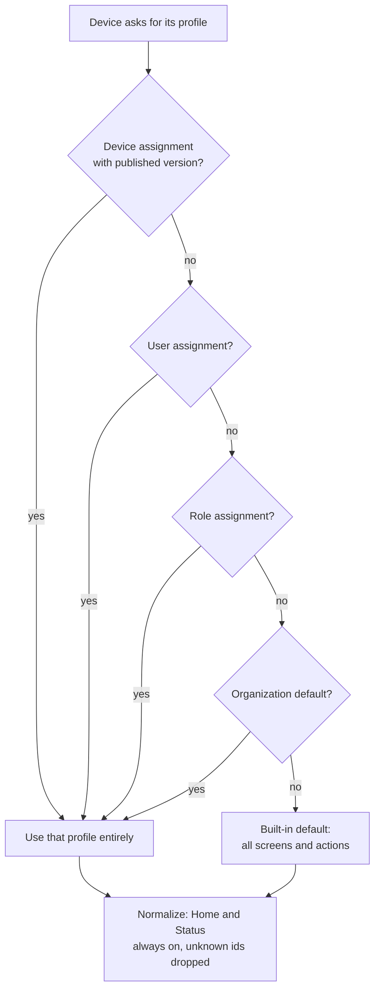


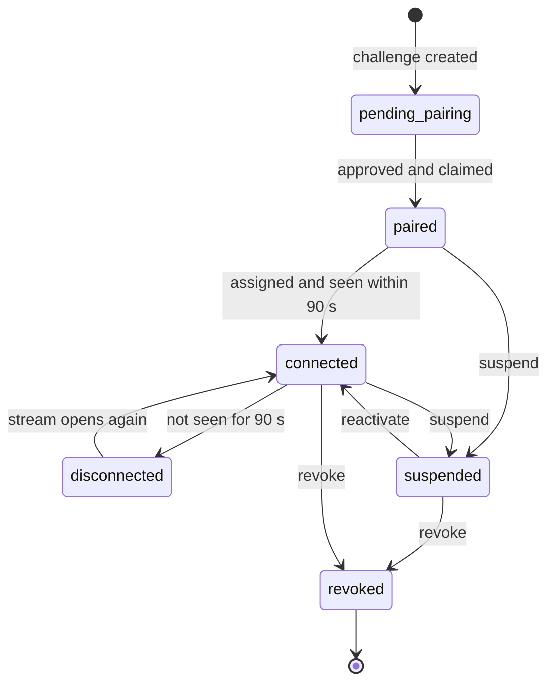

Table: Device and glasses requirements

| ID | Requirement | Pri | Status | Acceptance criteria | Surface |
|---|---|---|---|---|---|
| FR-050 | Pairing with an 8-character code (no 0, O, 1, I, L, U), QR link, 5-minute TTL, 3 s polling, approval with site and assignee | M | Built | Polling faster than 3 s returns `slow_down`; an expired code cannot be approved; a used code returns `already_used` (Playwright journey) | G, C, A, P |
| FR-051 | Device tokens: 15-minute access, 30-day rotating `hgd_` refresh with reuse detection, session version | M | Built | Reusing a rotated device refresh token revokes the token family and is audited | G, A, P |
| FR-052 | Suspend, reactivate, revoke, reassign; revocation effective on next request and within 30 s on the event stream | M | Built | A revoked device's open stream receives `session.ended` within 30 s | C, P |
| FR-053 | Device permission ceiling (`DEVICE_PERMISSIONS`) | M | Built | A device paired to an org admin still cannot manage members | P |
| FR-054 | UI profiles with draft, publish, rollback; precedence device, user, role, org; live push | S | Built | Publishing a profile changes the glasses screens without a reload; rollback restores the previous version | C, G, P |
| FR-055 | Ray-Ban Meta camera through DAT (preview stream and full-resolution photo) | M | Partial | Code complete in `GlassesManager.kt` and the WebView bridge. Gap: not validated on physical glasses | A |
| FR-056 | Glasses capture button takes the page photo or starts a scan | S | Partial | Short press emits a capture in `GlassesManager.captureButton`. Gap: not validated on hardware | A |
| FR-057 | The Android app registers the connected glasses as a Hydris device using the pairing endpoints | M | Partial | `Repository.registerGlasses` runs challenge, lookup, approve (first permitted site) and poll, then stores device tokens. Gap: depends on a real DAT device id; not validated on hardware | A, P |
| FR-058 | Log out and unpair from the glasses menu, ending the device's server sessions | M | Built | After `/device/logout` the device's refresh token is rejected and the glasses can be paired again by anyone | G, A, P |
| FR-059 | Glasses heads-up app with 12 screens and a six-key directional input vocabulary, plus a phone layout | M | Built | Every screen is reachable with up, down, left, right, select and back; browser back never leaves the app | G |

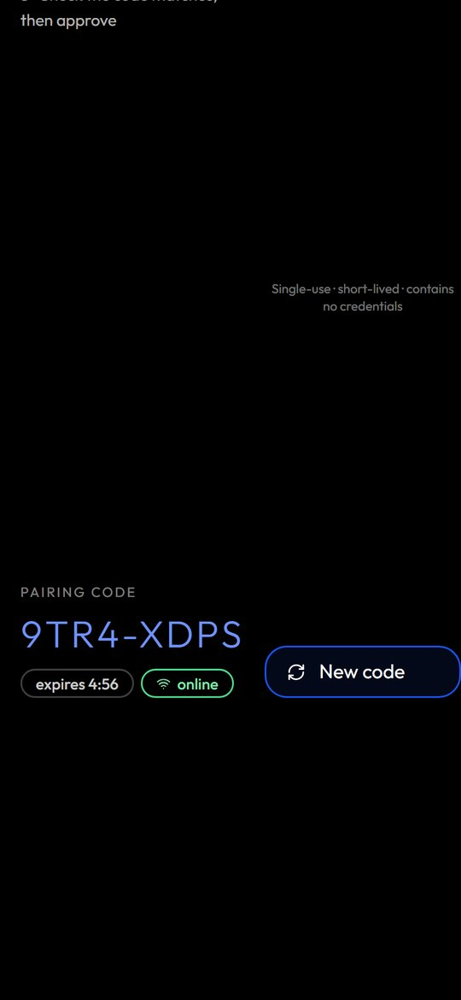

### Android app: Hydris Field

The native Android app is the operator's daily driver and the only supported way to reach Ray-Ban Meta glasses for the pilot. It is written in Kotlin with Jetpack Compose, targets Android 12 and later (min SDK 31, matching DAT), and uses the same API and session contract as the web console. It has five tabs (Home, Work, Scan, Hydris, Glasses) plus alarm and sensor detail screens (`apps/android/app/src/main/java/ai/hydris/field/ui/Root.kt`).

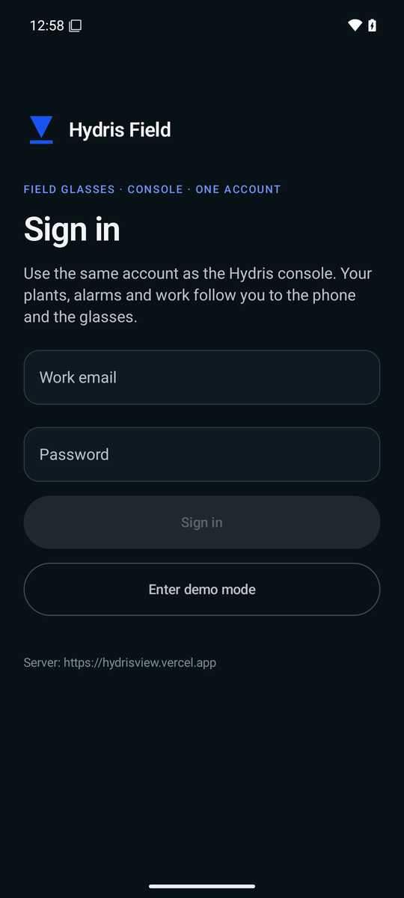

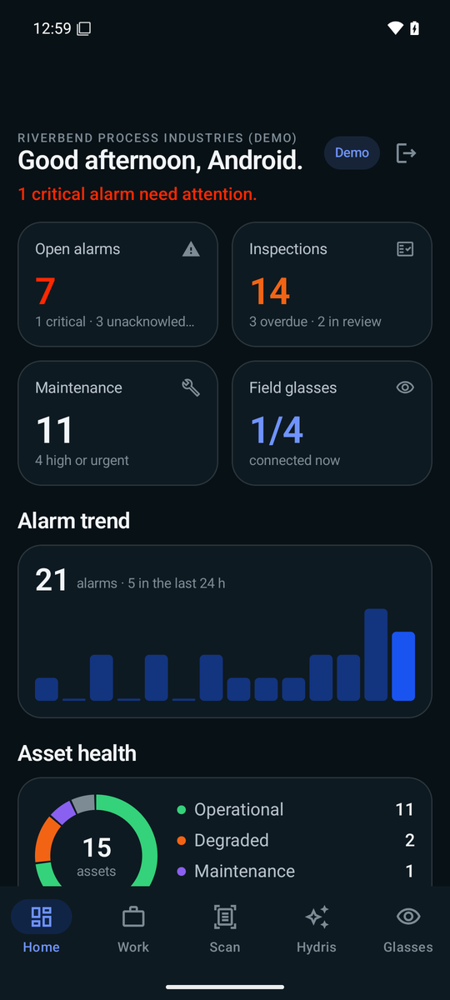

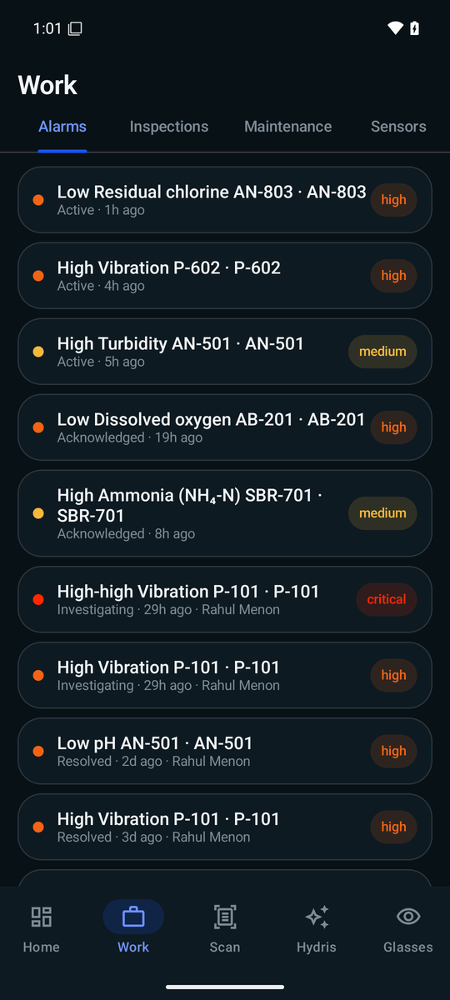

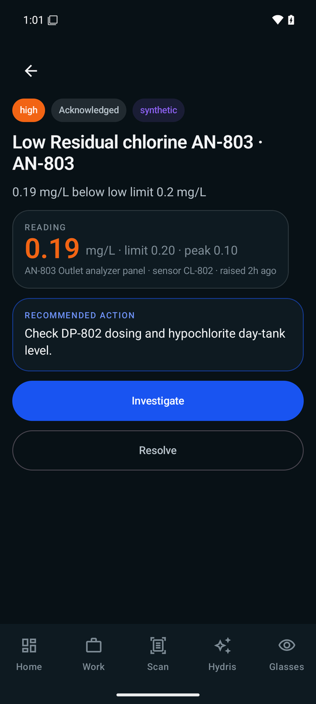

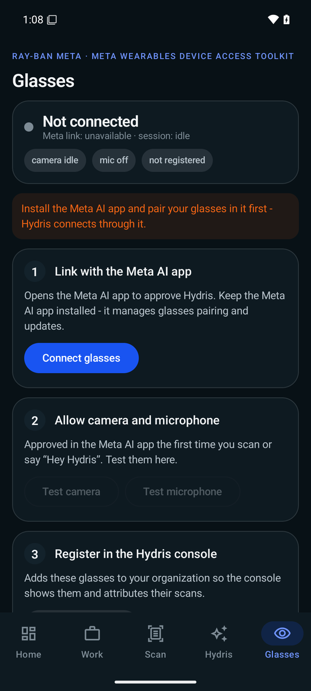

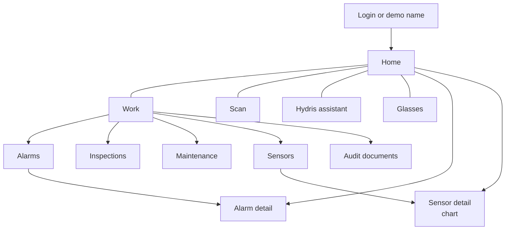

Table: Android app requirements

| ID | Requirement | Pri | Status | Acceptance criteria | Surface |
|---|---|---|---|---|---|
| FR-090 | Sign in with the console account; restore the session on restart from the refresh cookie, stored AES-256-GCM encrypted with a non-exportable Android Keystore key | M | Built | Killing and reopening the app restores the session without a password; no credential is stored in plain text (`SecureStore.kt`) | A |
| FR-091 | Demo mode sign-in with a name | M | Built | Entering a name of 2 or more characters opens a personal demo account | A |
| FR-092 | Home: greeting, 14-day alarm trend, asset health, live measurements with freshness and synthetic labels, recent activity | M | Built | Values marked synthetic in demo; stale values show their state | A |
| FR-093 | Work tabs: alarms, inspections, maintenance, sensors, audit documents | M | Built | Each tab lists only what the user's site scope allows | A |
| FR-094 | Alarm detail with lifecycle actions | M | Partial | Acknowledge, investigate and close work. Gap: Resolve sends no note, so the API returns `note_required`; the app also shows actions without checking `allowedActions` | A, P |
| FR-095 | Sensor detail with a 144-point history chart and min, typical and max | S | Built | Chart covers the history window with typical range from `MEASURAND_DEFS` | A |
| FR-096 | Audit scan from the glasses camera, the phone camera or an imported photo, with guided A4 capture, flattening, two ML Kit OCR passes and up to 6 pages | M | Built (phone). Glasses path Partial (FR-055) | A scan of the sample sheet reaches the console in review with values and engine agreement | A, P |
| FR-097 | Realtime alarm notifications: active critical or high alarms raise a system notification while the app runs | M | Built | `alarm.created` on the SSE stream raises a high-priority notification; reconnects resume with `Last-Event-ID` | A, P |
| FR-098 | Offline outbox for actions taken without connectivity (Room-backed, idempotent replay) | S | Planned (GA) | Alarm acknowledgements and checklist ticks made offline are sent once when the network returns | A |
| FR-099 | Complete MFA sign-in in the app | S | Planned (Pilot) | An MFA-enabled operator signs in on the phone with a TOTP code | A, P |

> [!RISK]
> FR-094 is a correctness gap a pilot operator will hit on day one: tapping Resolve in the Android app fails because the API requires a resolution note (FR-031). Fix before pilot: add a note dialog for Resolve and drive the buttons from the API's `allowedActions`.

### Audit document scanning

Audit scanning turns a paper record (inspection checklist, lab report, permit, calibration certificate, maintenance log) into a verified, searchable digital document. The design rule is dual verification: a machine cross-check of every value between independent readings, then a human review of every value and an independent approval by a second person.

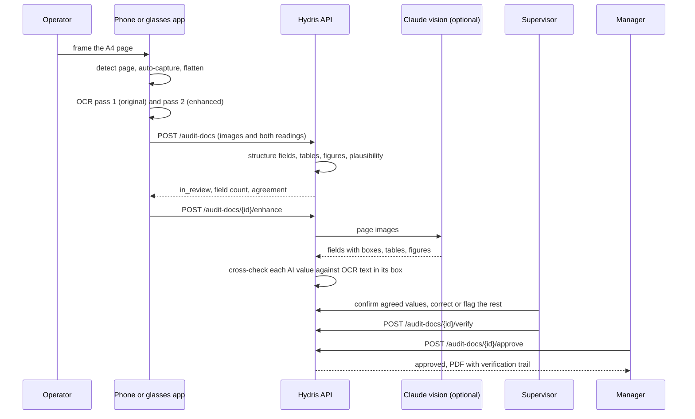


The document lifecycle is enforced by the API (`apps/api/src/modules/audit-docs.ts`). Every review action is appended to `audit_document_events`; corrections keep the first extracted value; concurrent edits are rejected with a revision check.

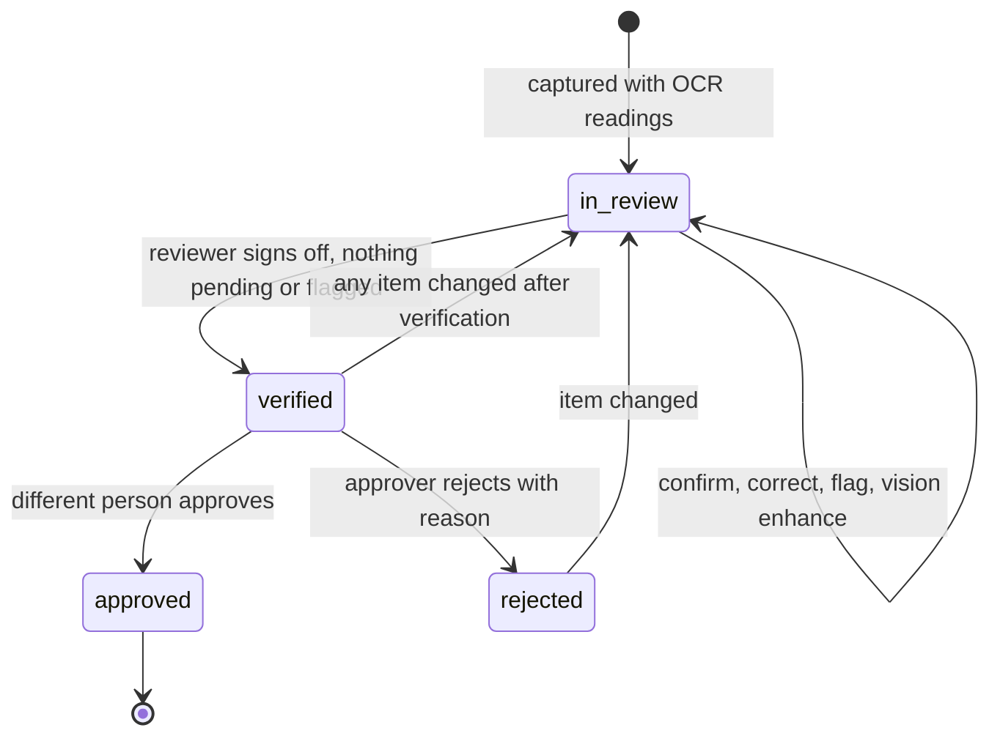


Table: Audit document scanning requirements

| ID | Requirement | Pri | Status | Acceptance criteria | Surface |
|---|---|---|---|---|---|
| FR-060 | Guided A4 capture with live page detection, auto-capture and perspective correction | M | Built (web `docdetect.ts`, Android `DocDetect.kt` with the same thresholds) | Capture fires only when the page is aligned, covers enough of the frame and is sharp | G, A, C |
| FR-061 | Dual-pass on-device OCR (`ocr:original`, `ocr:enhanced`) | M | Built (Tesseract.js on web, ML Kit on Android) | Two readings per page arrive at the API; no page image leaves the device before upload | G, A, C |
| FR-062 | Structuring into typed fields, tables and figures, with plausibility checks (pH 0 to 14, percentages, temperatures) | M | Built (`auditdoc.ts`) | An implausible pH is flagged with a message on the field | P |
| FR-063 | Optional vision engine (Claude) cross-checked against the OCR text inside each value's box | S | Built (needs `ANTHROPIC_API_KEY`) | Each vision value lists the OCR sources that agree or disagree; without a key the OCR result is kept and `aiStatus` is `unavailable` | P |
| FR-064 | Field review: confirm, correct, flag, reset; original value kept; verify requires zero pending and zero flagged items | M | Built | Verify with one flagged item returns `400 flagged_items`; a correction keeps `extracted` | C, P |
| FR-065 | Independent approval (four eyes); self-approval only in demo tenants and recorded as such | M | Built | The verifier approving their own document in a customer org gets 403 | C, P |
| FR-066 | PDF with verification trail, searchable original and reconstructed page | M | Built (`core/audit-pdf.ts`) | Text in the PDF original is selectable; the cover lists reviewer, approver and times | C, P |
| FR-067 | Up to 6 pages per document, each image at most 900 KB, JPEG or PNG validated by magic bytes | M | Built | A seventh page or a 1 MB page is refused with a clear message | P |
| FR-068 | Electronic signature with re-authentication and signature meaning (Part 11-style) | S | Planned (Advanced) | Approving asks for the password or MFA again and records the meaning of the signature | C, P |
| FR-069 | Bulk-confirm values where at least two independent engines match with confidence of 0.8 or more | S | Built (`confirm-agreed`) | Only multi-source, matching, confident items change to confirmed; the event lists their IDs | C, P |

> [!DECISION]
> Verification and approval are signed only by a person in the console (`p.kind !== 'user'` is refused). A device can capture and pre-review, but it cannot verify or approve. This keeps the evidentiary steps tied to an authenticated human session, not to a shared pair of glasses.

### Voice assistant and grounded assistance

"Hey Hydris" is a hands-free assistant. The wake phrase is detected on the client with a pattern tolerant of common recognition spellings ("hydras", "hi dris"); the question goes to `POST /assistant/ask`. The API answers with one of two engines:

- **Claude** (`claude-opus-5-5` with tool use) when an Anthropic credential is configured: natural phrasing and multi-step lookups through five read-only tools (`get_readings`, `get_open_alarms`, `get_my_work`, `get_asset`, `search_procedures`), at most five tool rounds.
- **A deterministic rules engine** otherwise, and as the fallback when the model fails: readings, alarms, my work, asset status, procedures and help. It never guesses; anything else gets "I can't answer that from your plant data".

Every tool is scoped to the caller (RLS plus site scope), so the assistant can only say what the caller could see in the console. Answers return `facts` (label, value, unit, time, source) so the client can show the evidence under the spoken answer.

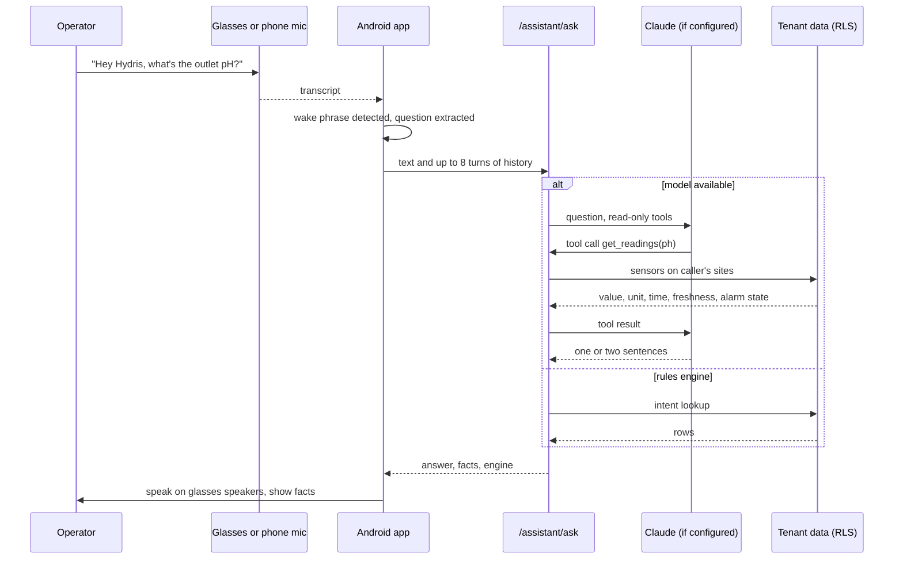

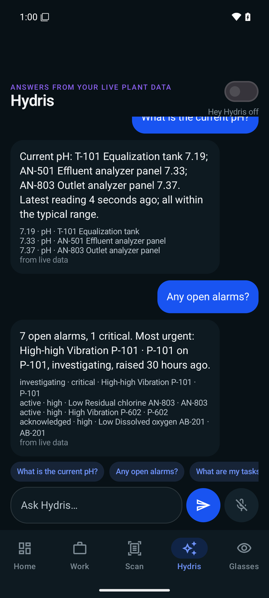

Table: Voice and assistance requirements

| ID | Requirement | Pri | Status | Acceptance criteria | Surface |
|---|---|---|---|---|---|
| FR-070 | Grounded SOP retrieval (`/assist`) with passages from approved documents and a safety notice | M | Built | Responses contain only approved documents and always include the safety notice | G, C, P |
| FR-071 | "Hey Hydris" wake phrase and short spoken answers | M | Built (web Web Speech API; Android SpeechRecognizer and TextToSpeech) | Saying the wake phrase and a question produces a spoken answer; "stop" or "thanks" ends the follow-up window | G, A |
| FR-072 | `/assistant/ask` answers only from tenant data through scoped tools; rules fallback never guesses | M | Built | An unknown question returns intent `unknown`; every number in an answer appears in `facts` for rules answers | G, A, P |
| FR-073 | Multi-language voice (Hindi, Tamil, Marathi, Gujarati) | S | Planned (Advanced) | A Hindi question returns a Hindi answer with the same grounding guarantees | G, A, P |
| FR-074 | Glasses microphone through DAT Speech with phone-microphone fallback; answers played through TextToSpeech on the glasses' open-ear speakers | M | Partial | Phone path built in `VoiceEngine.kt`. Gap: glasses microphone path not validated on hardware | A |
| FR-075 | Answers show the facts behind them with source, and label synthetic data | M | Built | A demo answer's facts show "synthetic demo data" | G, A, P |
| FR-076 | Follow-up questions with conversation history (up to 8 turns accepted by the API) | S | Built | "And the inlet?" after a pH question is answered for the inlet | G, A, P |
| FR-077 | "Hey Meta, start Hydris" voice invocation opens the assistant | C | Partial (WebView bridge only; DAT feature is experimental) | Voice invocation intent opens the assistant screen | A |
| FR-078 | The assistant has no write tools and cannot change any record or equipment state | M | Built | The tool list contains only read tools; the system prompt forbids operating equipment | P |

### Documents and SOPs

Table: Document and SOP requirements

| ID | Requirement | Pri | Status | Acceptance criteria | Surface |
|---|---|---|---|---|---|
| FR-110 | Document library (SOP, manual, datasheet, safety notice, troubleshooting) with draft, approved and archived states, versions, and site, asset or asset-type scope | M | Built | Only `document.manage` holders approve; versions increment on change | C, P |
| FR-111 | Only approved documents reach the glasses, the assistant and `/assist` | M | Built | A draft SOP never appears in a glasses search or assistant answer | G, A, P |
| FR-112 | Alarm rules link a procedure document shown with the alarm | M | Built | Alarm detail shows the linked SOP title and opens it | C, G, P |
| FR-113 | SOPs read on the glasses are cached for offline reading | S | Built (`glasses/data.ts` cache) | A previously opened SOP opens with no network | G |
| FR-114 | Upload PDF manuals and SOPs with text extraction for retrieval | C | Planned (GA) | An uploaded PDF becomes searchable by `/assist` after approval | C, P |

### Insights, reports and platform

Table: Platform requirements

| ID | Requirement | Pri | Status | Acceptance criteria | Surface |
|---|---|---|---|---|---|
| FR-080 | Realtime server-sent events with `Last-Event-ID` replay; memory or database mode | M | Built | Reconnecting with the last ID replays missed events; DB mode works across serverless instances | C, G, A, P |
| FR-081 | Reports (inspections, alarms, maintenance, devices, operators) in JSON and CSV | M | Built | Alarm report includes median minutes to acknowledge; inspection report includes on-time rate and glasses share | C, P |
| FR-082 | Append-only audit trail | M | Built | No API path updates or deletes audit events | C, P |
| FR-083 | Demo mode: zero-configuration synthetic tenant, named guests, cross-instance pairing | M | Built | A deployment with no environment variables serves a working demo | All |
| FR-084 | Deterministic simulation scenarios, demo tenants only | M | Built | Ten scenarios run; starting one in a customer org is refused | C, P |
| FR-085 | In-app notifications | M | Built | Notifications appear in realtime and can be marked read | C, G, A, P |
| FR-086 | Email delivery (SMTP, SES or Resend) for `mail_outbox` | M | Planned (Hardening) | Invitation and reset emails arrive; failures retry and are visible to admins | P |
| FR-087 | Audit log page with filters | M | Built | Auditor filters by action and entity and sees actor, time and IP | C, P |
| FR-088 | Global search across assets, sensors, documents and work | S | Built (`/search`) | Typing an asset tag finds the asset and its open work | C, P |
| FR-089 | Overview dashboard with KPIs, open alarms, health and live measurements | M | Built (`/overview`) | Console overview and Android home load from the same endpoint | C, A, P |

Table: Insights and compliance requirements

| ID | Requirement | Pri | Status | Acceptance criteria | Surface |
|---|---|---|---|---|---|
| FR-120 | Compliance summary per discharge point: daily minimum, maximum and average against consent limits, with data availability | S | Planned (Pilot) | A manager exports a monthly summary for the final outlet with gaps and exceedances marked | C, P |
| FR-121 | Scheduled report delivery by email | C | Planned (GA) | A weekly alarm report arrives every Monday (depends on FR-086) | P |
| FR-122 | Shift handover summary generated from the shift's alarms, work and readings, grounded and editable before sending | C | Planned (GA) | The outgoing operator reviews a summary whose every number links to a record | A, C, P |

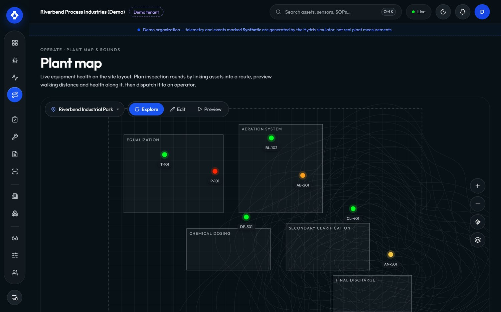

### Website, demo and public

Table: Website, demo and public requirements

| ID | Requirement | Pri | Status | Acceptance criteria | Surface |
|---|---|---|---|---|---|
| FR-100 | Marketing website with seven pages and a privacy page | M | Built | Pages render on phone and desktop, light and dark | W |
| FR-101 | Contact and demo-request form `POST /public/inquiries`, rate limited to 5 per 10 minutes per client | M | Built | The sixth submission within 10 minutes is refused | W, P |
| FR-102 | Live glasses demo from the website (`/glasses?demo=1&scenario=...`), fully client-side, and the browser simulator | M | Built | The demo runs with no API calls and shows scenario events | W, G |
| FR-103 | Named demo guests: each guest is an `org_admin` in the demo tenant with personal copies of scheduled inspections and open tasks | M | Built | Two guests acting at once do not see each other's personal work changes | C, A, P |

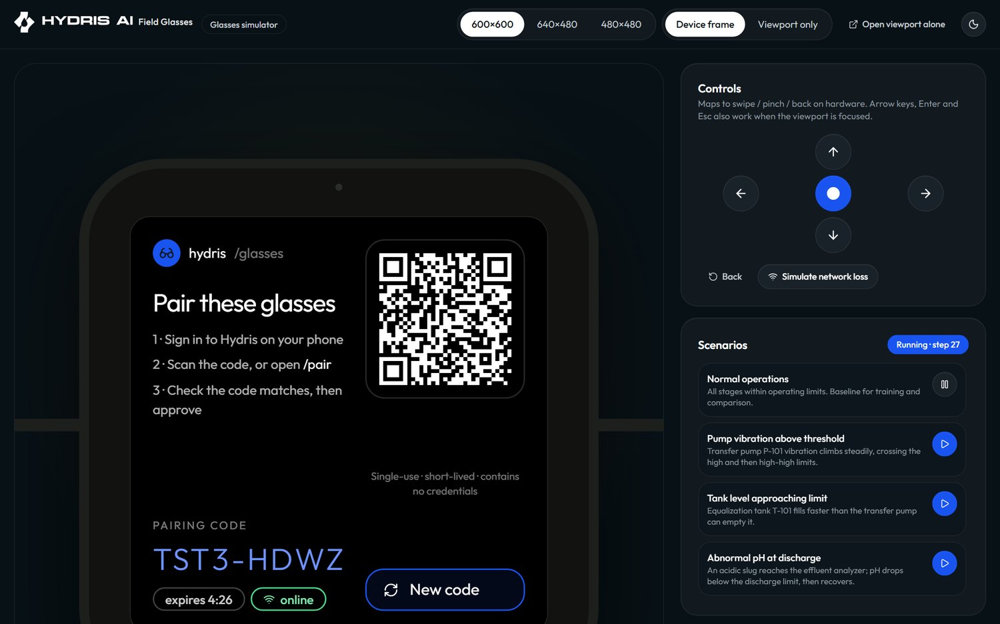

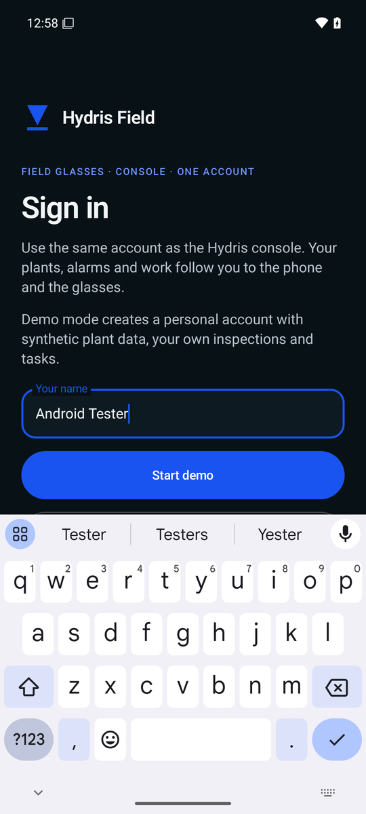

### Requirement status overview

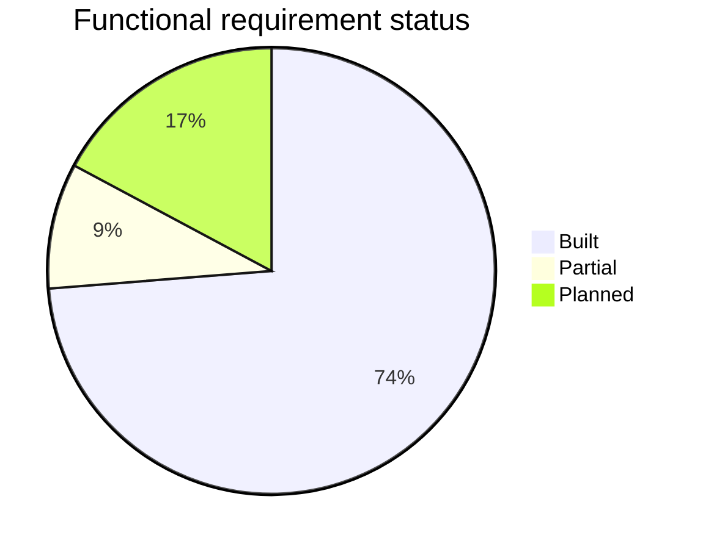

## Non-functional requirements

Non-functional requirements apply across surfaces. IDs are new in this edition (version 1.0 listed the same areas without IDs). Values are targets unless a measurement is named.

### Performance and responsiveness

Table: Performance requirements

| ID | Requirement | Pri | Status | Target and verification |
|---|---|---|---|---|
| NFR-001 | API read latency | M | Partial (not yet measured) | Target p95 under 300 ms for reads in-region; verify with load tests before pilot |
| NFR-002 | Realtime alarm delivery from creation to client | M | Built (design); not measured | Target 2 s or less. Memory mode is immediate; DB mode polls every 1.5 s (`realtime.ts`) |
| NFR-003 | Voice answer time from end of speech to start of spoken answer | M | Partial (not measured) | Targets: 3 s with the rules engine, 8 s with the model engine |
| NFR-004 | OCR time per page on a mid-range phone | S | Partial (not measured) | Target 15 s or less per page for both passes |
| NFR-005 | Glasses home screen ready after wake | S | Planned (measure) | Target 2 s from cached context; fresh data within 5 s |

### Availability, scalability and operations

Table: Availability and operations requirements

| ID | Requirement | Pri | Status | Target and verification |
|---|---|---|---|---|
| NFR-006 | Service availability | M | Planned (measure) | Targets: 99.5 % monthly in pilot, 99.9 % at GA, measured by external uptime checks |
| NFR-007 | Horizontal scale of realtime | M | Built | `REALTIME_MODE=db` supports serverless and multiple instances; memory mode is single-instance only |
| NFR-008 | Scheduled jobs (stale rules, pairing expiry, event pruning) run at a cadence suitable for real data | M | Partial | Long-running server: 30 s, 60 s and hourly timers. Vercel: daily cron only; fix in Hardening |
| NFR-009 | Backups and restore | M | Planned | Daily backups, point-in-time recovery on managed Postgres, restore tested each quarter |
| NFR-010 | Continuous integration on every change | M | Planned (Hardening) | Typecheck, unit, API and e2e tests on every pull request; no `.github` workflows exist today |

### Security and privacy

Table: Security and privacy requirements

| ID | Requirement | Pri | Status | Target and verification |
|---|---|---|---|---|
| NFR-011 | Tenant isolation enforced in the database | M | Built | RLS on every tenant table; requests run as `hydris_app` without BYPASSRLS; API tests cover cross-tenant access |
| NFR-012 | Short-lived credentials | M | Built | 15-minute access tokens (12 h in demo mode only); rotating refresh tokens with reuse detection |
| NFR-013 | Rate limiting | M | Built | Global 600 requests per minute per client; sign-in 10 per minute; pairing endpoints 10 to 40 per minute; public form 5 per 10 minutes |
| NFR-014 | Secrets at rest | M | Built | MFA secrets encrypted with `DATA_KEY`; tokens stored as SHA-256 hashes; Android credentials in Keystore-backed AES-256-GCM |
| NFR-015 | Camera only on explicit intent; no continuous recording | M | Built | Camera streams only while a scan screen is open (`startPreview` and `stopPreview`); no background capture |
| NFR-016 | Images stored only for audit documents and attachments | M | Built | No other path persists camera frames |
| NFR-017 | Data residency in India for Indian customers | S | Planned (GA) | Production database, storage and model inference in an Indian region, documented per tenant |
| NFR-018 | Independent penetration test before GA | M | Planned (GA) | No open high or critical findings at launch |

> [!WARNING]
> The glasses web app keeps its device refresh token in browser `localStorage` (`apps/web/src/glasses/link.ts`). That is acceptable for the simulator and demo, not for production glasses. The native Android app already stores device tokens in the Keystore-backed `SecureStore`, which is one reason the native app, not the WebView bridge, is the pilot path.

### Accessibility, glanceability and hands-free use

Table: Accessibility and hands-free requirements

| ID | Requirement | Pri | Status | Target and verification |
|---|---|---|---|---|
| NFR-019 | Glasses text scale per profile | M | Built | Scales 0.9, 1, 1.15 and 1.3 (`UI_TEXT_SCALES`), clamped to 0.85 to 1.4 |
| NFR-020 | Additive-display friendly design | M | Built (assumption to verify on hardware) | Pure black renders as transparent; 600 by 600 viewport assumption (`GLASSES_DISPLAY`) |
| NFR-021 | Every glasses action reachable with six directional keys or voice | M | Built | Keyboard, swipe and simulator controls map to up, down, left, right, select, back |
| NFR-022 | Spoken answers are short | M | Built | One or two sentences (assistant system prompt); units spoken in words |
| NFR-023 | Console and Android meet WCAG 2.2 AA | S | Partial (not audited) | Automated and manual accessibility audit before GA; contrast in light and dark themes |
| NFR-024 | Large touch targets for gloved use on Android | S | Built | Primary buttons are 52 to 54 dp tall in the scan, login and alarm screens |

### Offline, battery and device constraints

Table: Offline and device requirements

| ID | Requirement | Pri | Status | Target and verification |
|---|---|---|---|---|
| NFR-025 | Inspection responses survive connectivity loss on the glasses | M | Built | Queue plus idempotent replay; Playwright journey and `glasses_network_loss` scenario |
| NFR-026 | Last context and SOPs readable offline on the glasses | S | Built | Cached with timestamp; shown as cached, never as live |
| NFR-027 | Android offline outbox | S | Planned (GA) | See FR-098 |
| NFR-028 | Battery: a 4-hour shift on Ray-Ban Meta with up to 20 scans | S | Planned (measure) | Camera streams only on the scan screen; Android preview frames throttled to at most one per 100 ms; speech restarted only while enabled |
| NFR-029 | Android 12 or later (min SDK 31) | M | Built | Matches DAT requirements |

### Data integrity and maintainability

Table: Data integrity and maintainability requirements

| ID | Requirement | Pri | Status | Target and verification |
|---|---|---|---|---|
| NFR-030 | Provenance on every reading; synthetic data impossible in customer tenants | M | Built | DB check `telemetry_synthetic_source_ck`; ingest refuses simulator data for non-demo orgs |
| NFR-031 | Optimistic concurrency on review records | M | Built | Audit document edits carry a revision; stale writes get `409 stale` |
| NFR-032 | Shared domain logic between server and clients | M | Built | State machines, permissions, freshness and voice parsing live in `packages/domain`; Android ports keep identical thresholds |
| NFR-033 | Automated test coverage of security-critical paths | M | Built | 67 tests passing (26 domain, 41 API) on 22 Oct 2026; 4 Playwright journeys |
| NFR-034 | Observability | S | Planned (Pilot) | Structured logs, error tracking and uptime alerts with an on-call runbook |

## Data and AI requirements

### Data principles

1. **Tenant data stays in the tenant.** All AI calls are made with data the caller is already allowed to see, fetched through the same RLS-scoped queries as the console.
2. **The model never sees more than it needs.** The assistant receives tool results for the question asked, not a dump of the database. Vision extraction receives only the page images of the document being processed.
3. **Nothing the model says becomes a record without a person.** Vision-extracted values enter the review as `pending`; a reviewer confirms each one and a second person approves.
4. **Every AI output is attributable.** Audit documents record which engines produced each value (`engines`, `sources`); assistant responses say which engine answered (`engine: claude-opus-5-5` or `hydris-rules`).

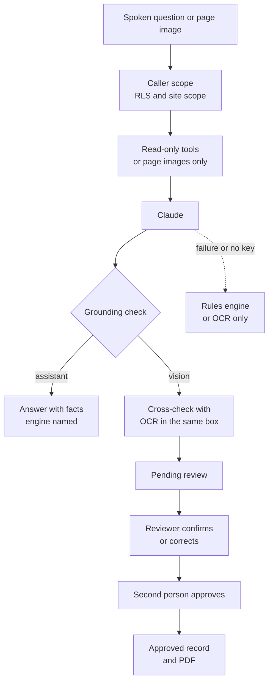

### Grounding requirements

Table: Data and AI requirements

| ID | Requirement | Pri | Status | Acceptance criteria |
|---|---|---|---|---|
| NFR-035 | The assistant uses only values returned by tools in the same conversation | M | Built (prompt and tool design) | Evaluation set: zero answers containing a number absent from tool results (target) |
| NFR-036 | The assistant states the age of a reading and says plainly when it is stale, missing, out of range or in alarm | M | Built | Rules answers include "measured N minutes ago"; stale readings add "not current, check the sensor" |
| NFR-037 | Graceful degradation without the model | M | Built | Any model error falls back to the rules engine; vision failure keeps OCR results with `aiStatus = failed` and the reason |
| NFR-038 | Vision transcribes faithfully: no correcting, normalizing or inferring illegible values | M | Built (system prompt) | Illegible areas appear in warnings with low confidence |
| NFR-039 | Human-in-the-loop for every AI-extracted value | M | Built | No document reaches `verified` with pending or flagged items |
| NFR-040 | Model choice and data handling documented per tenant, including region | S | Planned (GA) | Tenant settings show which model provider and region process its data |

### Accuracy targets

Table: AI and OCR quality targets (targets, not measurements)

| Measure | Target for pilot | How it will be measured |
|---|---|---|
| Fields where independent engines agree (`agreement = match`) | 90 % or more on typed forms | Agreement score per document in the console; pilot sample of 200 pages |
| Fields a reviewer has to correct | under 5 % | Ratio of `corrected` to all reviewed fields |
| Vision false confidence (value confirmed by engine agreement but wrong on paper) | under 0.5 % | Blind re-check of 100 approved documents |
| Assistant answers with facts (not "can't answer") | 85 % or more of real operator questions | Intent logging on `/assistant/ask` (engine, intent) |
| Assistant answers with a number not in its facts | 0 | Automated check on logged answers and facts |

> [!IMPORTANT]
> The assistant and vision engine run on `claude-opus-5-5` when `ANTHROPIC_API_KEY` is set (`voice-assistant.ts`, `core/vision-extract.ts`). Before a customer pilot the tenant must agree to that processing, and the deployment must record where inference runs. Until then, pilots can run with the rules engine and OCR only, which are fully on Hydris infrastructure and the device.

## Success metrics and KPIs

### North star

**Verified field records per active operator per week**: the number of inspections submitted, alarms acknowledged within target, and audit documents approved, divided by the number of operators who used Hydris that week. It rises only when operators use the product in the field and the records it produces are trusted.

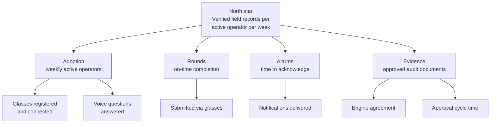

### Metrics and targets

Table: KPIs with definitions, sources and pilot targets

| Area | Metric | Definition and source | Pilot target |
|---|---|---|---|
| Adoption | Weekly active operators | Operators with at least one record in a week divided by licensed operators | 70 % or more |
| Rounds | On-time completion | `onTimeRate` in the inspections report | 95 % or more |
| Rounds | Time per inspection | Median start to submit, compared with the paper baseline | 30 % lower than paper |
| Rounds | Share submitted via glasses | `viaGlasses` in the inspections report | 50 % or more |
| Alarms | Time to acknowledge | `medianMinutesToAcknowledge` in the alarms report | under 5 minutes for critical and high |
| Alarms | Acknowledged but unresolved backlog | Count of alarms in acknowledged or investigating older than 24 h | Visible daily; trending down |
| Evidence | Engine agreement | Average agreement score of approved documents | 90 % or more |
| Evidence | Reviewer edits | Corrected fields divided by reviewed fields | under 5 % |
| Evidence | Approval cycle | Capture to approval, median | under 24 hours |
| Voice | Answered with facts | Share of questions with intent other than `unknown` | 85 % or more |
| Trust | Hallucinated numbers | Numbers in answers missing from facts | 0 |
| Security | Cross-tenant incidents | Confirmed data exposure across tenants | 0 |
| Security | Device revocation time | Revoke to `session.ended` on the stream | 30 s or less |

> [!NOTE]
> Most adoption and round metrics already have a data source in `/reports/:kind` (`apps/api/src/modules/insights.ts`). The voice and agreement metrics need lightweight logging that is Planned for the pilot (part of NFR-034).

## Release plan and milestones

### What has shipped

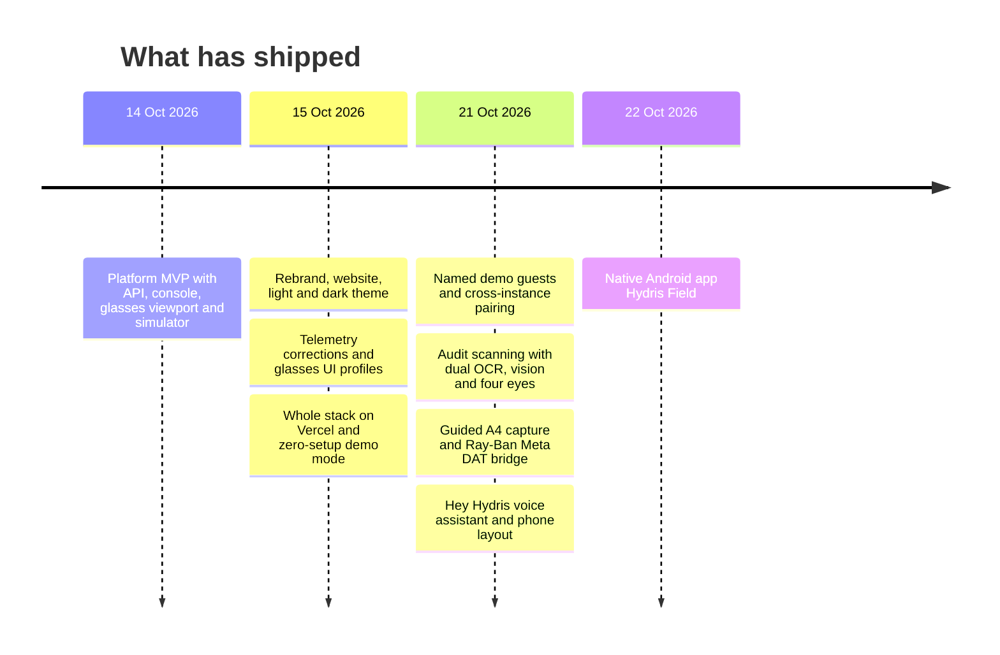

### Phases

Table: Release phases, scope and exit criteria

| Phase | When | Scope | Exit criteria |
|---|---|---|---|
| 0. MVP | Done (to October 2026) | API, console, glasses app, simulator, pairing, UI profiles, audit scanning, voice, demo mode, native Android app in code | Live demo; 67 tests passing |
| 1. Hardening | Q4 2026 | Email transport (FR-086), CI (NFR-010), job cadence on serverless (FR-035, NFR-008), Android fixes (FR-094, FR-099), audit page images to object storage, observability baseline | All Must requirements for pilot are Built or have an agreed workaround |
| 2. Hardware validation | Q4 2026 to Q1 2027 | Ray-Ban Meta on the test matrix: camera, capture button, speech, registration (FR-055, FR-056, FR-057, FR-074); battery measurement (NFR-028) | Every glasses requirement moves from Partial to Built or is descoped with a phone fallback |
| 3. Pilot | Q1 2027 | One or two Indian plants (ETP or STP), 10 to 30 operators, gateway ingestion, compliance summary (FR-120), escalation (FR-037), Android inspections (FR-044) | KPI baselines captured; pilot targets met or explained; customer sign-off |
| 4. GA | Q2 2027 | FCM push (FR-034), Android offline outbox (FR-098), SSO (FR-011), India-region production (NFR-017), pen test (NFR-018), recurring schedules (FR-047), Play or MDM distribution | Store or MDM release approved; security review passed |
| 5. Advanced | H2 2027 onwards | MQTT and OPC UA (FR-027), SCADA connectors (FR-028), multi-language voice (FR-073), e-signatures (FR-068), native glasses display, predictive maintenance, LIMS, iOS | Driven by customer demand |

```mermaid
%% caption: Release plan (indicative dates)
gantt
  dateFormat YYYY-MM-DD
  title Hydris Field Glasses release plan
  section Foundation
  MVP platform                     :done, m0, 2026-10-14, 2026-10-22
  Hardening                        :h1, 2026-10-23, 45d
  section Glasses
  Hardware validation              :g1, 2026-11-15, 60d
  Pilot release channel            :g2, after g1, 20d
  section Pilot
  Pilot at one or two plants       :p1, 2027-01-15, 75d
  section GA
  Push, offline, SSO               :ga1, 2027-03-01, 60d
  Pen test and India region        :ga2, 2027-03-01, 75d
  Store or MDM distribution        :ga3, 2027-04-15, 45d
  section Advanced
  MQTT and OPC UA ingestion        :a1, 2027-07-01, 60d
  Multi-language voice             :a2, 2027-07-01, 90d
  E-signatures and LIMS            :a3, 2027-10-01, 90d
```

### Prioritisation

Planned and Partial work was scored for value to the pilot customer and engineering effort by the product team. The chart is a planning aid, not a measurement.

```mermaid
%% caption: Planned and partial work by value and effort (product team estimate)
quadrantChart
  title Value versus effort for open work
  x-axis Low effort --> High effort
  y-axis Low value --> High value
  quadrant-1 Major bets
  quadrant-2 Quick wins
  quadrant-3 Fill ins
  quadrant-4 Defer
  Email transport: [0.15, 0.85]
  Resolve note on Android: [0.08, 0.7]
  Serverless job cadence: [0.2, 0.75]
  CI pipeline: [0.25, 0.65]
  Hardware validation: [0.55, 0.95]
  Alarm escalation: [0.35, 0.72]
  Android inspections: [0.5, 0.78]
  FCM push: [0.4, 0.68]
  Android offline outbox: [0.62, 0.62]
  SSO: [0.5, 0.55]
  Compliance summary: [0.45, 0.8]
  MQTT and OPC UA: [0.7, 0.6]
  Multi language voice: [0.75, 0.66]
  E signatures: [0.65, 0.45]
  Alarm shelving: [0.3, 0.3]
  PDF manual upload: [0.4, 0.28]
```

```mermaid
%% caption: Where the remaining effort goes before GA (product team estimate, share of engineering weeks)
pie title Effort mix to GA
  "Glasses hardware validation" : 25
  "Android app completion" : 25
  "Platform hardening and CI" : 20
  "Security, SSO, residency" : 15
  "Compliance reporting" : 10
  "Website and demo" : 5
```

> [!DECISION]
> The pilot runs on the native Android app, not the WebView bridge. The native app keeps device tokens in the Android Keystore, uses ML Kit for faster on-device OCR, and talks to DAT directly. The bridge remains useful for demonstrations of the web glasses app on hardware.

## Dependencies

Table: External dependencies, what Hydris uses them for, and the fallback

| Dependency | Used for | Owner | Risk if unavailable | Fallback |
|---|---|---|---|---|
| Meta AI app (`com.facebook.stella`) | Glasses pairing, DAT registration, camera and microphone permissions, firmware | Meta | Glasses features unavailable | Phone camera and phone microphone paths work without it |
| Meta Wearables DAT 1.0.1 and Developer Mode | Camera stream, photo, capture button, speech | Meta | Cannot reach the glasses | Same as above |
| Wearables Developer Center registration | Production app ID and client token; publishing beyond developer mode | Meta | Cannot distribute beyond test devices | Developer Mode for the pilot; apply early |
| Vercel | Hosting web, API route handlers, cron, Blob storage | Vercel | Outage of the hosted service | Container deployment (Docker, Render blueprint) is supported |
| Postgres (Neon or managed) | Primary database with RLS | Provider | Outage | Point-in-time recovery; PGlite for local and demo |
| Anthropic API | Assistant model and vision extraction | Anthropic | Degraded answers, no vision | Rules engine and OCR-only extraction are built |
| Google ML Kit text recognition | On-device OCR in the Android app | Google | Lower OCR quality | Tesseract.js path in the web app |
| Email provider (Planned) | Invitations, resets, scheduled reports | To be chosen | Invitations and resets do not arrive | Admin copies links from `mail_outbox` |

```mermaid
%% caption: Dependency chain from operator to plant data
flowchart TB
  OP["Operator"] --> RB["Ray-Ban Meta"]
  RB --> MA["Meta AI app"]
  MA --> DAT["DAT in Hydris Field"]
  OP --> PH["Phone camera and mic"]
  DAT --> APP["Hydris Field app"]
  PH --> APP
  APP --> VC["Vercel or container host"]
  VC --> PG[("Postgres")]
  VC -. "optional" .-> AN["Anthropic"]
  GW["Plant gateway"] --> VC
```

## Risks and mitigations

Table: Product risks, impact, likelihood and mitigations

| # | Risk | Impact | Likelihood | Mitigation | Owner |
|---|---|---|---|---|---|
| R1 | Meta DAT publishing remains gated; store submissions not open when we need them | Cannot distribute glasses features at scale | Medium | Pilot in Developer Mode and Developer Center release channels; phone paths ship independently; apply early | Product |
| R2 | Meta AI app dependency (pairing, registration, permissions, firmware) changes behaviour | Support burden, version drift | Medium | Onboarding checklist; the Glasses screen checks for the Meta AI app and shows link state and a connection log | Mobile |
| R3 | Glasses paths fail on real hardware | Scan and voice on glasses unusable | Medium | Phase 2 hardware matrix before pilot; phone fallback on every glasses feature | Mobile, QA |
| R4 | Email not wired | Invitations and resets do not reach users | High until fixed | FR-086 in Hardening; interim admin copy of links | Platform |
| R5 | Serverless cron runs once a day | Stale-data alarms late on Vercel deployments with real data | High on Vercel Hobby | Move to per-minute cron (Pro plan) or a container host; NFR-008 | Platform |
| R6 | No CI | Regressions reach the live demo | Medium | NFR-010 in Hardening | Platform |
| R7 | Android Resolve fails without a note | Operators cannot close the loop on the phone | High | FR-094 fix in Hardening | Mobile |
| R8 | LLM availability, cost or data-residency objections | Degraded answers; pilot blocked by policy | Medium | Rules engine and OCR-only modes; region-pinned provider option; NFR-040 | Product |
| R9 | Camera glasses not accepted in a customer's security zones; bystander privacy | Feature disabled on site | Medium | Camera only on intent; UI profile can disable the Scan screen; site camera policy agreed in the pilot contract | Product |
| R10 | Regulators or auditors do not accept Hydris PDFs as primary records | Paper remains the record | Medium | Keep the searchable original scan inside every PDF; FR-068 e-signatures; early conversations with the SPCB through the pilot customer | Product |
| R11 | Device refresh token in `localStorage` on the web glasses app | Token theft on a compromised device | Low for pilot (native app) | Native app with Keystore storage is the pilot path | Security |
| R12 | Audit page images stored in the database | Database growth and cost | Medium at scale | Move page images to object storage in Hardening | Platform |

> [!RISK]
> The single largest schedule risk is R3 combined with R1: everything that makes Hydris unique on glasses (camera scanning, capture button, glasses microphone) is code-complete but unproven on hardware, and distribution beyond developer mode is in Meta's hands. The plan protects the pilot by making every glasses feature work on the phone first.

## Open questions

Table: Open questions, owner and when they must be answered

| # | Question | Owner | Needed by |
|---|---|---|---|
| Q1 | Is India among Meta's supported countries for full DAT capabilities and Developer Center access? Written confirmation needed | Product | Before Phase 2 |
| Q2 | When do DAT 1.0 store submissions open, and what review does an unlisted enterprise app need? | Product | Before GA planning |
| Q3 | Will pilot customers allow camera glasses inside their plants, and in which zones? | Customer success | Pilot contract |
| Q4 | Which regulators accept a Hydris-generated PDF as the primary record rather than a scanned copy? | Product, pilot customer | Pilot exit |
| Q5 | Is a separate iOS app needed for pilot or GA customers? | Product | GA planning |
| Q6 | Must LLM inference run in India for Indian customers, and through which provider? | Security | Before enabling the model for a customer |
| Q7 | Should acknowledgement on the glasses count as acknowledgement by the assigned operator, or by the device, for compliance reports? | Product, compliance | Pilot |
| Q8 | What consent-limit data model does FR-120 need (per parameter, per discharge point, per consent version)? | Product | Pilot |
| Q9 | Which email provider meets deliverability and residency needs (SES Mumbai, Resend, other)? | Platform | Hardening |
| Q10 | Should the operator handover summary (FR-122) be generated by the model or by deterministic templates? | Product | GA planning |

## Glossary

Table: Terms used in this document

| Term | Meaning |
|---|---|
| ETP | Effluent treatment plant: treats industrial wastewater before discharge |
| STP | Sewage treatment plant: treats domestic wastewater |
| WTP | Water treatment plant: produces process or drinking water |
| CETP | Common effluent treatment plant: shared ETP serving an industrial cluster |
| CPCB / SPCB | Central and State Pollution Control Boards in India |
| OCEMS | Online continuous effluent and emission monitoring system |
| Consent to operate | SPCB permission that sets a plant's discharge limits |
| Measurand | A quantity measured by a sensor (pH, dissolved oxygen, COD, and so on) |
| Freshness | Live, delayed, stale or no data, derived from a sensor's expected interval |
| Deadband | Hysteresis band that stops an alarm chattering around its threshold |
| On-delay | Time a breach must persist before an alarm is raised |
| RLS | Row-level security in Postgres, used for tenant isolation |
| SSE | Server-sent events, the realtime channel from API to clients |
| DAT | Meta Wearables Device Access Toolkit for Ray-Ban and Oakley Meta glasses |
| Meta AI app | Meta's companion app that pairs, registers and updates the glasses |
| UI profile | Versioned configuration of what a pair of glasses shows and allows |
| Four eyes | Rule that a second, different person approves what the first verified |
| Agreement | Whether independent OCR and vision readings of a value match |
| MoSCoW | Must, Should, Could, Won't prioritisation |
| Demo mode | Zero-configuration deployment with an in-memory synthetic tenant |

## Appendix: traceability to other documents

Each requirement area is specified in more depth in the other documents of the suite. The table shows where to look.

Table: Traceability from requirement areas to the documentation suite

| Requirement area | ARCHITECTURE | DATA_MODEL | API_REFERENCE | MOBILE_APP_SPEC | GLASSES_INTEGRATION | DESIGN_SYSTEM | DEPLOYMENT | SECURITY_PRIVACY | QA_TEST_PLAN | OPERATIONS_RUNBOOK | ROADMAP |
|---|---|---|---|---|---|---|---|---|---|---|---|
| Identity and tenancy (FR-001 to FR-012) | Tenancy, token model | Identity tables, RLS | Auth, org | Sign-in | | | Env vars | Controls, STRIDE | Auth tests | Account recovery | Hardening, GA |
| Telemetry (FR-020 to FR-029) | Telemetry flow | Plant tables | Plant, telemetry | Sensor screens | | Data states | Jobs | Data classes | Ingestion tests | Gateway onboarding | Advanced |
| Alarms (FR-030 to FR-038) | Alarm flow | Alarm tables | Alarms | Alarm screens | | Severity colours | Cron | | Alarm tests | Alarm triage | Pilot |
| Work (FR-040 to FR-047) | Offline sync | Work tables | Inspections, maintenance | Work tab | HUD screens | | | | E2E journeys | Rounds setup | Pilot, GA |
| Devices (FR-050 to FR-059) | Pairing flow | Device tables | Devices, UI profiles | Glasses screen | Capability matrix | HUD | Android distribution | Device threats | Pairing tests | Revoke a device | Phase 2 |
| Android (FR-090 to FR-099) | Containers | | All client routes | Whole document | DAT flows | Tokens | Play, MDM | Keystore | Hardware matrix | Support | Phase 2 to 4 |
| Audit scanning (FR-060 to FR-069) | Audit scan flow | Audit document tables | Audit documents | Scan screens | Camera bridge | Scan UI | Blob storage | Retention | Audit doc tests | Review backlog | Hardening |
| Voice (FR-070 to FR-078) | Voice flow | | Assistant | Assistant screen | Speech bridge | Voice card | Model keys | AI data handling | Voice tests | Model outage | Advanced |
| Documents (FR-110 to FR-114) | | Documents | Plant documents | | | | | | | SOP approval | GA |
| Platform and insights (FR-080 to FR-089, FR-120 to FR-122) | Realtime | Platform tables | Insights, realtime | Home | | Charts | Topologies | Audit trail | Reports | Backups, incidents | Pilot, GA |
| Website and demo (FR-100 to FR-103) | Demo topology | | Public, auth demo | Demo sign-in | | Website | Demo mode | Demo secrets | Demo tests | Demo resets | Done |
| Non-functional (NFR-001 to NFR-040) | All | Retention | Errors, limits | Performance budgets | Limits | Accessibility | Scaling, DR | All | Non-functional tests | SLOs | Hardening, GA |

> [!NOTE]
> Every document referenced in this table is part of the suite in `docs/product/` and its Word edition in `docs/product/word/`.
