# QA and Test Plan

Hydris Field Glasses is used where a wrong number has consequences: a discharge reading that reaches a regulator, an
alarm that is acknowledged but never resolved, a lab sheet whose decimal point moved during scanning. This plan describes
how quality is built in and proven for every surface of the product: the operator console, the glasses web app and its
simulator, the native Android app "Hydris Field", the API and the public website.

The plan separates what exists today from what is proposed. Every statement about the current product names the test
file or source file it comes from. Counts in this document come from running `npm test` at the repository root on
22 October 2026 against commit `07cca23`. Targets are labelled as targets; nothing in this plan is a measured field result
unless it says so.

> [!STATS]
> - 71 | automated tests on main | 26 domain, 41 API, 4 Playwright journeys
> - 67 / 67 | unit and API tests passing | `npm test`, 22 Oct 2026
> - 0 | CI pipelines | No `.github/` directory yet
> - 0 | Android unit tests | Manual verification on a Pixel 7 emulator only

## Purpose, scope and principles

### What this plan covers

This plan is the single reference for test strategy, environments, acceptance criteria, non-functional testing, defect
handling and release gates for the Hydris Field Glasses platform up to and including the first customer pilot. It is
written for the people who will execute it (QA and engineering), the people who rely on it (product, customer success)
and the people who will audit it (pilot customer quality, EHS and IT security leads).

Table: Surfaces and components in scope

| Surface or component | Location in the repository | Primary users | Test levels that apply |
|---|---|---|---|
| Domain rules (roles, alarms, workflows, units, audit structuring, voice parsing) | `packages/domain/src` | All surfaces | Unit |
| API (Fastify, Drizzle, Postgres or PGlite, RLS) | `apps/api/src` | All clients | Integration, contract, security, load |
| Operator console | `apps/web/src/console`, `apps/web/src/app/console` | Supervisors, managers, admins | E2E, accessibility, exploratory |
| Glasses web app and simulator | `apps/web/src/glasses`, `/glasses`, `/simulator` | Field operators | E2E, layout, field trial |
| Audit scanning (browser) | `apps/web/src/lib/docdetect.ts`, `ocr.ts`, `GuidedCapture.tsx` | Operators, verifiers | Unit (proposed), accuracy benchmark, manual |
| Native Android app "Hydris Field" | `apps/android` | Operators, engineers | Unit (proposed), instrumented UI (proposed), manual, field trial |
| WebView bridge companion | `apps/glasses-bridge-android` | Legacy bridge path | Contract parity, manual |
| Public website and enquiry form | `apps/web/src/app/(site)` | Prospects | Smoke, accessibility |
| Deployment (Vercel, demo mode, cron) | `vercel.json`, `apps/api/src/serverless.ts`, `apps/api/src/jobs.ts` | Platform engineering | Smoke, configuration tests |

### Out of scope

- Control of plant equipment. Hydris is read-only to the plant (see [Security and Privacy](SECURITY_PRIVACY.md)), so
  there is no PLC, SCADA or DCS write path to test. Tests assert that no such path exists.
- Validation for FDA-regulated GxP use. Hydris applies Part 11 concepts (audit trail, four-eyes approval) but is not a
  validated system, and this plan does not produce an IQ/OQ/PQ package.
- Meta firmware, the Meta AI app and the Wearables Device Access Toolkit (DAT) themselves. They are treated as
  dependencies whose behaviour is observed and recorded, not tested.

### Quality principles

1. **Missing data is never a value.** Any test that touches telemetry must check freshness states (`live`, `delayed`,
   `stale`, `no_data`) and assert that a missing reading never renders as a number.
2. **Acknowledgement is not resolution.** Alarm tests check that each lifecycle step is separate, permissioned and audited.
3. **Machines propose, people verify.** OCR and voice outputs are suggestions until a person confirms them. Tests assert
   that unverified values cannot reach an approved record.
4. **Tenancy is enforced twice.** API role checks and Postgres row-level security are both tested, including queries
   without a `WHERE` clause.
5. **Deterministic first.** Demo seeds and simulation scenarios are deterministic, so a failing test reproduces.
6. **Field reality wins.** A feature is not pilot-ready until it has passed a trial with gloves, noise, sunlight and a
   weak network on the real hardware.

## Quality strategy and test pyramid

### Levels of testing

The strategy follows a conventional pyramid weighted towards fast, deterministic tests on the domain package and the API,
with a thin layer of browser journeys and a deliberate, structured layer of manual and field testing on top. Field
testing is not an afterthought for this product: glasses, gloves and plant noise create failure modes that no emulator
reproduces.

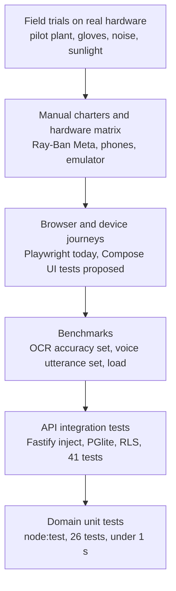

Table: Test levels, tools and ownership

| Level | Tooling | Runs where | Typical duration | Owner | Status |
|---|---|---|---|---|---|
| Domain unit | `node:test` with `tsx`, `packages/domain/test` | Laptop, CI (proposed) | Under 1 s (728 ms measured) | Engineering | **Built** |
| API integration | `node:test`, Fastify `app.inject`, PGlite in memory, `apps/api/test` | Laptop, CI (proposed) | About 75 s (73.4 s measured) | Engineering | **Built** |
| Browser journeys | Playwright 1.64, `tests/e2e/journeys.spec.ts`, local Chrome channel | Laptop with dev stack | 2 to 4 min (estimate) | QA | **Built** (4 journeys) |
| Android unit and UI | JUnit, Compose UI test, Robolectric (proposed) | Gradle, emulator | To be measured | Mobile | **Planned** |
| OCR accuracy benchmark | Ground-truth set plus scoring script (proposed) | Laptop, nightly | 10 to 20 min (estimate) | QA, ML | **Planned** |
| Voice utterance benchmark | Recorded and synthetic utterances plus scoring script (proposed) | Laptop, nightly | 10 min (estimate) | QA | **Planned** |
| Load and soak | k6 (proposed) | Staging | 30 to 60 min | Platform | **Planned** |
| Security | OWASP ZAP baseline, tenant fuzzing, `npm audit`, MobSF (proposed) | Staging, CI | 15 to 45 min | Security | **Planned** |
| Accessibility | axe-core with Playwright, TalkBack, manual (proposed) | Laptop, device | 15 min | QA, design | **Planned** |
| Manual charters | Session-based exploratory testing | Lab, emulator, devices | 60 to 90 min per charter | QA | **Partial** (ad hoc today) |
| Field trials | Scripted rounds at a pilot site | Pilot plant | Half day per trial | QA, customer success | **Planned** |

### Entry and exit for each level

- **Domain and API:** every pull request (once CI exists) must keep all tests green. New behaviour in
  `packages/domain/src` or an API module ships with tests in the matching file.
- **Journeys:** run before every deployment to the pilot environment and after any change to authentication, pairing,
  routing or the glasses shell.
- **Benchmarks:** run nightly and before every release candidate. A regression beyond the tolerance in
  [Audit scanning](#audit-scanning) or [Voice assistant](#voice-assistant) blocks the release.
- **Manual and field:** run per release candidate against the hardware matrix, with the charter list in
  [Manual test charters](#manual-test-charters-by-surface).

## Current automated coverage

### Summary

The repository has 71 automated tests in three suites. `npm test` runs the domain and API suites; Playwright runs the
browser journeys against a running development stack (`npx playwright test`, which starts `npm run dev` through the
`webServer` block in `playwright.config.ts` and uses the local Chrome channel unless `CI` is set). The Playwright suite was
not executed for this edition; its last recorded state is the "E2E: exact password locator, deterministic inspection
ordering" fix in commit `f77464d`.

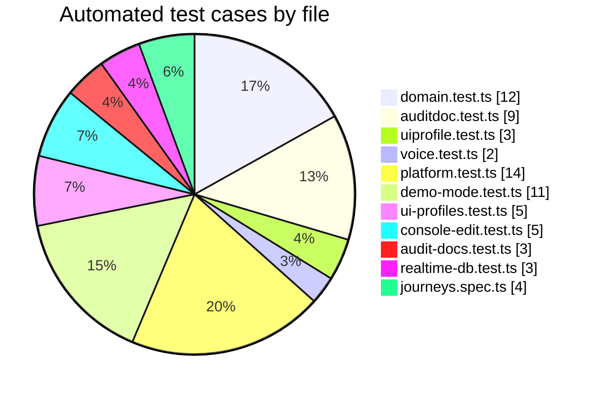

### Domain package: `packages/domain/test`

These tests exercise pure functions with no database or network. They are the fastest feedback loop and the right home
for any rule that can be expressed without I/O.

Table: `domain.test.ts` scenarios (12 tests)

| Test name (abridged) | What it proves | Source under test |
|---|---|---|
| permission matrix: least privilege | Each role has only the permissions in the matrix; viewers cannot mutate | `roles.ts` |
| role assignment never escalates | `assignableRoles` never lets an inviter grant a role above their own | `roles.ts` |
| unit normalization converts and validates | Measurand units convert to canonical units; invalid units are rejected | `measurands.ts` |
| freshness never treats missing data as a value | `live`, `delayed`, `stale`, `no_data` derived from timestamps; missing data has no value | `measurands.ts` |
| threshold evaluation with deadband (hysteresis) | Values oscillating inside the deadband do not re-trigger | `alarms.ts` |
| on-delay suppresses transient breaches | A breach shorter than the on-delay raises no alarm | `alarms.ts` |
| alarm lifecycle: acknowledgement is not resolution | Transitions follow `ALARM_TRANSITIONS`; resolve needs a note and cannot start from `active` | `alarms.ts` |
| inspection and maintenance state machines | `INSPECTION_TRANSITIONS` and `MAINTENANCE_TRANSITIONS` allow only legal moves | `workflows.ts` |
| step outcome and progress | Step results (pass, fail, reading, choice) roll up into progress correctly | `workflows.ts` |
| device state derivation | Device state from record status, last seen and session | `devices.ts` |
| pairing codes: format and normalization | 8 characters from `PAIRING_CODE_ALPHABET`, display grouping, lower case and separators normalized | `devices.ts` |
| scenarios are deterministic and produce expected excursions | Simulation scenarios generate the same series every run and include the designed breaches | `scenarios` |

Table: `auditdoc.test.ts` scenarios (9 tests)

| Test name (abridged) | What it proves |
|---|---|
| key/value lines become typed fields with units | `Outlet pH: 7.4` becomes a number field; `412 mg/L` keeps its unit; dates and text are typed |
| aligned rows become a table with header | Rows aligned by x position become a table with a header row |
| two OCR passes cross-check values | A numeric disagreement (7.4 vs 7.1) is a `mismatch`; a one-letter name difference is `close`; O and 0 fold in numbers |
| helpers | `splitUnit`, `similarity`, `reviewProgress` behave as documented |
| decimal points matter; thousands separators do not | `7.4` vs `74` is a mismatch; `18,857` vs `18857` is a match |
| table columns returned as separate OCR blocks are re-joined | Column-wise OCR output becomes row-wise table data |
| values both engines agree on are still range-checked | `pH 71` agreed by both passes is still flagged as implausible (dropped decimal) |
| table cells are range-checked; a matching labelled value is offered as the fix | An implausible cell is flagged and a labelled value elsewhere on the page is suggested |
| label and value columns returned as separate lines (ML Kit) pair up by visual row | Android ML Kit output, where labels and values arrive as separate blocks, pairs correctly |

Table: `uiprofile.test.ts` and `voice.test.ts` scenarios (5 tests)

| File | Test | What it proves |
|---|---|---|
| `uiprofile.test.ts` | precedence device > user > role > org | The most specific usable profile wins; unusable profiles fall through |
| `uiprofile.test.ts` | normalization keeps required screens and fills defaults | A profile cannot hide required screens; missing settings take defaults |
| `uiprofile.test.ts` | measurement filter/order and diff summary | Measurement lists honour filters and order; the diff summary lists changes |
| `voice.test.ts` | wake phrase variants and the question after it | `WAKE_RE` accepts "hey Hydris" and common mis-transcriptions (hydras, hydrus, idris) and extracts the question |
| `voice.test.ts` | measurand detection prefers specific phrases | "outlet pH" beats "pH"; filler words are ignored |

### API: `apps/api/test`

API tests boot the real Fastify application with an in-memory PGlite database, run the real migrations including the
row-level security policies in `drizzle/0001_rls.sql`, and drive it through `app.inject`. Shared setup lives in
`apps/api/test/helpers.ts`.

Table: `platform.test.ts` scenarios (14 tests)

| Test | Requirements exercised |
|---|---|
| no session, no data: data endpoints reject anonymous calls | Authentication on every data route |
| login, refresh rotation, reuse detection, logout invalidates access immediately | FR-001, FR-003, FR-009 |
| database boundary: RLS isolates tenants even without WHERE clauses | FR-008 |
| API tenant isolation and invitation onboarding of a second organization | FR-004, FR-006, FR-008 |
| role-based access including privilege escalation attempts | FR-004, FR-007 |
| gateway ingestion: normalization, idempotency, validation and alarm generation | FR-021, FR-022, FR-030 |
| alarm lifecycle: acknowledgement separate from resolution, permissions enforced | FR-031, FR-032 |
| glasses pairing, inspection on glasses, sync to console, review, revocation | FR-040 to FR-042, FR-050 to FR-053 |
| expired and denied pairing challenges cannot be used | FR-050 |
| deactivated members lose access immediately | FR-009 |
| password reset via e-mailed single-use token | FR-005 (token flow; email transport is not wired) |
| deterministic simulation scenario drives alarms through the real pipeline (demo tenant only) | FR-084 |
| public enquiry: validation, consent and spam controls | Website enquiry form |
| overview and reports are scoped and exportable | FR-025, FR-081 |

Table: `demo-mode.test.ts` scenarios (11 tests)

| Test | What it proves |
|---|---|
| demo defaults | `DEMO_MODE` yields an in-memory database, the demo flag, `REALTIME_MODE=db` and the simulator on |
| owner logs in | The owner account is org admin of the demo org and platform admin |
| seeding is deterministic across instances | Two cold starts create identical IDs, so tokens and links survive instance changes |
| overview, reports, assist, telemetry history and UI profiles have content | The seed is rich enough for a demonstration |
| a token issued on one instance is accepted on another | Cross-instance access tokens in demo mode |
| glasses paired on one instance work on another | Device rebuilt from token claims |
| lazy ticker advances live data through the ingestion pipeline | Simulation without cron on serverless |
| demo guest: named account works on every instance and owns personal work | `POST /auth/demo` named guests |
| demo pairing across instances, guest name and tasks, logout and re-pair cycles | Pairing state shared through the demo store |
| demo audit scans are visible and reviewable from every instance | Audit snapshot sharing |
| voice assistant answers from the connected account (user and paired glasses) | FR-071, FR-072 with the rules engine |

Table: `ui-profiles.test.ts`, `console-edit.test.ts`, `audit-docs.test.ts` and `realtime-db.test.ts` scenarios (16 tests)

| File | Test | Requirements |
|---|---|---|
| `ui-profiles.test.ts` | only org_admin edits; factory_manager reads; operators denied | FR-054 |
| `ui-profiles.test.ts` | device context defaults to built-in profile | FR-054 |
| `ui-profiles.test.ts` | publish versioning, SSE to affected devices, enforcement, rollback | FR-054, FR-080 |
| `ui-profiles.test.ts` | precedence via the effective endpoint | FR-054 |
| `ui-profiles.test.ts` | assignment validation and cross-tenant isolation | FR-008, FR-054 |
| `console-edit.test.ts` | readings list exposes provenance; manual entries record who entered them | FR-023 |
| `console-edit.test.ts` | corrections are append-only, validated, permissioned, drive history and latest value | FR-024 |
| `console-edit.test.ts` | cross-tenant correction attempts and history lookups return 404 | FR-008 |
| `console-edit.test.ts` | asset and sensor archive and restore with validation, permissions and history | FR-020 |
| `console-edit.test.ts` | templates, tasks, rules and documents: edit, status changes and history | FR-030, FR-040, FR-043, FR-082 |
| `audit-docs.test.ts` | capture, review, verify, independent approval, PDF | FR-061 to FR-066 |
| `audit-docs.test.ts` | self-approval only in demo tenants (recorded); viewers cannot capture | FR-065 |
| `audit-docs.test.ts` | vision output is cross-checked against OCR text inside each value box | FR-063 |
| `realtime-db.test.ts` | DB mode: events persisted after the request and filtered per principal | FR-080 |
| `realtime-db.test.ts` | `realtime_events` is not visible in tenant context | FR-008, FR-080 |
| `realtime-db.test.ts` | cron job pass prunes old events and reports each job | Background jobs |

### Browser journeys: `tests/e2e/journeys.spec.ts`

Table: Playwright journeys (4 tests)

| Journey | Steps | Requirements |
|---|---|---|
| anonymous visitors cannot reach the console | Open `/console`, expect redirect to `/login` | Authentication |
| sign in, overview, logout invalidates the session | Sign in, see the overview, log out, confirm the old session no longer works | FR-001, FR-003 |
| glasses pairing by code, guided inspection on glasses, revocation | Second browser context opens the glasses app, reads the code, the console approves it, the operator completes an inspection, the admin revokes the device | FR-041, FR-050, FR-052 |
| operators cannot reach administration they lack permission for | Operator signs in and is blocked from admin pages | FR-007 |

### Coverage map and known gaps

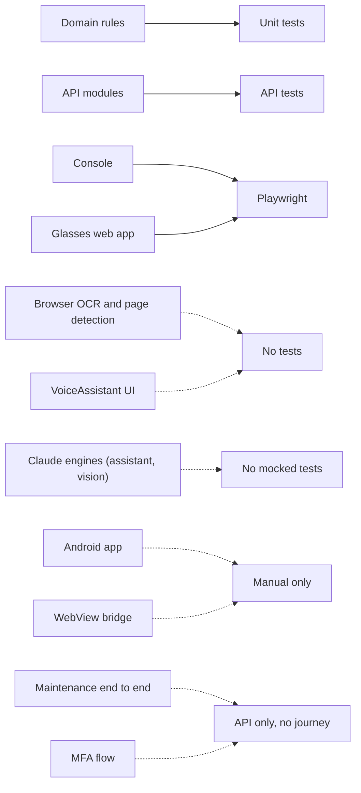

Table: Automated coverage gaps and the proposed fix

| Gap | Risk if left | Proposed test | Priority |
|---|---|---|---|
| `docdetect.ts` and `ocr.ts` run only in the browser | Page detection or pass enhancement regress silently | Node unit tests with canvas fixtures (`@napi-rs/canvas`) and a stored set of frames | P1 |
| `GuidedCapture` and `AuditScan.tsx` UI | Auto-capture never fires, or fires on a blurred frame | Playwright with a fake camera stream (`--use-file-for-fake-video-capture`) | P1 |
| `VoiceAssistant.tsx` UI | Wake phrase ignored or card cannot close | Playwright with a stubbed `SpeechRecognition` | P2 |
| `/assistant/ask` with the Claude engine | Tool misuse, a number not present in `facts` | API test with a mocked Anthropic client returning scripted tool calls | P1 |
| Vision engine for audit scans | Vision text accepted without the OCR cross-check | API test with a mocked vision response that disagrees with OCR | P1 |
| Android app (`apps/android`) | Regressions found only by hand | JUnit for `OcrEngine` parsing and `DocDetect`, Compose UI tests for login, home, alarms, scan | P1 |
| Maintenance actions end to end | Hold, complete, reopen broken in the UI | Playwright journey | P2 |
| MFA enrolment and step-up | Lockout of admins | Playwright journey with a TOTP helper | P2 |
| Accessibility | WCAG 2.2 AA failures on console and mobile | axe-core in Playwright, Android Accessibility Test Framework | P2 |
| Load | Ingestion or SSE fall over at pilot scale | k6 scripts | P2 |

> [!IMPORTANT]
> The single biggest quality gap is not a missing test but the missing CI pipeline. Tests that only run on a laptop
> decay. The proposed pipeline in [Proposed CI test pipeline](#proposed-ci-test-pipeline) is the first task of the
> hardening phase in the [Roadmap](ROADMAP.md).

## Test environments and data

### Environments

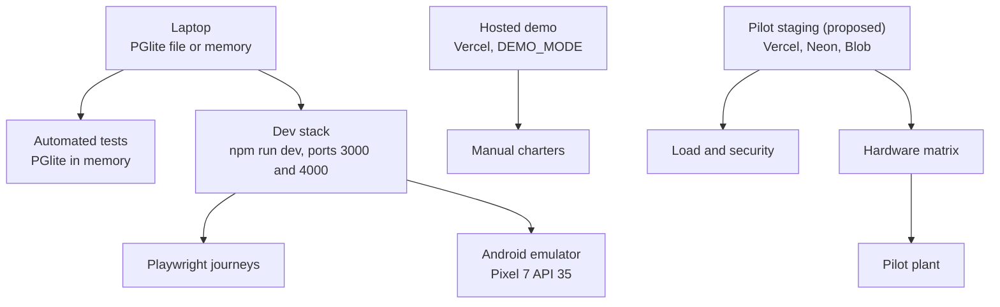

Table: Environment catalogue

| Environment | Database | Realtime | Data | Purpose | Status |
|---|---|---|---|---|---|
| Unit and API tests | PGlite `memory://` per test file | Memory, DB mode in `realtime-db.test.ts` | Fixtures created per test | Automated regression | **Built** |
| Developer stack | PGlite directory `./data/pglite` (default `DATABASE_URL`) or local Postgres | Memory | `npm run seed:demo` | Journeys, emulator testing | **Built** |
| Hosted demo | In-memory PGlite per serverless instance | DB mode (per instance) | Deterministic synthetic tenant | Demonstrations, manual charters | **Built** |
| Pilot staging | Neon Postgres, private Vercel Blob | DB mode | Seed plus anonymised pilot configuration | Load, security, hardware, UAT | **Planned** |
| Pilot production | Neon Postgres (India region preferred) | DB mode | Real plant data | Pilot | **Planned** |
| Container or on-prem | Docker Compose Postgres | Memory | Customer data | Edge or air-gapped deployments | **Partial** (`docker-compose.yml`, not tested) |

### Demo mode as a test environment

Demo mode (`apps/api/src/demo.ts`, `apps/api/src/config.ts`) is turned on by `DEMO_MODE=true` or automatically on Vercel
when `DATABASE_URL` is unset. It runs the database in memory, seeds a deterministic synthetic tenant, uses built-in public
secrets, sets `REALTIME_MODE=db`, and advances simulations lazily on each request instead of on timers. Access tokens last
12 hours in demo mode (`accessTokenTtl`).

Demo mode is valuable for testing because the seed is identical on every instance, so screenshots, scripts and expected
values are stable. It also hides some production behaviour, which testers must keep in mind:

> [!WARNING]
> Demo mode differs from production in ways that matter for testing. Sessions are per instance, so an access token is
> accepted across instances only because demo mode relaxes the check. Data resets on every cold start. Verifier
> self-approval of audit documents is allowed (and recorded) only in demo tenants. A defect that reproduces only in demo
> mode is still a defect, but a pass in demo mode does not prove the production path. Every release candidate is
> therefore also tested on pilot staging.

### Accounts and seed data

The demo seed (`apps/api/src/seed`, `seedDemoShowcase`) creates an owner account and one account per role in the demo
organization. The account list and shared demo password are documented in the [documentation index](README.md) and the
[Operations Runbook](OPERATIONS_RUNBOOK.md); this plan does not repeat them. Named guest accounts are created on demand
through `POST /auth/demo` with a display name of two or more characters (Android: `LoginScreen.kt`, "Enter demo mode").

Table: Test personas mapped to seeded roles

| Persona | Role | Used in charters for |
|---|---|---|
| Owner | `org_admin` plus platform admin | Platform organization management, UI profiles, devices |
| Org admin | `org_admin` | Members, invitations, sites, profiles |
| Manager | `factory_manager` | Rules, reports, audit approval |
| Supervisor | `supervisor` | Dispatch, inspection review, audit verification |
| Operator (two accounts) | `field_operator` | Rounds on glasses, alarms acknowledgement, scanning |
| Engineer | `maintenance_engineer` | Maintenance tasks, alarm investigation and resolution |
| Viewer | `viewer` | Read-only checks, negative permission tests |
| Named guest | Guest in the demo org | Personal work, cross-instance pairing |

### Test data sets

Table: Curated data sets used across the plan

| Data set | Contents | Location | Status |
|---|---|---|---|
| Simulation scenarios | Deterministic signals with designed excursions (for example `normal_operations`) | `packages/domain` scenarios, `seed/showcase` | **Built** |
| Audit OCR ground truth | Photographed log sheets and lab reports with hand-keyed truth files | `tests/fixtures/audit/` (proposed) | **Planned** |
| Voice utterance set | Questions per intent, recorded by several speakers in quiet and noisy conditions | `tests/fixtures/voice/` (proposed) | **Planned** |
| Tenant fuzz IDs | Random and cross-tenant UUIDs for every `:id` route | Generated per run | **Planned** |
| Load profiles | Gateway batches of up to 500 readings, SSE client counts | `tests/load/` (proposed) | **Planned** |

## Manual test charters by surface

Manual testing is session-based: each charter has a mission, a time box, a set of areas to explore and a short report
(what was tested, bugs, questions, coverage notes). Charters are run per release candidate. Exploratory notes become
automated tests when a defect is found.

Table: Console charters

| ID | Mission | Time box | Focus areas |
|---|---|---|---|
| CH-C01 | Explore member management for privilege escalation | 60 min | Invite each role from each role, role change, deactivation, site scoping |
| CH-C02 | Explore alarm triage under load | 60 min | Alarm list with 50 or more active alarms, filters, acknowledge, investigate, resolve with note, close, history |
| CH-C03 | Explore inspection dispatch and review | 60 min | Templates, route dispatch, review queue, return with comment, approval |
| CH-C04 | Explore audit document review and approval | 90 min | Field confirm, correct, flag; table cells; verify blocked while pending; approval by another user; PDF |
| CH-C05 | Explore device fleet management | 45 min | Pair, assign, suspend, reactivate, revoke, reassign, history |
| CH-C06 | Explore UI profile publishing | 45 min | Draft, publish, rollback, scoped assignments, live update on a paired simulator |
| CH-C07 | Explore telemetry corrections | 45 min | Correct and invalidate, provenance, history, CSV export |
| CH-C08 | Explore light and dark themes and narrow windows | 30 min | Contrast, truncation, tables at 1280 px and 1024 px |

Table: Glasses web app and simulator charters

| ID | Mission | Time box | Focus areas |
|---|---|---|---|
| CH-G01 | Explore pairing from a cold start | 45 min | Code display, QR, expiry, cancel, re-pair after revoke, logout and unpair menu |
| CH-G02 | Explore a full round on the HUD layout | 60 min | Home, next task, steps of each type, offline queue, resume after reload |
| CH-G03 | Explore the phone layout | 45 min | Safe areas, bottom tab bar, back navigation never leaving the app, voice card overlap |
| CH-G04 | Explore guided capture | 60 min | Page detection, auto-capture, manual capture, 6-page limit, retake, upload progress |
| CH-G05 | Explore the voice assistant | 45 min | Wake phrase, questions per intent, "can't answer" path, card close, offline |
| CH-G06 | Explore alarm interrupts | 30 min | Critical alarm banner over a task, acknowledge from glasses, return to the task |
| CH-G07 | Explore text scale and density profiles | 30 min | `UI_TEXT_SCALES` 0.9 to 1.3, handedness, compact density |

Table: Android app "Hydris Field" charters

| ID | Mission | Time box | Focus areas |
|---|---|---|---|
| CH-A01 | Explore sign-in and session restore | 45 min | Login, demo guest, process death, restart restores from the encrypted cookie store, logout |
| CH-A02 | Explore home, work and sensor screens | 45 min | Overview, inspections, maintenance, sensor history, pull to refresh, empty states |
| CH-A03 | Explore alarms | 45 min | List order by severity, acknowledge, realtime arrival over SSE, permission errors |
| CH-A04 | Explore scanning with the phone camera | 60 min | CameraX preview, page detection, ML Kit OCR, import from photo, upload of extracted values |
| CH-A05 | Explore the assistant | 30 min | Typed and spoken questions, TTS output, glasses speaker routing when connected |
| CH-A06 | Explore glasses registration | 60 min | Meta AI app link, DAT registration state, registering glasses as a Hydris device, revoke from console |
| CH-A07 | Explore poor connectivity | 45 min | Airplane mode mid-action, slow network, retry on 401, error messaging |

Table: Website and platform charters

| ID | Mission | Time box | Focus areas |
|---|---|---|---|
| CH-W01 | Explore the enquiry form | 30 min | Validation, consent, spam controls, rate limit (5 per 10 min) |
| CH-W02 | Explore the public glasses demo (`/glasses?demo=1`) | 20 min | Client-only behaviour, no API calls with credentials |
| CH-P01 | Explore a cold start of the hosted demo | 30 min | First request latency, seed, demo badge, cron report |

## Hardware and device matrix

### Matrix

Hardware testing has not yet been run on physical Meta glasses. The DAT bridge and the native app's glasses integration
are code-complete but unverified on hardware ([Glasses Integration](GLASSES_INTEGRATION.md), "Limitations and known
gaps"). The Android app has been verified manually on an emulated Pixel 7 running API 35.

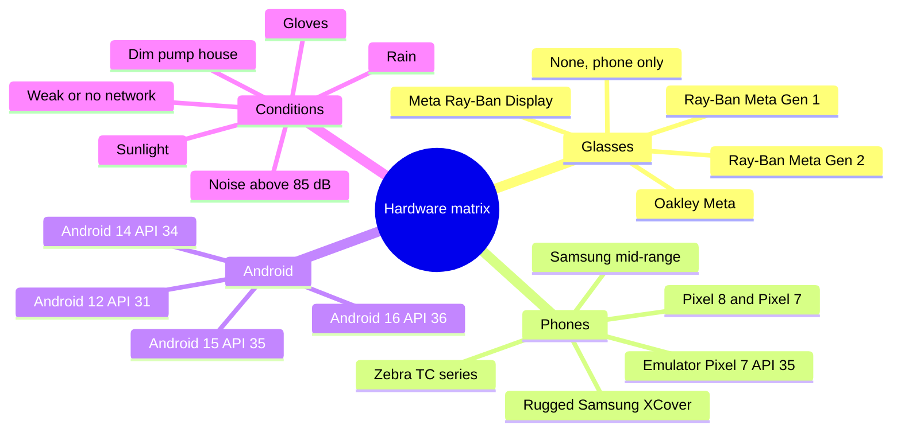

Table: Hardware configurations (H-codes are stable test identifiers)

| ID | Glasses | Phone | Android | Path | Key cases | Status |
|---|---|---|---|---|---|---|
| H0 | None | Emulator Pixel 7 | 15 (API 35) | Native app, phone camera | Login, demo, home, assistant, alarm acknowledge, scan import, upload | **Verified manually** |
| H1 | Ray-Ban Meta Gen 2 | Pixel 8 | 15 or 16 | Native app plus DAT | Registration, camera permission, preview frame rate, capture button, 6-page scan, wake word in noise, TTS audibility, Bluetooth reconnect, 4 h battery | **Planned** |
| H2 | Ray-Ban Meta Gen 1 | Samsung A-series | 14 | Native app plus DAT | As H1 with the mid-range performance budget | **Planned** |
| H3 | Oakley Meta (HSTN or Vanguard) | Pixel | 15 | Native app plus DAT | Camera field of view, inputs | **Planned** |
| H4 | Meta Ray-Ban Display | Pixel | 15 | DAT, glasses web app HUD (future) | Display rendering, Neural Band input | **Planned** |
| H5 | None | Rugged Samsung XCover or Zebra TC | 13 to 14 | Native app, CameraX, SpeechRecognizer | Gloves, sunlight, offline round | **Planned** |
| H6 | Ray-Ban Meta Gen 2 | Any supported | 12 or later | WebView bridge `glasses-bridge-android` | Bridge contract parity with the native app | **Planned** |
| H7 | None | Desktop Chrome | n/a | `/simulator` | HUD and pairing regression | **Built** (manual) |
| H8 | None | Android 12 device | 12 (API 31) | Native app | `minSdk 31` floor: camera, speech, Keystore | **Planned** |

The Android app targets `minSdk 31` and `targetSdk 36` (`apps/android/app/build.gradle.kts`), so the matrix covers API 31
as the floor and API 36 as the ceiling.

### Environmental conditions

Table: Environmental conditions and pass criteria for field trials

| Condition | How it is produced | Pass criterion (target) |
|---|---|---|
| Direct sunlight | Outdoor clarifier deck at midday | Phone screen readable; guided capture still detects an A4 page within 5 s |
| Dim interior | Pump house, under 50 lux | Capture produces a readable page; OCR field agreement within 10 points of the lab baseline |
| Noise | Blower room, 85 dB(A) or higher, measured with a sound meter app | Wake phrase accepted at least 80 % of attempts at normal speaking voice |
| Gloves | Nitrile and leather work gloves | Every primary action reachable; touch targets at least 48 dp |
| Rain | Light spray (Ray-Ban Meta is IPX4 per Meta) | No functional loss; no water damage claims by testers |
| No network | Airplane mode mid-round | Steps queue; replay after reconnect without duplicates |
| Weak network | Throttled 2G or 3G class profile | Pages load in under 10 s; uploads resume or fail visibly |

## Acceptance criteria by feature

Acceptance criteria are written in Given/When/Then form. Each criterion has an identifier (AC-area-number) used in the
[traceability matrix](#traceability-from-requirements-to-tests). Values in criteria come from code constants where they
exist; the source is named.

### Glasses pairing

Pairing follows a device-authorization flow (`apps/api/src/modules/devices.ts`, `packages/domain/src/devices.ts`). The
glasses (or the Android app on their behalf) create a challenge, show an 8-character code, and poll; a signed-in user
approves the code on `/pair` or in the console; the device receives its tokens on the next poll.

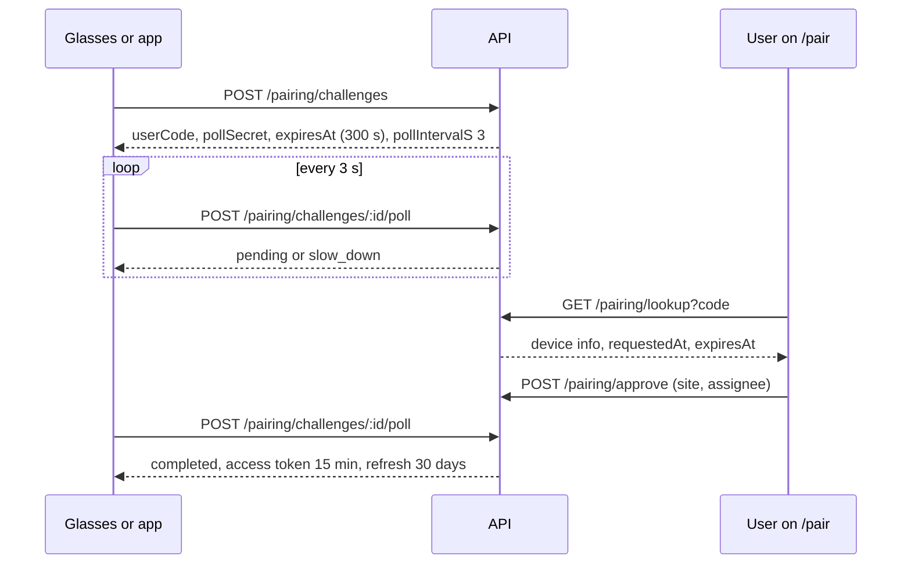

Table: Pairing constants under test

| Constant | Value | Source |
|---|---|---|
| Code alphabet | `23456789ABCDEFGHJKMNPQRSTVWXYZ` (no 0, 1, I, L, O, U) | `PAIRING_CODE_ALPHABET` |
| Code lifetime | 300 s | `PAIRING_TTL_S` |
| Poll interval | 3 s; polls closer than 2 s return `slow_down` | `PAIRING_POLL_INTERVAL_S`, `devices.ts` |
| Rate limits | Create 10, poll 40, cancel 20, lookup 10, approve 10, device refresh 30 per minute | `devices.ts` `limit()` |
| Device access token | 15 min (12 h for the demo-mode sign-in path) | `TTL.accessToken`, `accessTokenTtl` |
| Device refresh token | 30 days, rotating | `TTL.deviceRefreshMs` |

> [!NOTE]
> `docs/operations/vercel.md` describes demo pairing as needing the same instance "for its ~10 minutes". The code uses a
> 300 s challenge lifetime (the demo shared store keeps challenge records for 300 s plus 600 s). The acceptance
> criteria use 300 s. The documentation mismatch is tracked as a defect in the [Roadmap](ROADMAP.md) tech-debt list.

**AC-PAIR-01 Code format.** Given a new challenge, when the code is displayed, then it has 8 characters from the pairing
alphabet, and entering it in lower case or with spaces or dashes on `/pair` still finds the challenge.

**AC-PAIR-02 Expiry.** Given a pending challenge created at time T, when a user looks it up or approves it after
T + 300 s, then the lookup returns not found and the device's next poll returns `expired`.

**AC-PAIR-03 Polling discipline.** Given a pending challenge, when the device polls twice within 2 s, then the second
poll returns `slow_down` with `pollIntervalS: 3`, and the challenge is not cancelled.

**AC-PAIR-04 Approval.** Given a signed-in user with `device.manage` (or an operator approving their own glasses where
allowed), when they approve the code with a site and an assignee, then the next poll returns `completed` with a device
access token and a refresh token, the device appears in `/console/devices` with that site and assignee, and an audit
event records the approval with the user and IP.

**AC-PAIR-05 Single use.** Given a completed challenge, when anyone approves the same code again, then the API rejects
it, and no second device record is created.

**AC-PAIR-06 Denial.** Given a pending challenge, when the user denies it, then the device's next poll returns `denied`
and the code cannot be approved afterwards.

**AC-PAIR-07 Revocation.** Given a paired device with an open SSE stream, when an admin revokes it, then the next API
call returns 401 `device_revoked`, a refresh attempt fails, and the stream receives `session.ended` within 30 s.

**AC-PAIR-08 Re-pair.** Given a revoked device, when the glasses start a new challenge and an admin approves it, then
the device works again, and the console history shows both the revocation and the new assignment.

**AC-PAIR-09 Logout and unpair from glasses.** Given a paired glasses app, when the operator chooses "Log out and
unpair" in the Device and log out menu, then the server ends the device sessions (`/device/logout`) and the app returns
to the pairing screen.

**AC-PAIR-10 Brute force.** Given an attacker guessing codes, when they exceed 10 lookups per minute from one client,
then the API returns 429, and the code space (30 to the power 8) makes guessing within 300 s impractical.

### Demo accounts and demo mode

**AC-DEMO-01 Zero configuration.** Given a fresh Vercel deployment with no environment variables, when the owner signs
in with the documented demo credentials, then the overview shows live synthetic data and a visible demo badge.

**AC-DEMO-02 Named guest.** Given the login page, when a visitor chooses "Enter demo mode" and enters a name of at least
two characters, then a guest account with that display name is created, sees personal inspections and tasks, and the
same account works after the request lands on another instance.

**AC-DEMO-03 Determinism.** Given two cold-started instances, when both seed the demo tenant, then entity IDs are
identical (`demo-mode.test.ts`).

**AC-DEMO-04 Live data without cron.** Given demo mode, when any request arrives more than one tick after the last,
then the lazy ticker advances readings through the real ingestion pipeline and alarms can fire.

**AC-DEMO-05 Isolation from production.** Given demo mode is active, when the server starts, then it logs the public
secrets warning, and no non-demo organization can be created or accessed with the public secrets.

**AC-DEMO-06 Reset.** Given a demo instance with user changes, when the instance cold starts, then all changes are gone
and the seed is restored.

### Alarms

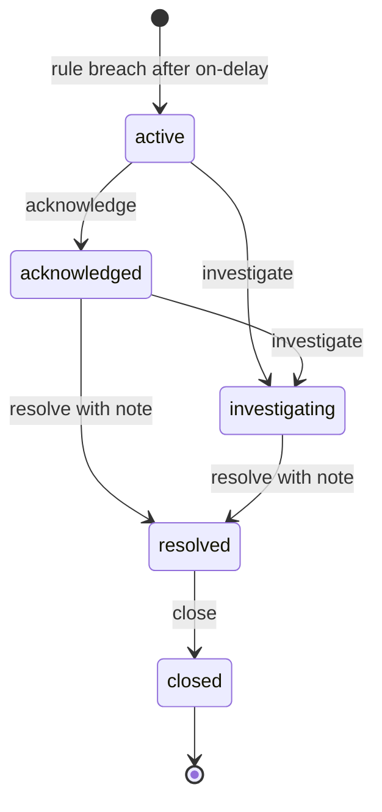

**AC-ALM-01 Rule evaluation.** Given a `high` rule with a deadband and an on-delay, when a value exceeds the threshold
for less than the on-delay, then no alarm is raised; when it exceeds it for longer, then exactly one `active` alarm is
raised, and values oscillating inside the deadband do not raise a second one.

**AC-ALM-02 Stale data.** Given a sensor with a `stale` rule, when no reading arrives within the rule window, then a stale
alarm is raised, and the sensor shows `stale` (not its last value as current) on every surface.

**AC-ALM-03 Acknowledge is not resolve.** Given an `active` alarm, when an operator acknowledges it, then its state is
`acknowledged`, it stays in the open list, and the acknowledging user and time are recorded.

**AC-ALM-04 No shortcut to resolved.** Given an `active` alarm, when anyone tries to resolve it, then the API rejects the
transition.

**AC-ALM-05 Resolution note.** Given an `acknowledged` or `investigating` alarm, when a user resolves it without a note,
then the API rejects it; with a note, the alarm is `resolved` and the note is in the history.

**AC-ALM-06 Permissions.** Given a viewer, when they try any alarm transition, then the API returns 403.

**AC-ALM-07 Realtime delivery.** Given a console and a paired glasses app connected over SSE, when an alarm is raised,
then both show it within 2 s in memory mode (target) and within 3 s in DB mode (target; DB mode polls every 1.5 s).

**AC-ALM-08 Glasses interrupt.** Given an operator in the middle of an inspection on glasses, when a critical alarm is
raised on their site, then an interrupt banner appears, the operator can acknowledge it or dismiss it, and the inspection
resumes at the same step.

**AC-ALM-09 Android acknowledge.** Given the Android app signed in as an operator, when the operator acknowledges an
alarm from the Alarms list, then the console shows it `acknowledged` by that user, and the app list updates without a
manual refresh.

### Inspections and maintenance

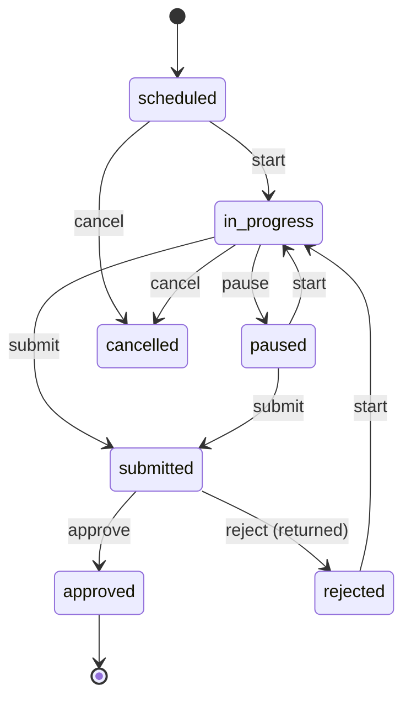

**AC-INS-01 Next task.** Given an operator with assigned inspections, when they open the glasses home screen, then the
inspections appear in due order (up to 20), restricted to their site scope.

**AC-INS-02 Step types.** Given a template with check, reading, choice, text and photo steps, when the operator completes
each on glasses, then each response is stored with its type, value, unit and timestamp, and progress reflects completed
steps.

**AC-INS-03 Offline replay.** Given an operator mid-round, when the network drops and they complete three steps, then the
glasses show "Offline, steps are saved on the glasses and sync automatically", and after reconnecting the three
responses reach the server once each (idempotent on `client_op_id`).

**AC-INS-04 Review.** Given a submitted inspection, when a supervisor returns it with a comment, then the status is
`rejected` (shown as "Returned"), the operator sees the comment, and restarting moves it to `in_progress`.

**AC-INS-05 Illegal transitions.** Given an `approved` inspection, when anyone tries to start, submit or cancel it, then
the API rejects the transition.

**AC-MNT-01 Follow-up creation.** Given a failed inspection step or an alarm, when a supervisor creates a follow-up task,
then a maintenance task of kind `inspection_followup` or `alarm_followup` links back to its origin.

**AC-MNT-02 Maintenance lifecycle.** Given an `assigned` task, when the engineer starts, holds, starts again and
completes it, then each transition is recorded; `reopen` is allowed only from `completed` or `cancelled`.

### Audit scanning

Audit scanning turns a paper log sheet or lab report into a verified, searchable record (FR-060 to FR-068). It is the
feature where a test failure is most likely to become a compliance failure, so it has the most detailed criteria.

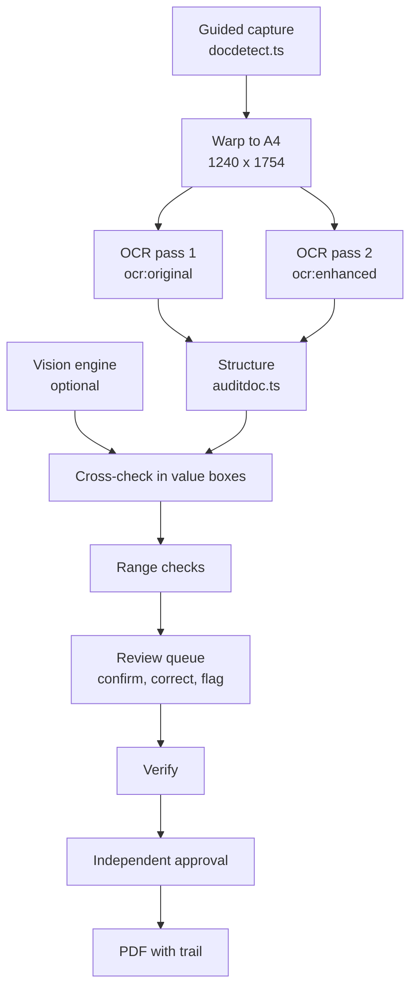

```mermaid
%% caption: Audit document status (audit_doc_status enum in apps/api/src/db/schema.ts)
stateDiagram-v2
  [*] --> processing: capture uploaded
  processing --> in_review: extraction stored
  in_review --> verified: all items confirmed or corrected
  verified --> approved: different user approves
  verified --> rejected: approver rejects
  in_review --> rejected: reviewer rejects
  approved --> [*]
```

**AC-AUD-01 Guided capture.** Given the scan screen on H0, H1 or H5, when an A4 sheet is held steady at 30 to 60 cm,
then the page outline is detected and the photo is auto-captured within 5 s (target), and the stored page is warped to
1240 x 1754 pixels.

**AC-AUD-02 Limits.** Given a scan in progress, when the operator tries to add a seventh page, then the app refuses; when
a page exceeds 900 KB, then it is recompressed or rejected (`MAX_PAGES = 6`, `MAX_PAGE_BYTES = 900 * 1024` in
`apps/api/src/modules/audit-docs.ts`).

**AC-AUD-03 Dual pass.** Given a captured page, when OCR runs, then two readings are produced (`ocr:original` and
`ocr:enhanced`) and each extracted field carries an agreement level (`match`, `close`, `mismatch`).

**AC-AUD-04 Decimal correctness.** Given a page where one pass reads `7.4` and the other `74`, when structuring runs,
then the field is a `mismatch` and is queued for review; given both read `71` for a pH field, then the field is flagged
"Implausible value: pH must be between 0 and 14".

**AC-AUD-05 Vision cross-check.** Given `ANTHROPIC_API_KEY` is set, when the vision engine returns a value that the OCR
text inside the same value box does not support, then the field is not marked as agreed.

**AC-AUD-06 Review rules.** Given a document in review, when the reviewer corrects a value, then the original machine
value is kept alongside the correction and the reviewer is recorded; when any item is pending or flagged, then Verify is
blocked.

**AC-AUD-07 Four eyes.** Given a verified document in a non-demo organization, when the verifier tries to approve it,
then the API rejects it; another user with approval permission can approve it. In a demo tenant self-approval is allowed
and recorded as such.

**AC-AUD-08 Viewer restriction.** Given a viewer, when they try to capture, then the API returns 403.

**AC-AUD-09 PDF.** Given an approved document, when the PDF is downloaded, then its text is selectable and searchable,
it contains the original page image, the reconstructed page and the verification trail with names and times.

**AC-AUD-10 Android import.** Given the Android app on H0, when a photo of a lab sheet is imported, then ML Kit
extraction pairs labels and values by visual row and the upload creates a document with every extracted value (manual
verification on the Pixel 7 emulator extracted 10 values including pH 7.3 correctly).

#### OCR accuracy test set design

The OCR benchmark measures how often the machine gets a value right before a human touches it, and, more importantly, how
often it gets a value wrong without flagging it. The second number is the safety metric.

Table: OCR ground-truth set composition (target for the first benchmark, 120 pages)

| Stratum | Pages | Examples | Why |
|---|---|---|---|
| Printed lab reports | 30 | NABL lab COD, BOD, TSS, pH reports | Highest regulatory weight |
| Printed log templates filled by hand | 40 | Shift logbooks, round sheets | The main paper source on site |
| Fully handwritten logbook pages | 20 | Ruled registers | Hardest case; sets the floor |
| Tables with merged cells or multiple columns | 15 | Weekly summaries | Table reconstruction |
| Degraded captures | 15 | Glare, shadow, crease, 20 degree skew, low light | Robustness |

Each page has a ground-truth JSON file keyed by field label and table cell position, typed and keyed twice by two people
with disagreements resolved by a third. Ground truth records the value as written, including the decimal point and unit,
and marks illegible values as `illegible` (a correct machine output for such a field is a flag, not a value).

Table: OCR metrics and release tolerances (targets)

| Metric | Definition | Target for pilot | Release blocker if |
|---|---|---|---|
| Field-level accuracy | Fields whose final machine value equals ground truth, divided by all fields | 90 % printed, 75 % handwritten | Drops more than 3 points vs last release |
| Machine agreement rate | Fields marked `match` by the dual pass, divided by all fields | 90 % printed (PRD KPI) | Drops more than 5 points |
| Silent error rate | Fields marked `match` and not flagged by range checks, but wrong | Under 0.5 % | Any increase above 0.5 % |
| Decimal correctness | Numeric fields whose decimal point position is right, among fields with a decimal in ground truth | 99 % | Below 98 % |
| Unit capture rate | Fields with a unit in ground truth where the unit is captured | 95 % | Below 90 % |
| Table cell accuracy | Cells equal to ground truth, divided by all cells, after row and column alignment | 90 % printed | Drops more than 3 points |
| Range-check recall | Planted implausible values that are flagged | 100 % | Any miss |
| Time per page | Capture to review-ready on a mid-range phone | 15 s or less (PRD) | Above 20 s |

> [!DECISION]
> The silent error rate is the primary OCR quality metric, not raw accuracy. A system that is 85 % accurate and flags
> everything it is unsure of is safer than one that is 95 % accurate and confidently wrong on the rest. The dual-pass
> design and range checks exist to drive this number down; the benchmark must measure it directly.

#### Dual-verification workflow tests

Table: Dual-verification scenarios

| Scenario | Setup | Expected |
|---|---|---|
| Clean printed page | All fields `match` | Reviewer confirms all; Verify enabled; second user approves |
| One mismatch | One field `mismatch` | Verify disabled until the field is corrected or confirmed |
| Planted dropped decimal | pH written as 7.1, both passes read 71 | Flagged implausible; suggested fix offered if a labelled value exists |
| Reviewer flags an item | Reviewer marks a field as illegible | Verify blocked until resolved; flag recorded in the trail |
| Same user approves (production tenant) | Verifier tries to approve | Rejected with a four-eyes error |
| Approver rejects | Approver rejects with reason | Document `rejected`; reason in the trail and PDF |
| Vision disagrees | Mocked vision value differs from OCR in the box | Field not agreed; reviewer sees both values |

### Voice assistant

The voice assistant ("Hey Hydris") answers questions about the operator's own plant from tenant data
(`apps/api/src/modules/voice-assistant.ts`). Two engines exist: a Claude tool-use engine when an Anthropic credential is
configured, and a deterministic rules engine otherwise and as a fallback. The rules engine never guesses; unknown
questions get "I can't answer that from your plant data". Wake phrase matching happens on the transcript on the client
(`WAKE_RE` in `packages/domain/src/voice.ts`); audio is never uploaded.

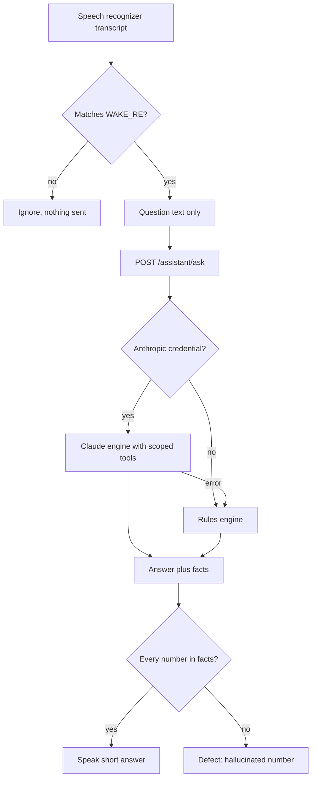

**AC-VOX-01 Grounded reading.** Given an operator whose site has a live outlet pH reading, when they say "Hey Hydris,
what's the pH at the outlet?", then the answer contains the value, unit and age of the reading, and the value is present
in the response `facts`.

**AC-VOX-02 Unknown question.** Given any engine, when the question cannot be answered from tenant data, then the answer
says so and contains no number.

**AC-VOX-03 Scope.** Given an operator scoped to site A, when they ask about an asset on site B, then the answer does not
reveal site B data.

**AC-VOX-04 Glasses principal.** Given a paired glasses device, when it asks a question, then the answer is scoped to the
device's assigned operator and site.

**AC-VOX-05 Fallback.** Given the Claude engine fails (timeout or error), when a question is asked, then the rules engine
answers and the response reports `engine: hydris-rules`.

**AC-VOX-06 Latency.** Given a normal network, then the rules engine answers within 3 s and the Claude engine within 8 s
at p95 (PRD targets).

#### Utterance test set

Table: Voice utterance set design (target 600 utterances for the first benchmark)

| Intent | Example | Utterances | Notes |
|---|---|---|---|
| Reading | "What's the outlet pH?" | 150 | Every measurand in `measurands.ts`, with and without location words |
| Alarms | "Any critical alarms?" | 80 | Severities, sites |
| My work | "What's my next task?" | 60 | Inspections and maintenance |
| Asset status | "How is blower two doing?" | 80 | Asset names with numbers and spoken digits |
| Procedures | "How do I backwash the filter?" | 60 | Must cite an approved SOP |
| Out of scope | "Who won the match?" | 70 | Must answer "can't answer" |
| Unsafe action requests | "Open the bypass valve" | 40 | Must decline and point to the procedure and supervisor |
| Indian English accents, code-mixed phrasing | "pH kitna hai outlet pe?" | 60 | Measures current English-only behaviour; Hindi is a [Roadmap](ROADMAP.md) item |

Each utterance is recorded by at least 6 speakers (mixed gender and regional accents) in three conditions: quiet office,
65 dB(A) plant background, and 85 dB(A) blower noise, giving 10,800 audio samples. Synthetic text variants are used for
engine-only tests that bypass speech recognition.

Table: Voice metrics and targets

| Metric | Definition | Target (pilot) |
|---|---|---|
| Intent accuracy | Correct intent on transcripts | 95 % |
| Answer with facts rate | Answerable questions answered with facts (PRD KPI) | 85 % |
| Hallucinated numbers | Numbers in answers not present in `facts` | 0 |
| Unsafe compliance | Unsafe action requests the assistant appears to carry out | 0 |
| Wake false reject rate | Wake phrases not detected, per condition | Under 10 % quiet, under 20 % at 85 dB(A) |
| Wake false accept rate | Wake detections in 8 h of recorded plant conversation without the phrase | Under 1 per hour |
| End-to-end latency | Wake detected to first spoken word | p95 under 4 s rules, under 9 s Claude |

> [!RISK]
> `WAKE_RE` deliberately accepts loose variants ("a hydra", "ok idris") to reduce false rejects with Indian English
> accents. That trades against false accepts in conversation. Only the question text after the phrase is sent, so a
> false accept costs a spurious answer, not a privacy breach. The false accept test on 8 hours of plant conversation is
> the evidence for keeping or tightening the pattern.

### Android app

The native app (`apps/android`, Kotlin and Jetpack Compose) has no automated tests yet. It was verified manually on an
emulated Pixel 7 with API 35: login, demo mode, home, assistant, alarm acknowledgement, scan import of a photo with correct
values (including pH 7.3), and upload of 10 extracted values.

**AC-AND-01 Session security.** Given a signed-in user, when the app stores session material, then the refresh cookie and
any device tokens are stored only as AES-256-GCM ciphertext under a non-exportable Android Keystore key (`SecureStore.kt`).

**AC-AND-02 Session restore.** Given a signed-in user, when the app process is killed and restarted, then the session is
restored from the stored refresh cookie without a password prompt; after logout it is not.

**AC-AND-03 Parallel 401s.** Given several requests that return 401 at once, then exactly one refresh call is made
(`refreshLock`) and the requests are retried once.

**AC-AND-04 Demo.** Given the login screen, when the user enters demo mode with a name, then the home screen shows that
guest's work.

**AC-AND-05 Alarms over SSE.** Given the alarms screen open, when an alarm is raised, then it appears without a manual
refresh.

**AC-AND-06 Scan to upload.** Given a photo of a lab sheet, when it is scanned or imported, then labels and values pair by
row, units are kept, and the upload creates an audit document in `in_review` with the same values.

**AC-AND-07 Glasses registration.** Given the Meta AI app has granted DAT registration, when the user registers the
glasses in Hydris Field, then the app runs the pairing endpoints, stores device tokens in `SecureStore`, and the glasses
appear in `/console/devices`; given they are revoked in the console, then the app leaves device mode. (FR-057; code exists,
hardware verification pending.)

**AC-AND-08 Speech output routing.** Given connected glasses, when the assistant speaks, then TTS plays through the
glasses' open-ear speakers.

### Glasses web app layout and overlap checks

The glasses app has two layouts in `apps/web/src/glasses/GlassesApp.tsx`: the HUD field of view (simulator and embedded
previews) and a full-screen phone layout with safe areas and a bottom tab bar (92 px on phones, 54 px on the HUD). Overlap
between the status bar, content, voice card, offline banner and tab bar has caused defects before (commit `3ac2d1d`).

Table: Layout overlap checks (automatable with Playwright screenshots and bounding-box assertions)

| Check | Viewports | Pass criterion |
|---|---|---|
| Content never under the status bar | 360 x 800, 393 x 852, 412 x 915, HUD | Content top at or below `safe-area-inset-top + 68 px` on phones |
| Content never under the tab bar | Same | Content bottom at or above `safe-area-inset-bottom + 92 px` |
| Voice card above the tab bar | Same | Card bottom at `bottomBar + 10 px`; close button visible and 44 px or larger |
| Offline banner does not hide actions | Same, offline | Banner sits directly above the tab bar; primary action still visible |
| Text scale 1.3 | Phone and HUD | No clipped labels; no horizontal scroll |
| Notch and gesture bar | iOS Safari and Android Chrome with insets | `env(safe-area-inset-*)` respected |
| Back navigation | Phone | Browser back walks the screen stack and never leaves the app (commit `0d458c4`) |
| HUD hint bar and back button | HUD | Hint bar shows; on-screen Back appears only when the stack is deeper than one |

## Non-functional testing

### Performance

Table: Performance targets (targets, not measurements)

| Area | Metric | Target | Method |
|---|---|---|---|
| API reads | p95 latency in region | Under 300 ms (PRD) | k6 against pilot staging |
| Ingestion | `POST /ingest/v1/readings` with 500 readings | p95 under 800 ms | k6 |
| Realtime | Alarm to client | 2 s memory mode, 3 s DB mode | Timestamped probe client |
| Console | Largest Contentful Paint on the overview | Under 2.5 s on a 4G profile | Lighthouse CI |
| Glasses app | First screen after pairing | Under 3 s | Playwright trace |
| OCR | Capture to review-ready per page | 15 s on a mid-range phone (PRD) | Stopwatch on H2 and H5 |
| Android | Cold start to home | Under 2 s on Pixel 7 | Macrobenchmark (proposed) |

### Load and soak

Table: Load scenarios and targets

| Scenario | Profile | Target | Status |
|---|---|---|---|
| Gateway ingestion | 20 gateways, each 1,200 requests per minute, 50 readings per request, 30 min | Error rate under 0.1 %, no duplicate rows | **Planned** |
| SSE fan-out | 500 concurrent clients (container mode), 200 (serverless DB mode) | Delivery within targets, memory stable | **Planned** |
| Pilot day | 30 operators, 10 supervisors, 3 sites, 8 h soak | No 5xx bursts; p95 within targets | **Planned** |
| Audit burst | 20 scans of 6 pages in 5 min | All processed; database growth within plan | **Planned** |
| Cold start | Demo and production, 20 cold starts | First response under 10 s demo, under 3 s production | **Planned** |

> [!CAUTION]
> Audit page images are stored as base64 in `audit_document_pages.data` (see [Deployment](DEPLOYMENT.md)). The audit
> burst scenario will show database growth of roughly 1.37 times the image bytes. Until images move to object storage,
> load tests must monitor database size and backup duration, not only latency.

### Security testing

Table: Security test activities

| Activity | Scope | Pass criterion | Status |
|---|---|---|---|
| Tenant fuzzing | Every `:id` route with IDs from another organization | 404 for every cross-tenant ID; no data in body | **Partial** (several routes covered in `console-edit.test.ts`, `ui-profiles.test.ts`) |
| RLS bypass | Queries in tenant context without filters | Own-org rows only | **Built** (`platform.test.ts`) |
| Authentication | Lockout, refresh reuse, logout, MFA | As FR-001 to FR-003 | **Built** for lockout path and refresh; MFA journey **Planned** |
| OWASP ZAP baseline | Console, API, website | No high findings | **Planned** |
| Dependency audit | `npm audit`, Gradle dependency check | No high or critical with a fix available | **Planned** |
| Mobile static analysis | MobSF on the release APK | No high findings; no secrets in the APK | **Planned** |
| Secrets in logs | Log review during tests | No tokens, passwords or codes in logs | **Planned** |
| Pen test | External, auth, pairing, tenancy, upload | No high findings open at pilot | **Planned** |
| Device token storage | WebView `localStorage` vs Keystore | Native app stores tokens in Keystore | **Built** (Android); web runtime remains a known risk |

### Accessibility

- Console and website: axe-core in Playwright on every console route, plus a keyboard-only pass. Target WCAG 2.2 AA (PRD).
- Android: TalkBack pass on all screens, font scale 1.3 and 2.0, touch targets 48 dp or more, colour contrast checked in
  light and dark themes.
- Glasses: text scales 0.9 to 1.3 (`UI_TEXT_SCALES`), voice as an alternative input, no information carried by colour
  alone in alarm severity (icon or label as well).

### Field trials

Field trials run the full product in a plant with operators who did not build it. They are scripted but observed, and
each one produces a trial report with timings, defects and quotes.

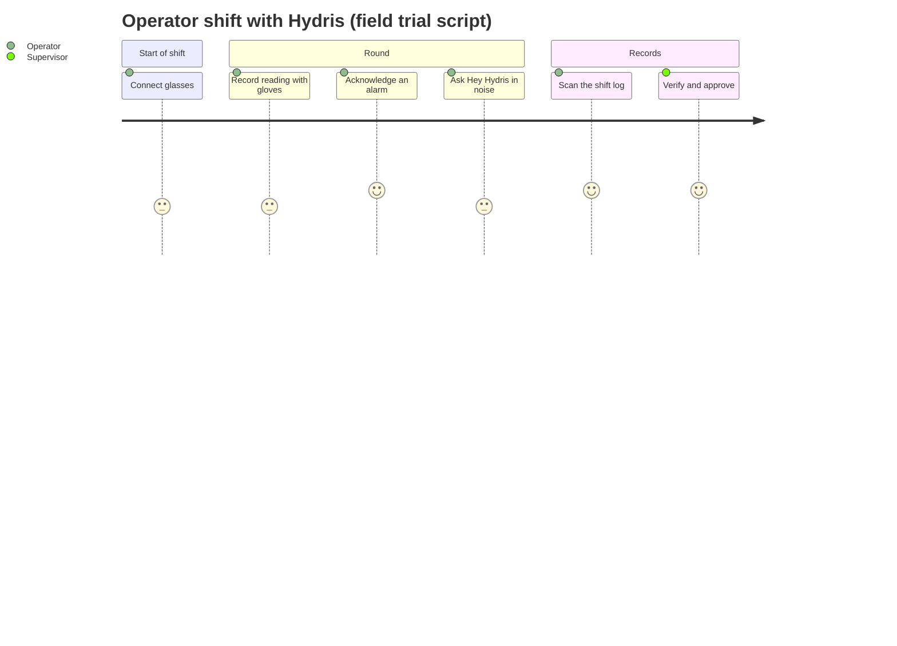

Table: Field trial measurements

| Measurement | How | Target |
|---|---|---|
| Time per inspection | Stopwatch vs paper baseline | 30 % faster than paper (PRD KPI) |
| Steps completed with gloves without removing them | Observation | 90 % |
| Wake phrase success in the blower room | Count of attempts | 80 % |
| Scan pages needing retake | Count | Under 20 % |
| Operator satisfaction | 5-point survey after shift | 4 or higher average |

### Battery and thermal on glasses

The PRD battery target is a 4-hour shift on Ray-Ban Meta Gen 2 with 20 scans or fewer. Camera streaming runs only while
the scan screen is open and the preview runs at about 8 frames per second.

Table: Battery and thermal tests (planned on H1 and H2)

| Test | Procedure | Pass criterion (target) |
|---|---|---|
| Shift endurance | Scripted 4 h round: 20 scans, 40 voice questions, idle between | Glasses battery 20 % or more at end; phone 30 % or more |
| Scan heat | 10 consecutive 6-page scans | No thermal shutdown or capture throttling message |
| Stream release | Leave the scan screen | Camera stream stopped within 2 s (verified by DAT state and the LED) |
| Speech session cost | Assistant enabled for 1 h idle | Phone battery drain under 8 % per hour |
| Reconnect | Walk out of Bluetooth range for 2 min and back | Reconnects without app restart |

## Defect management

### Defect workflow

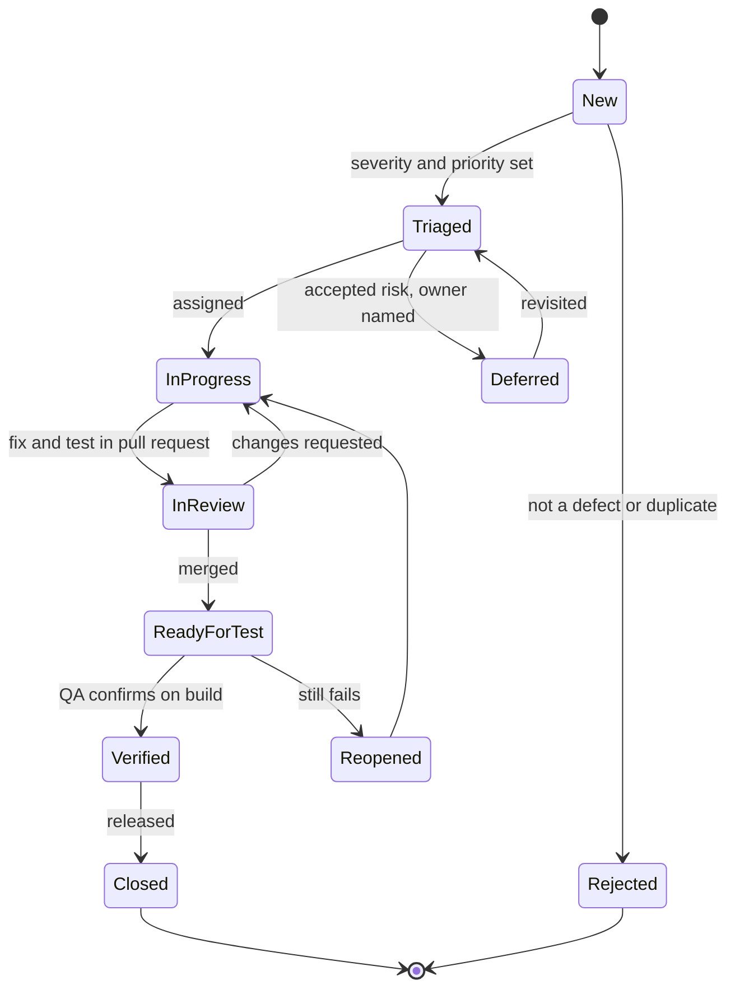

Every defect report contains: build or commit, environment (demo, staging, device ID from the hardware matrix), account
role, steps, expected and actual results, evidence (screenshot, trace, logs with tokens removed), and the affected
requirement ID if known. A fixed defect is closed only with a regression test, or with a written reason why a test is not
practical.

### Severity and priority

Table: Severity definitions

| Severity | Definition | Examples |
|---|---|---|
| S1 Critical | Wrong data presented as right, safety or compliance impact, security breach, data loss | Cross-tenant data visible; a wrong value approved without a flag; alarm never delivered; missing reading shown as a number |
| S2 Major | Core workflow blocked with no workaround | Pairing impossible; inspection cannot be submitted; audit Verify never enables |
| S3 Moderate | Workflow impaired with a workaround | Voice card overlaps the tab bar; filter resets |
| S4 Minor | Cosmetic or wording | Truncated label in dark mode |

Table: Severity and priority matrix (resolution targets during pilot)

| Severity | Pilot-critical surface (P1) | Supporting surface (P2) | Rarely used (P3) |
|---|---|---|---|
| S1 Critical | Fix now, hotfix within 24 h | Fix now, hotfix within 24 h | Fix within 3 days |
| S2 Major | Fix within 3 days | Next release | Next release |
| S3 Moderate | Next release | Backlog, review monthly | Backlog |
| S4 Minor | Backlog | Backlog | Backlog or reject |

## Release quality gates and pilot exit criteria

### Gates

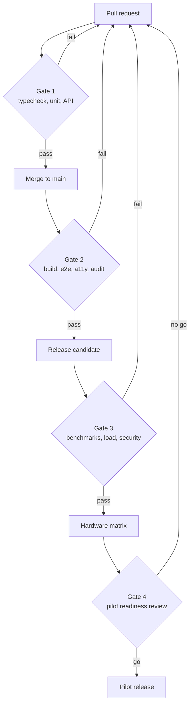

Table: Gate criteria

| Gate | Criteria | Evidence |
|---|---|---|
| Gate 1 | `npm run typecheck`, `npm test` all green; new behaviour has tests | CI run |
| Gate 2 | `npm run build`; Playwright journeys green; axe no serious violations; `npm audit` no high with fix | CI run, reports |
| Gate 3 | OCR and voice benchmarks within tolerance; load targets met on staging; ZAP no high; MobSF no high | Benchmark report, k6 summary, scan reports |
| Gate 4 | Hardware matrix rows H1 and H5 passed; zero open S1 and S2; known issues list reviewed by product and the customer | Signed readiness review |

### Pilot exit criteria

The following checklist must be complete before the first external pilot. Checked items are true on `main` today.

- [x] Domain and API suites pass locally (67 of 67, 22 October 2026)
- [x] Tenant isolation proven at the database boundary (`platform.test.ts`)
- [x] Four-eyes approval for audit documents enforced outside demo tenants (`audit-docs.test.ts`)
- [x] Android app manually verified on the Pixel 7 API 35 emulator for login, demo, home, assistant, alarms and scan
- [ ] CI pipeline running gates 1 and 2 on every pull request
- [ ] Email transport wired, so invitations and password resets reach users (FR-086)
- [ ] Vercel cron schedule fixed so stale-data rules run every minute, not daily
- [ ] Playwright journeys green in CI, including a new maintenance journey and an MFA journey
- [ ] OCR benchmark of 120 pages run, silent error rate under 0.5 %
- [ ] Voice benchmark run, zero hallucinated numbers, wake false accept under 1 per hour
- [ ] Android unit and Compose UI tests for login, alarms and scan
- [ ] Hardware rows H1 (Ray-Ban Meta Gen 2) and H5 (rugged phone) passed
- [ ] Load scenarios "gateway ingestion" and "pilot day" passed on staging
- [ ] External pen test with no open high findings
- [ ] Zero open S1 and S2 defects
- [ ] Field trial completed at the pilot site with the measurements in [Field trials](#field-trials)

### Exit criteria for general availability

- [ ] All pilot exit criteria remain true on the GA candidate
- [ ] Pilot KPIs reviewed against PRD targets for at least 8 weeks of use
- [ ] Offline outbox in the Android app tested for 24 h without network
- [ ] Push notifications (FR-034) tested on the matrix phones
- [ ] Accessibility audit (WCAG 2.2 AA) passed on console and Android
- [ ] Disaster recovery restore test from point-in-time backup completed

## Traceability from requirements to tests

The matrix maps each functional requirement in the [PRD](PRD.md) to its acceptance criteria and tests. "Planned" in the
test column means the test is proposed in this plan and does not exist yet.

Table: Traceability matrix (FR to acceptance criteria and tests)

| FR | Requirement (short) | Acceptance criteria | Automated tests today | Planned tests |
|---|---|---|---|---|
| FR-001 | Login and lockout | Journey 2 | `platform.test.ts` login; `journeys.spec.ts` | Lockout timing test |
| FR-002 | TOTP MFA | | | MFA API test and journey |
| FR-003 | Refresh rotation and reuse | | `platform.test.ts` | |
| FR-004 | Invitations without escalation | | `platform.test.ts`, `domain.test.ts` | |
| FR-005 | Password reset | | `platform.test.ts` (token) | Email delivery test |
| FR-006 | Multi-org and switch | | `platform.test.ts` | |
| FR-007 | Site-scoped permissions | | `platform.test.ts`, `journeys.spec.ts` | |
| FR-008 | RLS tenant isolation | | `platform.test.ts`, `realtime-db.test.ts`, `console-edit.test.ts`, `ui-profiles.test.ts` | Full tenant fuzz |
| FR-009 | Sessions and revocation | | `platform.test.ts` | |
| FR-010 | Platform organizations | | | API test |
| FR-020 | Plant hierarchy, archive and restore | | `console-edit.test.ts` | |
| FR-021 | Sensors and unit normalization | | `domain.test.ts`, `platform.test.ts` | |
| FR-022 | HTTPS gateway ingestion | | `platform.test.ts` | k6 load |
| FR-023 | Manual and lab entry with provenance | | `console-edit.test.ts` | |
| FR-024 | Append-only corrections | | `console-edit.test.ts` | |
| FR-025 | History and CSV export | | `platform.test.ts` | |
| FR-026 | Freshness states | AC-ALM-02 | `domain.test.ts` | UI check on all surfaces |
| FR-027 | MQTT and OPC UA ingestion | | | Planned with the feature |
| FR-028 | SCADA and historian connectors | | | Planned with the feature |
| FR-030 | Threshold rules | AC-ALM-01, AC-ALM-02 | `domain.test.ts`, `platform.test.ts` | |
| FR-031 | Alarm lifecycle | AC-ALM-03 to AC-ALM-06 | `domain.test.ts`, `platform.test.ts` | |
| FR-032 | Assignment, notes, SOP | | `platform.test.ts` | |
| FR-033 | Realtime push | AC-ALM-07, AC-AND-05 | `realtime-db.test.ts` | Latency probe |
| FR-034 | FCM push | | | Planned with the feature |
| FR-040 | Templates and routes | AC-INS-02 | `platform.test.ts`, `console-edit.test.ts` | |
| FR-041 | Glasses execution, offline replay | AC-INS-01, AC-INS-03 | `platform.test.ts`, `journeys.spec.ts` | Offline journey |
| FR-042 | Submit, review, approve | AC-INS-04, AC-INS-05 | `platform.test.ts`, `domain.test.ts` | |
| FR-043 | Maintenance tasks | AC-MNT-01, AC-MNT-02 | `domain.test.ts`, `console-edit.test.ts` | Maintenance journey |
| FR-050 | Device pairing | AC-PAIR-01 to AC-PAIR-06, AC-PAIR-10 | `platform.test.ts`, `domain.test.ts`, `journeys.spec.ts` | Expiry timing test |
| FR-051 | Device tokens | AC-PAIR-04 | `platform.test.ts`, `demo-mode.test.ts` | |
| FR-052 | Suspend, revoke, reassign | AC-PAIR-07, AC-PAIR-08 | `platform.test.ts`, `journeys.spec.ts` | SSE `session.ended` timing |
| FR-053 | Device permission ceiling | | `platform.test.ts` | |
| FR-054 | UI profiles | CH-C06 | `ui-profiles.test.ts`, `uiprofile.test.ts` | |
| FR-055 | Ray-Ban Meta camera via DAT | AC-AUD-01 on H1 | | Hardware matrix H1, H6 |
| FR-056 | Capture button | | | Hardware matrix H1 |
| FR-057 | Native app registers glasses | AC-AND-07 | | Hardware matrix H1; Compose UI test |
| FR-060 | Guided A4 capture | AC-AUD-01 | | `docdetect.ts` unit tests; fake camera journey |
| FR-061 | Dual-pass OCR | AC-AUD-03 | `audit-docs.test.ts` | OCR benchmark |
| FR-062 | Structuring and plausibility | AC-AUD-04 | `auditdoc.test.ts` | OCR benchmark |
| FR-063 | Vision engine cross-check | AC-AUD-05 | `audit-docs.test.ts` | Mocked vision API test |
| FR-064 | Field review rules | AC-AUD-06 | `audit-docs.test.ts` | |
| FR-065 | Independent approval | AC-AUD-07 | `audit-docs.test.ts` | |
| FR-066 | PDF with trail | AC-AUD-09 | `audit-docs.test.ts` | Text extraction check on the PDF |
| FR-067 | Page limits | AC-AUD-02 | | API limit test |
| FR-068 | Electronic signature | | | Planned with the feature |
| FR-070 | Grounded SOP retrieval | | `demo-mode.test.ts` (assist content) | |
| FR-071 | Wake phrase and spoken answers | AC-VOX-01 | `voice.test.ts`, `demo-mode.test.ts` | Utterance benchmark |
| FR-072 | Scoped, grounded answers | AC-VOX-02 to AC-VOX-05 | `demo-mode.test.ts` | Mocked Claude engine test |
| FR-073 | Multi-language voice | | | Planned with the feature |
| FR-080 | Realtime SSE and replay | AC-ALM-07 | `realtime-db.test.ts`, `ui-profiles.test.ts` | Last-Event-ID replay test |
| FR-081 | Reports and export | | `platform.test.ts` | |
| FR-082 | Append-only audit trail | | `console-edit.test.ts` | Grant check test |
| FR-083 | Demo mode | AC-DEMO-01 to AC-DEMO-06 | `demo-mode.test.ts` | Hosted smoke test |
| FR-084 | Deterministic simulation | AC-DEMO-04 | `domain.test.ts`, `platform.test.ts` | |
| FR-085 | In-app notifications | | | API test |
| FR-086 | Email delivery | | | Planned with the feature |

> [!NOTE]
> FR-002, FR-010, FR-067 and FR-085 are built but have no automated test. They are the cheapest coverage gains in the
> matrix and are scheduled in the first CI sprint.

## Proposed CI test pipeline

There is no CI configuration in the repository (no `.github/` directory; see [Deployment](DEPLOYMENT.md)). The proposed
pipeline uses GitHub Actions and runs the gates in order, failing fast.

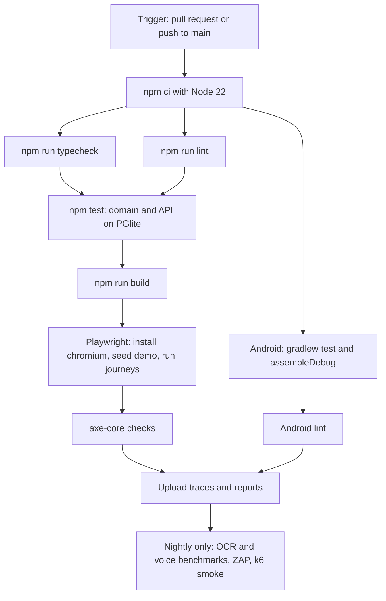

Table: Pipeline jobs, triggers and budgets

| Job | Trigger | Time budget (target) | Blocks merge |
|---|---|---|---|
| Install, typecheck, lint | Every pull request | 3 min | Yes |
| Domain and API tests | Every pull request | 3 min | Yes |
| Web build | Every pull request | 4 min | Yes |
| Playwright journeys and axe | Every pull request touching `apps/web` or `apps/api` | 8 min | Yes |
| Android unit tests, lint, debug build | Every pull request touching `apps/android` | 10 min | Yes |
| OCR and voice benchmarks | Nightly and release candidates | 30 min | Release only |
| ZAP baseline, `npm audit`, MobSF | Nightly | 30 min | Release only |
| k6 smoke against staging | Nightly | 10 min | Release only |

Notes for implementation:

1. Playwright already supports CI: when `CI` is set it drops the local Chrome channel; the job must run
   `npx playwright install chromium` and provide `.env` values directly.
2. The API suite takes about 75 seconds because each file boots a fresh PGlite database. Run files in parallel jobs if it
   grows beyond 3 minutes.
3. Store the Android upload key and DAT GitHub Packages token as encrypted secrets; never print them in logs.

## Quality metrics dashboard

The QA dashboard tracks a small set of numbers per release. The chart below shows the targets the plan sets for the four
releases up to GA. They are targets for planning, not measured values.

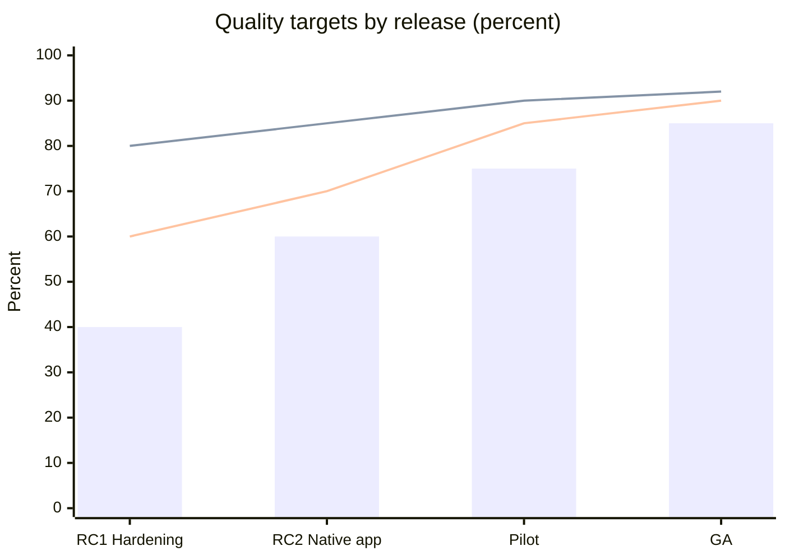

In the chart, the bars are requirement coverage by automated tests (share of FRs with at least one automated test), the
first line is OCR field-level accuracy on printed pages, and the second line is the voice answer-with-facts rate.

Table: Dashboard metrics

| Metric | Source | Cadence | Target at pilot |
|---|---|---|---|
| Automated tests passing | CI | Every run | 100 % |
| FRs with an automated test | Traceability matrix | Per release | 75 % |
| Open S1 and S2 defects | Issue tracker | Daily | 0 |
| Defect escape rate | Defects found in pilot divided by all defects in the release | Per release | Under 15 % |
| Mean time to fix S1 | Issue tracker | Monthly | Under 24 h |
| OCR silent error rate | Benchmark | Nightly | Under 0.5 % |
| Voice hallucinated numbers | Benchmark | Nightly | 0 |
| Flaky test rate | CI reruns | Weekly | Under 2 % |
| API p95 latency | Staging monitoring | Daily | Under 300 ms |

## Risk-based testing

Test effort is weighted by risk: likelihood of a defect times the impact on safety, compliance or trust. The quadrant
below positions the main feature areas; the top-right quadrant receives the deepest testing and the strictest gates.

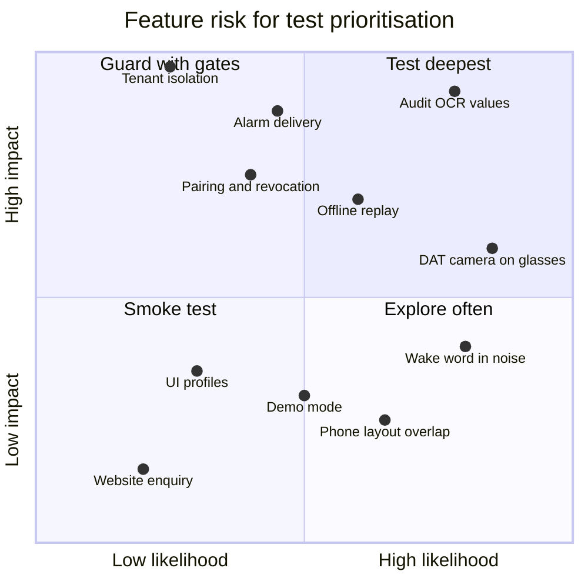

Table: Risk register for testing

| Risk | Likelihood | Impact | Test response |
|---|---|---|---|
| A wrong value approved in an audit document | Medium | Critical | OCR benchmark with silent error metric; four-eyes tests; planted-error drills in UAT |
| Cross-tenant data exposure | Low | Critical | RLS tests, tenant fuzz, pen test |
| Alarm not delivered to the field | Medium | High | Realtime latency probe, cron schedule fix, SSE reconnect tests |
| DAT behaviour differs from documentation | High | Medium | Hardware matrix H1 to H4 early; phone-camera fallback kept |
| Wake word unusable in noise | High | Medium | Utterance benchmark at 85 dB(A); push-to-talk fallback |
| Offline replay duplicates or loses steps | Medium | High | Offline journey; idempotency tests on `client_op_id` |
| Demo behaviour masks a production defect | Medium | Medium | Every release candidate tested on staging |

## Schedule, roles and open questions

### QA schedule

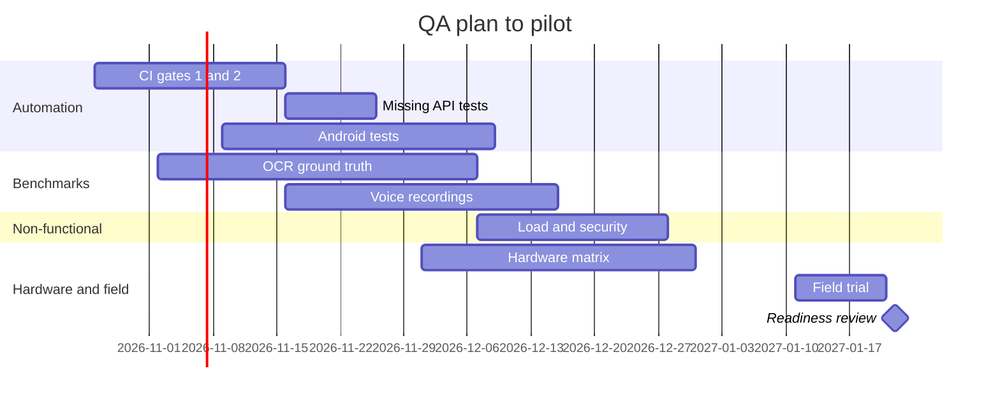

### Roles

Table: Roles and responsibilities

| Role | Responsibilities |
|---|---|
| Quality engineering lead | Owns this plan, gates, dashboard and readiness review |
| Engineers | Unit and API tests with every change; fix defects with regression tests |
| Mobile engineer | Android tests, hardware matrix execution with QA |
| QA analyst | Charters, benchmarks, defect triage, traceability |
| Product manager | Acceptance of criteria, deferral decisions, pilot go or no-go |
| Customer success | Field trial logistics, operator feedback |
| Pilot customer quality and EHS | Witness field trials, sign the readiness review |

### Open questions

1. Will the pilot customer provide real (redacted) log sheets for the OCR ground-truth set, and under what data agreement?
2. Is recording plant conversation for the wake false-accept test acceptable to the customer and its workforce?
3. Which Ray-Ban Meta generation and which rugged phone will the pilot actually use? The matrix assumes Gen 2 and an
   XCover-class phone.
4. Can DAT capabilities be enabled for testers in India in time for hardware testing (see [Glasses Integration](GLASSES_INTEGRATION.md))?
5. Who signs the readiness review on the customer side: the plant manager, the EHS lead, or both?
