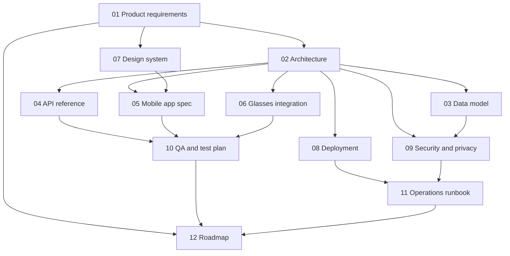
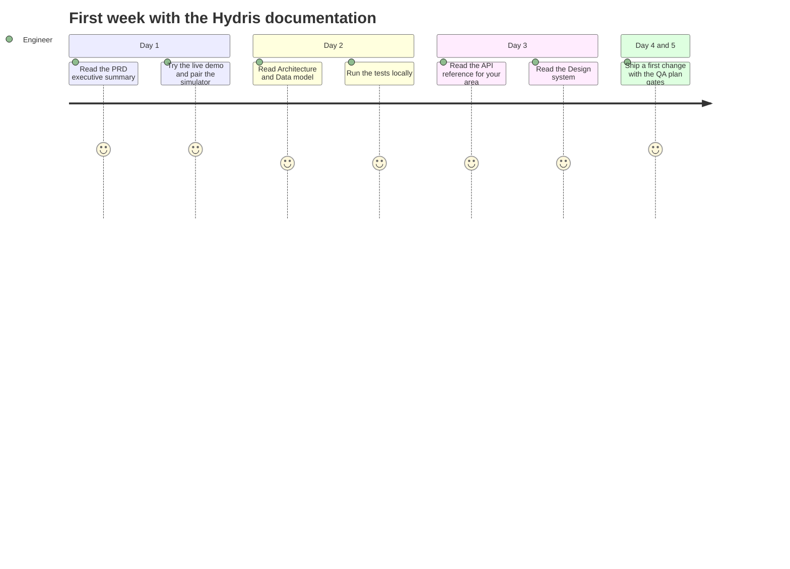
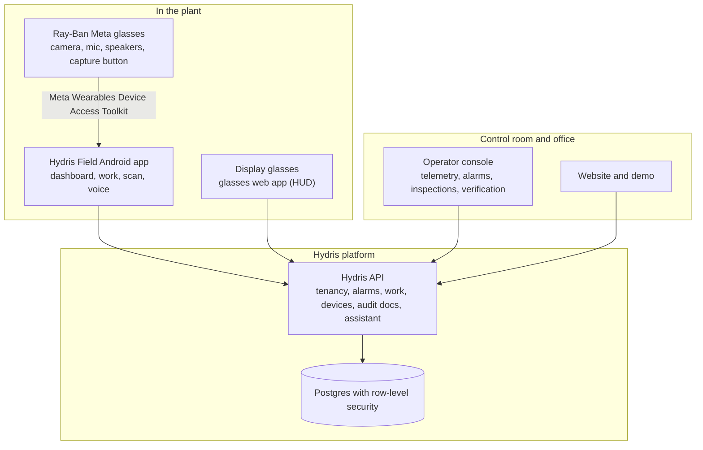
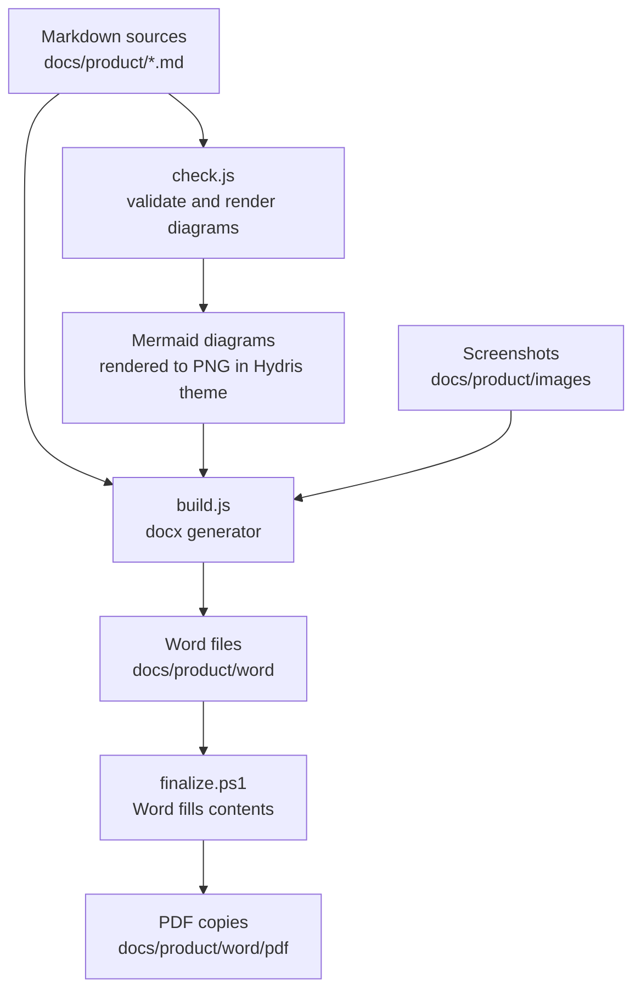

# Product Documentation Suite

Hydris Field Glasses puts live plant telemetry, guided inspections, approved procedures, audit-record scanning and a
grounded voice assistant in the field of view of wastewater and effluent treatment operators. One account powers four
surfaces: the website, the operator console, the glasses app and the native Android app, all backed by one API.

This suite is the reference for building, deploying, operating and evolving that product. Every document has a
Markdown source in this folder (the source of truth, reviewed like code) and a branded Word edition in `word/`
with a cover, document control, a contents page, numbered chapters, diagrams and captioned tables.

## The documents

Table: The Hydris Field Glasses documentation suite

| # | Document | ID | Answers | Primary readers |
|---|---|---|---|---|
| 00 | [Documentation Index](README.md) | HFG-IDX | What exists and where to start | Everyone |
| 01 | [Product Requirements](PRD.md) | HFG-PRD | What we build, for whom, why, and how we measure success | Product, leadership, engineering, pilots |
| 02 | [Architecture](ARCHITECTURE.md) | HFG-ARC | How the system is structured and why | Engineering |
| 03 | [Data Model](DATA_MODEL.md) | HFG-DAT | Every table, field, state and tenancy rule | Engineering, data, security |
| 04 | [API Reference](API_REFERENCE.md) | HFG-API | Every endpoint, payload, error and event | Engineering, integrators |
| 05 | [Mobile App Specification](MOBILE_APP_SPEC.md) | HFG-MOB | The native Android app, screen by screen | Mobile engineering, design, QA |
| 06 | [Glasses Integration](GLASSES_INTEGRATION.md) | HFG-GLS | How Ray-Ban Meta and display glasses connect | Engineering, field support |
| 07 | [Design System and UX](DESIGN_SYSTEM.md) | HFG-DSN | Tokens, components and hands-free interaction rules | Design, front-end, mobile |
| 08 | [Deployment and Infrastructure](DEPLOYMENT.md) | HFG-DEP | Where Hydris runs and how it ships | Platform engineering |
| 09 | [Security and Privacy](SECURITY_PRIVACY.md) | HFG-SEC | Threats, controls, privacy and compliance mapping | Security, legal, customers |
| 10 | [QA and Test Plan](QA_TEST_PLAN.md) | HFG-QA | How quality is proven, release by release | QA, engineering |
| 11 | [Operations Runbook](OPERATIONS_RUNBOOK.md) | HFG-OPS | Onboarding, support, troubleshooting, incidents | Customer success, support |
| 12 | [Roadmap and Future Features](ROADMAP.md) | HFG-RMP | Where the product goes next, and in what order | Leadership, product, partners |



## Where to start

Table: Suggested reading paths by role

| If you are | Read first | Then |
|---|---|---|
| New to Hydris | 01 Product requirements (executive summary and personas) | 02 Architecture (system context), 12 Roadmap |
| Back-end engineer | 02 Architecture, 03 Data model | 04 API reference, 09 Security, 10 QA |
| Android engineer | 05 Mobile app spec, 06 Glasses integration | 07 Design system, 04 API reference |
| Web or console engineer | 07 Design system, 04 API reference | 02 Architecture, 10 QA |
| Designer | 07 Design system, 01 Product requirements (journeys) | 05 Mobile app spec |
| Platform or DevOps | 08 Deployment, 09 Security | 11 Operations runbook |
| Customer success or support | 11 Operations runbook | 06 Glasses integration, 01 Product requirements |
| Customer security reviewer | 09 Security and privacy | 03 Data model, 08 Deployment |
| Leadership or investor | 01 Product requirements, 12 Roadmap | 08 Deployment (cost model) |



## The product on one page

> [!STATS]
> - 4 | product surfaces | website, console, glasses app, Android app
> - 1 | account everywhere | the same data on every surface
> - 2 | people per audit record | field review, then a different approver
> - 12 | documents | in this suite



The core loops the product supports:

- **See and act on the plant:** live readings and alarms reach the operator on the glasses or phone, with acknowledgement and investigation from the field.
- **Do the work right:** inspections and maintenance rounds with checklists and approved SOPs, hands-free.
- **Turn paper into verified records:** scan a paper audit sheet with the glasses or phone camera; values are read twice on the device, checked for plausibility, confirmed by a reviewer against the paper and approved by a second person before a searchable PDF is produced.
- **Ask the plant:** "Hey Hydris, what is the current pH?" is answered from the account's own data, never invented.

## How the Word editions are made

The Word files are generated, so they never drift from the Markdown. Edit the Markdown, then rebuild.

```bash
cd docs/product/tools
npm install
node check.js                     # every diagram renders, front matter and house style
node build.js                     # Markdown and Mermaid to branded Word files in ../word
powershell -File finalize.ps1     # Windows with Word: fill contents pages, export PDFs to ../word/pdf
```



> [!NOTE]
> Authoring conventions (captions, callouts, KPI tiles, diagram types, house style) are in `tools/AUTHORING.md`.
> Screenshots of the web surfaces can be refreshed from the live site with `node screenshots.js`.

## Status conventions

Every document uses the same status words so readers can tell what exists today from what is planned.

Table: Status vocabulary used across the suite

| Status | Meaning |
|---|---|
| **Built** | In the code on `main` and exercised by tests or the live demo |
| **Partial** | Exists but incomplete, or only on some surfaces |
| **Planned** | Agreed direction, not yet built |
| Target | A goal value, not a measurement |
| Estimate | A modelled value, labelled with its assumptions |

> [!IMPORTANT]
> Ray-Ban Meta support depends on Meta's Wearables Device Access Toolkit and the Meta AI app, which stays installed
> on the phone for pairing, permissions and firmware. Hydris replaces the Meta AI app for daily work, not for those
> functions. See 06 Glasses integration.
