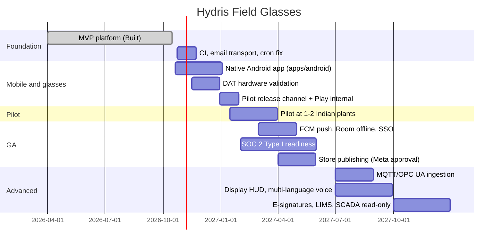

# Roadmap

Quarter-level and indicative. Dates assume the current team. Items marked **Built** are on `main` (`3ac2d1d`).

| Phase | Quarter | Milestones | Dependencies / exit |
|---|---|---|---|
| **0 · MVP** (Built) | to Q3 2026 | API, console, web HUD, pairing, UI profiles, audit scan, voice, demo mode, WebView DAT bridge | Done |
| **1 · Hardening** | Q4 2026 | GitHub Actions CI; SES/Resend for `mail_outbox`; cron schedule fix (`vercel.json`); body-based refresh endpoint for native clients; move audit page images to object storage; purge jobs for expired sessions | None |
| **2 · Native app** | Q4 2026 – Q1 2027 | `apps/android` Hydris Field: auth, dashboard, alarms (SSE), work, live charts, CameraX + ML Kit scan, voice, glasses registration through pairing | DAT 1.0 SDK; Meta AI app on test phones; Developer Center org (India eligibility) |
| **3 · Pilot** | Q1 2027 | 1–2 plants (ETP/STP), 10–30 operators, Ray-Ban Meta Gen 2 + rugged phones, gateway HTTPS ingestion, KPIs baseline | Phase 2 + H1/H5 test matrix; customer site camera policy |
| **4 · GA** | Q2 2027 | FCM push; Room offline outbox; SSO (SAML/OIDC); India-region production (Mumbai); Play/MDM release; SOC 2 Type I; data-retention settings | Meta DAT store submission approval; pen-test |
| **5 · Advanced** | H2 2027 → 2028 | MQTT and OPC UA ingestion adapters; read-only SCADA/historian connectors; AI vision (gauge reading, leak/foam detection); digital-twin plant map (extends `console/plant/map`); multi-language voice (Hindi, Tamil, Marathi, Gujarati); native Meta Ray-Ban Display HUD (Web App and/or DAT display); predictive maintenance from runtime/vibration/current; LIMS integration for lab COD/BOD/TSS; Part 11-style e-signatures; iOS app | Customer demand; Meta display APIs maturity; data volume for models |

## Key dependencies and risks
1. **Meta publishing:** DAT store distribution depends on Meta opening submissions ("soon" per the FAQ). Mitigation: phone-only features ship independently.
2. **Meta AI app:** a mandatory companion on every operator phone (pairing, registration, permissions, firmware).
3. **Country availability:** full DAT capabilities only in "AI glasses supported countries". Confirm India.
4. **Email and CI:** blockers for any external pilot.
