# Product Roadmap and Future Features

Hydris Field Glasses already does something no other product in Indian water and wastewater does end to end: it puts
live plant state, the next task, the approved procedure and a grounded voice assistant in an operator's line of sight, and
it turns paper log sheets into verified, searchable records. The minimum viable product is built and runs as a
zero-configuration demo. The next twelve months are about turning it into something a plant can rely on every shift,
then into something a regulator, a maintenance system and a control room can rely on too.

This roadmap is a plan, not a commitment. Everything dated is an estimate that assumes the current team and no major
change in Meta's developer programme. Status labels follow the house rule: **Built** is on `main` (commit `07cca23`),
**Partial** exists in code but is incomplete or unverified, **Planned** does not exist yet. Effort, reach and impact
numbers are team estimates and are labelled as such.

> [!STATS]
> - 5 | quarters planned | Q4 2026 to Q4 2027
> - 8 | themes | From hardening to ecosystem
> - 19 | future features analysed | Each with problem, outcome and dependencies
> - 1 to 2 | pilot plants targeted | ETP or STP, Q1 2027 (target)

## How to read this roadmap

### Horizons, not dates

The roadmap is organised in three horizons. **Now** is committed work for the current and next quarter, with named owners
and acceptance criteria in the [QA and Test Plan](QA_TEST_PLAN.md). **Next** is planned for the following two quarters;
scope may still change after pilot feedback. **Later** is direction: we believe these features matter and have designed
their shape, but they will be re-prioritised with evidence from the pilot.

Table: Confidence by horizon

| Horizon | Window (plan) | Confidence in scope | Confidence in dates | What changes it |
|---|---|---|---|---|
| Now | Q4 2026 to Q1 2027 | High | Medium | Pilot customer dates, Meta DAT access |
| Next | Q2 to Q3 2027 | Medium | Low | Pilot KPIs, customer requests, team size |
| Later | Q4 2027 and beyond | Low | Very low | Market, partners, regulation, hardware |

### Planning assumptions

1. The team stays roughly at its current size until a pilot converts; dates assume no new hires before Q2 2027.
2. Meta keeps the Wearables Device Access Toolkit (DAT) available to developers, and India-based testers can use it
   (unconfirmed; see [Dependencies and risks](#dependencies-and-risks)).
3. The first customers are Indian ETPs, STPs and CETPs with English-literate supervisors and mixed-language operators.
4. Hydris remains read-only to the plant: no feature in this roadmap writes to a PLC, SCADA or DCS.

## Where the product is today

The MVP covers every surface: website, console, glasses web app with a simulator, native Android app, and the API. The
inventory below is grounded in the [PRD](PRD.md) requirement statuses and the code.

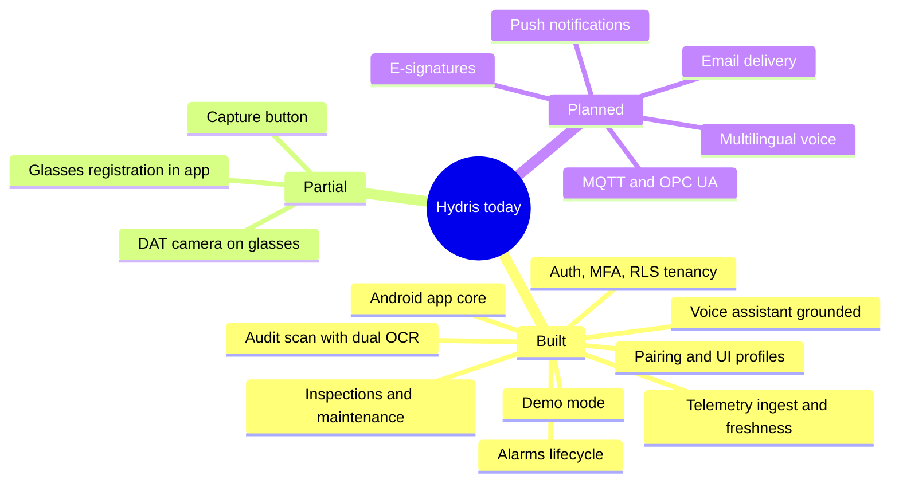

Table: Current state by product area

| Area | What exists | Status | Evidence |
|---|---|---|---|
| Identity and tenancy | Login with lockout, TOTP MFA, refresh rotation, invitations, site scoping, Postgres RLS | **Built** | FR-001 to FR-010, `platform.test.ts` |
| Telemetry | 16 measurands, HTTPS gateway ingestion, manual and lab entry, append-only corrections, freshness | **Built** | FR-020 to FR-026 |
| Industrial protocols | `gateways.protocol` enum only | **Planned** | FR-027, FR-028 |
| Alarms | Rules with deadband and on-delay, lifecycle, realtime over SSE | **Built** | FR-030 to FR-033 |
| Push to phones | None | **Planned** | FR-034 |
| Inspections and maintenance | Templates, routes, glasses execution with offline queue, review, maintenance tasks | **Built** | FR-040 to FR-043 |
| Devices | Pairing, tokens, revocation, permission ceiling, UI profiles | **Built** | FR-050 to FR-054 |
| Meta glasses hardware | DAT bridge and native app integration, not run on physical glasses | **Partial** | FR-055 to FR-057 |
| Audit scanning | Guided capture, dual-pass OCR, structuring, optional vision, review, four-eyes, PDF | **Built** | FR-060 to FR-067 |
| E-signature | None | **Planned** | FR-068 |
| Assistance and voice | SOP retrieval, "Hey Hydris", grounded answers with rules fallback | **Built** (English) | FR-070 to FR-072 |
| Multilingual voice | None | **Planned** | FR-073 |
| Platform | SSE replay, reports, audit trail, demo mode, simulation, in-app notifications | **Built** | FR-080 to FR-085 |
| Email | Messages written to `mail_outbox`, never sent | **Planned** | FR-086 |
| Android app | Login, demo, home, work, sensors, alarms, scan with CameraX and ML Kit, assistant, glasses screen | **Built** (manually verified on emulator) | `apps/android` |
| CI | None | **Planned** | No `.github/` directory |

## Vision and horizons

### Product vision

Every operator in a water or wastewater plant gets the live state of the plant, the next task and the right procedure in
their line of sight, hands free, and every reading, check and paper record they touch becomes a trustworthy digital
record. Over the next horizons that vision widens from the operator to the plant: the same trusted record feeds
compliance reporting, maintenance systems and predictive models.

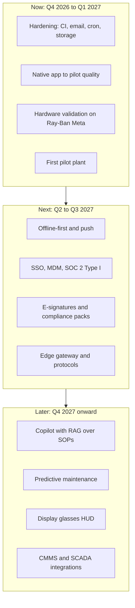

Table: Horizon goals and exit conditions

| Horizon | Goal | Exit condition |
|---|---|---|
| Now | A pilot plant uses Hydris every shift without engineering support on site | Pilot exit criteria in the QA plan all checked; 4 weeks of daily use |
| Next | A customer can buy, deploy and audit Hydris without Hydris engineers | GA release; SOC 2 Type I report; Play or MDM distribution; second paying site |
| Later | Hydris is the system of record for field work and compliance evidence at multi-site customers | Compliance reports generated from Hydris accepted by a regulator; one CMMS integration live |

## Timeline Q4 2026 to Q4 2027

The timeline and Gantt chart below are the plan as of October 2026. They are re-baselined at the end of every quarter.

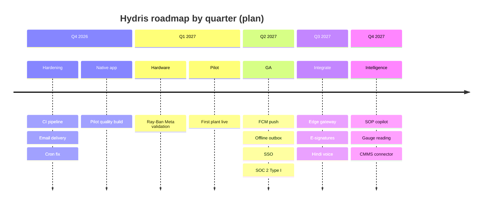

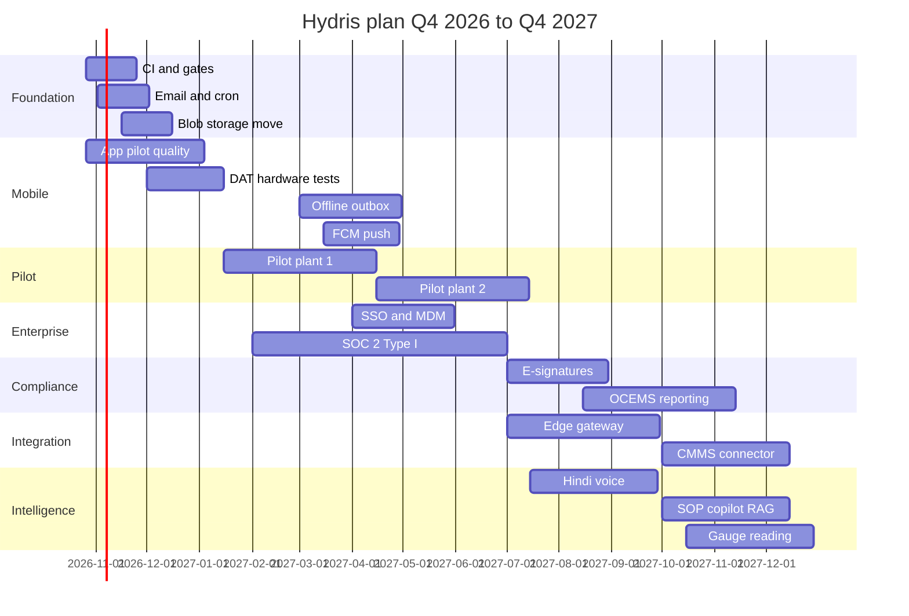

Table: Quarter summary (plan)

| Quarter | Headline | Key deliverables | Exit signal |
|---|---|---|---|
| Q4 2026 | Make it reliable | CI, email transport, cron schedule, audit images to object storage, purge jobs, Android pilot build | Gates 1 and 2 green on every PR |
| Q1 2027 | Prove it in a plant | DAT hardware matrix, pilot plant 1, field trial, KPI baseline | Pilot exit criteria met |
| Q2 2027 | Make it buyable | GA: FCM push, offline outbox, SSO, MDM, SOC 2 Type I readiness, India-region production | Second site signed |
| Q3 2027 | Make it compliant and connected | E-signatures, edge gateway (MQTT, OPC UA, Modbus), Hindi voice | First e-signed record approved at a customer |
| Q4 2027 | Make it intelligent | SOP copilot, gauge reading, first CMMS connector, OCEMS report drafts | Copilot used weekly by 50 % of operators (target) |

## Themes and epics

### Theme overview

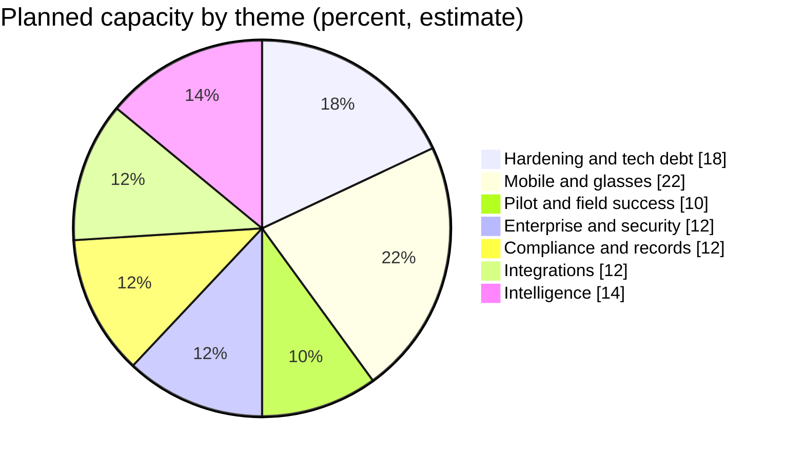

Each epic below states the problem, the outcome we want, the scope, the dependencies and the status. Epic IDs (EP-xx)
are stable and are used in the prioritisation table.

### Hardening and tech debt

**EP-01 CI and quality gates.** Problem: tests run only on laptops; nothing stops a regression reaching the demo.
Outcome: every pull request runs typecheck, unit, API, build, Playwright and Android checks. Scope: GitHub Actions
pipeline as specified in the [QA and Test Plan](QA_TEST_PLAN.md). Dependencies: none. Status: **Planned** (Q4 2026).

**EP-02 Email delivery.** Problem: invitations and password resets are written to `mail_outbox` and never sent (FR-086),
so a real customer cannot onboard users without manual help. Outcome: transactional email with delivery status and purge
after send. Scope: SES or Resend adapter, templates, bounce handling, outbox purge. Dependencies: domain verification.
Status: **Planned** (Q4 2026).

**EP-03 Storage and retention.** Problem: audit page images are base64 inside Postgres; expired sessions, pairing
challenges and outbox rows are never purged ([Data Model](DATA_MODEL.md)). Outcome: images in object storage with
lifecycle rules; purge jobs on a schedule. Scope: migrate `audit_document_pages.data` to Blob or S3, purge jobs in
`apps/api/src/jobs.ts`. Status: **Planned** (Q4 2026).

### Mobile and glasses

**EP-04 Android app to pilot quality.** Problem: the native app is built and manually verified on an emulator but has no
automated tests and has not run with glasses. Outcome: a signed pilot build on a Play internal track with unit and UI
tests. Scope: tests, crash reporting, settings, diagnostics screen, release signing. Status: **Partial**.

**EP-05 Ray-Ban Meta hardware validation.** Problem: the DAT camera, capture button and glasses speech paths are
unverified on hardware. Outcome: hardware matrix rows H1, H2 and H5 passed. Dependencies: DAT access for India-based
testers, Meta AI app on test phones. Status: **Planned** (Q4 2026 to Q1 2027).

**EP-06 Offline-first and push.** Problem: operators walk through basements and pump houses with no signal; the Android
app has no outbox and no push. Outcome: rounds and alarm acknowledgements work offline and sync safely; alarms reach a
pocket phone in seconds. Scope: see [Offline-first sync](#offline-first-sync) and FR-034. Status: **Planned** (Q2 2027).

**EP-07 Display glasses.** See [Meta display glasses and other displays](#meta-display-glasses-and-other-displays).
Status: **Planned** (Later).

### Pilot and field success

**EP-08 Pilot programme.** Problem: no plant has used Hydris on a real shift. Outcome: one to two Indian plants using it
daily with measured KPIs. Scope: onboarding kit, site survey, camera policy pack, training, weekly KPI review, field
trial. Dependencies: EP-01 to EP-05. Status: **Planned** (Q1 2027).

### Enterprise and security

**EP-09 SSO and MDM.** Problem: enterprise IT will not manage another password list or side-loaded APKs. Outcome: SAML
and OIDC sign-in, managed Android deployment. Status: **Planned** (Q2 2027).

**EP-10 Certifications.** Problem: due diligence questionnaires stall deals. Outcome: SOC 2 Type I, then Type II and
ISO/IEC 27001. Status: **Planned** (Q2 2027 onward).

### Compliance and records

**EP-11 Electronic signatures (FR-068).** See [E-signatures](#e-signatures). Status: **Planned** (Q3 2027).

**EP-12 OCEMS and pollution control board reporting.** See
[OCEMS and CPCB and SPCB compliance automation](#ocems-and-cpcb-and-spcb-compliance-automation). Status: **Planned**.

### Integrations

**EP-13 Edge gateway and protocols (FR-027, FR-028).** See
[Edge gateway and industrial protocols](#edge-gateway-and-industrial-protocols). Status: **Planned** (Q3 2027).

**EP-14 CMMS and marketplace.** See [Marketplace and CMMS integrations](#marketplace-and-cmms-integrations). Status:
**Planned** (Q4 2027).

### Intelligence

**EP-15 Multilingual voice (FR-073).** **EP-16 SOP copilot.** **EP-17 Gauge and meter reading.** **EP-18 Predictive
maintenance.** Each is described in depth in the next chapter. Status: **Planned**.

## Future features in depth

### Meta display glasses and other displays

**Problem.** Today's Ray-Ban Meta glasses have a camera, microphones and open-ear speakers but no display, so the Hydris
HUD runs on the phone. Operators still have to look down. Display glasses (Meta Ray-Ban Display with the Neural Band, and
industrial head-mounted displays) would put the live value and the next step in view.

**Outcome.** The same glasses web app, with its existing HUD layout and UI profiles (FR-054), renders on a display
device, and input comes from the device's native gestures as well as voice.

**Approach.** Treat displays as rendering targets behind a small adapter: the HUD layout already exists in
`apps/web/src/glasses/GlassesApp.tsx`, and input is abstracted in `glasses/input.ts` (which holds a placeholder for
hardware gestures today). Candidate targets, in order: Meta Ray-Ban Display (dependent on Meta exposing display and
Neural Band input to third parties), Android-based industrial headsets such as RealWear Navigator (voice-driven,
hard-hat mounted), and Vuzix-class smart glasses.

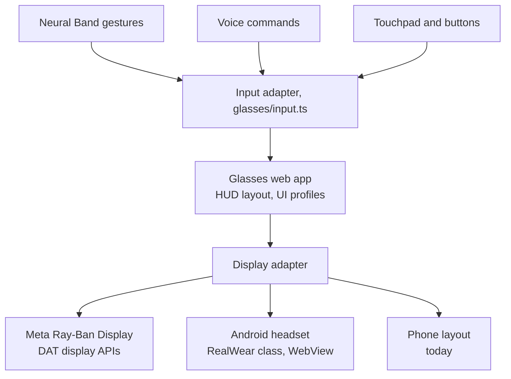

**Dependencies.** Meta display APIs (not available to us today; Mock Device Kit does not simulate display glasses), device
availability in India. **Status:** **Planned** (Later). **Effort:** 3 to 5 person-months per target (estimate).

### Offline-first sync

**Problem.** Plants have dead zones. The web glasses app already queues inspection responses and replays them
idempotently (`client_op_id`, FR-041), but the Android app has no persistent outbox, and alarm acknowledgements and
readings fail without a network.

**Outcome.** Every field action works offline for a full shift and syncs exactly once, with clear conflict rules.

**Scope.** Room database cache of the operator's context (tasks, assets, latest readings, SOPs), an outbox of commands
with client operation IDs, background sync with WorkManager, conflict policy (server wins for alarm state; append-only
merge for readings and steps), visible "queued" counts.

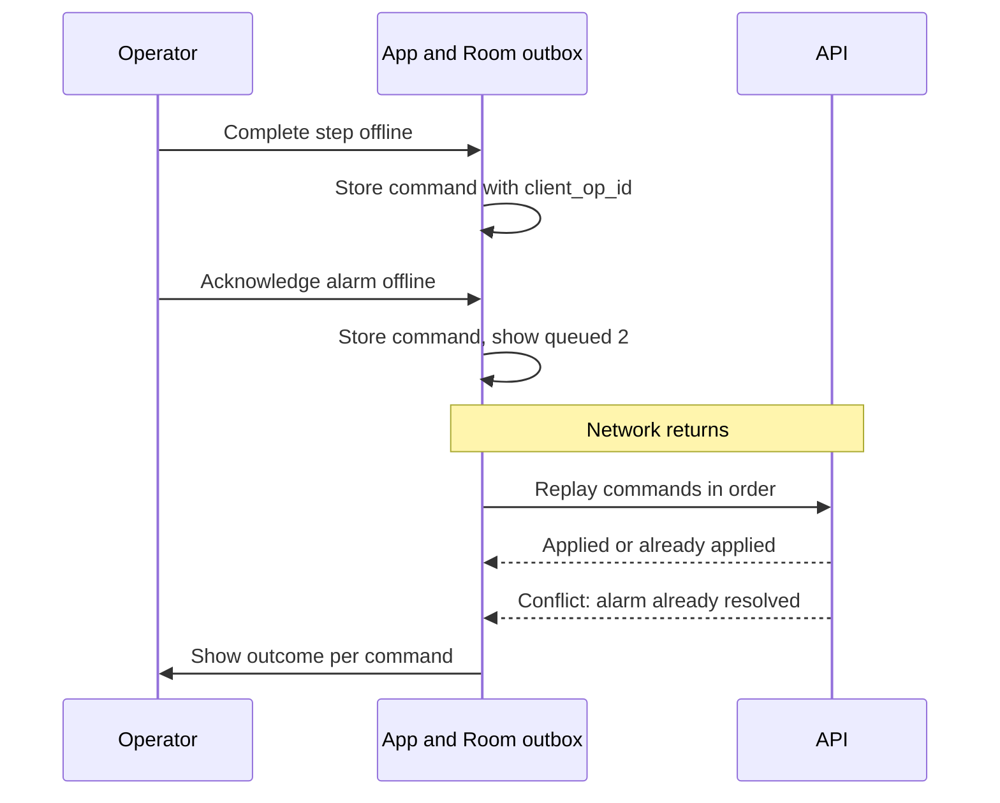

**Dependencies.** Server endpoints accept `client_op_id` for alarm actions (inspections already do). **Status:**
**Planned** (Q2 2027). **Effort:** 3 person-months (estimate).

### Edge gateway and industrial protocols

**Problem.** Plants publish instrument data on Modbus, OPC UA and MQTT, often through a SCADA or historian. Hydris
accepts HTTPS batches only (`POST /ingest/v1/readings`, FR-022), so each customer needs custom integration.

**Outcome.** A Hydris Edge gateway installed in the plant network reads tags and forwards readings outbound over HTTPS,
preserving the read-only and outbound-only security model.

**Scope.** Containerised gateway (Docker on an industrial PC), connectors for OPC UA (subscription), MQTT (including
Sparkplug B payloads), and Modbus TCP and RTU (polling), a tag mapping UI in the console, store-and-forward buffering,
and read-only historian connectors (FR-028).

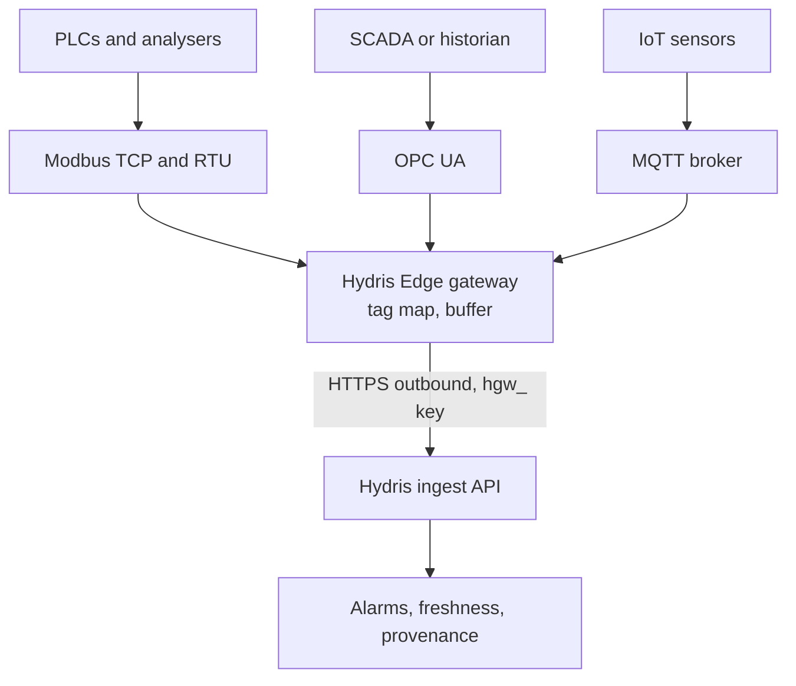

> [!DECISION]
> The gateway is read-only by construction: connectors are built without write function codes or method calls, and
> configuration cannot enable them. This keeps Hydris outside IEC 62443 control zones, as stated in
> [Security and Privacy](SECURITY_PRIVACY.md).

**Dependencies.** Pilot customer network policy, a test rig with a PLC simulator. **Status:** **Planned** (Q3 2027).
**Effort:** 5 person-months (estimate).

### Predictive maintenance and anomaly detection

**Problem.** Blowers, pumps and dosing systems fail with warning signs (rising current, vibration, runtime drift) that
nobody watches continuously.

**Outcome.** Hydris flags assets whose behaviour departs from their own normal, and creates maintenance tasks with
evidence, before the failure.

**Approach.** Start simple and explainable: per-asset baselines and seasonal residuals, then multivariate models once
there is enough labelled history. Every prediction becomes an advisory, never an automatic action, and links to the
evidence charts.

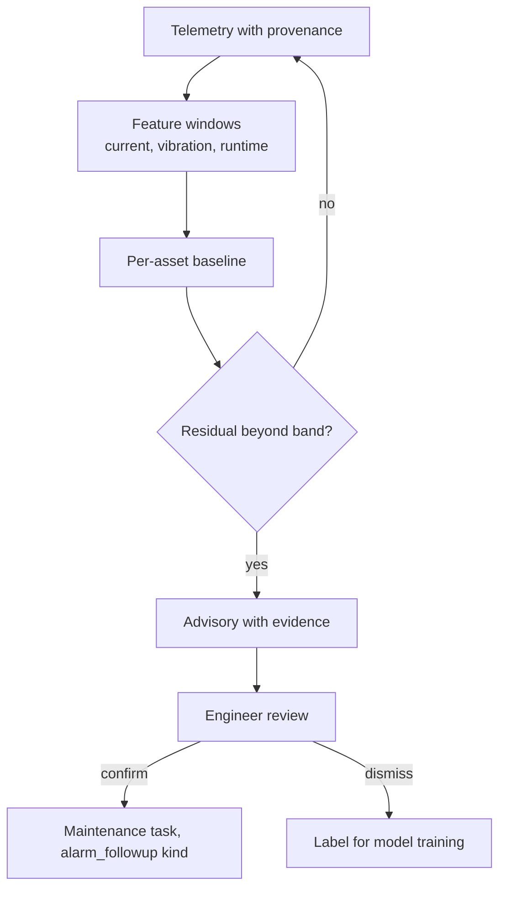

**Dependencies.** Edge gateway for high-frequency data, 6 or more months of history per asset. **Status:** **Planned**
(Later). **Effort:** 6 person-months for the first version (estimate).

### SOP copilot with retrieval over procedures

**Problem.** Today `/assist` retrieves approved SOPs and the voice assistant answers from tenant data via scoped tools
(FR-070, FR-072). Operators also ask "how" and "why" questions that need the content of long procedures, manuals and
past incident notes.

**Outcome.** A copilot that answers from the customer's approved documents with citations, in the field, and never
invents a step.

**Approach.** Retrieval-augmented generation: chunk and embed approved documents per tenant, retrieve with RLS-scoped
queries, generate with citations, and refuse when retrieval confidence is low. Safety rule kept from today: Hydris does
not control equipment; for safety-critical actions it points to the approved procedure and the supervisor.

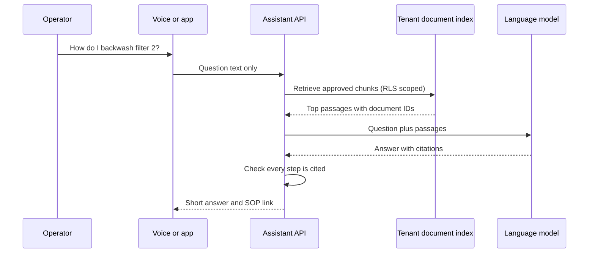

**Dependencies.** Document version control (exists: document status `draft`, `approved`, `archived`), LLM data residency
decision for Indian customers, per-org opt-out of third-party processing (planned in Security and Privacy). **Status:**
**Planned** (Q4 2027). **Effort:** 3 person-months (estimate).

### Multilingual voice

**Problem.** Many operators think and speak in Hindi, Tamil, Marathi, Gujarati, Telugu or Kannada, and mix languages in
one sentence. The assistant is English-only (FR-073 Planned).

**Outcome.** Operators ask in their language and hear answers in it, with numbers and units spoken correctly.

**Scope.** Speech recognition with Indic language support (Android on-device recognizers and cloud options such as
models trained on Indian languages), language-aware intent detection, localised wake phrase handling, TTS voices,
localised UI strings, and a code-mixed test set (the QA utterance set already includes code-mixed questions).

Table: Language rollout order (plan)

| Wave | Languages | Why first | Target |
|---|---|---|---|
| 1 | Hindi | Largest operator population in early pipeline | Q3 2027 |
| 2 | Tamil, Marathi | Pilot regions (assumed) | Q4 2027 |
| 3 | Gujarati, Telugu, Kannada, Bengali | Industrial clusters | 2028 |

**Dependencies.** Recognizer accuracy in noise, numeric normalisation per language. **Status:** **Planned**. **Effort:**
2 person-months for Hindi, then 1 per language (estimate).

### Computer vision for gauges and meters

**Problem.** Many plants still have analogue pressure gauges, flow totalisers and level indicators that are read by eye
and written down, which is where transcription errors start.

**Outcome.** The operator looks at a gauge, says "read this", and Hydris proposes a value with confidence; the operator
confirms it, and it is stored with the photo as provenance, like an audit scan field.

**Approach.** Reuse the audit scan pattern: capture on intent, machine proposes, human confirms, original kept. Dial gauge
reading via needle detection and scale calibration per registered gauge; digit recognition for seven-segment and
odometer-style totalisers; QR or tag on the gauge to link the asset and its calibration.

**Dependencies.** DAT camera validated (EP-05), labelled image set from pilot sites. **Status:** **Planned** (Q4 2027).
**Effort:** 5 person-months (estimate). **Target accuracy:** within 2 % of full scale on 95 % of reads (target).

### OCEMS and CPCB and SPCB compliance automation

**Problem.** CPCB requires online continuous effluent and emission monitoring (OCEMS) for 17 categories of highly
polluting industries and for CETPs, and state boards (SPCBs) set consent conditions with periodic returns. Plants
assemble these reports by hand from instruments, lab sheets and logbooks.

**Outcome.** Hydris assembles compliance evidence (continuous data with provenance and freshness, verified lab sheets,
approved logs) and drafts the periodic reports, with every number traceable to its source.

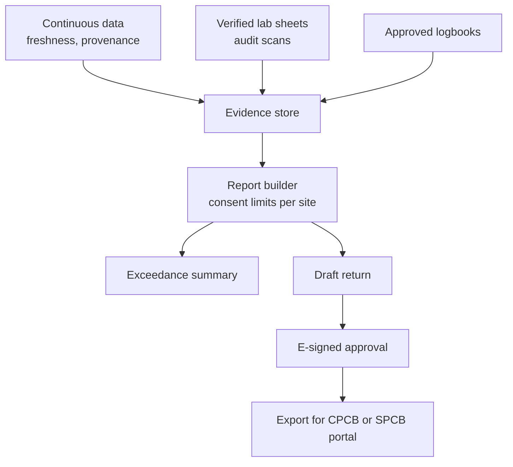

**Scope.** Consent-limit library per site, exceedance and data-availability calculations, report templates, export
formats. Direct submission to CPCB or SPCB systems only where an official interface exists (to be confirmed per state).

**Dependencies.** E-signatures (EP-11), edge gateway for continuous data, regulator acceptance of Hydris-generated
records (PRD open question). **Status:** **Planned** (Q3 to Q4 2027). **Effort:** 4 person-months (estimate).

### E-signatures

**Problem.** The audit trail is append-only and approval is four-eyes (FR-065), but there is no signature manifestation:
re-authentication at the moment of signing, a stated meaning ("reviewed", "approved"), and the signer's name and time
bound to the record (FR-068).

**Outcome.** Signatures that meet Part 11-style expectations for audit documents, inspections and compliance returns,
without claiming GxP validation.

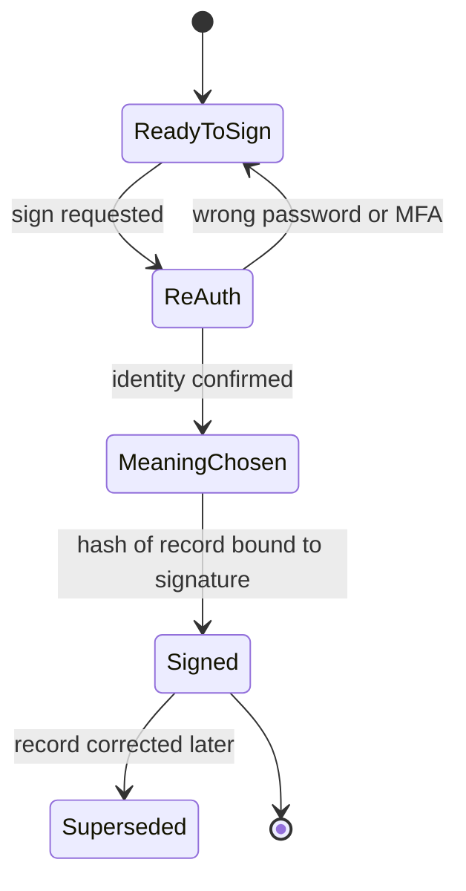

**Scope.** Re-auth with password or MFA, signature meanings, record hash bound to the signature, manifestation on the PDF,
signature report, lockout on repeated failures. **Status:** **Planned** (Q3 2027). **Effort:** 2 person-months
(estimate).

### Digital twin and plant map

**Problem.** The console has a plant map (`console/map`, `glasses/PlantMap.tsx`) with asset positions, but it is a
schematic, not a living model of process flow.

**Outcome.** A process-flow view of the plant where each unit shows live state, open alarms, overdue tasks and data
freshness, and where an operator's glasses position (by QR or BLE beacon check-in) shows nearby assets.

**Scope.** Process-flow layout editor, live overlays, asset check-in, "what is near me" on glasses, mass-balance views
later. **Status:** **Planned** (Later). **Effort:** 4 person-months (estimate).

### Remote expert video assist

**Problem.** When a junior operator faces an unfamiliar fault, the expert is often at another site or vendor office.

**Outcome.** The operator starts a call from the glasses; the expert sees the glasses camera view, talks to the operator
and annotates frames; the session summary is saved against the asset.

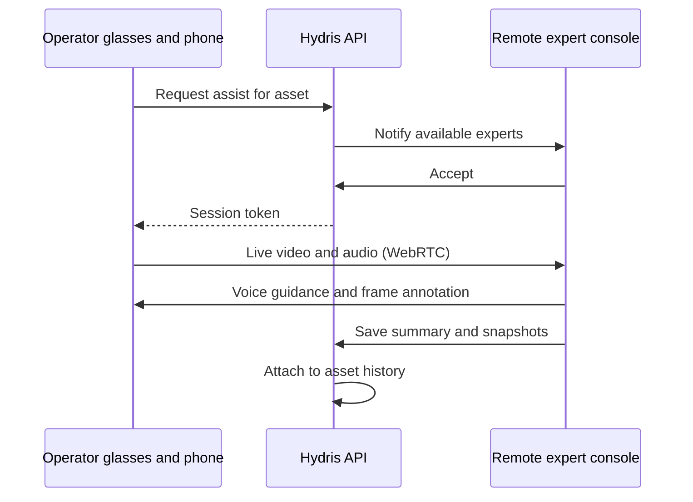

**Dependencies.** DAT video streaming bandwidth over the phone link, plant network uplink, consent for recording.
**Status:** **Planned** (Later). **Effort:** 3 person-months (estimate).

### iOS app

**Problem.** Some customers' supervisors and managers carry iPhones. Operators in Indian plants mostly use Android.

**Outcome.** An iOS companion for supervisors first (alarms, reviews, approvals), then operators if Meta's iOS DAT support
and customer demand justify it.

**Status:** **Planned** (Later; PRD open question 5). **Effort:** 6 person-months (estimate).

### Mobile device management

**Problem.** Pilot phones are set up by hand. Enterprises require managed devices, app configuration and remote wipe.

**Outcome.** Hydris Field supports Android Enterprise managed configuration (server URL, SSO, kiosk options), works in
work profiles, and is distributable through managed Google Play.

**Status:** **Planned** (Q2 2027). **Effort:** 1.5 person-months (estimate).

### Multi-site analytics

**Problem.** Reports today are per organization and per site (FR-081). Groups that run many STPs (municipal bodies, CETP
operators, facility managers) need comparisons.

**Outcome.** Cross-site dashboards: compliance status, alarm response times, round completion, data availability, and
benchmarks across sites.

**Status:** **Planned** (Later). **Effort:** 3 person-months (estimate).

### Marketplace and CMMS integrations

**Problem.** Large customers run maintenance in SAP Plant Maintenance or IBM Maximo. Hydris maintenance tasks
(FR-043) would otherwise duplicate work orders.

**Outcome.** Two-way sync of work orders and asset master data with the customer's CMMS, plus outbound webhooks for
other systems (LIMS, ERP, ticketing).

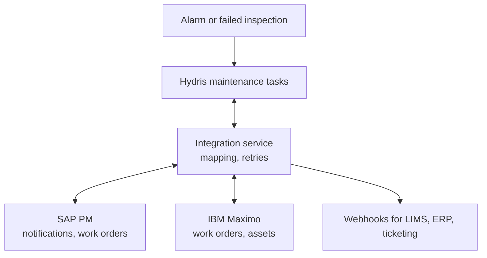

**Status:** **Planned** (Q4 2027 onward). **Effort:** 4 person-months for the first connector (estimate).

### Certifications

Table: Certification plan (targets)

| Certification | Why | Target |
|---|---|---|
| SOC 2 Type I | Customer due diligence for SaaS | Q2 2027 readiness |
| SOC 2 Type II | Operating effectiveness over time | 2028 |
| ISO/IEC 27001:2022 | Common Indian enterprise and PSU requirement | 2028 |
| IEC 62443-4-1 practices for the edge gateway | Industrial customers' OT security reviews | Assessment with the gateway |
| Intrinsically safe hardware | Not a Hydris certification; depends on glasses and phone vendors for hazardous zones | Customer-specific |

## Prioritisation

### RICE scoring

RICE = Reach x Impact x Confidence / Effort. Reach is operators or users affected per quarter after launch; impact is on a
0.25 to 3 scale; effort is person-months. All values are team estimates (October 2026). Hardening epics (EP-01 to EP-03)
are prerequisites and are not scored.

Table: RICE scores for candidate epics (estimates)

| Epic | Reach | Impact | Confidence | Effort | RICE |
|---|---|---|---|---|---|
| FCM push | 300 | 1 | 90 % | 1 | 270 |
| SSO | 300 | 1 | 90 % | 1.5 | 180 |
| Offline-first sync | 300 | 2 | 80 % | 3 | 160 |
| MDM | 300 | 0.5 | 80 % | 1.5 | 80 |
| E-signatures | 100 | 2 | 80 % | 2 | 80 |
| SOP copilot | 300 | 1 | 70 % | 3 | 70 |
| Multilingual voice | 250 | 2 | 50 % | 4 | 63 |
| Edge gateway | 200 | 2 | 60 % | 5 | 48 |
| OCEMS reporting | 80 | 3 | 50 % | 4 | 30 |
| CMMS connector | 100 | 2 | 50 % | 4 | 25 |
| Remote assist | 100 | 1 | 60 % | 3 | 20 |
| Digital twin map | 150 | 1 | 50 % | 4 | 19 |
| Multi-site analytics | 40 | 2 | 70 % | 3 | 19 |
| Gauge reading | 200 | 1 | 40 % | 5 | 16 |
| Display glasses HUD | 50 | 2 | 40 % | 4 | 10 |
| iOS app | 60 | 1 | 70 % | 6 | 7 |
| Predictive maintenance | 50 | 2 | 30 % | 6 | 5 |

> [!NOTE]
> RICE ranks within a horizon; it does not override dependencies or strategy. OCEMS reporting scores low on reach but is
> scheduled in Q3 to Q4 2027 because it is a buying reason for the highest-value segment (17 categories and CETPs).

### Value versus effort

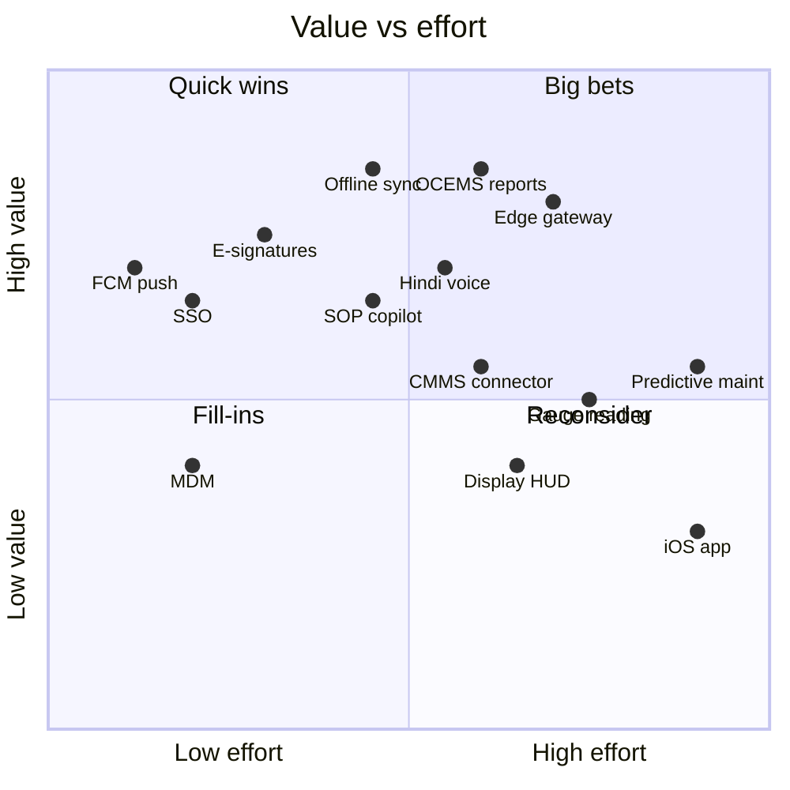

## Known gaps and tech debt to close

These items come from the product documents and the code. Most block an external pilot.

Table: Gaps and tech debt

| Item | Where | Impact | Fix | Target |
|---|---|---|---|---|
| No CI pipeline | No `.github/` | Regressions reach the demo | EP-01 | Q4 2026 |
| Email not wired | `mail_outbox`, FR-086 | Invites and resets never arrive | EP-02 | Q4 2026 |
| Cron runs daily on Vercel | `vercel.json` `0 3 * * *` | Stale-data alarms evaluated once a day | Per-minute schedule (Pro plan) or external scheduler | Q4 2026 |
| Device refresh token in `localStorage` | Web glasses runtime `glasses/link.ts` | Token theft on a compromised device | Native app (Keystore, built); shorter TTL or bound tokens for web | Q1 2027 |
| Audit images as base64 in Postgres | `audit_document_pages.data` | Database bloat, slow backups | Object storage with lifecycle | Q4 2026 |
| No purge jobs | `auth_sessions`, `device_sessions`, `pairing_challenges`, `mail_outbox` | Personal data kept indefinitely | Purge 30 days after expiry; outbox after send | Q4 2026 |
| No e-signature | FR-068 | Regulated customers hesitate | EP-11 | Q3 2027 |
| Pairing TTL documentation mismatch | `docs/operations/vercel.md` says about 10 minutes; code `PAIRING_TTL_S = 300` | Support confusion | Correct the doc to 5 minutes | Q4 2026 |
| Mobile spec status outdated | `MOBILE_APP_SPEC.md` says `apps/android` not on main | Misleads readers | Update spec | Q4 2026 |
| No Android automated tests | `apps/android` | Manual regression only | EP-04 | Q4 2026 |
| DAT paths unverified on hardware | FR-055 to FR-057 | Glasses features may fail on device | EP-05 | Q1 2027 |
| No per-org opt-out of third-party AI processing | Security and Privacy | Blocks some customers | Org setting | Q2 2027 |
| No device attestation | Native app | Spoofed clients | Play Integrity | Q2 2027 |
| Audit log not hash-chained | `audit_events` | Weaker tamper evidence | Hash chain or WORM export | Q3 2027 |

- [ ] CI pipeline with gates 1 and 2
- [ ] Email transport and outbox purge
- [ ] Cron schedule fixed
- [ ] Audit images moved to object storage
- [ ] Purge jobs for expired sessions and challenges
- [ ] Pairing TTL documentation corrected
- [ ] Mobile spec status updated
- [x] Native app stores tokens in Android Keystore (`SecureStore.kt`)

## Dependencies and risks

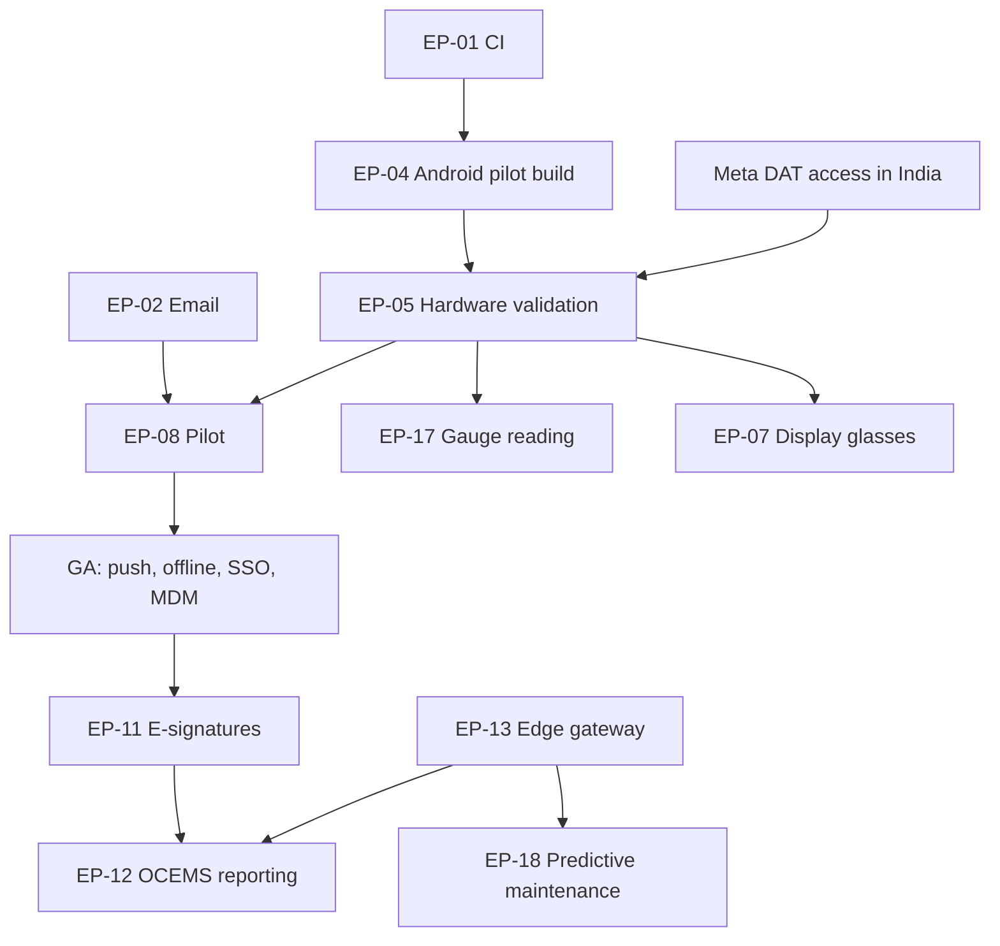

Table: Roadmap risks

| Risk | Likelihood | Impact | Mitigation |
|---|---|---|---|
| Meta DAT not available to India-based developers or publishing stays gated | Medium | High | Pilot via release channels and Developer Mode; phone-camera path works without DAT |
| Meta AI app dependency causes support load | High | Medium | Onboarding checklist, version check screen |
| Pilot customer delays (approvals, camera policy) | High | High | Site camera policy pack early; second pilot candidate in parallel |
| Regulators do not accept Hydris records as primary | Medium | High | E-signatures, PDF with trail, engage SPCBs early |
| LLM data residency required | Medium | Medium | Rules engine fallback exists; region-pinned provider |
| Small team spread across too many surfaces | High | High | Strict horizon discipline; Later items stay unstarted until GA |
| Display glasses APIs never open to third parties | Medium | Low | Industrial Android headsets as alternative target |

## Success metrics per horizon

Table: Success metrics (targets)

| Horizon | Metric | Target |
|---|---|---|
| Now | Pilot exit criteria complete | 100 % |
| Now | Round completion on time at pilot | 95 % (PRD) |
| Now | Median alarm acknowledgement time | Under 5 min (PRD) |
| Now | Audit fields machine-agreed | 90 % (PRD) |
| Next | Weekly active operators / licensed | 70 % (PRD) |
| Next | Paying sites | 3 |
| Next | Offline actions synced without duplicates | 100 % |
| Next | SOC 2 Type I | Report issued |
| Later | Compliance reports generated in Hydris | 1 regulator accepted |
| Later | Copilot answers with citations | 90 % of answered questions |
| Later | Multi-site customers | 2 |

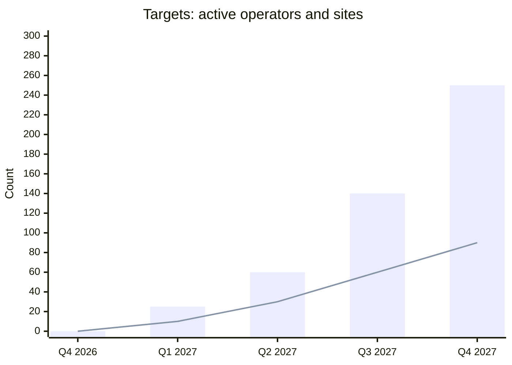

In the chart, bars are weekly active operators and the line is sites x 10 (so 90 means 9 sites). Both are targets.

## Release cadence

Table: Release cadence (plan)

| Surface | Cadence | Channel | Notes |
|---|---|---|---|
| API and web (console, glasses web app, website) | Continuous to staging; weekly to production after gates | Vercel | Hotfix within 24 h for S1 |
| Android app | Every 2 weeks | Play internal, then closed track, then managed Play | Glasses features behind remote flags |
| Edge gateway | Monthly | Signed container images | Customer-controlled upgrade window |
| Documentation | With each release | `docs/product` and Word editions | Version and change line updated |

Every release carries release notes listing requirement IDs changed, known issues and migration notes. Major features
ship behind organization-level flags so pilots can opt in.

## Open questions

1. Is India among Meta's supported countries for full DAT capabilities, and when do store submissions open?
2. Which pilot plants (ETP, STP or CETP) and which state boards will shape the first compliance pack?
3. Will customers accept glasses cameras in plant areas, and which zones must be camera-free?
4. Is a region-pinned LLM provider required before the copilot ships?
5. Which CMMS do the first enterprise prospects use: SAP PM, Maximo or something else?
