# Security and Privacy

Hydris Field Glasses puts live plant data, procedures, audit-record scanning and a voice assistant into the hands
(and the field of view) of wastewater and effluent treatment operators. That makes it a system of record for
regulated environmental data, an identity system for plant staff, and a camera worn in an industrial workplace.
This document describes how each of those responsibilities is met.

Statements about the current product name the file that implements them. Status follows the house rule:
**Built** (in the code and exercised), **Partial** (exists with a known gap) and **Planned** (designed, not
implemented). Compliance entries are mappings and targets, never claims of certification.

> [!STATS]
> - 3 | layers of access control | RBAC, site scope and Postgres row-level security
> - 15 min | access token lifetime | refresh tokens rotate with reuse detection
> - 0 | write paths to plant control | Hydris is read-only to PLC, SCADA and DCS
> - 2 | people per approved audit record | verifier and a different approver

> [!IMPORTANT]
> The public demo at `https://hydrisview.vercel.app` runs in demo mode with public signing secrets and synthetic
> data (`apps/api/src/config.ts`). Its security properties are deliberately weaker and are listed in this
> document. Real plant data must only ever be placed in a production deployment (see HFG-DEP).

## Security principles

1. **Read-only to the plant.** No endpoint writes to PLC, SCADA or DCS. Telemetry arrives by outbound push from a
   gateway (`POST /api/ingest/v1/readings`). The voice assistant prompt states that Hydris never operates
   equipment (`apps/api/src/modules/voice-assistant.ts`).
2. **Defence in depth for tenancy.** Permission checks in the API, site scoping in queries, and row-level security
   in Postgres, so one missing check does not leak another customer's data.
3. **Records are evidence.** Audit trails are append-only at the database grant level; corrections preserve the
   original value; audit documents need two different people.
4. **Least privilege for devices.** Glasses act for one assigned operator with a fixed permission ceiling and can
   be suspended or revoked instantly.
5. **Secrets are never stored in the clear.** Passwords use argon2id; refresh, device, gateway, invitation and
   reset tokens are stored as SHA-256 hashes; MFA seeds are AES-256-GCM encrypted.
6. **AI assists, people decide.** AI output is grounded in tenant data, labelled, cross-checked and verified by
   humans before it becomes a record.
7. **Capture on intent only.** The camera captures when a person asks it to. There is no continuous recording.
8. **Privacy by default.** Collect the minimum personal data, keep it in the customer's jurisdiction, and delete
   it when its purpose ends.

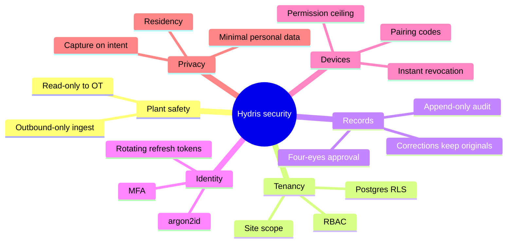

## System overview and trust boundaries

The data flow diagram shows every component that handles customer data and the trust boundaries between them.
A trust boundary is anywhere data crosses from a party or runtime we do not control to one we do, or the reverse.

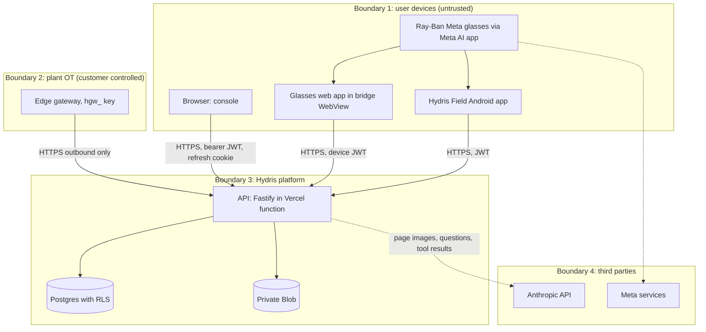

| Boundary | Crossing | Main controls |
|---|---|---|
| Devices to platform | All user and glasses traffic | TLS, JWT verification, revocation check per request, rate limits, zod validation |
| Plant to platform | Telemetry batches | Hashed gateway key, outbound-only, 500 readings per call, site-restricted sensors |
| Platform to database | Every query | Transaction runs as `hydris_app` with `app.org_id`; RLS forced |
| Platform to Anthropic | Audit page images, voice questions and tool results | Only when a key is configured; per-org opt-out **Planned** |
| Glasses to Meta | Camera, microphone, button events through DAT | Vendor platform; disclosed as a subprocessor |

Table: Trust boundary crossings

## Data classification

| Class | Examples | Where stored | Handling rules |
|---|---|---|---|
| Restricted secrets | Password hashes (argon2id), MFA seeds (AES-256-GCM with `DATA_KEY`), refresh, device, gateway, invitation and reset token hashes, `JWT_SECRET`, `DATA_KEY`, `CRON_SECRET` | Postgres, platform secrets | Never logged, never returned; raw tokens shown once |
| Regulated operational records | Telemetry, corrections, alarm history, inspections, maintenance, audit documents and their events | Postgres, Blob | Tenant RLS, append-only trails, retention per permit |
| Personal data | Names, emails, IPs in `auth_sessions` and `audit_events`, device `last_ip`, website inquiries (IP stored as a salted hash) | Postgres | Minimise, DPDP and GDPR rights, short retention outside records |
| Sensitive imagery | Page photos that may show signatures, names, faces or the plant | `audit_document_pages`, `attachments` | Capture on intent, authorized routes only, no public URLs |
| Voice content | Question text after "Hey Hydris" | Request body only, not persisted by `/assistant/ask` | Audio never uploaded to Hydris |
| Device-cached data | Glasses context cache and offline queue in `localStorage` (`apps/web/src/glasses/data.ts`, `link.ts`) | Phone browser storage | Cleared on logout; encryption **Planned** |
| Public | Website content, product documentation | Web | None |

Table: Data classification

## Threat model

The threat model uses STRIDE per component. "Controls" lists what is in the code; "Gaps" lists what is missing.

### Web console and authentication

| Threat | Scenario | Controls | Gaps |
|---|---|---|---|
| Spoofing | Password guessing, credential stuffing | argon2id (`core/crypto.ts`), lockout after 5 failures for 15 min, login limit 10 per min, timing-equal dummy verify, optional TOTP | No breached-password check, no SSO, MFA not enforceable per org |
| Tampering | Changing role or org in a token | JWT signed with `JWT_SECRET`; membership and role reloaded from the database on every request (`context.ts`) | None known |
| Repudiation | Denying a change | `audit_events` with actor, IP and action; append-only grant | No hash chain or WORM export |
| Information disclosure | Cross-tenant reads, user enumeration | RLS, 404 for out-of-scope records, identical reset responses | CSP disabled in helmet (`contentSecurityPolicy: false`) |
| Denial of service | Login floods | Rate limits, 1 MB body limit | Limits are per function instance |
| Elevation of privilege | Manager invites an admin | `assignableRoles` (`packages/domain/src/roles.ts`) | None known |

Table: STRIDE for the web console and authentication

### Glasses runtime and bridge app

| Threat | Scenario | Controls | Gaps |
|---|---|---|---|
| Spoofing | Rogue device pairs into an org | Pairing requires a signed-in user with `device.pair` to approve a short code; poll secret hashed | Code TTL 300 s, no device attestation |
| Tampering | Injected page calls native bridge | Bridge loads only `BuildConfig.HYDRIS_URL + "/glasses"` | Default `WebViewClient` allows navigation elsewhere with `HydrisNative` still exposed; `onPermissionRequest` grants everything |
| Repudiation | "The glasses did it" | Audit events record `actorDeviceId` and assigned user | None known |
| Information disclosure | Stolen phone exposes refresh token | 30-day device sessions, revocation | Web runtime keeps the device refresh token in `localStorage` |
| Denial of service | Pairing spam | 10 challenges per min, 40 polls per min | Per-instance limits |
| Elevation of privilege | Device calls admin endpoints | `DEVICE_PERMISSIONS` ceiling (`core/principal.ts`); verify and approve require a user principal | None known |

Table: STRIDE for the glasses runtime

### Native Android app

| Threat | Scenario | Controls | Gaps |
|---|---|---|---|
| Information disclosure | Token theft from storage or backup | AES-256-GCM with a non-exportable Android Keystore key (`SecureStore.kt`); `allowBackup="false"` | No user-authentication binding on the key |
| Tampering | Man-in-the-middle on hostile Wi-Fi | System TLS validation | Certificate pinning **Planned** |
| Spoofing | Repackaged app | Play signing (**Planned**) | Release currently signed with the debug key; no Play Integrity |

Table: STRIDE for the native app

### API, database and ingest

| Threat | Scenario | Controls | Gaps |
|---|---|---|---|
| Spoofing | Forged gateway | `hgw_` keys hashed, gateway and org must be active | No key expiry or IP allow-list |
| Tampering | Silent edit of readings | Corrections in append-only `telemetry_corrections`; original kept | No signed export |
| Information disclosure | SQL leak across tenants | `withTenant` sets role and org per transaction, FORCE RLS | Owner connection would bypass RLS; separate runtime user **Planned** |
| Denial of service | Ingest flood | 1,200 calls per min per instance, 500 readings per call | Shared limiter **Planned** |
| Elevation | Code path forgets `withTenant` | `withSystem` still runs as `hydris_app` with append-only grants | Review checklist only |

Table: STRIDE for the API, database and ingest

### AI provider and cron

| Threat | Scenario | Controls | Gaps |
|---|---|---|---|
| Information disclosure | Plant documents sent to a third party | Only with a configured key; images sent per request | Per-org opt-out **Planned**; no zero-retention agreement recorded |
| Tampering | Prompt injection in a scanned page | Structured output schema, cross-check against on-device OCR, human review | No explicit injection classifier |
| Spoofing | Unauthenticated cron calls | `CRON_SECRET` bearer compared with `timingSafeEqual` | None known |

Table: STRIDE for the AI provider and cron

## Authentication and sessions

### Tokens in use

| Token | Format | Lifetime | Storage (client) | Storage (server) | Revocation |
|---|---|---|---|---|---|
| User access token | JWT `typ: user` with `sid` family | 15 min (12 h in demo) | Memory | None | Family revocation checked per request |
| User refresh token | 48 random bytes | 7 days | `hg_refresh` cookie, `HttpOnly`, `SameSite=Strict`, path `/api/auth`, `Secure` in production | SHA-256 in `auth_sessions` | Logout, password change, reuse detection, session list |
| MFA challenge | JWT `typ: mfa` | 5 min | Memory | None | Expiry |
| Device access token | JWT `typ: device` with `sv` session version | 15 min | Memory | None | `session_version` bump |
| Device refresh token | `hgd_` plus 40 random bytes | 30 days | Keystore (native) or `localStorage` (web) | SHA-256 in `device_sessions` | Revoke, suspend, logout, reuse detection |
| Gateway key | `hgw_` random | Until revoked | Gateway config | SHA-256 in `gateways` | `POST /gateways/:id/revoke` |
| Invitation and reset tokens | Random | 7 days and 30 min | Link | SHA-256 | Single use |

Table: Token inventory (`apps/api/src/config.ts` TTL, `modules/auth.ts`, `modules/devices.ts`)

### Sign-in with MFA

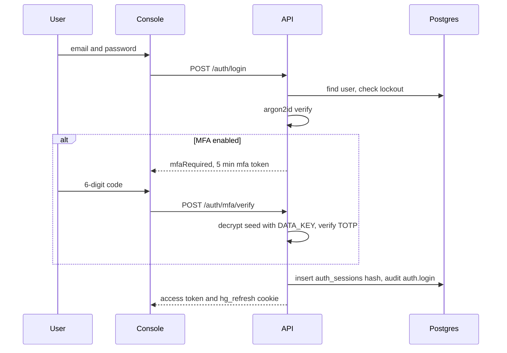

Failed logins increment `failed_logins`; at five the account locks for 15 minutes and an `auth.login_failed`
event is written each time. Unknown emails run a dummy argon2 verification so response time does not reveal
which accounts exist. Passwords must be 12 to 200 characters and not a repeated character (`passwordProblems`).

### Refresh rotation and reuse detection

Every refresh rotates the token within the same family. A rotated token presented again more than 30 seconds
later (the grace window for several tabs) is treated as theft: the whole family is revoked and
`auth.refresh_reuse_detected` is audited. Because each access token carries the family id and the API checks
the family on every request, logout and reuse detection end outstanding access tokens immediately.

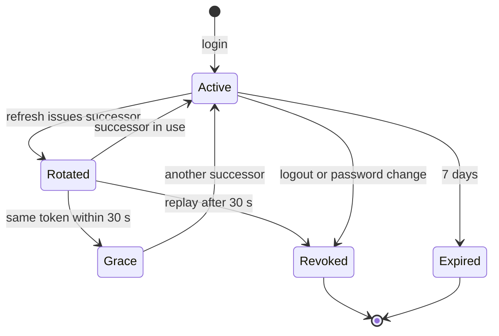

| Event | Effect | Status |
|---|---|---|
| Logout | Revokes the family | **Built** |
| Password change or reset | Revokes all sessions of the user | **Built** |
| Org switch | Revokes the current family, starts a new one | **Built** |
| Session list and remote revoke | `GET` and `DELETE /auth/sessions` | **Built** |
| User deactivated | Next request fails membership check | **Built** |
| SSO (SAML or OIDC) | Enterprise identity | **Planned** |
| Org-enforced MFA | Admin policy | **Planned** |

Table: Session control events

## Device and glasses security

### Pairing

Glasses use a device-authorization flow modelled on OAuth device grant. The device requests a challenge and
displays an 8-character code from an unambiguous alphabet (`packages/domain/src/devices.ts`); a signed-in user
approves it on `/pair`. The QR code encodes only the `/pair` URL with the short code, never a credential.

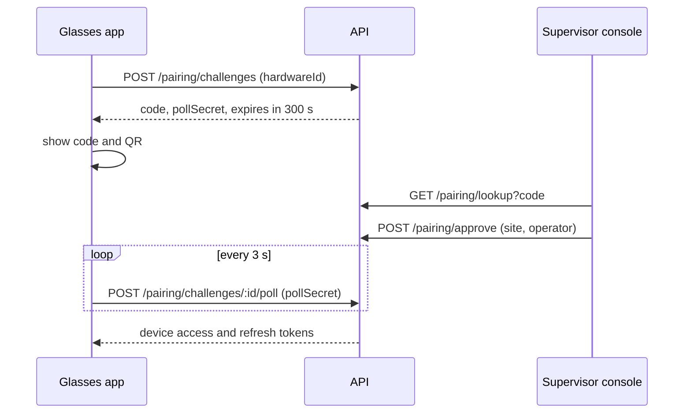

| Control | Value | Source |
|---|---|---|
| Code length and alphabet | 8 characters, 30 symbols, CSPRNG | `core/crypto.ts`, `packages/domain/src/devices.ts` |
| Code TTL | 300 s | `PAIRING_TTL_S` |
| Code stored | SHA-256 only | `pairing_challenges.code_hash` |
| Poll secret | 32 random bytes, hashed, constant-time compare | `modules/devices.ts` |
| Rate limits | 10 challenges, 40 polls, 10 lookups and approvals per min | `modules/devices.ts` |
| Approver | User with `device.pair` and site scope | `modules/devices.ts` |
| Previous challenges | Cancelled when the same hardware id asks again | `modules/devices.ts` |

Table: Pairing controls

### Device lifecycle and lost devices

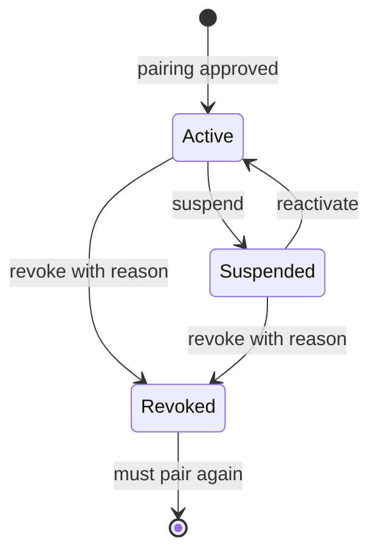

Every transition bumps `devices.session_version`, so outstanding device access tokens stop working at once.
Revocation also ends all device sessions and releases the operator assignment, writes `device.revoked` with the
reason, and pushes a `device.revoked` realtime event so an online device signs itself out.

Lost device procedure:

1. The operator reports the loss to a supervisor.
2. The supervisor revokes the device in the console with a reason (`POST /devices/:id/revoke`).
3. If the phone also held a user session, the user signs in elsewhere and revokes it in the session list, or an
   admin deactivates and re-invites the user.
4. If the phone is enrolled in MDM, IT issues a remote wipe.
5. Security reviews `audit_events` for the device since the last known good time.

| Storage of the device refresh token | Runtime | Status |
|---|---|---|
| Android Keystore AES-GCM (`SecureStore.kt`) | Hydris Field native app | **Built** |
| `localStorage` (`apps/web/src/glasses/link.ts`) | Glasses web app, including inside the bridge WebView | **Partial** (gap SEC-03) |

Table: Device credential storage

## Authorization

### Roles and permissions

`packages/domain/src/roles.ts` is the single source of truth for six roles and 38 permissions. The API enforces
it; clients only use it to decide what to show.

| Role | Highlights |
|---|---|
| `org_admin` | All permissions |
| `factory_manager` | Plant model, gateways, alarm rules, members (not admins), devices, reports, audit log, audit-doc verify and approve |
| `supervisor` | Alarm workflow, inspection management and review, maintenance, devices |
| `field_operator` | Read, acknowledge alarms, execute inspections, request and execute maintenance, capture audit docs |
| `maintenance_engineer` | Maintenance execution and read access |
| `viewer` | Read-only |

Table: Role summary

### Layered enforcement

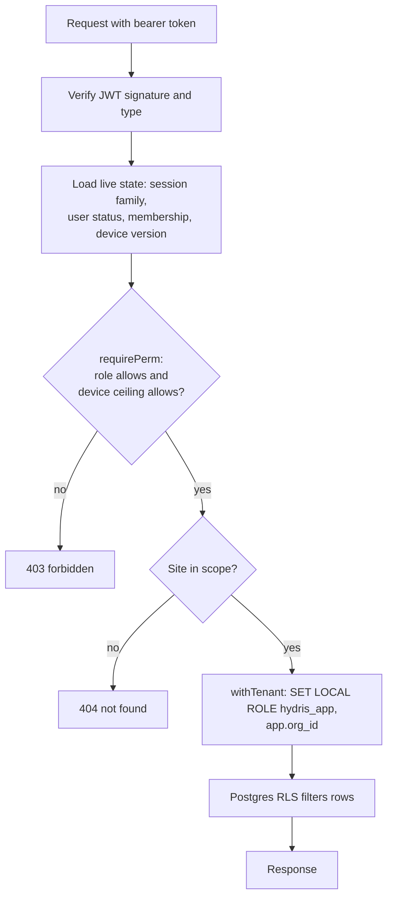

Out-of-scope records return 404, not 403, so their existence is not disclosed (`requireSite` in
`core/principal.ts`).

### Row-level security

Migration `0001_rls.sql` enables and forces RLS on every tenant table with one policy:

```sql
CREATE POLICY tenant_isolation ON <table>
  USING (hydris_tenant_ok(org_id)) WITH CHECK (hydris_tenant_ok(org_id));
-- hydris_tenant_ok: app.bypass = 'on' OR row_org = app.org_id
REVOKE UPDATE, DELETE ON audit_events FROM hydris_app;
```

Later migrations add the same policy to corrections, UI profiles (`0003`), realtime events (`0006`) and audit
documents (`0008`), revoke `UPDATE` and `DELETE` on `telemetry_corrections`, and grant only `SELECT, INSERT` on
`audit_document_events`. System work (login, pairing, jobs) uses `withSystem`, which sets `app.bypass` but still
runs as `hydris_app`, so append-only grants hold everywhere.

> [!WARNING]
> Owner and superuser connections bypass RLS. Production must connect as a runtime user that is a member of
> `hydris_app` and not the table owner. Today the same owner user runs migrations and the application.

## API security

| Control | Setting | Source | Status |
|---|---|---|---|
| Global rate limit | 600 per min per IP | `app.ts` | **Built** |
| Login, MFA | 10 per min | `modules/auth.ts` | **Built** |
| Password reset request | 5 per min | `modules/auth.ts` | **Built** |
| Refresh | 60 per min | `modules/auth.ts` | **Built** |
| Website inquiries | 5 per 10 min, honeypot, minimum fill time | `modules/public.ts` | **Built** |
| Voice assistant | 60 per min | `modules/voice-assistant.ts` | **Built** |
| Ingest | 1,200 per min, 500 readings per call | `modules/telemetry.ts` | **Built** |
| Body size | 1 MB default, 8 MB audit upload, 900 KB per page, 6 pages, 10 MB multipart | `app.ts`, `modules/audit-docs.ts` | **Built** |
| Input validation | zod on every body and parameter, 400 with field details | all modules | **Built** |
| Error hygiene | 5xx returns a generic message; stack only in logs | `app.ts` | **Built** |
| Shared rate-limit store | Limits are per instance | | **Planned** |

Table: API protections

| Header | Value | Source |
|---|---|---|
| `X-Content-Type-Options` | `nosniff` | `next.config.ts`, helmet |
| `Referrer-Policy` | `strict-origin-when-cross-origin` | `next.config.ts` |
| `Permissions-Policy` | `camera=(self), microphone=(), geolocation=()` | `next.config.ts` |
| `X-Frame-Options` | `DENY`, `SAMEORIGIN` for glasses and simulator | `next.config.ts` |
| Helmet defaults (HSTS and others) | On, CSP off | `app.ts` |
| `X-Powered-By` | Removed | `poweredByHeader: false` |
| Content Security Policy | None | **Planned** |

Table: Security headers

> [!NOTE]
> `Permissions-Policy` sets `microphone=()`, which disables the microphone for the site's own pages. That may
> block the browser speech engine on `/glasses`; the Meta DAT speech path does not use the browser microphone.
> Verify and, if needed, set `microphone=(self)` for the glasses routes only.

Fastify runs with `trustProxy: true`. On Vercel the client address comes from the platform's
`x-forwarded-for`; on a container deployment without a trusted proxy, a client could spoof the header and evade
per-IP limits. Set `trustProxy` to the load balancer address in Topology B and C.

## Secrets management

| Secret | Purpose | Rotation impact | Store |
|---|---|---|---|
| `JWT_SECRET` | Signs all JWTs | All users and devices must refresh; MFA steps in flight fail; inquiry IP hash salt changes | Vercel env, production scope |
| `DATA_KEY` | Encrypts MFA seeds | Requires re-encryption of every `mfa_secret_enc` | Vercel env plus offline escrow |
| `CRON_SECRET` | Authorizes `/api/cron` | Update Vercel cron header | Vercel env |
| `ANTHROPIC_API_KEY` | AI features | None | Vercel env |
| `BLOB_READ_WRITE_TOKEN` | Attachment storage | Reconnect store | Injected by Vercel |
| `DATABASE_URL` | Database credentials | Rotate in Neon, redeploy | Injected by Vercel |
| Gateway keys | Ingest | Issue new key, revoke old | Hash only in DB |
| Android upload key, DAT token | Mobile release | Play key reset process | CI environment secret (**Planned**) |

Table: Secret inventory

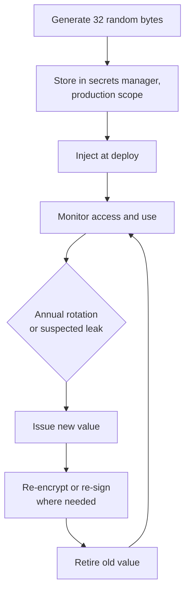

Rules: no secret in the repository or `NEXT_PUBLIC_*`; preview deployments use their own secrets; demo secrets
in `DEMO_SECRETS` are public and only used in demo mode; annual rotation of `JWT_SECRET` and `CRON_SECRET` with a
planned re-encryption tool for `DATA_KEY` (**Planned**).

## Mobile security

| Control | Hydris Field (`apps/android`) | Glasses bridge (`apps/glasses-bridge-android`) |
|---|---|---|
| Credential storage | Keystore AES-256-GCM `SecureStore`, cookies persisted encrypted | WebView `localStorage` (gap) |
| Backup | `allowBackup="false"` | `allowBackup="false"` |
| Minimum OS | Android 12 (SDK 31) | Android 12 (SDK 31) |
| Code shrinking | R8 on release | Not configured |
| Release signing | Debug key today (gap) | Debug build distributed |
| Cookie scope | Sent only to the configured host | n/a |
| Certificate pinning | **Planned** | **Planned** |
| Play Integrity attestation | **Planned** | **Planned** |
| WebView hardening | n/a | Origin allow-list and per-origin permission grants **Planned** |
| Cleartext traffic | Default (blocked on SDK 28+) | Default |

Table: Mobile security controls

Planned hardening for the bridge: override `shouldOverrideUrlLoading` to keep navigation on the Hydris origin,
grant WebView camera permission only for that origin, and move the device refresh token behind a native bridge
call backed by the Keystore so the web page never holds it.

## AI safety

### What is sent to Anthropic

AI features are enabled only when `ANTHROPIC_API_KEY` or `ANTHROPIC_AUTH_TOKEN` is set (`visionAvailable()` in
`core/vision-extract.ts`). Without a key, audit scans keep on-device OCR results and the assistant uses the
deterministic rules engine.

| Feature | Data sent | Model | Trigger |
|---|---|---|---|
| Audit scan enhancement | Page images (up to 6), optional operator hint | `claude-opus-5-5` | User presses enhance, before review starts |
| Voice assistant | Question text (max 500 chars), up to 8 history turns, tool results with tenant data | `claude-opus-5-5` | `/assistant/ask` |

Table: Data sent to the AI provider

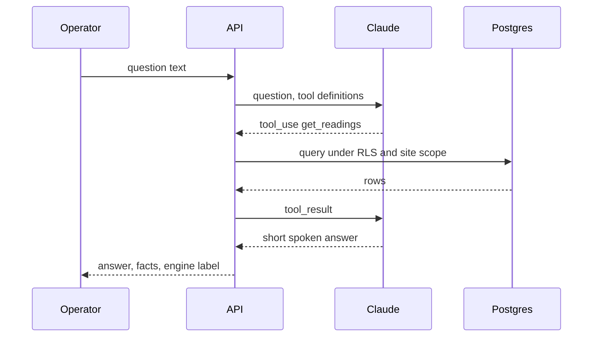

### Controls

| Risk | Control | Status |
|---|---|---|
| Hallucinated values | System prompt allows only tool values; facts returned with source and time; rules fallback never guesses | **Built** |
| Cross-tenant data in prompts | Tools run inside the caller's tenant transaction and site scope | **Built** |
| Prompt injection from scanned text | Vision output is a strict schema of fields and tables, not instructions; values are cross-checked with on-device OCR; nothing is executed from extracted text | **Built** |
| Unreviewed AI output becoming a record | Every field must be confirmed or corrected; flagged items block verification; a different approver signs off | **Built** |
| Unsafe operational advice | Prompt says Hydris never operates equipment and points to procedures and supervisors | **Built** |
| Excess data to the provider | Per-org opt-out, AI usage log, zero-retention terms | **Planned** |

Table: AI safety controls

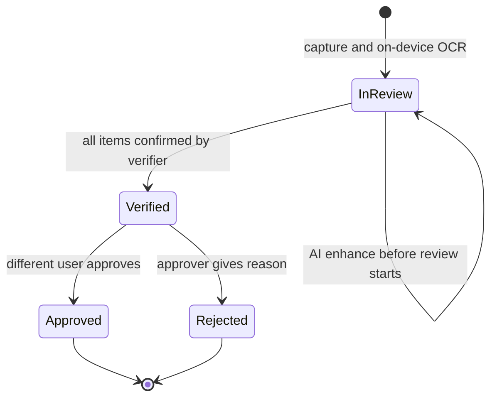

## Camera and bystander privacy

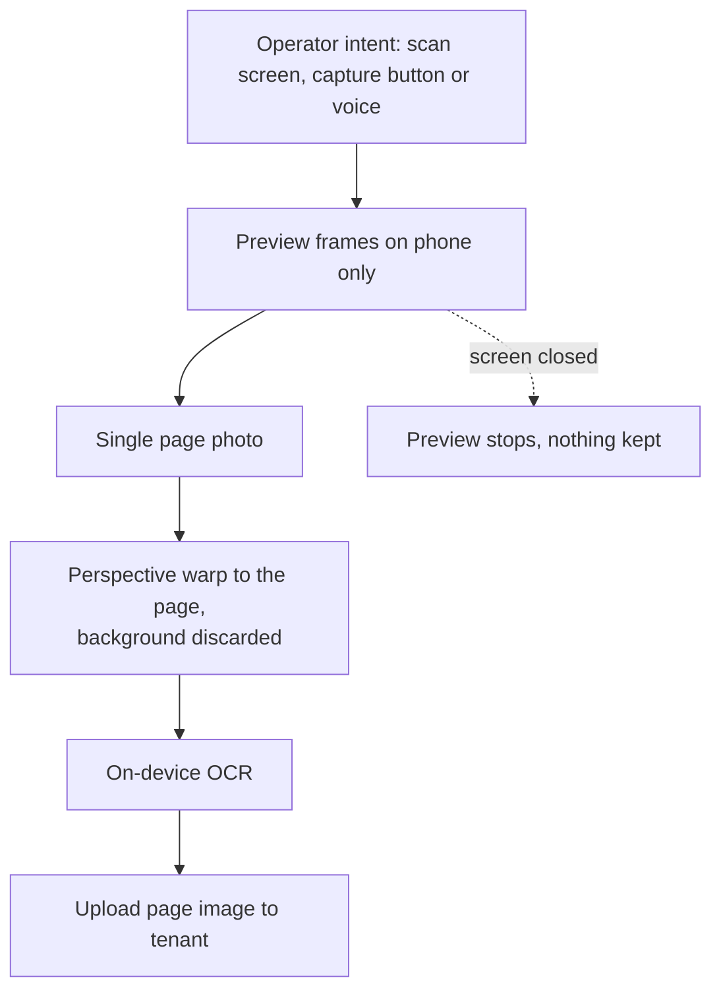

| Commitment | Status |
|---|---|
| No background or continuous recording; no video stored | **Built** |
| Preview frames stay on the phone; only the final page is uploaded | **Built** |
| Meta glasses capture LED cannot be disabled by apps (vendor firmware) | Vendor control |
| Guided capture crops to the page quad | **Built** |
| Wake phrase matched on transcripts; only text after "Hey Hydris" is sent; audio never uploaded to Hydris | **Built** |
| Browser speech engines may send audio to the browser vendor | Disclosed; prefer DAT speech |
| Face and badge redaction before upload | **Planned** |
| Camera-free zones per site | **Planned** |
| Site signage and works council consultation | Customer process |

Table: Camera and bystander commitments

## Worker privacy and monitoring ethics

Hydris records who did what to a plant record because regulators require it. It is not a productivity
surveillance tool, and we design to keep it that way.

- Device `last_seen_at` and `last_ip` exist for connectivity and security, not attendance. No location tracking.
- No continuous audio or video. No keystroke or gaze analytics.
- Reports on individual performance are not built and are not on the roadmap; aggregated workload views will be
  site-level only.
- Workers can see their own actions in the audit log through their supervisor; access requests are handled under
  DPDP and GDPR rights.
- Customers agree in the DPA not to use Hydris data for disciplinary monitoring without a lawful basis and worker
  consultation.

## Compliance mapping

The table maps requirements to product controls. It is a mapping and a target, not a certification.

| Framework | Relevant requirements | Hydris controls | Position |
|---|---|---|---|
| India DPDP Act 2023 and DPDP Rules 2025 | Notice and consent, security safeguards, breach notice to the Board and principals, erasure, retention limits | Consent version on inquiries, encryption and RLS, audit trail | Partial; retention and rights tooling **Planned** |
| CPCB and SPCB consent conditions, OCEMS guidance | Unaltered, retrievable monitoring records | Provenance, append-only corrections, CSV export, freshness | Mapping; Hydris is not the regulatory feed |
| CERT-In Directions 2022 | 6-hour incident reporting, 180-day logs in India | Incident plan; log drain **Planned** | Target |
| ISO/IEC 27001:2022 | ISMS and Annex A controls | Many technical controls in code | Target: ISMS build 2027 |
| SOC 2 | Security, availability, confidentiality criteria | Same | Target: Type I after first commercial year |
| IEC 62443 | Zones and conduits, secure development | Read-only, outbound-only conduit from the DMZ gateway | Mapping; 4-1 practices as target |
| GDPR (exports, EU users) | Lawful basis, DPA, subprocessors, 72-hour breach notice | DPA, subprocessor list | Mapping |

Table: Compliance mapping (targets, not certifications)

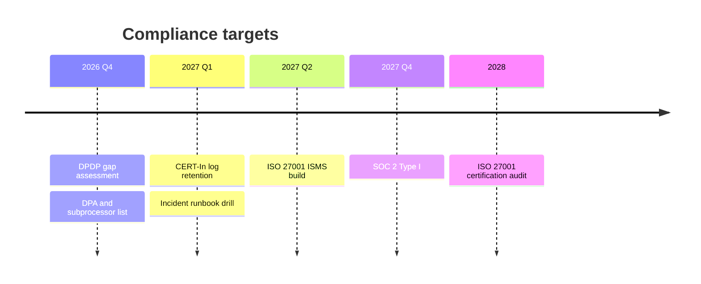

## Retention schedule

Retention below is the recommended default, configurable per organization (**Planned**). Today no purge job
exists except `realtime_events` (1 day).

| Data | Current | Recommended |
|---|---|---|
| Telemetry readings | Indefinite | Raw 2 years online, then archive; discharge data at least 5 years or per consent |
| Audit events, audit document events, alarm history | Indefinite, append-only | At least 7 years, then WORM export |
| Audit page images | Indefinite in Postgres | Object storage with lifecycle per record retention |
| Sessions, device sessions, pairing challenges | Not purged | Purge 30 days after expiry |
| Mail outbox (contains reset links) | Indefinite | Purge after send or 7 days |
| Inquiries | Indefinite | 24 months or on consent withdrawal |
| Realtime events | 1 day | Keep |
| Logs | Vercel default | 180 days in India for Indian tenants |

Table: Retention schedule

## Audit logging

| Category | Example actions |
|---|---|
| Authentication | `auth.login`, `auth.login_failed`, `auth.logout`, `auth.mfa_enabled`, `auth.password_reset`, `auth.refresh_reuse_detected`, `auth.session_revoked` |
| Membership | `member.invitation_accepted`, role and scope changes |
| Devices | `device.pairing_denied`, `device.suspended`, `device.revoked`, `device.refresh_reuse_detected` |
| Records | `auditdoc.verified`, `auditdoc.approved`, `auditdoc.rejected`, telemetry corrections |
| Platform | `organization.created`, `organization.suspended` |

Table: Audit event catalogue (examples)

Each event records org, actor user or device, action, entity, summary, metadata and IP (`audit()` in
`core/services.ts`). Admins and managers read it through `GET /api/audit`. Planned: hash chaining, export to WORM
storage and SIEM forwarding.

## Vulnerability management

| Activity | Cadence | Status |
|---|---|---|
| Dependency audit and updates | Weekly, CI gate on high and critical | **Planned** |
| Static analysis (CodeQL) and secret scanning | Every PR | **Planned** |
| Third-party penetration test | Before first commercial customer, then yearly | **Planned** |
| Responsible disclosure address and `security.txt` | Ongoing | **Planned** |

Table: Vulnerability management

| Severity | Fix target |
|---|---|
| Critical | 72 hours |
| High | 14 days |
| Medium | 60 days |
| Low | Next planned release |

Table: Remediation targets

## Incident response

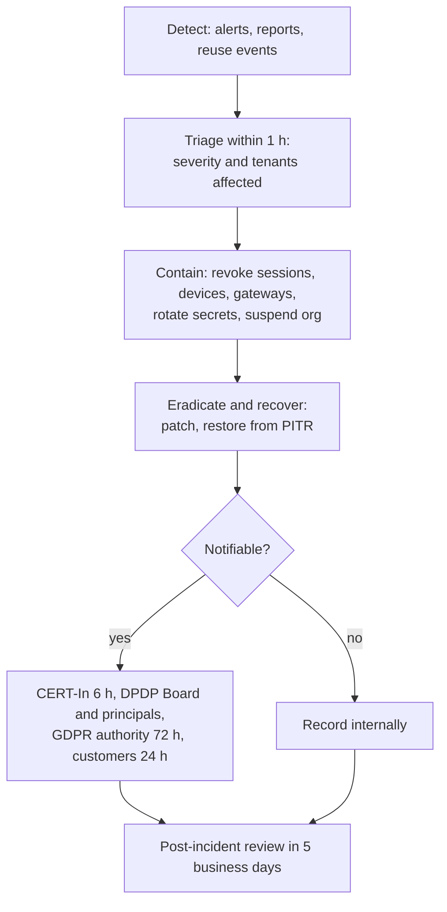

| Severity | Definition | Response | Customer notice |
|---|---|---|---|
| SEV1 | Confirmed cross-tenant exposure, data breach or secret compromise | Immediate, all hands | Within 24 h |
| SEV2 | Exploitable vulnerability or prolonged outage | Within 1 h | Within 48 h if affected |
| SEV3 | Contained issue, no data exposure | Same business day | Release notes |
| SEV4 | Hardening finding | Backlog | None |

Table: Incident severity

Containment tools already built: session revocation (`/auth/sessions`), device revoke, gateway revoke,
organization suspension (`/platform/organizations/:id/status`), and `JWT_SECRET` rotation to sign everyone out.

## Security roadmap

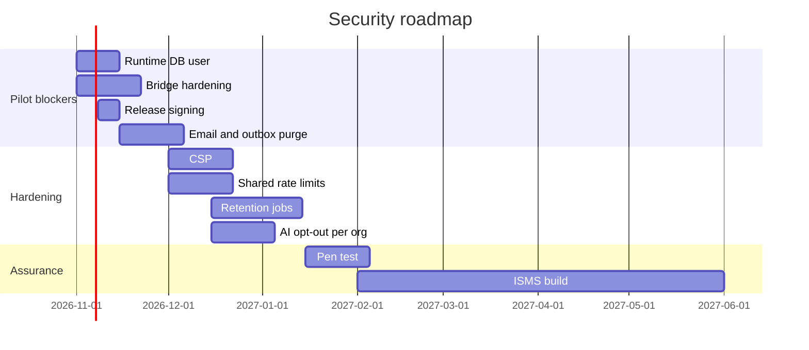

## Known gaps register

| ID | Gap | Likelihood | Impact | Rating | Plan |
|---|---|---|---|---|---|
| SEC-01 | No CI security gates | High | Medium | High | CI with audit, CodeQL, secrets |
| SEC-02 | Email not wired; reset links in `mail_outbox` | Medium | Medium | Medium | Provider and purge |
| SEC-03 | Glasses web device refresh token in `localStorage` | Medium | High | High | Native Keystore bridge |
| SEC-04 | Audit page images base64 in Postgres | Low | Medium | Medium | Object storage, encryption |
| SEC-05 | No purge or retention jobs | High | Medium | High | Retention jobs |
| SEC-06 | E-signature (re-auth, meaning) not built | Medium | Medium | Medium | Signature step on approve |
| SEC-07 | Pairing code TTL 300 s with no attestation | Low | Medium | Low | Shorter TTL, attestation |
| SEC-08 | Bridge WebView: open navigation, blanket permission grant | Medium | High | High | Origin allow-list |
| SEC-09 | CSP disabled | Medium | Medium | Medium | Strict CSP |
| SEC-10 | Owner connection could bypass RLS | Low | High | Medium | Separate runtime user |
| SEC-11 | Per-instance rate limits | Medium | Low | Low | Shared limiter |
| SEC-12 | Release APK signed with debug key | High | High | High | Upload key |
| SEC-13 | No per-org AI opt-out | Medium | Medium | Medium | Org setting |

Table: Security gaps register

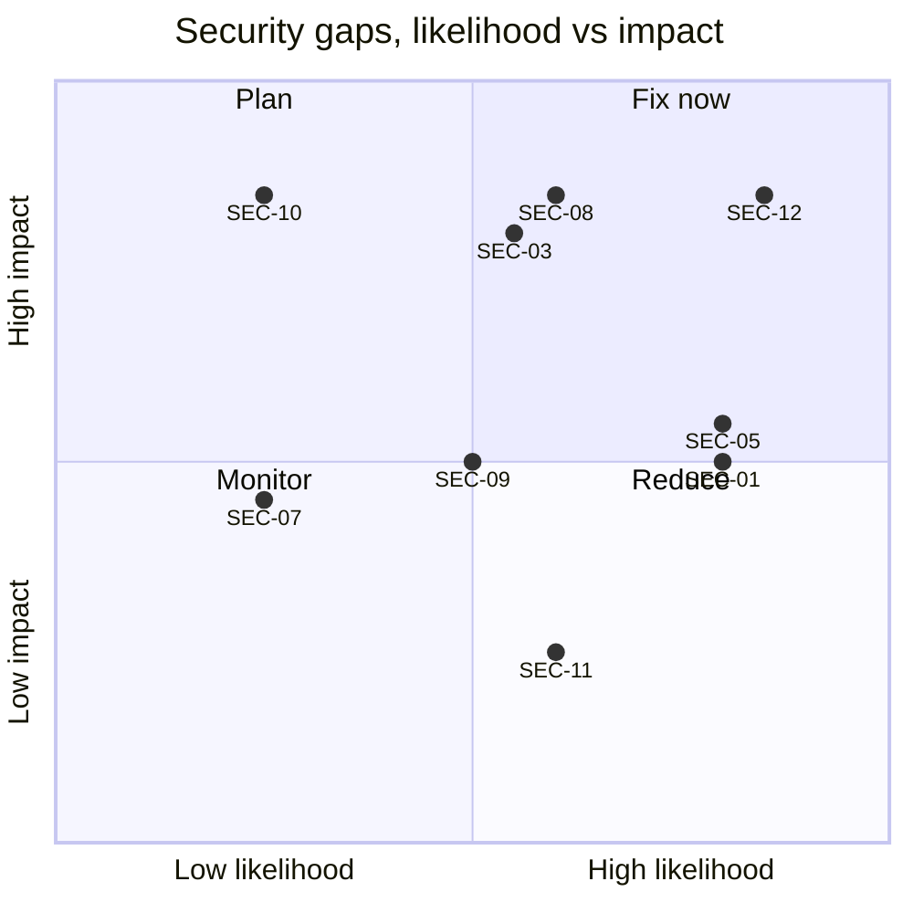

> [!DECISION]
> SEC-03, SEC-08, SEC-10 and SEC-12 block any pilot with real plant data. The remaining items are scheduled in
> the roadmap above.
