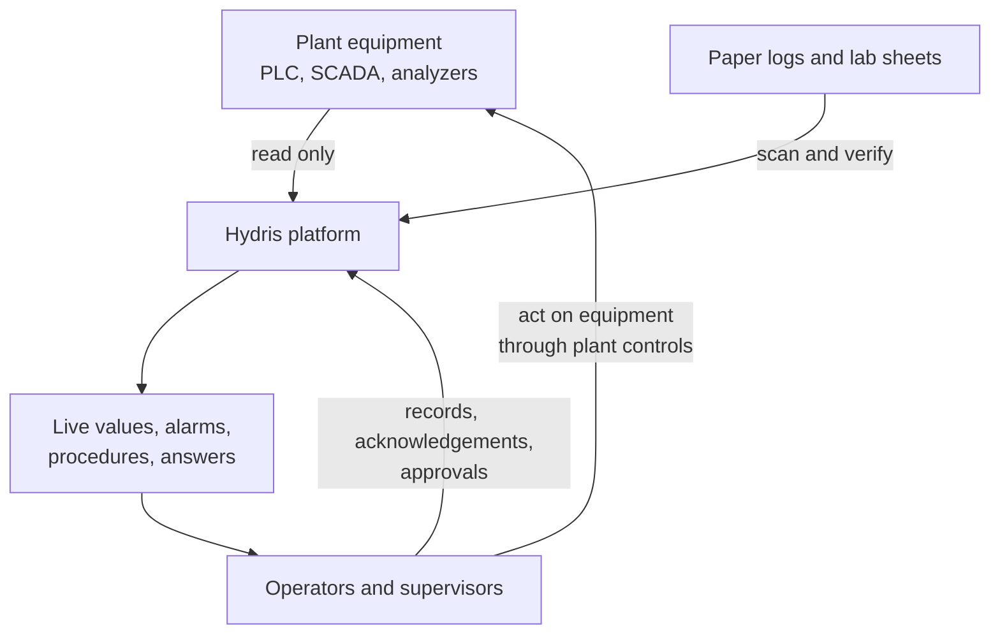
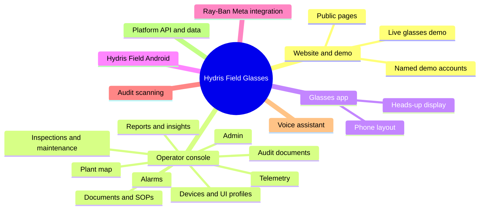
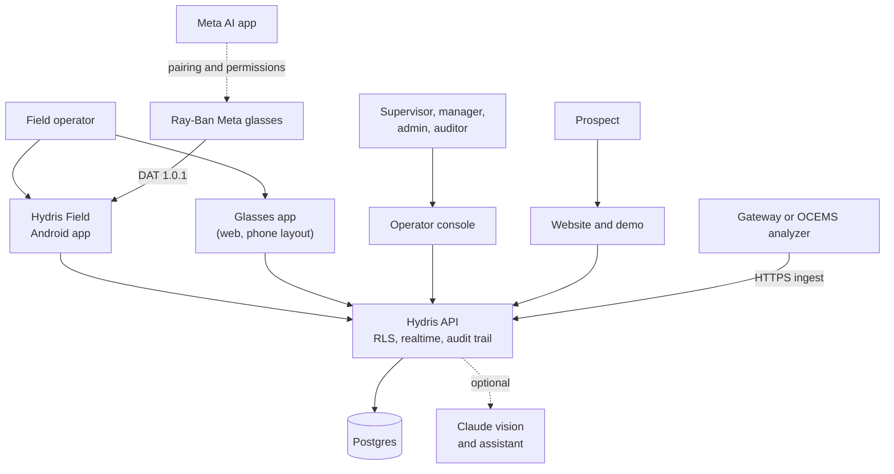
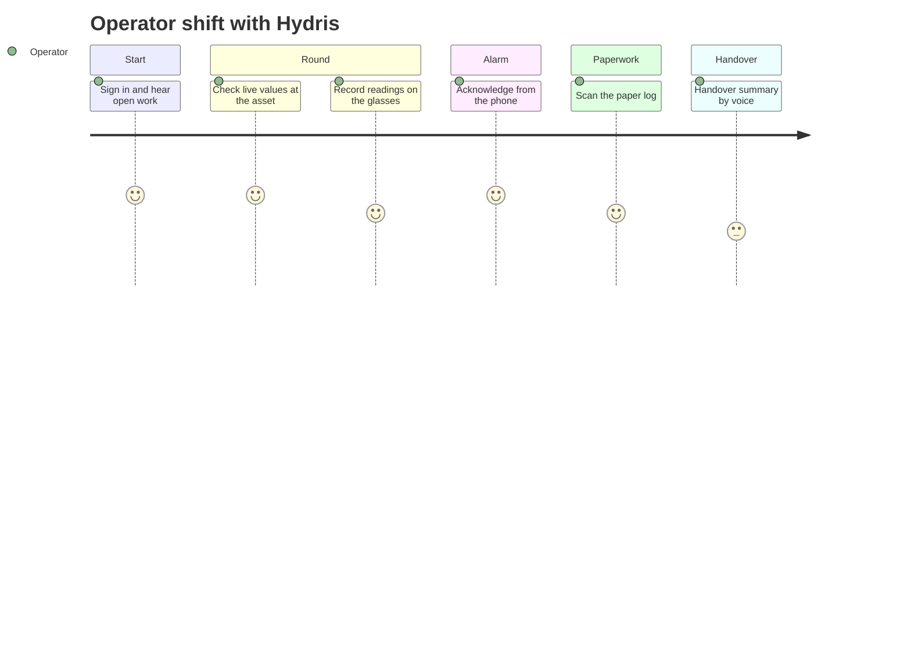
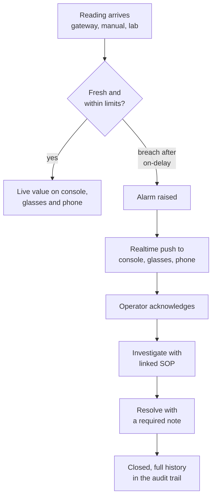
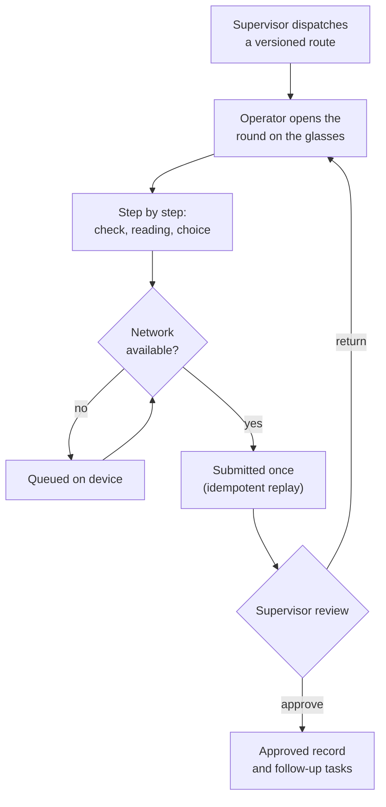
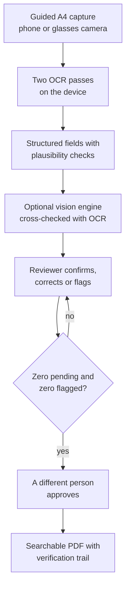
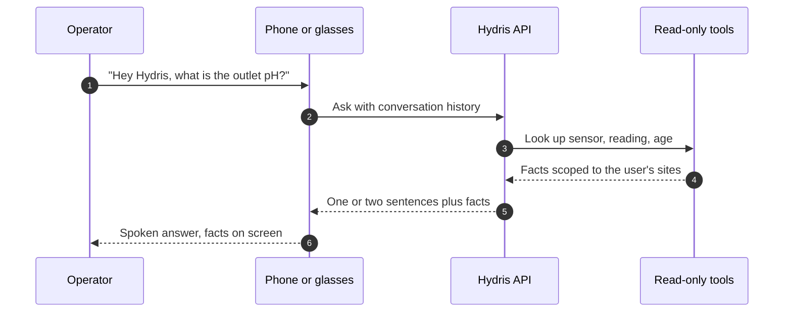

# Hydris Product Book

## Hydris Field Glasses at a glance

### Executive summary

Wastewater operators spend their shift walking the plant: reading instruments, checking pumps and blowers, sampling effluent, writing values on paper and responding to alarms that usually reach a control room before they reach the person standing next to the equipment. The records they leave behind are the evidence a plant shows its regulator, and much of that evidence is still on paper.

Hydris Field Glasses puts the live state of the plant, the next task and the approved procedure in the operator's line of sight, hands free, and turns every reading, check and paper record they touch into a record that can be trusted. It does this through a family of connected products that share one API, one tenant model and one permission matrix: a public website with a live demo, an operator console, a glasses heads-up app, the native Android app Hydris Field, a Ray-Ban Meta integration, audit scanning, a grounded voice assistant and the platform underneath.

> [!STATS]
> - 5 | product surfaces | website, console, glasses app, Android app, API
> - 143 | API routes | across 15 modules
> - 67 | automated tests passing | 26 domain + 41 API, 22 Oct 2026
> - 10 | demo scenarios | deterministic, demo tenants only

> [!STATS]
> - 6 | roles | 38 permissions, one fixed matrix
> - 16 | measurands | pH to residual chlorine
> - 12 | glasses screens | six-key directional input
> - 42 | database tables | row-level security on every tenant table

The platform core is **Built** and runs at `https://hydrisview.vercel.app` in demo mode, with named guest accounts on synthetic plant data. The main gaps before a customer pilot are validation of the glasses paths on physical Ray-Ban Meta hardware, email delivery for invitations and password resets, continuous integration, a scheduled-job cadence suited to real data on serverless hosting, and an offline outbox in the Android app. The plan sequences these into hardening in Q4 2026, a pilot at one or two Indian plants in Q1 2027 and general availability in Q2 2027 (plan, not commitment).

> [!DECISION]
> Hydris is read-only towards the plant. It never writes to PLCs, SCADA or equipment. The grounded assistance endpoint states "Hydris does not control equipment" in every response, and every voice-assistant tool is read-only. This keeps Hydris outside the plant's control-system safety case.

### Vision and principles

**Vision.** Every operator in a water or wastewater plant sees what matters, does the next right thing and leaves behind a record that stands up to an audit, without putting down their tools. In three years we want Hydris to be the default way an Indian ETP, STP or CETP runs its rounds, responds to alarms and keeps its compliance records.

Four principles carry most of the weight. When requirements conflict, they decide.

Table: The four principles that shape every Hydris product

| Principle | What it means for users | How the product enforces it |
|---|---|---|
| Advisory only | Hydris informs and guides; people operate the plant | No write path to equipment; assistant tools are read-only; safety notice on every grounded answer |
| Hands-free | Every operator action works with six directional keys or voice; the camera runs only on intent | Glasses input vocabulary (up, down, left, right, select, back); "Hey Hydris"; camera only on scan screens |
| Grounded | A number is never a guess; every value has a source and an age | Freshness states (live, delayed, stale, no data); provenance on every reading; assistant answers only from tool results |
| Human verification | Machines propose, a person confirms, a different person approves | Audit document review and four-eyes approval; corrections append, originals stay visible |

Hydris sits beside the control system, never inside it. Data flows in from instruments and paper; decisions and actions stay with people, who use the plant's own controls.

### The problem in wastewater plants

Effluent, sewage, water and common effluent treatment plants (ETPs, STPs, WTPs, CETPs) run continuously, with operators walking fixed rounds through intake, equalization, aeration, clarification, filtration, disinfection, sludge handling and the discharge point. Four problems recur:

1. **Paper rounds drift from reality.** Readings are written on clipboards and transcribed later. Nobody can tell which value was observed and which was copied.
2. **Alarms reach the wrong person.** The operator nearest the pump finds out last, and acknowledging an alarm gets confused with fixing it.
3. **Compliance evidence is unsearchable.** Logbooks, lab sheets and checklists are paper, so producing evidence for an inspection means digging through files.
4. **Phones are the wrong tool at the asset.** Gloves, ladders, wet hands and sampling bottles make phones awkward.

**Indian compliance context.** Discharges are regulated under the Water (Prevention and Control of Pollution) Act, 1974, through consents to establish and operate issued by State Pollution Control Boards (SPCBs) and Pollution Control Committees. General discharge standards are set under the Environment (Protection) Rules, 1986, with plant-specific limits in each consent. In 2014 the Central Pollution Control Board (CPCB) directed the 17 categories of highly polluting industries, and CETPs, to install online continuous effluent and emission monitoring systems (OCEMS) connected to CPCB and SPCB servers.

> [!NOTE]
> Hydris does not certify compliance and is not a certified OCEMS. It produces records (telemetry with provenance, inspection results, verified documents and an append-only audit trail) that make compliance easier to demonstrate. OCEMS analyzers can feed Hydris through the gateway ingestion API so operators see the values the regulator sees.

**Why now.** Camera glasses such as Ray-Ban Meta are light, affordable and acceptable on a plant floor; Meta opened a device access toolkit (DAT) to third-party apps; and language models can now answer spoken questions from structured plant data reliably enough to help, provided they are grounded and constrained.

### Personas and jobs

Six personas map onto the six roles in the permission matrix; a seventh, the Hydris platform administrator, is a flag on the user.

Table: Personas, primary surfaces and top jobs

| Persona | Role | Primary surface | Top jobs |
|---|---|---|---|
| Field operator (Ravi) | Field operator | Glasses, Android app | Walk the round, see live values at the asset, acknowledge alarms, scan paper logs, ask by voice |
| Shift supervisor (Meena) | Supervisor | Console, Android app | Dispatch rounds, triage and assign alarms, review inspections, verify scans |
| Maintenance engineer (Arjun) | Maintenance engineer | Android app, glasses | Work orders and checklists, resolve alarms, SOPs at the asset |
| Plant manager (Priya) | Factory manager | Console | KPIs and reports, alarm rules, approve documents, decide what the glasses show |
| Compliance auditor (Mr Rao) | Viewer with report access | Console, PDF exports | Read approved records and their verification trail; never change anything |
| Organization admin | Org admin | Console | Members, invitations, sites, glasses UI profiles |
| Platform admin | Platform flag | Console platform page | Create and suspend customer organizations |

Table: Jobs to be done

| Job | When ... I want ... so that ... |
|---|---|
| J1 Round | When I start my round, I want my inspections in order, so I do not miss an asset |
| J2 Trust | When I stand at an asset, I want its live readings and their age, so I can trust what I record |
| J3 Alarm | When an alarm fires near me, I want to acknowledge it and see the action and SOP, so the right person is accountable |
| J4 Evidence | When I fill a paper log, I want to capture it once and have it verified, so the record is searchable and defensible |
| J5 Voice | When my hands are busy, I want a short spoken answer grounded in our data |
| J6 Control | As a manager, I want to control what each role sees on the glasses without an app update |
| J7 Devices | As an admin, I want to pair, reassign, suspend or revoke glasses in seconds |
| J8 Audit | As an auditor, I want every approved document traceable to a person and a time |
| J9 Evaluate | As a prospect, I want to try the product in minutes without talking to sales |

### The product family

Hydris is one platform with eight products. Each has its own part in this book, written as a compact PRD.

Table: Products, what they do and where they stand

| Product | What it does | Status |
|---|---|---|
| Website and demo | Seven public pages, contact and demo request, live glasses demo, one-click named demo accounts | Built |
| Operator console | Sixteen sections in five groups (Operate, Work, Plant, People and devices, Insight) plus admin and platform pages | Built |
| Glasses app | Twelve heads-up screens with directional input, offline inspection queue, scan and voice; phone layout and browser simulator | Built (web); native display rendering Planned |
| Hydris Field Android | Sign-in, home, work, alarms, sensors, audit scan with on-device OCR, "Hey Hydris", glasses connection | Partial: built in code, glasses paths not validated on hardware |
| Ray-Ban Meta integration | Camera, capture button, microphone and speakers through Meta DAT 1.0.1; registration as a Hydris device | Partial: not validated on physical glasses |
| Audit scanning | Guided A4 capture, dual OCR, optional vision engine, field review, four-eyes approval, searchable PDF | Built |
| Voice assistant | Wake phrase, short spoken answers from tenant data through read-only tools, rules fallback | Built (English); other languages Planned |
| Platform API and data | 143 routes, row-level security, realtime events, append-only audit trail, demo mode | Built |

### One account, every surface

A user signs in once and gets the same permissions and data on the console, the glasses and the phone. Every surface talks to one API; the database enforces tenant isolation, not the application code.

> [!IMPORTANT]
> Ray-Ban Meta glasses reach third-party apps only through Meta's DAT, and they are paired and permissioned through the Meta AI app. That app must stay installed on every operator phone; Hydris Field checks for it and sends the user there to connect.

### The operator's day

The journey below is the target state for a field operator across one shift. Scores are design targets (1 to 5), not measurements.

The product is strongest today at alarm acknowledgement, scanning and voice lookups. The handover summary is **Planned**, and inspection execution on the Android app is **Planned**; rounds are executed in the glasses app today.

### The core loops

Four loops explain the whole product. Each crosses several products, which is why they share one platform.

#### See and act on the plant

Every reading passes one ingestion path with provenance. Alarm rules use deadband and on-delay so values that hover do not flap, and the lifecycle refuses to resolve an alarm without a note, so "acknowledged" is never mistaken for "fixed".

#### Do the work right

Inspection templates are versioned, so a round keeps the version it was dispatched with. Responses are queued locally and replayed exactly once when the network returns.

#### Paper to verified record

Machines propose and people decide. The original extracted value is kept beside every correction, and approval must come from someone other than the verifier, except in demo tenants where self-approval is allowed and recorded.

#### Ask the plant

The assistant answers only from tool results in the same conversation and states the age of each reading. If the model is unavailable, a rules engine answers instead, and an unknown question gets "can't answer", never a guess.

### Status, gaps and the path to pilot

Table: Top gaps before a customer pilot

| Gap | Effect today | Plan |
|---|---|---|
| Glasses paths not run on physical Ray-Ban Meta | Camera, capture button and glasses microphone are Partial | Hardware test matrix, Q4 2026 to Q1 2027 |
| Email not sent | Invitations and resets sit in an outbox | Email transport in hardening, Q4 2026 |
| No continuous integration | Regressions can reach the demo | CI gates on every change, Q4 2026 |
| Daily cron on serverless hosting | Stale-data alarms evaluated once a day | Per-minute schedule, Q4 2026 |
| No Android offline outbox | Phone actions need connectivity | Planned for GA, Q2 2027 |

> [!STATS]
> - North star | verified field records per active operator per week | rises only with real, trusted field use
> - 95 % | on-time rounds | pilot target
> - Under 5 min | median alarm acknowledgement | pilot target, critical and high
> - 0 | hallucinated numbers | target for voice answers

### How to read this book

Each product part follows the same spine: purpose and problem, users and jobs, scope, key flows, requirements (with the stable FR IDs from the PRD and status **Built**, **Partial** or **Planned**), experience notes, success metrics (targets labelled as targets) and status with next steps.

Table: Part map

| Part | Read it if you want to know |
|---|---|
| Hydris Field Glasses at a glance | What Hydris is, for whom, and how the products fit together |
| Website and demo | How a prospect discovers and tries Hydris in minutes |
| Operator console and its sub-products | How supervisors, managers and admins run the plant, the work and the devices |
| Glasses app | What the operator sees and does on the heads-up display and phone layout |
| Hydris Field Android app | The native companion app for operators and engineers |
| Ray-Ban Meta integration | How the glasses' camera, button, microphone and speakers reach Hydris |
| Audit scanning | How paper becomes verified, approved evidence |
| Voice assistant | How "Hey Hydris" answers from plant data without guessing |
| Platform API and data | Tenancy, security, realtime and the shared data model underneath |
| Roadmap and future products | What comes next, in what order, and how we will know it worked |
