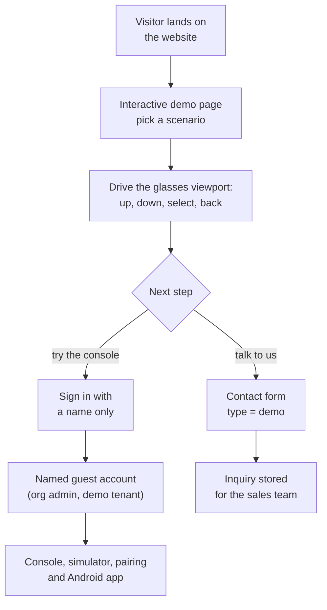
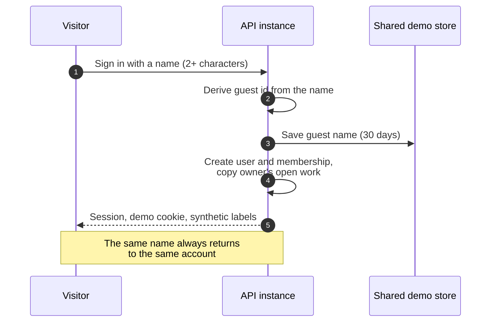
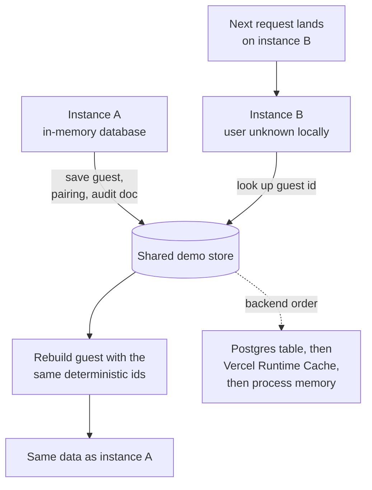

# Website and demo

## Website and demo

### Purpose and problem

Industrial buyers rarely get to touch a product before a sales cycle starts, and smart-glasses software is hard to picture without the hardware. The website explains Hydris and, more importantly, lets a prospect try it in minutes: drive the real glasses viewport in the browser, then sign in to the console or the Android app with just a name. Everything runs on synthetic data that is labelled as such and can never reach a customer tenant.

### Users and jobs

Table: Users of the website and demo

| User | Job |
|---|---|
| Prospect (plant manager, IT lead, consultant) | Understand the product and try it without talking to sales (J9) |
| Partner or investor | See the real product working, on any laptop or phone |
| Hydris sales and product team | Run a repeatable demo from any browser, with named accounts that survive between sessions |
| Trainer | Replay a deterministic scenario for a class, the same way every time |

### Scope

Table: Scope of the website and demo

| In scope | Out of scope |
|---|---|
| Seven public pages (`/`, `/product`, `/technology`, `/operations`, `/demo`, `/contact`, `/privacy`), phone and desktop, light and dark | Self-serve sign-up for customer tenants |
| Contact and demo-request form | Pricing pages, payments |
| Live glasses demo, fully client-side, ten scenarios | Real plant data of any kind in the demo |
| Browser simulator and pairing page | A demo that runs on physical glasses without the app |
| One-click named demo accounts on console and Android | Persistent guest data beyond the shared store's 30-day TTL |

### Key flows

#### From visitor to signed-in guest

The `/demo` page runs the production glasses UI in a browser frame against a deterministic simulator of the reference plant, with no API calls. The ten scenarios cover normal operations, pump vibration, tank high level, abnormal pH, a scheduled inspection, equipment offline, glasses network loss, a high-priority alert, a maintenance checklist and device reassignment. Each replays identically, which makes it useful for training. From there a visitor books a guided demo or signs in by name.

#### One-click named demo account

A guest is an organization administrator of the demo tenant with access to all sites. The account id is derived deterministically from the normalized name, so returning with the same name restores the same account. Each guest gets personal copies of the demo owner's scheduled inspections and open maintenance tasks, so two guests acting at once never disturb each other's work.

#### Cross-instance demo state

Demo mode turns on automatically on Vercel when no database is configured. Every serverless instance seeds the same deterministic tenant in memory, so only a little state must travel between instances: named guests, pairing challenges and their approvals, and audit documents (snapshotted after each write). A resilient wrapper falls back to memory on any store error, so the demo never fails because of the store. Demo device refresh tokens are signed and self-contained, so any instance can rebuild a paired device.

### Requirements

Table: Website and demo requirements

| ID | Requirement | Priority | Status |
|---|---|---|---|
| FR-100 | Marketing website with seven pages and a privacy page, phone and desktop, light and dark | Must | Built |
| FR-101 | Contact and demo-request form, rate limited to 5 per 10 minutes per client | Must | Built |
| FR-102 | Live glasses demo from the website, fully client-side, plus the browser simulator | Must | Built |
| FR-103 | Named demo guests with personal copies of scheduled inspections and open tasks | Must | Built |
| FR-083 | Zero-configuration synthetic demo tenant, named guests, cross-instance pairing | Must | Built |
| FR-084 | Ten deterministic simulation scenarios, refused outside demo tenants | Must | Built |
| FR-091 | Demo sign-in with a name in the Android app | Must | Built |
| FR-029 | Synthetic data labelled everywhere and refused for customer tenants | Must | Built |

### Experience notes

- **Simulator.** `/simulator` renders the 600 by 600 heads-up display with a simulated camera that films a sample A4 sheet, so the whole scan pipeline can be shown without hardware. The website may embed `/glasses` and `/simulator`; every other page refuses framing.
- **Pairing in the demo.** A guest can pair the simulator or the phone layout by QR or typed code on `/pair`, and the pairing works even when the steps land on different instances.
- **Honest labelling.** The demo page shows a synthetic-data notice, and every value and voice answer in the demo tenant says it is synthetic demonstration data.
- **Limits.** Demo sign-in is limited to 20 per minute per client; the inquiry form to 5 per 10 minutes. The client IP on inquiries is stored hashed.

> [!CAUTION]
> Demo mode relaxes security on purpose: public signing secrets, 12-hour access tokens instead of 15 minutes, self-contained device refresh tokens, acceptance of tokens whose session family the instance has never seen, and self-approval of audit documents. It is acceptable only because demo data is synthetic and flagged; production sets `DEMO_MODE=false` and `SIMULATOR_ENABLED=false`.

### Success metrics

Table: Website and demo metrics (targets)

| Metric | Target |
|---|---|
| Time from landing to a signed-in demo account | Minutes, with no sales contact (target, J9) |
| Demo availability on a zero-configuration deployment | Works with no environment variables (acceptance criterion of FR-083) |
| Guest isolation | Zero cases of one guest's personal work changing another's (target) |
| Demo requests converted to guided demos | Tracked from inquiries once the pilot pipeline opens (target to be set) |

### Status, gaps and next steps

The website and demo are **Built** and live. Open items:

- Inquiries are stored but no notification email is sent, because email delivery (FR-086) is **Planned** for hardening in Q4 2026.
- The Vercel Runtime Cache backend is per region and best effort; a Postgres shared store is preferred where available.
- The live demo mimics glasses input with on-screen buttons; a native device adapter for display glasses is **Planned** (see the roadmap part).
