# Hydris Product Book

## Operator console

The operator console is the web application at `/console` where supervisors, managers, auditors and administrators run the plant record. Field operators produce data with the glasses and the Android app; the console is where that data is dispatched, triaged, reviewed, approved and reported. It is one Next.js surface (`apps/web/src/console`) over the same API that serves every other client, so a value acknowledged on the glasses is the same record a manager sees on the overview a second later.

> [!STATS]
> - 16 | Navigation destinations | `Shell.tsx`
> - 6 | Roles | 38 permissions, `roles.ts`
> - 5 | Alarm lifecycle states | resolve needs a note
> - 2 s | Realtime alarm target | NFR-002, not yet measured

### Purpose, users and information architecture

#### Purpose and problem

Water and wastewater plants still run on paper log sheets, phone calls and spreadsheets. The supervisor cannot see which rounds are late, the manager cannot prove to a regulator who saw an alarm and when, and the auditor receives evidence that cannot be traced to a person. The console replaces that patchwork with one tenant-isolated, site-scoped workspace where every state change is attributed, timestamped and written to an append-only audit trail.

#### Users and jobs

Table: Console users and their main jobs

| User | Role in code | Main jobs in the console |
|---|---|---|
| Shift supervisor | `supervisor` | Triage and assign alarms, dispatch rounds, review inspections, verify scanned documents, pair glasses |
| Plant manager | `factory_manager` | KPIs and reports, alarm rules, plant model, approve audit documents, devices and people |
| Compliance auditor | `viewer` plus `report.read` | Read the trail, approved documents and reports; export evidence |
| Organization admin | `org_admin` | Members, invitations, sites, glasses UI profiles, organization settings |
| Platform admin | `users.is_platform_admin` | Create and suspend customer organizations at `/console/platform` |

Field operators and maintenance engineers can sign in to the console too, but their primary surfaces are the glasses and the Android app.

#### Information architecture

The navigation in `apps/web/src/console/Shell.tsx` groups destinations by intent. Each item declares the permission it needs; items the current role lacks are hidden rather than greyed out, and the API enforces the same check.

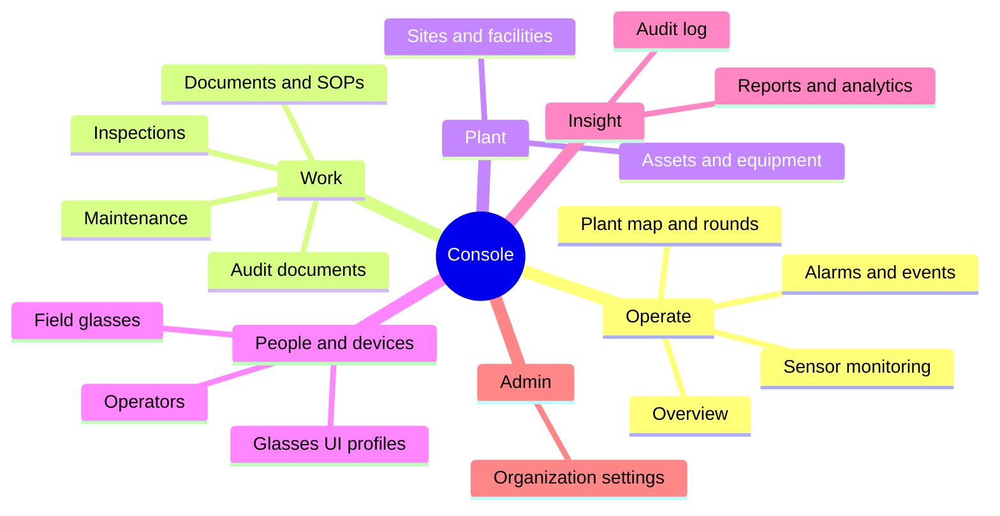

A command palette (`CommandPalette.tsx`) gives keyboard access to every destination and to global search across assets, sensors, documents and work (FR-088). The console supports system, light and dark themes.

#### Role access summary

Permissions come from one fixed matrix (`packages/domain/src/roles.ts`, FR-012): `can(role, permission)` is the only check, and every role except `org_admin` is additionally scoped to its sites (FR-007). Row-level security in Postgres keeps tenants apart (FR-008).

Table: What each role can do in the console (summary of roles.ts)

| Capability | Admin | Manager | Supervisor | Engineer | Operator | Viewer |
|---|---|---|---|---|---|---|
| Read plant, telemetry, alarms, work | Yes | Yes | Yes | Yes | Yes | Yes |
| Manage sites, assets, sensors, gateways | Yes | Yes | No | No | No | No |
| Manage alarm rules | Yes | Yes | No | No | No | No |
| Acknowledge alarms | Yes | Yes | Yes | Yes | Yes | No |
| Resolve alarms / close alarms | Yes / Yes | Yes / Yes | Yes / Yes | Yes / No | No / No | No / No |
| Manage and review inspections | Yes | Yes | Yes | No | No | No |
| Manage maintenance | Yes | Yes | Yes | No | No | No |
| Pair glasses / manage devices and profiles | Yes / Yes | Yes / Yes | Yes / No | Yes / No | Yes / No | No / No |
| Manage documents and SOPs | Yes | Yes | No | No | No | No |
| Verify / approve audit documents | Yes / Yes | Yes / Yes | Yes / No | No / No | No / No | No / No |
| Reports, audit log | Yes | Yes | Reports | No | No | Reports |
| Members and invitations / org settings | Yes / Yes | Yes / No | Read / No | No | No | No |

> [!NOTE]
> The auditor persona maps to `viewer`, which today holds read access plus `report.read` but not `audit.read`. Giving auditors the audit log page needs either a role change or a dedicated auditor role; this is an open product decision.

### Overview dashboard

#### Purpose and scope

The overview is the first screen after sign-in. It answers "is anything wrong right now, and where?" in one glance: KPI tiles, open alarms by severity, asset health, live measurements with freshness, and recent activity. It is served by `GET /overview` (FR-089), the same endpoint that feeds the Android home screen (FR-092), so the console and the phone never disagree.

In scope: KPIs, open alarms, health roll-up, live values with freshness and synthetic labels, recent activity, realtime refresh. Out of scope: user-configurable widgets and cross-site benchmarking.

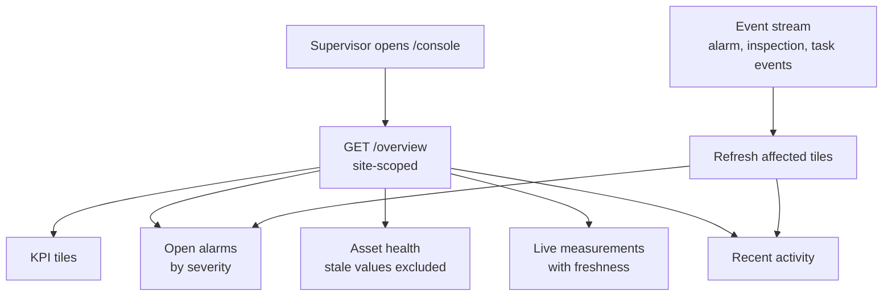

Freshness is computed per sensor from its expected interval, and stale values are excluded from health roll-ups (`packages/domain/src/freshness.ts`). Synthetic demo values carry a visible label wherever they appear (FR-029).

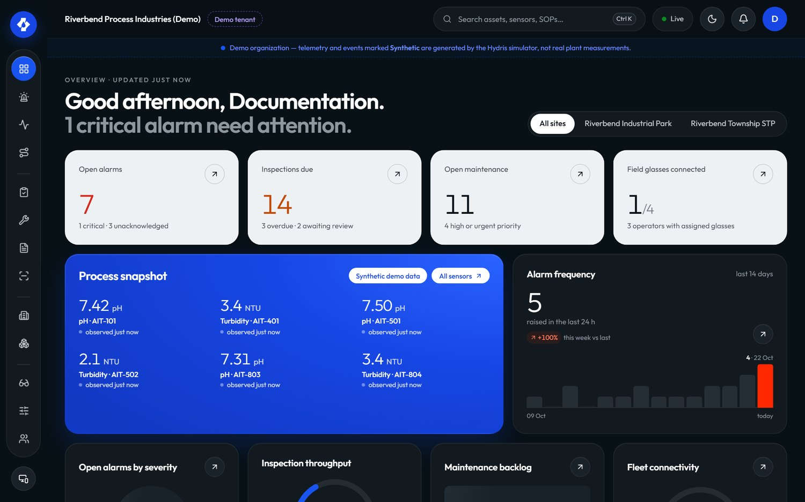

Table: Overview requirements

| ID | Requirement | Pri | Status |
|---|---|---|---|
| FR-089 | Overview with KPIs, open alarms, health and live measurements | M | Built |
| FR-026 | Freshness states shown; missing data never shown as a value | M | Built |
| FR-085 | In-app notifications in realtime, mark as read | M | Built |
| FR-088 | Global search across assets, sensors, documents and work | S | Built |

Status: Built. Next step: per-user default site and a compliance tile once FR-120 lands.

### Plant model: sites, assets, sensors and the plant map

#### Purpose and scope

Everything in Hydris hangs off the plant model: alarms, rounds, documents and devices are all scoped to a site and usually an asset. The plant model lets managers describe their plant once (site, facility, process area, asset, sensor) and place it on a map, so that operators walking the plant see the right asset and the right values.

In scope: hierarchy with map positions, archive and restore (FR-020), sensors for 16 measurands with unit normalization (FR-021), gateways with `hgw_` API keys, the plant map with rounds overlay. Out of scope: digital twins, P&ID import, write paths to equipment (Hydris is read-only towards the plant).

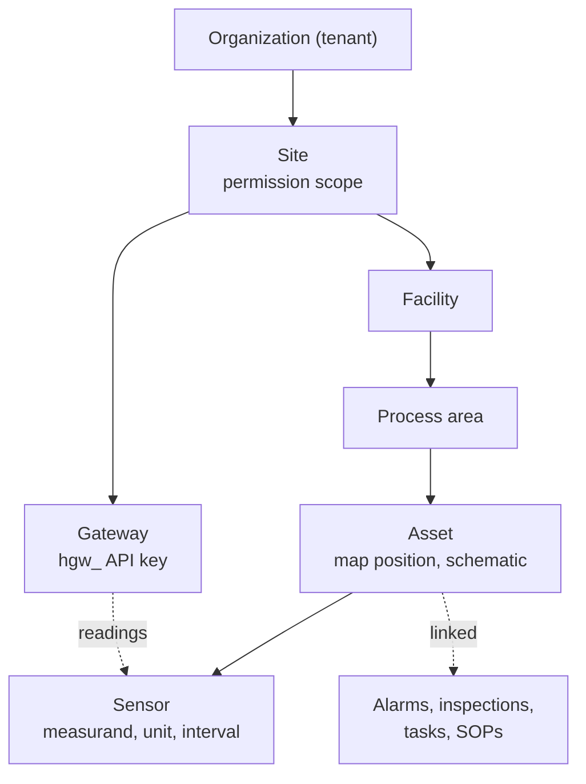

The site level is the permission boundary: a site-scoped supervisor sees nothing from other sites. Archiving an asset removes it from glasses screens and assistant answers while keeping its history.

#### Plant map and rounds

The plant map (`/console/map`, `apps/web/src/console/plant/map`) places assets on the site layout and overlays route stops, so a supervisor can see where a round goes and where open alarms sit. The hierarchy navigator and asset schematic (`HierarchyNavigator.tsx`, `AssetSchematic.tsx`) give the same model as a tree and as a per-asset view of its sensors.

Table: Plant model requirements

| ID | Requirement | Pri | Status |
|---|---|---|---|
| FR-020 | Site, facility, area and asset hierarchy with map positions, archive and restore | M | Built |
| FR-021 | Sensors for 16 measurands with unit normalization | M | Built |
| FR-007 | Site-scoped permissions | M | Built |
| FR-088 | Search by asset tag finds the asset and its open work | S | Built |

Status: Built. Gaps: no bulk import of the asset register; map layout is drawn per site rather than imported from drawings.

### Telemetry and sensor monitoring

#### Purpose and scope

Sensor monitoring shows what the plant measures, how fresh each value is, and where a value came from. The core promise is honesty: a missing reading is shown as "No data", never as zero, and every value carries its source (gateway, manual, lab or synthetic) and its time.

In scope: HTTPS gateway ingestion (FR-022), manual and lab entry with provenance (FR-023), append-only corrections (FR-024), history and CSV export (FR-025), freshness states (FR-026). Out of scope today: MQTT and OPC UA adapters (FR-027) and read-only historian connectors (FR-028), both Planned.

#### Ingestion flow

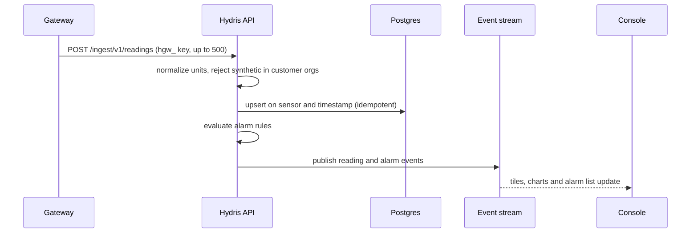

Replaying the same batch never creates duplicates because readings are keyed on sensor and timestamp. Synthetic readings sent into a customer organization are refused (FR-029).

#### Freshness

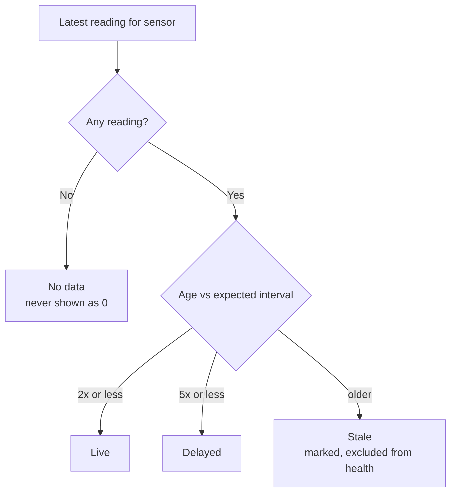

#### Corrections and history

A supervisor who finds a wrong value does not edit it. They add a correction or invalidate the reading; the original stays visible next to the correction with its author and reason (FR-024). Manual and lab entries (`ManualEntryDialog.tsx`) carry their provenance everywhere they appear. The sensor detail shows raw readings and history, and exports CSV with formula injection escaped (FR-025).

Table: Telemetry requirements

| ID | Requirement | Pri | Status |
|---|---|---|---|
| FR-022 | Gateway ingestion, 500 per call, idempotent | M | Built |
| FR-023 | Manual and lab entry with provenance | M | Built |
| FR-024 | Append-only corrections (correct or invalidate) | M | Built |
| FR-025 | History, raw readings, CSV export | S | Built |
| FR-026 | Freshness live, delayed, stale, no data | M | Built |
| FR-029 | Synthetic data labelled, refused for customers | M | Built |
| FR-027 | MQTT and OPC UA adapters | S | Planned |
| FR-028 | Read-only SCADA and historian connectors | C | Planned |

Status: Built for HTTPS. Next: MQTT and OPC UA adapters so pilots can connect existing gateways without custom code.

### Alarms

#### Purpose and scope

Alarms turn readings into attributed work. The console is where alarm rules are defined, where supervisors triage and assign, and where the evidence of who saw what and when is kept. Acknowledging records that a person has seen the alarm; it never changes the process.

In scope: threshold and stale rules with deadband and on-delay (FR-030), the five-state lifecycle (FR-031), assignment, notes, history and linked SOP (FR-032, FR-112), realtime push (FR-033). Planned: escalation (FR-037), shelving (FR-038), push notifications when the app is closed (FR-034).

#### Rule evaluation

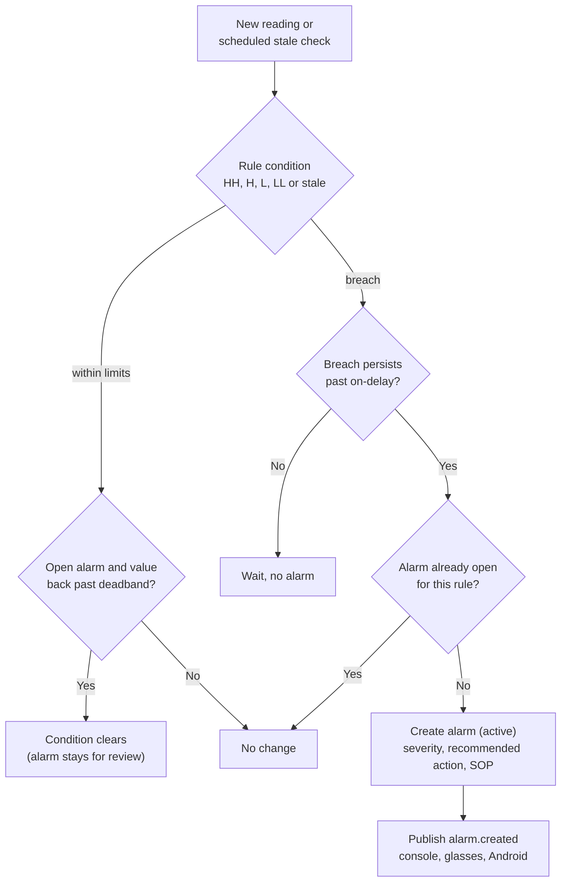

The deadband stops a value oscillating around a limit from raising and clearing repeatedly, and the on-delay ignores short spikes. Stale rules run on a schedule: every 30 s on a long-running server, but only once a day on the current Vercel cron (FR-035, Partial).

#### Lifecycle and permissions

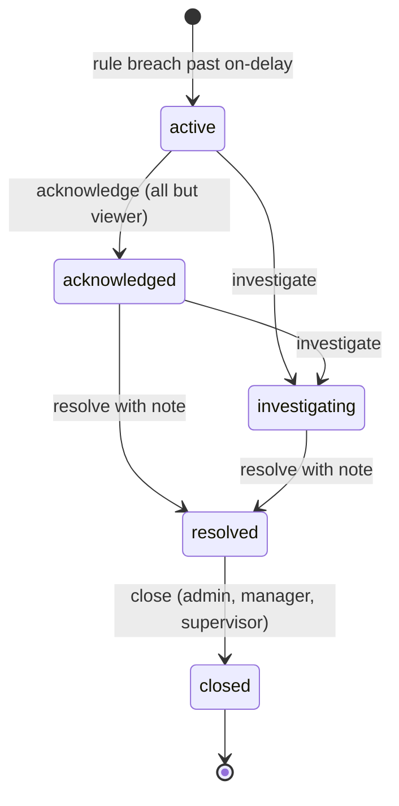

There is no path from active straight to resolved: someone must first see the alarm. Resolving requires a note, and the API rejects a resolve without one. Investigate and resolve are held by admins, managers, supervisors and maintenance engineers. Every transition writes a history row and an audit event.

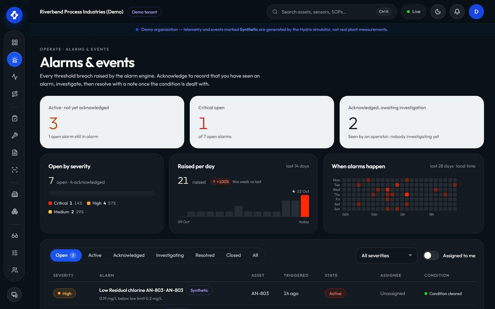

#### Escalation

Escalation is Planned for the pilot (FR-037): an unacknowledged critical alarm will notify the site supervisor after a configurable number of minutes, and the escalation will appear in the alarm history. Until then, supervisors rely on the realtime alarm list, the Android notification for critical and high alarms while the app runs (FR-097), and the median time to acknowledge in the alarm report.

Table: Alarm requirements

| ID | Requirement | Pri | Status |
|---|---|---|---|
| FR-030 | Threshold rules with deadband and on-delay | M | Built |
| FR-031 | Five-state lifecycle, no resolve from active, note required | M | Built |
| FR-032 | Assignment, notes, history, recommended action, SOP | M | Built |
| FR-033 | Realtime push to console, glasses, Android | M | Built |
| FR-112 | Rule links a procedure shown with the alarm | M | Built |
| FR-035 | Stale-data alarms on a schedule | M | Partial |
| FR-037 | Escalation when unacknowledged | S | Planned |
| FR-038 | Shelving with reason and expiry | C | Planned |
| FR-034 | Push notifications when the app is closed | S | Planned |

Status: core lifecycle Built. Gaps: stale evaluation cadence on serverless, escalation and shelving. Next: escalation first, because time to acknowledge is the headline alarm metric.

### Inspections and maintenance

#### Purpose and scope

Rounds and maintenance are the daily work of the plant. The console lets a supervisor design what must be checked, send it to the right operator, and review the result; and lets anyone turn an alarm or an abnormal reading into a tracked task. Execution happens on the glasses (FR-041) and, for checklists, on the phone (FR-046).

In scope: versioned templates with five step kinds and routes with dispatch (FR-040), review with approve or return (FR-042), maintenance tasks with checklists and follow-ups (FR-043). Planned: recurring schedules (FR-047) and inspection execution on Android (FR-044).

#### Templates, routes and dispatch

A template is built in the console (`TemplateBuilder.tsx`) from steps: check, reading with expected range, choice with abnormal options, text and photo. Editing creates a new version, so inspections already dispatched keep the version they started with. Routes order templates along a walk and are dispatched to an operator. On the glasses, a reading outside its range, a failed check or an abnormal choice marks the step abnormal automatically.

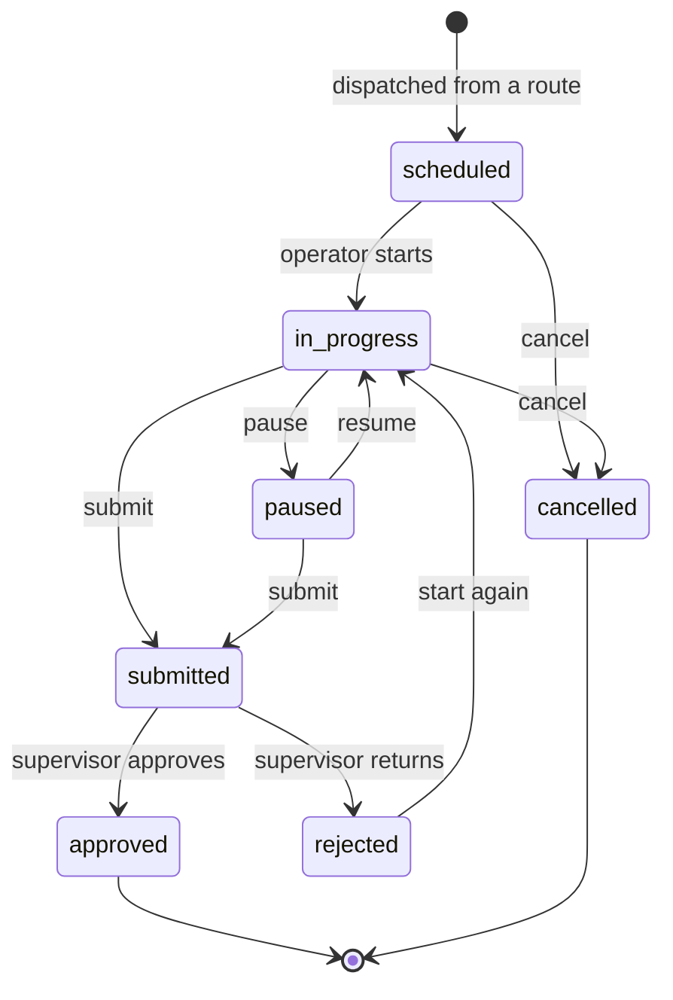

Review is the console's job. The supervisor opens a submitted inspection, sees each step with abnormal ones highlighted and any photos, and either approves it or returns it with a reason. A returned inspection can be restarted and resubmitted, and history shows both submissions. Offline responses from the glasses are replayed idempotently, so the reviewer never sees duplicates.

#### Maintenance

Maintenance tasks are corrective, preventive, inspection follow-ups or alarm follow-ups, with a priority from low to urgent, a checklist and an activity log. A follow-up created from an alarm or inspection links back to its source.

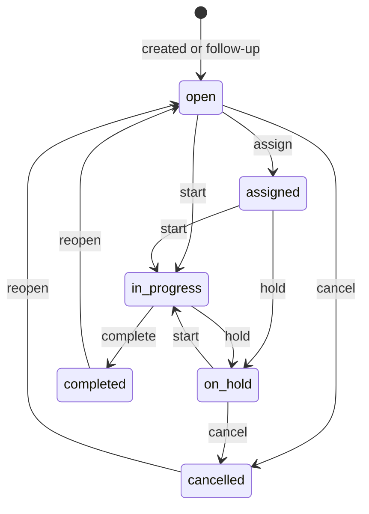

Table: Inspection and maintenance requirements

| ID | Requirement | Pri | Status |
|---|---|---|---|
| FR-040 | Versioned templates, five step kinds, routes, dispatch | M | Built |
| FR-041 | Glasses execution with offline queue | M | Built |
| FR-042 | Submit, review, approve or return | M | Built |
| FR-043 | Maintenance tasks, checklists, follow-ups | M | Built |
| FR-046 | Tick checklist items from Android | M | Built |
| FR-045 | Photo steps from glasses or phone camera | S | Partial |
| FR-044 | Inspection execution in the Android app | S | Planned |
| FR-047 | Recurring schedules (calendar or runtime) | S | Planned |

Status: Built for manual dispatch and review. Gap: every round is dispatched by hand. Next: recurring schedules, which also make on-time completion meaningful as a KPI.

### Documents and SOPs

#### Purpose and scope

Operators need the right procedure at the asset, and only an approved one. The document library (`/console/documents`) holds SOPs, manuals, datasheets, safety notices and troubleshooting guides, each with versions and a scope of site, asset or asset type (FR-110). Only approved documents reach the glasses, the assistant and grounded retrieval (FR-111).

Lifecycle: draft, approved, archived. Managers and admins hold `document.manage`; everyone else reads. Alarm rules link a procedure that is shown with the alarm (FR-112). The library page also exposes grounded SOP retrieval (`/assist`): a question returns passages from approved documents with a safety notice (FR-070), so a supervisor can check what an operator will be told before it happens.

Table: Documents requirements

| ID | Requirement | Pri | Status |
|---|---|---|---|
| FR-110 | Library with draft, approved, archived; versions; scope | M | Built |
| FR-111 | Only approved documents reach glasses and assistant | M | Built |
| FR-112 | Alarm rules link a procedure | M | Built |
| FR-070 | Grounded SOP retrieval with safety notice | M | Built |
| FR-113 | SOPs cached on glasses for offline reading | S | Built |
| FR-114 | Upload PDF manuals with text extraction | C | Planned |

Status: Built for authored documents. Gap: existing PDF manuals cannot yet be uploaded and searched (FR-114).

### Field glasses fleet

#### Purpose and scope

Glasses are shared, often unattended devices. The console makes them a managed fleet: pair a new pair to a site and an operator, see which are connected, suspend or revoke one that is lost, and control what each pair shows through UI profiles. The glasses never hold a user password; they hold a device credential that the console can end.

In scope: pairing approval (FR-050), device tokens and revocation (FR-051, FR-052), the device permission ceiling (FR-053), UI profiles (FR-054). The camera, capture button and Android registration are covered in the glasses part of this book.

#### Pairing from the console

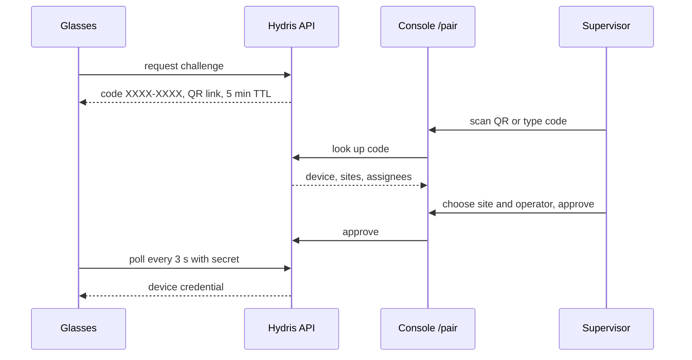

The code avoids confusable characters (no 0, O, 1, I, L, U), wrong-code lookups are rate limited, and the QR link never carries a credential. The approver needs `device.pair`, which every role except viewer holds.

#### Device states

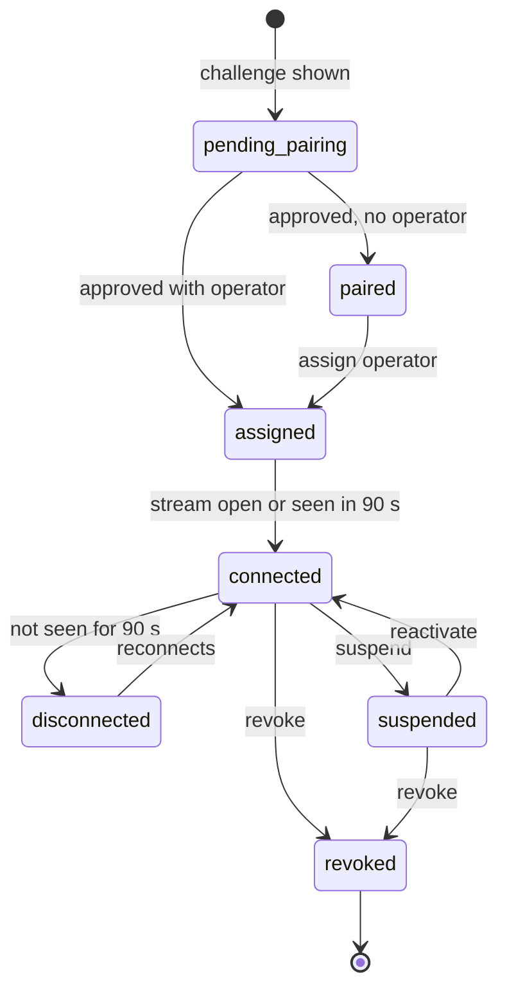

Revocation takes effect on the next request and closes an open event stream within 30 s (FR-052). Device access tokens last 15 minutes and refresh tokens rotate with reuse detection. Whatever role the assigned operator has, a device can never exceed the device permission ceiling: glasses paired to an admin still cannot manage members (FR-053).

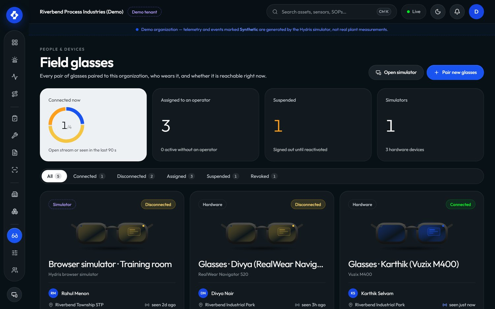

#### UI profiles

A UI profile controls what the glasses show (`/console/glasses-profiles`, `ui-profiles.ts`). Profiles are edited as drafts, published, and can be rolled back. Assignment can be made to a device, a user, a role or the whole organization; the most specific assignment with a published version wins. Publishing pushes the change live, so the glasses screens change without a restart. Managing profiles needs `device.manage` (admins and managers).

Table: Fleet requirements

| ID | Requirement | Pri | Status |
|---|---|---|---|
| FR-050 | Pairing code, QR, 5 min TTL, 3 s polling, approval | M | Built |
| FR-051 | Device tokens, rotation, reuse detection | M | Built |
| FR-052 | Suspend, reactivate, revoke, reassign | M | Built |
| FR-053 | Device permission ceiling | M | Built |
| FR-054 | UI profiles: draft, publish, rollback, precedence, live push | S | Built |
| FR-058 | Log out and unpair from the glasses menu | M | Built |

Status: Built. Next: fleet health signals (battery, app version) once the glasses bridge reports them.

### Audit documents: review and approval

#### Purpose and scope

Paper log sheets scanned in the field become evidence only after a person has checked them and a second person has approved them. The console side (`/console/audit-docs`, `work/auditdocs.tsx`) is that review desk. Capture, page detection and OCR are covered in the scanning part of this book.

In scope: field review (confirm, correct, flag, reset) with the original value kept (FR-064), bulk-confirm where engines agree (FR-069), four-eyes approval (FR-065), the evidence PDF (FR-066). Planned: electronic signature with re-authentication (FR-068).

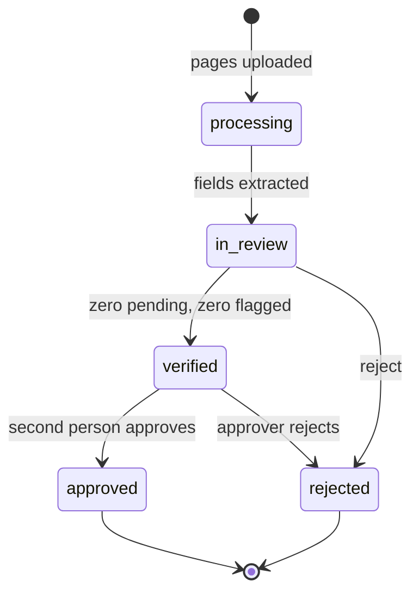

The reviewer sees each extracted value beside its crop of the page, with the engines that read it and their agreement. Values where at least two independent engines match with confidence of 0.8 or more can be confirmed in bulk; everything else is confirmed, corrected or flagged one by one, and the original reading is always kept. Verify is blocked while any item is pending or flagged. Approval needs `auditdoc.approve` (admins and managers) and must come from someone other than the verifier, except in demo tenants where self-approval is allowed and recorded as such. The approved PDF carries the verification trail, the searchable original and a reconstructed page.

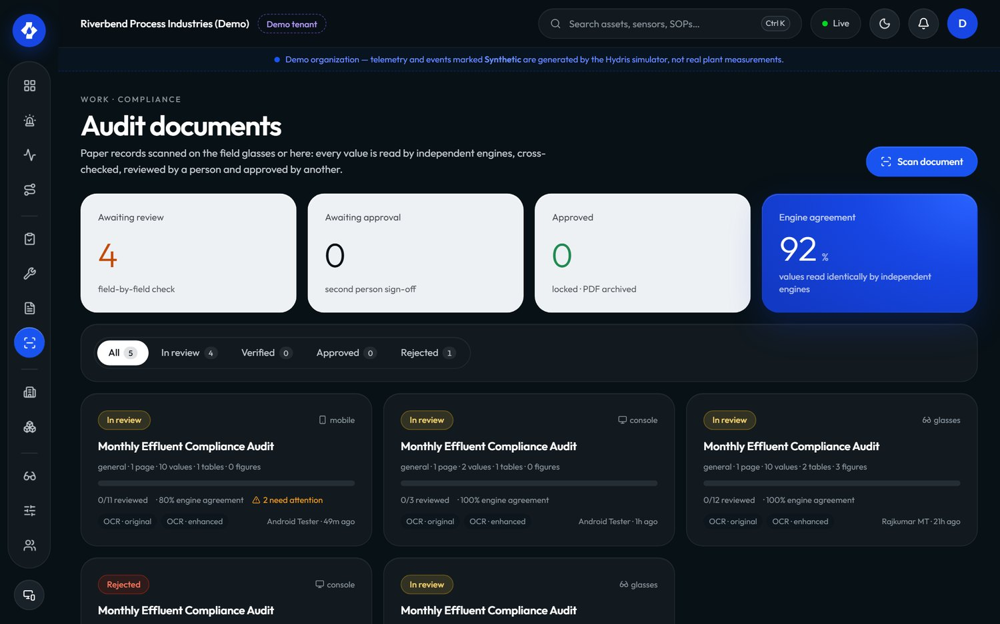

Table: Audit review requirements

| ID | Requirement | Pri | Status |
|---|---|---|---|
| FR-064 | Confirm, correct, flag, reset; verify gate | M | Built |
| FR-069 | Bulk-confirm agreed multi-engine values | S | Built |
| FR-065 | Independent approval (four eyes) | M | Built |
| FR-066 | PDF with trail, searchable original, reconstruction | M | Built |
| FR-068 | Electronic signature with re-authentication | S | Planned |

Status: Built. Next: electronic signature, which regulated customers will ask for before audit documents replace paper.

### Reports, insights and the assistant

#### Purpose and scope

Managers and auditors need numbers they can defend. Reports (`/console/reports`, `insights.ts`) cover inspections, alarms, maintenance, devices and operators, in JSON for the page and CSV for export (FR-081). The alarm report includes median minutes to acknowledge; the inspection report includes on-time rate and the share submitted via glasses. Those fields are the data sources for most of the pilot KPIs below.

The assistant is grounded and read-only. In the console it appears as SOP retrieval on the documents page (FR-070); the voice assistant (`/assistant/ask`) answers only from tenant data through read tools and has no write tools (FR-072, FR-078). Its full design is in the assistant part of this book.

Table: Reports and insights requirements

| ID | Requirement | Pri | Status |
|---|---|---|---|
| FR-081 | Reports for five areas in JSON and CSV | M | Built |
| FR-080 | Realtime events with replay | M | Built |
| FR-084 | Simulation scenarios in demo tenants only | M | Built |
| FR-120 | Compliance summary per discharge point | S | Planned |
| FR-121 | Scheduled report delivery by email | C | Planned |
| FR-122 | Grounded shift handover summary | C | Planned |

Status: operational reports Built. Gap: no compliance summary against consent limits, which is the report regulators actually ask for. Next: FR-120 for the pilot.

### Organization admin

#### Purpose and scope

Admins set up who can do what. The admin area covers operators (members), roles, invitations, sessions, organization settings, the audit log and, for Hydris staff, platform administration. Its rule is no escalation: nobody can grant a role above their own (`assignableRoles`).

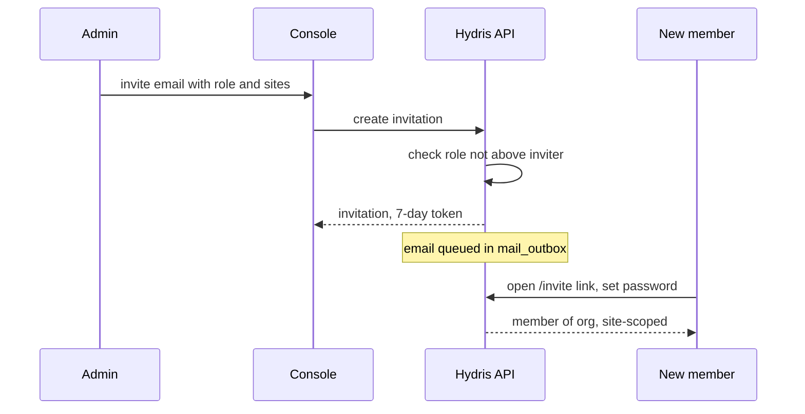

Invitation emails are written to `mail_outbox` but not yet sent; until email delivery lands (FR-086), the admin shares the link. Members can belong to several organizations and switch between them (FR-006); sessions can be listed and revoked (FR-009); TOTP MFA is available (FR-002). Organization settings need `org.manage`, held only by `org_admin`.

The audit log page (`/console/audit`, FR-087) filters the append-only trail by action and entity and shows actor, time and IP; no API path updates or deletes an audit event (FR-082). Platform admins create and suspend customer organizations at `/console/platform` (FR-010); members of a suspended organization cannot sign in to it.

Table: Organization admin requirements

| ID | Requirement | Pri | Status |
|---|---|---|---|
| FR-004 | Invitations, 7-day token, no escalation | M | Built |
| FR-006 | Multi-organization membership and switch | S | Built |
| FR-009 | Session listing and revocation | S | Built |
| FR-012 | Fixed role matrix | M | Built |
| FR-082 | Append-only audit trail | M | Built |
| FR-087 | Audit log page with filters | M | Built |
| FR-010 | Platform organization create and suspend | M | Built |
| FR-005 | Password reset email | M | Partial |
| FR-086 | Email delivery (SMTP, SES or Resend) | M | Planned |
| FR-011 | SSO with SAML 2.0 and OIDC | S | Planned |

Status: Built apart from email delivery and SSO. Next: email delivery before the pilot, SSO for general availability.

### Console success metrics and gaps

#### Success metrics

The console is measured by whether supervisors and managers act on field records quickly and trust them. All values below are pilot targets from the PRD, not measured results.

Table: Console metrics (pilot targets)

| Area | Metric | Source | Target |
|---|---|---|---|
| Alarms | Median time to acknowledge, critical and high | Alarm report | Under 5 minutes |
| Alarms | Acknowledged but unresolved older than 24 h | Alarm list | Visible daily, trending down |
| Rounds | On-time completion | Inspection report `onTimeRate` | 95 % or more |
| Rounds | Share submitted via glasses | Inspection report `viaGlasses` | 50 % or more |
| Evidence | Approval cycle, capture to approval | Audit documents | Under 24 hours |
| Evidence | Reviewer edits per reviewed field | Audit documents | Under 5 % |
| Security | Device revocation to stream end | Event stream | 30 s or less |
| Security | Cross-tenant incidents | Security review | 0 |

> [!STATS]
> - < 5 min | Time to acknowledge | target, critical and high
> - 95 % | On-time rounds | target
> - < 24 h | Evidence approval | target
> - 0 | Cross-tenant incidents | target

#### Gaps and next steps

Table: Console gaps in priority order

| Gap | Requirement | Effect today | Next step |
|---|---|---|---|
| No email delivery | FR-086, FR-005 | Admin shares invite links by hand | Wire SMTP, SES or Resend with retries |
| No escalation | FR-037 | Unacknowledged alarms rely on someone watching | Configurable escalation to site supervisor |
| Stale checks daily on Vercel | FR-035 | Stale alarms late on serverless | Higher-frequency scheduler |
| No recurring schedules | FR-047 | Rounds dispatched by hand | Calendar and runtime schedules |
| No compliance summary | FR-120 | Regulator reports built outside Hydris | Daily min, max, average against consent |
| No SSO | FR-011 | Local passwords only | SAML and OIDC per organization |
| No electronic signature | FR-068 | Approval not Part 11-style | Re-authentication on approve |
| Auditor cannot open audit log | roles.ts | `viewer` lacks `audit.read` | Decide on an auditor role |
| Performance not measured | NFR-001, NFR-002 | Targets unproven | Load and latency tests before pilot |

> [!IMPORTANT]
> The console is functionally complete for a supervised pilot. The items that block an unsupervised pilot are email delivery, alarm escalation and a reliable stale-data schedule.
