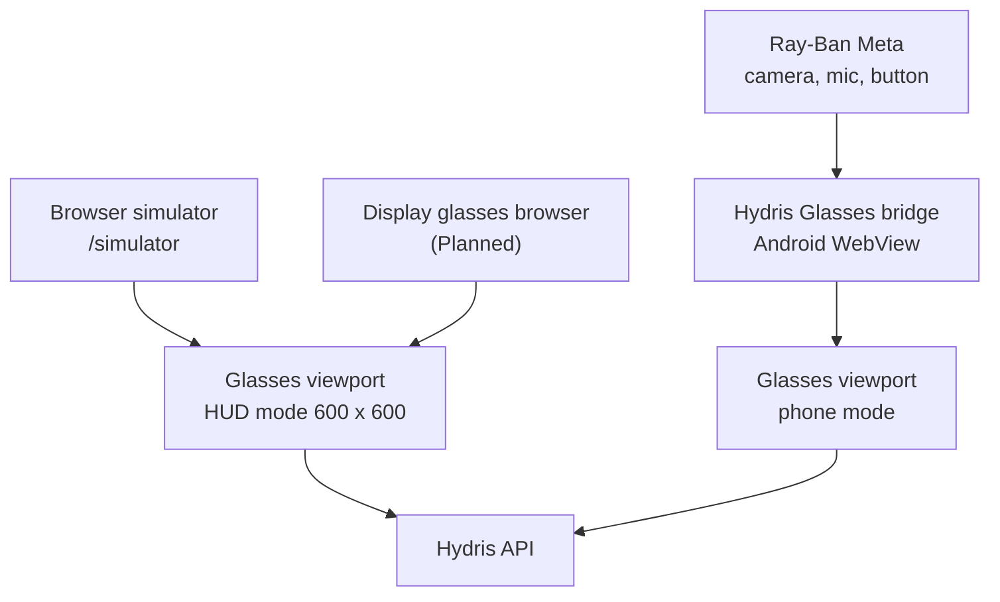
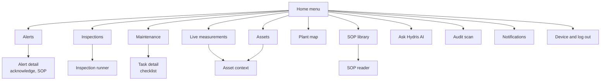
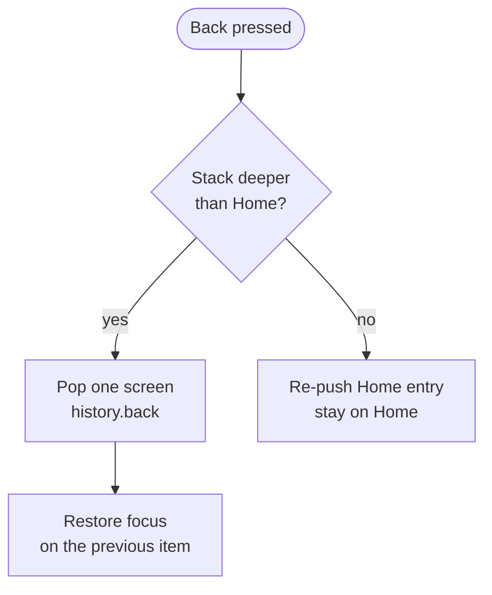
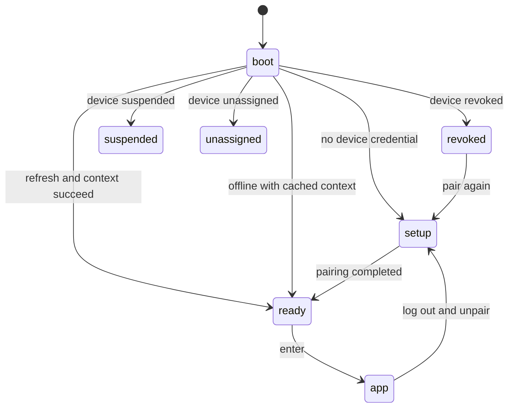
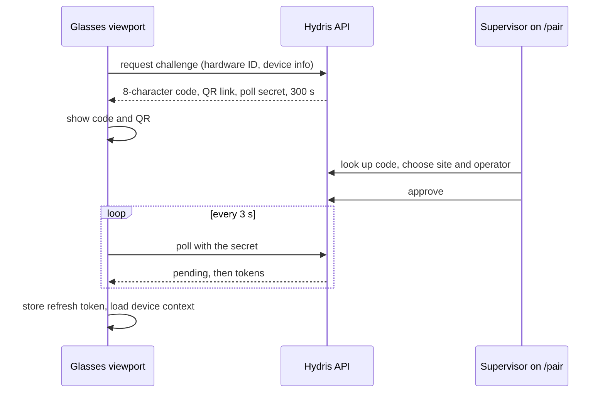
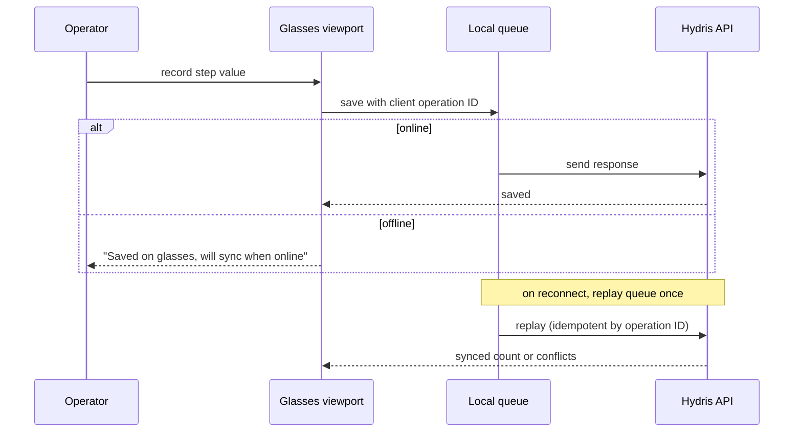
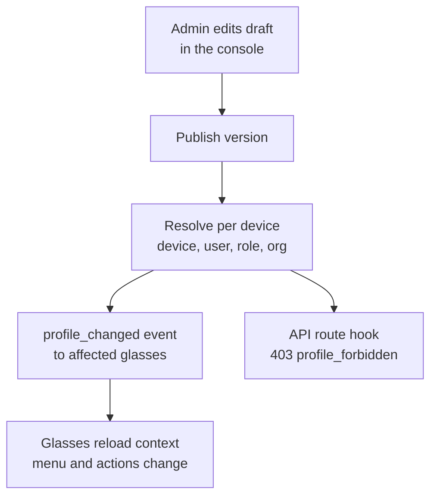
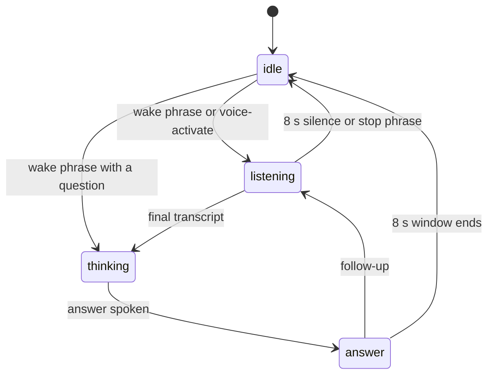

# Glasses app

## Glasses app (heads-up and phone)

### Purpose and problem

Field operators walk rounds with gloves on, a radio in one hand and a log sheet in the other. They need the next inspection, the live reading at the asset in front of them, the alarm near them and the right procedure, without stopping to unlock a phone or walk back to the control room. The Hydris glasses app is one web viewport (`apps/web/src/glasses/*`, served at `/glasses`) that puts this work in front of the operator's eyes on display glasses, inside the phone bridge for Ray-Ban Meta, and in a browser simulator for demos and testing.

> [!STATS]
> - 12 | Screens | gated by the UI profile
> - 6 | Input keys | up, down, left, right, select, back
> - 600 x 600 | HUD canvas | additive display
> - 0 | Lost offline steps | queue plus idempotent replay

#### Hands-free principles

The app follows a small set of rules that come from the design system and are enforced in `hud.tsx`:

- **One primary action per screen**, one lime focus ring, and every action reachable with six directional keys or voice (NFR-021).
- **Glanceable.** Body type at 20 px or more, light strokes on black, no large filled areas, because pure black is transparent on an additive display (NFR-020).
- **Records only.** Hydris never operates equipment. Acknowledge carries the hint "does not change equipment", and the task screen says "Records only".
- **Honest data.** Cached data is labelled as cached with its age, never as live (NFR-026). Demo data is labelled as synthetic.
- **Administered, not configured on the device.** What a pair of glasses shows is decided in the console through UI profiles, with no app update (FR-054).

### Users and jobs

Table: Who uses the glasses app and why

| User | Job on the glasses | Requirements |
|---|---|---|
| Field operator | Walk the assigned round, record readings, acknowledge nearby alarms, open the SOP | FR-041, FR-059, FR-112 |
| Field operator | Capture a paper log once and send it for verification | FR-060, FR-061 |
| Field operator, hands busy | Ask "Hey Hydris" and hear a short grounded answer | FR-071, FR-072 |
| Shift supervisor | Pair a pair of glasses to an operator and site from a phone | FR-050 |
| Plant manager or admin | Decide what each role sees, roll back a bad change | FR-054 |
| Prospect and sales | Try the full app in the browser simulator | FR-059 |

### Scope

Table: Scope of the glasses app

| In scope (Built) | Out of scope or Planned |
|---|---|
| HUD layout for display glasses, phone layout for the bridge, browser simulator | Rendering on a real glasses display (Planned) |
| Device pairing by code and QR, device tokens, log out and unpair | Native Vuzix or RealWear hosts (Planned) |
| Home, alerts, inspections with offline queue, tasks, measurements, assets, plant map | Camera capture into inspection photo steps (FR-045 Partial) |
| SOP library and reader with offline cache | Hardware gestures such as a neural band or temple touchpad (Planned) |
| Audit scan entry, Hey Hydris voice entry | Multi-language voice (FR-073 Planned) |

### Runtimes

The same React viewport runs in three places. `useViewportLayout` in `hud.tsx` picks the layout: phone mode when the page runs inside the bridge (`HydrisNative` is present), when `?mode=phone` is set, or on a narrow portrait screen; HUD mode otherwise.

The HUD scales a 600 x 600 canvas to the window and is driven by directional keys, swipes or the simulator's on-screen pad. Phone mode uses a 540-unit-wide layout at full height with safe-area insets and a bottom tab bar: Home or Back, Scan, Hey Hydris, Alerts. The simulator also offers 640 x 480 and 480 x 480 viewports, a network switch for simulating loss, and an event log.

Table: HUD and phone mode compared

| Aspect | HUD mode | Phone mode |
|---|---|---|
| Target | Display glasses, simulator | Bridge app on the phone paired with Ray-Ban Meta |
| Navigation | Six keys, swipes, `hydris:input` from the simulator | Bottom tab bar plus touch |
| Camera | Simulated or device camera | Glasses camera through the bridge |
| Voice | Browser speech | Glasses microphone through the bridge, browser fallback |

### Screen map and navigation

The app has twelve top-level screens (FR-059) plus detail screens for an alert, an inspection, a task, an asset and an SOP. Home is the menu: its item order and visibility come from the UI profile, and Home and Status (device and log out) can never be switched off.

Navigation is a stack. Every push also writes a browser history entry, so the hardware or browser back button walks back through glasses screens and never leaves the app; at the bottom of the stack it returns to Home. In HUD mode, up and down move the focus, select activates it, left or back pops the stack.

### Lifecycle and pairing

The viewport moves through phases before the operator reaches Home. On boot it looks for a device credential; without one it shows the pairing screen. If the server reports the device as revoked, suspended or unassigned, the app shows that state plainly instead of failing silently.

Pairing follows the shape of the OAuth device authorization grant (RFC 8628). The glasses never type a password: they show a short code and a QR link, a signed-in supervisor approves on any phone or browser, and the glasses claim their own credential with a secret that is never displayed.

The code uses 8 characters from an alphabet without 0, O, 1, I, L or U. Polling faster than 3 s returns `slow_down`; an expired code cannot be approved. After pairing the device holds a 15-minute access token and a 30-day rotating refresh token with reuse detection (FR-051). The viewport keeps its hardware ID (`hg-` plus a random UUID) and refresh token in local storage, which the code marks as the boundary for a hardware-backed store.

**Log out and unpair** lives on the Device screen behind a confirmation ("Log out and unpair these glasses?"). It ends the device's server sessions, after which the refresh token is rejected and anyone can pair the glasses again (FR-058). Revocation from the console takes effect on the next request and within 30 s on the live event stream (FR-052).

### Core experience

#### Home

Home greets the operator by first name ("...'s shift") with the site name, then shows profile-controlled widgets: the next inspection card, a critical alarm badge, three measurements at a glance and checklist progress. Below is the menu, each item with a live count (open alerts and critical count, inspections assigned, sensors on site). Values outside their threshold are tinted.

#### Alarms

Alerts lists open alarms by severity. The detail shows the value, the rule, the recommended action and the linked SOP (FR-112). Acknowledge is the single primary action; it needs a connection, says so when offline, and confirms with "Acknowledged. The equipment state is unchanged."

#### Inspections with an offline queue

The inspection runner walks the operator one step at a time through check, reading, choice and text steps. A reading outside its expected range, a failed check or an abnormal choice marks the step abnormal automatically. Photo steps show "attach from console" today (FR-045 Partial).

Every response is queued first and then flushed, so the same path serves online and offline work (FR-041, NFR-025). The status bar shows "N queued" and an offline strip states the age of cached data. On reconnect the app reports "Back online, N queued steps synced", or names the first conflict if the server rejected a step. Submitting an inspection needs a connection and stays disabled until every required step is complete.

#### SOPs and assets

The SOP library lists only approved documents (FR-111); a draft never reaches the glasses. An SOP opened once is cached and opens again with no network (FR-113). Asset context shows the asset's live readings with freshness and a short trend from the last 30 values, and links to Assist for grounded procedure passages with a safety notice (FR-070).

#### Audit scan entry point

Audit scan turns a paper log into a verified record. On the glasses it opens a guided A4 capture: live page detection, auto-capture when the page is aligned, steady and sharp, perspective correction, two on-device OCR passes, review of up to six pages, then upload for verification in the console (FR-060, FR-061, FR-067). In the bridge the glasses camera feeds the guidance and the capture button takes the photo; in the simulator a simulated camera walks a sample sheet through too close, too far, tilted and square. The full pipeline is described in the audit scan part of this book.

### UI profiles

A UI profile is a versioned description of what a pair of glasses may show and do: enabled screens and their order, home widgets, allowed actions, a measurement filter and a text scale (0.9, 1, 1.15 or 1.3, NFR-019). Profiles are drafted, published and rolled back in the console. Assignment resolves with precedence device, then user, then role, then organization; the most specific published profile wins entirely and is never merged.

The server enforces the same profile it sends: a device whose profile hides alarms gets `403 profile_forbidden` from the alarms API even if the operator's role allows it. On the glasses, a blocked action shows a dashed "not permitted by your profile" note rather than disappearing silently. The console can also push a draft into a live preview of the viewport before publishing.

Table: What a profile controls

| Control | Options |
|---|---|
| Screens | 12 screens; Home and Device are always on |
| Widgets | Next inspection, critical alarm badge, measurements at a glance, checklist progress |
| Actions | Acknowledge alarms, record and submit inspections, tick checklists, ask AI, open SOPs, view map, mark notifications read |
| Measurements | Allowed measurands, order by asset type |
| Text scale | 0.9, 1, 1.15, 1.3 |

### Voice entry point

"Hey Hydris" opens the voice assistant from any screen, and so does the Hey Hydris tab in phone mode or a "Hey Meta, start Hydris" invocation in the bridge (FR-077 Partial). The engine order is the glasses microphone through the bridge, then the browser Web Speech API, then typed questions. Answers are one or two sentences, spoken, and shown with the facts behind them (FR-071, FR-075, NFR-022).

Offline, demo and cached answers come from the same rules engine the API uses, so the assistant never guesses: an unknown question returns "unknown" (FR-072). The assistant has no write tools (FR-078).

### Requirements

Table: Glasses app requirements (IDs from the PRD)

| ID | Requirement | Pri | Status |
|---|---|---|---|
| FR-059 | Heads-up app, 12 screens, six-key input, phone layout | M | Built |
| FR-050 | Pairing by 8-character code and QR, 300 s TTL, 3 s polling | M | Built |
| FR-051 | Device tokens: 15-minute access, 30-day rotating refresh | M | Built |
| FR-052 | Suspend, revoke, reassign; effective within 30 s on the stream | M | Built |
| FR-058 | Log out and unpair from the glasses menu | M | Built |
| FR-054 | UI profiles: draft, publish, rollback, live push | S | Built |
| FR-041 | Inspection execution with offline queue and idempotent replay | M | Built |
| FR-042 | Submit inspections; returned ones can be restarted | M | Built |
| FR-045 | Photo steps captured with the glasses camera | S | Partial |
| FR-112 | Alarm detail shows and opens the linked SOP | M | Built |
| FR-111 | Only approved documents reach the glasses | M | Built |
| FR-113 | Opened SOPs cached for offline reading | S | Built |
| FR-060 | Guided A4 capture with auto-capture | M | Built |
| FR-071 | Hey Hydris wake phrase and short spoken answers | M | Built |
| FR-077 | "Hey Meta, start Hydris" opens the assistant | C | Partial (bridge only) |
| NFR-019 | Text scale per profile | M | Built |
| NFR-020 | Additive-display friendly design | M | Built, to verify on hardware |
| NFR-025 | Inspection responses survive connectivity loss | M | Built |
| NFR-026 | Cached context shown as cached, never as live | S | Built |

### Success metrics

Table: Glasses app metrics (targets, not measured results)

| Metric | Target | Source |
|---|---|---|
| Home ready after wake | 2 s from cached context, fresh data within 5 s | NFR-005 (target) |
| Queued steps lost after reconnect | Zero | NFR-025 (Playwright journey passes today) |
| Voice answer time, end of speech to spoken answer | 3 s rules engine, 8 s model engine | NFR-003 (target) |
| Profile change visible on glasses | Without a reload | FR-054 acceptance |
| Rounds completed on the glasses in pilot | To be set with the pilot customer | Pilot plan |

### Status, gaps and next steps

The web viewport is Built and runs today in the simulator and inside the bridge. It has not yet run on a real glasses display.

> [!WARNING]
> Hardware gestures (neural band, temple touchpad) are not delivered to the web runtime yet; `input.ts` keeps a placeholder. The viewport's refresh token sits in local storage until a hardware-backed store exists.

- [ ] Run the HUD on display glasses (Vuzix M400, RealWear Navigator 520, Meta Ray-Ban Display), Planned.
- [ ] Wire glasses camera capture into inspection photo steps (FR-045).
- [ ] Hardware-backed credential storage for the viewport.
- [ ] Inspection execution in the Android app with the same offline guarantees (FR-044, Planned for pilot).
- [ ] Measure NFR-003 and NFR-005 on hardware during the first pilot.
