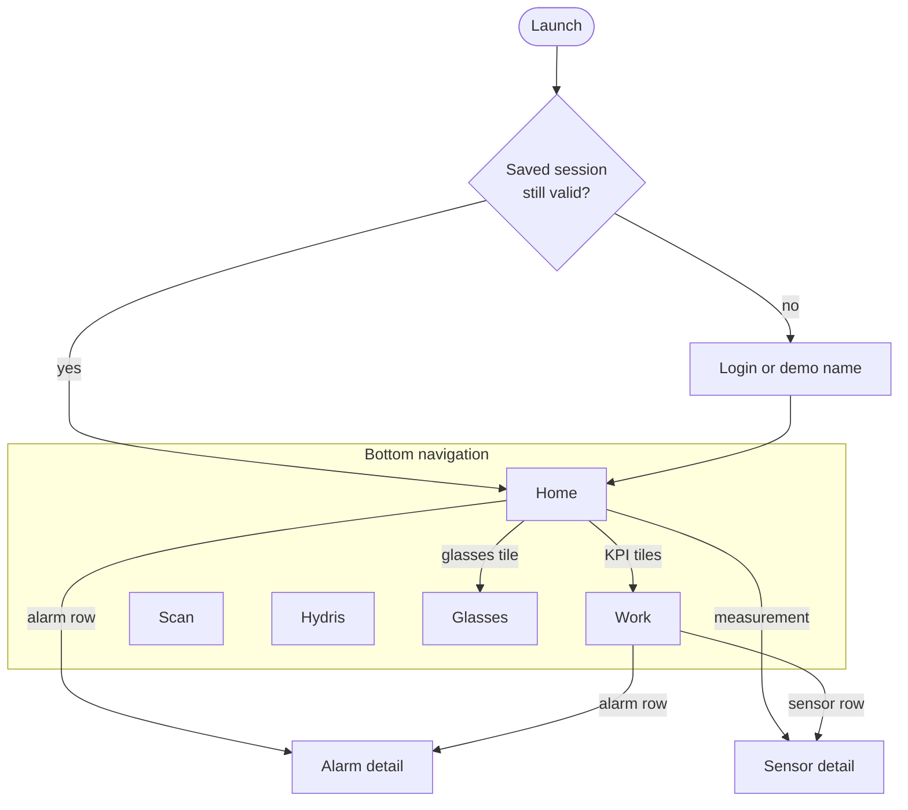
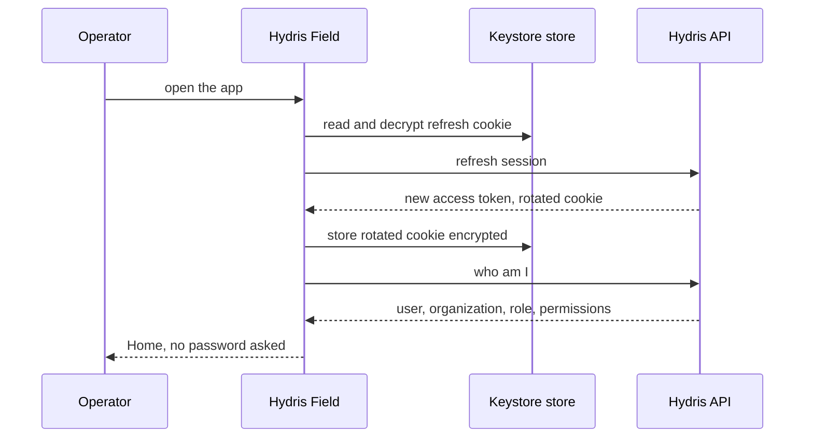
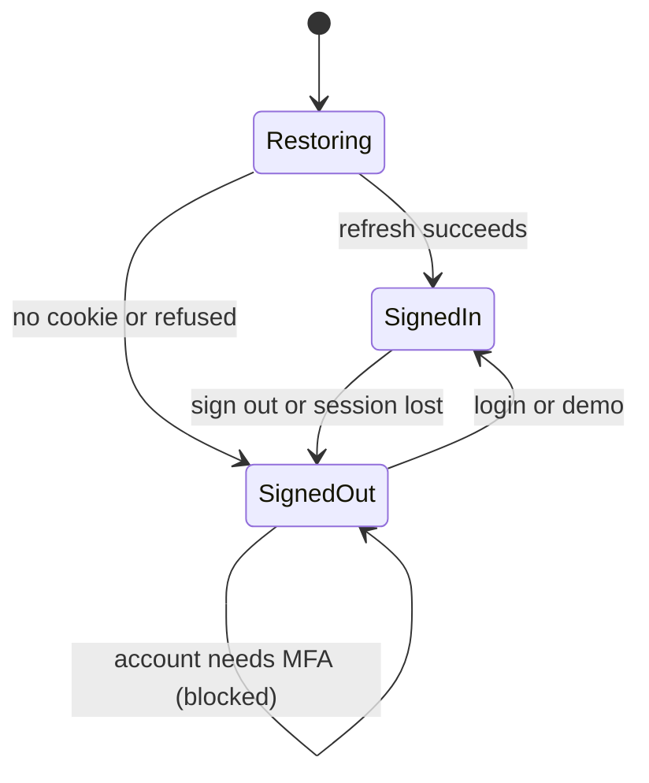
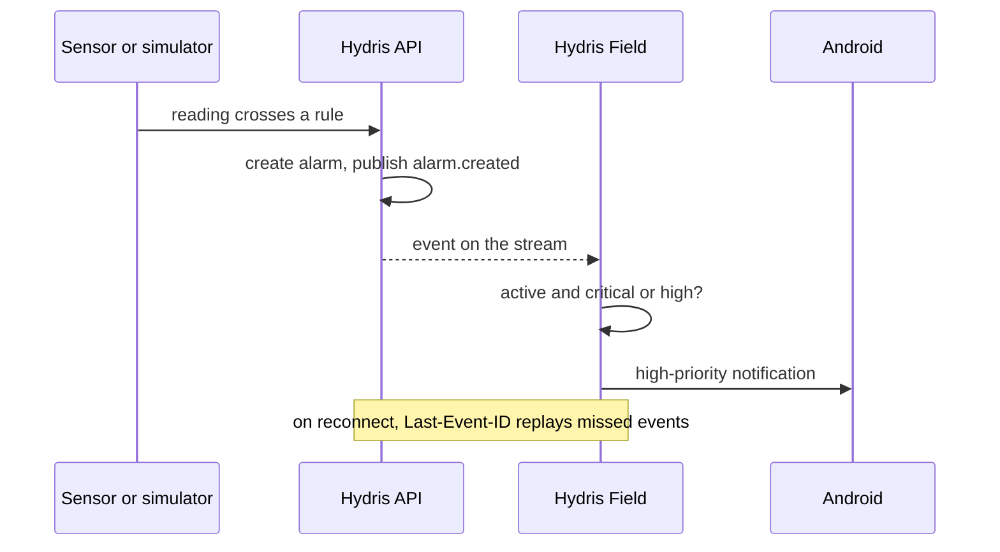
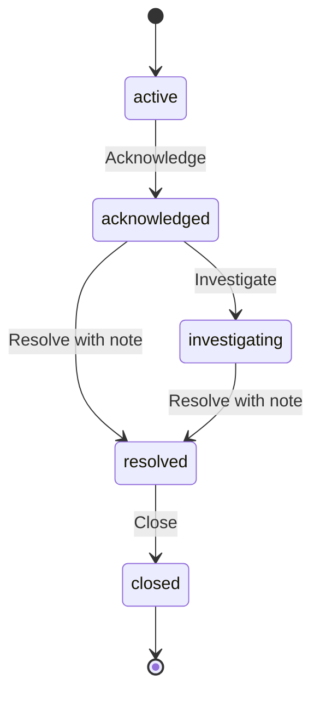
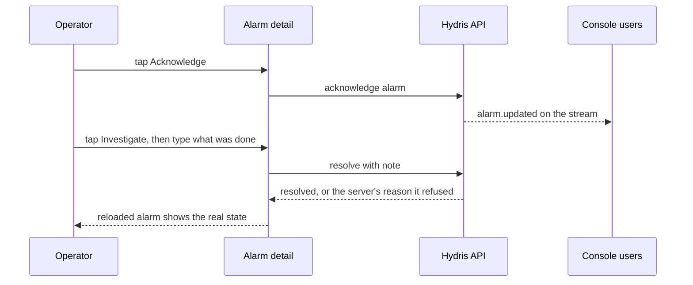

# Hydris Product Book

## Hydris Field Android app

### Purpose and problem

Operators in effluent and sewage treatment plants walk rounds with a phone in their pocket and, increasingly, Ray-Ban Meta glasses on their face. Until now the only app that talked to those glasses was Meta AI, a consumer assistant that knows nothing about the plant. Hydris Field is the native Android companion that takes over the working day: one Hydris account, the plant dashboard, alarms and work, audit scanning, the "Hey Hydris" assistant and the glasses link, all in one app (`apps/android`, Kotlin and Jetpack Compose).

> [!IMPORTANT]
> Hydris Field does not replace the Meta AI app, and cannot. Meta's Wearables Device Access Toolkit (DAT) requires Meta AI for Bluetooth pairing, firmware updates, Developer Mode and the approval prompts for camera and microphone. Meta AI stays installed as the connection broker; after a one-time setup the operator opens only Hydris Field.

> [!STATS]
> - 5 | Bottom tabs | Home, Work, Scan, Hydris, Glasses
> - 7 | Navigation routes | `Root.kt` NavHost
> - 2 | OCR passes per page | on the phone, before upload
> - 12 | Minimum Android version | `minSdk` 31

### Users and jobs

Table: Who uses the app and for what

| User | Job the app does for them |
|---|---|
| Field operator | See what needs attention on my sites, act on alarms where I stand, scan paper logs, ask questions hands-free |
| Maintenance engineer | See open work orders and tick checklist items in the field |
| Shift supervisor | Keep plant status, alarm trend and asset health in my pocket |
| Prospect or partner | Try the full product in minutes with a named demo account |

All of them already hold a Hydris console account. The app adds no new account type and the server needed no mobile-specific authentication.

### Scope

Table: In scope and out of scope for this release

| In scope | Out of scope |
|---|---|
| Sign-in, demo mode, session restore | Administration of members, roles, sites and rules (console) |
| Home dashboard, Work tabs, alarm and sensor detail | Reviewing and approving audit documents (console) |
| Audit scan from glasses, phone camera or import | Equipment control of any kind |
| Hey Hydris assistant | A heads-up display on Ray-Ban Meta (they have none) |
| Glasses connect, test and register | iOS native app |
| Realtime alarm notifications while the app runs | Replacing the Meta AI app |

### Navigation

The app is one activity with a bottom navigation bar. `Root.kt` first decides between restoring a session, Login and the signed-in shell; each tab keeps its scroll position when the user switches away and back.

Table: What each tab is for

| Tab | What the user does there | Part of this book |
|---|---|---|
| Home | Reads the plant status at a glance | This part |
| Work | Works alarms, inspections, maintenance, sensors, audit documents | This part |
| Scan | Turns a paper record into a document for verification | Audit document scanning |
| Hydris | Asks questions by voice or text | Hey Hydris voice assistant |
| Glasses | Connects, tests and registers Ray-Ban Meta glasses | Ray-Ban Meta glasses |

### Session and sync

#### Sign-in and restore

The operator signs in with the console email and password, or taps "Enter demo mode" and types a name of two or more characters to get a personal synthetic account. The short-lived access token lives in memory only; the rotating refresh cookie is stored encrypted with AES-256-GCM under a non-exportable Android Keystore key (`SecureStore.kt`). Killing and reopening the app restores the session without a password.

If the cookie is missing or refused, the operator lands on Login. Later, any 401 triggers one refresh; refreshes are serialized by a lock so parallel screens never present an old cookie, which the server would treat as reuse and revoke. If refresh fails the user sees "Session ended. Please sign in again."

#### Keeping screens live

Two mechanisms keep data current without a local database. Screens poll while visible (Home and alarms every 15 s, sensors every 10 s, audit documents every 20 s), and a server-sent event stream pushes alarm events. The stream resumes with `Last-Event-ID`, so events missed during a network drop are replayed.

> [!DECISION]
> Polling plus the event stream is deliberate for the pilot. Every screen stays correct after a network drop without an offline cache. The cost is extra requests while a screen is visible; the Planned offline outbox and cache will change this.

### Home dashboard

Home answers "what needs me now?" from one call to the same overview endpoint the console uses (FR-089). Top to bottom: a greeting with the operator's first name and a "Demo" chip for demo tenants; a status line ("2 critical alarms need attention." or "All quiet on your sites."); four KPI tiles (open alarms, inspections due and overdue, maintenance, field glasses connected); a 14-day alarm trend; an asset-health donut; live measurements with a freshness dot, age and a "synthetic" label for simulator data; recent alarms; and the last eight activity events. Tiles and rows are shortcuts into Work, Alarm detail, Sensor detail and Glasses.

A failed refresh keeps the last overview on screen. Missing data shows "No data", never zero, and stale values carry their state.

### Work

Work holds everything open in five tabs, each filtered by the operator's site scope on the server.

Table: Work tabs

| Tab | What the operator sees | What the operator can do | Status |
|---|---|---|---|
| Alarms | Severity, title, state, age, assignee; critical alarms outlined in orange | Open alarm detail and act | Built |
| Inspections | Title, status, site, overdue marker, step progress | Read only | Partial: running an inspection on the phone is Planned (FR-044) |
| Maintenance | Priority, status, checks done; expands to the checklist | Tick checklist items | Built; start, hold and complete Planned |
| Sensors | Name, tag, freshness, age, open alarms, value | Open sensor detail with 6 h, 24 h, 7 d chart | Built |
| Audit docs | Status, values, engine agreement, review progress | Read only (review is in the console) | Built |

#### Working an alarm

Alarm detail shows the trigger value in the severity colour against its limit and peak, the asset and sensor, a recommended action, and buttons for the next lifecycle step. Resolve asks for a note ("What was done"), because the API refuses a resolution without one (FR-031); the button stays disabled until the note is filled.

Server rules always win: if the operator lacks the permission, or a colleague moved the alarm first, the server's message is shown and the screen reloads the true state.

### Glasses tab

The Glasses tab is the one place to link Ray-Ban Meta glasses through the Meta AI app, test the camera and microphone, and register the glasses as a Hydris device so scans are attributed. If Meta AI is not installed, "Connect glasses" stops early and says so. The full flows are in the Ray-Ban Meta glasses part. Every glasses feature has a phone fallback: phone camera, phone microphone, phone speaker.

### Permissions

The app asks for each permission in context and keeps working when one is denied.

Table: Permissions and what happens if denied

| Permission | Asked when | If denied |
|---|---|---|
| Nearby devices (Bluetooth connect) | App start | Glasses unavailable; phone features work |
| Notifications | App start | No alarm notifications |
| Camera | "Scan with phone camera" | Import a photo still works |
| Microphone | Turning Hey Hydris on | Typing still works |
| Glasses camera (in Meta AI) | First glasses preview or photo | Clear message; phone camera works |
| Glasses microphone (in Meta AI) | First glasses listening | Falls back to the phone microphone |

> [!WARNING]
> Bluetooth and notification permissions are requested on every app start, so a user who denies them is asked again each time. Asking once and explaining in Settings is Planned.

### Performance and native principles

- **Native, not a wrapped website.** Kotlin, Compose and Material 3, dark only, in the shared Hydris palette; charts are drawn directly on a canvas with no chart library.
- **Work on the device first.** Page detection and both OCR passes run on the phone; no image leaves it until "Send for verification".
- **Fail fast, wait when it matters.** 15 s connect timeout; 90 s read timeout for scan uploads; the event stream has no read timeout and relies on server heartbeats.
- **Tolerant of server change.** Unknown JSON fields are ignored, so new API fields do not break older builds.
- **Glanceable for gloves and glare.** Large KPI numbers, 52 to 54 dp primary buttons, explicit empty states ("No open alarms.").
- **One app-wide set of engines.** Session, glasses link and voice live in singletons created once at start; ViewModels, Hilt and Room are Planned.

### Requirements

Table: Android app requirements (FR-090 block)

| ID | Requirement | Pri | Status |
|---|---|---|---|
| FR-090 | Console sign-in; session restored from a Keystore-encrypted refresh cookie | M | Built |
| FR-091 | Demo sign-in with a name | M | Built |
| FR-092 | Home: greeting, 14-day trend, asset health, live measurements with freshness | M | Built |
| FR-093 | Work tabs scoped to the user's sites | M | Built |
| FR-094 | Alarm detail with lifecycle actions | M | Partial: resolve note added; buttons not yet driven by the API's allowed actions |
| FR-095 | Sensor detail with 144-point history and typical range | S | Built |
| FR-096 | Audit scan from glasses, phone or import | M | Built (phone); glasses path Partial |
| FR-097 | Realtime notifications for critical and high alarms while the app runs | M | Built |
| FR-098 | Offline outbox with idempotent replay | S | Planned (GA) |
| FR-099 | Complete MFA sign-in in the app | S | Planned (Pilot) |
| FR-089 | Home and console overview from the same endpoint | M | Built |

### Success metrics

Table: Android success measures (targets, not measured results)

| Measure | Target |
|---|---|
| Opening Scan to "Sent" for one A4 page | Under 60 s on a mid-range phone |
| Scans that auto-capture without "Capture now" | Above 70 % |
| Critical alarm to phone notification | Under 5 s while the app runs |
| Spoken answer after the question ends | Under 3 s on 4G |
| Crash-free sessions in pilot | Above 99.5 % |

The app was verified manually on an emulated Pixel 7 (API 35): login, demo mode, home, assistant, alarm acknowledgement, and a scan import that extracted 10 values including pH 7.3 correctly.

### Status, gaps and next steps

Table: Gaps to close before and during the pilot

| Gap | Effect today | Plan |
|---|---|---|
| No MFA step (FR-099) | Accounts with TOTP must sign in on the web | Code entry screen, Pilot |
| No offline outbox (FR-098) | Actions need a network | Room cache and outbox, GA |
| Actions not driven by allowed actions (FR-094) | A button may be offered that the server refuses | Use the API's list, Hardening |
| No push service | Notifications only while the app runs | FCM, GA (FR-034) |
| Notification opens the app, not the alarm | Operator must find it | Deep link to the alarm |
| No automated tests | Regressions caught by hand | Unit and UI tests before pilot |
| Release builds signed with the debug key | Cannot be distributed outside the team | Release keystore, Play internal track |
| Glasses path not run on hardware | DAT flows proven only on the mock device | First hardware run, Q4 2026 |
| Glasses registered to the first site | Multi-site users cannot choose | Site picker before multi-site pilots |

> [!RISK]
> Until release signing is in place, no build may leave the team. MFA, release signing and the first hardware run are the three items that gate a pilot handover.
