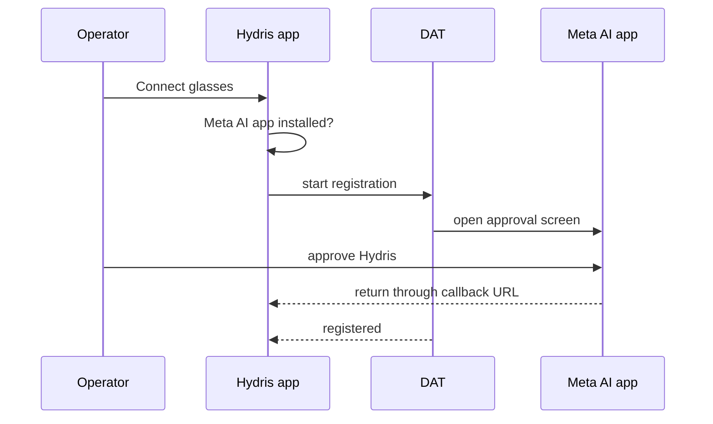
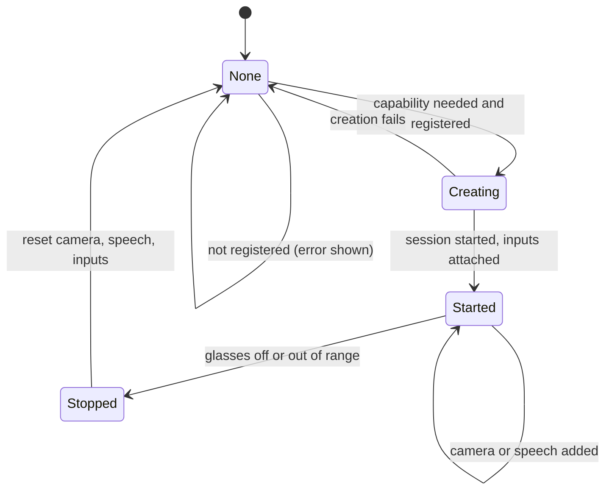
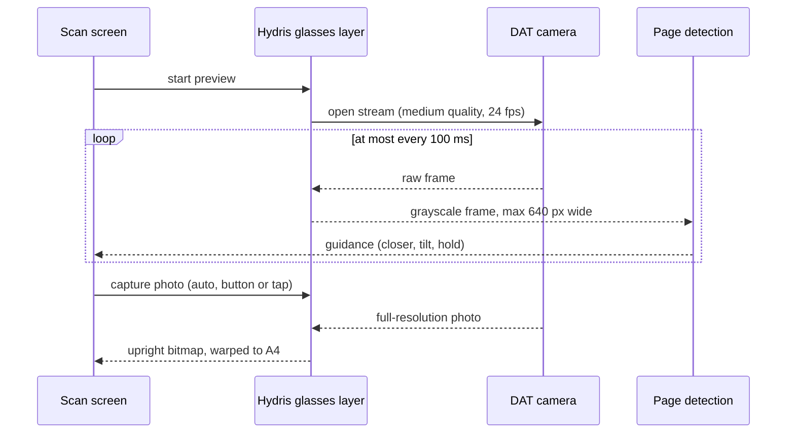
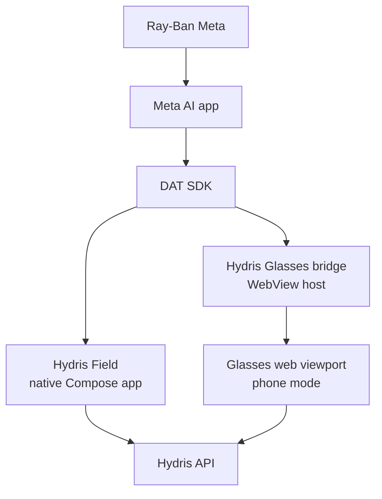
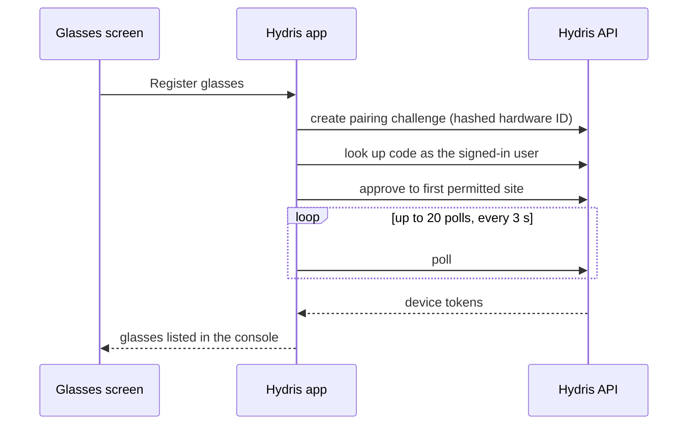
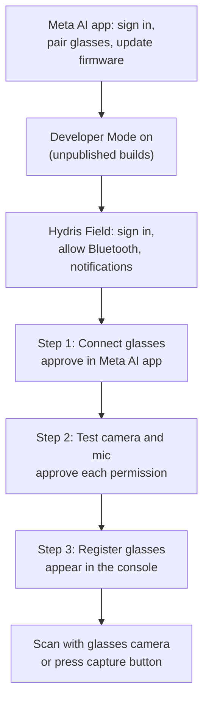
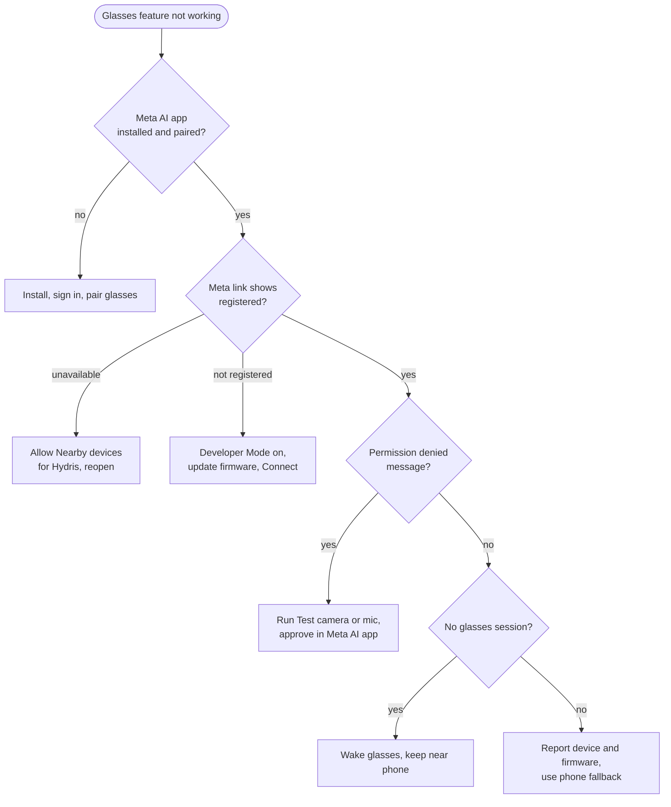

# Ray-Ban Meta integration

## Ray-Ban Meta integration

### Purpose and problem

Ray-Ban Meta glasses are the lightest way to give an operator a camera, a microphone and speakers at eye and ear level, but they have no display. Hydris uses them as hands-free sensors for the phone: the glasses camera frames and shoots paper logs, the glasses microphone hears "Hey Hydris", the open-ear speakers play the answer, and the capture button takes the photo. The phone is the screen. The integration uses Meta's Wearables Device Access Toolkit (DAT) 1.0.1 with four modules: core, camera, speech and inputs.

> [!IMPORTANT]
> No Hydris build has yet been run against physical Meta glasses. All DAT calls compile and are type-checked against DAT 1.0.1, and the page side of the bridge was tested with a stand-in bridge. Every hardware behaviour here is **Built, not hardware-verified** unless stated otherwise.

> [!STATS]
> - 4 | DAT modules | core, camera, speech, inputs
> - 0 | Displays | the phone is the screen
> - 2 | Integration routes | native app, WebView bridge
> - 15 | Hardware acceptance tests | none run yet

### Users and jobs

Table: Users and jobs

| User | Job | Requirements |
|---|---|---|
| Field operator | Scan a paper log with the glasses camera without holding the phone | FR-055, FR-056 |
| Field operator | Ask by voice and hear the answer on the open-ear speakers | FR-074, FR-077 |
| Supervisor or admin | See the glasses as a managed, revocable device in the console | FR-057 |
| Solutions engineer | Set up and troubleshoot a pilot kit | Setup and troubleshooting below |

### Scope

Table: Scope

| In scope | Out of scope |
|---|---|
| Ray-Ban Meta Gen 1 and Gen 2 (primary target: Gen 2) | Video recording or upload |
| Camera preview for guided capture, full-resolution photo | Replacing the Meta AI app |
| Glasses microphone, phone TTS on the glasses speakers | Hydris UI on the Ray-Ban Meta (it has no display) |
| Capture button short press | Long press and other gestures |
| Registering the glasses as a Hydris device | Several pairs of glasses per phone |

### What the glasses can do

Table: Capability matrix by glasses family

| Capability | Ray-Ban Meta | Oakley Meta (HSTN, Vanguard) | Meta Ray-Ban Display |
|---|---|---|---|
| Supported by DAT | Yes (Meta FAQ) | Yes (Meta FAQ) | Yes (Meta FAQ) |
| Camera stream and photo | Yes | Expected, unverified | Expected, unverified |
| Microphone through DAT Speech | Yes | Unverified | Unverified |
| Speakers | Phone TTS over Bluetooth | Phone TTS over Bluetooth | Phone TTS over Bluetooth |
| Capture button | DAT Inputs | Unverified | Unverified |
| Display | **None** | **None** | Yes; Hydris use Planned |
| Hydris status | Primary target, not yet on hardware | Untested | Phone path expected; display Planned |

Every glasses feature has a phone fallback: phone camera, phone microphone and phone speaker. An operator without glasses loses nothing but the hands-free convenience.

### The Meta AI app dependency

Meta's documentation is explicit that the Meta AI app must be used to pair the glasses. It pairs them to the phone, updates firmware, enables Developer Mode for unpublished apps, and approves each third-party app and each permission (camera, microphone). Hydris does not try to replace it.

> [!DECISION]
> The Meta AI app must stay installed and signed in. Hydris checks for it (package `com.facebook.stella`) and, if missing, tells the operator to install it and pair the glasses there first. Hydris pairing is separate: it makes the glasses a managed device in the customer's organization.

### DAT lifecycle

Both Hydris phone apps follow the same lifecycle. DAT is initialized only after Android grants the Bluetooth permissions; the app then watches registration state, connected devices and device names.

#### Registration and permissions

Camera and microphone access on the glasses are DAT permissions, separate from Android permissions, and are also approved in the Meta AI app. Hydris asks for one permission at a time, and a cancelled prompt counts as denied.

#### Session

One device session is shared by camera, speech and inputs. It is created the first time a capability is needed, reused while started, and rebuilt from scratch after it stops (for example when the glasses are switched off).

#### Camera stream and photo

Preview frames are processed in memory for framing only; Hydris reads the luma plane and never stores or uploads frames. The photo is taken only on an active stream, decoded (bitmap or HEIC), rotated upright from EXIF, then flattened to an A4 page of 1654 x 2339 pixels. Images leave the phone only when the operator taps "Send for verification".

#### Capture button and speech

A short press of the capture button starts a glasses scan from the Scan menu or review, and takes the photo while framing; elsewhere it is ignored. Speech is always on while wanted: transcripts arrive as text, Hydris restarts listening after silence and ignores transcripts while its own answer is playing. Answers are spoken by the phone's text-to-speech and play on the glasses when they are the Bluetooth audio output. Hydris receives transcripts, never audio, and sends only the question text to the assistant.

### Two integration routes

Table: The two routes compared

| Aspect | Hydris Field (native) | Glasses bridge (WebView) |
|---|---|---|
| UI | Native Compose screens | The `/glasses` web viewport in phone mode |
| How DAT reaches the UI | Kotlin state flows | `HydrisNative` JavaScript interface and page callbacks |
| Registration as a Hydris device | Self-approved by the signed-in user | Code and QR, approved by a supervisor |
| "Hey Meta, start Hydris" | Planned | Built |
| Intended use | **Pilot runtime** | Web viewport and development comparison; not for general distribution |

The bridge forwards one JPEG preview frame per 120 ms and full photos at quality 92 to the page; the page gives up on a photo after 20 s. The same page also supports an injected promise API for iOS hosts and a postMessage protocol for any embedding host.

> [!WARNING]
> Bridge hardening is Planned: the WebView grants every page permission request and does not restrict navigation away from the Hydris site. Restrict navigation to the Hydris origin before distributing the bridge outside the team.

### Registering glasses as a Hydris device

The Meta AI app pairs the glasses to the phone; Hydris pairing makes them a managed device: assigned to a person and a site, visible to supervisors, revocable, and credited for the scans they capture (FR-057). In the native app the phone plays both roles of the device flow at once.

The hardware ID is `rbm-` plus a SHA-256 digest of the DAT device identifier, so the raw Meta identifier never leaves the phone and re-registering reuses the same console record. Glasses registered in another organization must be revoked there first (`device_owned_elsewhere`).

> [!NOTE]
> The same glasses paired through both routes produce two device records, because the hardware IDs differ. Pilots should use one runtime per pair. The native app assigns the glasses to the first site the user can see; a site picker is Planned before multi-site pilots.

### Setup guide

Developer Mode is turned on in the Meta AI app under Settings, App Info, by tapping the app version five times. Speech, Inputs and Voice Invocations are experimental in DAT and must be enabled for the app in Meta's Wearables Developer Center; Hydris treats them as optional and keeps the phone fallbacks. Developer Mode builds use placeholder DAT credentials; production builds use the values issued by the Developer Center.

### Troubleshooting

Table: Other common symptoms

| Symptom | Fix |
|---|---|
| Capture button ignored | Enable Inputs in the Developer Center; open Scan |
| Answers play on the phone speaker | Reconnect audio to the glasses in Android Bluetooth settings |
| Preview black or garbled | Report device and firmware; use the phone camera meanwhile |
| "Your account has no site to assign the glasses to" | Ask an admin for site access |
| `device_owned_elsewhere` | Revoke the glasses in the other organization |

### Requirements

Table: Ray-Ban Meta requirements (IDs from the PRD)

| ID | Requirement | Pri | Status |
|---|---|---|---|
| FR-055 | Glasses camera through DAT: preview stream and full-resolution photo | M | Partial (not on hardware) |
| FR-056 | Capture button takes the photo or starts a scan | S | Partial (not on hardware) |
| FR-057 | Android app registers the glasses as a Hydris device | M | Partial (not on hardware) |
| FR-074 | Glasses microphone with phone fallback; answers on the speakers | M | Partial (phone path Built) |
| FR-077 | "Hey Meta, start Hydris" opens the assistant | C | Partial (bridge only) |
| NFR-015 | Camera only on explicit intent; no continuous recording | M | Built |
| NFR-028 | 4-hour shift on Ray-Ban Meta with up to 20 scans | S | Planned (measure) |
| NFR-029 | Android 12 or later | M | Built |

### Success metrics

Table: Timing targets for the first hardware run (targets, not measured)

| Path | Target |
|---|---|
| First preview frame after opening the glasses scan | Under 3 s with an existing session |
| Preview rate reaching detection | 8 to 10 frames per second |
| Photo returned after capture | Under 4 s |
| Speech restart gap after silence | Under 1 s |
| Battery | 4-hour shift with up to 20 scans (NFR-028) |

### Limitations and publishing constraints

- **Not yet run on hardware.** Preview stride inference, capture press decoding and speech restart are unverified.
- **The DAT camera stream is not stopped** when the preview ends, only when the session ends; battery and capture LED impact to be checked.
- **Low-resolution preview.** Frames cross the wireless link, so detection runs on small frames; the photo is full resolution.
- **Publishing.** Public publishing of DAT apps is not open yet (Meta FAQ); pilots rely on Developer Mode and Developer Center release channels. Full Developer Center access is limited to countries where Meta AI glasses are supported.
- **Testing.** Hydris has no automated DAT tests yet, and Meta's Mock Device Kit does not support display glasses.
- **Privacy.** Meta glasses show a capture LED that Hydris cannot control; whether it is lit during preview streaming is to be confirmed. Pilot sites should brief staff and mark scan points.

### Hardware acceptance status

Table: Hardware acceptance tests (none run yet)

| ID | Test | Status |
|---|---|---|
| GLS-T01, T02 | Connect with and without Developer Mode | Not run |
| GLS-T03 to T06 | Camera permission, guided A4 scan, leaving scan, photo orientation | Not run |
| GLS-T07, T08 | Capture button short and long press | Not run |
| GLS-T09, T10 | Ten minutes of Hey Hydris, answers on the speakers | Not run |
| GLS-T11 to T13 | Register, revoke then upload, glasses off mid-session | Not run |
| GLS-T14 | Repeat camera and voice tests through the bridge | Not run |
| GLS-T15 | Battery over a simulated four-hour shift | Not run |

Next steps, in order: the first run on Ray-Ban Meta Gen 2 with this checklist, stopping the DAT stream when the scan screen closes, and bridge hardening (Q4 2026); Oakley Meta validation, Voice Invocations in the native app and DAT mock-device tests (Q1 2027); a Developer Center release channel pilot and a site picker for registration (Q2 2027). Using the Meta Ray-Ban Display screen remains Planned and unverified.
