# Hydris Product Book

## Audit document scanning

### Purpose and problem

Treatment plants still run on paper: shift logbooks, round sheets, lab reports, permits, calibration certificates. These records are the evidence a regulator or auditor asks for, yet they are hard to search, easy to lose, and slow to copy into a system by hand, where a moved decimal point turns pH 7.1 into 71. Audit scanning turns a paper record into a verified, searchable digital document. The design rule is dual verification: a machine cross-check of every value between independent readings, then a human review of every value and an independent approval by a second person.

> [!STATS]
> - 2 | OCR passes per page | original and enhanced, on device
> - 6 | Pages per document | each under 900 KB
> - 4 eyes | Verify and approve | two different people
> - 10 | Values from the demo sheet | pH 7.3 read correctly

### Users and jobs

Table: Who takes part in a scan

| User | Job |
|---|---|
| Field operator | Capture the paper record where it is, with glasses or phone, in under a minute |
| Shift supervisor (reviewer) | Confirm, correct or flag every value against the paper, then verify |
| Plant manager (approver) | Approve or reject a verified document; never the same person as the verifier |
| Compliance auditor | Download a searchable PDF with the full verification trail |

### Scope

Table: In scope and out of scope

| In scope | Out of scope |
|---|---|
| Capture from glasses, phone camera, imported photo, console | Signing on the device: devices capture, people verify |
| Guided A4 framing, auto-capture, flattening | Electronic signature with re-authentication (Planned, FR-068) |
| Two OCR passes, structuring of fields, tables, figures | Handwriting-specific recognition models |
| Plausibility checks and optional vision engine | Bulk upload of existing PDF archives |
| Field review, verify, approve, PDF with trail | Writing values into plant records automatically |

### From paper to verified PDF

The whole journey has three halves that never mix: the device captures and reads, the server structures and cross-checks, and people verify and approve.

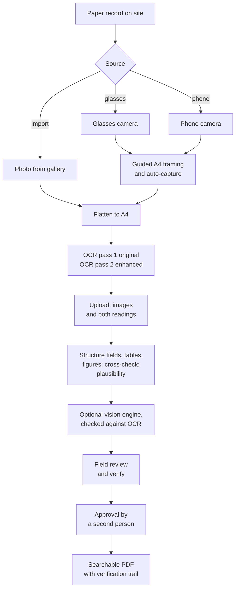

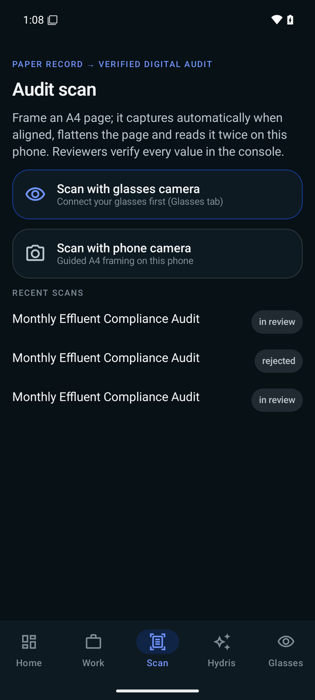

#### Who does what

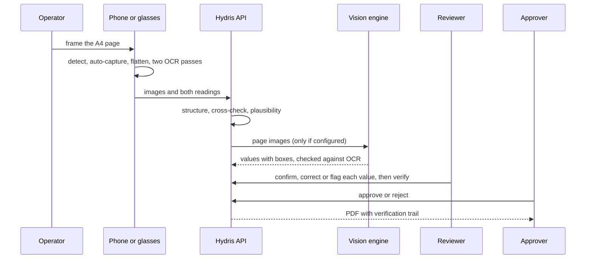

The operator sees "Sent · awaiting dual verification" with the detected title, value and table counts, and the engine agreement. Review and approval happen in the console.

### Guided capture

Framing a sheet on glasses, with no display, is the hard part. The device checks each preview frame (at most every 90 ms) and speaks or shows one instruction at a time, in a fixed order: there is no point asking the wearer to straighten a page that is half out of frame. The phone, the glasses web viewport and the console use the same detection code and thresholds.

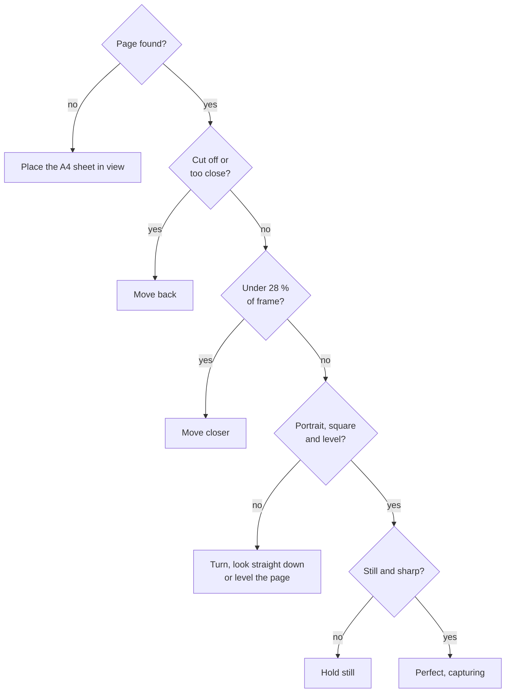

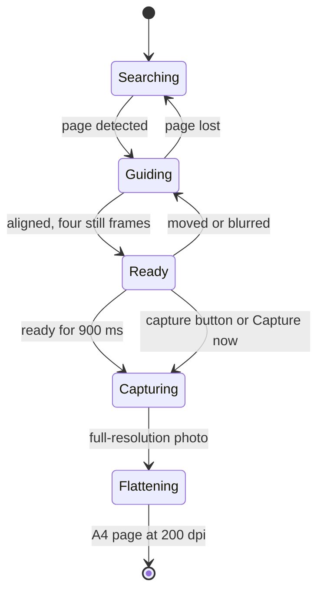

On capture the device takes a full-resolution photo, finds the page again, and warps it to a flat A4 image (1654 x 2339 pixels, 200 dpi). A short press of the glasses capture button takes the photo during framing.

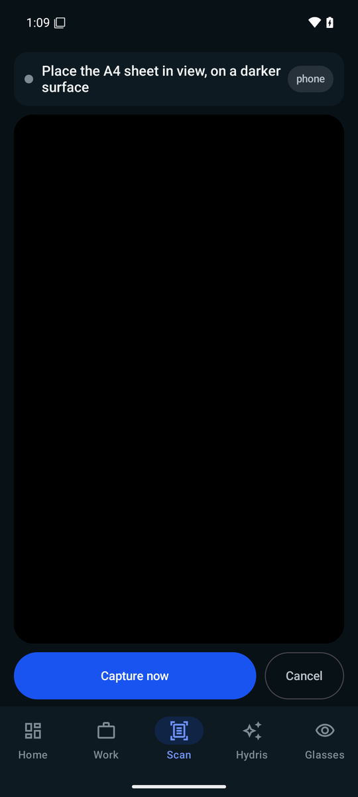

### Reading the page twice

Each page is read twice on the device before anything is sent. Pass 1 reads the page as captured. Pass 2 reads an enhanced copy: contrast stretched, adaptively thresholded, with table rulings removed so borders do not merge cells. Two independent readings let the server tell a confident value from a lucky one. Up to six pages make one document; the review screen shows each page's confidence and the label and value pairs found.

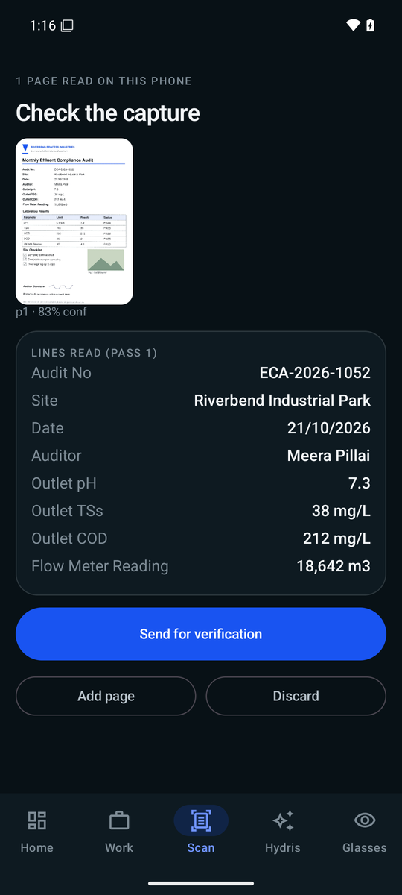

### Structuring and cross-checking

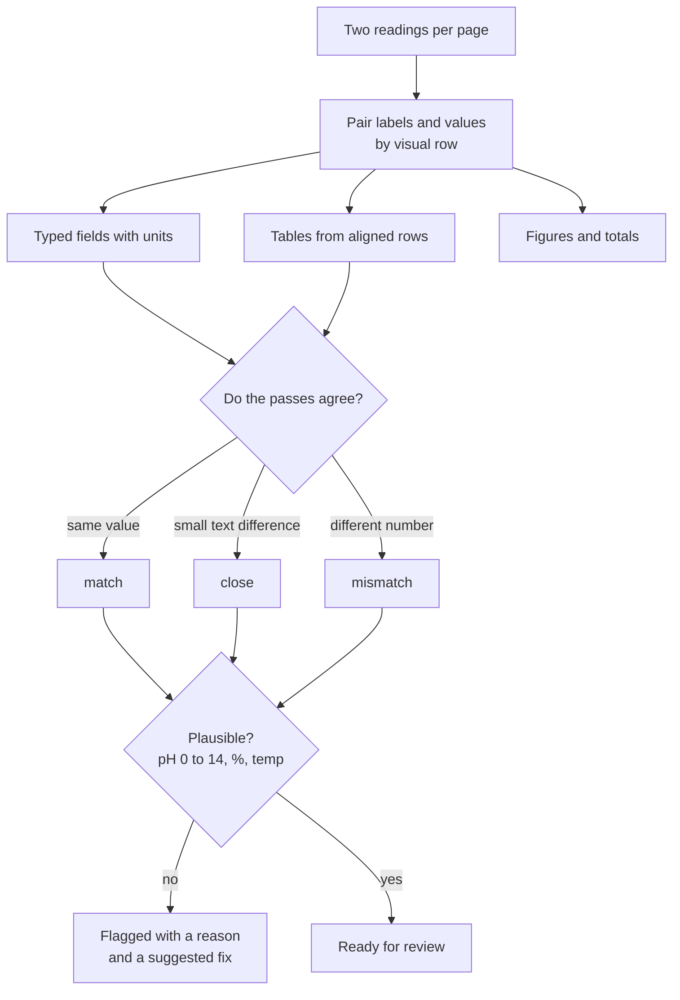

Each value carries an agreement level and keeps its position on the page. Plausibility checks run even when both passes agree, because both can be wrong in the same way.

#### Optional vision enhancement

When an Anthropic credential is configured, the server sends the page images to a vision model that returns fields, tables and figures with boxes. Each vision value is then checked against the OCR text inside its own box; a value the OCR does not support is never marked as agreed. Without a key the OCR result stands and the document says vision is unavailable. The vision model adds reach; it never adds unchecked trust.

### Accuracy design

> [!DECISION]
> The primary quality metric is the silent error rate: a value marked as agreed and not flagged, but wrong. A system that is 85 % accurate and flags what it is unsure of is safer than one that is 95 % accurate and confidently wrong on the rest.

Table: How the design protects the numbers that matter

| Risk | Safeguard |
|---|---|
| Decimal point dropped or moved | "7.4" against "74" is always a mismatch; thousands separators ("18,857" and "18857") are not |
| Both passes misread the same way | Range checks still flag pH 71 as implausible, and offer a matching labelled value as the fix |
| Letters and digits confused | O and 0 are folded inside numbers before comparison |
| Labels and values read as separate columns | Paired again by visual row (common with ML Kit) |
| Vision model invents a value | Checked against OCR text in the value's box |
| Reviewer overwrites the machine value | The first extracted value is always kept beside the correction |

### Review, verify and approve

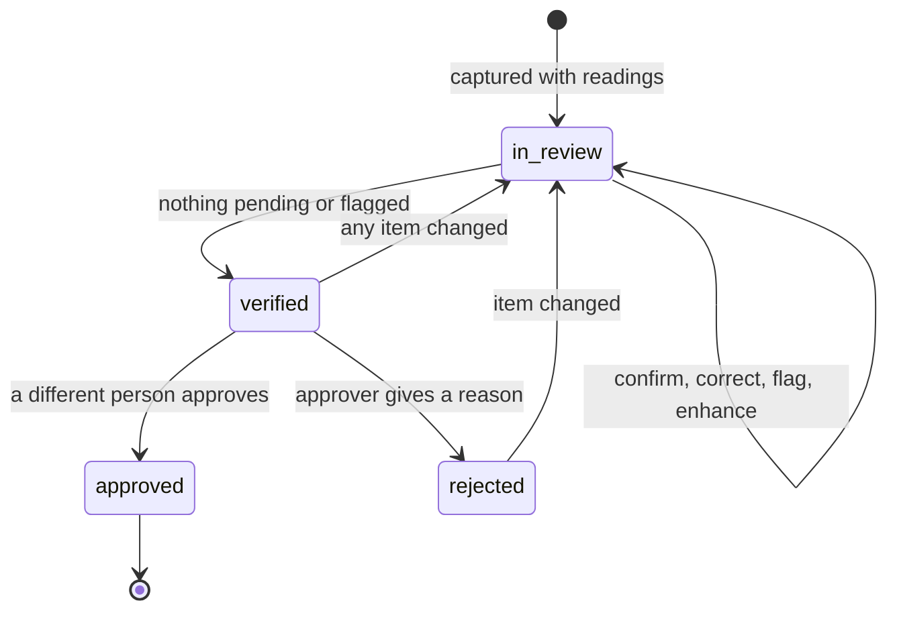

The reviewer works field by field against the paper and can bulk-confirm values where at least two engines match with confidence of 0.8 or more. Verify is blocked while anything is pending or flagged. Approval must come from a different person in a customer organization; demo tenants allow self-approval and record it as such. Only a signed-in person in the console can verify or approve: a device never can.

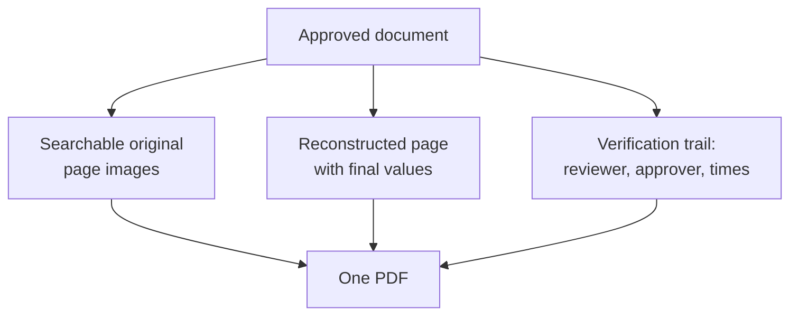

Every review action is appended to the document's event history, and concurrent edits are rejected with a revision check, so two reviewers cannot silently overwrite each other.

### Requirements

Table: Audit scanning requirements

| ID | Requirement | Pri | Status |
|---|---|---|---|
| FR-060 | Guided A4 capture with live detection, auto-capture, perspective correction | M | Built (web and Android, same thresholds) |
| FR-061 | Dual-pass on-device OCR | M | Built |
| FR-062 | Fields, tables, figures with plausibility checks | M | Built |
| FR-063 | Optional vision engine cross-checked against OCR in each box | S | Built (needs a key) |
| FR-064 | Field review; original kept; verify needs zero pending and flagged | M | Built |
| FR-065 | Independent approval (four eyes) | M | Built |
| FR-066 | PDF with trail, searchable original, reconstructed page | M | Built |
| FR-067 | Up to 6 pages, each at most 900 KB, JPEG or PNG | M | Built |
| FR-068 | Electronic signature with re-authentication | S | Planned (Advanced) |
| FR-069 | Bulk-confirm values where two engines agree confidently | S | Built |
| FR-096 | Scan from glasses, phone or import in the Android app | M | Built (phone); glasses Partial |
| FR-055 | Glasses camera capture through DAT | M | Partial (not run on hardware) |

### Success metrics

Table: Scanning quality targets (targets, not measured results)

| Metric | Pilot target |
|---|---|
| Fields where the engines agree, typed forms | 90 % or more |
| Fields a reviewer corrects | Under 5 % |
| Silent error rate | Under 0.5 % |
| Decimal correctness | 99 % |
| Planted implausible values flagged | 100 % |
| Capture to review-ready per page | 15 s or less |
| Capture to approval, median | Under 24 hours |

> [!EXAMPLE]
> Demo result (manual verification, emulated Pixel 7 with API 35): a printed lab sheet imported into the Android app was read correctly, including pH 7.3, and 10 values were extracted and uploaded for review. This is one sheet, not a benchmark.

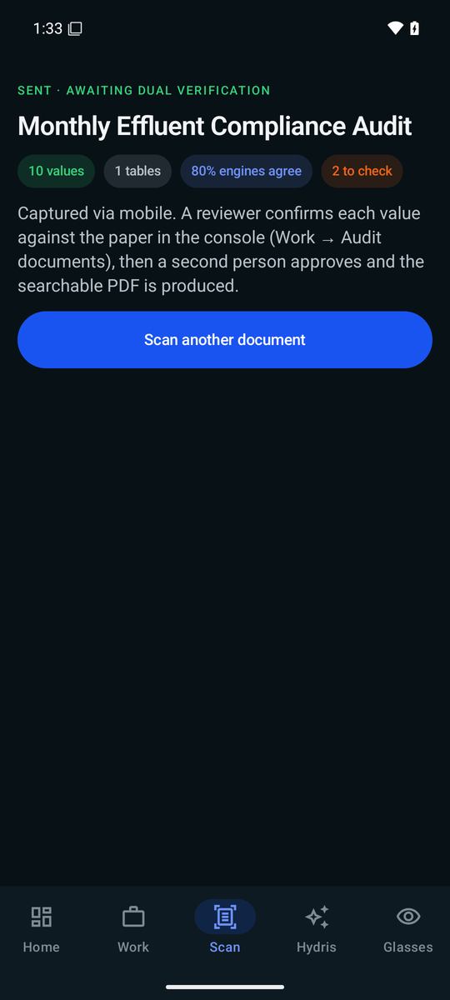

### Status, gaps and next steps

- **Benchmark not yet run.** A 120-page ground-truth set (printed lab reports, filled templates, handwritten registers, complex tables, degraded captures) is designed; until it runs, every accuracy number above is a target.
- **Glasses capture unproven on hardware.** The DAT path works on Meta's mock device; the first run on Ray-Ban Meta is scheduled for Q4 2026.
- **Electronic signature** with re-authentication and signature meaning (FR-068) is Planned for the Advanced phase.
- **Vision processing consent.** Before a customer pilot the tenant must agree to vision processing and the deployment must record where inference runs; until then pilots run on OCR alone.
- **Page images** move to object storage during Hardening.
