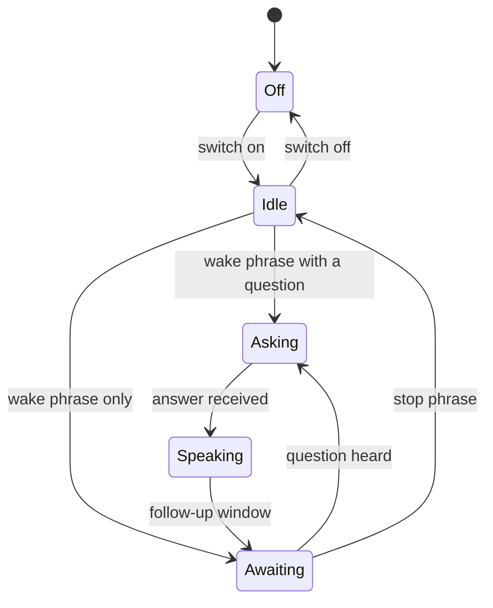
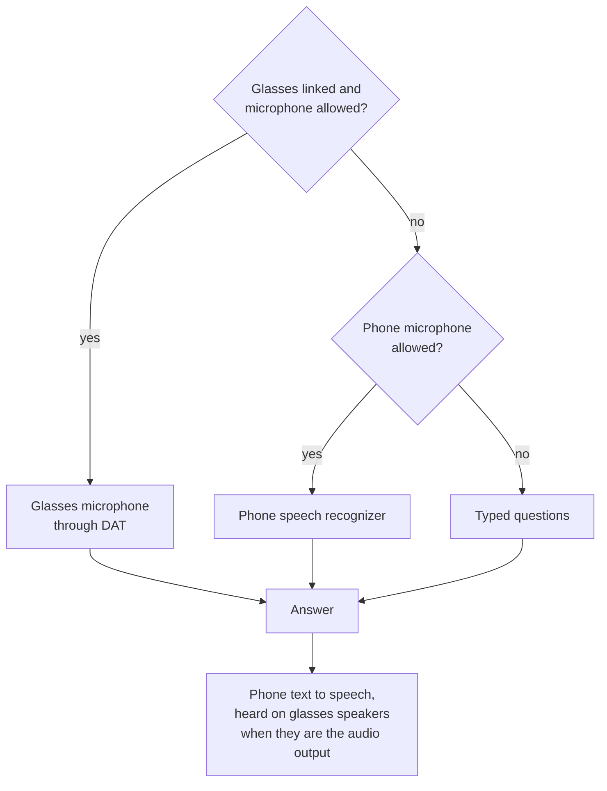
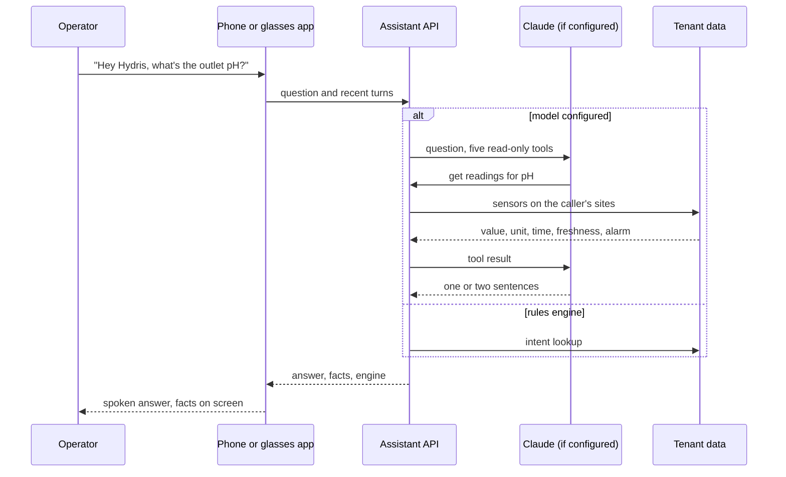
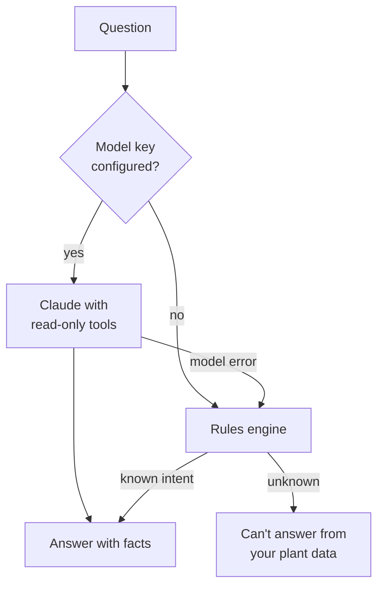

# Hydris Product Book

## Hey Hydris voice assistant

### Purpose and problem

An operator at a clarifier with gloves on cannot scroll a dashboard. "Hey Hydris" lets them ask out loud ("what's the outlet pH?", "any open alarms?", "what are my tasks?") and hear a short answer on the glasses speakers or the phone, with the facts behind it on screen. Every answer comes from the caller's own plant data, never from general knowledge, and the assistant cannot change anything.

> [!STATS]
> - 5 | Read-only tools | readings, alarms, my work, assets, SOPs
> - 2 | Answer engines | Claude, or the rules engine
> - 0 | Write tools | advisory only
> - 0 | Invented numbers allowed | target and design rule

### Users and jobs

Table: Users and jobs

| User | Job |
|---|---|
| Field operator | Get a reading, its age and alarm state without touching the phone |
| Maintenance engineer | Hear my open work and the procedure for an asset |
| Supervisor | Check open alarms on my sites while walking the plant |

### Scope

Table: In scope and out of scope

| In scope | Out of scope |
|---|---|
| Wake phrase, spoken question, spoken answer | Operating equipment or changing records |
| Readings, alarms, my work, asset status, approved SOPs | Answers from outside the tenant's data |
| Follow-up questions with history | Indian languages (Planned, FR-073) |
| Glasses, phone and browser speech | "Hey Meta, start Hydris" as a supported path (experimental) |

### Wake word flow

The wake phrase is detected on the device with a pattern tolerant of how recognizers hear "Hydris" ("hydras", "hi dris", "idris"). After an answer the assistant keeps listening for a follow-up; "stop", "cancel" or "thanks" ends it.

> [!NOTE]
> The glasses web viewport closes the follow-up window after 8 s of silence; the Android app keeps it open until a stop phrase. Aligning them on 8 s is Planned.

### Speech engines

Table: Speech engines by surface

| Surface | Listens with | Speaks with | Status |
|---|---|---|---|
| Android app, glasses | DAT Speech on the glasses microphone | Phone text to speech over Bluetooth | Partial: not yet run on hardware |
| Android app, phone | Android speech recognizer, restarted after each result | Phone text to speech | Built |
| Glasses web viewport and simulator | Bridge first, then the browser Web Speech API | Browser speech synthesis | Built |

Transcripts are dropped while the assistant is speaking, so it does not answer itself.

### Grounded answering

When an Anthropic credential is configured, Claude answers with up to five rounds of read-only tool calls. Otherwise, and whenever the model fails, a deterministic rules engine answers readings, alarms, my work, asset status, procedures and help, and says "I can't answer that from your plant data" for anything else. Every tool runs with the caller's row-level and site scope, so the assistant can only say what the caller could see in the console.

### Guardrails

- **Advisory only.** The tool list holds only read tools and the system prompt forbids operating equipment (FR-078).
- **Never invents numbers.** Answers return facts (label, value, unit, time, source); the screen shows up to four under the answer. Rules answers contain only numbers that appear in facts.
- **States the data age.** Answers say "measured N minutes ago"; stale readings add "not current, check the sensor"; missing data is "no data", never zero (NFR-036).
- **Labels synthetic data.** Demo answers mark their facts as synthetic demo data (FR-075).
- **Approved documents only.** Draft SOPs never reach an answer (FR-111).

Table: Example dialogue (illustrative of the rules described above, not a recorded transcript)

| Operator says | Hydris answers | Facts shown |
|---|---|---|
| "Hey Hydris, what's the outlet pH?" | Outlet pH is 7.3, measured a few minutes ago, within range | 7.3 · Outlet pH |
| "And the inlet?" | Answers for the inlet, using the conversation history | Inlet pH value and time |
| "Any open alarms?" | Counts open alarms on my sites and names the most severe | Alarm titles and states |
| "What are my tasks?" | Lists my open maintenance tasks and due inspections | Task titles |
| "What's the weather tomorrow?" | I can't answer that from your plant data | None |
| "Thanks" | Ends the follow-up window | None |

### Requirements

Table: Voice assistant requirements

| ID | Requirement | Pri | Status |
|---|---|---|---|
| FR-070 | Grounded SOP retrieval from approved documents with a safety notice | M | Built |
| FR-071 | Wake phrase and short spoken answers | M | Built |
| FR-072 | Answers only from tenant data through scoped tools; rules fallback never guesses | M | Built |
| FR-073 | Hindi, Tamil, Marathi, Gujarati | S | Planned (Advanced) |
| FR-074 | Glasses microphone with phone fallback; answers on glasses speakers | M | Partial: glasses not run on hardware |
| FR-075 | Facts with source; synthetic data labelled | M | Built |
| FR-076 | Follow-ups with history (up to 8 turns) | S | Built |
| FR-077 | "Hey Meta, start Hydris" opens the assistant | C | Partial (experimental) |
| FR-078 | No write tools | M | Built |

### Success metrics

Table: Voice targets (targets, not measured results)

| Metric | Pilot target |
|---|---|
| Questions answered with facts, not "can't answer" | 85 % or more |
| Numbers in answers missing from facts | 0 |
| Spoken answer after the question ends | Under 3 s on 4G |

### Status, gaps and next steps

- **Logging for metrics.** Engine and intent logging on the assistant is Planned for the pilot; until then the targets cannot be measured.
- **Glasses microphone on hardware** is the first hardware run item for Q4 2026.
- **Wake phrase false accepts** are tested against eight hours of plant conversation before tightening the pattern.
- **Model processing consent.** A tenant must agree to Claude processing before a pilot uses it; otherwise the rules engine runs alone.
- **Languages.** Indian-language questions and answers depend on server support and are Planned.
