# Hydris Product Book

## Platform: API, data and integrations

Every Hydris surface (website, operator console, glasses HUD, the Hydris Field Android app) talks to one platform: a modular API over one Postgres schema with row-level security. This part explains how that platform is shaped, how a request travels through it, how data is organised and isolated per customer, and how telemetry, AI and background work flow in. It closes with the decisions behind the design, the requirements it meets, and the debt that matters before scale.

> [!STATS]
> - 15 | API route modules | one Fastify instance, `apps/api/src/app.ts`
> - 42 | database tables | ten domains, `apps/api/src/db/schema.ts`
> - 3 | access control layers | RBAC, site scope, Postgres RLS
> - 0 | write paths to plant control | Hydris is read-only to PLC, SCADA and DCS

### Architecture in one picture

Hydris is an npm workspaces monorepo. The API (`apps/api`, Fastify 5) is a modular monolith. It runs either inside the Next.js web deployment through a catch-all route that calls `app.inject` (no network hop), or as its own container. A pure TypeScript domain package (`packages/domain`) holds the state machines, permissions, freshness and voice parsing rules that both server and web use; the Android app mirrors them by hand.

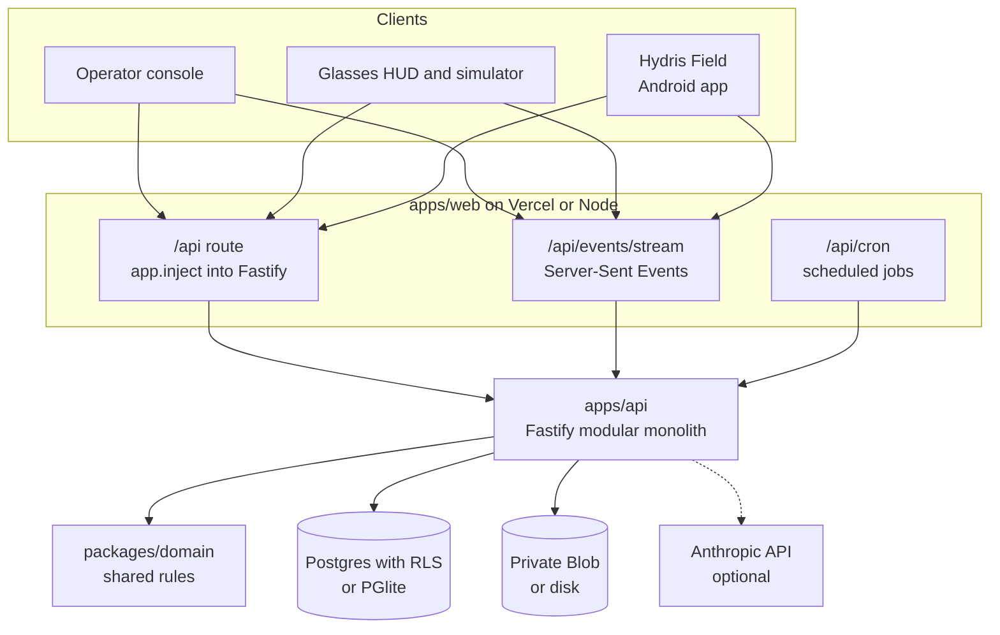

Configuration is one validated environment (`apps/api/src/config.ts`): `DATABASE_URL` selects Postgres or in-process PGlite, `REALTIME_MODE` selects the event bus, a Blob token selects cloud storage over disk, and `API_URL` in the web app switches to an external API. The same code therefore runs on Vercel, in Docker Compose at a plant, in a hybrid set-up and as the self-contained public demo.

### The modular API

`buildApp()` registers shared plugins (helmet, cookies, a global rate limit, JWT, multipart), installs the error handler and the glasses UI profile hook, then mounts fifteen route modules. Modules share a context object and core services; they do not reach into each other's tables except through exported functions.

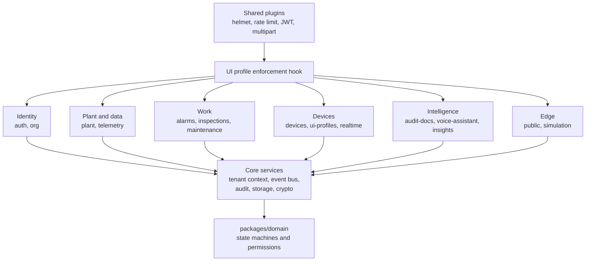

Table: API modules and what each owns (route counts from `apps/api/src/modules/*.ts`)

| Module | Routes | Owns | Rule worth knowing |
|---|---|---|---|
| auth | 17 | Sign-in, MFA, refresh, invitations, resets, sessions, org switch | Lockout after 5 failures for 15 min |
| org | 13 | Organization, members, notifications, audit log, platform orgs | No role escalation |
| plant | 28 | Sites, facilities, areas, assets, sensors, gateways, documents, attachments | Attachments only through the authorised route |
| telemetry | 6 | Ingestion, manual and lab entry, history, CSV, corrections | One `ingest()` path, idempotent per sensor and time |
| alarms | 9 | Rules, events, transitions, stale-data evaluation | Deadband, on-delay, note required to resolve |
| inspections | 15 | Templates, routes, inspections, responses, review | Offline replay by client operation id |
| maintenance | 7 | Work orders, checklists, activity | Transitions from the domain package |
| devices | 16 | Pairing, device tokens, device context, fleet admin | Session version and refresh family revocation |
| ui-profiles | 13 | Glasses UI profiles, versions, assignments | Enforced on device requests |
| realtime | 1 | Event stream (SSE) | Per-connection, per-event authorisation |
| audit-docs | 12 | Scanned records: capture, enhance, review, verify, approve, PDF | Four-eyes approval, optimistic concurrency |
| voice-assistant | 1 | Grounded spoken answers | Read-only tools, 60 per min |
| insights | 4 | Overview KPIs, document assist, search, reports | Read-only |
| public | 1 | Website contact and demo requests | 5 per 10 min |
| simulation | 3 | Demo scenarios | Synthetic data refused for customer tenants |

### The request lifecycle

Every authenticated call follows the same path, and the order is deliberate. The principal is resolved from the database on every request, so a revoked session or device stops working at once, not when its token expires. Device principals then pass the UI profile check. Only then does the handler run, inside a tenant transaction where Postgres itself filters rows.

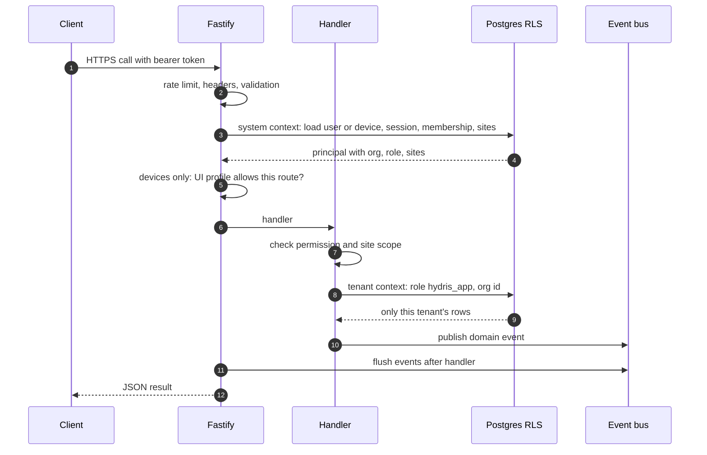

Three outcomes are worth naming. Out-of-scope records return 404, not 403, so a user cannot probe for another site's assets. Every error uses one JSON shape with a stable code (`validation_failed`, `note_required`, `stale`), which the clients turn into plain messages. Unexpected errors return a masked 500 and the stack stays in logs.

### Identity, sessions and device tokens

People sign in with email and password (argon2id hashing, optional TOTP MFA). They receive a 15-minute access token and a 7-day refresh token in an httpOnly cookie. Every refresh rotates the token within a family; a rotated token presented again after a 30-second multi-tab grace is treated as theft and the whole family is revoked. Because each access token carries its family id and the API checks the family on every request, logout and theft detection take effect immediately.

Devices never see a password. Glasses and phones pair through a flow shaped like the OAuth device authorisation grant (RFC 8628): the device shows a short code, a signed-in person approves it with a site and an operator, and the device receives its own tokens. A device then acts on behalf of its assigned operator, capped by a fixed ceiling of 13 device permissions.

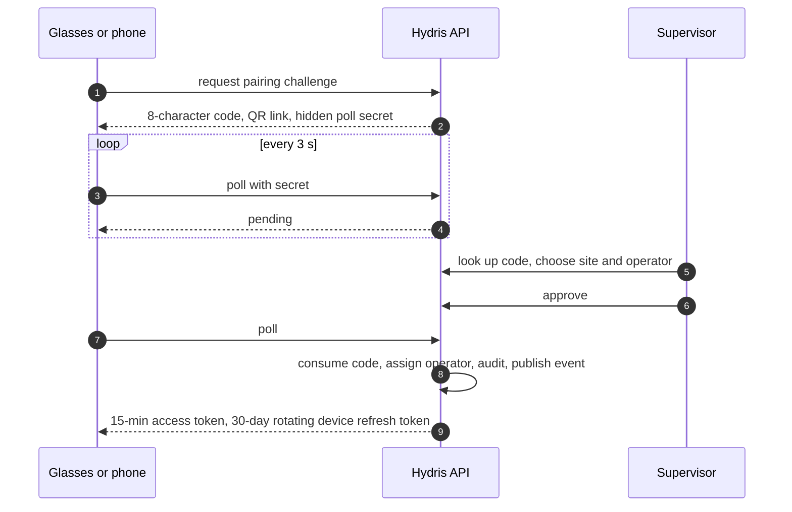

Table: Credentials at a glance

| Credential | Lifetime | Revoked by |
|---|---|---|
| User access token | 15 min (12 h in demo mode only) | Family revocation, checked per request |
| User refresh token | 7 days, rotating | Logout, password change, reuse detection, session list |
| Device access token | 15 min | Session version bump on suspend, revoke, reassign |
| Device refresh token (`hgd_`) | 30 days, rotating | Revoke, logout, reuse detection |
| Gateway key (`hgw_`) | Until revoked | Admin revoke; stored only as a hash |

### Realtime events

Alarms, telemetry, work updates and device changes reach clients over Server-Sent Events. The stream is opened with `fetch`, so the bearer token travels in a header and never in a URL. Events carry identifiers and small payloads; clients refetch through the normal API, so authorisation is never bypassed. Every event is checked per connection (organization, target user or device, site, permission) before it is sent.

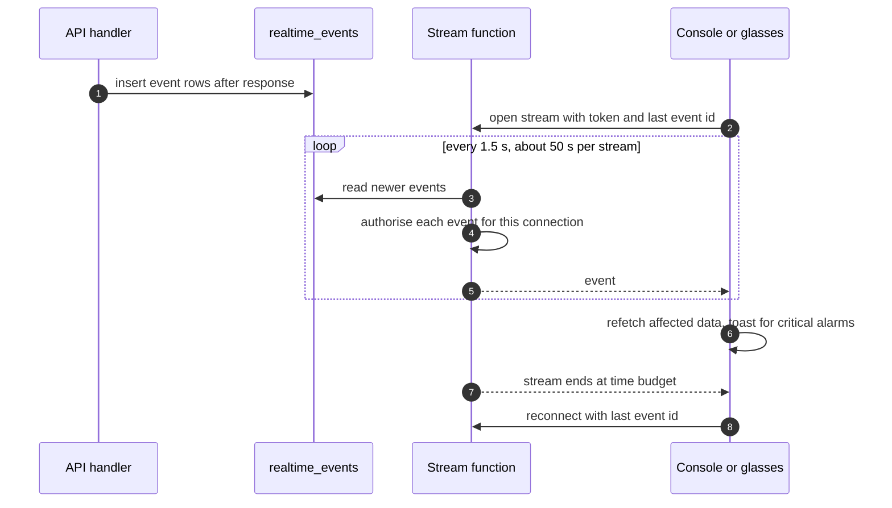

Table: Realtime modes (`REALTIME_MODE` in `apps/api/src/core/events.ts`)

| Aspect | memory | db |
|---|---|---|
| Fan-out across instances | No, single instance | Yes, all instances read one table |
| Replay on reconnect | Last 1,000 events | Any event still stored (pruned after 1 day) |
| Latency | Immediate | Up to 1.5 s poll |
| Used by | Docker Compose, long-running server | Vercel, demo, multi-instance |

The console batches cache invalidations every 1.5 s but raises a toast at once for critical and high alarms; the Android app raises a system notification.

### The data model by domain

The schema has 42 tables in ten domains, each owned by one module. Plant objects are archived, not deleted; telemetry and the realtime log use big integer keys; everything else uses UUIDs. Four views carry the essentials.

> [!STATS]
> - 8 | identity and tenancy tables | users are global, membership is per org
> - 8 | plant and telemetry tables | site to sensor hierarchy, immutable readings
> - 11 | alarm and work tables | rules, events, inspections, maintenance
> - 10 | device, UI and audit document tables | pairing, profiles, scanned records

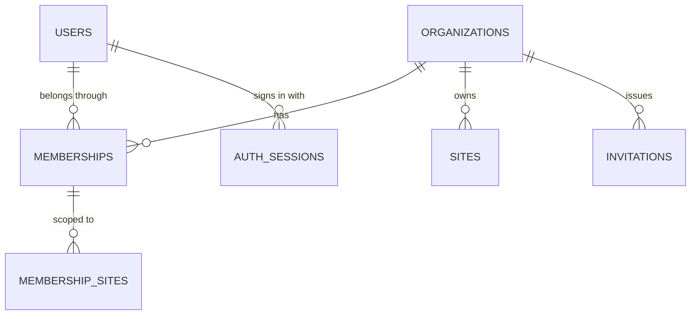

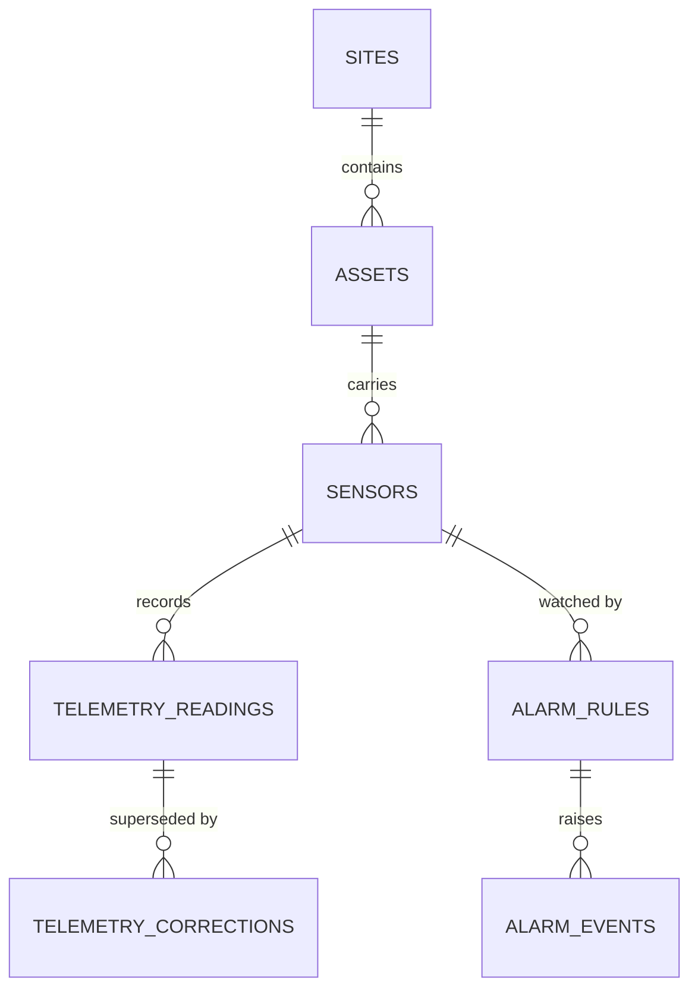

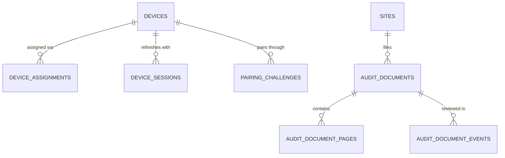

Work (inspection templates, routes, inspections, responses, maintenance tasks and activity) hangs off sites and assets in the same way, and inspection records carry a revision counter for safe offline replay. Records are evidence: manual and lab readings keep provenance, corrections never overwrite the original reading, and synthetic data is marked and refused for customer tenants by a database check.

### Tenancy and data isolation

Isolation is enforced by Postgres, not only by application code. Every tenant table has row-level security enabled and forced, with one policy that compares the row's organization with a per-transaction setting. Requests run as a non-privileged role, `hydris_app`, that cannot bypass the policy.

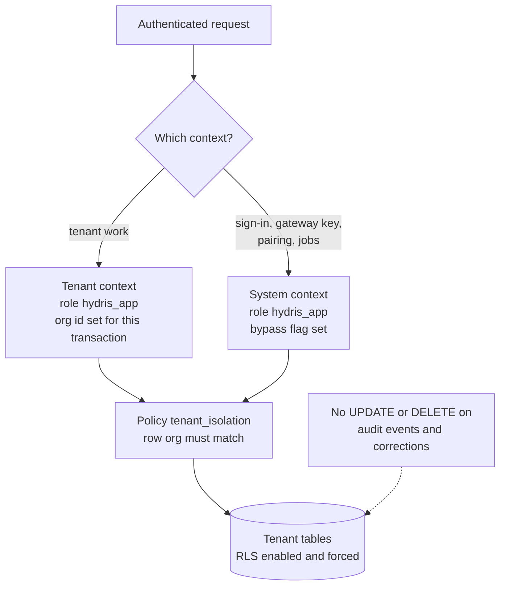

Settings use `SET LOCAL`, so nothing leaks to the next request on a pooled connection. Append-only grants hold even in system context. The application adds RBAC (six roles, 38 permissions in `packages/domain/src/roles.ts`) and site scope on top, so a forgotten filter in a handler is a non-event rather than a breach.

> [!WARNING]
> Owner and superuser connections bypass RLS. Production must connect as a runtime user that is a member of `hydris_app` and not the table owner. Today the same owner user runs migrations and the application.

### Telemetry ingestion and integrations

Hydris never connects into a plant. A gateway on the customer side pushes readings outward over HTTPS with a hashed `hgw_` key, up to 500 readings per call. Ingestion is idempotent per sensor and timestamp, so a gateway can retry safely after an outage, and it returns per-reading rejections so the gateway can retry or drop single readings. Manual and lab entries and the demo simulator use the same `ingest()` path.

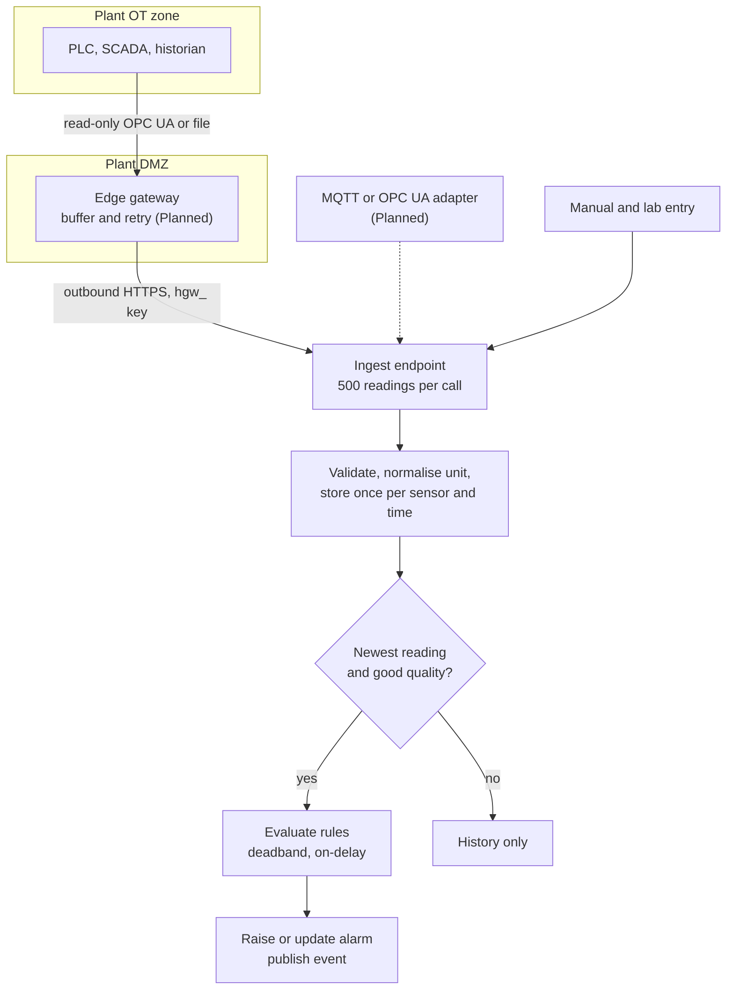

Design details keep alarms honest: late data is stored for history but does not overwrite a newer value or re-trigger rules; once in alarm, a value inside the deadband reports "holding" so a noisy signal does not flap; a breach must persist for the on-delay before an alarm is raised; and there is one open event per rule. Stale-data rules cannot run on ingestion, because the problem is the absence of readings, so they run as a background job.

Table: Integration status

| ID | Integration | Status |
|---|---|---|
| FR-022 | HTTPS gateway ingestion, 500 readings per call, idempotent | Built |
| FR-023 | Manual and lab entry with provenance | Built |
| FR-024 | Append-only corrections | Built |
| FR-027 | MQTT and OPC UA ingestion adapters | Planned (Advanced) |
| FR-028 | Read-only SCADA and historian connectors | Planned (Advanced) |
| FR-029 | Synthetic data labelled and refused for customer tenants | Built |
| n/a | Edge gateway software (store and forward) | Planned; API contract Built |

### AI services and the human in the loop

Two features use a model (Claude, through `@anthropic-ai/sdk`), and both are optional. Without a credential, audit scans keep their on-device OCR results and the assistant uses a deterministic rules engine. The model never sees the database: the assistant can only call five read-only tools (`get_readings`, `get_open_alarms`, `get_my_work`, `get_asset`, `search_procedures`), and they run inside the caller's tenant transaction, so RLS and site scope apply to every lookup.

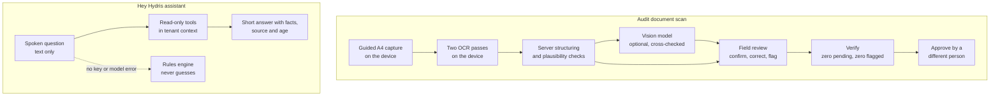

Table: AI requirements

| ID | Requirement | Status |
|---|---|---|
| FR-063 | Optional vision engine cross-checked against OCR text | Built (needs API key) |
| FR-064 | Field review; verify requires zero pending and zero flagged items | Built |
| FR-065 | Independent four-eyes approval | Built |
| FR-072 | Assistant answers only from tenant data; rules fallback never guesses | Built |
| FR-078 | Assistant has no write tools | Built |
| NFR-035 | Only values returned by tools in the same conversation | Built (prompt and tool design) |
| NFR-037 | Graceful degradation without the model | Built |
| NFR-039 | Human in the loop for every AI-extracted value | Built |
| NFR-040 | Model provider and region documented per tenant | Planned (GA) |

Vision cannot replace an extraction once review has started, and every review write carries a revision so a lost race returns a conflict instead of overwriting a colleague's work.

### Background jobs

Four jobs keep the platform current. On a long-running server they run on timers; on Vercel they run from a cron route protected by a secret; in demo mode a lazy ticker advances them on API activity.

Table: Background jobs by topology

| Job | Long-running server | Vercel today | Demo |
|---|---|---|---|
| Stale-data alarm rules | Every 30 s | Daily (`0 3 * * *`) | Not ticked |
| Pairing challenge expiry | Every 60 s | Daily | Expiry checked on use |
| Realtime event pruning (older than 1 day) | Hourly | Daily | Per instance |
| Simulation steps | Every 5 s per run | Daily | On activity, at most every 5 s |

> [!WARNING]
> In the all-Vercel topology stale-data alarms are raised at most daily (FR-035 Partial, TD-02). A production plant needs a per-minute scheduler or the API in a container.

### Key architecture decisions

Table: Architecture decision records (all Accepted, `ARCHITECTURE.md`)

| ADR | Decision | Why | Trade-off |
|---|---|---|---|
| 002 | Fastify modular monolith | One deployable, in-process calls | Modules must stay disciplined |
| 003 | API inside the Next.js route with `app.inject` | One Vercel project, no network hop | Cold start builds the app and migrates |
| 004 | Postgres RLS plus RBAC and site scope | Strong isolation in one schema | Every request is a transaction |
| 005 | PGlite for development, tests and demo | Real Postgres semantics, no service | Per-instance memory in demo |
| 007 | SSE over `fetch` for realtime | Works on serverless and proxies; token out of URLs | Polling in db mode |
| 008 | Two event bus modes, memory and db | No extra infrastructure | 1.5 s latency in db mode |
| 009 | On-device dual OCR, vision optional | Works offline and without AI | Vision only improves layout |
| 011 | RFC 8628-style pairing | No credential on screen or in a QR | Code TTL, no attestation yet |
| 012 | Push-only HTTPS ingestion from an edge gateway | Hydris stays outside control networks | Customer or partner runs the gateway |
| 013 | Short JWTs plus rotating refresh tokens checked per request | Immediate revocation | One lookup per request |
| 015 | LLM grounded through tenant-scoped tools with fallbacks | Answers cite real readings | Narrower coverage without the model |
| 016 | Pure domain package shared by server and web | One definition of rules | Android mirrors by hand |

### Platform requirements and NFRs

Table: Platform requirements (IDs from `PRD.md`)

| ID | Requirement | Status |
|---|---|---|
| FR-003 | Refresh rotation with family revocation on reuse | Built |
| FR-007 | Site-scoped permissions for every role except org admin | Built |
| FR-008 | Database-enforced tenant isolation | Built |
| FR-033 | Realtime push of alarm events to all clients | Built |
| FR-050 | Pairing with short code, QR, 5-min TTL, 3 s polling | Built |
| FR-051 | Device tokens with rotating refresh and reuse detection | Built |
| NFR-001 | API read latency p95 under 300 ms in-region | Partial (target, not measured) |
| NFR-002 | Realtime alarm delivery 2 s or less | Built (design, target not measured) |
| NFR-007 | Horizontal scale of realtime | Built (db mode) |
| NFR-008 | Scheduled jobs at a cadence suitable for real data | Partial (daily on Vercel) |
| NFR-009 | Backups and tested restore | Planned |
| NFR-011 | Tenant isolation enforced in the database | Built |
| NFR-012 | Short-lived credentials | Built |
| NFR-013 | Rate limiting | Built (per instance) |
| NFR-030 | Provenance on every reading | Built |
| NFR-031 | Optimistic concurrency on review records | Built |
| NFR-032 | Shared domain logic between server and clients | Built |

### The technical debt that matters

The register in `ARCHITECTURE.md` lists 18 items. These are the ones that decide whether a pilot runs well and whether the platform scales.

Table: Technical debt that matters

| ID | Debt | Impact | Fix |
|---|---|---|---|
| TD-01 | Root `.gitignore` hides the Android `data` package | A fresh clone of the Android app does not compile | Anchor the rule, commit the package |
| TD-02 | Vercel cron runs daily | Stale-data alarms up to a day late | Per-minute scheduler or hybrid topology |
| TD-03 | In-memory rate-limit store | Limits are per instance | Shared store or edge firewall |
| TD-04 | Audit page images in Postgres as base64 | Database and backup growth | Object storage behind the storage adapter |
| TD-05 | Empty contracts package; Android models by hand | Contract drift | Generate schemas and Kotlin models |
| TD-06 | No CI pipeline | Regressions found late | GitHub Actions workflow |
| TD-07 | db realtime polls every 1.5 s per stream | Database load grows with connections | `LISTEN/NOTIFY` or managed pub/sub |
| TD-10 | No telemetry partitioning or retention | Index cost at volume | Monthly partitions, retention per contract |
| TD-11 | Ingestion evaluates rules reading by reading | Throughput ceiling | Batch inserts and rule loading |
| TD-12 | No content security policy | Weaker defence against injected scripts | Nonce-based CSP |

> [!NOTE]
> Planning estimates, not measurements: at 200 sensors per site reporting every minute, one site produces about 288,000 readings a day. The bottlenecks arrive in the order TD-11, TD-07, TD-10, TD-04, which is the order the scaling plan addresses them.
