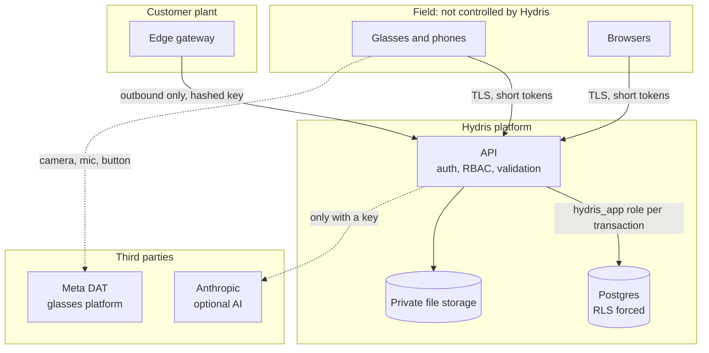
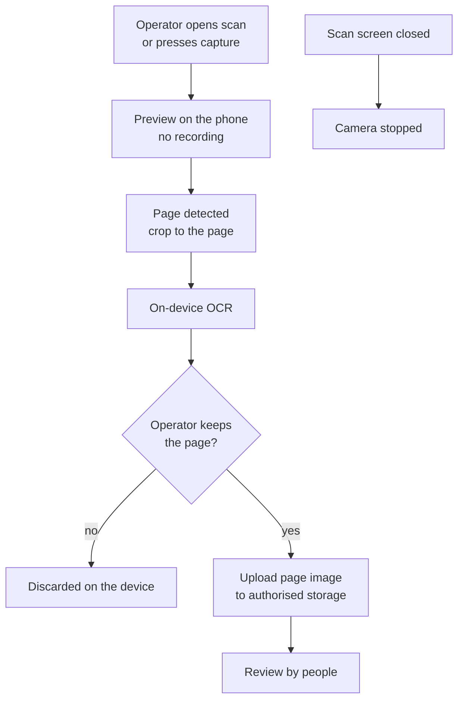
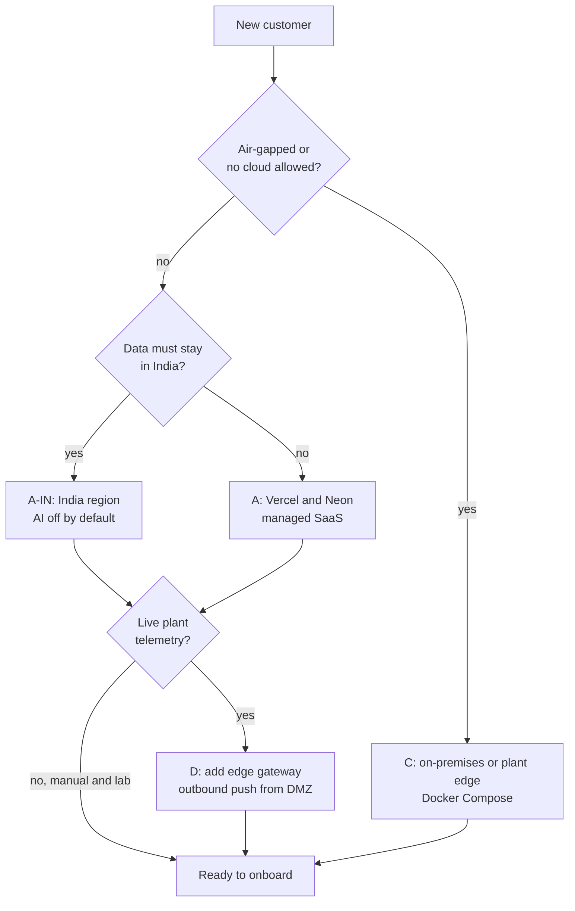
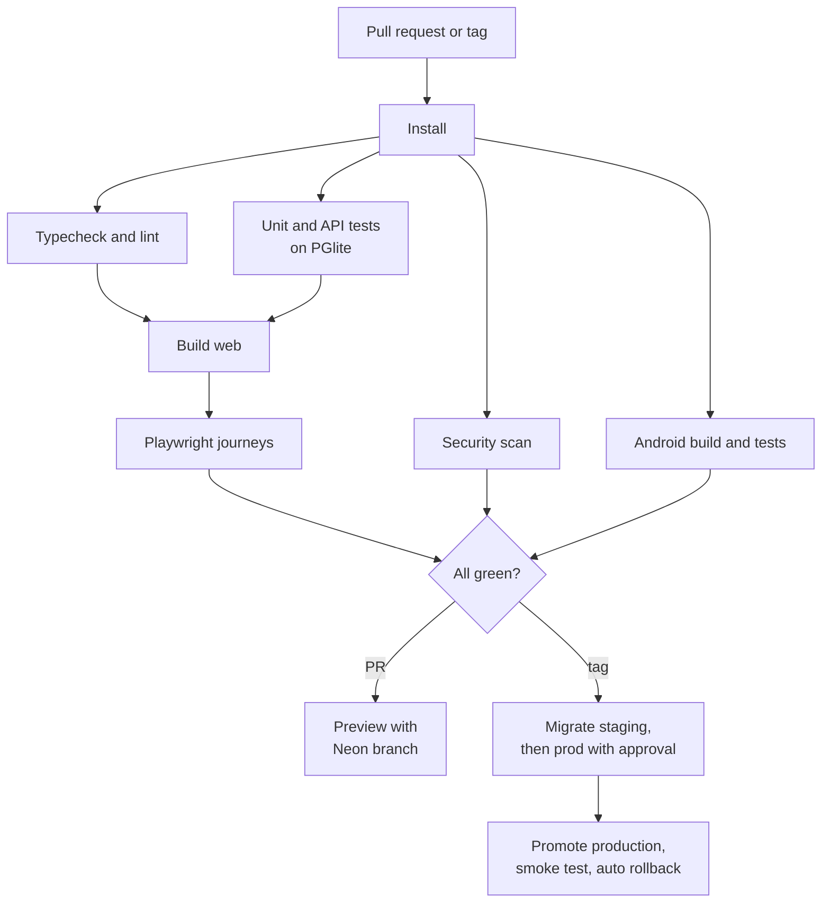
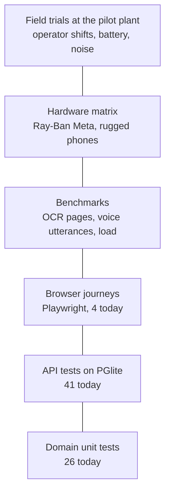
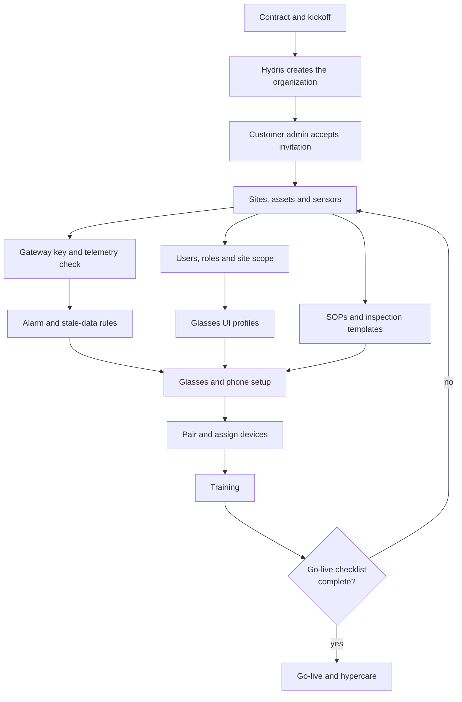
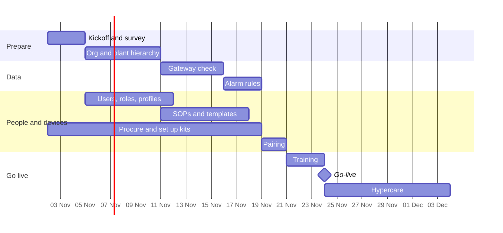
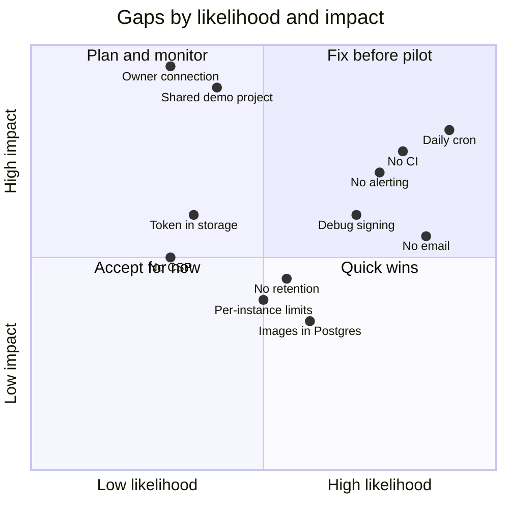

# Hydris Product Book

## Security, delivery and operations

Hydris puts cameras on workers' faces and turns plant readings into regulated records. Trust is therefore part of the product, not a layer on top. This part covers how Hydris protects customers and workers, how it maps to the frameworks buyers ask about, where it runs, how quality is proven, and how a customer is onboarded and supported. Every target is labelled as a target; nothing here is a certification.

> [!STATS]
> - 3 | layers of access control | RBAC, site scope, Postgres RLS
> - 15 min | access token lifetime | rotating refresh with reuse detection
> - 0 | write paths to plant control | read-only to PLC, SCADA and DCS
> - 2 | people per approved record | verifier and a different approver

### Security model

Eight principles shape every design choice: read-only to the plant; defence in depth for tenancy; records are evidence (append-only trails); least privilege for devices; secrets never stored in the clear; AI assists, people decide; capture on intent only; privacy by default.

#### Trust boundaries

A trust boundary is anywhere data crosses between a party or runtime Hydris controls and one it does not. Five boundaries matter.

Table: Top threats and controls (STRIDE extract from `SECURITY_PRIVACY.md`)

| Threat | Scenario | Control in the product | Open gap |
|---|---|---|---|
| Spoofing | Password guessing, credential stuffing | argon2id, lockout after 5 failures, 10 sign-ins per min, optional TOTP | No SSO, MFA not enforceable per org |
| Spoofing | Rogue device pairs into an org | Signed-in approver with `device.pair`, 300 s single-use code, hashed poll secret | No device attestation |
| Tampering | Silent edit of readings or records | Append-only corrections and audit events at the grant level | No signed export or hash chain |
| Information disclosure | Cross-tenant read | RLS forced, 404 for out-of-scope records | Owner connection would bypass RLS |
| Information disclosure | Stolen phone | Keystore AES-256-GCM on Android, device revoke | Web glasses keep the token in `localStorage` |
| Denial of service | Login or ingest floods | Rate limits, 500 readings per call, body limits | Limits are per instance |
| Elevation | Device calls admin endpoints | Fixed device permission ceiling; verify and approve need a person | None known |
| AI | Prompt injection in a scanned page | Strict output schema, OCR cross-check, human review | No injection classifier |

#### Privacy for camera glasses and workers

The camera only runs when a person asks for it, and only the final page leaves the phone.

Table: Camera and worker commitments

| Commitment | Status |
|---|---|
| No background or continuous recording, no video stored | Built |
| Only text after "Hey Hydris" is sent; audio never uploaded to Hydris | Built |
| Meta capture LED cannot be disabled by apps | Vendor control |
| No location tracking, no keystroke or gaze analytics, no individual performance reports | Built (by design) |
| Face and badge redaction before upload | Planned |
| Camera-free zones per site | Planned |

### Compliance mapping

The table maps frameworks to product controls. It is a mapping and a set of targets, never a claim of certification.

Table: Compliance mapping (targets, not certifications)

| Framework | What it asks | Hydris controls | Position |
|---|---|---|---|
| India DPDP Act 2023 and Rules 2025 | Notice, safeguards, breach notice, erasure, retention limits | Encryption, RLS, audit trail, consent version on inquiries | Partial; retention and rights tooling planned |
| CPCB and SPCB consent conditions | Unaltered, retrievable monitoring records | Provenance, append-only corrections, freshness, CSV export | Mapping; Hydris is not the regulatory feed |
| CERT-In Directions 2022 | 6-hour incident reporting, 180-day logs in India | Incident plan; India log drain planned | Target |
| ISO/IEC 27001:2022 | ISMS and Annex A controls | Many technical controls in code | Target: ISMS build 2027 |
| IEC 62443 | Zones and conduits, secure development | Read-only, outbound-only conduit from the DMZ gateway | Mapping; 4-1 practices as target |
| SOC 2 | Security, availability, confidentiality | Same controls | Target: Type I after first commercial year |

Retention today is indefinite for records, with only realtime events pruned after a day. The recommended defaults (for example audit trails at least 7 years, sessions purged 30 days after expiry) are configurable per organization and Planned.

### Deployment topologies

The same code runs in four shapes. A customer chooses by residency, network rules and operations appetite.

Table: Topologies

| Topology | Shape | Status |
|---|---|---|
| A, managed SaaS | Vercel functions, Neon Postgres, private Blob | Built (live as demo); production Planned |
| A-IN, India region | Mumbai functions, Indian database and S3, India log drain, AI off unless an addendum is signed | Planned |
| B, container API | Vercel web, API container next to managed Postgres | Partial (`render.yaml`) |
| C, plant edge | Postgres 17, API and web on one plant server | Built (`docker-compose.yml`) |
| D, hybrid gateway | A or A-IN plus an edge gateway pushing over HTTPS | API Built; gateway Planned |

Table: Environment matrix

| Environment | Purpose | Database | Status |
|---|---|---|---|
| dev | Local development | PGlite on disk | Built |
| preview | One per pull request | Neon branch (target) or demo mode | Partial |
| staging | Release candidate, hardware tests, pilot rehearsal | Neon staging branch | Planned |
| prod | Customer tenants | Neon production, region pinned, point-in-time recovery | Planned |
| demo | Public sales demo | In-memory PGlite per instance, public secrets | Built |

#### Release pipeline

Today there is no CI: a push to `main` deploys through Vercel's Git integration, and tests are run by developers. Migrations run on cold start under an advisory lock. The proposed pipeline gates every pull request and every release tag.

> [!DECISION]
> Demo and production split into two Vercel projects on the same repository: demo tracks `main` with no database, production deploys only on release tags after the staging gate (DEP-11).

### Quality

Hydris tests from fast, deterministic checks at the base up to field trials at a plant.

The 67 domain and API tests pass (22 October 2026). They cover the security-critical paths: tenant isolation at the database, four-eyes approval, refresh reuse, pairing, alarm hysteresis and the db realtime mode. The four Playwright journeys were not re-run for this edition. The Android app has no automated tests yet and was verified by hand on a Pixel 7 emulator.

#### OCR and voice accuracy design

Accuracy is measured with benchmarks, all targets for the first pilot.

Table: Benchmark design (targets)

| Benchmark | Set | Primary metric | Target |
|---|---|---|---|
| OCR | 120 pages: printed lab reports, filled templates, handwritten logbooks, tables, degraded captures; ground truth keyed twice | Silent error rate (wrong but marked as matching) | Under 0.5 % |
| OCR | Same | Field accuracy | 90 % printed, 75 % handwritten |
| Voice | 600 utterances by at least 6 speakers in quiet, 65 and 85 dB(A) | Hallucinated numbers | 0 |
| Voice | Same, including 40 unsafe action requests | Unsafe compliance | 0 |
| Voice | 8 hours of plant conversation | Wake false accepts | Under 1 per hour |

> [!DECISION]
> The silent error rate is the primary OCR metric. A system that is 85 % accurate and flags what it is unsure of is safer than one that is 95 % accurate and confidently wrong on the rest.

#### Release gates and pilot exit

Table: Release gates

| Gate | Criteria |
|---|---|
| 1, pull request | Typecheck and tests green; new behaviour has tests |
| 2, main | Build, Playwright, accessibility and dependency audit clean |
| 3, release candidate | OCR and voice benchmarks in tolerance; load and security scans clean |
| 4, pilot readiness | Hardware rows H1 and H5 passed; zero open S1 and S2 defects; signed review |

Pilot exit criteria, as of today:

- [x] Domain and API suites pass (67 of 67)
- [x] Tenant isolation proven at the database boundary
- [x] Four-eyes approval enforced outside demo tenants
- [ ] CI running gates 1 and 2 on every pull request
- [ ] Email transport wired for invitations and resets
- [ ] Stale-data rules running every minute on Vercel
- [ ] OCR and voice benchmarks run within targets
- [ ] Hardware rows passed on Ray-Ban Meta and a rugged phone
- [ ] External penetration test with no open high findings

### Operations

#### Customer onboarding

#### Support and incidents

Operators go to their supervisor, the supervisor to the customer admin, and the customer admin to Hydris.

Table: Support tiers

| Tier | Handles |
|---|---|
| Customer admin | First line inside the plant: users, pairing, profiles |
| Hydris L1 | Anything a documented runbook procedure resolves |
| Hydris L2 | Configuration, logs and platform-admin actions |
| Hydris L3 | Code, data and infrastructure; postmortem for Sev 1 and 2 |

Table: Incident severity (targets)

| Severity | Definition | Response | Customer update |
|---|---|---|---|
| Sev 1 | Platform down or data at risk, including any suspected breach | L3 within 15 min | Within 1 hour, then hourly |
| Sev 2 | Major function down, no workaround | L3 within 1 hour | Within 2 hours, then every 4 hours |
| Sev 3 | Degraded, workaround exists | Next business day | Daily |
| Sev 4 | Minor or cosmetic | Planned release | On release |

A suspected breach also triggers external notices: customers within 24 hours, CERT-In within 6 hours for reportable incidents, and the DPDP Board and data principals as the Rules require.

#### Operations KPIs

> [!STATS]
> - 5 min | time to pair | target, median
> - 1 day | scan to verified | target, median
> - 5 min | critical alarm acknowledge | target, median
> - 99.5 % | monthly availability | target

Table: Operations KPIs (targets) and where they are measured

| KPI | Target | Source in the product |
|---|---|---|
| Pairing success on first code | Over 90 % | Completed vs expired challenges |
| Verified to approved | Median 2 business days | Audit document timestamps |
| Rescan rate | Under 10 % | Rejected vs total documents |
| Alarms resolved with a note | 100 % (enforced in code) | Resolve transition |
| Sensors live | Over 98 % of sensor-hours | Freshness history |
| Devices connected on shift | Over 95 % | Device report |

### Known gaps register

The gaps below are drawn from the security, deployment and architecture registers. Each has an owner and a plan; the quadrant shows how they compare.

Table: Known gaps that matter before pilot and GA

| ID | Gap | Impact | Priority |
|---|---|---|---|
| DEP-01 | No CI pipeline | Regressions and unsafe migrations can reach production | High |
| DEP-02 | Cron runs daily on Vercel | Stale-data alarms up to 24 h late | High |
| DEP-03 | Android release signed with the debug key | Cannot distribute through Play | High |
| DEP-04 | Email not wired | Invitations and resets need manual delivery | High |
| DEP-05 | No metrics, tracing or alerting | Incidents found by users | High |
| DEP-11 | Demo and production share one project | Customer data could land in a demo | High |
| SEC | Owner connection runs the application | RLS bypass if a query escapes the tenant role | High |
| SEC-03 | Web glasses keep the device token in `localStorage` | Token exposed to scripts on the origin | Medium |
| DEP-10 | Per-instance rate limiting | Weaker limits under many instances | Medium |
| DEP-06 | Audit page images in Postgres | Database and backup growth | Medium |
| DEP-07 | No retention or purge jobs | Unbounded growth; DPDP retention limits | Medium |
| TD-12 | No content security policy | Weaker defence against injected scripts | Medium |

