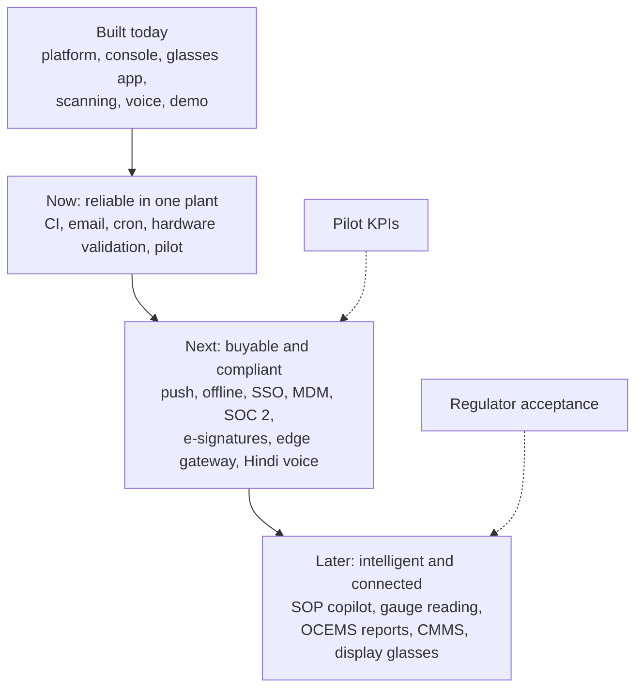
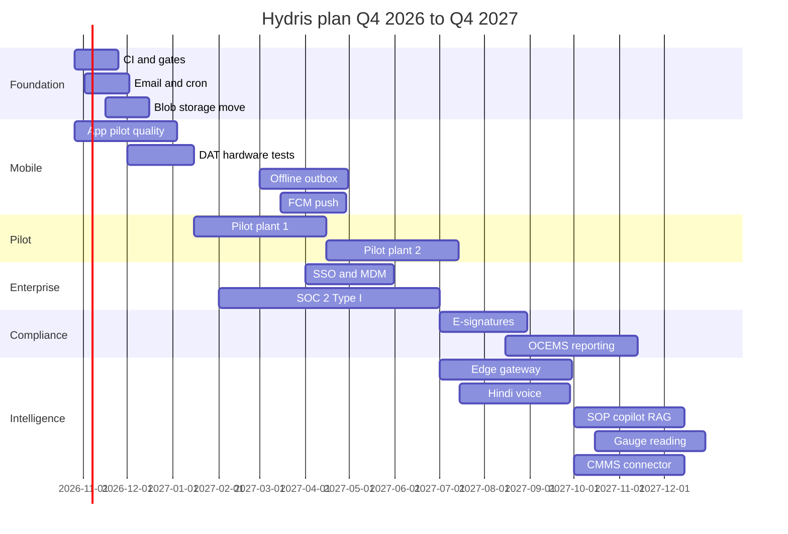
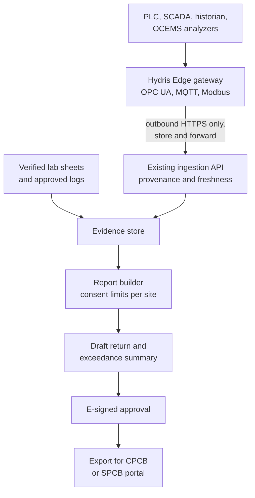
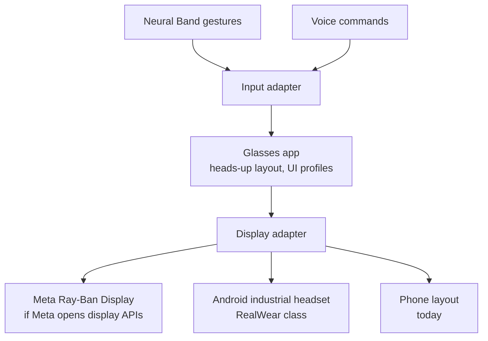
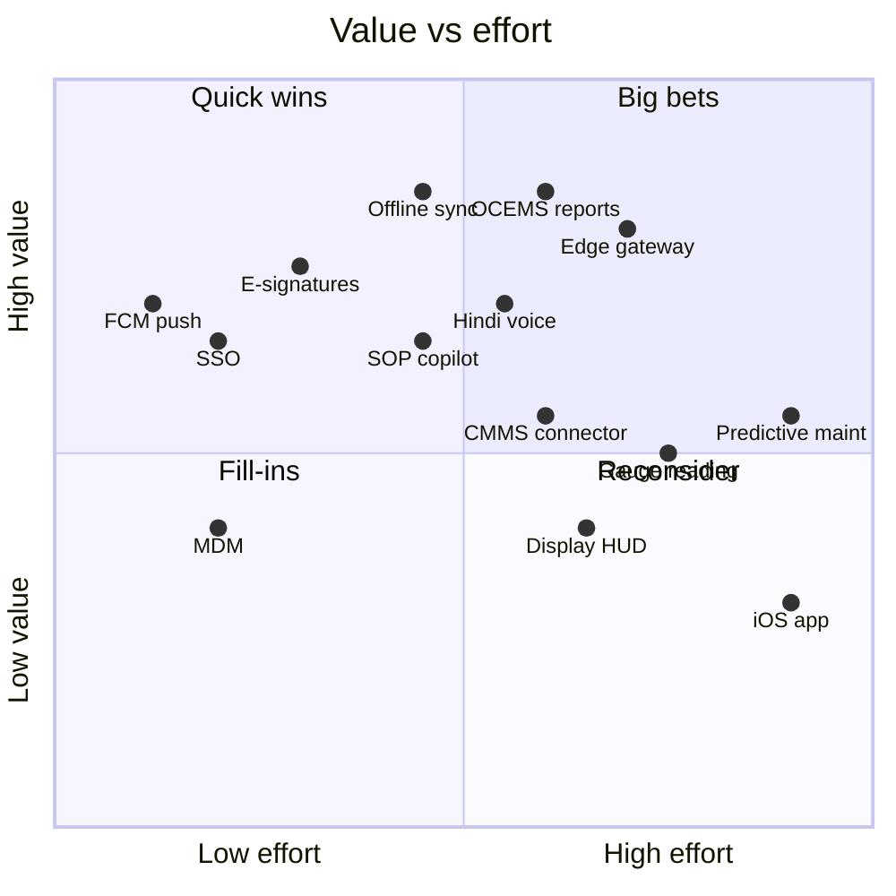

# Roadmap and future products

## Roadmap and future products

### Purpose of the roadmap

The minimum viable product is built and runs as a zero-configuration demo. The next twelve months turn it into something a plant can rely on every shift, then into something a regulator, a maintenance system and a control room can rely on too. This part is a plan, not a commitment: every date is an estimate that assumes the current team and no major change in Meta's developer programme, and effort figures are team estimates. Status labels follow the book: **Built**, **Partial**, **Planned**.

> [!STATS]
> - 5 | quarters planned | Q4 2026 to Q4 2027
> - 8 | themes | from hardening to ecosystem
> - 19 | future features analysed | problem, outcome, dependencies
> - 1 to 2 | pilot plants | ETP or STP, Q1 2027 (target)

### Horizons: now, next, later

Table: Horizons, goals and exit conditions (plan)

| Horizon | Window | Goal | Exit condition |
|---|---|---|---|
| Now | Q4 2026 to Q1 2027 | A pilot plant uses Hydris every shift without engineering support on site | Pilot exit criteria all checked; 4 weeks of daily use |
| Next | Q2 to Q3 2027 | A customer can buy, deploy and audit Hydris without Hydris engineers | GA release; SOC 2 Type I report; Play or MDM distribution; second paying site |
| Later | Q4 2027 and beyond | Hydris is the system of record for field work and compliance evidence at multi-site customers | A regulator accepts a Hydris compliance report; one CMMS integration live |

Confidence falls with distance: scope is high-confidence for Now, medium for Next and low for Later; dates are medium, low and very low. Pilot customer dates, Meta DAT access, pilot KPIs and team size are what move them.

### Timeline, Q4 2026 to Q4 2027

The timeline and Gantt chart are the plan as of October 2026 and are re-baselined at the end of every quarter.

Table: Quarter summary (plan)

| Quarter | Headline | Key deliverables | Exit signal |
|---|---|---|---|
| Q4 2026 | Make it reliable | CI, email transport, cron schedule, audit images to object storage, purge jobs, Android pilot build | Test gates green on every change |
| Q1 2027 | Prove it in a plant | Ray-Ban Meta hardware matrix, pilot plant 1, field trial, KPI baseline | Pilot exit criteria met |
| Q2 2027 | Make it buyable | GA: push notifications, offline outbox, SSO, MDM, SOC 2 Type I readiness, India-region production | Second site signed |
| Q3 2027 | Make it compliant and connected | E-signatures, edge gateway, Hindi voice | First e-signed record approved at a customer |
| Q4 2027 | Make it intelligent | SOP copilot, gauge reading, first CMMS connector, OCEMS report drafts | Copilot used weekly by 50 % of operators (target) |

### Known gaps to close first

These are the debts that would hurt a pilot. They come before any new product.

Table: Known gaps and tech debt, in priority order

| Gap | Impact | Fix | Target |
|---|---|---|---|
| No CI pipeline | Regressions reach the demo | Typecheck, unit, API and e2e gates on every change (NFR-010) | Q4 2026 |
| Email not sent | Invitations and resets never arrive | Email transport for the outbox (FR-086) | Q4 2026 |
| Cron runs daily on Vercel | Stale-data alarms evaluated once a day (FR-035) | Per-minute schedule or external scheduler | Q4 2026 |
| Audit images stored in Postgres | Database bloat, slow backups | Object storage with lifecycle | Q4 2026 |
| No purge jobs | Expired sessions, challenges and sent mail kept indefinitely | Purge 30 days after expiry | Q4 2026 |
| No Android automated tests | Manual regression only | Android test suite | Q4 2026 |
| DAT paths unverified on hardware | Glasses camera, button and microphone may fail on device (FR-055 to FR-057, FR-074) | Hardware test matrix | Q1 2027 |
| Web glasses refresh token in browser storage | Token theft on a compromised device | Native app keystore (built); shorter or bound tokens for web | Q1 2027 |
| No per-org opt-out of third-party AI | Blocks some customers | Organization setting | Q2 2027 |
| No device attestation | Spoofed clients | Play Integrity | Q2 2027 |
| Audit log not hash-chained | Weaker tamper evidence | Hash chain or WORM export | Q3 2027 |

### Future products in brief

Each future product reuses a pattern already proven in the MVP: read-only and outbound-only towards the plant, machines propose and people confirm, and every value keeps its provenance.

Table: Future products (all Planned; effort is a team estimate)

| Product | Problem it solves | Outcome | When (plan) | Effort |
|---|---|---|---|---|
| Edge gateway (OPC UA, MQTT, Modbus) | Each customer needs custom integration; Hydris accepts HTTPS batches only | A container in the plant network reads tags and forwards readings outbound over HTTPS, with store-and-forward and a tag-mapping UI (FR-027, FR-028) | Q3 2027 | RICE effort score 5 (estimate) |
| Offline-first sync | Plants have dead zones; only glasses inspections queue today | Android outbox with idempotent replay for acknowledgements and checklist ticks (FR-098) | Q2 2027 | 3 person-months |
| Predictive maintenance | Pumps and blowers fail with warning signs nobody watches | Per-asset baselines flag drift and create advisory maintenance tasks with evidence | Later | 6 person-months |
| SOP copilot (RAG) | Operators ask "how" and "why" questions that need long procedures | Answers from approved documents only, with citations, never inventing a step | Q4 2027 | 3 person-months |
| Multilingual voice | Operators speak Hindi, Tamil, Marathi, Gujarati | Same grounding guarantees in each language (FR-073): Hindi first, then Tamil and Marathi | Q3 2027 onwards | 4 person-months |
| Gauge reading by computer vision | Analogue gauges are read by eye and copied | "Read this": Hydris proposes a value with confidence, the operator confirms, the photo is kept | Q4 2027 | 5 person-months |
| Compliance reporting and OCEMS | Plants assemble CPCB and SPCB returns by hand | Evidence assembled with provenance, exceedances and data availability, draft returns for e-signed approval (FR-120) | Q3 to Q4 2027 | 4 person-months |
| E-signature | Approval has no signature manifestation | Re-authentication at signing, stated meaning, name and time bound to the record (FR-068) | Q3 2027 | 2 person-months |
| Display glasses | Ray-Ban Meta has no display, so operators look down at the phone | The existing heads-up layout renders on display glasses and industrial headsets behind a display adapter | Later | 3 to 5 person-months per target |
| iOS app | Some supervisors and managers carry iPhones | Supervisor companion first (alarms, reviews, approvals) | Later | 6 person-months |
| CMMS integrations | Hydris tasks would duplicate SAP PM or IBM Maximo work orders | Two-way sync of work orders and assets, plus webhooks for LIMS, ERP and ticketing | Q4 2027 onwards | 4 person-months for the first connector |

#### Edge gateway and the compliance pipeline

The gateway reuses the single ingestion path, so readings from industrial protocols carry the same guarantees as today's HTTPS batches. Compliance reporting then builds on verified scans and e-signatures; direct submission to regulator systems happens only where an official interface exists.

#### Display glasses and new inputs

The heads-up layout and input abstraction already exist; display targets plug in behind adapters. The dependency is Meta exposing display and Neural Band input to third parties, which is not available today.

### Value versus effort

Quick wins (push, SSO, e-signatures) land first because they unblock buying. Offline sync, OCEMS reports and the edge gateway are the big bets that make Hydris a system of record. iOS and predictive maintenance wait for evidence of demand and enough labelled history. A RICE score backs this ordering: push notifications score highest (270), then SSO (180) and offline sync (160); predictive maintenance scores lowest (5).

> [!RISK]
> The biggest risks are a small team spread across too many surfaces, pilot customer delays (approvals, camera policy) and Meta DAT publishing staying gated for India-based developers. Mitigations: strict horizon discipline (Later items stay unstarted until GA), a site camera-policy pack and a second pilot candidate, and the phone-camera path, which works without DAT.

### Success metrics per horizon

Every figure below is a target.

Table: Success metrics per horizon (targets)

| Horizon | Metric | Target |
|---|---|---|
| Now | Pilot exit criteria complete | 100 % |
| Now | Rounds completed on time at the pilot | 95 % |
| Now | Median alarm acknowledgement, critical and high | Under 5 minutes |
| Now | Audit fields where independent engines agree | 90 % |
| Next | Weekly active operators over licensed operators | 70 % |
| Next | Paying sites | 3 |
| Next | Offline actions synced without duplicates | 100 % |
| Next | SOC 2 Type I | Report issued |
| Later | Compliance reports generated in Hydris | Accepted by 1 regulator |
| Later | Copilot answers with citations | 90 % of answered questions |
| Later | Multi-site customers | 2 |

### Release cadence

API and web ship continuously to staging and weekly to production after the gates, with S1 hotfixes within 24 hours. The Android app ships every two weeks through Play internal, closed and managed tracks, with glasses features behind remote flags. The edge gateway will ship monthly as signed container images inside a customer-controlled upgrade window, and this book is updated with each release.
