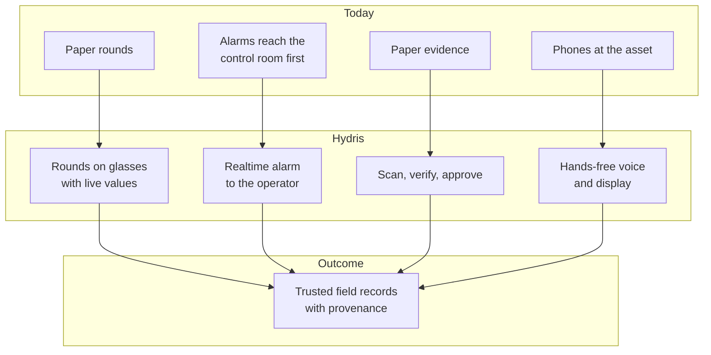
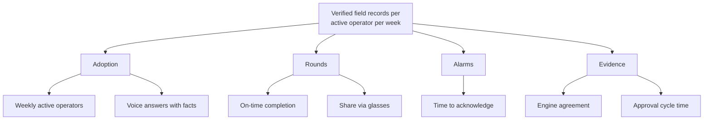
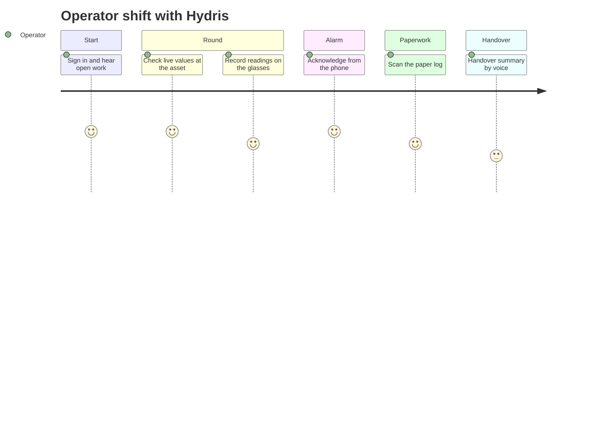

# Hydris Field Glasses PRD

## Overview

### Executive summary

Wastewater operators spend their shift walking the plant: reading instruments, checking pumps and blowers, sampling effluent, writing values on paper logs and responding to alarms that usually reach the control room before they reach the person standing next to the equipment. The records they produce are the evidence a plant shows its regulator, and much of that evidence is still paper.

Hydris Field Glasses puts the live state of the plant, the next task and the approved procedure in the operator's line of sight, hands free, and turns every reading, check and paper record they touch into a trustworthy digital record. It is one platform with eight products (website and demo, operator console, glasses app, Hydris Field Android, Ray-Ban Meta integration, audit scanning, voice assistant, platform API and data) that share one API, one tenant model and one permission matrix.

The platform core is **Built** and running at `https://hydrisview.vercel.app` in demo mode on synthetic plant data. The Android app and the Ray-Ban Meta paths are **Partial**: built in code, not yet validated on physical glasses. This PRD asks leadership to approve three things: the pilot scope (one or two Indian ETPs or STPs in Q1 2027), the hardening work that must land before it, and the success metrics the pilot will be judged on.

> [!STATS]
> - 8 | products | one API, one tenant model
> - 143 | API routes | 15 modules in apps/api/src/modules
> - 67 | automated tests passing | 26 domain + 41 API, local run, 22 Oct 2026
> - Q1 2027 | customer pilot | target, one or two Indian plants

> [!DECISION]
> Hydris is read-only towards the plant. It never writes to PLCs, SCADA or equipment, and every assistant tool is read-only (`apps/api/src/modules/voice-assistant.ts`). This keeps Hydris outside the plant's control-system safety case and is a precondition for every requirement in this document.

### Problem statement

Effluent, sewage, water and common effluent treatment plants (ETPs, STPs, WTPs and CETPs) run continuously, with shift operators walking fixed rounds through intake, aeration, clarification, disinfection, sludge handling and the discharge point. Four problems recur:

1. **Paper rounds drift from reality.** Readings are written on clipboards and transcribed later. Nobody can tell which value was observed and which was copied.
2. **Alarms reach the wrong person.** The operator nearest the pump finds out last, and "acknowledged" gets confused with "fixed", so the record shows alarms cleared that were never resolved.
3. **Compliance evidence is unsearchable.** Logbooks, lab sheets and checklists are paper. Producing evidence for an inspection means digging through files.
4. **Phones are the wrong tool at the asset.** Gloves, ladders, wet hands and sampling bottles make phones awkward, and there is no industrial software for smart glasses.

### Opportunity and market context

Hydris is designed first for India, where discharge monitoring is a legal obligation and record quality matters:

- Discharges are regulated under the Water (Prevention and Control of Pollution) Act, 1974, through consents to establish and operate issued by State Pollution Control Boards (SPCBs) and Pollution Control Committees.
- General discharge standards are set under the Environment (Protection) Rules, 1986, with plant-specific limits in each consent.
- In 2014 the Central Pollution Control Board (CPCB) directed the 17 categories of highly polluting industries, and CETPs, to install online continuous effluent and emission monitoring systems (OCEMS) connected to CPCB and SPCB servers.

The same need (continuous monitoring, retrievable records, who did what and when) exists under NPDES permits in the United States and the Urban Waste Water Treatment Directive in the EU, which makes those later markets.

Three things make this the right time. Ray-Ban Meta camera glasses are light, affordable and acceptable on a plant floor. Meta's Wearables Device Access Toolkit (DAT 1.0.1) lets third-party Android apps use the glasses' camera, microphone, capture button and speakers. Language models can now answer spoken questions from structured plant data well enough to be useful, provided they are grounded and constrained.

Table: Alternatives a plant uses today and the gap Hydris fills

| Alternative | Strength | Gap Hydris fills |
|---|---|---|
| Paper logbooks | Familiar, no devices | No provenance, no search, transcription errors |
| SCADA and HMI | Authoritative live data | Not at the asset; no rounds or paper digitization |
| Mobile forms apps | Cheap digital checklists | Not hands-free; no live context or alarm lifecycle |
| Remote-assist glasses apps | Expert sees what the operator sees | No plant data model, rounds or records |
| CMMS and EAM suites | Maintenance planning | Desktop-first, weak in the field, no glasses |

> [!NOTE]
> Hydris is not a certified OCEMS and does not replace OCEMS reporting to CPCB or SPCB servers. A plant's OCEMS analyzers can feed Hydris through the gateway ingestion API (FR-022) so operators see the same values the regulator sees.

### Vision

Every operator in a water or wastewater plant sees what matters, does the next right thing, and leaves behind a record that stands up to an audit, without putting down their tools.

In three years we want Hydris to be the default way an Indian ETP, STP or CETP runs its rounds, responds to alarms and keeps its compliance records, and a credible choice in other markets with similar discharge-monitoring obligations.

### Product principles

These principles settle design arguments. When two requirements conflict, the higher principle wins.

Table: Product principles and how the product applies them

| ID | Principle | What it means in practice |
|---|---|---|
| P1 | Safety first, read-only towards the plant | Never issue a control command; point to the approved procedure and the supervisor |
| P2 | Never show a guess as a value | Missing data is "no data", never zero; stale values are marked and excluded from roll-ups |
| P3 | Every number has provenance | A reading states its source (instrument, manual, lab, simulator) and time |
| P4 | History is never overwritten | Corrections append; the original stays visible |
| P5 | Humans verify, machines assist | AI and OCR propose, a person confirms, a different person approves |
| P6 | Glance, then act | One question per glasses screen; spoken answers of one or two sentences |
| P7 | Hands busy, still in control | Every action works with directional input or voice; the camera runs only on intent |
| P8 | Isolation enforced by the database | Row-level security on every tenant table |
| P9 | Synthetic data never reaches a customer | Simulator readings are refused for non-demo organizations |
| P10 | One account everywhere | Same user, permissions and data on console, glasses and phone |

## Goals, non-goals and success metrics

### Business and user goals

Table: Goals for the pilot and general availability

| ID | Type | Goal | Evidence of success |
|---|---|---|---|
| G1 | Business | Win a paid pilot at one or two Indian plants in Q1 2027 | Signed pilot contract and customer sign-off at exit |
| G2 | Business | Reach general availability in Q2 2027 | Store or MDM release approved; security review passed |
| G3 | User | Operators record rounds faster and more accurately than on paper | Time per inspection 30 % below the paper baseline (target) |
| G4 | User | The right person acts on an alarm quickly, and closes it properly | Median time to acknowledge under 5 minutes for critical and high (target) |
| G5 | User | Paper records become verified, searchable evidence | Median capture to approval under 24 hours (target) |
| G6 | Trust | No answer or record presents a guess as a fact | Zero hallucinated numbers; zero cross-tenant incidents |

### Non-goals

- **Plant control.** No writes to PLC, SCADA or equipment, and no setpoint changes.
- **A SCADA, DCS or historian.** Hydris reads from them (connectors Planned) and never replaces them.
- **Certified regulatory reporting.** No certified OCEMS reporting to CPCB or SPCB servers.
- **A general chatbot.** The assistant answers only from the tenant's own data and approved documents, never the open internet.
- **Autonomous decisions.** AI never approves a record or generates a procedure on its own.
- **A LIMS or CMMS.** Lab results are stored as telemetry with `source = lab`; integrations come later.
- **Custom hardware or iOS before GA.** The pilot runs on Ray-Ban Meta through Android.
- **Self-serve signup for customer tenants.** Self-serve exists only in demo mode.

### North-star metric

**Verified field records per active operator per week**: inspections submitted, alarms acknowledged within target and audit documents approved, divided by the operators who used Hydris that week. It rises only when operators use the product in the field and the records it produces are trusted.

### KPI table

All values below are pilot targets, not measurements. Most have a data source today in `/reports/:kind` (`apps/api/src/modules/insights.ts`); voice and agreement metrics need lightweight logging that is Planned for the pilot (NFR-034).

Table: KPIs with definitions, pilot targets and measurement

| Metric | Definition | Target | Measurement |
|---|---|---|---|
| Weekly active operators | Operators with at least one record in a week, over licensed operators | 70 % or more | Inspections and alarms reports |
| On-time rounds | Inspections submitted by their due time | 95 % or more | `onTimeRate`, inspections report |
| Time per inspection | Median start to submit versus paper baseline | 30 % lower | Inspections report plus baseline study |
| Share via glasses | Inspections submitted from glasses | 50 % or more | `viaGlasses`, inspections report |
| Time to acknowledge | Median minutes, critical and high alarms | Under 5 minutes | `medianMinutesToAcknowledge` |
| Engine agreement | Average agreement score of approved documents | 90 % or more | Audit document agreement score |
| Reviewer edits | Corrected fields over reviewed fields | Under 5 % | Audit document review data |
| Approval cycle | Capture to approval, median | Under 24 hours | Audit document timestamps |
| Voice answered with facts | Questions with a known intent | 85 % or more | Intent logging (Planned) |
| Hallucinated numbers | Numbers in answers absent from facts | 0 | Automated check on logged answers |
| Cross-tenant incidents | Confirmed exposure across tenants | 0 | Security incident log |
| Device revocation time | Revoke to `session.ended` on the stream | 30 s or less | Realtime event timestamps |

## Users and use cases

### Personas

Six personas map one to one onto the roles in `packages/domain/src/roles.ts` (6 roles, 38 permissions); the Hydris platform admin is a flag on the user.

Table: Personas, goals, pain points and primary surface

| Persona | Role | Goals | Pain points | Primary surface |
|---|---|---|---|---|
| Field operator (Ravi) | `field_operator` | Next task, live values at the asset, record readings, acknowledge alarms | Gloves and wet hands, copied readings, blamed for others' values | Glasses, Android app |
| Shift supervisor (Meena) | `supervisor` | Dispatch rounds, triage alarms, review inspections, verify scans | Cannot see late rounds or who owns an alarm | Console, Android app |
| Maintenance engineer (Arjun) | `maintenance_engineer` | Work orders, checklists, resolve alarms, SOPs at the asset | Manuals and history are in the office, not at the pump | Android app, glasses |
| Plant manager (Priya) | `factory_manager` | KPIs, alarm rules, approve documents, control glasses features | Accountable to the SPCB with paper evidence | Console |
| Compliance auditor (Mr Rao) | `viewer` plus `report.read` | Tamper-evident trail, approved records, exports | Cannot trace who changed what and when | Console, PDF exports |
| Organization admin | `org_admin` | Members, invitations, sites, glasses UI profiles | Device onboarding and revocation take too long | Console |

### Top use cases

Table: Top use cases and the requirements that serve them

| ID | Use case | Served by | Status |
|---|---|---|---|
| J1 | Start a round with assigned inspections in order | FR-040, FR-041, FR-059 | Built on glasses; Android Planned (FR-044) |
| J2 | See live readings and their freshness at the asset | FR-021, FR-026, FR-095 | Built |
| J3 | Acknowledge a nearby alarm and see the action and SOP | FR-031, FR-032, FR-033, FR-112 | Built |
| J4 | Capture a paper log once and get it verified and approved | FR-060 to FR-069 | Built |
| J5 | Ask by voice and hear a short, grounded answer | FR-071, FR-072, FR-074 | Built (English); glasses mic Partial |
| J6 | Control what each role sees on the glasses without an app update | FR-054 | Built |
| J7 | Pair, reassign, suspend or revoke glasses in seconds | FR-050 to FR-053, FR-057 | Built; DAT registration Partial |
| J8 | Trace every approved document and change to a person and time | FR-065, FR-066, FR-082 | Built |
| J9 | Try the product in minutes without talking to sales | FR-083, FR-091, FR-102 | Built |

### Operator-day journey

The journey below is the target state for a field operator across one shift. Scores (1 to 5) are design targets, not measurements.

The product is strongest today at alarm acknowledgement, scanning and voice lookups. The weakest step is handover: the handover summary (FR-122) is **Planned**, and inspection execution on the Android app (FR-044) is **Planned**, so rounds run in the glasses app today.
