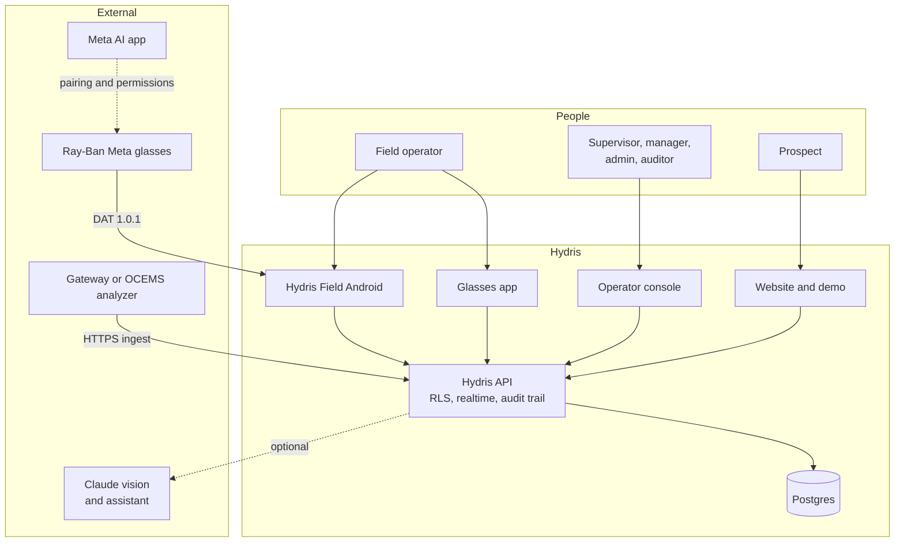
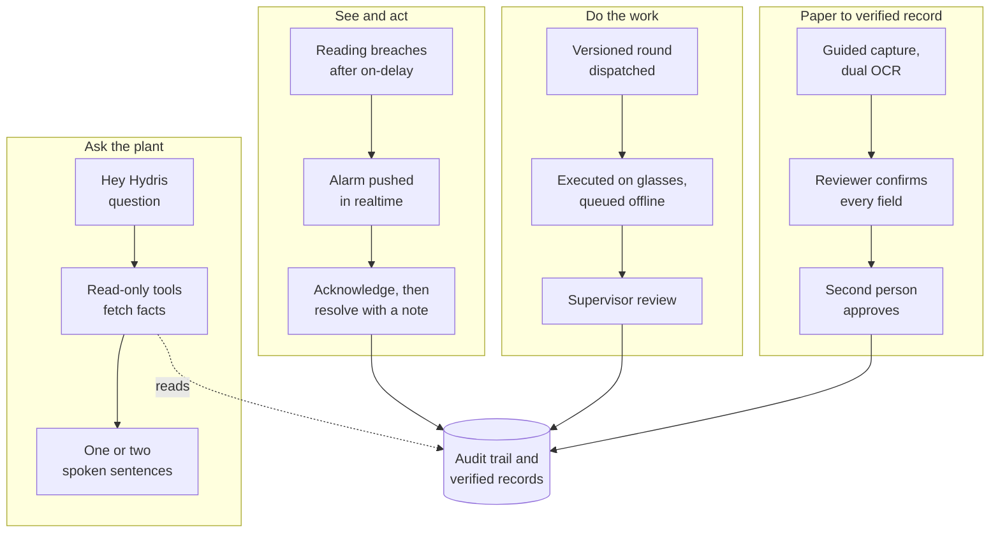

# Solution overview

## Solution overview

### The product family

Hydris is one platform with eight products. A user signs in once and gets the same permissions and data on the console, the glasses and the phone. Every product talks to one API, and the database, not application code, enforces tenant isolation.

Table: The product family, sub-products, users and status

| Product | Sub-products | Primary users | Status |
|---|---|---|---|
| Website and demo | Seven public pages, contact and demo request, live glasses demo, named demo accounts | Prospects | Built |
| Operator console | Telemetry, alarms, inspections and maintenance, plant map, devices and UI profiles, audit documents, documents and SOPs, reports, admin | Supervisors, managers, auditors, admins | Built |
| Glasses app | Twelve heads-up screens, phone layout, browser simulator, offline inspection queue | Field operators, engineers | Built (web); native display rendering Planned |
| Hydris Field Android | Sign-in, home, work, alarms, sensors, audit scan with on-device OCR, "Hey Hydris", glasses connection | Field operators, supervisors, engineers | Partial: built in code, glasses paths not validated on hardware |
| Ray-Ban Meta integration | Camera, capture button, microphone and speakers through DAT 1.0.1; registration as a Hydris device | Field operators | Partial: not validated on physical glasses |
| Audit scanning | Guided A4 capture, dual OCR, optional vision engine, field review, four-eyes approval, searchable PDF | Operators, supervisors, managers, auditors | Built |
| Voice assistant | Wake phrase, read-only tools, short spoken answers, rules fallback | Field operators, engineers | Built (English); other languages Planned |
| Platform API and data | 143 routes, row-level security, realtime events, append-only audit trail, demo mode | All products | Built |

### System context

Three external dependencies shape the design. Ray-Ban Meta glasses reach third-party apps only through DAT, and they are paired and permissioned through the Meta AI app, which must stay installed on every operator phone. Plant data arrives over HTTPS from an edge gateway or OCEMS analyzer (FR-022); MQTT and OPC UA adapters are **Planned**. The Claude model is optional: without it, a rules engine answers questions and OCR alone extracts documents (NFR-037).

### The core loops

Four loops explain the whole product. Each crosses several products, which is why they share one platform.

Table: The core loops, what makes them trustworthy, and status

| Loop | What makes it trustworthy | Status |
|---|---|---|
| See and act | Deadband and on-delay stop flapping; an alarm cannot be resolved without a note, so acknowledged is never mistaken for fixed | Built; Android Resolve fix in Hardening (FR-094) |
| Do the work | Templates are versioned; responses queue on the device and replay exactly once | Built on glasses; Android inspections Planned (FR-044) |
| Paper to verified record | The original extracted value is kept beside every correction; approval must come from a different person | Built |
| Ask the plant | Answers use only tool results from the same conversation and state the age of each reading; unknown questions get "can't answer" | Built (English) |

### Release scope by product

The MVP is complete in code. The pilot adds the hardening and hardware validation needed to run at a real plant; GA and later phases broaden reach.

Table: Release scope by product, pilot versus later

| Product | Pilot (Q1 2027) | Later (GA Q2 2027 and Advanced) |
|---|---|---|
| Website and demo | As built | Content updates only |
| Operator console | Compliance summary (FR-120), alarm escalation (FR-037), email transport (FR-086) | SSO (FR-011), recurring schedules (FR-047) |
| Glasses app | As built, on the web runtime and phone layout | Native glasses display rendering |
| Hydris Field Android | Resolve fix (FR-094), inspections (FR-044), FR-099 fixes | FCM push (FR-034), offline outbox (FR-098), Play or MDM distribution |
| Ray-Ban Meta integration | Hardware validation of camera, capture button, speech, registration (FR-055 to FR-057, FR-074) in Developer Mode | Store or Developer Center distribution |
| Audit scanning | Page images moved to object storage | E-signatures (FR-068), LIMS |
| Voice assistant | English, rules or model engine per tenant consent | Hindi, Tamil, Marathi, Gujarati (FR-073) |
| Platform API and data | CI (NFR-010), job cadence (NFR-008), observability (NFR-034) | India-region production (NFR-017), pen test (NFR-018), MQTT and OPC UA (FR-027) |

> [!DECISION]
> The pilot runs on the native Android app, not the WebView bridge. The native app keeps device tokens in the Android Keystore, uses ML Kit for on-device OCR and talks to DAT directly. Every glasses feature also works on the phone, so the pilot does not depend on Meta's distribution timeline.
