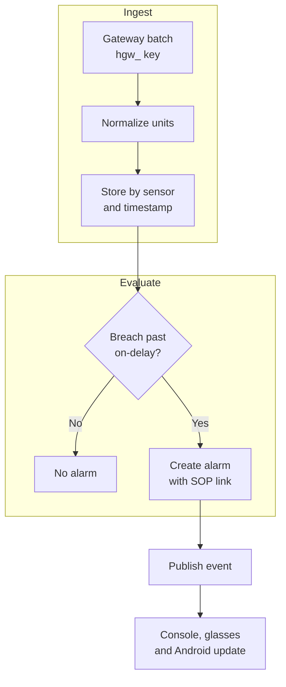
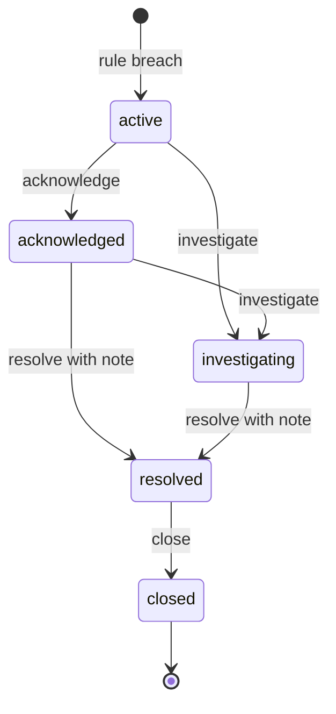
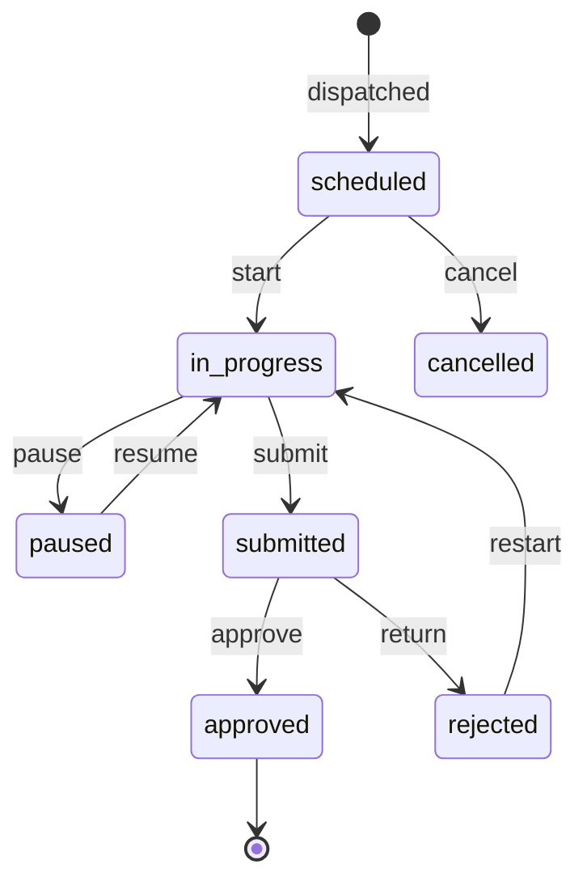
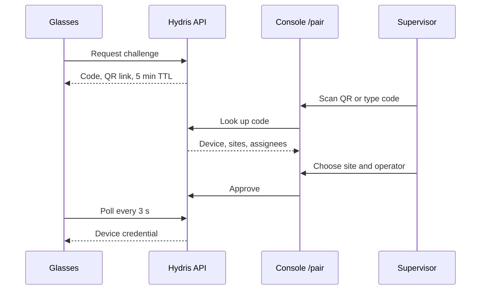

# Operator console

## Operator console

The operator console is the web application at `/console` where supervisors, managers, auditors and administrators run the plant record. Field operators produce data with the glasses and the Android app; the console is where that data is dispatched, triaged, reviewed, approved and reported. It is one Next.js surface (`apps/web/src/console`) over the same API that serves every other client, so a value acknowledged on the glasses is the same record a manager sees on the overview a second later.

Table: Console sub-products

| Sub-product | Route | Job it does | Status |
|---|---|---|---|
| Overview dashboard | `/console` | Is anything wrong right now, and where | Built |
| Plant model and map | `/console/map`, sites, assets | Describe the plant once and place it on a map | Built |
| Telemetry | Sensor monitoring | Honest live values with source and freshness | Built (HTTPS) |
| Alarms | Alarms and events | Turn readings into attributed work | Built, escalation Planned |
| Inspections and maintenance | Inspections, maintenance | Design, dispatch and review rounds and tasks | Built, schedules Planned |
| Documents and SOPs | `/console/documents` | Approved procedures at the asset | Built |
| Glasses fleet and UI profiles | Devices, `/console/glasses-profiles` | Pair, revoke and configure glasses | Built |
| Audit review and approval | `/console/audit-docs` | Turn scanned paper into approved evidence | Built, e-signature Planned |
| Reports | `/console/reports` | Numbers managers and auditors can defend | Built, compliance Planned |
| Administration and roles | Members, settings, audit log | Who can do what, with no escalation | Built, email and SSO Planned |

### Overview

Water and wastewater plants still run on paper log sheets, phone calls and spreadsheets. The supervisor cannot see which rounds are late, the manager cannot prove to a regulator who saw an alarm and when, and the auditor receives evidence that cannot be traced to a person. The console replaces that patchwork with one tenant-isolated, site-scoped workspace where every state change is attributed, timestamped and written to an append-only audit trail. Navigation (`Shell.tsx`) hides any destination the current role lacks, and the API enforces the same check from one fixed role matrix (`packages/domain/src/roles.ts`, six roles, 38 permissions).

### Users and user stories

Table: Console user stories

| ID | Story | Priority |
|---|---|---|
| US-C1 | As a shift supervisor I want open alarms ranked by severity so that I triage the worst first | P0 |
| US-C2 | As a shift supervisor I want to dispatch a route to an operator and review the result so that rounds are traceable | P0 |
| US-C3 | As a shift supervisor I want to approve glasses pairing from any phone so that a new pair is live in minutes | P0 |
| US-C4 | As a plant manager I want threshold rules with deadband and on-delay so that operators are not flooded by noise | P0 |
| US-C5 | As a plant manager I want to approve verified audit documents so that paper logs become evidence | P0 |
| US-C6 | As a plant manager I want alarm and inspection reports in CSV so that I can defend KPIs | P1 |
| US-C7 | As a compliance auditor I want an append-only trail of who did what so that evidence is attributable | P0 |
| US-C8 | As an organization admin I want to decide what each role sees on the glasses so that screens fit the job | P1 |
| US-C9 | As an organization admin I want to invite members with a role no higher than mine so that privileges never escalate | P0 |

### Scope

Table: Console scope

| In scope | Out of scope |
|---|---|
| Overview, plant model and map, telemetry with freshness and corrections | User-configurable widgets, cross-site benchmarking |
| Alarm rules and five-state lifecycle | Any write path to plant equipment (Hydris is read-only towards the plant) |
| Inspection templates, routes, dispatch, review; maintenance tasks | Digital twins, P&ID import |
| Document library with approval; grounded SOP retrieval | Bulk import of the asset register (gap) |
| Glasses fleet, pairing approval, UI profiles | Fleet health signals such as battery (next step) |
| Audit document review and four-eyes approval | Capture and OCR (glasses and Android sections) |
| Reports in JSON and CSV; admin, roles, audit log | Pricing, billing |

### Overview dashboard

The overview is the first screen after sign-in: KPI tiles, open alarms by severity, asset health, live measurements with freshness and recent activity. It is served by `GET /overview`, the same endpoint that feeds the Android home screen, so the console and the phone never disagree. Stale values are excluded from health roll-ups (`packages/domain/src/freshness.ts`) and synthetic values carry a visible label. A command palette (`CommandPalette.tsx`) gives keyboard access to every destination and global search. Next step: a per-user default site and a compliance tile once FR-120 lands.

### Plant model and map

Everything hangs off the plant model: organization, site, facility, process area, asset and sensor. The site is the permission boundary, so a site-scoped supervisor sees nothing from other sites. Archiving an asset removes it from glasses screens and assistant answers while keeping its history. The plant map (`/console/map`) places assets on the site layout and overlays route stops and open alarms; the hierarchy navigator and asset schematic give the same model as a tree and per asset. Gateways authenticate with `hgw_` API keys. Gaps: no bulk import of the asset register, and the map is drawn per site rather than imported from drawings.

### Telemetry

The core promise is honesty: a missing reading is shown as "No data", never as zero, and every value carries its source (gateway, manual, lab or synthetic) and time. Gateways post up to 500 readings per call; readings are keyed on sensor and timestamp so a replayed batch never duplicates. Freshness is live up to twice the expected interval, delayed up to five times, then stale. A wrong value is never edited: a supervisor adds a correction or invalidates it, and the original stays visible with author and reason. MQTT, OPC UA and historian connectors are Planned.

### Alarms

Alarms turn readings into attributed work. Acknowledging records that a person has seen the alarm; it never changes the process. Rules support HH, H, L, LL and stale conditions with deadband (no flapping around a limit) and on-delay (short spikes ignored). There is no path from active straight to resolved, and the API rejects a resolve without a note. Every transition writes a history row and an audit event, and pushes in realtime to the console, glasses and Android.

> [!RISK]
> Stale rules run every 30 s on a long-running server but only once a day on the current Vercel cron (FR-035, Partial), and unacknowledged alarms do not escalate (FR-037, Planned). Both block an unsupervised pilot.

### Inspections and maintenance

A template is built in the console (`TemplateBuilder.tsx`) from five step kinds: check, reading with expected range, choice with abnormal options, text and photo. Editing creates a new version, so dispatched inspections keep the version they started with. Routes order templates along a walk and are dispatched to an operator. The supervisor reviews a submitted inspection with abnormal steps highlighted and approves it or returns it with a reason; offline responses from the glasses replay idempotently, so the reviewer never sees duplicates. Maintenance tasks are corrective, preventive or follow-ups from an alarm or inspection, with priority, checklist and activity log, and move through open, assigned, in progress, on hold, completed or cancelled, with reopen. Every round is dispatched by hand today; recurring schedules are Planned.

### Documents and SOPs

The library holds SOPs, manuals, datasheets, safety notices and troubleshooting guides, each with versions and a scope of site, asset or asset type. The lifecycle is draft, approved, archived, and only approved documents reach the glasses, the assistant and grounded retrieval. Alarm rules link a procedure shown with the alarm. The library page exposes grounded SOP retrieval (`/assist`), so a supervisor can check what an operator will be told before it happens. Uploading existing PDF manuals with text extraction is Planned.

### Glasses fleet and UI profiles

Glasses are shared, often unattended devices, so the console makes them a managed fleet. A supervisor approves pairing to a site and an operator; the glasses never hold a user password, only a device credential the console can end. Devices move through pending, paired, assigned, connected, disconnected (not seen for 90 s), suspended and revoked. Access tokens last 15 minutes and refresh tokens rotate with reuse detection. A device can never exceed the device permission ceiling, whatever the operator's role.

A UI profile controls what the glasses show. Profiles are drafted, published and rolled back; assignment is by device, user, role or organization, and the most specific published assignment wins. Publishing pushes the change live without a restart.

### Audit review and approval

Scanned paper logs become evidence only after one person has checked them and a second has approved them. The reviewer sees each extracted value beside its crop of the page, with the engines that read it and their agreement. Values where at least two engines agree with confidence 0.8 or more can be bulk-confirmed; everything else is confirmed, corrected or flagged one by one, and the original reading is always kept. Verify is blocked while any item is pending or flagged. Approval needs `auditdoc.approve` and must come from someone other than the verifier (demo tenants allow recorded self-approval). The approved PDF carries the verification trail, the searchable original and a reconstructed page.

### Reports

Reports (`insights.ts`) cover inspections, alarms, maintenance, devices and operators, in JSON for the page and CSV for export. The alarm report includes median minutes to acknowledge; the inspection report includes on-time rate and the share submitted via glasses. These fields feed most pilot KPIs. A compliance summary per discharge point, the report regulators actually ask for, is Planned.

### Administration and roles

The rule is no escalation: nobody can grant a role above their own (`assignableRoles`). Invitations carry a 7-day token; members can belong to several organizations and switch; sessions can be listed and revoked; TOTP MFA is available. The audit log page filters the append-only trail by action and entity, and no API path updates or deletes an audit event. Platform admins create and suspend customer organizations at `/console/platform`. Invitation emails are queued in `mail_outbox` but not yet sent.

Table: Role access summary (roles.ts)

| Capability | Admin | Manager | Supervisor | Engineer | Operator | Viewer |
|---|---|---|---|---|---|---|
| Acknowledge alarms | Yes | Yes | Yes | Yes | Yes | No |
| Resolve / close alarms | Yes / Yes | Yes / Yes | Yes / Yes | Yes / No | No | No |
| Manage alarm rules, plant model | Yes | Yes | No | No | No | No |
| Review inspections, manage maintenance | Yes | Yes | Yes | No | No | No |
| Pair glasses / manage profiles | Yes / Yes | Yes / Yes | Yes / No | Yes / No | Yes / No | No |
| Verify / approve audit documents | Yes / Yes | Yes / Yes | Yes / No | No | No | No |
| Audit log | Yes | Yes | No | No | No | No |

> [!DECISION]
> The auditor persona maps to `viewer`, which holds `report.read` but not `audit.read`. Open decision: grant `audit.read` to viewer or add a dedicated auditor role.

### Functional requirements

Priorities map the source PRD as Must to P0, Should to P1 and Could to P2.

Table: Console functional requirements by sub-product

| ID | Requirement | Pri | Status |
|---|---|---|---|
| FR-089 | Overview: KPIs, open alarms, health, live measurements | P0 | Built |
| FR-085 | In-app notifications in realtime, mark as read | P0 | Built |
| FR-088 | Global search across assets, sensors, documents and work | P1 | Built |
| FR-020 | Plant hierarchy with map positions, archive and restore | P0 | Built |
| FR-021 | Sensors for 16 measurands with unit normalization | P0 | Built |
| FR-007 | Site-scoped permissions | P0 | Built |
| FR-022 | Gateway ingestion, 500 per call, idempotent | P0 | Built |
| FR-023 | Manual and lab entry with provenance | P0 | Built |
| FR-024 | Append-only corrections (correct or invalidate) | P0 | Built |
| FR-025 | History, raw readings, CSV export | P1 | Built |
| FR-026 | Freshness: live, delayed, stale, no data | P0 | Built |
| FR-029 | Synthetic data labelled, refused for customers | P0 | Built |
| FR-027 | MQTT and OPC UA adapters | P1 | Planned |
| FR-028 | Read-only SCADA and historian connectors | P2 | Planned |
| FR-030 | Threshold rules with deadband and on-delay | P0 | Built |
| FR-031 | Five-state lifecycle, no resolve from active, note required | P0 | Built |
| FR-032 | Assignment, notes, history, recommended action | P0 | Built |
| FR-033 | Realtime push to console, glasses, Android | P0 | Built |
| FR-035 | Stale-data alarms on a schedule | P0 | Partial |
| FR-037 | Escalation when unacknowledged | P1 | Planned |
| FR-038 | Shelving with reason and expiry | P2 | Planned |
| FR-040 | Versioned templates, five step kinds, routes, dispatch | P0 | Built |
| FR-042 | Submit, review, approve or return | P0 | Built |
| FR-043 | Maintenance tasks, checklists, follow-ups | P0 | Built |
| FR-047 | Recurring schedules | P1 | Planned |
| FR-110 | Document library: draft, approved, archived; versions; scope | P0 | Built |
| FR-111 | Only approved documents reach glasses and assistant | P0 | Built |
| FR-112 | Alarm rule links a procedure shown with the alarm | P0 | Built |
| FR-070 | Grounded SOP retrieval with safety notice | P0 | Built |
| FR-114 | Upload PDF manuals with text extraction | P2 | Planned |
| FR-050 | Pairing code, QR, 5 min TTL, 3 s polling, approval | P0 | Built |
| FR-051 | Device tokens, rotation, reuse detection | P0 | Built |
| FR-052 | Suspend, reactivate, revoke, reassign | P0 | Built |
| FR-053 | Device permission ceiling | P0 | Built |
| FR-054 | UI profiles: draft, publish, rollback, precedence, live push | P1 | Built |
| FR-064 | Confirm, correct, flag, reset; verify gate | P0 | Built |
| FR-069 | Bulk-confirm agreed multi-engine values | P1 | Built |
| FR-065 | Independent approval (four eyes) | P0 | Built |
| FR-066 | PDF with trail, searchable original, reconstruction | P0 | Built |
| FR-068 | Electronic signature with re-authentication | P1 | Planned |
| FR-081 | Reports for five areas in JSON and CSV | P0 | Built |
| FR-120 | Compliance summary per discharge point | P1 | Planned |
| FR-121 | Scheduled report delivery by email | P2 | Planned |
| FR-004 | Invitations, 7-day token, no escalation | P0 | Built |
| FR-012 | Fixed role matrix | P0 | Built |
| FR-082 | Append-only audit trail | P0 | Built |
| FR-087 | Audit log page with filters | P0 | Built |
| FR-010 | Platform organization create and suspend | P0 | Built |
| FR-005 | Password reset email | P0 | Partial |
| FR-086 | Email delivery (SMTP, SES or Resend) | P0 | Planned |
| FR-011 | SSO with SAML 2.0 and OIDC | P1 | Planned |

### Key flows

A new reading is normalized, stored idempotently and evaluated against rules before events reach every client.

An alarm must be seen before it can be resolved, and resolution needs a note.

An inspection is dispatched, executed in the field and approved or returned by a supervisor.

The glasses never type a password; a signed-in supervisor approves the code and the glasses claim their own credential.

### Acceptance criteria

- Given an active alarm, when a user tries to resolve it directly, then the API rejects the transition; and given an acknowledged alarm, when resolve is sent without a note, then it is rejected (FR-031).
- Given a gateway batch already stored, when the same batch is replayed, then no duplicate readings are created (FR-022).
- Given a sensor with no reading, when the overview loads, then it shows "No data" and never zero (FR-026).
- Given a submitted inspection, when the supervisor returns it with a reason, then the operator can restart it and history shows both submissions (FR-042).
- Given a verified audit document, when the verifier tries to approve it in a customer tenant, then approval is refused (FR-065).
- Given a revoked device, when it makes its next request, then it is refused and its event stream closes within 30 s (FR-052).

### Success metrics

All values are pilot targets, not measured results.

Table: Console metrics (pilot targets)

| Metric | Source | Target |
|---|---|---|
| Median time to acknowledge, critical and high | Alarm report | Under 5 minutes |
| On-time round completion | Inspection report `onTimeRate` | 95 % or more |
| Share of rounds submitted via glasses | Inspection report `viaGlasses` | 50 % or more |
| Audit document capture to approval | Audit documents | Under 24 hours |
| Reviewer edits per reviewed field | Audit documents | Under 5 % |
| Device revocation to stream end | Event stream | 30 s or less |
| Realtime alarm delivery | NFR-002 | 2 s (not yet measured) |
| Cross-tenant incidents | Security review | 0 |

### Dependencies and open issues

- Depends on the platform API, Postgres row-level security (FR-008) and the realtime event stream (FR-080).
- Blocks an unsupervised pilot: email delivery (FR-086), escalation (FR-037) and a reliable stale schedule (FR-035).
- Open: auditor role decision; compliance summary (FR-120); SSO (FR-011); electronic signature (FR-068); NFR-001 and NFR-002 not yet load-tested.
