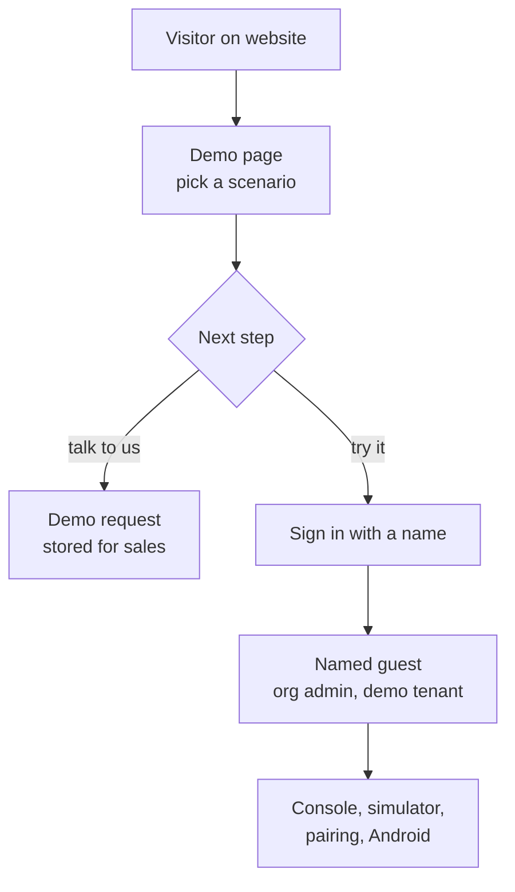

# Website and demo

## Website and demo

### Overview

Industrial buyers rarely touch a product before a sales cycle starts, and smart-glasses software is hard to picture without hardware. The website explains Hydris and lets a prospect try it in minutes: drive the real glasses viewport in the browser, then sign in to the console or the Android app with just a name. Everything runs on synthetic data labelled as such. The goal is a self-serve path from curiosity to a working demo account with no sales contact.

### Users and user stories

Table: Website and demo user stories

| ID | Story | Priority |
|---|---|---|
| US-W1 | As a prospect I want to drive the glasses UI in my browser so that I understand the product without hardware | P0 |
| US-W2 | As a prospect I want to sign in with only a name so that I can try the console immediately | P0 |
| US-W3 | As a salesperson I want my named account to survive between sessions so that demos are repeatable | P0 |
| US-W4 | As a trainer I want deterministic scenarios so that every class sees the same events | P1 |
| US-W5 | As a prospect I want to request a guided demo so that I can talk to the team | P1 |

### Scope

Table: Website and demo scope

| In scope | Out of scope |
|---|---|
| Seven public pages plus privacy, phone and desktop, light and dark | Self-serve sign-up for customer tenants |
| Contact and demo-request form | Pricing pages, payments |
| Client-side glasses demo with ten scenarios; browser simulator and pairing | Real plant data of any kind |
| One-click named demo accounts on console and Android | Guest data beyond the shared store's 30-day TTL |

### Functional requirements

Table: Website and demo requirements

| ID | Requirement | Pri | Status |
|---|---|---|---|
| FR-100 | Marketing website, seven pages and privacy page | P0 | Built |
| FR-101 | Contact form, 5 per 10 minutes per client | P0 | Built |
| FR-102 | Client-side glasses demo plus browser simulator | P0 | Built |
| FR-103 | Named guests with personal copies of open work | P0 | Built |
| FR-083 | Zero-configuration demo tenant, cross-instance pairing | P0 | Built |
| FR-084 | Ten deterministic scenarios, refused outside demo tenants | P0 | Built |
| FR-091 | Demo sign-in with a name in the Android app | P0 | Built |
| FR-029 | Synthetic data labelled, refused for customer tenants | P0 | Built |

### Key flows

A guest id is derived from the normalized name, so the same name always returns to the same account, rebuilt on any serverless instance from the shared store.

### Acceptance criteria

- Given a deployment with no environment variables, when a visitor opens `/demo` and signs in, then the demo works end to end (FR-083).
- Given a guest named "Asha", when she returns later with the same name, then she reaches the same account and work (FR-103).
- Given two guests acting at once, when one completes an inspection, then the other's copies are unchanged (FR-103).
- Given a customer tenant, when a simulation scenario is started, then it is refused (FR-084).

> [!WARNING]
> Demo mode relaxes security on purpose (12-hour access tokens, public signing secrets, audit self-approval). Production sets `DEMO_MODE=false` and `SIMULATOR_ENABLED=false`.

### Success metrics

Table: Website and demo metrics (targets)

| Metric | Target |
|---|---|
| Landing to signed-in demo account | Minutes, no sales contact |
| Demo on zero-configuration deployment | Works with no environment variables |
| Guest isolation failures | Zero |
| Demo requests converted to guided demos | Target to be set at pilot |

### Dependencies and open issues

- Inquiries are stored but no notification email is sent until email delivery (FR-086) lands.
- The Vercel Runtime Cache store is per region and best effort; Postgres is preferred where available.
- The demo mimics glasses input with on-screen buttons; a native display-glasses adapter is Planned.
