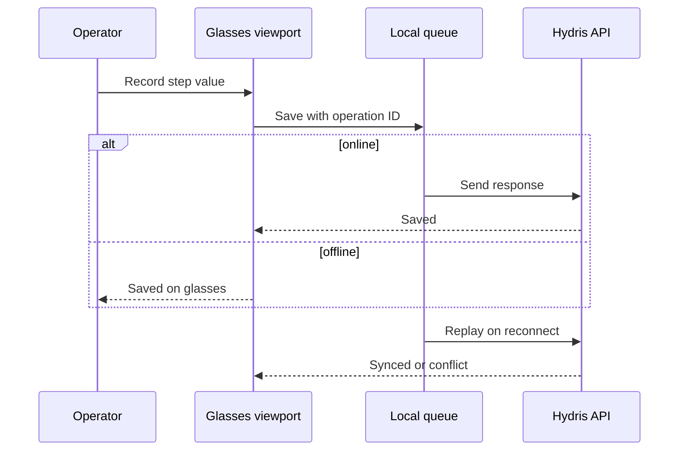
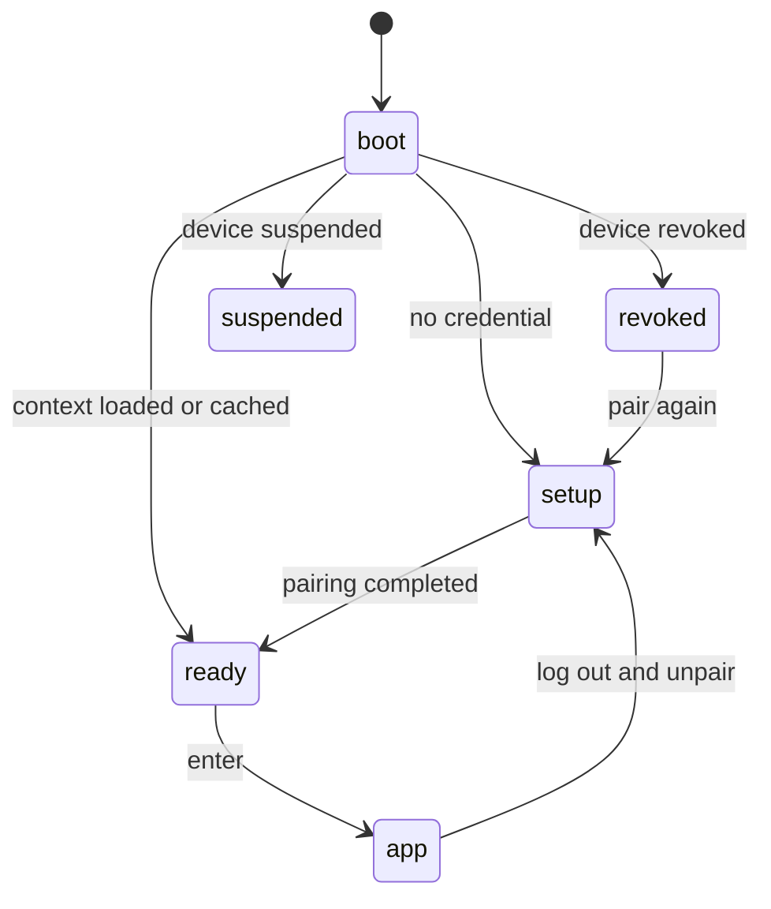

# Glasses app

## Glasses app

### Overview

Field operators walk rounds with gloves on, a radio in one hand and a log sheet in the other. They need the next inspection, the live reading at the asset in front of them, the nearby alarm and the right procedure without unlocking a phone or walking back to the control room. The glasses app is one web viewport (`apps/web/src/glasses`, served at `/glasses`) that puts this work at eye level. It records only: Hydris never operates equipment, and acknowledging an alarm says so.

Its principles are enforced in `hud.tsx`: one primary action per screen and six directional keys or voice for everything (NFR-021); body text of 20 px or more with light strokes on black for additive displays (NFR-020); cached data labelled with its age, never as live (NFR-026); and what a device shows decided in the console, not on the device (FR-054).

### Users and user stories

Table: Glasses app user stories

| ID | Story | Priority |
|---|---|---|
| US-G1 | As a field operator I want to record round steps hands-free so that I do not carry a log sheet | P0 |
| US-G2 | As a field operator I want steps saved when the network drops so that no work is lost | P0 |
| US-G3 | As a field operator I want to acknowledge a nearby alarm and open its SOP so that I act on the right procedure | P0 |
| US-G4 | As a shift supervisor I want to pair glasses from my phone so that no password is typed on the device | P0 |
| US-G5 | As an admin I want to change what a role sees without an app update so that screens fit the job | P1 |
| US-G6 | As a prospect I want to run the full app in a simulator so that I can evaluate it without hardware | P1 |

### Scope

Table: Glasses app scope

| In scope (Built) | Out of scope or Planned |
|---|---|
| HUD layout, phone layout for the bridge, browser simulator | Rendering on a real glasses display (Planned) |
| Pairing by code and QR, device tokens, log out and unpair | Native Vuzix or RealWear hosts (Planned) |
| Home, alerts, inspections with offline queue, tasks, measurements, assets, map | Photo steps from the glasses camera (FR-045 Partial) |
| SOP library and reader with offline cache | Hardware gestures such as a temple touchpad (Planned) |
| Audit scan and Hey Hydris entry points | Multi-language voice (FR-073 Planned) |

### Runtimes

One React viewport runs in three places. `useViewportLayout` chooses phone mode inside the Android bridge (`HydrisNative` present), with `?mode=phone`, or on a narrow portrait screen; otherwise HUD mode.

Table: HUD and phone runtimes

| Aspect | HUD mode | Phone mode |
|---|---|---|
| Target | Display glasses, browser simulator | Bridge app on the phone paired with Ray-Ban Meta |
| Canvas | 600 x 600, scaled to window | 540-unit width, full height, safe areas |
| Navigation | Six keys, swipes, simulator pad | Bottom tabs (Home, Scan, Hey Hydris, Alerts) plus touch |
| Camera and voice | Simulated or device camera; browser speech | Glasses camera and microphone through the bridge |

Twelve top-level screens (FR-059) sit under a Home menu whose order and visibility come from the UI profile; Home and Device can never be switched off. Navigation is a stack mirrored into browser history, so back never leaves the app.

### Pairing

Pairing follows the shape of the OAuth device authorization grant (RFC 8628). The glasses show an 8-character code (no 0, O, 1, I, L or U) and a QR link valid for 300 s; a signed-in supervisor approves on `/pair`; the glasses poll every 3 s with a secret that is never displayed and receive a 15-minute access token and a 30-day rotating refresh token. On boot, a revoked, suspended or unassigned device shows that state plainly. Log out and unpair, behind a confirmation, ends the device sessions (FR-058).

### Inspections with offline replay

The runner walks one step at a time through check, reading, choice and text steps; out-of-range readings, failed checks and abnormal choices are marked abnormal automatically. Every response is queued with a client operation ID before it is sent, so online and offline work share one path. The status bar shows "N queued"; on reconnect the queue replays once, idempotently, and the app reports the synced count or names the first conflict. Submitting needs a connection.

### UI profiles

A profile is a versioned description of enabled screens and order, home widgets, allowed actions, a measurement filter and a text scale (0.9, 1, 1.15 or 1.3, NFR-019). Precedence is device, then user, then role, then organization. Publishing sends `profile_changed`, the glasses reload context without a restart, and the API enforces the same profile with `403 profile_forbidden`. A blocked action shows "not permitted by your profile" rather than disappearing.

### Functional requirements

Table: Glasses app requirements

| ID | Requirement | Pri | Status |
|---|---|---|---|
| FR-059 | Heads-up app, 12 screens, six-key input, phone layout | P0 | Built |
| FR-050 | Pairing by code and QR, 300 s TTL, 3 s polling | P0 | Built |
| FR-051 | Device tokens: 15-minute access, 30-day rotating refresh | P0 | Built |
| FR-052 | Suspend, revoke, reassign; effective within 30 s | P0 | Built |
| FR-058 | Log out and unpair from the glasses menu | P0 | Built |
| FR-054 | UI profiles: draft, publish, rollback, live push | P1 | Built |
| FR-041 | Inspection execution with offline queue and replay | P0 | Built |
| FR-042 | Submit inspections; returned ones can restart | P0 | Built |
| FR-045 | Photo steps from the glasses camera | P1 | Partial |
| FR-112 | Alarm detail opens the linked SOP | P0 | Built |
| FR-113 | Opened SOPs cached for offline reading | P1 | Built |
| FR-060 | Guided A4 capture with auto-capture | P0 | Built |
| FR-071 | Hey Hydris wake phrase, short spoken answers | P0 | Built |
| NFR-025 | Inspection responses survive connectivity loss | P0 | Built |
| NFR-026 | Cached context shown as cached, never live | P1 | Built |

### Key flows

Every step is queued first, so a dropped network never loses work.

The viewport passes through explicit phases so device state is never hidden.

### Acceptance criteria

- Given an operator offline mid-round, when steps are recorded and the network returns, then every queued step syncs once with zero lost or duplicated (FR-041, NFR-025).
- Given a pairing code older than 300 s, when a supervisor tries to approve it, then approval is refused (FR-050).
- Given a profile that hides alarms, when the device calls the alarms API, then it receives `403 profile_forbidden` (FR-054).
- Given a profile is published, when the glasses are on, then the menu changes without a reload (FR-054).
- Given an alarm detail, when the operator acknowledges, then the app confirms that equipment state is unchanged (FR-059).

### Success metrics

Table: Glasses app metrics (targets, not measured)

| Metric | Target |
|---|---|
| Home ready after wake | 2 s from cache, fresh data within 5 s (NFR-005) |
| Queued steps lost after reconnect | Zero (Playwright journey passes today) |
| Voice answer, end of speech to answer | 3 s rules engine, 8 s model (NFR-003) |
| Rounds completed on glasses in pilot | Set with the pilot customer |

### Dependencies and open issues

- Not yet run on a real glasses display; Vuzix M400, RealWear Navigator 520 and Meta Ray-Ban Display are Planned targets.
- The refresh token sits in local storage until hardware-backed storage exists.
- Depends on the console for pairing approval and profiles, and on the Ray-Ban Meta bridge for phone mode hardware.
