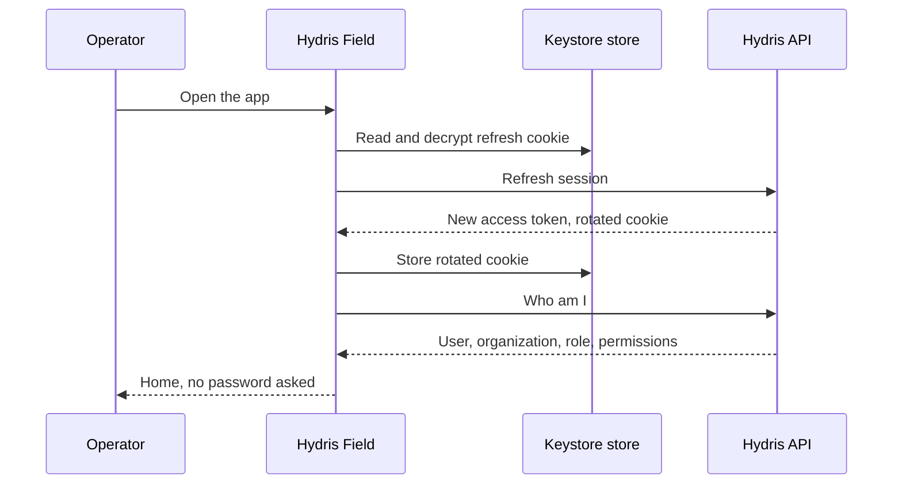
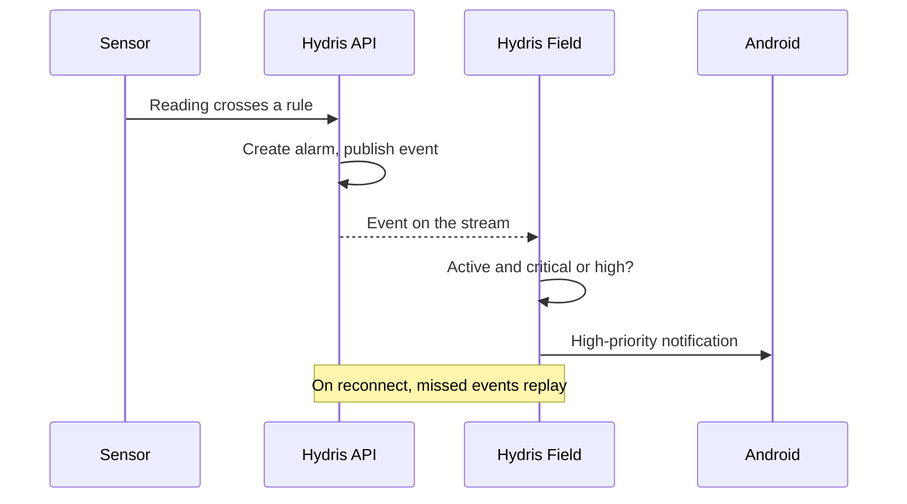

# Hydris Field Glasses PRD

## Hydris Field Android app

### Overview

Operators in effluent and sewage treatment plants walk rounds with a phone in their pocket and, increasingly, Ray-Ban Meta glasses on their face. The only app that talked to those glasses was Meta AI, a consumer assistant that knows nothing about the plant. Hydris Field (`apps/android`, Kotlin and Jetpack Compose) is the native companion for the working day: one Hydris account, the plant dashboard, alarms and work, audit scanning, the Hey Hydris assistant and the glasses link in one app. Meta AI stays installed as the connection broker, because Meta's Wearables Device Access Toolkit (DAT) requires it for pairing and permission prompts; after a one-time setup the operator opens only Hydris Field.

### Users and user stories

Table: Android user stories

| ID | User story | Priority |
|---|---|---|
| US-A1 | As a field operator I want to see what needs attention on my sites so that I act on the right thing first | P0 |
| US-A2 | As a field operator I want to acknowledge and resolve an alarm where I stand so that the console reflects reality at once | P0 |
| US-A3 | As a field operator I want to scan a paper log with my phone or glasses so that it reaches review without retyping | P0 |
| US-A4 | As a maintenance engineer I want to tick checklist items in the field so that work orders stay current | P1 |
| US-A5 | As a shift supervisor I want plant status, alarm trend and asset health in my pocket so that I can supervise while walking | P1 |
| US-A6 | As a prospect I want a named demo account so that I can try the full product in minutes | P0 |

All users already hold a Hydris console account. The app adds no new account type and needs no mobile-specific server authentication.

### Scope

Table: Android scope

| In scope | Out of scope |
|---|---|
| Sign-in, demo mode, session restore | Administration of members, roles, sites, rules (console) |
| Home dashboard, five Work tabs, alarm and sensor detail | Reviewing and approving audit documents (console) |
| Audit scan from glasses, phone camera or import | Equipment control of any kind |
| Hey Hydris assistant and the Glasses tab | A heads-up display on Ray-Ban Meta (they have none) |
| Realtime alarm notifications while the app runs | iOS native app; replacing Meta AI |

The app has five bottom tabs (Home, Work, Scan, Hydris, Glasses) and two detail screens (alarm, sensor). Each tab keeps its scroll position. Every glasses feature has a phone fallback: phone camera, phone microphone, phone speaker. Permissions are asked in context and the app keeps working when one is denied.

### Functional requirements

Table: Android functional requirements

| ID | Requirement | Priority | Status |
|---|---|---|---|
| FR-089 | Home and console overview from the same endpoint | P0 | Built |
| FR-090 | Console sign-in; session restored from a Keystore-encrypted refresh cookie | P0 | Built |
| FR-091 | Demo sign-in with a name of two or more characters | P0 | Built |
| FR-092 | Home: greeting, KPI tiles, 14-day trend, asset health, live measurements with freshness | P0 | Built |
| FR-093 | Work tabs (alarms, inspections, maintenance, sensors, audit docs) scoped to the user's sites | P0 | Built |
| FR-094 | Alarm detail with lifecycle actions; resolve requires a note | P0 | Partial |
| FR-095 | Sensor detail with 144-point history and typical range | P1 | Built |
| FR-096 | Audit scan from glasses, phone or import | P0 | Built (phone); glasses Partial |
| FR-097 | Realtime notifications for critical and high alarms while the app runs | P0 | Built |
| FR-098 | Offline outbox with idempotent replay | P1 | Planned (GA) |
| FR-099 | Complete MFA sign-in in the app | P1 | Planned (Pilot) |
| FR-044 | Run an inspection on the phone | P1 | Planned |

FR-094 is Partial because buttons are not yet driven by the API's list of allowed actions: a button may be offered that the server then refuses. Server rules always win, and the screen reloads the true state with the server's message.

### Key flows

Session restore keeps the operator signed in across app restarts without a password: the short-lived access token lives in memory, and the rotating refresh cookie is stored with AES-256-GCM under a non-exportable Android Keystore key (`SecureStore.kt`).

Alarms reach the phone over the server-sent event stream, which resumes with `Last-Event-ID` after a network drop; visible screens also poll (Home and alarms every 15 s, sensors every 10 s, audit documents every 20 s).

> [!DECISION]
> Polling plus the event stream is deliberate for the pilot: every screen stays correct after a network drop without an offline cache. The cost is extra requests while a screen is visible. The Planned outbox and cache (FR-098) change this.

### Acceptance criteria

- **FR-090:** Given a signed-in operator who kills the app, when they reopen it, then Home loads without a password; given a refused cookie, then Login shows "Session ended. Please sign in again."
- **FR-090:** Given several screens hit a 401 at once, when the app refreshes, then refreshes are serialized and only one rotated cookie is presented, so the server never sees reuse.
- **FR-094:** Given an acknowledged alarm, when the operator taps Resolve with an empty note, then the button stays disabled; with a note, then the alarm resolves and the console sees the update.
- **FR-097:** Given the app is running, when a critical alarm is created on the operator's site, then a high-priority Android notification appears.
- **FR-092:** Given a sensor with no readings, when Home renders, then it shows "No data", never zero, and synthetic values carry a "synthetic" label.
- **FR-096:** Given a printed lab sheet imported on the phone, when it is sent, then values are extracted and uploaded for review (verified manually on an emulated Pixel 7, API 35: 10 values including pH 7.3).

### Success metrics

Table: Android success targets (targets, not measured results)

| Measure | Target |
|---|---|
| Opening Scan to "Sent" for one A4 page | Under 60 s on a mid-range phone |
| Scans that auto-capture without "Capture now" | Above 70 % |
| Critical alarm to phone notification | Under 5 s while the app runs |
| Spoken answer after the question ends | Under 3 s on 4G |
| Crash-free sessions in pilot | Above 99.5 % |

### Dependencies and open issues

- **Dependencies:** the Hydris API and its event stream; Meta AI app and DAT for glasses; Android 12 or later (`minSdk` 31, NFR-029).
- **Pilot gates:** MFA in the app (FR-099), release signing (builds are signed with the debug key and may not leave the team), and the first glasses hardware run (Q4 2026).
- **Notifications** work only while the app runs; FCM push is Planned for GA (FR-034), and a notification opens the app rather than the alarm.
- **Quality:** no automated Android tests yet; unit and UI tests are required before pilot.
- **Permissions:** Bluetooth and notification prompts repeat on every start; asking once is Planned.
- **Multi-site:** glasses are registered to the first site; a site picker is needed before multi-site pilots.

> [!RISK]
> Until release signing is in place no build may leave the team. MFA, release signing and the first hardware run gate the pilot handover.
