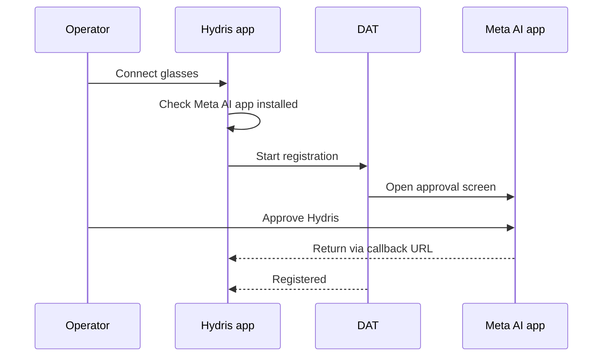
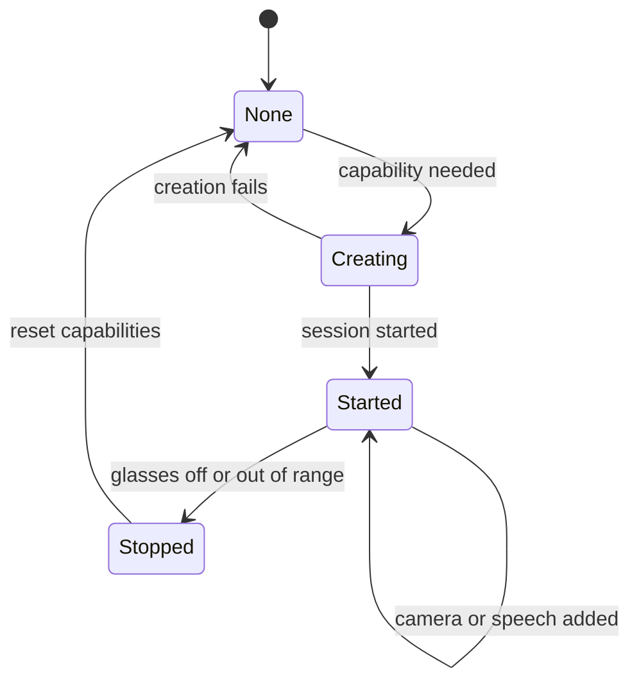

# Ray-Ban Meta integration

## Ray-Ban Meta integration

### Overview

Ray-Ban Meta glasses are the lightest way to give an operator a camera, microphone and speakers at eye and ear level, but they have no display. Hydris uses them as hands-free sensors for the phone: the glasses camera frames and shoots paper logs, the microphone hears "Hey Hydris", the open-ear speakers play the answer, and the capture button takes the photo. The phone is the screen. Integration uses Meta's Wearables Device Access Toolkit (DAT 1.0.1) with core, camera, speech and inputs modules.

> [!IMPORTANT]
> No Hydris build has yet run against physical Meta glasses. DAT calls compile and type-check, and the bridge page was tested with a stand-in. Hardware behaviour is Built, not hardware-verified, and requirements below are Partial until it is.

### Users and user stories

Table: Ray-Ban Meta user stories

| ID | Story | Priority |
|---|---|---|
| US-R1 | As a field operator I want to scan a paper log with the glasses camera so that my hands stay free | P0 |
| US-R2 | As a field operator I want spoken answers on the glasses speakers so that I keep my eyes on the plant | P0 |
| US-R3 | As a supervisor I want glasses registered as revocable devices so that I know who captured each scan | P0 |
| US-R4 | As an operator without glasses I want phone fallbacks so that I lose nothing but convenience | P0 |
| US-R5 | As a solutions engineer I want a clear setup path so that pilot kits work first time | P1 |

### Scope

Table: Ray-Ban Meta scope

| In scope | Out of scope |
|---|---|
| Ray-Ban Meta Gen 1 and Gen 2 (primary Gen 2) | Video recording or upload |
| Camera preview for guided capture, full-resolution photo | Replacing the Meta AI app |
| Glasses microphone, phone TTS on glasses speakers | Hydris UI on the glasses (no display) |
| Capture button short press | Long press and other gestures |
| Registering glasses as a Hydris device | Several glasses per phone |

### Meta AI app dependency and DAT lifecycle

Meta requires its Meta AI app to pair the glasses to the phone, update firmware, enable Developer Mode for unpublished apps, and approve each third-party app and each permission.

> [!DECISION]
> The Meta AI app must stay installed and signed in. Hydris checks for package `com.facebook.stella` and, if missing, tells the operator to install it and pair there first. Hydris pairing is separate: it makes the glasses a managed device in the customer's organization.

DAT initializes only after Android grants Bluetooth permissions. Registration hands off to the Meta AI app and returns through a callback URL. Camera and microphone are DAT permissions approved in the Meta AI app, requested one at a time; a cancelled prompt counts as denied. One device session is shared by camera, speech and inputs: created when first needed, reused while started, and rebuilt after it stops. Preview frames (medium quality, 24 fps, at most every 100 ms to detection) are processed in memory for framing only and never stored; the photo is rotated upright and flattened to A4 (1654 x 2339). Images leave the phone only on "Send for verification".

Two routes share DAT and the backend: Hydris Field, the native Compose app and pilot runtime, and the Glasses bridge, a WebView hosting the `/glasses` viewport in phone mode for development comparison.

### Registration

The Meta AI app pairs glasses to the phone; Hydris registration makes them a managed device assigned to a person and site, visible and revocable in the console, and credited for scans (FR-057). In the native app the signed-in user self-approves the device flow. The hardware ID is `rbm-` plus a SHA-256 digest of the DAT identifier, so the raw Meta ID never leaves the phone and re-registering reuses the same record. Glasses owned by another organization return `device_owned_elsewhere`.

### Functional requirements

Table: Ray-Ban Meta requirements

| ID | Requirement | Pri | Status |
|---|---|---|---|
| FR-055 | Glasses camera via DAT: preview and full-resolution photo | P0 | Partial (not on hardware) |
| FR-056 | Capture button takes the photo or starts a scan | P1 | Partial (not on hardware) |
| FR-057 | Android app registers glasses as a Hydris device | P0 | Partial (not on hardware) |
| FR-074 | Glasses microphone with phone fallback, answers on speakers | P0 | Partial (phone path Built) |
| FR-077 | "Hey Meta, start Hydris" opens the assistant | P2 | Partial (bridge only) |
| NFR-015 | Camera only on explicit intent, no continuous recording | P0 | Built |
| NFR-028 | 4-hour shift with up to 20 scans | P1 | Planned (measure) |
| NFR-029 | Android 12 or later | P0 | Built |

### Key flows

Registration with Meta happens once, in the Meta AI app, before any Hydris capability is used.

One shared session serves camera, speech and inputs and is rebuilt cleanly after the glasses go away.

### Acceptance criteria

- Given the Meta AI app is missing, when the operator taps Connect glasses, then Hydris explains how to install and pair it (decision above).
- Given an active glasses preview, when the page is aligned and the capture button is pressed, then a full-resolution upright A4 image is returned (FR-055, FR-056).
- Given registered glasses, when an admin revokes them in the console, then later uploads from that device are refused (FR-057, GLS-T12).
- Given no glasses session, when the operator scans or asks a question, then the phone camera and microphone are used instead (FR-074).

### Success metrics

Table: Hardware run targets (not measured)

| Path | Target |
|---|---|
| First preview frame with an existing session | Under 3 s |
| Preview rate reaching detection | 8 to 10 fps |
| Photo returned after capture | Under 4 s |
| Speech restart gap after silence | Under 1 s |
| Battery | 4-hour shift with up to 20 scans |

### Dependencies and open issues

- Fifteen hardware acceptance tests (GLS-T01 to T15) are defined and none has run; first run on Gen 2 is the next step.
- The DAT camera stream is stopped only when the session ends; battery and capture-LED impact to be checked.
- Public DAT publishing is not open; pilots rely on Developer Mode and Developer Center release channels.
- Bridge hardening (navigation and permission restriction) is Planned before any distribution outside the team.
- The same glasses paired through both routes create two device records; pilots use one runtime per pair. A site picker for registration is Planned.
