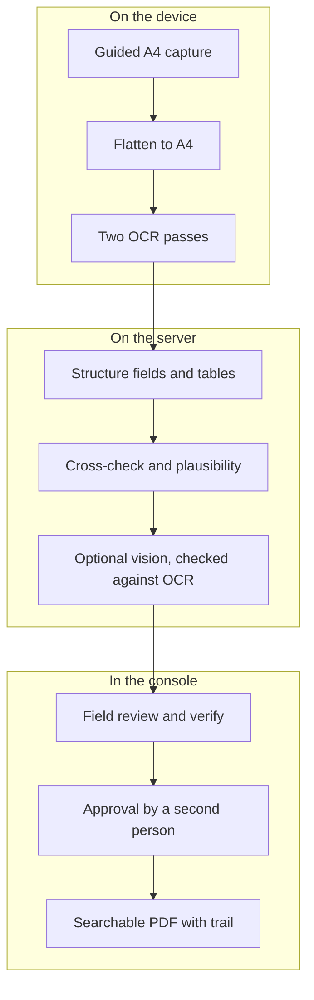
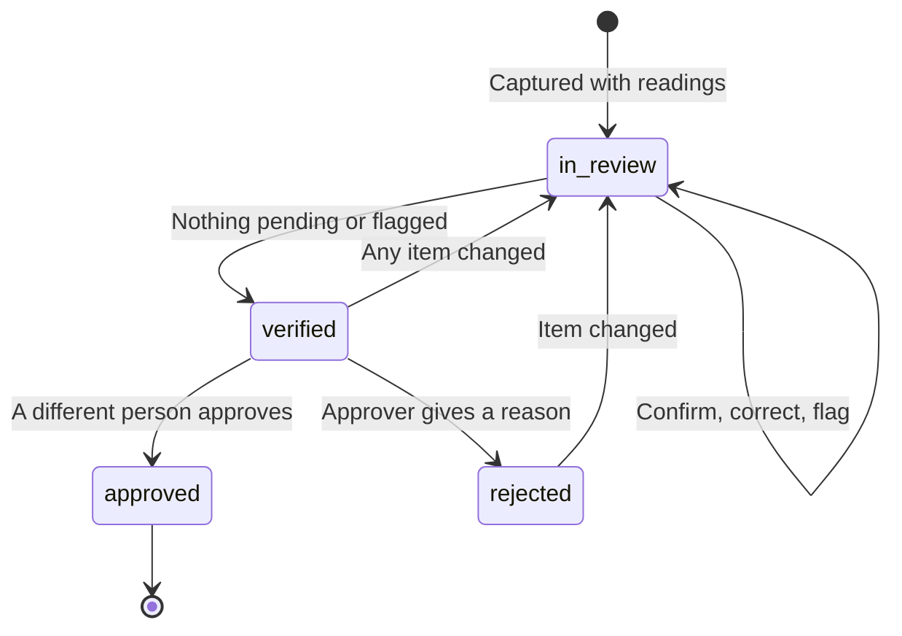

# Hydris Field Glasses PRD

## Audit document scanning

### Overview

Treatment plants still run on paper: shift logbooks, round sheets, lab reports, permits and calibration certificates. These records are the evidence a regulator or auditor asks for, yet they are hard to search, easy to lose and slow to copy by hand, where a moved decimal point turns pH 7.1 into 71. Audit scanning turns a paper record into a verified, searchable PDF. The governing rule is dual verification: a machine cross-check of every value between independent readings, then a human review of every value and an independent approval by a second person.

### Users and user stories

Table: Audit scanning user stories

| ID | User story | Priority |
|---|---|---|
| US-S1 | As a field operator I want to capture a paper record with glasses or phone in under a minute so that evidence is digital at the point of work | P0 |
| US-S2 | As a reviewer I want to confirm, correct or flag every value against the paper so that nothing wrong is verified | P0 |
| US-S3 | As a plant manager I want to approve or reject a verified document so that a second person stands behind it | P0 |
| US-S4 | As a compliance auditor I want a searchable PDF with the full verification trail so that I can rely on the record | P0 |
| US-S5 | As a reviewer I want to bulk-confirm values where engines agree confidently so that review is fast | P1 |

### Scope

Table: Audit scanning scope

| In scope | Out of scope |
|---|---|
| Capture from glasses, phone camera, imported photo, console | Signing on the device: devices capture, people verify |
| Guided A4 framing, auto-capture, flattening | Electronic signature with re-authentication (Planned, FR-068) |
| Two on-device OCR passes; fields, tables, figures | Handwriting-specific recognition models |
| Plausibility checks and an optional vision engine | Bulk upload of existing PDF archives |
| Field review, verify, approve, PDF with trail | Writing values into plant records automatically |

### Functional requirements

Table: Audit scanning functional requirements

| ID | Requirement | Priority | Status |
|---|---|---|---|
| FR-060 | Guided A4 capture with live detection, auto-capture, perspective correction | P0 | Built (web and Android) |
| FR-061 | Dual-pass on-device OCR (original and enhanced) | P0 | Built |
| FR-062 | Fields, tables, figures with plausibility checks | P0 | Built |
| FR-063 | Optional vision engine, each value cross-checked against OCR in its box | P1 | Built (needs a key) |
| FR-064 | Field review; original value kept; verify needs zero pending and flagged | P0 | Built |
| FR-065 | Independent approval by a different person (four eyes) | P0 | Built |
| FR-066 | PDF with trail, searchable original and reconstructed page | P0 | Built |
| FR-067 | Up to 6 pages, each at most 900 KB, JPEG or PNG | P0 | Built |
| FR-068 | Electronic signature with re-authentication | P1 | Planned (Advanced) |
| FR-069 | Bulk-confirm values where two engines agree with confidence 0.8 or more | P1 | Built |
| FR-096 | Scan from glasses, phone or import in the Android app | P0 | Built (phone); glasses Partial |
| FR-055 | Glasses camera capture through DAT | P0 | Partial (not run on hardware) |

Guided capture speaks or shows one instruction at a time, in a fixed order (find page, move back, move closer, straighten, hold still), checking frames at most every 90 ms. It auto-captures after 900 ms of readiness and flattens the page to A4 at 200 dpi (1654 x 2339 pixels). Phone, glasses viewport and console share the same detection code and thresholds.

### Key flows

The journey has three halves that never mix: the device captures and reads, the server structures and cross-checks, and people verify and approve.

Every review action is appended to the document's event history; any change after verification sends the document back to review, and approval must come from a different person.

Each value carries an agreement level between the passes (match, close, mismatch) and keeps its position on the page. Plausibility checks run even when both passes agree, because both can be wrong the same way.

> [!DECISION]
> The primary quality metric is the silent error rate: a value marked as agreed and not flagged, but wrong. A system that is 85 % accurate and flags what it is unsure of is safer than one that is 95 % accurate and confidently wrong on the rest.

Table: Safeguards for the numbers that matter

| Risk | Safeguard |
|---|---|
| Decimal point dropped or moved | "7.4" against "74" is always a mismatch; thousands separators are not |
| Both passes misread the same way | Range checks flag pH 71 and offer a matching labelled value as the fix |
| Letters and digits confused | O and 0 are folded inside numbers before comparison |
| Vision model invents a value | Checked against OCR text inside the value's box |
| Reviewer overwrites the machine value | The first extracted value is kept beside the correction |

### Acceptance criteria

- **FR-060:** Given an A4 sheet held aligned and still, when it is ready for 900 ms, then the device captures and flattens it without a button press.
- **FR-062:** Given both passes read pH as 71, when the server structures the page, then the value is flagged as implausible with a reason and a suggested fix.
- **FR-063:** Given a vision value with no supporting OCR text in its box, when results merge, then it is never marked as agreed.
- **FR-064:** Given a document with one pending or flagged item, when the reviewer tries to verify, then verify is blocked.
- **FR-065:** Given a verified document in a customer organization, when the verifier tries to approve it, then approval is refused; demo tenants allow self-approval and record it.
- **NFR-031:** Given two reviewers editing the same document, when the second saves with an old revision, then the write returns `409 stale` instead of overwriting.

### Success metrics

Table: Scanning quality targets (targets, not measured results)

| Metric | Pilot target |
|---|---|
| Fields where the engines agree, typed forms | 90 % or more |
| Fields a reviewer corrects | Under 5 % |
| Silent error rate | Under 0.5 % |
| Decimal correctness | 99 % |
| Planted implausible values flagged | 100 % |
| Capture to review-ready per page | 15 s or less |
| Capture to approval, median | Under 24 hours |

One manual demo (emulated Pixel 7, API 35) read a printed lab sheet correctly, including pH 7.3, with 10 values extracted. That is one sheet, not a benchmark.

### Dependencies and open issues

- **Benchmark not yet run.** A 120-page ground-truth set is designed; until it runs, every accuracy number is a target.
- **Glasses capture unproven on hardware.** The DAT path works on Meta's mock device; the first Ray-Ban Meta run is scheduled for Q4 2026.
- **Vision consent.** A tenant must agree to vision processing and the deployment must record where inference runs; until then pilots run on OCR alone.
- **Storage.** Page images move to object storage during Hardening.
- **Electronic signature** (FR-068) is Planned for the Advanced phase.
