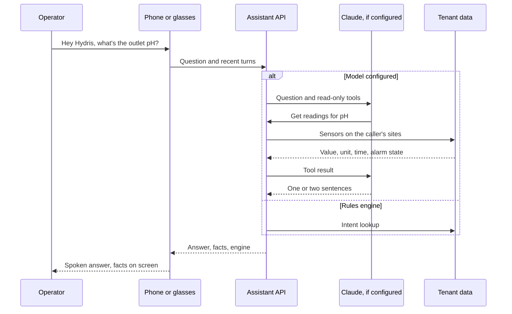

# Hydris Field Glasses PRD

## Hey Hydris voice assistant

### Overview

An operator at a clarifier with gloves on cannot scroll a dashboard. Hey Hydris lets them ask out loud ("what's the outlet pH?", "any open alarms?", "what are my tasks?") and hear a short answer on the glasses speakers or the phone, with the facts behind it on screen. Every answer comes from the caller's own plant data through read-only, tenant-scoped tools, never from general knowledge. The assistant is advisory only and cannot change anything.

### Users and user stories

Table: Voice assistant user stories

| ID | User story | Priority |
|---|---|---|
| US-V1 | As a field operator I want a reading, its age and alarm state by voice so that I keep my hands on the job | P0 |
| US-V2 | As a maintenance engineer I want to hear my open work and an asset's procedure so that I act without the console | P0 |
| US-V3 | As a supervisor I want to hear open alarms on my sites while walking so that I stay aware | P1 |
| US-V4 | As any user I want to ask a follow-up without repeating context so that the conversation feels natural | P1 |

### Scope

Table: Voice assistant scope

| In scope | Out of scope |
|---|---|
| Wake phrase, spoken question, spoken answer | Operating equipment or changing records |
| Readings, alarms, my work, asset status, approved SOPs | Answers from outside the tenant's data |
| Follow-ups with history (up to 8 turns) | Indian languages (Planned, FR-073) |
| Glasses, phone and browser speech | "Hey Meta, start Hydris" as a supported path (experimental) |

### Functional requirements

Table: Voice assistant functional requirements

| ID | Requirement | Priority | Status |
|---|---|---|---|
| FR-070 | Grounded SOP retrieval from approved documents with a safety notice | P0 | Built |
| FR-071 | Wake phrase and short spoken answers | P0 | Built |
| FR-072 | Answers only from tenant data through scoped tools; rules fallback never guesses | P0 | Built |
| FR-073 | Hindi, Tamil, Marathi, Gujarati | P1 | Planned (Advanced) |
| FR-074 | Glasses microphone with phone fallback; answers on glasses speakers | P0 | Partial (not run on hardware) |
| FR-075 | Facts with source; synthetic data labelled | P0 | Built |
| FR-076 | Follow-ups with history (up to 8 turns) | P1 | Built |
| FR-077 | "Hey Meta, start Hydris" opens the assistant | P2 | Partial (experimental) |
| FR-078 | No write tools | P0 | Built |

### Key flows

When an Anthropic credential is configured, Claude answers with up to five rounds of five read-only tools (readings, open alarms, my work, asset, procedures) that run in the caller's tenant and site scope; otherwise, or on any model error, a deterministic rules engine answers.

The wake phrase is detected on the device with a pattern tolerant of how recognizers hear "Hydris". Transcripts are dropped while the assistant speaks, so it never answers itself; "stop", "cancel" or "thanks" ends the follow-up window.

### Acceptance criteria

- **FR-072:** Given no model key, when the operator asks about the weather, then the answer is "I can't answer that from your plant data".
- **FR-072:** Given a site-scoped operator, when they ask about another site's sensor, then the answer contains nothing they could not see in the console.
- **FR-075, NFR-036:** Given a reading 12 minutes old, when it is answered, then the answer states its age; a stale reading adds "not current, check the sensor"; missing data is "no data", never zero.
- **FR-078:** Given any question, when the assistant runs, then only read tools are available and no record changes.
- **FR-074:** Given glasses linked but the glasses microphone denied, when the assistant listens, then it falls back to the phone microphone, then to typing.

### Success metrics

Table: Voice targets (targets, not measured results)

| Metric | Pilot target |
|---|---|
| Questions answered with facts, not "can't answer" | 85 % or more |
| Numbers in answers missing from facts | 0 |
| Spoken answer after the question ends | Under 3 s (rules) and 8 s (model) on 4G, NFR-003 |

### Dependencies and open issues

- **Logging** of engine and intent is Planned for the pilot; until then the targets cannot be measured.
- **Glasses microphone** on Ray-Ban Meta hardware is a first hardware run item for Q4 2026.
- **False accepts** of the wake phrase are tested against eight hours of plant conversation before the pattern is tightened.
- **Follow-up window:** the glasses viewport closes after 8 s of silence; Android waits for a stop phrase. Aligning on 8 s is Planned.
- **Model consent:** a tenant must agree to Claude processing; otherwise the rules engine runs alone.
