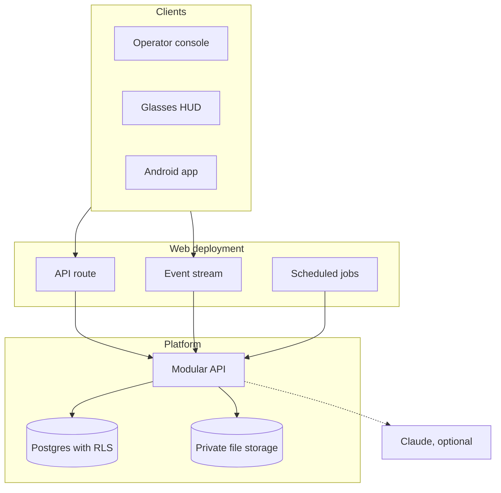
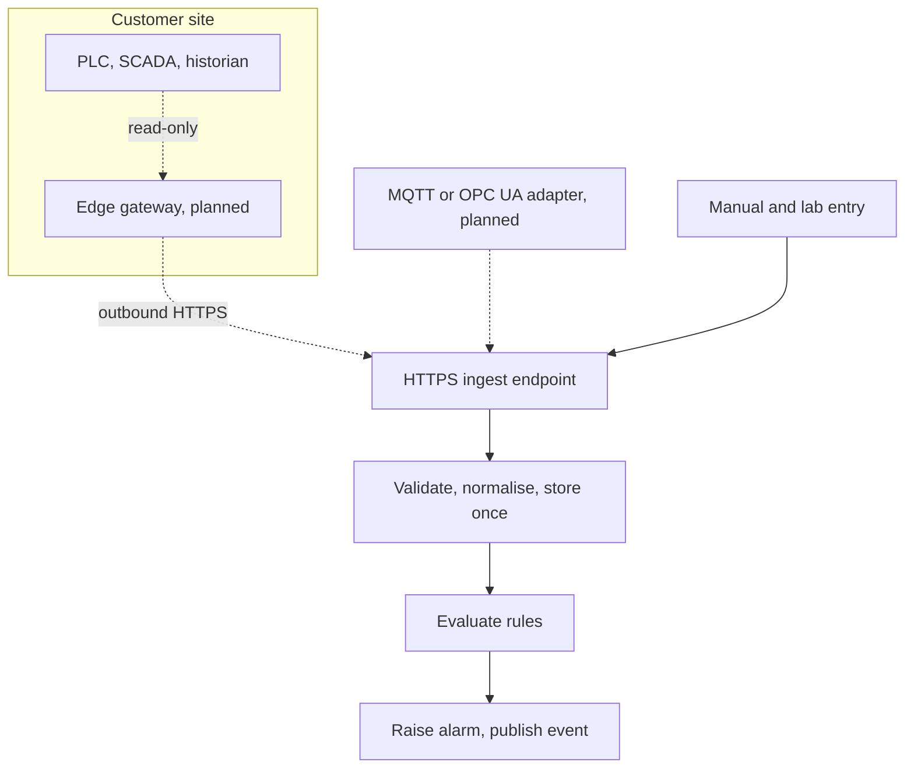

# Hydris Field Glasses PRD

## Platform, data and integrations

Every Hydris surface (website, operator console, glasses HUD, Hydris Field Android app) talks to one platform: a modular API over one Postgres schema with row-level security. This section states what the platform must guarantee to every product: isolation, security, honest data, safe integration and AI that never acts without a person.

### Architecture summary

Hydris is an npm workspaces monorepo. The API (`apps/api`, Fastify 5) is a modular monolith of fifteen route modules sharing core services (tenant context, event bus, audit, storage, crypto). It runs inside the Next.js web deployment through a catch-all route that calls `app.inject` (no network hop), or as its own container. A pure TypeScript domain package (`packages/domain`) holds state machines, permissions, freshness and voice parsing rules shared by server and web; the Android app mirrors them by hand.

One validated configuration (`apps/api/src/config.ts`) selects Postgres or in-process PGlite, the realtime mode, cloud or disk storage, and an external API. The same code runs on Vercel, in Docker Compose at a plant, in a hybrid set-up and as the self-contained public demo.

> [!DECISION]
> A modular monolith (ADR-002) with the API inside the web deployment (ADR-003) gives one deployable and in-process calls for the pilot. The trade-off is module discipline and a cold start that builds the app and migrates.

### Tenancy and security requirements

Isolation is enforced by Postgres, not only by application code. Every tenant table has row-level security enabled and forced, with one policy comparing the row's organization to a per-transaction setting (`SET LOCAL`, so nothing leaks across pooled connections). Requests run as the non-privileged role `hydris_app`. On top sit RBAC (six roles, 38 permissions in `packages/domain/src/roles.ts`) and site scope; out-of-scope records return 404, not 403, so users cannot probe for other sites.

The principal is reloaded from the database on every request, so a revoked session or device stops at once. People sign in with argon2id-hashed passwords and optional TOTP MFA, receive a 15-minute access token and a 7-day rotating refresh token; reuse of a rotated token after a 30-second grace revokes the whole family. Devices never see a password: they pair through an RFC 8628-style flow (8-character code, 300 s TTL, 3 s polling) and act for their assigned operator under a ceiling of 13 device permissions.

Table: Credentials

| Credential | Lifetime | Revoked by |
|---|---|---|
| User access token | 15 min (12 h in demo only) | Family revocation, checked per request |
| User refresh token | 7 days, rotating | Logout, password change, reuse detection |
| Device access token | 15 min | Session version bump on suspend, revoke, reassign |
| Device refresh token | 30 days, rotating | Revoke, logout, reuse detection |
| Gateway key | Until revoked | Admin revoke; stored only as a hash |

> [!RISK]
> Owner and superuser connections bypass RLS. Today the same owner user runs migrations and the application; production must connect as a runtime member of `hydris_app` that is not the table owner.

### Data entities summary

The schema (`apps/api/src/db/schema.ts`) has 42 tables in ten domains, each owned by one module. Plant objects are archived, not deleted. Records are evidence: readings keep provenance, corrections never overwrite the original, and synthetic data is refused for customer tenants by a database check.

Table: Core data entities

| Domain | Key entities | Rule |
|---|---|---|
| Identity and tenancy | Users, organizations, memberships, membership sites, sessions, invitations | Users are global; membership and site scope are per organization |
| Plant | Sites, facilities, areas, assets, sensors, gateways, documents | Archive and restore, never delete |
| Telemetry | Readings, corrections | Readings immutable; one per sensor and time |
| Alarms | Rules, events | One open event per rule |
| Work | Inspection templates, routes, inspections, responses, maintenance tasks | Revision counter for offline replay |
| Devices and UI | Devices, assignments, device sessions, pairing challenges, UI profiles | One operator per device |
| Audit documents | Documents, pages, events | Append-only event trail |
| Platform | Audit log, realtime events, mail outbox | No update or delete on audit events |

### APIs and integrations

Hydris never connects into a plant. A customer-side gateway pushes readings outward over HTTPS (`POST /ingest/v1/readings`) with a hashed `hgw_` key, up to 500 readings per call, idempotent per sensor and timestamp, with per-reading rejections so the gateway can retry safely. Manual and lab entry and the demo simulator use the same `ingest()` path. Late data is stored for history but never overwrites a newer value or re-triggers rules; deadband and on-delay stop flapping.

Realtime events (alarms, telemetry, work, devices) reach clients over Server-Sent Events opened with `fetch`, so the token travels in a header, never a URL. Each event is authorised per connection and carries only identifiers; clients refetch through the normal API. `REALTIME_MODE=memory` is immediate on a single instance; `db` mode fans out across instances with up to 1.5 s polling and replays from `Last-Event-ID`.

Table: Integration status

| ID | Integration | Status |
|---|---|---|
| FR-022 | HTTPS gateway ingestion, 500 readings per call, idempotent | Built |
| FR-023 | Manual and lab entry with provenance | Built |
| FR-024 | Append-only corrections | Built |
| FR-033 | Realtime push of alarm events to all clients (SSE) | Built |
| FR-027 | MQTT and OPC UA ingestion adapters | Planned (Advanced) |
| FR-028 | Read-only SCADA and historian connectors | Planned (Advanced) |
| n/a | Edge gateway software (store and forward) | Planned; API contract Built |

### AI services with a human in the loop

Two features use Claude, and both are optional. Audit scanning adds a vision engine whose every value is checked against on-device OCR; the assistant calls five read-only tools inside the caller's tenant transaction, so RLS and site scope apply to every lookup. The model never sees the database. Without a key, scans keep their OCR results and the assistant uses a rules engine that never guesses. People decide what becomes a record: no document reaches verified with pending or flagged items, and approval needs a second person.

> [!DECISION]
> AI adds reach, never unchecked trust (ADR-009, ADR-015). Every AI-extracted value passes human review, and the assistant has no write tools.

### Platform requirements

Table: Platform requirements

| ID | Requirement | Priority | Status |
|---|---|---|---|
| FR-003 | Refresh rotation with family revocation on reuse | P0 | Built |
| FR-007 | Site-scoped permissions for every role except org admin | P0 | Built |
| FR-008 / NFR-011 | Database-enforced tenant isolation | P0 | Built |
| FR-011 | SAML 2.0 and OIDC single sign-on per organization | P1 | Planned (GA) |
| FR-029 / NFR-030 | Synthetic data labelled and refused for customer tenants | P0 | Built |
| FR-050 | Pairing with short code, QR, 5-min TTL, 3 s polling | P0 | Built |
| FR-051 | Device tokens with rotating refresh and reuse detection | P0 | Built |
| NFR-001 | API read latency p95 under 300 ms in-region (target) | P0 | Partial (not measured) |
| NFR-002 | Realtime alarm delivery 2 s or less (target) | P0 | Built (design; not measured) |
| NFR-006 | Availability 99.5 % in pilot, 99.9 % at GA (targets) | P0 | Planned (measure) |
| NFR-007 | Horizontal scale of realtime | P0 | Built (db mode) |
| NFR-008 | Scheduled jobs at a cadence suitable for real data | P0 | Partial (daily on Vercel) |
| NFR-009 | Daily backups, point-in-time recovery, quarterly restore test | P0 | Planned |
| NFR-010 | CI with typecheck and tests on every change | P0 | Planned (Hardening) |
| NFR-013 | Rate limiting (600 per min global, 10 per min sign-in) | P0 | Built |
| NFR-014 | Secrets at rest encrypted or hashed | P0 | Built |
| NFR-017 | Data residency in India for Indian customers | P1 | Planned (GA) |
| NFR-018 | Independent penetration test before GA | P0 | Planned (GA) |
| NFR-034 | Structured logs, error tracking, uptime alerts | P1 | Planned (Pilot) |
| NFR-037 | Graceful degradation without the model | P0 | Built |
| NFR-039 | Human in the loop for every AI-extracted value | P0 | Built |
| NFR-040 | Model provider and region documented per tenant | P1 | Planned (GA) |

> [!RISK]
> On an all-Vercel topology, stale-data alarms run at most daily (NFR-008). A production plant needs a per-minute scheduler or the API in a container.
