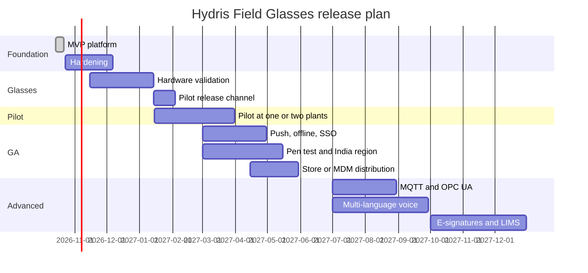
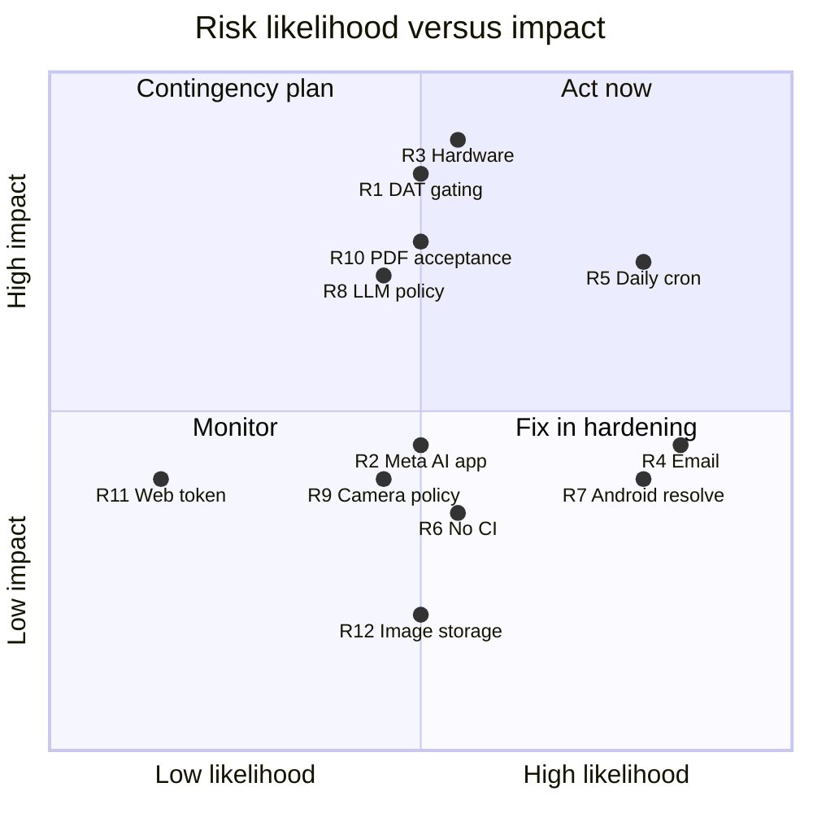

# Closing sections

## Non-functional requirements

Non-functional requirements apply across every product. IDs match the long PRD. Every number in the Target column is a target unless the Status column says it is built and verified by tests.

Table: Non-functional requirements by category

| Category | ID | Requirement | Target | Status |
|---|---|---|---|---|
| Performance | NFR-001 | API read latency | p95 under 300 ms in-region | Partial (not measured) |
| Performance | NFR-002 | Realtime alarm delivery, creation to client | 2 s or less | Built (design); not measured |
| Performance | NFR-003 | Voice answer, end of speech to spoken answer | 3 s rules engine, 8 s model engine | Partial (not measured) |
| Performance | NFR-004 | OCR time per page on a mid-range phone | 15 s or less for both passes | Partial (not measured) |
| Performance | NFR-005 | Glasses home ready after wake | 2 s cached, fresh data within 5 s | Planned (measure) |
| Availability | NFR-006 | Service availability | 99.5 % monthly in pilot, 99.9 % at GA | Planned (measure) |
| Availability | NFR-008 | Scheduled jobs at a cadence fit for real data | Per-minute stale and pairing jobs | Partial (daily cron on Vercel) |
| Availability | NFR-009 | Backups and restore | Daily backups, PITR, quarterly restore test | Planned |
| Availability | NFR-010 | CI on every change | Typecheck, unit, API and e2e on every pull request | Planned (Hardening) |
| Security | NFR-011 | Tenant isolation in the database | RLS on every tenant table; app role without BYPASSRLS | Built |
| Security | NFR-012 | Short-lived credentials | 15-minute access tokens; rotating refresh with reuse detection | Built |
| Security | NFR-013 | Rate limiting | 600 per minute global; 10 per minute sign-in | Built |
| Security | NFR-014 | Secrets at rest | MFA secrets encrypted; tokens hashed; Android Keystore AES-256-GCM | Built |
| Security | NFR-018 | Independent penetration test before GA | No open high or critical findings | Planned (GA) |
| Privacy | NFR-015 | Camera only on explicit intent | No continuous recording or background capture | Built |
| Privacy | NFR-016 | Images stored only for audit documents and attachments | No other path persists camera frames | Built |
| Privacy | NFR-017 | Data residency in India for Indian customers | Database, storage and inference in an Indian region | Planned (GA) |
| Privacy | NFR-040 | Model provider and region documented per tenant | Visible in tenant settings | Planned (GA) |
| Accessibility | NFR-019 | Glasses text scale per profile | Scales 0.9 to 1.3 | Built |
| Accessibility | NFR-023 | Console and Android meet WCAG 2.2 AA | Audit before GA | Partial (not audited) |
| Accessibility | NFR-024 | Large touch targets for gloved use | Primary buttons 52 to 54 dp | Built |
| Hands-free | NFR-020 | Additive-display friendly design | Pure black renders transparent; 600 by 600 viewport | Built (verify on hardware) |
| Hands-free | NFR-021 | Every glasses action by six directional keys or voice | Up, down, left, right, select, back | Built |
| Hands-free | NFR-022 | Spoken answers are short | One or two sentences | Built |
| Hands-free | NFR-028 | Battery on Ray-Ban Meta | 4-hour shift with up to 20 scans | Planned (measure) |
| Offline | NFR-025 | Inspection responses survive connectivity loss | Queue with idempotent replay | Built |
| Offline | NFR-026 | Last context and SOPs readable offline | Shown as cached, never as live | Built |
| Offline | NFR-027 | Android offline outbox | Phone actions queue and replay | Planned (GA) |
| AI quality | NFR-035 | Assistant uses only values from tools in the conversation | Zero numbers absent from tool results | Built (prompt and tool design) |
| AI quality | NFR-036 | Assistant states reading age and stale or missing data | Every answer with a value | Built |
| AI quality | NFR-037 | Graceful degradation without the model | Rules engine and OCR-only fallback | Built |
| AI quality | NFR-039 | Human in the loop for every AI-extracted value | No verified document with pending or flagged items | Built |

Table: AI and OCR quality targets for the pilot (targets, not measurements)

| Measure | Target | How it will be measured |
|---|---|---|
| Fields where independent engines agree | 90 % or more on typed forms | Agreement score; pilot sample of 200 pages |
| Fields a reviewer corrects | Under 5 % | Corrected over reviewed fields |
| Vision false confidence | Under 0.5 % | Blind re-check of 100 approved documents |
| Assistant answers with facts | 85 % or more | Intent logging on `/assistant/ask` |
| Answers with a number not in the facts | 0 | Automated check on logged answers |

> [!NOTE]
> The security-critical paths are covered by 67 passing automated tests (26 domain, 41 API, local run on 22 October 2026) plus 4 Playwright journeys. Performance, availability and battery numbers have not yet been measured; measuring them is part of the pilot entry criteria.

## Release plan and milestones

The MVP shipped between 14 and 22 October 2026: API, console, glasses app and simulator, pairing, UI profiles, audit scanning, voice, demo mode and the native Android app in code. The plan below sequences the rest. Dates are a plan, not a commitment, and depend on the dependencies and open questions in later sections.

### Phase entry and exit criteria

Table: Release phases with entry and exit criteria

| Phase | When (plan) | Entry criteria | Scope | Exit criteria |
|---|---|---|---|---|
| MVP | Done, October 2026 | None | Platform core, all products in code | Live demo; 67 tests passing |
| Hardening | Q4 2026 | MVP on `main` | Email (FR-086), CI (NFR-010), job cadence (FR-035, NFR-008), Android fixes (FR-094, FR-099), page images to object storage, observability (NFR-034) | All Must requirements for pilot Built or with an agreed workaround |
| Hardware validation | Q4 2026 to Q1 2027 | DAT Developer Mode access; test glasses on hand | Camera, capture button, speech, registration (FR-055, FR-056, FR-057, FR-074); battery (NFR-028) | Every glasses requirement Built, or descoped with a phone fallback |
| Pilot | Q1 2027 | Hardening exit; signed pilot contract; site camera policy agreed | One or two Indian ETPs or STPs, 10 to 30 operators, gateway ingestion, compliance summary (FR-120), escalation (FR-037), Android inspections (FR-044) | KPI baselines captured; targets met or explained; customer sign-off |
| GA | Q2 2027 | Pilot exit | FCM push (FR-034), offline outbox (FR-098), SSO (FR-011), India region (NFR-017), pen test (NFR-018), recurring schedules (FR-047), Play or MDM | Store or MDM release approved; security review passed |
| Advanced | H2 2027 onwards | GA | MQTT and OPC UA (FR-027), SCADA connectors (FR-028), multi-language voice (FR-073), e-signatures (FR-068), native glasses display, LIMS, iOS | Driven by customer demand |

### Pilot exit criteria

The pilot is judged on evidence, not on feature count. It exits successfully when all of the following hold:

- [ ] KPI baselines are captured for paper rounds before go-live and for Hydris during the pilot.
- [ ] Pilot targets are met or each miss is explained with a remedy: 70 % weekly active operators, 95 % on-time rounds, under 5 minutes to acknowledge critical and high alarms, under 24 hours capture to approval.
- [ ] Zero hallucinated numbers in logged assistant answers and zero cross-tenant incidents.
- [ ] Every glasses feature used in the pilot runs on physical Ray-Ban Meta glasses or has a working phone fallback.
- [ ] Availability at or above the 99.5 % pilot target (NFR-006).
- [ ] The customer signs off and states whether the regulator accepts the Hydris PDF as a primary record (Q4).

> [!DECISION]
> Every glasses feature must work on the phone first. This decouples the pilot from both hardware risk and Meta's distribution timeline.

## Dependencies, assumptions and constraints

Table: Dependencies, assumptions and constraints

| Type | Item | Impact if it fails | Fallback or response |
|---|---|---|---|
| Dependency | Meta AI app (`com.facebook.stella`) for pairing, registration, permissions and firmware | Glasses features unavailable | Phone camera and microphone paths |
| Dependency | Meta Wearables DAT 1.0.1 and Developer Mode | Cannot reach the glasses | Phone paths; Developer Mode for the pilot |
| Dependency | Wearables Developer Center registration | Cannot distribute beyond test devices | Apply early; pilot in Developer Mode |
| Dependency | Vercel hosting, cron and Blob storage | Hosted service outage; daily cron only | Container deployment (Docker, Render blueprint) |
| Dependency | Managed Postgres (Neon or similar) | Outage | Point-in-time recovery; PGlite for local and demo |
| Dependency | Anthropic API for assistant and vision | Degraded answers, no vision | Rules engine and OCR-only extraction (Built) |
| Dependency | Google ML Kit text recognition | Lower OCR quality on Android | Tesseract.js path in the web app |
| Dependency | Email provider (to be chosen) | Invitations and resets do not arrive | Admin copies links from `mail_outbox` |
| Assumption | Pilot plants have an HTTPS gateway or OCEMS analyzer that can push readings | No live telemetry | Manual and lab entry |
| Assumption | Operators carry an Android 12 or later phone (min SDK 31) | Android app cannot install | Glasses web app in phone layout |
| Assumption | Customers allow camera glasses in agreed zones | Scan disabled on site | UI profile disables Scan; phone scanning |
| Constraint | Read-only towards the plant | No control actions | By design (P1) |
| Constraint | English UI and voice until Advanced | Limited reach for non-English speakers | Multi-language voice Planned (FR-073) |
| Constraint | No iOS before GA | iPhone users excluded | Decision at GA planning (Q5) |

## Risks and mitigations

Table: Product risks with likelihood, impact and mitigation

| ID | Risk | Likelihood | Impact | Mitigation | Owner |
|---|---|---|---|---|---|
| R1 | Meta DAT publishing stays gated | Medium | High | Pilot in Developer Mode; phone paths ship independently; apply early | Product |
| R2 | Meta AI app behaviour changes | Medium | Medium | Onboarding checklist; Glasses screen shows link state and connection log | Mobile |
| R3 | Glasses paths fail on real hardware | Medium | High | Hardware matrix before pilot; phone fallback on every feature | Mobile, QA |
| R4 | Email not wired | High | Medium | FR-086 in Hardening; interim admin copy of links | Platform |
| R5 | Serverless cron runs once a day | High | High | Per-minute cron or container host; NFR-008 | Platform |
| R6 | No CI | Medium | Medium | NFR-010 in Hardening | Platform |
| R7 | Android Resolve fails without a note | High | Medium | FR-094 fix in Hardening | Mobile |
| R8 | LLM availability, cost or residency objections | Medium | High | Rules and OCR-only modes; region-pinned provider; NFR-040 | Product |
| R9 | Camera glasses not accepted on site; bystander privacy | Medium | Medium | Camera on intent only; UI profile can disable Scan; site policy in contract | Product |
| R10 | Regulators do not accept Hydris PDFs as primary records | Medium | High | Original scan inside every PDF; e-signatures (FR-068); early SPCB conversations | Product |
| R11 | Device refresh token in browser storage on the web glasses app | Low | Medium | Native app with Keystore is the pilot path | Security |
| R12 | Audit page images stored in the database | Medium | Low | Move to object storage in Hardening | Platform |

> [!RISK]
> The largest schedule risk is R3 combined with R1: everything unique to Hydris on glasses (camera scanning, capture button, glasses microphone) is code-complete but unproven on hardware, and distribution beyond Developer Mode is in Meta's hands. The phone-first decision protects the pilot.

## Open questions and decisions

Table: Open questions with owner and due point

| ID | Question | Owner | Due |
|---|---|---|---|
| Q1 | Is India among Meta's supported countries for full DAT capabilities and Developer Center access? Written confirmation needed | Product | Before hardware validation |
| Q2 | When do DAT store submissions open, and what review does an unlisted enterprise app need? | Product | GA planning |
| Q3 | Will pilot customers allow camera glasses in their plants, and in which zones? | Customer success | Pilot contract |
| Q4 | Which regulators accept a Hydris PDF as the primary record rather than a scanned copy? | Product, pilot customer | Pilot exit |
| Q5 | Is an iOS app needed for pilot or GA customers? | Product | GA planning |
| Q6 | Must LLM inference run in India for Indian customers, and through which provider? | Security | Before enabling the model for a customer |
| Q7 | Does acknowledgement on the glasses count as the assigned operator or the device in compliance reports? | Product, compliance | Pilot |
| Q8 | What consent-limit data model does the compliance summary (FR-120) need? | Product | Pilot |
| Q9 | Which email provider meets deliverability and residency needs? | Platform | Hardening |
| Q10 | Should the handover summary (FR-122) use the model or deterministic templates? | Product | GA planning |

Table: Decisions recorded in this PRD

| Decision | Rationale |
|---|---|
| Hydris is read-only towards the plant | Keeps Hydris outside the control-system safety case |
| The pilot runs on the native Android app, not the WebView bridge | Keystore token storage, on-device OCR, direct DAT access |
| Every glasses feature works on the phone first | Decouples the pilot from hardware and Meta distribution risk |
| Rules engine and OCR-only modes are first-class | Pilots can run without the model until a tenant consents to processing |
| Approval needs a second, different person | Records stand up to an audit (P5) |

## Appendix

### Glossary

Table: Terms used in this document

| Term | Meaning |
|---|---|
| ETP, STP, WTP, CETP | Effluent, sewage, water and common effluent treatment plant |
| CPCB, SPCB | Central and State Pollution Control Boards in India |
| OCEMS | Online continuous effluent and emission monitoring system |
| Consent to operate | SPCB permission that sets a plant's discharge limits |
| Measurand | A quantity a sensor measures, such as pH or dissolved oxygen |
| Freshness | Live, delayed, stale or no data, from a sensor's expected interval |
| Deadband, on-delay | Hysteresis band and persistence time that stop alarms chattering |
| RLS | Row-level security in Postgres, used for tenant isolation |
| SSE | Server-sent events, the realtime channel to clients |
| DAT | Meta Wearables Device Access Toolkit |
| Meta AI app | Meta's companion app that pairs, registers and updates the glasses |
| UI profile | Versioned configuration of what a pair of glasses shows and allows |
| Four eyes | A second, different person approves what the first verified |
| Agreement | Whether independent OCR and vision readings of a value match |
| Demo mode | Zero-configuration deployment with a synthetic tenant |
| Built, Partial, Planned | On `main` and exercised; partly built or not validated; not yet in the repository |

### Related documents

Table: Related documents in `docs/product/`

| Document | What it covers |
|---|---|
| `PRD.md` | Full requirements with every FR and NFR, acceptance criteria and priorities |
| `book/` | The product book: one compact PRD per product |
| `ARCHITECTURE.md` | Containers, flows, tenancy and token model |
| `DATA_MODEL.md` | Tables, enums, RLS and retention |
| `API_REFERENCE.md` | Routes, payloads, errors and limits |
| `MOBILE_APP_SPEC.md` | Hydris Field Android specification |
| `GLASSES_INTEGRATION.md` | Ray-Ban Meta and DAT capability matrix and flows |
| `DESIGN_SYSTEM.md` | Tokens, heads-up display and console patterns |
| `SECURITY_PRIVACY.md` | Controls, threat model and data handling |
| `DEPLOYMENT.md` | Topologies, environment and distribution |
| `QA_TEST_PLAN.md` | Test strategy, hardware matrix and journeys |
| `OPERATIONS_RUNBOOK.md` | Onboarding, incidents, backups and support |
| `ROADMAP.md` | Horizons, timeline and future products |
